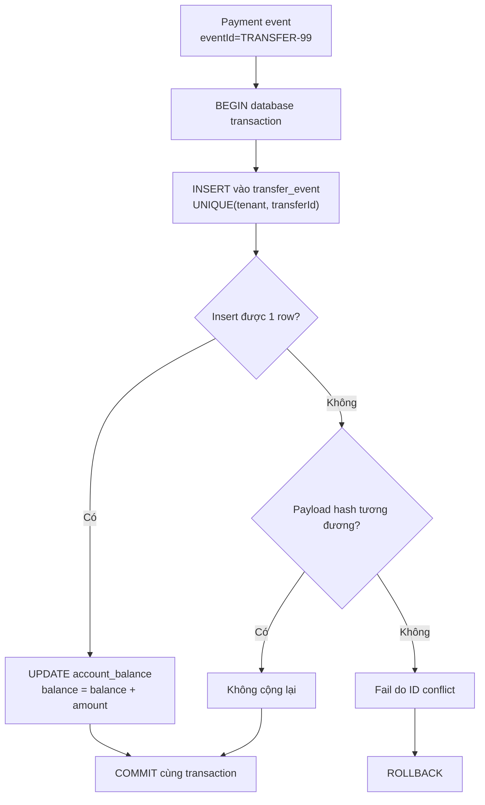
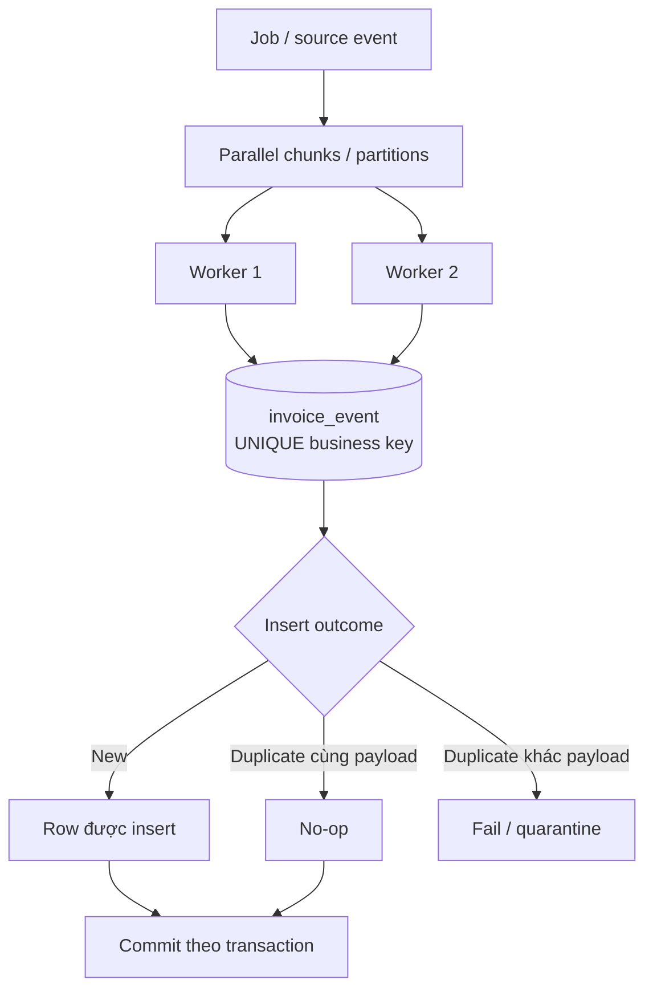

# Unique key chống ghi trùng trong Spring Batch

> **Chương:** Idempotency  
> **Mục tiêu:** Chọn **unique key theo nghiệp vụ**, thiết lập ràng buộc `PRIMARY KEY`/`UNIQUE` ở database, xử lý an toàn khi nhiều worker ghi đồng thời, và thiết kế writer có thể chạy lại trong các tình huống retry, restart, local partitioning, remote chunking hoặc remote partitioning. Ví dụ dùng **Java 17, Spring Batch 5.2.x, Spring JDBC và PostgreSQL**.

## 1. Tại sao phải chống ghi trùng ở tầng database?

Một job nhập dữ liệu nhận cùng hóa đơn từ hai nguồn: file đối tác và hàng đợi sự kiện. Job sử dụng bốn worker thread để tăng tốc. Trong một lần chạy:

1. Worker A nhận sự kiện `E-125`, ghi hóa đơn vào database.
2. Worker B nhận lại sự kiện `E-125` do broker redelivery.
3. Worker A commit, nhưng mất reply tới manager.
4. Manager restart hoặc nguồn phát sự kiện lần nữa, đưa cùng dữ liệu tới worker C.

Nếu mỗi worker tạo một ID mới ở database, cùng một sự kiện có thể tạo **ba hàng giống nhau** hoặc — tệ hơn — ba lần cộng tiền vào số dư.

**Unique key** là tuyến phòng thủ ở database: một tập giá trị xác định **danh tính duy nhất của đối tượng hoặc sự kiện**. Một `UNIQUE` constraint/index được áp dụng nguyên tử, kể cả khi nhiều thread, JVM hoặc pod cố chèn cùng lúc.

Với module `SPRING_BATCH_SCALING_OPERATIONS`, điều này quan trọng vì:

- **Multi-threaded step:** Nhiều chunk cùng ghi vào một bảng, có thể commit không theo thứ tự đọc.
- **Parallel steps:** Nhiều nhánh nghiệp vụ có thể gặp cùng business record.
- **Partitioning:** Partition không giao nhau theo dải đọc vẫn có thể chứa business key trùng nếu dữ liệu đầu vào có duplicate.
- **Remote chunking:** Message broker có thể giao lại chunk sau khi worker chết hoặc mất ACK/reply.
- **Remote partitioning:** Một partition được gọi lại hoặc worker cũ tiếp tục chạy sau timeout.
- **Retry/restart:** Writer có thể được gọi lại cho item đã xử lý, kể cả khi job/step trước đó bị lỗi.

**Kết luận ban đầu:** Không dựa duy nhất vào kiểm tra trong Java (`Set`, `synchronized`, `SELECT EXISTS`) để chống ghi trùng trên hệ thống phân tán. Unique constraint tại **hệ thống lưu trữ chịu trách nhiệm cuối cùng** mới là cơ chế phân xử giữa các writer.

## 2. Chọn đúng danh tính: Row, sự kiện hay phiên bản?

Trước khi viết `UNIQUE`, phải quyết định **thế nào là trùng**.

Giả sử một hóa đơn `INV-42` có ba sự kiện hợp lệ:

```text
E1: InvoiceCreated(invoice=INV-42, version=1, amount=100)
E2: InvoiceAdjusted(invoice=INV-42, version=2, amount=120)
E3: InvoiceCancelled(invoice=INV-42, version=3)
```

Nếu bảng lưu **trạng thái hiện tại**, unique key có thể là `(tenant_id, invoice_id)`: mỗi hóa đơn chỉ có một row hiện hành.

Nếu bảng lưu **lịch sử sự kiện**, unique key có thể là `(tenant_id, source_system, event_id)` hoặc `(tenant_id, invoice_id, version)`: cùng hóa đơn có **nhiều sự kiện hợp lệ**.

Nếu bảng lưu **dòng tiền**, khóa thường là event ID/transfer ID ổn định; chống trùng chỉ bằng account ID sẽ ngăn cả những giao dịch mới hợp lệ.

| Dữ liệu đích | Ví dụ unique key | Đảm bảo | Không đảm bảo |
| --- | --- | --- | --- |
| Trạng thái hóa đơn hiện tại | `tenant_id, invoice_id` | Một row hiện tại cho một hóa đơn | Sự kiện mới đến có đúng thứ tự không |
| Lịch sử thay đổi hóa đơn | `tenant_id, source_system, event_id` | Một event chỉ xuất hiện một lần | Hai event khác ID nhưng cùng bản chất không bị lặp |
| Hàng nhập từ snapshot bất biến | `snapshot_id, source_row_id` | Một dòng nguồn không nhập hai lần trong snapshot | Cùng dữ liệu ở snapshot khác có thể vẫn xuất hiện |
| Lệnh chuyển tiền | `tenant_id, transfer_request_id` | Một yêu cầu chuyển tiền có một lần ghi nhận | Không tự chống lần gọi API ngoài DB |
| CDC event | `source_system, table_key, change_sequence` | Không có hai row cho cùng biến đổi | Thứ tự và nội dung được kiểm tra ở nơi khác |
| Remote chunk request | `step_execution_id, chunk_sequence` | Phát hiện cùng request bị giao lại | Restart đọc cùng item vào chunk mới sẽ có ID khác |

**Hai câu hỏi cần hỏi người thiết kế nghiệp vụ:**

1. **Cùng khóa, cùng payload:** Đây có phải duplicate có thể bỏ qua an toàn?
2. **Cùng khóa, payload khác:** Đây là sự kiện cập nhật hợp lệ, vi phạm dữ liệu hay nguồn phát ID không nhất quán?

Không thể trả lời cả hai câu hỏi chỉ bằng một câu lệnh `ON CONFLICT DO NOTHING`.

### Natural key, composite key và surrogate key

- **Natural/business key:** ID nguồn hoặc giá trị định danh có ý nghĩa nghiệp vụ, ổn định khi replay.
- **Composite key:** Nhiều cột ghép lại (`tenant_id` + `source_system` + `event_id`) khi một ID chỉ duy nhất trong một miền.
- **Surrogate key:** ID nội bộ như `BIGSERIAL`/UUID của row; hữu ích cho quan hệ, nhưng **không thay thế unique business key** nếu được cấp mới ở mỗi lần ghi.

Ví dụ:

```sql
CREATE TABLE invoice_event (
    id BIGINT GENERATED ALWAYS AS IDENTITY PRIMARY KEY,
    tenant_id VARCHAR(64) NOT NULL,
    source_system VARCHAR(64) NOT NULL,
    event_id VARCHAR(128) NOT NULL,
    invoice_id VARCHAR(128) NOT NULL,
    amount NUMERIC(18, 2) NOT NULL,
    payload_sha256 CHAR(64) NOT NULL,

    CONSTRAINT uk_invoice_event_identity
        UNIQUE (tenant_id, source_system, event_id)
);
```

`id` là surrogate primary key; `uk_invoice_event_identity` bảo vệ **danh tính sự kiện nguồn**. Nếu hai worker cùng gửi `tenant=A, source=ERP, event=E-1`, unique constraint chỉ cho phép một bản ghi mang danh tính ấy.

## 3. Điều gì xảy ra khi hai worker INSERT cùng khóa?

Giả sử worker A và B cùng chèn event `E-1` vào PostgreSQL, dùng hai transaction độc lập:

```mermaid
sequenceDiagram
    participant A as Worker A
    participant B as Worker B
    participant DB as PostgreSQL
    A->>DB: BEGIN; INSERT key=E-1
    B->>DB: BEGIN; INSERT key=E-1
    Note over B,DB: B có thể chờ unique-key lock của A
    A->>DB: COMMIT
    DB-->>B: unique conflict / ON CONFLICT branch
    B->>DB: Đối chiếu payload và xử lý duplicate
    B->>DB: COMMIT hoặc ROLLBACK
```

Nếu A **ROLLBACK** thay vì COMMIT, B có thể tiếp tục và chèn thành công. Database quyết định điều này bằng **unique index + cơ chế giao dịch**, không cần một `synchronized` chung giữa JVM.

Cần phân biệt hai cách ghi:

```sql
-- A. Không xử lý xung đột: duplicate gây lỗi.
INSERT INTO invoice_event (
    tenant_id, source_system, event_id,
    invoice_id, amount, payload_sha256
) VALUES (?, ?, ?, ?, ?, ?);

-- B. Có conflict policy: duplicate không làm INSERT lần nữa.
INSERT INTO invoice_event (
    tenant_id, source_system, event_id,
    invoice_id, amount, payload_sha256
) VALUES (?, ?, ?, ?, ?, ?)
ON CONFLICT (tenant_id, source_system, event_id)
DO NOTHING;
```

Ở trường hợp A, PostgreSQL thường báo SQLSTATE `23505`; Spring JDBC có thể chuyển thành `DuplicateKeyException` nếu dùng exception translation phù hợp. Trên PostgreSQL, một lỗi SQL trong transaction thông thường có thể đưa transaction vào trạng thái lỗi cho đến khi rollback; vì vậy **không nên bắt `DuplicateKeyException` rồi tiếp tục SQL trong cùng transaction như thể không có chuyện gì**. Nếu duplicate là trường hợp được chấp nhận, câu lệnh `ON CONFLICT` thích hợp hơn.

Ở trường hợp B, kết quả insert có thể là **0 row** khi duplicate. Nhưng kết quả ấy **chưa chứng minh payload tương đương** — phải kiểm tra giá trị hoặc hash đã lưu nếu nghiệp vụ yêu cầu.

### Vì sao SELECT trước INSERT vẫn có race?

```text
A: SELECT EXISTS(key=E-1) → false
B: SELECT EXISTS(key=E-1) → false
A: INSERT(E-1)
B: INSERT(E-1) → conflict
```

Hai lệnh `SELECT` có thể nhìn thấy trạng thái trước khi bên kia commit. Không dùng logic “kiểm tra trước, rồi cứ insert vì chắc chưa có”. Có thể dùng `SELECT` như **tối ưu sớm**, nhưng unique constraint/UPSERT vẫn phải là **tuyến kiểm tra cuối cùng**.

Tương tự, một `ConcurrentHashMap` chỉ bảo vệ bộ nhớ của **một JVM**; nó mất sau restart và không đồng bộ giữa pod.

## 4. Thiết kế UNIQUE đúng: NULL, chuẩn hóa chữ và phạm vi tenant

Một unique constraint chỉ hữu ích khi cột khóa phản ánh chính xác danh tính.

### NULL không mặc nhiên là một giá trị giống nhau

Trong PostgreSQL theo semantics mặc định, `UNIQUE(email)` **có thể cho phép nhiều row có `email IS NULL`**. Nếu cột là một phần bắt buộc của khóa nghiệp vụ, hãy dùng `NOT NULL`.

```sql
-- Không nên để event_id có NULL nếu nó dùng để dedup.
CREATE TABLE bad_event (
    tenant_id VARCHAR(64) NOT NULL,
    event_id VARCHAR(128),
    UNIQUE (tenant_id, event_id)
);

-- Tốt hơn khi event_id bắt buộc:
CREATE TABLE good_event (
    tenant_id VARCHAR(64) NOT NULL,
    event_id VARCHAR(128) NOT NULL,
    UNIQUE (tenant_id, event_id)
);
```

PostgreSQL 15+ có `UNIQUE NULLS NOT DISTINCT` nếu nghiệp vụ thật sự muốn coi NULL là bằng nhau. Tuy nhiên **không dùng NULL để biểu diễn event ID chưa biết** rồi hy vọng unique index giải quyết việc định danh; tốt hơn là fail validation hoặc đưa record vào quarantine.

### Case, Unicode và khoảng trắng

`ERP-42` và `erp-42` có phải cùng event không? Nếu có, phải chuẩn hóa theo **hợp đồng nguồn** trước khi ghi hoặc dùng một biểu thức/index phù hợp.

```sql
-- Ví dụ khi business identity quy định email không phân biệt chữ hoa:
CREATE UNIQUE INDEX uk_user_email_canonical
ON customer_account (tenant_id, LOWER(TRIM(email)));
```

Trước khi sử dụng, phải quyết định quy tắc Unicode, locale, normalization và các trường hợp email/domain. Tránh mặc định `lowercase()` mọi business ID: nhiều hệ thống coi `AbC` và `abc` là hai khóa khác nhau.

**Đầu vào khác nhau nhưng bị chuẩn hóa thành cùng khóa** có thể là lỗi do dữ liệu không nhất quán; cần phát hiện và báo cáo. Nếu index dùng biểu thức, mệnh đề `ON CONFLICT` và truy vấn của writer phải tương thích với index, không giả định conflict target trên tên cột thô là đủ.

### Luôn xác định miền duy nhất

`event_id=123` của tenant A và tenant B có thể là hai sự kiện khác nhau. Nếu schema chỉ có `UNIQUE(event_id)`, bạn có thể **chặn nhầm** dữ liệu hợp lệ của tenant B.

Tương tự, nhiều nguồn `ERP` và `CRM` cùng phát `E-100` có thể không liên quan. Composite key phải phản ánh namespace thực tế; không thêm tenant/source vào khóa nếu hệ thống nguồn cam kết ID toàn cục và nghiệp vụ không cần, nhưng phải đưa vào khi ID chỉ unique theo phạm vi.

## 5. Ba chiến lược xử lý xung đột

| Chiến lược | SQL/ý tưởng | Dùng khi | Rủi ro |
| --- | --- | --- | --- |
| **Fail fast** | `INSERT`, duplicate ném exception | Duplicate là lỗi chất lượng dữ liệu | Cần xử lý transaction rollback |
| **Ignore equivalent duplicate** | `ON CONFLICT DO NOTHING` rồi đối chiếu payload | Một event đã áp dụng có thể được gửi lại | Che giấu payload khác nếu bỏ bước so sánh |
| **Upsert state** | `ON CONFLICT DO UPDATE` có điều kiện | Cùng đối tượng có các bản cập nhật hợp lệ | Ghi đè dữ liệu mới hơn nếu không có version guard |

### Chiến lược 1 — Fail fast

```sql
INSERT INTO invoice_event (
    tenant_id, source_system, event_id,
    invoice_id, amount, payload_sha256
) VALUES (?, ?, ?, ?, ?, ?);
```

Nếu duplicate được coi là vi phạm, để exception làm fail chunk/step hoặc đưa vào chính sách skip **chính xác theo nghiệp vụ**. Không đánh dấu `DuplicateKeyException` là skippable cho toàn bộ job nếu một duplicate biểu thị lỗi logic nghiêm trọng.

### Chiến lược 2 — Chấp nhận duplicate tương đương

```sql
INSERT INTO invoice_event (
    tenant_id, source_system, event_id,
    invoice_id, amount, payload_sha256
) VALUES (?, ?, ?, ?, ?, ?)
ON CONFLICT (tenant_id, source_system, event_id)
DO NOTHING;
```

Sau khi update count bằng `0`, đọc `payload_sha256`/các field cần so sánh từ row đang tồn tại. **Chỉ no-op nếu nội dung tương đương**. Nếu payload khác, báo conflict — đừng lặng lẽ coi đó là redelivery hợp lệ.

### Chiến lược 3 — Chỉ cập nhật state khi version mới hơn

Với bảng `invoice_current` chứa một hàng cho mỗi invoice:

```sql
CREATE TABLE invoice_current (
    tenant_id VARCHAR(64) NOT NULL,
    invoice_id VARCHAR(128) NOT NULL,
    source_version BIGINT NOT NULL,
    amount NUMERIC(18, 2) NOT NULL,
    PRIMARY KEY (tenant_id, invoice_id)
);
```

Dùng upsert có điều kiện:

```sql
INSERT INTO invoice_current (
    tenant_id, invoice_id, source_version, amount
) VALUES (?, ?, ?, ?)
ON CONFLICT (tenant_id, invoice_id)
DO UPDATE
SET source_version = EXCLUDED.source_version,
    amount = EXCLUDED.amount
WHERE invoice_current.source_version < EXCLUDED.source_version;
```

Nếu version 4 đã commit, retry version 3 sẽ không ghi đè version 4. Nhưng update count 0 có thể là **bản cũ** hoặc **cùng version**. Trường hợp cùng version nhưng payload khác vẫn phải được kiểm tra và cảnh báo.

Đây là mô hình **projection có version**, không thay thế ledger theo từng event nếu một event còn có side effect khác, và cũng không tự xử lý yêu cầu các version phải đi liên tục, không bỏ số.

## 6. Một ví dụ tính toán: Duplicate không được cộng tiền hai lần

Một ví dụ nguy hiểm:

```sql
UPDATE account_balance
SET balance = balance + 500
WHERE account_id = 'A-1';
```

Nếu chunk chứa sự kiện `TRANSFER-99` được thực thi lại, lệnh `UPDATE` cộng **lại 500**. Unique key trên `account_balance.account_id` không ngăn được hành vi này, vì update của row hợp lệ không vi phạm unique key.

Muốn tránh duplicate effect, cần dùng **khóa của hành động** và làm cho việc ghi nhận hành động cùng effect trở thành một transaction:



**Điểm cần nhớ:** Unique key chỉ ngăn trùng **đối tượng mà nó ràng buộc**. Nó không tự ngăn side effect nằm ở một bảng khác, HTTP API hoặc message broker. Muốn dùng unique event key làm cổng thực thi, tất cả side effect **được mong đợi nguyên tử** phải nằm trong cùng transaction với lần ghi event; còn side effect bên ngoài cần idempotency/outbox riêng.

## 7. Ví dụ Java Spring Batch 5.2: Writer chống trùng theo business key

Bài này dùng bảng `invoice_event` ở phần 2. Mỗi event có định danh và fingerprint bất biến, writer chèn trực tiếp vào **bảng kết quả nghiệp vụ**. Vì vậy không cần một bảng marker riêng cho ví dụ này.

```java
package com.example.batch.idempotency;

import java.math.BigDecimal;
import java.util.Objects;

import org.springframework.batch.item.ItemWriter;
import org.springframework.context.annotation.Bean;
import org.springframework.context.annotation.Configuration;
import org.springframework.jdbc.core.JdbcTemplate;

@Configuration(proxyBeanMethods = false)
public class UniqueKeyInvoiceWriterConfig {

    public record InvoiceEvent(
            String tenantId,
            String sourceSystem,
            String eventId,
            String invoiceId,
            BigDecimal amount,
            String payloadSha256) {
    }

    public static final class ConflictingDuplicateException
            extends RuntimeException {
        public ConflictingDuplicateException(String eventId) {
            super("Same event key, conflicting payload: " + eventId);
        }
    }

    @Bean
    public ItemWriter<InvoiceEvent> uniqueKeyInvoiceWriter(
            JdbcTemplate jdbc) {

        return chunk -> {
            for (InvoiceEvent event : chunk) {
                requireValid(event);

                int rows = jdbc.update("""
                    INSERT INTO invoice_event (
                        tenant_id, source_system, event_id,
                        invoice_id, amount, payload_sha256
                    ) VALUES (?, ?, ?, ?, ?, ?)
                    ON CONFLICT
                        (tenant_id, source_system, event_id)
                    DO NOTHING
                    """,
                    event.tenantId(),
                    event.sourceSystem(),
                    event.eventId(),
                    event.invoiceId(),
                    event.amount(),
                    event.payloadSha256());

                if (rows == 1) {
                    // Event hoàn toàn mới. Insert tham gia transaction
                    // của chunk khi DataSource được cấu hình đúng.
                    continue;
                }

                if (rows != 0) {
                    throw new IllegalStateException(
                            "Unexpected insert count: " + rows);
                }

                // Conflict: xác nhận là cùng event và cùng nội dung.
                String storedHash = jdbc.queryForObject("""
                    SELECT payload_sha256
                    FROM invoice_event
                    WHERE tenant_id = ?
                      AND source_system = ?
                      AND event_id = ?
                    """,
                    String.class,
                    event.tenantId(),
                    event.sourceSystem(),
                    event.eventId());

                if (!Objects.equals(storedHash, event.payloadSha256())) {
                    throw new ConflictingDuplicateException(event.eventId());
                }

                // Same event đã tồn tại: không ghi row thứ hai.
            }
        };
    }

    private static void requireValid(InvoiceEvent event) {
        if (event == null
                || isBlank(event.tenantId())
                || isBlank(event.sourceSystem())
                || isBlank(event.eventId())
                || isBlank(event.invoiceId())
                || event.amount() == null
                || event.payloadSha256() == null
                || !event.payloadSha256().matches("[0-9a-f]{64}")) {
            throw new IllegalArgumentException(
                    "Invalid invoice event or identity");
        }
    }

    private static boolean isBlank(String value) {
        return value == null || value.isBlank();
    }
}
```

### Điều gì đã được bảo vệ?

- `UNIQUE (tenant_id, source_system, event_id)` có tác dụng giữa **nhiều thread/JVM**.
- `ON CONFLICT DO NOTHING` giúp duplicate không làm PostgreSQL transaction rơi vào trạng thái lỗi vì `23505`.
- `rows=0` và hash bằng nhau → coi là **duplicate delivery tương đương**.
- `rows=0` và hash khác nhau → **conflict**; ném exception để không âm thầm mất dữ liệu.
- Nếu writer được gọi lại sau rollback/restart, cùng event không được chèn hai lần, trong điều kiện khóa/hợp đồng nguồn ổn định.

### Giới hạn của ví dụ

1. Phải có bean `JdbcTemplate`, schema PostgreSQL, JobRepository, transaction manager, reader và job. Writer trên **không phải một ứng dụng đầy đủ**.
2. Hash được tính sẵn từ **canonical payload**. Để phát hiện bất kỳ field nghiệp vụ nào thay đổi, canonicalization phải bao gồm **đầy đủ các field quan trọng**, nhất quán về encoding, scale số thập phân và thứ tự dữ liệu.
3. `JdbcTemplate` phải dùng datasource do `PlatformTransactionManager` của chunk quản lý. Nếu không, JDBC writes có thể auto-commit ngoài chunk.
4. Chống duplicate ở bảng này không tự ngăn các thao tác ngoài DB như gửi email hoặc thu tiền.
5. Mẫu kỳ vọng row đã commit với cùng key không bị **xóa** đồng thời trước lúc kiểm tra hash. Nếu có cleanup/retention, phải định nghĩa khóa/retention và đường xử lý khi `SELECT` không tìm thấy row.
6. `ON CONFLICT DO NOTHING` được áp dụng cho conflict target được khai báo; lỗi unique ở **constraint khác** vẫn có thể ném exception. Đó thường là hành vi tốt vì giúp phát hiện xung đột nghiệp vụ khác.
7. Đoạn code dùng mỗi item một lệnh `INSERT` và có thêm `SELECT` cho duplicate để làm rõ logic. Khi dữ liệu rất lớn, cân nhắc JDBC batching/staging và đo hiệu năng, nhưng không bỏ kiểm tra conflict khác nội dung.

## 8. Đưa ItemWriter vào chunk Step

Một step tối thiểu cho writer ở trên:

```java
import org.springframework.batch.core.Step;
import org.springframework.batch.core.repository.JobRepository;
import org.springframework.batch.core.step.builder.StepBuilder;
import org.springframework.batch.item.ItemReader;
import org.springframework.batch.item.ItemWriter;
import org.springframework.beans.factory.annotation.Qualifier;
import org.springframework.context.annotation.Bean;
import org.springframework.transaction.PlatformTransactionManager;

@Bean
Step importInvoiceEventsStep(
        JobRepository repository,
        PlatformTransactionManager transactionManager,
        @Qualifier("invoiceEventReader")
                ItemReader<UniqueKeyInvoiceWriterConfig.InvoiceEvent> reader,
        @Qualifier("uniqueKeyInvoiceWriter")
                ItemWriter<UniqueKeyInvoiceWriterConfig.InvoiceEvent> writer) {

    return new StepBuilder("importInvoiceEventsStep", repository)
            .<UniqueKeyInvoiceWriterConfig.InvoiceEvent,
              UniqueKeyInvoiceWriterConfig.InvoiceEvent>
                    chunk(200, transactionManager)
            .reader(reader)
            .writer(writer)
            .build();
}
```

Giả định reader do ứng dụng cung cấp, trả `InvoiceEvent` đúng schema nguồn. Spring Batch quản lý chunk transaction; nếu writer ném exception chưa được skip/retry, transaction rollback và step có thể `FAILED`.

**Không bắt buộc bật `faultTolerant()` để có idempotency.** Đây là hai lớp độc lập:

- **Unique key/idempotency:** Dù writer có bị gọi lại bao nhiêu lần, duplicate effect không phát sinh.
- **Retry/skip:** Lỗi nào được thử lại/bỏ qua và trong giới hạn bao nhiêu.

Một lỗi `ConflictingDuplicateException` thường nên **fail/quarantine**, không tự chuyển thành skip im lặng. Một lỗi database transient phù hợp có thể retry hữu hạn nếu writer an toàn lặp.

## 9. Dùng JdbcBatchItemWriter: Cẩn thận với update count bằng 0

Khi dữ liệu sạch rất lớn, `JdbcBatchItemWriter` giúp gửi nhiều statement theo cơ chế JDBC batch. Với SQL `ON CONFLICT DO NOTHING`, **item trùng có thể trả update count = 0**.

`JdbcBatchItemWriter` trong Spring Batch 5.2 có tùy chọn **`assertUpdates`**, mặc định kỳ vọng statement cập nhật được row theo hợp đồng writer. Nếu cho phép no-op duplicate, cần chủ động xét tùy chọn này.

Ví dụ chỉ dành cho nguồn **đã có quy ước duplicate tương đương và đã được kiểm soát**:

```java
import javax.sql.DataSource;

import org.springframework.batch.item.database.JdbcBatchItemWriter;
import org.springframework.batch.item.database.builder.JdbcBatchItemWriterBuilder;
import org.springframework.jdbc.core.namedparam.MapSqlParameterSource;

@Bean
JdbcBatchItemWriter<UniqueKeyInvoiceWriterConfig.InvoiceEvent>
        fastInvoiceWriter(DataSource dataSource) {

    return new JdbcBatchItemWriterBuilder<
            UniqueKeyInvoiceWriterConfig.InvoiceEvent>()
            .dataSource(dataSource)
            .sql("""
                INSERT INTO invoice_event (
                    tenant_id, source_system, event_id,
                    invoice_id, amount, payload_sha256
                ) VALUES (
                    :tenantId, :sourceSystem, :eventId,
                    :invoiceId, :amount, :payloadSha256
                )
                ON CONFLICT
                    (tenant_id, source_system, event_id)
                DO NOTHING
                """)
            .itemSqlParameterSourceProvider(item ->
                    new MapSqlParameterSource()
                            .addValue("tenantId", item.tenantId())
                            .addValue("sourceSystem", item.sourceSystem())
                            .addValue("eventId", item.eventId())
                            .addValue("invoiceId", item.invoiceId())
                            .addValue("amount", item.amount())
                            .addValue("payloadSha256", item.payloadSha256()))
            // 0 affected rows là khả năng được thiết kế do dedup.
            .assertUpdates(false)
            .build();
}
```

**Đổi lại:** `assertUpdates(false)` giúp writer chấp nhận count 0 nhưng **không so sánh `payload_sha256` khi duplicate**. Nó cũng có thể che một số tình huống update count không như mong muốn. Chỉ dùng nếu duplicate khác payload đã được loại trừ bằng hợp đồng, hoặc có **bước đối soát/validation** thực sự phát hiện conflict. Với dữ liệu tiền tệ/audit nghiêm ngặt, ưu tiên kiểm chứng chặt như `uniqueKeyInvoiceWriter` ở phần 7 hoặc thiết kế batch upsert trả về danh tính những row được/không được ghi để đối chiếu.

Một số JDBC driver trả các giá trị update count đặc biệt khi batch execution; cần kiểm chứng trên phiên bản driver/database đang chạy, thay vì suy từ lý thuyết rằng mỗi item luôn nhận `0` hoặc `1`.

## 10. Unique key trong trường hợp worker bị gọi lại



### Multi-threaded step

Các chunk có transaction độc lập và có thể commit không theo thứ tự đọc. Nếu hai chunk chứa cùng event ID, unique index vẫn phân xử đồng thời. Nhưng reader chia sẻ con trỏ, `ExecutionContext` checkpoint và processor stateless/thread-safe vẫn là vấn đề riêng; unique key **không sửa được mất item do reader race**.

### Parallel steps

Hai flow nghiệp vụ có thể đọc cùng record khi cấu hình input chồng lấn. Unique key ngăn double insert, nhưng việc hai flow cùng cố **cập nhật** một row có thể tạo deadlock hoặc version conflict. Tách phạm vi dữ liệu hoặc chọn business contract rõ ràng.

### Local/remote partitioning

Một partition cần có input scope rõ, ví dụ key range hoặc file shard. Unique constraint vẫn cần vì:

- dữ liệu nguồn thực tế có duplicate;
- range theo partition không tương đương business key;
- partition có thể được xử lý lại khi crash/restart;
- hai worker từ xa có thể chạy trùng do timeout/dispatch bug.

Mỗi partition có `StepExecution` riêng, nhưng **khóa idempotency phải theo event**, không theo `StepExecution`.

### Remote chunking

Broker có thể giao lại **cùng chunk** khi worker chết trước ACK, kể cả sau DB commit. Unique key nhận diện event đã tồn tại. Không dùng ACK của broker hay `ChunkResponse` làm bằng chứng unique constraint không cần thiết; chúng không đảm bảo exactly-once effect end-to-end.

### Restart

Một `JobExecution` mới có thể đọc lại cùng event theo checkpoint. Nếu khóa là `jobExecutionId + rowNumber`, lần restart tạo khóa mới và phát sinh trùng. Dùng source event ID/snapshot version ổn định qua mọi attempt.

## 11. Chọn unique key cho trạng thái cuối và cho sự kiện là hai việc khác nhau

Một hệ thống có thể cần **hai unique key** trong hai bảng:

```sql
-- Lưu mỗi event nguồn đúng một lần.
CREATE TABLE invoice_event_history (
    tenant_id VARCHAR(64) NOT NULL,
    event_id VARCHAR(128) NOT NULL,
    invoice_id VARCHAR(128) NOT NULL,
    source_version BIGINT NOT NULL,
    amount NUMERIC(18, 2) NOT NULL,
    PRIMARY KEY (tenant_id, event_id),
    UNIQUE (tenant_id, invoice_id, source_version)
);

-- Lưu một trạng thái hiện tại cho mỗi invoice.
CREATE TABLE invoice_current (
    tenant_id VARCHAR(64) NOT NULL,
    invoice_id VARCHAR(128) NOT NULL,
    source_version BIGINT NOT NULL,
    amount NUMERIC(18, 2) NOT NULL,
    PRIMARY KEY (tenant_id, invoice_id)
);
```

`PRIMARY KEY (tenant_id, event_id)` chống một sự kiện bị ghi lặp. `UNIQUE (tenant_id, invoice_id, source_version)` trong history có thể giúp phát hiện hai event cùng tự nhận là cùng một phiên bản invoice.

Bảng current chỉ có một row mỗi invoice, nhưng điều kiện version cần bảo vệ khỏi **event cũ tới muộn**:

```sql
INSERT INTO invoice_current (
    tenant_id, invoice_id, source_version, amount
) VALUES (?, ?, ?, ?)
ON CONFLICT (tenant_id, invoice_id)
DO UPDATE
SET source_version = EXCLUDED.source_version,
    amount = EXCLUDED.amount
WHERE invoice_current.source_version < EXCLUDED.source_version;
```

Cần thêm chính sách cho hai event có **cùng version nhưng payload khác nhau** và cho khoảng trống version. Không đánh đồng “unique row” với “state hiện tại luôn chính xác”.

## 12. Transaction boundary: Constraint không thay thế commit nguyên tử

Trong Spring Batch, writer của **một chunk** được gọi trong transaction do step mở, nếu cấu hình theo mô hình chunk imperative chuẩn. Các thao tác JDBC cùng tham gia datasource/transaction manager được commit/rollback chung.

Ví dụ hai cách xử lý khác nhau:

| Cách ghi | Khi transaction rollback | Khả năng duplicate |
| --- | --- | --- |
| `INSERT invoice_event` trong chunk TX | Row chưa commit bị rollback | Retry có thể insert lại; unique key vẫn bảo vệ khi đã commit |
| `INSERT invoice_event` qua autocommit ngoài chunk TX | Row có thể đã commit | Framework rollback chunk **không undo row ấy** |
| `INSERT event` rồi `UPDATE balance` trong cùng DB TX | Hai tác dụng cùng commit/rollback | Có thể bảo vệ balance nếu event là cổng effect |
| `INSERT event` rồi gọi HTTP API | DB rollback không undo HTTP | Cần idempotency key ở API |
| Worker `REQUIRES_NEW` ghi event, outer TX ghi effect | Event có thể commit dù effect rollback | Có thể bỏ sót effect khi retry |

**Không đặt `REQUIRES_NEW` cho marker/event rồi mặc định nghĩ dữ liệu nghiệp vụ sẽ commit theo.** Nó cố ý tạo transaction độc lập, có thể làm mất invariant “event tồn tại ⇔ effect đã được áp dụng”.

Nếu `JobRepository` nằm ở DB khác với business database, metadata và effect có thể commit lệch. Unique business key giúp đối phó replay nhưng vẫn cần đối soát checkpoint và trạng thái JobInstance. Unique constraint ở metadata và unique constraint nghiệp vụ là hai thứ khác nhau.

## 13. Những tình huống unique key không đủ

| Tình huống | Vì sao unique constraint chưa đủ? | Bổ sung |
| --- | --- | --- |
| Một event cộng tiền nhiều lần bằng `UPDATE` | Không có row mới để vi phạm constraint | Event ledger unique, effect cùng transaction |
| Gửi email từ writer | SMTP không tham gia transaction JDBC | Outbox, delivery ID và consumer dedup |
| Gửi thanh toán HTTP | Dịch vụ ngoài DB có commit riêng | Idempotency key phía provider, reconciliation |
| Upsert ghi đè state mới hơn | Unique chỉ buộc một row/key, không buộc ordering | Version guard, optimistic locking nghiệp vụ |
| Hai nguồn dùng cùng event ID | Khóa thiếu namespace | Composite key gồm tenant/source |
| Payload thay đổi sau restart | Unique key cũ có thể che thay đổi | Hash/version, immutable snapshot |
| Soft delete rồi tái tạo | Unique key có thể chặn bản mới hoặc cho duplicate lịch sử | Lifecycle/key và partial unique có chủ đích |
| Dedupe quá sớm trong RAM | Không giữ state qua JVM/pod | Constraint tại primary DB |
| Cần đọc file không mất dòng | Unique không sửa lỗi reader/checkpoint | Partition/checkpoint và reconciliation |
| Xóa dữ liệu đã commit/retention | Unique row bị xóa không còn chống replay | Retention, archive hoặc một dedup ledger bền vững |

Một ví dụ **partial unique index** cho soft delete:

```sql
-- Chỉ cho phép một row active trên một business key.
CREATE UNIQUE INDEX uk_active_customer
ON customer_record (tenant_id, external_customer_id)
WHERE deleted_at IS NULL;
```

Giải pháp này **cố ý** cho phép nhiều row lịch sử đã bị soft-delete mang cùng business key. Nếu mục tiêu là chống một **event đã từng xử lý** bị phát lại sau khi row bị delete, partial unique index ở bảng active **không đủ**; cần event ledger/retention riêng.

## 14. Migration: Thêm UNIQUE vào bảng đã có duplicate

Đưa unique constraint vào hệ thống có hàng triệu row cần kiểm tra dữ liệu trước khi migration.

### Bước 1 — Khám phá duplicate

```sql
SELECT tenant_id, source_system, event_id,
       COUNT(*) AS duplicate_count
FROM invoice_event
GROUP BY tenant_id, source_system, event_id
HAVING COUNT(*) > 1
ORDER BY duplicate_count DESC;
```

Với bảng có dữ liệu thật, đừng mặc định **giữ row ID nhỏ nhất** là đúng. Nếu hai row cùng key nhưng payload khác, phải có chính sách hợp nhất/chọn bản đúng, đôi khi cần điều tra nguồn.

### Bước 2 — Chuẩn hóa dữ liệu và loại bỏ xung đột

- Xác định business key chuẩn, namespace và liệu có giá trị NULL không.
- Phát hiện duplicate **tương đương** vs duplicate **mâu thuẫn**.
- Quyết định giữ, merge, quarantine hoặc sửa nguồn.
- Chạy trên snapshot/test trước, có backup và khả năng rollback migration.
- Đảm bảo writer hiện tại không tiếp tục tạo duplicate trong lúc clean-up.

### Bước 3 — Tạo unique index/constraint có kiểm soát

PostgreSQL ví dụ:

```sql
-- Chỉ chạy khi đã làm sạch dữ liệu và đánh giá tải index.
CREATE UNIQUE INDEX CONCURRENTLY uk_invoice_event_identity_idx
ON invoice_event (tenant_id, source_system, event_id);
```

`CREATE INDEX CONCURRENTLY` nhằm giảm việc khóa ghi kéo dài so với tạo index thông thường, nhưng **không chạy trong transaction block** và vẫn có chi phí I/O/CPU; nếu index build thất bại có thể để lại index không hợp lệ cần xử lý qua runbook. Không sao chép câu lệnh vào migration framework vốn mặc định gói mọi migration trong một transaction mà không cấu hình đúng.

Có thể gắn một unique constraint lên index đã tạo (khi phù hợp schema/cú pháp PostgreSQL), nhưng cần xác định chính sách database migration của dự án. Mỗi thay đổi trên bảng cực lớn nên có kế hoạch rollout, monitor lock waits và rollback.

### Bước 4 — Đổi writer theo conflict policy

Sau khi ràng buộc unique đã có, chỉnh code `INSERT`/`ON CONFLICT` theo đúng ngữ nghĩa. Nếu rollout đa phiên bản ứng dụng, đảm bảo cả phiên bản cũ và mới tương thích với khóa và quy tắc xử lý duplicate.

**Không xóa unique index chỉ để job chạy qua dữ liệu lỗi.** Việc làm ấy có thể biến một lỗi có thể quan sát thành duplicate khó phục hồi trong tương lai.

## 15. Hiệu năng: Unique index tăng chi phí nhưng giảm rủi ro

Mỗi insert phải kiểm tra unique index; trên workload lớn điều đó có chi phí CPU, I/O, WAL và đôi khi lock wait. Chi phí này **có chủ đích** để ngăn lỗi toàn vẹn dữ liệu.

Các yếu tố ảnh hưởng:

- Số worker/transaction cùng insert vào index.
- Phân bố key (ngẫu nhiên hay tuần tự, hotspot theo tenant).
- Tỷ lệ duplicate (nhiều lần chờ conflict/SELECT).
- Chunk size/transaction duration: transaction lớn giữ row/index locks lâu hơn.
- Cấu trúc index, dung lượng dữ liệu, tốc độ storage và cache hit.
- Số connection thực sự khả dụng; JobRepository có thể sử dụng cùng pool.
- Chi phí tính fingerprint/canonicalization trước khi writer.
- Cách batch JDBC driver báo update counts khi có `ON CONFLICT`.

Bảng **giả định để học cách đo**, không phải benchmark:

| Worker threads | Chunk size | Duplicate rate | Throughput giả định | Nhận xét |
| ---: | ---: | ---: | ---: | --- |
| 1 | 100 | 0% | 8.000 event/s | Baseline |
| 4 | 100 | 0% | 21.000 event/s | DB còn dư tài nguyên |
| 8 | 100 | 0% | 19.000 event/s | Lock/pool/I/O có thể bão hòa |
| 4 | 100 | 20% | 18.000 event/s | Conflict lookup và SELECT tăng |
| 4 | 500 | 20% | 16.500 event/s | Transaction dài gây contention |

**Quy trình đo:** Giữ nguyên tập input có snapshot và tỷ lệ duplicate, thay một tham số mỗi lần; ghi `items/s`, thời gian DB insert p95, unique-conflict waits, lock waits, DB pool pending, commit/rollback, số item **newly inserted** và số duplicate được no-op. `StepExecution.writeCount` thường phản ánh item chuyển cho writer, **không nhất thiết** bằng số row mới tạo khi có `DO NOTHING`.

Không tăng concurrency chỉ để che lỗi duplicate. Khi cùng business key được gửi đến nhiều worker, tăng thread có thể tăng lock waits mà không tăng số effect có ích.

## 16. Giám sát duplicate và conflict đúng cách

Cần phân biệt ít nhất ba kết quả ghi:

| Outcome | Ý nghĩa | Hành động |
| --- | --- | --- |
| `APPLIED_NEW` | Khóa chưa có, đã insert/commit row mới | Tăng chỉ số xử lý mới |
| `DUPLICATE_EQUIVALENT` | Khóa đã có, payload khớp | No-op; ghi metric/trace phù hợp |
| `DUPLICATE_CONFLICT` | Khóa đã có, payload khác | Fail/quarantine/alert |
| `WRITE_FAILED` | DB/transient hoặc lỗi khác | Retry/fail theo policy |
| `RECONCILIATION_MISMATCH` | Số row/business effect lệch so với contract | Điều tra, không đánh đồng với duplicate hợp lệ |

Structured log ví dụ:

```text
INFO  job=invoiceImport step=importInvoiceEventsStep
      outcome=DUPLICATE_EQUIVALENT eventKeyHash=... worker=chunk-2

ERROR job=invoiceImport step=importInvoiceEventsStep
      outcome=DUPLICATE_CONFLICT source=ERP tenant=tenant-a
      eventKeyHash=... error=ConflictingDuplicateException
```

Với dữ liệu nhạy cảm, **không log raw account number, email hay toàn bộ payload**. Nếu dùng hash để log ID, cần xem lại yêu cầu privacy, tính dễ đoán và salt/secret theo mô hình đe dọa.

Metric nên có tag ổn định như job name, step name, outcome, source type; không gắn từng event ID, `JobExecution ID` hoặc `StepExecution ID` vào nhãn Prometheus vì cardinality rất cao. Giữ correlation IDs trong logs/traces.

Quan sát thêm:

- Tỷ lệ duplicate theo file/nguồn tăng bất thường.
- Số lần ghi nhận payload conflict (mục tiêu thường gần bằng 0).
- `rollbackCount`, retry rate và deadlock rate tăng sau khi scale.
- DB unique-index growth và storage.
- Độ tuổi message redelivery, DLQ backlog và số job restart.
- Chênh lệch giữa số event nguồn hợp lệ và số business effect kỳ vọng sau dedup.

## 17. Các lỗi thường gặp

| Triệu chứng | Nguyên nhân | Cách xử lý |
| --- | --- | --- |
| Trùng row dù đã có auto-increment primary key | Surrogate ID tạo mới ở mỗi attempt | Thêm unique business key |
| Trùng row chỉ khi chạy nhiều pod | Check-then-insert trong RAM hoặc local lock | Ràng buộc UNIQUE tại database đích |
| Cùng ID nhưng nội dung bị bỏ qua sai | `DO NOTHING` không so sánh payload | Đối chiếu hash/field, fail conflict |
| `DuplicateKeyException` làm transaction PostgreSQL hỏng | `INSERT` vi phạm unique, code catch rồi tiếp tục | Dùng `ON CONFLICT` hoặc rollback/retry toàn transaction |
| `JdbcBatchItemWriter` báo lỗi vì 0 row updated | Duplicate do `ON CONFLICT DO NOTHING`, `assertUpdates` đang true | Chọn cấu hình phù hợp và kiểm tra conflict ngoài writer batch |
| `assertUpdates(false)` che dữ liệu sai | Chấp nhận 0 count cho mọi duplicate mà không đối chiếu | Validation canonical payload, conflict auditing |
| Khóa chỉ có `invoiceId` chặn sự kiện hợp lệ | Event mới cùng hóa đơn bị coi là trùng | Phân biệt event identity với state identity |
| Không chống duplicate của tenant khác | Unique key thiếu tenant/source | Composite business key đúng namespace |
| Hai payload có cùng key nhưng case khác | Quy tắc chuẩn hóa bất nhất | Định nghĩa canonicalization và index tương thích |
| Bảng có nhiều row `NULL` dù có UNIQUE | Semantics `NULL` của unique constraint | `NOT NULL` hoặc chính sách null rõ ràng |
| Worker A commit nhưng manager mất reply | Redelivery và output có thể đã tồn tại | Idempotent writer, reconciliation/restart |
| Số dư cộng hai lần dù account_id UNIQUE | Update aggregate không vi phạm unique row | Event key unique + effect cùng transaction |
| Event cũ ghi đè state mới | Upsert không kiểm tra source version | Conditional update, version conflict handling |
| Index build migration thất bại | Có duplicate, thiếu disk hoặc lock contention | Data cleanup, monitor build, runbook rollback |
| Job COMPLETED nhưng số row mới ít hơn writeCount | Duplicate no-op hợp lệ hoặc dữ liệu bị filter/skip | Metric newlyInserted, đối soát nguồn/đích |
| Xóa row quá sớm làm replay tạo trùng effect | Unique constraint chỉ tồn tại khi row còn | Retention hợp lý, ledger lâu dài hoặc output uniqueness |

## 18. Bài thực hành và kiểm thử fault injection

**Bài A — Khóa surrogate không đủ.** Tạo bảng với `id BIGSERIAL PRIMARY KEY`, không có business UNIQUE. Chạy nhập cùng 10 sự kiện hai lần. Đếm số row, giải thích vì sao primary key tự tăng không chống replay.

**Bài B — Thêm composite unique key.** Tạo `UNIQUE (tenant_id, source_system, event_id)`. Chèn lại 10 sự kiện với `ON CONFLICT DO NOTHING`; kiểm tra còn 10 row.

**Bài C — Duplicate payload conflict.** Chèn `eventId=E-1` với `amount=100` rồi gửi lại cùng key nhưng `amount=999` và hash tương ứng. Kiểm tra `ConflictingDuplicateException`, transaction rollback, không làm biến đổi row trước.

**Bài D — Concurrent insert.** Hai worker thread kết nối DB bằng transaction riêng, cùng insert `E-2`. Dùng latch để gần như đồng thời; xác minh chỉ một row được commit. Thử thêm trường hợp worker A rollback để xem worker B có thể insert sau đó.

**Bài E — Trạng thái hóa đơn theo version.** Chèn version 4, sau đó version 3. Dùng `ON CONFLICT DO UPDATE ... WHERE source_version < EXCLUDED.source_version`, xác minh version cuối vẫn là 4. Thêm cùng version 4 nhưng amount khác, thiết kế policy phát hiện conflict.

**Bài F — Remote chunk redelivery.** Cho worker commit rồi chết trước ACK/reply; broker giao lại cùng chunk cho worker mới. Kiểm tra không thêm row và manager có đường phục hồi hợp lệ.

**Bài G — Restart với JobExecution mới.** Chạy job tới một số chunk, gây `FAILED`, restart cùng JobInstance. Kiểm tra business key vẫn ổn định dù `JobExecution ID` thay đổi; đối soát kết quả cuối.

**Bài H — JdbcBatchItemWriter.** Thử SQL `DO NOTHING` với `assertUpdates(true)` rồi `false`; quan sát update counts và viết test chứng minh `false` không tự phát hiện payload conflict.

**Bài I — NULL/case/tenant.** Thử hai row `event_id=NULL`, hai giá trị `ERP-1`/`erp-1` và cùng event ID ở hai tenant. Đặt lại constraint/normalization theo business contract để kết quả đúng.

**Bài J — Tuning.** So sánh 1/2/4/8 worker, chunk size 50/200/500, duplicate rate 0/10/40%, giữ input snapshot. Đo throughput, lock wait, p95 insert latency, số duplicate và số row mới.

### Checklist nghiệm thu production

- [ ] Đã xác định rõ event identity, state identity và phạm vi tenant/source.
- [ ] Unique business key nằm tại **database đích**, không chỉ ở Java.
- [ ] Những cột bắt buộc của key được khai báo `NOT NULL`.
- [ ] Đã thống nhất canonicalization, case, Unicode và fingerprint.
- [ ] Duplicate tương đương được no-op; duplicate khác nội dung bị phát hiện.
- [ ] Dữ liệu phiên bản mới hơn được xử lý có kiểm soát, không ghi đè vô ý.
- [ ] Với nhiều effect, event key và effect được commit cùng transaction hoặc có outbox/recovery.
- [ ] Writer chạy lại an toàn khi retry, restart, redelivery và nhiều worker đồng thời.
- [ ] `JdbcBatchItemWriter.assertUpdates` được chọn đúng với SQL conflict policy.
- [ ] Có đối soát newly inserted/duplicate/conflict, không coi `writeCount` là row mới.
- [ ] Đã kiểm thử worker crash trước/sau commit và manager mất reply.
- [ ] Có kế hoạch migration/retention unique index và giám sát hiệu năng.

## 19. Tài liệu tham khảo

- [Spring Batch 5.2 — Scaling and Parallel Processing](https://docs.spring.io/spring-batch/reference/5.2/scalability.html)
- [Spring Batch 5.2 — Chunk-oriented Processing](https://docs.spring.io/spring-batch/reference/5.2/step/chunk-oriented-processing.html)
- [Spring Batch 5.2 — Configuring Retry Logic](https://docs.spring.io/spring-batch/reference/5.2/step/chunk-oriented-processing/retry-logic.html)
- [Spring Batch 5.2 — Configuring Skip Logic](https://docs.spring.io/spring-batch/reference/5.2/step/chunk-oriented-processing/configuring-skip.html)
- [Spring Batch 5.2 — JdbcBatchItemWriter API](https://docs.spring.io/spring-batch/docs/5.2.x/api/org/springframework/batch/item/database/JdbcBatchItemWriter.html)
- [Spring Batch 5.2 — JdbcBatchItemWriterBuilder API](https://docs.spring.io/spring-batch/docs/5.2.x/api/org/springframework/batch/item/database/builder/JdbcBatchItemWriterBuilder.html)
- [Spring Batch 5.2 — Restartability](https://docs.spring.io/spring-batch/reference/5.2/step/chunk-oriented-processing/restart.html)
- [Spring Framework — JdbcTemplate](https://docs.spring.io/spring-framework/reference/data-access/jdbc/core.html)
- [PostgreSQL — Unique Constraints](https://www.postgresql.org/docs/current/ddl-constraints.html)
- [PostgreSQL — INSERT ON CONFLICT](https://www.postgresql.org/docs/current/sql-insert.html)
- [PostgreSQL — CREATE INDEX / Concurrent Index Builds](https://www.postgresql.org/docs/current/sql-createindex.html)
- [PostgreSQL — Transaction Isolation](https://www.postgresql.org/docs/current/transaction-iso.html)

> **Giới hạn phiên bản:** Ví dụ sử dụng Spring Batch **5.2.x**, Java 17 và PostgreSQL, trong đó `ON CONFLICT`/`NULLS NOT DISTINCT` có semantics riêng và `NULLS NOT DISTINCT` yêu cầu PostgreSQL 15+. Không áp nguyên SQL sang Oracle/MySQL/SQL Server hoặc import API 5.2 sang Spring Batch 6 mà chưa đối chiếu. Các câu lệnh migration và benchmark chỉ để học thiết kế, cần chạy thử trên snapshot/test database và duyệt quy trình production.

**Ghi nhớ:** Unique key chống ghi trùng phải biểu diễn đúng **danh tính nghiệp vụ**, có namespace/version phù hợp và được ràng buộc **nguyên tử tại database**. Nó bảo vệ giữa nhiều worker, retry, restart và redelivery, nhưng không tự kiểm tra payload tương đương, thứ tự cập nhật hay side effect ngoài transaction. Một writer thực sự idempotent cần kết hợp unique constraint, conflict policy chính xác, transaction boundary, dữ liệu nguồn bất biến và kiểm thử phục hồi.
