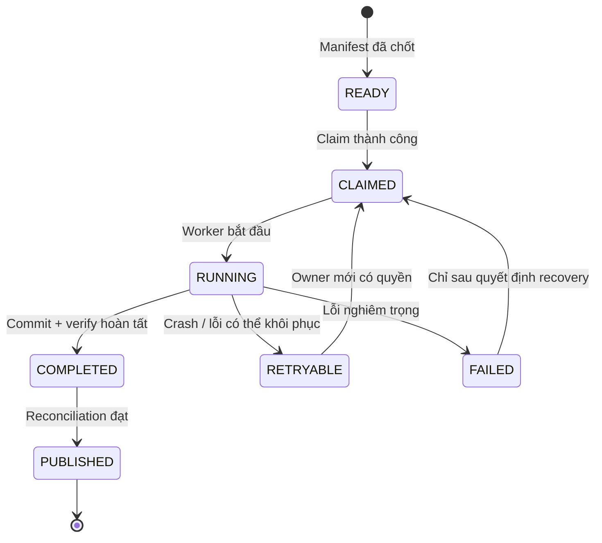
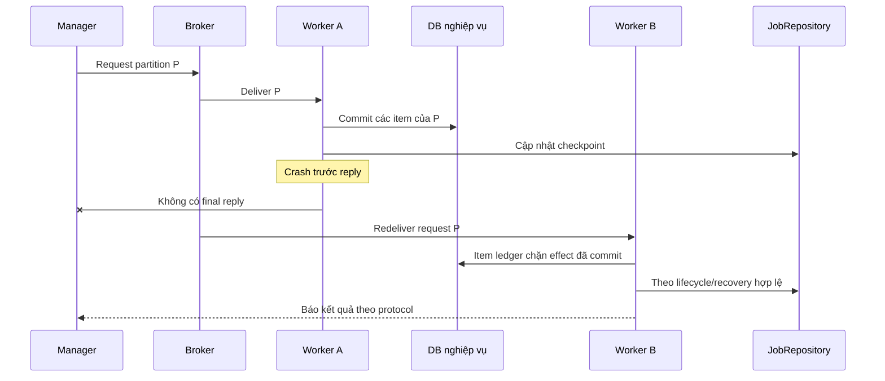

# Idempotency key theo partition

## 1. Bài toán: cùng partition có thể được thực thi nhiều lần

Trong chương **Idempotency** của module **SPRING_BATCH_SCALING_OPERATIONS**, chúng ta mở rộng Spring Batch cho workload dữ liệu lớn bằng multi-threaded step, parallel steps, partitioning và các mô hình phân tán. Khi chạy tuần tự một lần, ta dễ nghĩ mỗi bản ghi chỉ được xử lý một lần. Nhưng ở quy mô lớn, **retry, rollback, process crash, restart, timeout và broker redelivery** đều có thể khiến cùng đơn vị công việc được thử lại.

Giả sử manager chia 8 triệu hóa đơn thành 16 partition. Worker A xử lý `partition07`, đã commit 120 chunk rồi mất kết nối ngay trước khi gửi kết quả. Manager chỉ thấy reply chưa về; broker có thể giao lại request cho worker B. Nếu worker B chạy lại từ đầu hoặc từ checkpoint cũ, hệ thống có thể:

- Ghi cùng hóa đơn vào bảng đích hai lần.
- Cộng số dư hai lần khi logic dùng `UPDATE balance = balance + amount`.
- Gửi hai email hoặc tạo hai khoản thanh toán dù cùng một event.
- Đánh dấu partition `COMPLETED` nhầm từ reply cũ khi một attempt mới đang chạy.
- Bỏ sót record nếu đánh dấu partition “đã xử lý” **trước** khi business transaction commit.

**Idempotency key theo partition** là khóa ổn định giúp nhận diện **cùng một phần việc logic** xuyên các lần gửi lại hoặc thử lại. Tuy nhiên, **một khóa partition không tự bảo vệ mọi item bên trong partition**. Muốn an toàn khi worker có thể crash sau khi đã commit một phần, cần phân biệt ít nhất **ba lớp danh tính**:

1. **Partition identity**: phần việc logic nào đang được giao?
2. **Attempt/owner identity**: tiến trình nào đang được phép xử lý phần việc tại thời điểm này?
3. **Business effect identity**: tác dụng phụ nào chỉ được thực hiện một lần theo ý nghĩa nghiệp vụ?

> **Quy tắc chính:** Khóa partition cần **giữ nguyên qua retry/restart của cùng công việc**, còn token attempt/lease phải **thay đổi khi chuyển owner**. Khóa business item lại phải chặn cùng tác dụng phụ kể cả khi item vô tình được giao cho partition khác.

### Mục tiêu học tập

Sau bài này, bạn có thể:

- Xác định phạm vi và cấu trúc của `partitionKey` ổn định, không dùng nhầm ID theo lần thực thi.
- Phân biệt `JobInstance`, `JobExecution`, `StepExecution`, message ID và business idempotency key.
- Thiết kế partition manifest, tên partition và `ExecutionContext` có khả năng restart.
- Dùng bảng deduplication/ledger có unique constraint để chống áp dụng lại business effect.
- Giải thích transaction atomic giữa **ledger insert** và **business write**.
- Thiết kế claim/lease/fencing cho partition chạy trên nhiều JVM, hiểu giới hạn của heartbeat.
- Cấu hình local partitioning Spring Batch 5.x và writer JDBC idempotent.
- Phân tích crash trước/sau commit, reply thất lạc, overlapping partitions và duplicate launch.
- Đo độ trùng, contention, throughput, retry/restart và xác minh tính đúng đắn bằng fault injection.

## 2. Idempotency là gì và “đúng một lần” phải hiểu ở tầng nào?

Một phép xử lý `F` là idempotent khi cùng yêu cầu được áp dụng nhiều lần vẫn tạo **trạng thái hiệu lực tương đương áp dụng một lần**:

\[
F(F(x)) = F(x).
\]

Ví dụ `SET invoice.status = 'VALIDATED'` thường dễ làm idempotent hơn `UPDATE account SET balance = balance + 100`: lệnh cộng dồn nếu chạy lại sẽ cộng lần nữa. Nhưng kể cả `SET` cũng có thể phát sinh audit trigger hoặc notification lặp nếu không kiểm soát side effect.

Trong batch, cần phân biệt:

| Tầng | “Một lần” được đếm theo | Công cụ bảo vệ | Giới hạn |
| --- | --- | --- | --- |
| **Message transport** | Một delivery/ACK | Broker ack, correlation, DLQ | ACK không chứng minh business transaction đã commit |
| **Partition dispatch** | Một partition logic | `partitionKey`, claim, lease | Không tự chặn item đã commit bị chạy lại |
| **Step execution** | Một `StepExecution` | `JobRepository`, status, checkpoint | Execution ID có thể đổi khi restart |
| **Chunk transaction** | Một nhóm item trong transaction | Transaction manager, `ItemStream` | Side effect HTTP/queue ngoài transaction có thể lặp |
| **Business effect** | Một sự kiện/hóa đơn/thao tác nghiệp vụ | Unique key, idempotency ledger, conditional write | Phải chọn đúng phạm vi khóa và hiệu lực |
| **Publish output** | Một phiên bản kết quả được công bố | Manifest/versioned pointer, atomic CAS | Không có transaction chung mặc định trên nhiều hệ thống |

Mục tiêu thực tế thường là **at-least-once execution + idempotent business effects**, không phải hứa rằng worker code chỉ được gọi đúng một lần. `JobRepository` hỗ trợ checkpoint/restart; **không thay thế** unique business key hay deduplication ở database đích.

### 2.1. Ví dụ “processed” khác “committed”

```text
Worker A:
  read invoice #101
  call processor(invoice #101)
  write(invoice #101) vào JDBC transaction
  JVM crash ngay trước COMMIT

Worker B sau restart:
  đọc lại invoice #101
  processor() chạy lại
  write() chạy lại

Nếu transaction đầu rollback:
  hiệu lực business có thể chỉ được commit một lần,
  dù processor và writer đã được gọi hai lần.
```

Ngược lại, nếu writer gọi HTTP POST ngoài transaction, HTTP server **có thể đã thực hiện tác vụ** trước khi JVM crash. Khi retry, cần **idempotency key được server kiểm tra** hoặc cơ chế truy vấn trạng thái nghiệp vụ, không thể dựa vào checkpoint JDBC.

## 3. Partition key, attempt key và item key: ba khóa phục vụ ba mục đích

### 3.1. Partition key phải biểu diễn công việc logic bất biến

Một partition hợp lệ cần mô tả phạm vi dữ liệu đủ chính xác:

```text
logicalJob  = invoice-normalization/v1
dataset    = snapshot-2026-11-26-v3
partition  = invoices:ids:00000001-00025000

partitionKey =
  invoice-normalization/v1
  |snapshot-2026-11-26-v3
  |invoices:ids:00000001-00025000
```

Trong sản xuất, lưu các trường tách biệt trong registry hoặc tạo một chuỗi canonical rồi hash nếu độ dài cần giới hạn. Điều quan trọng là:

- Cùng **job logic + dataset version + miền dữ liệu** luôn sinh **cùng partition key**.
- Hai phạm vi dữ liệu khác nhau **không** được vô tình dùng cùng key.
- Key không phụ thuộc thứ tự thread, hostname, delivery ID, timestamp ngẫu nhiên hoặc số lần thử.
- Thuật toán chia partition phải giữ ổn định cho cùng `JobInstance` cần restart.

Một key như `partition0` **không đủ để làm khóa idempotency toàn hệ thống**: nhiều job, nhiều snapshot và nhiều lần chạy khác nhau đều có thể có `partition0`.

### 3.2. Những ID nào ổn định qua restart?

| Trường | Ổn định trong phạm vi nào? | Dùng làm idempotency key? |
| --- | --- | --- |
| `JobInstanceId` | Cùng `JobInstance` trong một `JobRepository` | Có thể làm namespace **nội bộ**, nhưng không tự là business key xuyên repository |
| Identifying `JobParameters` | Định nghĩa `JobInstance` nếu giữ nguyên | Tốt khi chúng chứa snapshot/business identity đúng nghĩa |
| `JobExecutionId` | Một lần thực thi job | **Không** dùng làm logical partition key xuyên restart |
| `StepExecutionId` | Một lần thực thi step/partition | **Không** dùng làm key xuyên nhiều attempts |
| `StepExecution.getStepName()` | Tên step hoặc `workerStep:partitionName` | Cần kết hợp namespace job/dataset và ổn định partition plan |
| `gridSize` | Gợi ý cho `Partitioner` | **Không** phải identity; đổi grid size có thể đổi mapping |
| JMS/Kafka delivery/message ID | Một delivery hoặc publish theo transport | Không bảo đảm giữ nguyên khi phát lại logic |
| `attemptToken` / `generation` | Một owner/attempt | Dùng quản lý quyền và fencing, **không** thay logical key |
| `datasetVersion + sourceRecordId + operation` | Tác dụng phụ theo hợp đồng nghiệp vụ | Thích hợp làm **item idempotency key** |

`JobInstance` được xác định bởi tên job và identifying job parameters. Khi restart, Spring Batch thường tạo **`JobExecution` mới** cho cùng instance, cùng các worker `StepExecution` mới nếu cần. Vì vậy đưa `JobExecutionId` hoặc `StepExecutionId` vào logical idempotency key sẽ làm mỗi lần restart bị coi như công việc hoàn toàn mới.

### 3.3. Phân biệt partition key và item key

Giả sử partition A chứa hóa đơn #100 đến #199. Nếu idempotency ledger chỉ có:

```text
key = "invoice-normalization|snapshot-v3|partitionA"
status = DONE
```

thì có thể chặn phát lại **toàn partition sau khi DONE**. Nhưng nếu worker crash sau khi commit hóa đơn #100–#149 mà chưa DONE, worker tiếp theo cần xử lý lại phần việc. Nếu từng hóa đơn không idempotent, #100–#149 có thể bị ghi trùng.

Vì vậy:

```text
Partition key:
  normalize|snapshot-v3|ids:100-199
  -> Giao việc, claim, ownership, trạng thái hoàn tất

Item effect key:
  normalize|snapshot-v3|invoice:100
  normalize|snapshot-v3|invoice:101
  ...
  -> Chặn cùng side effect được áp dụng lại
```

**Một partition key không thay thế per-item key** khi chunk có nhiều transaction. Ngược lại, item key giúp tránh trùng effect nhưng **không ngăn hai worker cùng chiếm tài nguyên, cùng đọc nguồn hoặc tranh chấp file output**. Hai cơ chế bổ sung cho nhau.

## 4. Thiết kế partition identity từ manifest bất biến

### 4.1. Vì sao phải chốt manifest?

Một partitioner không nên quét lại danh sách file hoặc lấy `MIN/MAX` hiện tại rồi tùy tiện chia lại khi cùng `JobInstance` đang restart. Ví dụ:

| Lần chạy | `partition2` nghĩa là gì? | Rủi ro |
| --- | --- | --- |
| Lần đầu | ID 50.001–75.000 | Checkpoint ghi vị trí trong dải này |
| Restart sau đổi `gridSize` | ID 25.001–37.500 | Tên cũ nhưng phạm vi mới, checkpoint có thể sai |
| Restart sau file mới xuất hiện | `orders-C.csv` thay cho `orders-B.csv` | Một file hoàn thành bị bỏ qua, file mới thiếu dữ liệu |

**Nên chốt bản kế hoạch phân vùng** như một manifest gắn với identifying parameters:

```json
{
  "logicalJob": "normalize-invoice-v1",
  "datasetVersion": "snapshot-2026-11-26-v3",
  "partitionPlanVersion": 1,
  "partitions": [
    {"name": "range_0000001_0000250", "fromId": 1, "toId": 250},
    {"name": "range_0000251_0000500", "fromId": 251, "toId": 500},
    {"name": "range_0000501_0000750", "fromId": 501, "toId": 750},
    {"name": "range_0000751_0001000", "fromId": 751, "toId": 1000}
  ]
}
```

Đây là contract ví dụ của ứng dụng, không phải format chuẩn `ExecutionContext` của Spring Batch. Trong production, manifest có thể được lưu trong bảng riêng hoặc object version bất biến; `ExecutionContext` chỉ giữ `manifestId`, `partitionKey` và ranh giới cần thiết.

### 4.2. Đừng đổi nội dung key sau khi đã phát hành

Nếu key chỉ chứa `startId-endId` nhưng input snapshot thay đổi, cùng key có thể đại diện dữ liệu khác. Vì vậy nên có **dataset version/checksum/source snapshot identity**.

Nếu một file CSV được thay nội dung nhưng giữ nguyên URI `file:/input/orders.csv`, checkpoint theo dòng cũ không còn đúng. Với nguồn DB, `maxId` chưa chắc là snapshot nếu row cũ được cập nhật hoặc xóa. Cần chọn snapshot/isolation phù hợp nghiệp vụ.

### 4.3. Khi cần hash một khóa canonical

Với key quá dài, có thể hash:

\[
K_p=\operatorname{SHA256}(
\text{namespace} \parallel \text{datasetVersion}
\parallel \text{partitionType}\parallel\text{stableRange}).
\]

Đặt quy tắc canonical rõ: version của thuật toán, UTF-8, thứ tự trường, length-prefix hoặc encoding không nhập nhằng, normalizing ID và separator được escape. **Không dùng `Object.hashCode()` hoặc thứ tự iteration của một `HashMap` bất định** để tạo khóa bền vững.

Giữ lại các trường nguồn bên cạnh hash để audit va chạm và debug. SHA-256 có xác suất va chạm cực thấp khi dùng đúng, nhưng **hash không thay thế validation miền dữ liệu** hoặc bảo vệ khỏi cùng item bị đưa vào hai partition khác nhau.

## 5. Luồng partition idempotent có những trạng thái nào?

Một registry ngoài `JobRepository` có thể hỗ trợ ownership và deduplication ở mức partition:



Đây là **state machine nghiệp vụ đề xuất**, không phải giá trị mặc định của `BatchStatus`. Có thể có hai nguồn trạng thái:

- `JobRepository` quản lý lifecycle `JobExecution`/`StepExecution`, checkpoint, counters.
- Partition registry/manifest quản lý claim, owner token, generation, business completion/publish.

**Không cho phép registry tự khai `COMPLETED` rồi ép `BATCH_STEP_EXECUTION.STATUS='COMPLETED'` bằng SQL.** Hai nguồn cần được đối chiếu qua lifecycle và transaction của ứng dụng.

### 5.1. Quá sớm hoặc quá muộn đều có cửa sổ lỗi

Nếu làm:

```text
mark partition DONE
-> ghi 100.000 record
-> crash ở record #50.000
```

thì lần sau thấy DONE và bỏ qua 50.000 record chưa ghi: **mất dữ liệu**.

Nếu làm:

```text
ghi 100.000 record theo nhiều chunk commit
-> crash trước mark DONE
-> lần sau xử lý lại từ một checkpoint cũ
```

thì record đã commit có thể bị xử lý lại: **ghi trùng nếu writer không idempotent**.

Vì một partition thường chứa nhiều chunk/transaction, không thể biến toàn partition thành một transaction ngắn chỉ bằng việc đổi thứ tự hai lệnh trên. Cần **chunk checkpoint + business idempotency**; trạng thái DONE chỉ được ghi sau khi step và đầu ra được xác minh.

## 6. PostgreSQL: hai ledger với hai mục đích khác nhau

### 6.1. Bảng phân công partition

Ví dụ schema PostgreSQL:

```sql
-- Registry ứng dụng, KHÔNG phải bảng BATCH_* của Spring Batch.
CREATE TABLE batch_partition_owner (
    job_key         TEXT NOT NULL,
    partition_key   TEXT NOT NULL,
    dataset_version TEXT NOT NULL,
    from_id         BIGINT NOT NULL,
    to_id           BIGINT NOT NULL,
    state           TEXT NOT NULL
                    CHECK (state IN ('READY','CLAIMED',
                                    'COMPLETED','FAILED')),
    owner_id        TEXT,
    generation      BIGINT NOT NULL DEFAULT 0,
    lease_until     TIMESTAMPTZ,
    updated_at      TIMESTAMPTZ NOT NULL DEFAULT CURRENT_TIMESTAMP,
    PRIMARY KEY (job_key, partition_key),
    CHECK (from_id <= to_id)
);

CREATE INDEX idx_partition_owner_lease
    ON batch_partition_owner (state, lease_until);
```

Các dòng READY được nạp từ manifest **một lần cho logical job/dataset**; khi restart phải đối chiếu key và ranh giới chứ không chèn một plan mới cùng tên nhưng dữ liệu khác.

### 6.2. Claim nguyên tử

```sql
UPDATE batch_partition_owner
SET state = 'CLAIMED',
    owner_id = :ownerId,
    generation = generation + 1,
    lease_until = CURRENT_TIMESTAMP + INTERVAL '90 seconds',
    updated_at = CURRENT_TIMESTAMP
WHERE job_key = :jobKey
  AND partition_key = :partitionKey
  AND (
      state = 'READY'
      OR (state = 'CLAIMED'
          AND lease_until < CURRENT_TIMESTAMP)
  )
RETURNING generation, dataset_version, from_id, to_id;
```

Trong một transaction PostgreSQL, cập nhật có điều kiện trên cùng row được database điều phối. Worker chỉ được bắt đầu khi nhận được một row, xác minh dataset/range đúng manifest và lưu `generation` được cấp. Nếu không có row trả về, không được tự coi mình có quyền xử lý.

**Không kết luận worker cũ đã chết chỉ vì lease hết hạn.** Worker có thể bị network partition tới claim store nhưng vẫn đang ghi database đích.

### 6.3. Gia hạn quyền sở hữu

```sql
UPDATE batch_partition_owner
SET lease_until = CURRENT_TIMESTAMP + INTERVAL '90 seconds',
    updated_at = CURRENT_TIMESTAMP
WHERE job_key = :jobKey
  AND partition_key = :partitionKey
  AND state = 'CLAIMED'
  AND owner_id = :ownerId
  AND generation = :generation
  AND lease_until >= CURRENT_TIMESTAMP;
```

Nếu `rowsAffected=0`, worker không được giả định mình vẫn giữ quyền. Cần báo mất ownership, dừng nhận side effect mới theo giao thức và kiểm tra liệu task đang blocking có thể còn hoàn thành muộn không.

### 6.4. Đánh dấu partition đã hoàn tất

```sql
UPDATE batch_partition_owner
SET state = 'COMPLETED',
    lease_until = NULL,
    updated_at = CURRENT_TIMESTAMP
WHERE job_key = :jobKey
  AND partition_key = :partitionKey
  AND state = 'CLAIMED'
  AND owner_id = :ownerId
  AND generation = :generation;
```

Chỉ cập nhật sau khi **worker thực sự hoàn thành, output đã đối soát và owner còn hợp lệ**. Nếu giao dịch business writer nằm ở database khác, thao tác này không atomic với toàn bộ lịch sử chunk; cần checkpoint và item ledger bên dưới để restart an toàn.

### 6.5. Bảng deduplication theo item/business effect

```sql
CREATE TABLE batch_item_dedup (
    dataset_version     TEXT NOT NULL,
    source_id           BIGINT NOT NULL,
    operation           TEXT NOT NULL,
    payload_sha256      CHAR(64) NOT NULL,
    first_partition_key TEXT NOT NULL,
    created_at          TIMESTAMPTZ NOT NULL DEFAULT CURRENT_TIMESTAMP,
    PRIMARY KEY (dataset_version, source_id, operation)
);

CREATE TABLE normalized_invoice (
    dataset_version TEXT NOT NULL,
    source_id       BIGINT NOT NULL,
    amount          NUMERIC(18, 2) NOT NULL,
    PRIMARY KEY (dataset_version, source_id)
);
```

**Vì sao unique key của `batch_item_dedup` không chứa `partition_key`?** Vì một item có thể bị đưa nhầm sang partition khác sau khi plan thay đổi. Nếu dedup key là `(partition_key, source_id)`, cùng item ở partition A và B vẫn tạo **hai key khác nhau**. Business effect key phải được chọn **độc lập với cách tổ chức worker**.

`first_partition_key` lưu để audit/điều tra. Nó không được dùng làm điều kiện duy nhất để biết effect đã áp dụng hay chưa.

### 6.6. Lưu ledger và effect trong cùng transaction

Quy tắc trong một transaction JDBC dùng **cùng DataSource và transaction manager**:

```text
BEGIN TRANSACTION

  1. INSERT dedup(effectKey, payloadHash) ON CONFLICT DO NOTHING
  2. Nếu insert được:
        áp dụng business effect
     Nếu đã tồn tại:
        đọc payloadHash cũ
        nếu giống -> no-op/replay thành công
        nếu khác -> fail "same key, different meaning"

COMMIT
```

Đối với PostgreSQL, unique constraint giúp điều phối hai transaction đang tranh cùng effect key. Khi transaction đầu rollback, ledger và business write của nó rollback cùng nhau; transaction sau có thể thử lại. Khi transaction đầu commit, transaction sau thấy key đã tồn tại, xác minh hash và **không áp dụng effect lần nữa**.

Nếu ledger và business write nằm ở **hai database/transaction manager độc lập**, quy trình trên không còn atomic. Nếu ledger commit trước nhưng effect chưa commit, retry có thể bỏ qua effect gây mất dữ liệu. Nếu effect commit trước ledger, retry có thể thực hiện effect hai lần. Cần chuyển cùng transaction, transactional outbox, idempotent API ở bên nhận hoặc reconciliation/compensation theo nghiệp vụ.

## 7. Ví dụ Spring Batch 5.x: partition cố định và writer có item ledger

Phần này minh họa một **local partitioning job** bằng Java 17+, Spring Batch 5.x và PostgreSQL. Dữ liệu nguồn `invoice_source(id, amount)` được đóng băng theo snapshot trong kỳ chạy. Mỗi partition có reader `@StepScope` riêng. Writer áp dụng effect theo `(datasetVersion, sourceId, operation)` **trong cùng JDBC chunk transaction**.

Ví dụ dùng bốn partition cố định trên ID 1–1.000, executor tối đa bốn thread. **Trong production**, partitioner lấy plan từ manifest bất biến gắn với `JobInstance`; mã cố định chỉ để dễ kiểm thử.

### 7.1. Định nghĩa item và partitioner

```java
import java.math.BigDecimal;
import java.util.LinkedHashMap;
import java.util.List;
import java.util.Map;

import org.springframework.batch.core.partition.support.Partitioner;
import org.springframework.batch.item.ExecutionContext;
import org.springframework.context.annotation.Bean;

record Invoice(long id, BigDecimal amount) {}
record NormalizedInvoice(long id, BigDecimal amount, String payloadHash) {}
record FrozenRange(long fromId, long toId) {}

@Bean
Partitioner fixedInvoicePartitioner() {
    // Production: nạp từ frozen manifest theo identifying params.
    List<FrozenRange> frozenRanges = List.of(
        new FrozenRange(1, 250),
        new FrozenRange(251, 500),
        new FrozenRange(501, 750),
        new FrozenRange(751, 1000)
    );

    return gridSize -> {
        // gridSize chỉ là hint. Plan của cùng JobInstance phải ổn định.
        Map<String, ExecutionContext> result = new LinkedHashMap<>();
        for (FrozenRange range : frozenRanges) {
            String name = "range_" + range.fromId() + "_" + range.toId();
            ExecutionContext context = new ExecutionContext();
            context.putLong("fromId", range.fromId());
            context.putLong("toId", range.toId());
            context.putString("partitionName", name);
            result.put(name, context);
        }
        return result;
    };
}
```

Với `gridSize(8)` nhưng frozenRanges chứa bốn vùng, partitioner trả bốn entries; số worker thực tế do **map trả về**, handler và executor quyết định, không phải do `gridSize` đơn lẻ.

### 7.2. Reader step-scoped và checkpoint

```java
import javax.sql.DataSource;
import org.springframework.batch.core.configuration.annotation.StepScope;
import org.springframework.batch.item.database.JdbcCursorItemReader;
import org.springframework.batch.item.database.builder.JdbcCursorItemReaderBuilder;
import org.springframework.beans.factory.annotation.Value;
import org.springframework.context.annotation.Bean;

@Bean
@StepScope
JdbcCursorItemReader<Invoice> partitionReader(
        DataSource dataSource,
        @Value("#{stepExecutionContext['fromId']}") Long fromId,
        @Value("#{stepExecutionContext['toId']}") Long toId) {

    return new JdbcCursorItemReaderBuilder<Invoice>()
        .name("partitionInvoiceReader")
        .dataSource(dataSource)
        .sql("""
            SELECT id, amount
            FROM invoice_source
            WHERE id BETWEEN ? AND ?
            ORDER BY id
            """)
        .preparedStatementSetter(ps -> {
            ps.setLong(1, fromId);
            ps.setLong(2, toId);
        })
        .rowMapper((rs, rowNum) ->
            new Invoice(rs.getLong("id"), rs.getBigDecimal("amount")))
        .saveState(true)
        .build();
}
```

`@StepScope` tạo một reader target theo **worker `StepExecution`**, tránh dùng chung mutable cursor giữa các partition. `saveState(true)` cho phép reader lưu trạng thái trong `ExecutionContext`, nhưng checkpoint chỉ đáng tin khi source snapshot, query order và ranh giới partition không đổi. `@StepScope` **không tự cho một reader riêng mỗi chunk thread** nếu worker step lại bật multi-threaded chunks.

### 7.3. Processor canonical hóa output và payload hash

Hash dùng để phát hiện **cùng idempotency key nhưng payload khác**. Không dùng `BigDecimal.toString()` thiếu chuẩn hóa scale hay giá trị hash phụ thuộc thứ tự map:

```java
import java.nio.charset.StandardCharsets;
import java.security.MessageDigest;
import java.security.NoSuchAlgorithmException;
import java.util.HexFormat;
import org.springframework.batch.item.ItemProcessor;
import org.springframework.context.annotation.Bean;

@Bean
ItemProcessor<Invoice, NormalizedInvoice> normalizeInvoice() {
    return item -> {
        var normalized = item.amount().setScale(
            2, java.math.RoundingMode.HALF_UP);

        // Contract: input ID + output amount chuẩn hóa, có version.
        String canonical = "NORMALIZE_V1|" + item.id()
            + "|" + normalized.toPlainString();
        byte[] bytes = canonical.getBytes(StandardCharsets.UTF_8);
        String digest;
        try {
            digest = HexFormat.of().formatHex(
                MessageDigest.getInstance("SHA-256").digest(bytes));
        } catch (NoSuchAlgorithmException ex) {
            throw new IllegalStateException("SHA-256 unavailable", ex);
        }
        return new NormalizedInvoice(item.id(), normalized, digest);
    };
}
```

Đây là phép chuẩn hóa **đơn giản theo dữ liệu ví dụ**. Nếu nghiệp vụ có currency, timezone, tax rules hoặc mapping version, phải đưa các yếu tố ảnh hưởng hiệu lực vào canonical payload/operation version. `payloadHash` là kiểm tra xung đột **sau khi chọn đúng effect key**, không phải cách thay thế cho khóa record.

### 7.4. Writer JDBC: ledger trước, effect sau, một transaction

```java
import org.springframework.batch.core.configuration.annotation.StepScope;
import org.springframework.batch.item.ItemWriter;
import org.springframework.beans.factory.annotation.Value;
import org.springframework.context.annotation.Bean;
import org.springframework.jdbc.core.JdbcTemplate;

@Bean
@StepScope
ItemWriter<NormalizedInvoice> idempotentInvoiceWriter(
        JdbcTemplate jdbc,
        @Value("#{jobParameters['datasetVersion']}") String datasetVersion,
        @Value("#{stepExecutionContext['partitionName']}") String partitionName,
        @Value("#{stepExecutionContext['fromId']}") Long fromId,
        @Value("#{stepExecutionContext['toId']}") Long toId) {

    return chunk -> {
        for (NormalizedInvoice item : chunk) {
            if (item.id() < fromId || item.id() > toId) {
                throw new IllegalStateException(
                    "Item outside assigned partition: " + item.id());
            }

            int inserted = jdbc.update("""
                INSERT INTO batch_item_dedup (
                    dataset_version, source_id, operation,
                    payload_sha256, first_partition_key
                )
                VALUES (?, ?, 'NORMALIZE_V1', ?, ?)
                ON CONFLICT (dataset_version, source_id, operation)
                DO NOTHING
                """,
                datasetVersion, item.id(),
                item.payloadHash(), partitionName);

            if (inserted == 1) {
                // Cùng JDBC transaction với INSERT dedup.
                jdbc.update("""
                    INSERT INTO normalized_invoice (
                        dataset_version, source_id, amount
                    ) VALUES (?, ?, ?)
                    """,
                    datasetVersion, item.id(), item.amount());
            } else if (inserted == 0) {
                String previousHash = jdbc.queryForObject("""
                    SELECT payload_sha256
                    FROM batch_item_dedup
                    WHERE dataset_version = ?
                      AND source_id = ?
                      AND operation = 'NORMALIZE_V1'
                    """,
                    String.class, datasetVersion, item.id());

                if (!item.payloadHash().equals(previousHash.trim())) {
                    throw new IllegalStateException(
                        "Same idempotency key, different payload: "
                        + item.id());
                }
                // Đã áp dụng hiệu lực tương đương: không ghi lần nữa.
            } else {
                throw new IllegalStateException(
                    "Unexpected dedup affected rows: " + inserted);
            }
        }
    };
}
```

**Điều kiện bắt buộc của ví dụ:** `JdbcTemplate`, `batch_item_dedup` và `normalized_invoice` phải dùng **cùng PostgreSQL DataSource + transaction manager** do chunk step quản lý. Không dùng `REQUIRES_NEW` cho ledger. Khi transaction của chunk rollback, **cả ledger row mới lẫn business row mới đều rollback**.

Một số đánh đổi:

- Ví dụ ghi **từng item** để dễ quan sát logic; workload lớn nên benchmark batch insert/staging/SQL set-based để giảm round-trip.
- Khi key đã tồn tại và hash trùng, writer **không chạy business INSERT nữa**. Với operation có tác dụng phụ không nằm trong cùng DB transaction, mẫu này **không đủ**.
- Trường `first_partition_key` dùng tên partition cho audit; business effect key vẫn dựa vào `datasetVersion, sourceId, operation`.
- Nếu một key cũ có cùng hash nhưng bảng business bị sửa/xóa ngoài hệ thống ledger, query dedup sẽ coi effect đã làm. Do đó cần **cấm bypass ledger, có reconciliation và quản lý retention/sửa dữ liệu**.
- `IllegalStateException` khi payload khác phải khiến step **FAILED**, không cấu hình skip nó một cách tùy tiện.

### 7.5. Worker step, manager step và job

```java
import org.springframework.batch.core.Job;
import org.springframework.batch.core.Step;
import org.springframework.batch.core.job.builder.JobBuilder;
import org.springframework.batch.core.repository.JobRepository;
import org.springframework.batch.core.step.builder.StepBuilder;
import org.springframework.batch.core.partition.support.Partitioner;
import org.springframework.batch.item.ItemProcessor;
import org.springframework.batch.item.ItemWriter;
import org.springframework.batch.item.database.JdbcCursorItemReader;
import org.springframework.beans.factory.annotation.Qualifier;
import org.springframework.context.annotation.Bean;
import org.springframework.core.task.TaskExecutor;
import org.springframework.scheduling.concurrent.ThreadPoolTaskExecutor;
import org.springframework.transaction.PlatformTransactionManager;

@Bean
Step normalizeWorker(
        JobRepository repository,
        PlatformTransactionManager transactionManager,
        JdbcCursorItemReader<Invoice> partitionReader,
        ItemProcessor<Invoice, NormalizedInvoice> normalizeInvoice,
        ItemWriter<NormalizedInvoice> idempotentInvoiceWriter) {

    return new StepBuilder("normalizeWorker", repository)
        .<Invoice, NormalizedInvoice>chunk(100, transactionManager)
        .reader(partitionReader)
        .processor(normalizeInvoice)
        .writer(idempotentInvoiceWriter)
        .build();
}

@Bean
TaskExecutor partitionTaskExecutor() {
    ThreadPoolTaskExecutor executor = new ThreadPoolTaskExecutor();
    executor.setCorePoolSize(4);
    executor.setMaxPoolSize(4);
    executor.setQueueCapacity(8);
    executor.setThreadNamePrefix("normalize-part-");
    executor.initialize();
    return executor;
}

@Bean
Step normalizeManager(
        JobRepository repository,
        @Qualifier("normalizeWorker") Step worker,
        Partitioner fixedInvoicePartitioner,
        @Qualifier("partitionTaskExecutor") TaskExecutor executor) {

    return new StepBuilder("normalizeManager", repository)
        .partitioner("normalizeWorker", fixedInvoicePartitioner)
        .step(worker)
        .gridSize(8)
        .taskExecutor(executor)
        .build();
}

@Bean
Job normalizeInvoicesJob(
        JobRepository repository,
        @Qualifier("normalizeManager") Step manager) {
    return new JobBuilder("normalizeInvoicesJob", repository)
        .start(manager)
        .build();
}
```

Các `@Bean` đặt trong một hoặc nhiều `@Configuration` hợp lệ, các record DTO được chia sẻ trong package ứng dụng. Cần cung cấp `DataSource`, `JdbcTemplate`, Spring Batch metadata schema, bảng nguồn và identifying `JobParameters` (trong đó `datasetVersion` là một tham số định danh khi nó xác định kỳ snapshot).

Đây là ví dụ **local partitioning**. Nó không tự chạy remote worker; khi chuyển sang remote phải bổ sung `PartitionHandler`, request/reply adapter, shared repository và cơ chế chống duplicate ownership.

### 7.6. Vì sao có cả checkpoint lẫn ledger?

**Checkpoint** giúp giảm lượng công việc cần đọc lại: worker có thể resume sau chunk đã commit. **Ledger** bảo vệ tác dụng phụ khi checkpoint cũ, message bị gửi lại, transaction metadata và business dùng tài nguyên khác nhau hoặc item bị phân công nhầm. Không nên chỉ dùng ledger mà bỏ checkpoint: vẫn đúng dữ liệu trong điều kiện lý tưởng nhưng tốn nhiều I/O/CPU khi replay và có thể gây tải lớn.

## 8. Remote partitioning: request trùng và owner cũ còn chạy

Với remote partitioning, manager giao `StepExecutionRequest` cho worker qua middleware. Broker có thể có **at-least-once delivery**, worker có thể crash sau commit nhưng trước reply/ACK hoặc manager timeout rồi gửi request lại.



Sơ đồ mô tả **rủi ro và trách nhiệm**, không khẳng định Spring Batch sẽ tự chạy lại một `StepExecution` chỉ vì broker redeliver. `StepExecutionRequestHandler`, trạng thái repository, remote `PartitionHandler`, broker ACK/transaction và quy trình restart quyết định liệu request đó có được thực thi hay bị từ chối.

### 8.1. Partition key không phải quyền sở hữu

Hai worker có thể cùng biết `partitionKey=P`, nhưng **không vì thế cả hai đều được phép ghi**. Nếu heartbeat của worker A quá hạn do mạng, manager có thể giao việc cho worker B trong khi A vẫn đang chạy và có kết nối database đích.

Đây là bài toán **zombie worker/split brain**. Một claim store chỉ ghi `generation=5` cũng **không tự chặn** A mang `generation=4` tiếp tục ghi.

**Fencing thực sự** yêu cầu tài nguyên đích kiểm tra thế hệ ownership hoặc cơ chế từ chối ghi của owner cũ tương đương. Ví dụ khi claim store và business DB cùng PostgreSQL, có thể kiểm tra/giữ row ownership bằng `SELECT ... FOR UPDATE` trong transaction ghi nghiệp vụ; claim chuyển owner cũng phải khóa/cập nhật cùng row đó. Nếu dùng database khác, API không hỗ trợ fencing hoặc object storage không có conditional write, không được tuyên bố tự động failover là an toàn tuyệt đối.

### 8.2. Ngữ nghĩa của ba giá trị trong message

| Trường | Có giữ khi redelivery cùng logic? | Mục đích |
| --- | --- | --- |
| Logical `partitionKey` | **Có** | Dedupe request theo công việc |
| `stepExecutionId` | Có thể cùng ID khi giao lại cùng request, **có thể mới khi restart** | Tải đúng metadata execution |
| `attemptGeneration` | Thay đổi khi coordinator chuyển owner | Fencing/loại response cũ |

`StepExecutionId` không thay thế `partitionKey`. Một message transport ID lại càng không nên quyết định business uniqueness.

### 8.3. Reply đến muộn

Worker A (generation 4) có thể gửi reply sau khi worker B (generation 5) đã claim. Manager cần kiểm tra:

```text
jobKey + partitionKey:
  expected generation = 5

reply A: generation = 4 -> stale; không tự công bố DONE
reply B: generation = 5 -> tiếp tục xác minh StepExecution + business data
```

Trong Spring Batch Integration, các message class/protocol của framework có cấu trúc riêng; không tùy tiện thay thế payload nội bộ. Generation hoặc correlation bổ sung phải được tích hợp qua **header/registry/handler được kiểm chứng theo phiên bản**, và không phá contract `StepExecutionRequest`.

## 9. Partition idempotency trong local, remote và remote chunking

| Kiến trúc | Đơn vị giao việc | Identity cần ổn định | Nguồn duplicate phổ biến |
| --- | --- | --- | --- |
| Local `TaskExecutorPartitionHandler` | `StepExecution` của partition | Dataset + partitionName/range | Restart sau chunk commit chưa rõ |
| Remote partitioning | `StepExecutionRequest` cho partition | Dataset + partitionName/range + ownership | Redelivery, mất reply, zombie worker |
| Remote chunking | `ChunkRequest` chứa item, reader tại manager | Chunk correlation + **item effect key** | Worker commit rồi mất `ChunkResponse` |
| Multi-threaded step | Chunk threads chia sẻ `StepExecution` | Business item key, checkpoint phù hợp | Chunk hoàn tất/commit không theo thứ tự |
| Parallel steps | Nhiều logical steps trong một flow | Namespace theo step/operation nếu side effect khác nhau | Hai steps vô tình áp dụng cùng business effect |
| Remote step (Spring Batch 6.x) | Một whole-step execution được ủy quyền | Step/job logic + business effect keys | Remote step mất kết nối hoặc restart |

**Remote chunking không mặc định có một `StepExecution` riêng cho từng chunk**. Do đó dùng `partitionKey` từ partitioning để dedupe mỗi `ChunkRequest` là sai đơn vị. Với remote chunking, cần correlation/sequence của chunk theo protocol, kết hợp item-level idempotency và checkpoint của manager.

Đối với multi-threaded chunk step, `@StepScope` vẫn theo **StepExecution**, không tự tạo reader/writer mới theo từng thread. Nếu chỉ khóa `read()` mà các chunk commit ngoài thứ tự, checkpoint có thể phức tạp; phải kiểm thử restart và thread safety thay vì tin item ledger giải quyết mọi vấn đề.

## 10. Các cửa sổ lỗi và điều gì thực sự được bảo vệ

Giả sử worker xử lý partition P gồm 1.000 item, commit interval 100.

| Sự cố | Checkpoint có thể ở đâu? | Ledger/business state | Khi phát lại |
| --- | --- | --- | --- |
| Crash trước khi ghi chunk 3 | Sau chunk 2 | Chunk 3 chưa commit | Có thể xử lý lại chunk 3 |
| Crash sau ledger INSERT nhưng trước business INSERT, cùng transaction | Sau chunk 2 nếu transaction rollback | Cả ledger và business rollback | Không bỏ sót effect của chunk 3 |
| Crash sau business INSERT trước commit, cùng transaction | Sau chunk 2 nếu rollback | Cả ledger và business rollback | Replay an toàn |
| Crash sau commit ledger + business nhưng trước reply | Có thể đã ghi checkpoint mới hoặc chưa, tùy repository transaction | Effect đã tồn tại | Ledger nhận ra duplicate, không ghi thêm |
| Ledger và business dùng DB/transaction độc lập | Có thể bất kỳ | Hai phía có thể lệch | **Không an toàn** nếu thiếu outbox/reconciliation |
| Hai worker cùng xử lý P | Cả hai có thể cùng chạy | Unique ledger chặn duplicate item ở cùng DB | Vẫn tốn tài nguyên, cần claim/fencing |
| `payloadHash` khác trên cùng effect key | Checkpoint tùy lần chạy | Conflict về ý nghĩa nghiệp vụ | **Fail**, không silently skip hay overwrite |
| HTTP POST thành công trước JDBC rollback | JDBC chưa ghi checkpoint | Side effect HTTP có thể đã tồn tại | API cần key idempotent và status lookup |
| Claim lease hết hạn, worker cũ chưa dừng | Manager có thể dispatch lại | Effect cần ledger, file/API cần fencing | Không coi hết lease là bằng chứng dừng |
| Partition DONE được ghi trước khi mọi item commit | Có thể chưa hoàn tất | Dữ liệu thiếu | Có thể **bỏ sót** vì dedup sai cấp |

### 10.1. Tại sao “mark partition DONE trước” nguy hiểm?

Nếu registry đánh dấu DONE tại lúc manager **gửi request**, nó đang đo “đã dispatch”, không phải “đã xử lý thành công”. Khi worker crash, controller không thể dùng trạng thái đó để skip phần việc còn thiếu.

Một thiết kế tốt tách:

- `DISPATCHED/CLAIMED`: yêu cầu đã được giao hoặc worker sở hữu.
- `STEP_COMPLETED`: worker step kết thúc theo framework.
- `BUSINESS_VERIFIED`: đối soát dữ liệu và side effect đạt yêu cầu.
- `PUBLISHED`: kết quả cuối đã được công bố theo manifest/version.

Không đồng nhất bốn mốc này với một boolean `processed=true`.

### 10.2. Tại sao “ghi ledger trước” chỉ an toàn trong cùng transaction?

`INSERT ledger` trước `business write` chỉ an toàn khi **cả hai thay đổi cùng commit hoặc rollback**. Nếu ledger được lưu vào DB A còn business action ở HTTP API, crash giữa hai thao tác có thể để lại ledger “DONE” trong khi API chưa từng được gọi. Với external side effect, cần các lựa chọn khác:

- API đích nhận và áp dụng idempotency key, trả lại kết quả trước đó nếu yêu cầu lặp.
- Transactional outbox lưu **ý định phát request** trong DB cùng transaction với dữ liệu nguồn/ledger, relay phát at-least-once, endpoint dedup theo key.
- Có bảng trạng thái `PENDING/CONFIRMED`, status inquiry và reconciliation cho trường hợp kết quả không rõ.
- Nếu không có cách đồng bộ trạng thái hoặc bù, không quảng cáo exactly-once.

## 11. Idempotency key cho HTTP, message và file output

### 11.1. HTTP POST có side effect

Giả sử worker cần gọi API thanh toán cho mỗi invoice. Không gửi cùng POST với **idempotency key mới mỗi lần retry**:

```text
Không an toàn:
  request attempt 1 -> Idempotency-Key: random-A
  request attempt 2 -> Idempotency-Key: random-B
  => endpoint có thể tạo hai giao dịch

Đúng mục đích:
  request attempt 1 -> Idempotency-Key: pay|invoice-501|operation-v1
  request attempt 2 -> Idempotency-Key: pay|invoice-501|operation-v1
  => endpoint dedup theo key + kiểm tra payload
```

**Điều kiện:** API bên nhận **phải thực sự hỗ trợ** key, có retention đủ dài, lưu status/result atomically với effect và từ chối cùng key nhưng payload khác. Header tự đặt tên `Idempotency-Key` ở client **không tạo idempotency** nếu server không triển khai giao thức tương ứng.

Không dùng `partitionKey` duy nhất cho từng POST hóa đơn: cả nghìn invoice trong một partition sẽ cùng key và có thể bị server coi là một giao dịch. Hãy dùng **operation + business entity/action key**.

### 11.2. Message publish và consumer

Nếu worker publish event `InvoiceNormalized` vào Kafka/JMS:

- Event có **business event ID** ổn định khi phát lại.
- Consumer dedupe theo event ID với unique key và transaction phù hợp.
- Producer có thể dùng **transactional outbox** để không mất event khi DB đã commit.
- Broker ACK không đồng nghĩa consumer đã commit business result; một message có thể được giao lại.
- Kafka partition/offset hoặc JMSMessageID không phải lúc nào cũng biểu diễn cùng logical event sau republish.

### 11.3. File output và công bố kết quả

Một partition ghi file `output/partition7.csv`. Nếu worker A và B cùng mở đường dẫn này, một idempotency ledger trong DB **không ngăn hai file writer ghi đè**.

Nên:

```text
staging/jobKey/partitionKey/generation-4.part.tmp
staging/jobKey/partitionKey/generation-5.part.tmp

finalizer:
  kiểm tra đúng generation thắng
  kiểm tra checksum/record count
  publish manifest chứa đúng một version của partition
```

Với filesystem hỗ trợ, atomic move cùng filesystem có thể hữu ích; với object storage, rename không nên mặc định coi là atomic. Dùng **immutable output keys + versioned manifest/pointer với conditional write** phù hợp provider. Nếu manager crash trước publish, có thể retry publish theo key ổn định mà không cần ghi lại toàn file.

## 12. Retry/restart cùng JobInstance và sự khác nhau của rerun

### 12.1. Restart công việc bị lỗi

Spring Batch `JobRepository` lưu `JobInstance` theo tên job và identifying `JobParameters`. Khi job bị `FAILED`/`STOPPED` và restart hợp lệ, framework có thể tạo `JobExecution` mới cho cùng instance; những worker partition đã `COMPLETED` thường được bỏ qua theo chính sách mặc định.

Khi restart:

- Giữ `datasetVersion`, `manifestId` và các identifying parameters gắn với input.
- Giữ partition keys/names/ranges tương ứng manifest.
- Mỗi worker `@StepScope` có reader/checkpoint riêng.
- Idempotency ledger được giữ qua restart, **không dọn chỉ vì JobExecution mới**.
- Nếu metadata còn `STARTED` sau process crash, dùng quy trình recovery quản trị an toàn, không sửa `VERSION`/`STATUS` bằng SQL mù.
- Nếu worker remote cũ có thể còn ghi, xác minh đã dừng hoặc có fencing trước khi giao lại.

### 12.2. Rerun có chủ đích khác restart

Một lần xử lý lại kỳ dữ liệu vì business correction có thể dùng **operation version** hoặc **dataset version** mới. Phạm vi key phải được thiết kế có chủ ý:

| Ý định | Key phù hợp | Điều cần xác minh |
| --- | --- | --- |
| Retry cùng request | Giữ nguyên logical key | Payload phải có cùng ý nghĩa |
| Restart cùng JobInstance | Giữ manifest + partition/item key | Checkpoint và output cũ còn hợp lệ |
| New JobInstance nhưng cùng dataset/effect | Có thể giữ business effect key | Tránh áp dụng trùng chỉ vì job ID mới |
| Reprocessing sau sửa rule | Cân nhắc `operationVersion` mới | Phải quyết định update/replace/compensate, không cộng effect hai lần |
| Kỳ nghiệp vụ mới | Namespace theo business period/version mới | Không xung đột với kỳ cũ |

**Không tự thêm `run.id=System.currentTimeMillis()` làm identifying parameter để “chữa” job stuck**. Nó có thể tạo JobInstance mới, còn ledger nếu scope theo JobInstance ID sẽ không chặn duplicate business effect.

### 12.3. Retention của ledger là một phần hợp đồng

Nếu ledger bị xóa sau 7 ngày nhưng broker có thể redeliver event sau 30 ngày, một request cũ sẽ bị coi là mới. Cần chọn retention **ít nhất bao phủ thời gian replay/retry hợp lệ**, hoặc dựa vào business unique key bền vững hơn.

Không giữ raw payload/PII mãi mãi chỉ vì muốn dedup. Có thể lưu tối thiểu effect key, hash, operation version, state và timestamps theo policy; đồng thời có cơ chế archive/purge không làm mất an toàn replay.

## 13. Phân biệt partition identity với checkpoint

`StepExecutionContext` có thể lưu:

```text
partitionName: range_1_250
fromId: 1
toId: 250
reader state: position / count / cursor checkpoint
```

`partitionName/fromId/toId` mô tả **đơn vị công việc**. Reader state mô tả **tiến độ bên trong đơn vị đó**.

**Không dùng checkpoint vị trí như một idempotency key**, vì:

- Vị trí có thể thay đổi theo reader implementation, skip/filter hoặc dữ liệu nguồn.
- Cùng item ở partition khác có thể có vị trí khác.
- Hai processing attempts có thể checkpoint tại các mốc khác nhau dù cùng business effect.

Checkpoint dùng để **tiếp tục hiệu quả**; business effect key dùng để **chặn hiệu lực trùng**. Cả hai cần thiết khi transaction không thể bao trùm toàn bộ pipeline.

## 14. Giám sát JobRepository và ledger

### 14.1. Quan sát các partition StepExecution

```sql
SELECT
    STEP_EXECUTION_ID,
    JOB_EXECUTION_ID,
    STEP_NAME,
    STATUS,
    EXIT_CODE,
    READ_COUNT,
    WRITE_COUNT,
    COMMIT_COUNT,
    ROLLBACK_COUNT,
    START_TIME,
    END_TIME,
    LAST_UPDATED
FROM BATCH_STEP_EXECUTION
WHERE JOB_EXECUTION_ID = ?
ORDER BY STEP_EXECUTION_ID;
```

Trong partitioning, manager step và các worker `normalizeWorker:range_1_250`... đều có metadata. Manager có thể đã tổng hợp counters của worker, vì vậy **không cộng manager count với toàn bộ worker count** để suy số record duy nhất.

`LAST_UPDATED` không phải heartbeat đều đặn. Một worker có thể đang block I/O trong chunk chưa commit mà metadata chưa thay đổi.

### 14.2. Quan sát partition registry

```sql
SELECT
    job_key,
    partition_key,
    dataset_version,
    state,
    owner_id,
    generation,
    lease_until,
    updated_at
FROM batch_partition_owner
WHERE job_key = :jobKey
ORDER BY partition_key;
```

Nếu một row `CLAIMED` với lease quá hạn, **đánh dấu SUSPECT**, không tự sửa trạng thái Batch hay giao lại khi chưa kiểm tra worker cũ và fencing/side effects.

### 14.3. Đếm item effect duy nhất

```sql
SELECT
    dataset_version,
    operation,
    COUNT(*) AS applied_effect_keys
FROM batch_item_dedup
WHERE dataset_version = :datasetVersion
GROUP BY dataset_version, operation;
```

`applied_effect_keys` là số effect keys ledger đã commit, **không tự là số invoice đầu vào hợp lệ** nếu một item không có effect, bị filter, hoặc nhiều operations khác nhau. Hãy đối chiếu với bảng business và manifest:

```sql
SELECT COUNT(*) AS normalized_rows
FROM normalized_invoice
WHERE dataset_version = :datasetVersion;
```

Với mẫu 1 operation/1 row này, sau khi xử lý thành công, hai count nên khớp khi không có sửa/bỏ sót ngoài hệ thống. Nếu khác, cần điều tra transaction wiring, thao tác bypass ledger, rollback hoặc corruption, **không chỉ sửa số đếm**.

### 14.4. Phát hiện source ID được gán sai partition

```sql
SELECT
    first_partition_key,
    COUNT(*) AS effect_count
FROM batch_item_dedup
WHERE dataset_version = :datasetVersion
GROUP BY first_partition_key
ORDER BY first_partition_key;
```

Kết hợp manifest/range để kiểm tra mỗi `source_id` thuộc đúng partition. Không suy từ một count tổng rằng mọi ranh giới đã được xử lý đúng.

### 14.5. Các metric cần quan sát

| Metric | Nguồn | Mục đích |
| --- | --- | --- |
| Ledger inserts/s và dedup hits/s | Item writer/DB | Có nhiều replay hoặc item phân công trùng? |
| Payload conflict count | Writer validation | Phát hiện cùng key nhưng nội dung khác |
| Duplicate claim/failed renew | Claim store | Phát hiện owner cạnh tranh hoặc lease lỗi |
| Stale generation write rejects | Business sink | Phát hiện zombie worker/fencing |
| Partition start/finish age | Manager/JobRepository | Có partition bị treo/straggler? |
| Broker redelivery, queue age | Middleware | Request có phát lại, worker có theo kịp? |
| JDBC pending, lock wait, deadlocks | DB/connection pool | Ledger unique index có thành bottleneck? |
| Read/write/commit/rollback count | `StepExecution` | Theo dõi chunk progress |
| Unique business rows, checksum/số tiền | Data reconciliation | Chống thiếu/trùng tác dụng nghiệp vụ |
| Throughput items/s, P95/P99 chunk latency | Metrics/APM | Cân bằng an toàn và hiệu năng |

Không dùng `partitionKey` hoặc `sourceId` có cardinality cực lớn làm nhãn Prometheus không giới hạn; đưa chúng vào log/tracing có kiểm soát, còn metrics nên aggregate theo operation/result/worker pool.

## 15. Hiệu năng: idempotency ledger có chi phí

Nếu có 20 triệu items, một insert ledger và một insert business mỗi item có thể tạo hàng chục triệu thao tác index/transaction. Chạy thêm worker sẽ cải thiện thông lượng tới khi **database đích, unique index, WAL/redo, connection pool hoặc lock** trở thành nút thắt.

### 15.1. Những hướng tối ưu có điều kiện

1. **Đo baseline** trước: chunk size 100–500, concurrency từ thấp lên cao, ghi P95/P99 chunk duration và lock wait.
2. **Giữ transaction ngắn:** ledger và effect phải atomic, nhưng không cần giữ DB transaction mở xuyên HTTP request chậm nếu thiết kế có thể tách giai đoạn.
3. **Batch/set-based operations:** staging cùng transaction, UPSERT/conditional insert theo tập, output effect có unique key; benchmark plan với dữ liệu thật.
4. **Chọn khóa đúng:** unique index có kích thước hợp lý, không nhét payload JSON lớn vào khóa.
5. **Giảm hot key:** tránh mọi worker cập nhật một counter `processed_count` trên cùng row; dùng partition-local counters rồi aggregate.
6. **Partition registry nhẹ:** heartbeat/renew mỗi vài giây, đừng ghi `BATCH_STEP_EXECUTION` từ background thread để giả lập lease.
7. **Retention/partition table:** nếu ledger rất lớn, thiết kế theo business period/dataset và điều kiện replay; không xóa dữ liệu quá sớm.
8. **Bounded concurrency:** executor, broker consumers, HTTP pool, JDBC pool và DB capacity phải cân bằng.

### 15.2. Bảng thử nghiệm gợi ý

| Thử nghiệm | Số partition | Worker thread | Chunk size | Kiểm tra |
| --- | ---: | ---: | ---: | --- |
| A | 4 | 1 | 100 | Baseline transaction/ledger latency |
| B | 4 | 4 | 100 | Hiệu quả che I/O và DB contention |
| C | 16 | 4 | 100 | Overhead metadata khi nhiều partition |
| D | 16 | 8 | 250 | Throughput vs lock wait |
| E | 32 | 16 | 500 | DB pool/unique index bão hòa? |
| F | 16 | 8 | 250 | Gửi request trùng 5% để đo dedup hits |

Không dùng một con số “tăng 16 thread thì nhanh gấp 16”. Nếu database là bottleneck, tăng worker có thể làm **throughput giảm, rollback/deadlock tăng**. Kết quả tối ưu cần được xác nhận cùng fault-injection và so sánh business output, không chỉ tổng thời gian.

## 16. Những sai lầm điển hình

| Ngộ nhận | Hậu quả | Cách làm đúng |
| --- | --- | --- |
| “`partition0` đủ làm khóa toàn hệ thống.” | Collision giữa nhiều job/snapshot | Namespace bằng logical job + dataset + stable range |
| “Dùng `JobExecutionId` để chống trùng qua restart.” | ID đổi khi restart, effect được coi là mới | Business idempotency key ổn định |
| “Dùng `StepExecutionId` làm item key.” | Mỗi attempt có thể tạo key khác | Source/business ID + operation |
| “`gridSize` chính là partition identity.” | Khi đổi grid plan, mapping sai | Frozen manifest + stable partition names |
| “Có partition key thì không cần item ledger.” | Crash giữa chunk đã commit gây replay trùng | Checkpoint + per-item idempotency |
| “Có item ledger thì không cần claim/lease.” | Hai worker vẫn đồng thời ghi file/API, tăng contention | Ownership/fencing khi cần |
| “Lease hết hạn là worker đã dừng.” | Zombie worker có thể ghi | Fencing tại sink hoặc xác minh dừng |
| “UUID attempt token là fencing token.” | Không có thứ tự và sink không chặn owner cũ | Monotonic generation + conditional write |
| “Ghi ledger trước rồi commit riêng là an toàn.” | Ledger tồn tại nhưng effect chưa áp dụng | Ledger + effect chung transaction |
| “HTTP POST có header idempotency thì tự an toàn.” | Server có thể không hỗ trợ hoặc retention ngắn | Kiểm tra contract server và status lookup |
| “Duplicate response nghĩa là có duplicate business effect.” | Reply có thể được phát lại dù effect chỉ commit một lần | Correlation + idempotent aggregator |
| “`ON CONFLICT DO NOTHING` giải quyết mọi sai khác.” | Cùng key nhưng payload khác bị bỏ qua | So sánh canonical payload hash và fail |
| “Job COMPLETED nghĩa mọi business effect đúng.” | Logic có thể skip/filter hoặc write bypass ledger | Reconciliation business keys/checksum |
| “Dọn ledger ngay khi job xanh.” | Reply/replay đến muộn được coi là yêu cầu mới | Retention phủ replay window |
| “Chia nhiều partition làm database metadata vô hạn.” | JobRepository/unique index thành bottleneck | Quan sát throughput, lock wait, pool |
| “@StepScope cho mỗi chunk thread một bean riêng.” | Shared mutable state và checkpoint không an toàn | Scope theo StepExecution; cân nhắc partitioning |

## 17. Runbook khi nghi có partition bị xử lý trùng

1. **Xác định công việc:** `logicalJob`, `datasetVersion`, `manifestId`, `partitionKey` và expected range/file version.
2. **Đối chiếu execution:** lấy `JobInstanceId`, các `JobExecutionId` và `StepExecutionId` liên quan; phân biệt restart với rerun.
3. **Kiểm tra process còn sống:** worker cũ, worker mới, broker redelivery, heartbeat và owner generation.
4. **Đóng đường phát lại ngoài kiểm soát:** không giao thêm cùng partition cho tới khi ownership rõ ràng.
5. **Kiểm tra transaction:** ledger và business sink có chung DB/transaction không? Có side effect HTTP/file/message ngoài transaction không?
6. **Đối chiếu ledger:** unique keys, hash mismatches, first partition, business output count và dữ liệu nguồn.
7. **Kiểm tra checkpoint:** trạng thái `ExecutionContext` và StepExecution; đừng tự sửa `VERSION`/`STATUS` để ép job chạy.
8. **Ngăn zombie writer:** xác minh worker cũ đã dừng hoặc đã bị fencing theo hệ thống đích.
9. **Khôi phục có kiểm soát:** restart cùng `JobInstance` khi được phép, giữ plan; chỉ replay effect khi có idempotency contract.
10. **Publish an toàn:** chỉ công bố khi mọi partition được xác nhận và reconciliation business đạt yêu cầu.
11. **Phòng tái phát:** sửa key scope, broker ACK, transaction wiring, lease/fencing hoặc throughput bottleneck tùy root cause.

Một runbook tốt phải chỉ ra **điều kiện dừng khẩn cấp**: khi thấy cùng key nhưng payload hash khác, hai owner đồng thời hoặc sink không bảo vệ side effect quan trọng, nên **fail/hold và điều tra**, không tiếp tục retry cho đến khi trạng thái được hiểu rõ.

## 18. Bài thực hành: crash và phát lại cùng partition

**Tình huống:** Job chuẩn hóa 2 triệu hóa đơn trong snapshot `snapshot-2026-11-26-v3`, chia 16 partition. Mỗi worker xử lý chunk 250 và ghi PostgreSQL. Một số request có thể được giao lại khi worker crash hoặc mất reply. Hệ thống yêu cầu không ghi trùng business effect và vẫn restart được từ checkpoint.

Các bước:

1. **Xác định key:** tạo contract `logicalJob + datasetVersion + partitionName/range` và `datasetVersion + invoiceId + NORMALIZE_V1`. Giải thích vì sao hai key không thể thay nhau.
2. **Manifest:** chốt 16 range không chồng lấn, lưu partition keys. Restart phải nhận cùng plan, không tạo range theo dữ liệu thay đổi.
3. **DB:** tạo hai bảng `batch_item_dedup` và `normalized_invoice` với unique keys như mục 6; xác minh writer dùng chung transaction manager.
4. **Reader:** dùng `@StepScope` để nhận `fromId/toId`, bật `saveState(true)` và `ORDER BY id` trên snapshot bất biến.
5. **Replay giống payload:** cố chạy lại cùng hóa đơn sau commit, đo `dedup hit` và xác nhận business effect không tăng.
6. **Replay khác payload:** dùng cùng key nhưng amount khác, xác nhận worker **FAILED** với thông báo conflict thay vì silently overwrite.
7. **Crash trước commit:** kill process khi ledger đã insert nhưng chunk chưa commit; xác nhận cả ledger và business write rollback trong cùng transaction.
8. **Crash sau commit trước reply:** để worker commit rồi chặn reply; khi request được phát lại, xác nhận ledger chặn thêm effect.
9. **Duplicate partition:** cố ý dispatch cùng `partitionKey` cho hai worker; đo claim conflict và xác minh unique index chống trùng item.
10. **Zombie worker:** làm owner cũ mất lease nhưng vẫn còn kết nối DB; kiểm thử cách sink từ chối generation cũ **hoặc** xác định giới hạn khiến không thể bật auto-failover.
11. **Đổi `gridSize`:** thử cho `partition3` nhận range khác ở lần restart; giải thích vì sao phải từ chối thay đổi manifest.
12. **Thêm JobInstance mới:** dùng identifying `run.id` khác nhưng giữ cùng dataset; quan sát business ledger vẫn chống trùng nếu key theo dataset/effect, trong khi ledger theo JobExecutionId sẽ không chống được.
13. **External API:** mô phỏng HTTP POST đã xử lý nhưng response timeout; server phải dedupe bằng effect key và có cách tra cứu trạng thái.
14. **So sánh hiệu năng:** chạy pool 2, 4, 8, 16 và chunk 100/250/500; đo throughput, ledger latency, DB pool pending, deadlock, rollback và duplicate hit ratio.
15. **Đối soát:** kiểm tra set business keys đầu vào, ledger, bảng đích và các partition `COMPLETED`; không cộng manager counters với worker counters.
16. **Viết runbook:** mô tả quy trình nghi duplicate, ngưỡng dừng, quyền restart và cách kiểm soát ledger retention.

### Câu hỏi tự kiểm tra

1. Vì sao `partitionKey` không nên được tạo từ `JobExecutionId` hoặc `StepExecutionId`?
2. Khi nào phải đưa dataset version và operation version vào key?
3. Vì sao chỉ có `partitionKey` không đủ chống ghi trùng sau crash giữa nhiều chunk?
4. Vì sao unique key của `batch_item_dedup` cố ý **không chứa partition key**?
5. Nếu ledger được commit nhưng business effect chưa commit, có nguy cơ gì khi retry?
6. Một worker gửi reply muộn sau khi owner generation đổi, manager cần xử lý thế nào?
7. Claim/lease khác idempotency ở điểm nào? Fencing bảo vệ thêm điều gì?
8. Vì sao broker at-least-once delivery không có nghĩa business effect exactly once?
9. Khi nào `ON CONFLICT DO NOTHING` là không đủ và phải so sánh payload hash?
10. Vì sao `saveState(true)` của reader không thay cho business idempotency ledger?
11. Multi-threaded step có dùng một `StepExecution` cho nhiều chunk threads không? `@StepScope` có tự tách bean theo thread không?
12. Với remote chunking, đơn vị công việc cần correlation khác remote partitioning như thế nào?
13. Vì sao không nên dọn idempotency ledger trước khi hết cửa sổ replay?
14. Điều kiện nào để một HTTP `Idempotency-Key` thật sự có tác dụng?
15. Nếu một partition được đánh dấu DONE trước business commit, loại lỗi dữ liệu nào có thể xảy ra?
16. Những metric nào giúp phân biệt replay bình thường với partition key collision hoặc bug phân vùng?

## 19. Tài liệu tham khảo

- [Spring Batch 5.2 — Scaling and Parallel Processing / Partitioning](https://docs.spring.io/spring-batch/reference/5.2/scalability.html).
- [Spring Batch 5.2 — Domain Language of Batch](https://docs.spring.io/spring-batch/reference/5.2/domain.html).
- [Spring Batch 5.2 — JobRepository](https://docs.spring.io/spring-batch/reference/5.2/job/configuring-repository.html).
- [Spring Batch 5.2 — ItemStream](https://docs.spring.io/spring-batch/reference/5.2/readers-and-writers/item-stream.html).
- [Spring Batch 5.2 — Late Binding / Step Scope](https://docs.spring.io/spring-batch/reference/5.2/step/late-binding.html).
- [Spring Batch 5.2 — Batch Meta-Data Schema](https://docs.spring.io/spring-batch/reference/5.2/schema-appendix.html).
- [Spring Batch 5.2 — Externalizing Batch Process Execution](https://docs.spring.io/spring-batch/reference/5.2/spring-batch-integration/externalizing-execution.html).
- [PostgreSQL — INSERT và ON CONFLICT](https://www.postgresql.org/docs/current/sql-insert.html).
- [PostgreSQL — Transaction Isolation](https://www.postgresql.org/docs/current/transaction-iso.html).

**Ghi nhớ:** Idempotency key theo partition phải nhận diện **phần việc logic bất biến** xuyên các lần giao lại, trong khi `attemptGeneration` đại diện **quyền sở hữu hiện tại** và business item key đại diện **tác dụng phụ cần chống trùng**. `JobRepository` cung cấp lifecycle/checkpoint, nhưng không tự bảo vệ mọi side effect ngoài transaction. Với batch song song hoặc phân tán, hãy giữ partition manifest ổn định, ghi ledger và business effect trong cùng transaction khi có thể, kiểm tra payload conflict, dùng claim/fencing nếu chuyển owner và đối soát dữ liệu thật trước khi publish kết quả.
