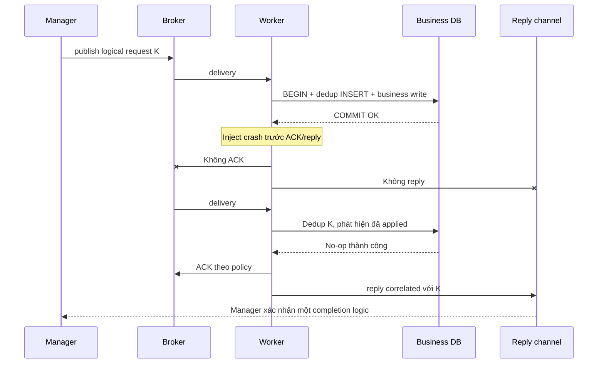
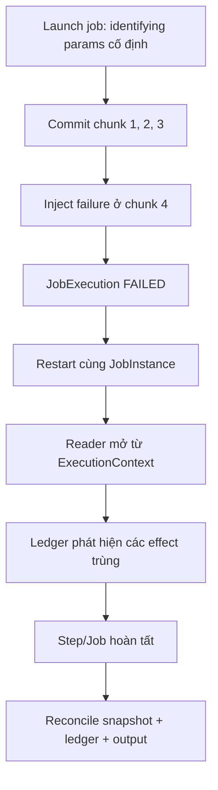
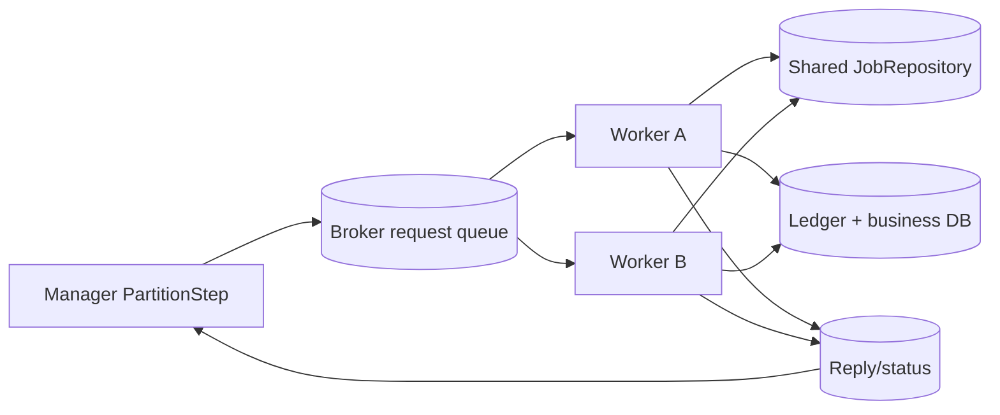
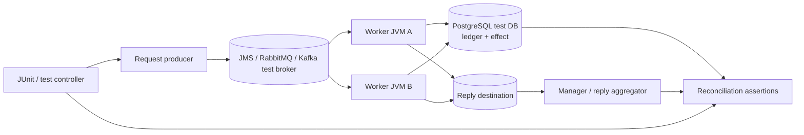
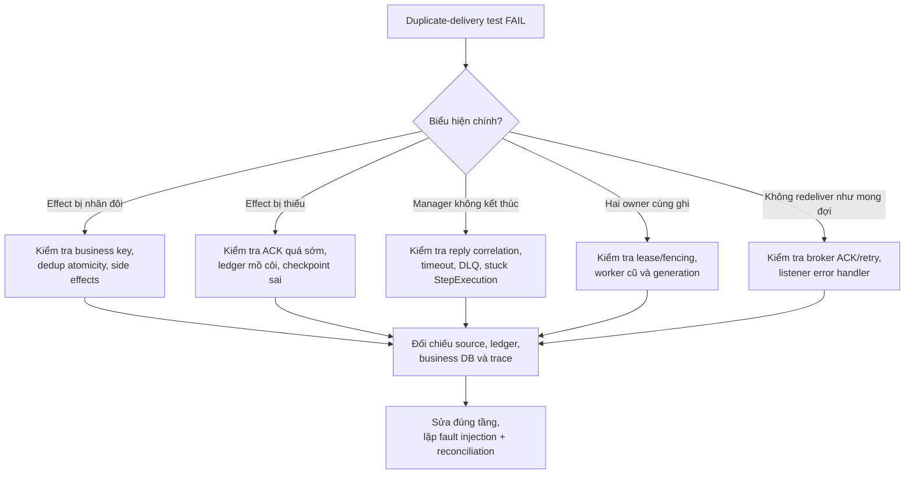

# Kiểm thử duplicate delivery

## 1. Vì sao duplicate delivery phải được kiểm thử, không chỉ được mô tả?

Trong chương **Idempotency** thuộc module **SPRING_BATCH_SCALING_OPERATIONS**, ta mở rộng Spring Batch để xử lý workload dữ liệu lớn bằng multi-threaded step, parallel steps, partitioning và mô hình phân tán. Khi một manager gửi công việc cho nhiều worker qua broker, chuyện cùng yêu cầu xuất hiện **hơn một lần** là tình huống phải tính trước: consumer crash sau khi ghi dữ liệu nhưng trước ACK, manager không nhận reply và phát lại request, broker redeliver, hoặc một operator restart job khi attempt cũ chưa được xác minh đã dừng.

**Duplicate delivery** nghĩa là cùng một **yêu cầu logic** đến hệ thống xử lý từ hai lần trở lên. Nó **không nhất thiết** đồng nghĩa hai message có cùng transport ID; khi producer publish lại cùng công việc, JMS/Kafka message ID có thể khác. Và nó **không đồng nghĩa** dữ liệu đã bị ghi trùng — đó chính là điều ta cần kiểm thử.

Ví dụ, manager giao `partition:orders-07` cho worker A. A đã commit 20 chunk nhưng chết trước khi gửi reply. Worker B nhận yêu cầu tương đương. Một bộ kiểm thử tốt phải chứng minh được:

1. B không áp dụng lại **business effect** của những item đã commit.
2. B vẫn có thể hoàn tất các item chưa commit.
3. Hệ thống không đánh dấu toàn partition `DONE` khi mới có một phần dữ liệu.
4. Nếu A vẫn còn sống do mất mạng, A và B không được đồng thời gây side effect trái hợp đồng.
5. Reply cũ, reply trùng và restart không làm kết quả tổng hợp bị đếm hai lần.

> **Thông điệp chính:** Không thể chứng minh tính idempotent chỉ bằng một unit test gọi processor hai lần. Cần kiểm thử **transaction, checkpoint, cạnh tranh đồng thời, broker acknowledgment, phản hồi đến muộn và dữ liệu đích thực tế**.

### Mục tiêu học tập

Sau bài này, bạn sẽ:

- Xác định đúng các lớp **duplicate delivery**, **duplicate execution** và **duplicate business effect**.
- Định nghĩa các **invariant** đo được thay vì chỉ kiểm tra exception/status.
- Lập ma trận fault injection quanh `COMMIT`, `ACK`, reply, lease và restart.
- Viết kiểm thử JUnit 5 + PostgreSQL cho idempotency ledger và business effect trong cùng transaction.
- Kiểm thử hai worker đồng thời nhận cùng logical event, một key có payload khác, crash và rollback.
- Phân biệt kịch bản Spring Batch **remote partitioning** và **remote chunking**.
- Đánh giá bảo vệ `StepExecution`, `ExecutionContext` và worker ownership khi nhiều JVM chạy.
- Thiết kế kiểm thử với broker thật, timeout/redelivery, DLQ và replay có kiểm soát.
- Đo duplicate rate, kết quả nghiệp vụ, lock contention, recovery latency và throughput để vận hành an toàn.

## 2. Bốn khái niệm phải tách biệt

| Khái niệm | Câu hỏi | Ví dụ | Điều không thể suy ra |
| --- | --- | --- | --- |
| **Duplicate delivery** | Cùng yêu cầu logic được giao mấy lần? | Chunk #42 tới worker A rồi B | Chưa biết ghi trùng hay không |
| **Duplicate execution** | Handler/processor được gọi mấy lần? | Processor chạy lại sau rollback | Chưa biết transaction nào commit |
| **Duplicate business effect** | Tác dụng phụ có bị áp dụng nhiều lần? | Tài khoản bị cộng tiền hai lần | Phải đối chiếu dữ liệu đích |
| **Duplicate reply** | Kết quả hoàn thành được gửi/nhận nhiều lần? | Hai `ChunkResponse` cùng correlation | Không chứng minh hai lần business commit |

Một hệ thống có thể có **2 deliveries, 2 handler invocations và 1 business effect** — đó là một kết quả idempotent hợp lệ. Ngược lại, `WRITE_COUNT=1` không bảo đảm external HTTP POST chỉ diễn ra một lần nếu POST nằm ngoài transaction JDBC.

### 2.1. At-least-once, at-most-once và exactly-once

- **At-most-once delivery**: message có thể bị mất nếu ACK/offset được xác nhận trước khi business effect an toàn.
- **At-least-once delivery**: message có thể phát lại nếu không xác định được xử lý thành công; duplicate là hành vi cần thiết kế.
- **Exactly-once delivery/processing**: khái niệm phải được giới hạn theo **hệ thống và transaction cụ thể**. Một bảo đảm của broker không tự mở rộng sang HTTP API, bảng khác database hoặc file output.
- **Exactly-once business effect**: có thể đạt theo **hợp đồng idempotency + atomic transaction/dedup** phù hợp. Ta cần kiểm tra hiệu lực cuối cùng, không yêu cầu Java method chỉ chạy đúng một lần.

### 2.2. Bốn danh tính không thể thay thế nhau

| ID/key | Phạm vi ổn định | Dùng để làm gì? |
| --- | --- | --- |
| `JobInstance` / identifying `JobParameters` | Một công việc logic được Spring Batch xác định | Restart đúng công việc |
| `JobExecutionId`, `StepExecutionId` | Một lần thực thi | Theo dõi trạng thái Batch, có thể đổi khi restart |
| Logical `partitionKey` hoặc `chunkRequestKey` | Cùng đơn vị việc logic xuyên redelivery | Correlation, kiểm soát assignment/reply |
| **Business effect key** | Cùng tác dụng phụ nghiệp vụ xuyên attempts | Dedup trước side effect/kiểm tra payload |

Một transport `messageId` hay `deliveryTag` **không nên** làm business effect key; broker có thể cấp ID mới khi publish lại cùng một công việc. Một `attemptId` ngẫu nhiên cũng không thể dùng làm key chống trùng vì **mỗi lần retry sẽ bị coi là mới**.

**Phân biệt quan trọng:** `partitionKey` giúp nhận diện công việc ở cấp partition, nhưng một partition chứa nhiều chunk/commit. Nếu worker crash giữa partition, phần đã commit cần **item/effect key riêng**, trừ khi toàn partition thật sự được xử lý nguyên tử trong một transaction thích hợp (thường không khả thi với job lớn).

## 3. Định nghĩa invariant trước khi viết test

Thay vì yêu cầu “job có `COMPLETED`”, ta định nghĩa những điều phải luôn đúng.

Giả sử snapshot gồm 100 event thanh toán, mỗi event có `eventId` duy nhất, và cùng event chỉ được áp dụng vào số dư **một lần**.

| Mã | Invariant | Cách kiểm tra |
| --- | --- | --- |
| INV-01 | Mỗi `effectKey` có tối đa một hiệu lực nghiệp vụ đã commit | Unique ledger + dữ liệu đích |
| INV-02 | Gửi lại cùng key và cùng payload không thay đổi output | So sánh trạng thái trước/sau duplicate |
| INV-03 | Cùng key với payload khác bị từ chối, không silent overwrite | Test conflict error + DB unchanged |
| INV-04 | Nếu transaction rollback, không có ledger mồ côi | Assert cả ledger và effect đều không tồn tại |
| INV-05 | Tại thời điểm công bố, đủ mọi event hợp lệ trong snapshot | So sánh tập business keys/source manifest |
| INV-06 | Cùng partition không có hai writer **có quyền** đồng thời | Claim/fencing assertions và sink rejects |
| INV-07 | Reply lặp hoặc đến muộn không nhân đôi kết quả manager | Unique correlation/attempt checks |
| INV-08 | Restart cùng `JobInstance` không đổi partition plan/input snapshot | Compare manifest/keys/ranges |
| INV-09 | Poison message bị giới hạn retry và đưa vào DLQ/quarantine đúng chính sách | Broker metrics + audit |
| INV-10 | Lỗi tạm thời không làm retry vô hạn hoặc mất dữ liệu im lặng | Bounded retry, failure/reconciliation |

**Một test “không thấy duplicate rows” chưa đủ** nếu business action là `UPDATE balance = balance + amount`: chỉ có một hàng `account_balance` nhưng số dư có thể đã cộng hai lần. Vì vậy phải chọn **assertion theo đúng side effect**, ví dụ tổng tiền, số lần phát hành phiếu, số notification hoặc effect ledger.

### 3.1. Biến testcase thành kết quả đo được

Với 100 event, tổng amount theo dữ liệu thử là `S`. Nếu gửi mỗi event đúng một lần:

```text
expected:
  unique applied effect keys = 100
  balance delta              = S
  processed source IDs       = tập 100 event IDs
```

Nếu gửi thêm 500 deliveries trùng có chủ đích:

```text
expected sau duplicate storm:
  deliveries                 >= 600
  unique applied effect keys = 100
  balance delta              = S, KHÔNG phải 6*S
  checksum business output   = giữ nguyên
  duplicate detection count  > 0
```

Số deliveries ở đây là số **yêu cầu do test gửi**; số lần broker thực giao có thể lớn hơn do redelivery và phải đo riêng. Đừng dùng số ACK làm số business records.

## 4. Ma trận kiểm thử duplicate delivery

Thiết kế bộ thử theo **cửa sổ lỗi**, **phạm vi concurrency** và **giao thức transport**.

### 4.1. Ma trận quanh commit/ACK/reply

| Test ID | Điểm chèn lỗi | Tình huống cần tạo | Kết quả bắt buộc |
| --- | --- | --- | --- |
| D01 | Trước khi handler bắt đầu | Gửi request giống nhau 2 lần | Chỉ một logical effect |
| D02 | Sau khi claim, trước business write | Worker đầu crash; request giao lại | Owner mới có thể xử lý phần chưa commit |
| D03 | Sau INSERT ledger, trước business write | Ném exception để rollback | Không còn ledger/effect sau rollback |
| D04 | Sau business write, trước DB commit | Crash/rollback transaction | Không có effect đã commit từ attempt lỗi |
| D05 | **Sau DB commit, trước broker ACK** | Consumer bị kill/mất kênh ACK | Redelivery không nhân đôi effect |
| D06 | **Sau DB commit, trước reply** | Cắt kênh reply manager | Reply timeout không được suy là chưa commit |
| D07 | Hai delivery đồng thời | Hai worker cùng xử lý key | Unique ledger + transaction chặn double effect |
| D08 | Reply trùng | Gửi lại response đã thành công | Aggregator chỉ ghi nhận một completion logic |
| D09 | Reply cũ đến muộn | Owner generation đã đổi | Stale response không overwrite owner mới |
| D10 | Same key, different payload | Cố tình sửa amount | Fail conflict, dữ liệu giữ nguyên |
| D11 | Worker crash giữa nhiều chunk | Một số chunk đã commit | Replay chỉ bổ sung effect chưa có |
| D12 | Manager crash, remote worker sống | Manager khởi động lại và thấy request chưa rõ | Không dispatch trùng khi owner cũ còn quyền |
| D13 | Duplicate job launch | Hai client launch cùng identifying params | Repository/contract không tạo hai job xử lý cùng kỳ |
| D14 | Broker poison message | Parser lỗi lặp lại | Bounded retries, DLQ và alert |
| D15 | Lease hết hạn, worker cũ vẫn có DB | Split brain/zombie writer | Fencing từ chối owner stale hoặc có quy trình chặn failover |
| D16 | Đổi manifest khi restart | Cùng partitionName nhưng range khác | Reject thay đổi plan, không dùng checkpoint cũ |

**D05 và D06 là những test quan trọng nhất**: lỗi thường xuất hiện trong khoảng rất nhỏ sau business commit nhưng trước khi manager/broker biết kết quả. Không được diễn giải “ACK chưa tới” là “DB chắc chắn rollback”.

### 4.2. Đặt lỗi vào đúng layer



Đây là **mô hình thử**, không khẳng định mọi broker sẽ redeliver chính xác vào cùng worker hay theo một thứ tự cố định. JMS/AMQP/Kafka có ACK/offset/transaction khác nhau. Test phải ghi lại **kết quả thật của broker và consumer container**.

## 5. Chiến lược kiểm thử nhiều lớp

| Lớp | Công cụ gợi ý | Chứng minh được | Chưa chứng minh được |
| --- | --- | --- | --- |
| Unit | JUnit 5, mock/stub | Tạo key ổn định, router phân loại, branch duplicate/conflict | DB isolation/rollback, broker ACK |
| DB integration | PostgreSQL thật/test database, `JdbcTemplate`, `TransactionTemplate` | Unique constraint, ledger+effect atomicity, concurrent inserts | JMS redelivery/response routing |
| Spring Batch step integration | `@SpringBatchTest`, `JobLauncherTestUtils` hoặc launcher thật | `StepExecution`/checkpoint/restart và counters | Nhiều JVM/broker thật nếu không cấu hình |
| Messaging integration | Broker thật/test container, worker listener thật | ACK/redelivery, DLQ, headers, reply correlation | Crash toàn process nếu chỉ throw exception |
| Multi-process fault injection | Manager và ít nhất hai JVM worker riêng | `SIGKILL`, manager crash, stale owner, recovery | Độ đúng toàn tập dữ liệu nếu không đối soát |
| End-to-end reconciliation | Manifest + ledger + business DB + audit | Có thiếu/trùng side effects không | Không thay kiểm tra trường hợp lỗi chưa bao phủ |

**Không tự tuyên bố “exactly once” chỉ vì unit test gọi `writer.write()` hai lần và nhìn thấy một row.** Ít nhất phải test **độc lập transaction**, cạnh tranh đồng thời và crash quanh commit/ACK.

### 5.1. Một test fixture có thể lặp lại

Thiết lập dataset cố định:

```text
datasetVersion : snapshot-test-v1
logicalJob     : apply-payments-v1
input          : event-0001 ... event-0100
partitionPlan  : P0 [1..25], P1 [26..50],
                 P2 [51..75], P3 [76..100]
chunkSize      : 10
manager        : 1 instance
workers        : 2 ... 4 instances
broker         : test destination riêng
output         : PostgreSQL account_balance + dedup_ledger
```

Đóng băng dataset và identifying params theo test run. Mỗi test nên có **namespace riêng** hoặc reset DB có kiểm soát, không chạy cleanup khiến những test concurrent khác mất dữ liệu.

### 5.2. Idempotency key nào được dùng trong fixture?

```text
partitionKey = apply-payments-v1
             |snapshot-test-v1
             |range:0001-0025

effectKey    = snapshot-test-v1
             |event-0001
             |APPLY_PAYMENT_V1

attemptId    = random UUID / owner generation
              (chỉ định danh attempt, không dùng làm effectKey)
```

Nếu event bị giao nhầm sang P1, **effect key vẫn không đổi**. Đó là lý do không đưa `partitionKey` vào unique key của business effect ledger: tránh vô tình cho phép cùng event được áp dụng hai lần chỉ vì plan thay đổi.

## 6. PostgreSQL fixture: kiểm tra ledger và business effect

Để thấy rõ sai lầm “một row output không có nghĩa một effect”, ví dụ dùng **cộng số dư**. Đây là side effect **không idempotent nếu thiếu ledger**:

```sql
CREATE TABLE test_account_balance (
    account_id    VARCHAR(80) PRIMARY KEY,
    balance       NUMERIC(18, 2) NOT NULL DEFAULT 0
);

CREATE TABLE test_effect_ledger (
    dataset_version VARCHAR(100) NOT NULL,
    event_id        VARCHAR(100) NOT NULL,
    operation       VARCHAR(60) NOT NULL,
    payload_sha256  CHAR(64) NOT NULL,
    first_partition VARCHAR(160) NOT NULL,
    created_at      TIMESTAMPTZ NOT NULL DEFAULT CURRENT_TIMESTAMP,
    PRIMARY KEY (dataset_version, event_id, operation)
);

INSERT INTO test_account_balance(account_id, balance)
VALUES ('acct-01', 0.00);
```

Đây là schema **dành cho test**, không phải `BATCH_*` mặc định của Spring Batch. Đối với môi trường production, business logic phải kiểm soát currency, expected balances, authorization, sequencing và cả transaction bất biến theo nghiệp vụ; ví dụ chỉ nhằm chứng minh idempotency.

**Vì sao key không có `partitionKey`, `JobExecutionId` hoặc message ID?** Vì cùng logical event có thể bị gửi tới partition khác hoặc attempt mới. Dedup cần dựa trên **source business event + operation/version** và dataset scope phù hợp.

### 6.1. Điều cần kiểm tra khi INSERT vào ledger

```text
BEGIN;
  INSERT ledger(effectKey, hash)
    ON CONFLICT DO NOTHING;

  Nếu insert thành công:
      UPDATE balance = balance + amount;

  Nếu key đã tồn tại:
      SELECT payloadHash của key;
      nếu hash giống: no-op, trả ALREADY_APPLIED;
      nếu hash khác: ROLLBACK/FAIL;
COMMIT;
```

Những điều kiện sau là bắt buộc:

- Ledger và account update phải dùng **cùng database transaction**.
- Unique constraint phải được database bảo vệ khi hai transactions đồng thời insert cùng key.
- Không đặt transaction riêng `REQUIRES_NEW` cho ledger.
- Không dùng `ON CONFLICT DO NOTHING` mà **không kiểm tra payload hash**; cùng key khác amount phải bị báo lỗi.
- Không coi ledger là nguồn sự thật vĩnh viễn nếu cho phép quy trình khác sửa/xóa business row ngoài cơ chế này.

### 6.2. Một sai lầm test cần bắt được

```text
Implementation lỗi:
  commit ledger(event X) bằng transaction A
  JVM crash
  update account balance bằng transaction B chưa kịp chạy

Sau redelivery:
  ledger X tồn tại -> handler bỏ qua
  => effect X BỊ MẤT
```

Nhiều test chỉ kiểm tra “không double charge” và bỏ sót **missing charge**. Vì vậy invariant cần kiểm tra **cả exactly-once effect và coverage**: không được nhân đôi, **cũng không được bỏ qua** effect đáng ra phải có.

## 7. Mẫu Java: service áp dụng effect có transaction và fault hook

Ví dụ Java 17, Spring JDBC và PostgreSQL. Đây là phần **service nghiệp vụ có thể kiểm thử độc lập với broker**, không phải code giả mạo một `JobRepository`. Để test concurrency và rollback thực tế, dùng `DataSourceTransactionManager` và `TransactionTemplate`.

### 7.1. Contract của event

```java
import java.math.BigDecimal;
import java.nio.charset.StandardCharsets;
import java.security.MessageDigest;
import java.util.HexFormat;

public record PaymentEvent(
    String datasetVersion,
    String eventId,
    String accountId,
    BigDecimal amount,
    String partitionKey
) {
    public PaymentEvent {
        if (datasetVersion == null || datasetVersion.isBlank()
                || eventId == null || eventId.isBlank()
                || accountId == null || accountId.isBlank()
                || partitionKey == null || partitionKey.isBlank()
                || amount == null) {
            throw new IllegalArgumentException("Missing event fields");
        }
    }

    public String payloadHash() {
        // Canonical form có version; amount chuẩn hóa để scale không
        // làm hai payload tương đương có hash khác nhau.
        String canonical = "APPLY_PAYMENT_V1|"
            + accountId + "|"
            + amount.setScale(2).toPlainString();
        try {
            byte[] hash = MessageDigest.getInstance("SHA-256")
                .digest(canonical.getBytes(StandardCharsets.UTF_8));
            return HexFormat.of().formatHex(hash);
        } catch (java.security.NoSuchAlgorithmException ex) {
            throw new IllegalStateException("SHA-256 unavailable", ex);
        }
    }
}
```

`amount.setScale(2)` cố ý yêu cầu dữ liệu đã có tối đa hai chữ số thập phân; giá trị có nhiều chữ số hơn có thể ném `ArithmeticException` và phải bị validate/reject trước khi ghi. Trong production, canonical payload phải bao gồm mọi yếu tố ảnh hưởng business effect (currency, tenant, operation version, authorization context khi có ý nghĩa), không chỉ account và amount.

### 7.2. Fault points và kết quả

```java
public enum FailurePoint {
    NONE,
    AFTER_LEDGER_INSERT,
    AFTER_BALANCE_UPDATE
}

public enum ApplyResult {
    APPLIED,
    ALREADY_APPLIED
}
```

Hai điểm lỗi này nằm **bên trong JDBC transaction** để xác minh rollback atomic. Kiểm thử “DB đã commit nhưng chưa ACK broker” là **một lớp test khác**: không thể mô phỏng chính xác chỉ bằng ném exception trong transaction.

### 7.3. Service dùng một TransactionTemplate

```java
import org.springframework.jdbc.core.JdbcTemplate;
import org.springframework.transaction.support.TransactionTemplate;

public final class PaymentEffectService {
    private final JdbcTemplate jdbc;
    private final TransactionTemplate transactions;

    public PaymentEffectService(
            JdbcTemplate jdbc,
            TransactionTemplate transactions) {
        this.jdbc = jdbc;
        this.transactions = transactions;
    }

    public ApplyResult apply(PaymentEvent event, FailurePoint failurePoint) {
        return transactions.execute(status -> {
            int inserted = jdbc.update("""
                INSERT INTO test_effect_ledger (
                    dataset_version, event_id, operation,
                    payload_sha256, first_partition
                ) VALUES (?, ?, 'APPLY_PAYMENT_V1', ?, ?)
                ON CONFLICT (dataset_version, event_id, operation)
                DO NOTHING
                """,
                event.datasetVersion(), event.eventId(),
                event.payloadHash(), event.partitionKey());

            if (inserted == 0) {
                String previousHash = jdbc.queryForObject("""
                    SELECT payload_sha256
                    FROM test_effect_ledger
                    WHERE dataset_version = ?
                      AND event_id = ?
                      AND operation = 'APPLY_PAYMENT_V1'
                    """, String.class,
                    event.datasetVersion(), event.eventId());

                if (!event.payloadHash().equals(previousHash.trim())) {
                    throw new IllegalStateException(
                        "Idempotency key reused with different payload");
                }
                return ApplyResult.ALREADY_APPLIED;
            }
            if (inserted != 1) {
                throw new IllegalStateException(
                    "Unexpected ledger insert count: " + inserted);
            }

            if (failurePoint == FailurePoint.AFTER_LEDGER_INSERT) {
                throw new SimulatedWorkerCrash(
                    "after ledger insert, before balance update");
            }

            int changed = jdbc.update("""
                UPDATE test_account_balance
                SET balance = balance + ?
                WHERE account_id = ?
                """, event.amount(), event.accountId());
            if (changed != 1) {
                throw new IllegalStateException("Unknown account");
            }

            if (failurePoint == FailurePoint.AFTER_BALANCE_UPDATE) {
                throw new SimulatedWorkerCrash(
                    "after balance update, before commit");
            }
            return ApplyResult.APPLIED;
        });
    }
}

class SimulatedWorkerCrash extends RuntimeException {
    SimulatedWorkerCrash(String message) {
        super(message);
    }
}
```

**Điểm chính xác cần nhớ:**

- `TransactionTemplate.execute` quản lý một transaction mỗi lần gọi `apply` nếu không có transaction ngoài; `JdbcTemplate` phải dùng cùng `DataSource` và transaction manager.
- Khi `SimulatedWorkerCrash` được ném trước commit, template sẽ rollback; đây là **fault injection ở tầng transaction**, không phải tắt JVM thật.
- `UPDATE balance = balance + ?` cố tình **không idempotent**. Ledger mới bảo đảm nó chỉ chạy cho mỗi effect key một lần.
- Ở hai requests đồng thời, PostgreSQL unique constraint điều phối xung đột INSERT; transaction đến sau có thể phải đợi transaction trước kết thúc.
- Nếu cùng key nhưng amount khác, service **fail**; không chuyển thành `ALREADY_APPLIED`.
- Nếu nghiệp vụ phải xử lý nhiều rows một chunk, service có thể được gọi trong transaction chunk; khi đó **không tạo transaction độc lập cho từng item** nếu muốn ledger và toàn chunk commit theo một đơn vị. Mẫu sử dụng template ở đây dành để **kiểm chứng invariant**.

### 7.4. Cấu hình transaction cho bộ test

```java
import javax.sql.DataSource;
import org.springframework.context.annotation.Bean;
import org.springframework.jdbc.core.JdbcTemplate;
import org.springframework.jdbc.datasource.DataSourceTransactionManager;
import org.springframework.transaction.support.TransactionTemplate;

@Bean
JdbcTemplate paymentJdbc(DataSource dataSource) {
    return new JdbcTemplate(dataSource);
}

@Bean
TransactionTemplate paymentTransactions(DataSource dataSource) {
    return new TransactionTemplate(
        new DataSourceTransactionManager(dataSource));
}

@Bean
PaymentEffectService paymentEffectService(
        JdbcTemplate paymentJdbc,
        TransactionTemplate paymentTransactions) {
    return new PaymentEffectService(
        paymentJdbc, paymentTransactions);
}
```

Ở test thực tế, cần chuẩn bị **PostgreSQL database riêng**, chạy DDL ở mục 6 và dọn dữ liệu test giữa các cases. **Không dùng database in-memory thay cho PostgreSQL** rồi kết luận unique-conflict locking/transaction behavior giống production.

## 8. JUnit 5: các bài kiểm thử cơ sở phải có

Những test đầu tiên chưa cần broker. Chúng kiểm tra **logic bảo vệ business effect** và transaction — là nền tảng cho mọi kịch bản redelivery về sau.

### 8.1. Tạo fixture riêng cho mỗi test

Một test class Spring Boot 3.x/JUnit 5 có thể dùng PostgreSQL test database với service của mục 7. Các bean `JdbcTemplate`, `TransactionTemplate` và `PaymentEffectService` được cấu hình trong application/test context; phần khởi tạo datasource/schema có thể thực hiện bằng Testcontainers hoặc một PostgreSQL riêng cho test.

```java
import java.math.BigDecimal;
import org.junit.jupiter.api.BeforeEach;
import org.junit.jupiter.api.Test;
import org.springframework.beans.factory.annotation.Autowired;
import org.springframework.boot.test.context.SpringBootTest;
import org.springframework.jdbc.core.JdbcTemplate;

import static org.junit.jupiter.api.Assertions.*;

@SpringBootTest(properties = "spring.batch.job.enabled=false")
class PaymentEffectServiceIT {
    @Autowired PaymentEffectService effects;
    @Autowired JdbcTemplate jdbc;

    @BeforeEach
    void resetDatabase() {
        // Dùng database riêng, không chạy trên dữ liệu production.
        jdbc.update("DELETE FROM test_effect_ledger");
        jdbc.update("DELETE FROM test_account_balance");
        jdbc.update("""
            INSERT INTO test_account_balance (account_id, balance)
            VALUES ('acct-01', 0.00)
            """);
    }

    private PaymentEvent event(String eventId, String amount) {
        return new PaymentEvent(
            "snapshot-test-v1",
            eventId,
            "acct-01",
            new BigDecimal(amount),
            "apply-payments-v1|range:1-25");
    }

    private BigDecimal balance() {
        return jdbc.queryForObject("""
            SELECT balance
            FROM test_account_balance
            WHERE account_id = 'acct-01'
            """, BigDecimal.class);
    }

    private long appliedCount() {
        return jdbc.queryForObject(
            "SELECT COUNT(*) FROM test_effect_ledger",
            Long.class);
    }

    // Các @Test tiếp theo đặt vào class này.
}
```

**Lưu ý quan trọng:** Đây là khung class dành cho ví dụ; các test ở dưới được chèn làm phương thức trong chính class này, không tạo nhiều class `PaymentEffectServiceIT` trùng tên. Nếu dùng `@Transactional` bao toàn method test, cần **bỏ annotation đó** cho các test crash/concurrency: transaction bao quanh test có thể che khuất commit và khiến worker threads không quan sát cùng dữ liệu đã commit.

### 8.2. Test D01: gửi cùng event hai lần

```java
@Test
void repeatedDeliveryDoesNotDoubleApplyEffect() {
    PaymentEvent original = event("event-001", "100.00");

    assertEquals(ApplyResult.APPLIED,
        effects.apply(original, FailurePoint.NONE));
    assertEquals(ApplyResult.ALREADY_APPLIED,
        effects.apply(original, FailurePoint.NONE));

    assertEquals(1L, appliedCount());
    assertEquals(0, balance().compareTo(new BigDecimal("100.00")));
}
```

Test này chứng minh business effect không tăng khi **gọi lại service sau khi lần đầu đã commit**. Nó **chưa chứng minh** broker redelivery đúng cách hay hệ thống xử lý được crash sau commit trước ACK. Cần giữ ranh giới rõ.

### 8.3. Test D03: rollback sau ledger insert

```java
@Test
void crashAfterLedgerBeforeBusinessWriteRollsBackBoth() {
    PaymentEvent payment = event("event-002", "70.00");

    assertThrows(SimulatedWorkerCrash.class,
        () -> effects.apply(
            payment, FailurePoint.AFTER_LEDGER_INSERT));

    assertEquals(0L, appliedCount(),
        "Ledger không được commit khi effect chưa ghi");
    assertEquals(0, balance().compareTo(BigDecimal.ZERO));

    assertEquals(ApplyResult.APPLIED,
        effects.apply(payment, FailurePoint.NONE));
    assertEquals(1L, appliedCount());
    assertEquals(0, balance().compareTo(new BigDecimal("70.00")));
}
```

Nếu bản test này thất bại với ledger còn tồn tại nhưng balance bằng 0, rất có thể logic dùng hai transaction hoặc mở `REQUIRES_NEW` cho ledger — một lỗi nghiêm trọng có thể gây **missing effect** sau redelivery.

### 8.4. Test D04: rollback sau business write

```java
@Test
void crashAfterBusinessUpdateBeforeCommitRollsBackBoth() {
    PaymentEvent payment = event("event-003", "90.00");

    assertThrows(SimulatedWorkerCrash.class,
        () -> effects.apply(
            payment, FailurePoint.AFTER_BALANCE_UPDATE));

    assertEquals(0L, appliedCount());
    assertEquals(0, balance().compareTo(BigDecimal.ZERO));

    assertEquals(ApplyResult.APPLIED,
        effects.apply(payment, FailurePoint.NONE));
    assertEquals(1L, appliedCount());
    assertEquals(0, balance().compareTo(new BigDecimal("90.00")));
}
```

Một exception được ném **trước commit** dẫn đến rollback và không tương đương `SIGKILL` ngay sau commit. Tuy vậy test giúp xác nhận cơ chế transaction ở tầng JDBC hoạt động như thiết kế.

### 8.5. Test D10: cùng key nhưng payload khác

```java
@Test
void sameKeyWithDifferentPayloadMustFail() {
    PaymentEvent first = event("event-004", "100.00");
    PaymentEvent changed = event("event-004", "101.00");

    assertEquals(ApplyResult.APPLIED,
        effects.apply(first, FailurePoint.NONE));

    IllegalStateException failure = assertThrows(
        IllegalStateException.class,
        () -> effects.apply(changed, FailurePoint.NONE));

    assertTrue(failure.getMessage()
        .contains("different payload"));
    assertEquals(1L, appliedCount());
    assertEquals(0, balance().compareTo(new BigDecimal("100.00")));
}
```

**Không được chuyển test này thành “duplicate nên return success”**. Cùng khóa nhưng payload khác báo hiệu **collision, input thay đổi, sai canonicalization hoặc một producer vi phạm hợp đồng**. Đây thường là lý do phải fail/hold, không silently overwrite hoặc skip.

### 8.6. Test D07: hai worker thread tranh cùng một key

Test tuần tự không chứng minh được unique constraint và transaction dưới concurrency. Hãy dùng hai transaction chạy **đồng thời**:

```java
import java.util.concurrent.CountDownLatch;
import java.util.concurrent.ExecutorService;
import java.util.concurrent.Executors;
import java.util.concurrent.Future;
import java.util.concurrent.TimeUnit;

@Test
void concurrentDuplicateRequestsApplyOnlyOnce() throws Exception {
    PaymentEvent payment = event("event-005", "55.00");
    CountDownLatch ready = new CountDownLatch(2);
    CountDownLatch start = new CountDownLatch(1);

    ExecutorService pool = Executors.newFixedThreadPool(2);
    try {
        java.util.concurrent.Callable<ApplyResult> attempt = () -> {
            ready.countDown();
            if (!start.await(5, TimeUnit.SECONDS)) {
                throw new IllegalStateException("Start barrier timed out");
            }
            return effects.apply(payment, FailurePoint.NONE);
        };

        Future<ApplyResult> first = pool.submit(attempt);
        Future<ApplyResult> second = pool.submit(attempt);

        assertTrue(ready.await(5, TimeUnit.SECONDS));
        start.countDown();

        ApplyResult a = first.get(15, TimeUnit.SECONDS);
        ApplyResult b = second.get(15, TimeUnit.SECONDS);

        assertTrue(
            (a == ApplyResult.APPLIED && b == ApplyResult.ALREADY_APPLIED)
            || (b == ApplyResult.APPLIED && a == ApplyResult.ALREADY_APPLIED));
    } finally {
        pool.shutdownNow();
    }

    assertEquals(1L, appliedCount());
    assertEquals(0, balance().compareTo(new BigDecimal("55.00")));
}
```

Đoạn test dùng `try/finally` để cleanup `ExecutorService` và tương thích **Java 17**, mức nền tảng phổ biến của Spring Batch 5.x. `shutdownNow()` là yêu cầu dừng các task còn sót sau test, không có nghĩa luôn có thể ngắt tức thì một I/O đang blocking; bounded `Future.get` giúp test không chờ vô hạn.

**Điều kiện để test đáng tin cậy:**

- Connection pool phải đủ hai connection đồng thời; nếu pool một connection, hai attempt bị tuần tự hóa bởi pool thay vì cùng cạnh tranh ở DB.
- Không gắn `@Transactional` ở lớp test khiến tất cả lời gọi chạy trong một test transaction bên ngoài.
- PostgreSQL thật phải có unique constraint trên effect key.
- Có thể thêm barrier/fault hook ngay trước ledger insert để tăng xác suất hai transactions tranh nhau; **không dùng `Thread.sleep` như bằng chứng chắc chắn tạo được race**.
- Chạy lặp nhiều seed/iterations để phát hiện race, nhưng không thay thế test với broker/process thật.

### 8.7. Test quan trọng: duplicate cross-partition

Với cùng `eventId`, đặt `partitionKey` khác nhưng giữ dataset, account, amount và operation:

```java
@Test
void sameEventInDifferentPartitionsStillDeduplicates() {
    PaymentEvent p0 = event("event-006", "40.00");
    PaymentEvent p9 = new PaymentEvent(
        p0.datasetVersion(),
        p0.eventId(),
        p0.accountId(),
        p0.amount(),
        "apply-payments-v1|range:226-250");

    assertEquals(ApplyResult.APPLIED,
        effects.apply(p0, FailurePoint.NONE));
    assertEquals(ApplyResult.ALREADY_APPLIED,
        effects.apply(p9, FailurePoint.NONE));

    assertEquals(1L, appliedCount());
    assertEquals(0, balance().compareTo(new BigDecimal("40.00")));
}
```

Nếu test này tạo hai effects, nhiều khả năng ledger key đã chứa `partitionKey` dù effect phải unique trên business event. **Tuy nhiên**, nếu nghiệp vụ thực sự định nghĩa cùng `eventId` ở hai dataset khác nhau là hai nghiệp vụ riêng, namespace effect key phải phản ánh sự khác biệt đó.

## 9. D05/D06: test sau COMMIT trước ACK hoặc reply

Đây là ranh giới khó nhất: **business transaction đã kết thúc** nhưng caller chưa được xác nhận.

### 9.1. Vì sao throw exception trong transaction chưa đủ?

Nếu trong `ItemWriter.write()` hoặc `TransactionTemplate.execute()` ta ném exception, JDBC transaction thường rollback. Nhưng với lỗi thật:

```text
worker process:
    BEGIN DB TRANSACTION
    INSERT ledger
    UPDATE business
    COMMIT DB                 <-- dữ liệu đã bền vững
    publish reply / ACK      <-- crash xảy ra trước dòng này
```

Test crash sau commit phải được đặt **ngoài ranh giới business transaction**, ví dụ dùng test hook ngay sau một transaction hoàn tất hoặc kill process sau khi quan sát commit marker, trước ACK/reply.

### 9.2. Một test logic không cần broker

```java
@Test
void duplicateAfterCommittedEffectIsNoOp() {
    PaymentEvent payment = event("event-007", "125.00");

    // Transaction 1 đã COMMIT thành công.
    assertEquals(ApplyResult.APPLIED,
        effects.apply(payment, FailurePoint.NONE));

    // Mô phỏng manager không nhận ACK/reply: caller chủ động
    // phát lại cùng logical request bằng transaction 2.
    assertEquals(ApplyResult.ALREADY_APPLIED,
        effects.apply(payment, FailurePoint.NONE));

    assertEquals(1L, appliedCount());
    assertEquals(0, balance().compareTo(new BigDecimal("125.00")));
}
```

Test này chứng minh **effect layer chống phát lại sau commit**. Để chứng minh **broker thực sự redeliver trong tình huống mất ACK**, phải chạy integration test có broker/consumer container.

### 9.3. Thiết kế hook để crash đúng thời điểm

Một implementation testable có thể có các điểm quan sát:

```text
onMessage(request):
    validate logical key
    begin/commit DB business transaction
    signal TEST_HOOK: BUSINESS_COMMITTED
    wait at a controllable latch
    ACK message / publish reply

test controller:
    send request
    await BUSINESS_COMMITTED (bounded timeout)
    kill consumer JVM, hoặc cắt đường reply/ACK
    start new worker / restore broker connection
    await redelivery / retry
    reconcile database and correlated result
```

Không để `TEST_HOOK` xuất hiện và block worker vô hạn trong production. Test harness chỉ được bật ở môi trường test, có deadline và namespace riêng. Với broker message-driven listener, vị trí thực tế ACK do container quản lý; **không giả định application code gọi ACK đúng lúc** nếu không dùng chế độ phù hợp.

### 9.4. Các trường hợp outcome không rõ

| Kết quả sau lỗi | Chúng ta biết gì? | Đường kiểm tra |
| --- | --- | --- |
| Commit DB có marker bền vững, reply mất | Business effect có thể đã áp dụng | Ledger + DB output, gửi lại cùng key |
| Lệnh COMMIT trả timeout | Client **chưa biết chắc** commit hay rollback | Query DB/ledger theo key, không phát lại mù |
| Message ACK thành công nhưng DB chưa commit | Có nguy cơ **lost effect** | Kiểm tra thứ tự transaction/ACK |
| Broker redelivery nhưng worker cũ còn sống | Có thể hai owner | Claim/fencing, effect dedup |
| Reply gửi thành công nhưng manager crash | Manager có thể chưa ghi kết quả tổng hợp | Durable reply/correlation và repository state |

**Kiểm thử phải bao gồm cả thiếu dữ liệu lẫn ghi trùng**. Một implementation cố tránh duplicate bằng cách ACK quá sớm có thể đạt test “no double apply” nhưng làm mất hoàn toàn một số item khi worker crash.

## 10. Kiểm thử Spring Batch 5.x: StepExecution và checkpoint

JUnit test service chưa kiểm tra hành vi `ItemStream`, `JobRepository` và `PartitionStep`. Với Spring Batch 5.x, cần test ở cấp **chunk step**:

1. Cố định identifying `JobParameters` và snapshot đầu vào.
2. Dùng `@StepScope` reader có trạng thái, ví dụ `JdbcCursorItemReader` hoặc `FlatFileItemReader`.
3. Tạo một worker step `.<I, O>chunk(n, transactionManager)`, writer gọi business idempotency logic.
4. Gây lỗi sau một số chunk đã commit, cho step/job chuyển sang `FAILED` qua lifecycle bình thường.
5. Restart **cùng `JobInstance`** khi execution ở trạng thái hợp lệ.
6. Đối chiếu `StepExecution`, checkpoint, ledger và đầu ra; không bắt buộc mọi `READ_COUNT` chỉ tăng một lần qua các attempts.

### 10.1. Khung worker step

```java
import org.springframework.batch.core.Step;
import org.springframework.batch.core.repository.JobRepository;
import org.springframework.batch.core.step.builder.StepBuilder;
import org.springframework.batch.item.ItemReader;
import org.springframework.batch.item.ItemWriter;
import org.springframework.transaction.PlatformTransactionManager;

// Các bean @StepScope reader/writer phải được cấp bởi context test.
Step buildPaymentWorker(
        JobRepository jobRepository,
        PlatformTransactionManager transactionManager,
        ItemReader<PaymentEvent> reader,
        ItemWriter<PaymentEvent> writer) {

    return new StepBuilder("paymentWorker", jobRepository)
        .<PaymentEvent, PaymentEvent>chunk(10, transactionManager)
        .reader(reader)
        .writer(writer)
        .build();
}
```

Đoạn này minh họa API builder Spring Batch 5.x, không phải một chương trình chạy độc lập. Nếu writer gọi service `apply` dùng `TransactionTemplate` trong transaction chunk, phải cấu hình propagation/connection **để ledger + business cùng commit với checkpoint theo mục đích test**; không vô tình tạo transaction độc lập khiến một item commit nhưng chunk rollback.

### 10.2. Vòng đời kiểm thử restart



**Không dùng `startNextInstance()` hoặc thêm `run.id` ngẫu nhiên để giả vờ test restart:** đó thường là JobInstance mới và không kiểm thử cùng checkpoint. Nếu cố tình kill process bằng `SIGKILL`, repository có thể vẫn `STARTED`; cần một **quy trình recovery metadata an toàn** và xác nhận process cũ đã dừng trước khi restart, không sửa `BATCH_*` bằng SQL tùy tiện.

### 10.3. Assert metadata và business output

Các câu SQL gợi ý:

```sql
SELECT
    STEP_EXECUTION_ID,
    JOB_EXECUTION_ID,
    STEP_NAME,
    STATUS,
    READ_COUNT,
    WRITE_COUNT,
    COMMIT_COUNT,
    ROLLBACK_COUNT,
    READ_SKIP_COUNT,
    PROCESS_SKIP_COUNT,
    WRITE_SKIP_COUNT
FROM BATCH_STEP_EXECUTION
WHERE JOB_EXECUTION_ID = ?
ORDER BY STEP_EXECUTION_ID;
```

Trong partitioning, manager có `StepExecution` riêng và có thể **tổng hợp** counters worker. Đừng cộng số của manager với mọi worker thành “unique records processed”. Khi có restart, những execution lịch sử có thể đã đọc/ghi lại cùng item. **Source/business keys và ledger** mới là cơ sở kiểm tra hiệu lực duy nhất.

### 10.4. Thêm fault injection có kiểm soát

Một `ItemWriteListener` hoặc test writer decorator có thể chặn tại một ranh giới được định nghĩa:

```text
plan:
  chunk 1..3 -> commit bình thường
  chunk 4    -> trước commit: throw exception
  job        -> FAILED, không sửa metadata thủ công
  restart    -> cùng identifying params
  assert     -> đủ input, không double business effect
```

Nếu muốn test **sau commit**, cần hook/quan sát ở transaction synchronization, test controller hoặc process-level orchestration; ném exception ở `ItemWriter.write()` chưa chắc đại diện lỗi sau commit.

## 11. Remote partitioning: duplicate StepExecutionRequest

Trong remote partitioning, manager tạo nhiều worker `StepExecution` và gửi `StepExecutionRequest` qua broker. Worker nhận request, dùng `StepExecutionRequestHandler`/worker step tương ứng để thực thi, cập nhật `JobRepository` và phản hồi theo `PartitionHandler`/transport cấu hình.



### 11.1. Những test cần chạy

| Test | Cách tạo lỗi | Assertion |
| --- | --- | --- |
| Cùng `StepExecutionRequest` được publish hai lần | Gửi 2 message tương đương từ test producer | Không có hai business effects cho mỗi item |
| Worker A commit một số chunk rồi crash | Kill JVM worker A | Checkpoint và ledger cho phép recovery phần còn lại |
| Request redelivery khi worker B đang chạy | Giao lại cùng logical partition | Claim/fencing hoặc policy không cho hai owner sai |
| Manager timeout nhưng worker vẫn sống | Cắt reply hoặc chậm network | Không coi timeout là worker đã dừng |
| Reply từ owner A sau owner B | Delay reply A rồi chuyển generation | Kết quả stale không overwrite trạng thái mới |
| Restart manager khi worker remote còn chạy | Kill manager JVM | Không phát lại mù những partition owner cũ đang xử lý |
| Sai partition mapping sau restart | Đổi `gridSize` hoặc nguồn file | Reject plan mismatch, không reuse checkpoint sai |

### 11.2. Không nhầm broker duplicate với Batch restart

Một message `StepExecutionRequest` cũ được phát lại **không tự biến thành một lần `JobExecution` restart hợp lệ**. Worker handler có thể từ chối vì trạng thái execution, hoặc manager có thể cần đường recovery khác; behavior phụ thuộc API Spring Batch Integration và cấu hình broker/handler đang dùng.

Test phải ghi lại:

- Logical `partitionKey` và tên worker `StepExecution`.
- `JobInstanceId`, `JobExecutionId`, `StepExecutionId` của request/attempt.
- Broker delivery/redelivery count, ACK/nack, reply ID/correlation.
- Owner `generation`, process ID, heartbeat và thời điểm commit.
- Các effect keys đã commit và trạng thái business data.

Kết luận test không được là “framework luôn tự replay partition khi message lặp”. **Yêu cầu cần chứng minh** là “dù request lặp hoặc worker crash, không tạo tác dụng phụ trái hợp đồng; quá trình phục hồi có đường đi xác định”.

### 11.3. Ownership và idempotency là hai assertion riêng

Giả sử hai workers cùng xử lý partition P. Unique ledger có thể khiến balance vẫn đúng, nhưng hai worker vẫn:

- Mở hai cursor đọc cùng nguồn, tốn tài nguyên.
- Giữ/ghi cùng file output, có thể làm hỏng file.
- Gọi API không idempotent **trước khi** insert ledger.
- Cùng cập nhật một `StepExecution`, gây optimistic locking conflict.

Vì vậy thêm hai nhóm test:

1. **Ownership test:** chỉ một worker có claim/generation hợp lệ; nếu chuyển owner, old generation bị chặn tại sink.
2. **Business effect test:** kể cả khi có duplicate execution, side effect đã được bảo vệ bằng unique effect key.

**Heartbeat stale không chứng minh worker cũ đã chết.** Muốn test zombie worker, chủ động cắt đường từ A tới lease store nhưng giữ đường A tới business DB; sau khi B giành claim, thử cho A ghi và xác minh sink **từ chối generation cũ**. Nếu sink không hỗ trợ fencing, phải ghi nhận giới hạn và không bật auto-failover chỉ dựa vào lease expiry.

## 12. Remote chunking: duplicate ChunkRequest và ChunkResponse

Trong remote chunking, **manager giữ reader** và dùng message writer gửi `ChunkRequest<T>` tới worker. Worker xử lý/ghi chunk và gửi `ChunkResponse`. Mỗi chunk **không mặc định có một `StepExecution` riêng** như remote partitioning.

### 12.1. Bài test đúng đơn vị

```text
Manager:
  read items [#101, #102, #103]
  send ChunkRequest logical key = jobE:stepE:chunk-42

Worker A:
  receive chunk-42
  commit business effect cho #101..#103
  crash trước khi gửi ChunkResponse

Broker/manager:
  resend hoặc redeliver chunk-42

Worker B:
  nhận cùng logical chunk
  business ledger chặn effect #101..#103 đã commit
  trả ChunkResponse tương quan đúng chunk

Manager:
  ghi nhận một kết quả logic cho chunk-42
```

**Lưu ý:** `jobE:stepE:chunk-42` là **minh họa định danh logic dành cho test**, không khẳng định Spring Batch Integration chính thức serialize field này thành header đúng tên. Phải dùng correlation/sequence metadata do phiên bản framework và message adapters thực sự hỗ trợ, và kiểm tra chúng qua broker thật.

### 12.2. Nhóm test riêng cho remote chunking

| Test | Điều cần xác minh |
| --- | --- |
| Gửi cùng `ChunkRequest` 2 lần | Business effect của từng item chỉ commit một lần |
| Gửi chunks 41, 42, 43 rồi reply đảo thứ tự | Manager aggregate đúng theo correlation |
| Gửi hai `ChunkResponse` cho chunk 42 | Không đếm chunk 42 hai lần |
| Worker commit rồi crash trước response | Resend/replay không nhân đôi item effects |
| Một item lỗi validation trong chunk | Skip/retry chính sách đúng, không mất item khác |
| Quarantine response từ job cũ | Không gán cho `JobExecution` mới |
| Broker redeliver khi manager đã restart | Correlation không nhầm lần thực thi |
| Header mapper bỏ `sequenceNumber` hoặc correlation | Test fail rõ, không giả thành công |
| Chunk chứa payload quá lớn | Thấy size limit/backpressure, bounded retry |

**Không dùng `StepExecutionRequestHandler` để xử lý `ChunkRequest`.** Partitioning và remote chunking là hai giao thức khác nhau. Với remote chunking, lỗi reader/parse ở manager có thể xảy ra trước khi gửi chunk; lỗi processor/writer ở worker cần được phản ánh theo protocol tương ứng.

### 12.3. Cần test reply lặp và reply thất lạc

Một implementation xử lý duplicate `ChunkRequest` tốt nhưng **aggregate reply sai** vẫn có thể làm manager đợi vô hạn hoặc tính sai progress. Vì vậy song song với business ledger, cần assert:

- Request/chunk correlation không thay đổi do retry logic nếu vẫn là cùng công việc.
- Một chunk logic chỉ được manager công nhận là hoàn tất một lần.
- Reply đến muộn của một `JobExecution` cũ không được áp dụng cho execution khác.
- Không suy `READ_COUNT + WRITE_COUNT` từ số message deliveries.
- Khi reply thất lạc, manager không tự cho rằng DB transaction chưa commit.

## 13. Kiểm thử broker thật: bắt buộc quan sát ACK/redelivery

Unit test và JDBC integration test trả lời “business code có idempotent không?”. Chúng **không tự chứng minh** consumer container xử lý ACK đúng, header/correlation được giữ nguyên hay DLQ hoạt động. Vì vậy cần một tầng kiểm thử dùng **broker thật** trên môi trường tách biệt.

### 13.1. Môi trường thử tích hợp gợi ý



Đối với Spring Batch 5.x và Spring Integration tương thích, có thể chọn:

- **JMS (ví dụ ActiveMQ/Artemis)**: test listener transaction/acknowledgment, reply destination, redelivery policy và DLQ.
- **AMQP (ví dụ RabbitMQ)**: test consumer ACK/nack/requeue, prefetch, listener concurrency, dead-letter routing và reply correlation.
- **Kafka**: test offset commit, retry topic/DLQ nếu dùng, consumer group rebalance và interaction với JDBC transaction.

**Không có một cấu hình ACK chung cho tất cả.** Tùy provider, listener container, transaction manager và middleware, exception có thể requeue, đi DLQ, được xử lý bởi error handler hoặc thậm chí bị ACK theo policy. Test phải **ghi nhận cấu hình và kết quả thực tế**, không suy đoán từ tên annotation.

### 13.2. Ví dụ test harness với Testcontainers

Một môi trường JUnit 5/Spring Boot 3.x có thể dựng PostgreSQL và RabbitMQ như sau:

```java
import org.junit.jupiter.api.Test;
import org.springframework.boot.test.context.SpringBootTest;
import org.springframework.test.context.DynamicPropertyRegistry;
import org.springframework.test.context.DynamicPropertySource;
import org.testcontainers.containers.PostgreSQLContainer;
import org.testcontainers.containers.RabbitMQContainer;
import org.testcontainers.junit.jupiter.Container;
import org.testcontainers.junit.jupiter.Testcontainers;

@Testcontainers
@SpringBootTest(properties = "spring.batch.job.enabled=false")
class BrokerRedeliveryIT {
    @Container
    static final PostgreSQLContainer<?> postgres =
        new PostgreSQLContainer<>("postgres:16-alpine");

    @Container
    static final RabbitMQContainer rabbit =
        new RabbitMQContainer("rabbitmq:3.13-management");

    @DynamicPropertySource
    static void destinations(DynamicPropertyRegistry props) {
        props.add("spring.datasource.url", postgres::getJdbcUrl);
        props.add("spring.datasource.username", postgres::getUsername);
        props.add("spring.datasource.password", postgres::getPassword);
        props.add("spring.rabbitmq.host", rabbit::getHost);
        props.add("spring.rabbitmq.port", rabbit::getAmqpPort);
        props.add("spring.rabbitmq.username", rabbit::getAdminUsername);
        props.add("spring.rabbitmq.password", rabbit::getAdminPassword);
    }

    @Test
    void duplicateDeliveryAcrossBrokerMustNotDuplicateEffects() {
        // Test đầy đủ cần:
        // 1. tạo schema và fixture riêng;
        // 2. cấu hình queue + producer/consumer thật;
        // 3. gửi logical request;
        // 4. inject lỗi sau business COMMIT, trước ACK;
        // 5. chờ broker redeliver theo policy hữu hạn;
        // 6. assert ledger, balance, reply correlation và DLQ.
    }
}
```

Đây là **sườn tích hợp môi trường**, không phải một test đã chứng minh redelivery: method `@Test` cần được hoàn thiện theo flow/broker thật. API Testcontainers và Spring Boot có thể thay đổi theo phiên bản dependency; với dự án chỉ dùng Spring Framework không có Boot, cấu hình `DataSource` và broker properties theo cách tương đương.

### 13.3. Điều kiện phải cấu hình và ghi lại

| Nhóm | Điều kiện test cần biết |
| --- | --- |
| Message durability | Queue/topic có bền vững? Message persistent? |
| Ack mode | Auto/manual/client-transacted/offset commit theo framework? |
| Listener transaction | Broker receive có cùng transaction với business DB không? Có XA không? |
| Prefetch/concurrency | Consumer có thể nhận nhiều request song song không? |
| Requeue/retry | Exception dẫn tới requeue hay DLQ? Số lần retry tối đa? |
| Dead-letter | Destination, TTL, routing key và quyền đọc DLQ |
| Reply correlation | Header/sequence nào được preserve qua adapter? |
| Visibility/timeout | Manager chờ bao lâu và xử lý request trùng ra sao? |
| Process lifecycle | Test có thể kill **đúng JVM worker** không, hay chỉ dừng một thread? |
| Data persistence | DB volume/test schema tồn tại qua worker restart không? |

### 13.4. Hai cách gây duplicate delivery

**Cách A — gửi hai message logic giống nhau:** producer gửi cùng `businessEffectKey` trong hai message khác `messageId`. Đây là test **application-level dedup** và rất dễ tái hiện, nhưng **không kiểm tra redelivery do consumer crash**.

**Cách B — thật sự làm broker redeliver:** consumer nhận message, commit business DB, rồi không ACK thành công; broker redeliver theo policy. Đây mới là test **transport-level redelivery**. Cần kiểm tra broker metrics hoặc redelivery headers/consumer logs để xác minh đúng sự kiện xảy ra.

Nên có **cả hai**. Cách A phát hiện key sai; cách B phát hiện vấn đề ACK, transaction boundary, listener error handler, DLQ và timing.

### 13.5. Một consumer minh họa với lỗi sau DB commit

Đoạn Java sau mô tả **adapter nghiệp vụ nhận message**; nó không phải Spring Batch remote chunking builder. Dùng một hook test-only để gây lỗi sau `effects.apply`:

```java
import java.util.concurrent.atomic.AtomicBoolean;
import org.springframework.amqp.rabbit.annotation.RabbitListener;
import org.springframework.stereotype.Component;

@Component
class PaymentRequestConsumer {
    private final PaymentEffectService effects;
    private final AtomicBoolean failFirstDelivery = new AtomicBoolean(true);

    PaymentRequestConsumer(PaymentEffectService effects) {
        this.effects = effects;
    }

    @RabbitListener(queues = "batch.test.payments")
    void receive(PaymentEvent event) {
        effects.apply(event, FailurePoint.NONE);
        // Service method đã COMMIT transaction JDBC trước khi trở về.

        if (failFirstDelivery.compareAndSet(true, false)) {
            throw new SimulatedWorkerCrash(
                "simulate failure after DB commit before normal ACK");
        }
        // Container nhận normal return; ACK theo cấu hình listener.
    }
}
```

**Chú ý:** Ví dụ này **không kill process**, chỉ ném exception sau khi service commit. Broker có requeue hay không còn phụ thuộc listener configuration; default có thể thay đổi theo Boot/AMQP version, retry advice và error handler. Đừng dùng một exception giả lập rồi tuyên bố đã test `SIGKILL`. Hơn nữa `AtomicBoolean` ở đây phục vụ một lần test đơn lẻ, **không phải distributed dedup flag production**; trong test nhiều consumer instances cần test controller phối hợp hook theo message/attempt.

Để xác nhận redelivery:

1. Cấu hình listener error/requeue hữu hạn theo mục đích test.
2. Gửi một `PaymentEvent` với stable business effect key.
3. Chờ consumer đầu commit; kiểm tra ledger/effect đã tồn tại.
4. Xác minh broker giao lại (delivery count/log hoặc consumer invocation counter).
5. Xác minh consumer lần sau nhận `ALREADY_APPLIED`; balance không tăng.
6. Xác minh message được ACK cuối cùng hoặc vào DLQ đúng chính sách, không loop vô hạn.

### 13.6. Test DLQ không đồng nghĩa với test nghiệp vụ

Đưa poison message vào DLQ là **thành công về cô lập transport lỗi**, nhưng chưa chắc đã thành công nghiệp vụ. Nếu message đã ghi dữ liệu trước khi bị đưa vào DLQ, replay từ DLQ có thể gây duplicate. Cần test:

- DLQ ghi đủ nguồn/correlation nhưng không lộ PII/secret.
- Replay giữ **logical effect key**, không đổi vì message ID mới.
- Replay từ DLQ đi qua cùng idempotency validation.
- Poison message được giới hạn số lần retry và có cảnh báo; không gây backlog toàn queue.
- Operator chỉ replay sau khi biết nguyên nhân (schema/authorization/DB outage...) đã được xử lý.

## 14. Test process crash thật, không chỉ giả lập exception

Muốn biết điều gì xảy ra khi process biến mất ngay giữa I/O, nên chạy **ít nhất hai JVM worker riêng** trong integration environment, thay vì chỉ dùng nhiều thread trong một JVM.

### 14.1. Orchestration gợi ý

```text
Test controller JVM
   |
   +-- manager JVM (Spring Batch / Spring Integration)
   +-- worker-A JVM
   +-- worker-B JVM
   +-- real broker
   +-- PostgreSQL test DB (persistent across worker restart)

Test controller:
   dispatch -> await durable checkpoint/commit marker
   -> kill worker-A process
   -> restart/wake worker-B
   -> let broker redeliver or run documented recovery path
   -> reconcile JobRepository + ledger + business output
```

Trên Linux container thường có thể dừng worker theo kiểu **kill process không graceful** để mô phỏng `SIGKILL`. Trên Windows process supervisor hoặc Testcontainers dùng thao tác tương đương trên JVM worker. **Không yêu cầu toàn bộ pipeline production bị tắt**; mọi fault injection diễn ra trên test resources cô lập.

### 14.2. Bốn checkpoint của test controller

Test cần ghi lại các thời điểm:

- `T1: REQUEST_DELIVERED` — broker đã giao cho worker.
- `T2: BUSINESS_COMMITTED` — quan sát bền vững ở DB/ledger, không chỉ log.
- `T3: ACK_RECORDED` — broker xác nhận consumer ack/offset đúng policy.
- `T4: REPLY_ACCEPTED` — manager đã ghi nhận response cho đúng logical work.

Sau đó chèn crash ở các khoảng:

| Cửa sổ | Ví dụ | Điều cần quan sát |
| --- | --- | --- |
| Trước T1 | Kill worker chưa nhận | Message còn trong queue/recover được |
| T1 → T2 | Kill giữa transaction | Rollback/partial commit đúng contract |
| **T2 → T3** | Kill sau DB commit trước ACK | Broker redelivery **không double effect** |
| T3 → T4 | ACK xong, reply mất | Manager không suy sai trạng thái; recovery có đường đi |
| Sau T4 | Publish reply trùng đến manager | Aggregation idempotent |

Không phải broker nào cũng có đường ACK/REPLY giống bảng. Với Kafka có offset commit; với remote chunking manager chờ `ChunkResponse`; với remote partitioning handler có thể nhìn repository và reply. **Định nghĩa T3/T4 theo chính giao thức đang dùng**, không ép toàn bộ mô hình vào một API giả định.

### 14.3. Giữ test deterministic, tránh dùng sleep tùy ý

Không viết:

```java
Thread.sleep(1000);
killWorker();
```

rồi tin chắc rằng worker đã commit. Trên máy CI hoặc lúc database chậm, một giây có thể rơi vào bất kỳ vị trí nào. Nên:

- Dùng một **durable commit marker** được ghi trong cùng transaction với ledger/effect, hoặc query DB cho trạng thái đã commit.
- Dùng hook test-only/barrier có bounded timeout ở **ngoài** transaction business.
- Chờ broker redelivery bằng polling/condition với deadline, không chờ vô hạn.
- Ghi timestamps và correlation để tái hiện khi thất bại.
- Với test timing khó cố định, chạy nhiều iteration/seed và luôn assert invariant thay vì đòi một thứ tự scheduler cụ thể.

### 14.4. Phải xác minh worker cũ thực sự đã dừng

Nếu chỉ chặn đường mạng của worker-A tới manager hoặc heartbeat store, A có thể vẫn ghi DB. Test đó mô phỏng **network partition/zombie worker**, **không phải process crash**. Hai kịch bản đều cần nhưng phải đặt tên khác nhau:

- **Crash test:** process-A bị kết thúc; xác minh container/process exit.
- **Partitioned network test:** A vẫn chạy, mất một đường mạng; yêu cầu fencing/side-effect guard.

Khi test failover, đừng tự đánh dấu `BATCH_STEP_EXECUTION.STATUS='FAILED'` hoặc sửa `VERSION` bằng SQL để ép restart. `JobRepository` có lifecycle/optimistic locking riêng; job có thể còn `STARTED` sau `SIGKILL`. Phải dùng recovery procedure được hỗ trợ theo phiên bản và kiểm tra không còn owner cũ trước khi restart.

## 15. Những tình huống dễ tạo kết quả test giả

| Test “xanh” nhưng chưa đủ | Vì sao chưa chứng minh đúng? | Test bổ sung |
| --- | --- | --- |
| Gửi cùng request hai lần **tuần tự** | Không có cạnh tranh giao dịch | Hai consumer đồng thời, real DB unique key |
| Chỉ kiểm tra một row tồn tại | Một row balance có thể bị cộng hai lần | Assert số dư/số tiền/checksum effect |
| Mock `JdbcTemplate` để trả update count 0 | Không đo được unique lock/rollback của DB | PostgreSQL integration test |
| Ném lỗi bên trong writer trước commit | Không mô phỏng “commit xong mất ACK” | Hook sau commit + broker redelivery |
| Test broker producer gửi hai message | Chưa chứng minh broker tự redeliver | Kill worker/mất ACK theo ack mode |
| Dùng H2 thay PostgreSQL | Conflict/isolation/locking có thể khác | Test bằng đúng engine mục tiêu |
| Tắt worker bằng graceful stop | Listener có thể cleanup hoàn chỉnh | Test `SIGKILL`/process crash |
| Chỉ thấy `JobExecution.COMPLETED` | Có thể skip/filter, đếm trùng hoặc thiếu | Reconcile input keys và business effects |
| Đếm `WRITE_COUNT` làm total business rows | Replayed/skipped item và manager aggregation khác nhau | Ledger + business output set |
| Cùng key khác payload vẫn return success | Conflict bị ẩn | Test hash mismatch phải fail |
| Dedup theo `StepExecutionId` | Restart có ID mới nên duplicate lọt | Giao lại cùng logical key qua JobExecution mới |
| Dedup theo `partitionKey` cho toàn chunk | Partition chưa DONE có partial commits | Test crash giữa nhiều chunk |
| Có ledger nhưng hai worker ghi cùng file | DB dedup không bảo vệ file writer | Staging riêng + publish fencing |
| Lease hết hạn thì cho B chạy, A bị “suspect” | A vẫn có thể ghi side effect | Network partition + fenced sink test |
| Test chạy 1 lần trên laptop | Race xảy ra ngẫu nhiên | Stress/soak trên CI và nhiều seed |

## 16. Kết quả kiểm thử phải báo cáo những gì?

Một báo cáo tốt phân biệt **delivery**, **execution** và **business effect**, ví dụ:

```text
Test ID: D05-after-commit-before-ack
Run ID: unique-test-20261126-001
Dataset: snapshot-test-v1
Logical request: event-007, APPLY_PAYMENT_V1

Producer sends:              1
Broker deliveries observed:  2
Handler invocations:         2
Ledger rows for effect key:  1
Committed balance delta:     125.00
Expected balance delta:      125.00
Payload conflicts:           0
Duplicate effects:           0
Completion logical results:  1
Outcome: PASS
```

Các giá trị là **minh họa**. Một số broker không cung cấp đếm delivery chính xác theo message hoặc ứng dụng không quan sát được mọi attempt; hãy đánh dấu trường đó `UNKNOWN` thay vì tự đoán. Nhưng nếu test tuyên bố **đã kiểm tra redelivery thật**, phải có bằng chứng cụ thể về việc consumer nhận yêu cầu nhiều lần.

### 16.1. SQL đối soát

Đếm ledger của một dataset/operation:

```sql
SELECT
    dataset_version, operation,
    COUNT(*) AS committed_effect_keys
FROM test_effect_ledger
WHERE dataset_version = :datasetVersion
GROUP BY dataset_version, operation;
```

Đọc số dư cuối:

```sql
SELECT account_id, balance
FROM test_account_balance
ORDER BY account_id;
```

Kiểm tra cùng event trong nguồn được đưa vào nhiều partition (dữ liệu giám sát có thể lưu riêng):

```sql
-- Nếu có bảng audit riêng của test:
SELECT dataset_version, event_id,
       COUNT(DISTINCT partition_key) AS partition_count
FROM test_delivery_audit
WHERE dataset_version = :datasetVersion
GROUP BY dataset_version, event_id
HAVING COUNT(DISTINCT partition_key) > 1;
```

`test_delivery_audit` là **bảng gợi ý** do test harness tạo, không có trong DDL mục 6 và không phải schema chuẩn Spring Batch. Nếu chưa có bảng này, dùng structured logs/traces hoặc fixture manifest để đối chiếu assignment.

**Không chỉ query “duplicate key rows”** trên ledger vì primary key đã đảm bảo không có duplicate rows, trong khi balance có thể bị cập nhật sai ở một code path khác. Cần đối chiếu **business total** và nguồn input độc lập.

### 16.2. Metric quan trọng

| Nhóm | Metric | Dùng để phát hiện |
| --- | --- | --- |
| Transport | Redelivery/ACK failures, queue age, DLQ | Broker đang giao lại bao nhiêu? |
| Handler | Invocation count, processing latency, failures | Có retry storm/poison request? |
| Ledger | `APPLIED`/`ALREADY_APPLIED` count, payload conflicts | Duplicate effect có được chặn? |
| Ownership | Duplicate claim, lease renew failed, stale token rejected | Zombie worker và tranh chấp partition |
| Repository | `JobExecution`/`StepExecution` status/counters | Checkpoint và vòng đời Batch |
| Database | Unique index waits, deadlocks, commit P95/P99 | Idempotency có tạo bottleneck? |
| Business | Balance delta, unique IDs, reconciliation checksum | Tác dụng phụ đúng hay thiếu/trùng? |
| Recovery | Time-to-detect, time-to-replay, time-to-complete | Khôi phục có đáp ứng SLA? |

Không dùng `eventId`, `partitionKey` hoặc `messageId` làm Prometheus label trực tiếp khi cardinality rất lớn. Đưa chúng vào structured logs/traces có retention và phân quyền; metric dùng label ở cấp operation, result, worker pool, exception class đã giới hạn.

## 17. Hiệu năng khi kiểm thử nhiều duplicate

Test correctness phải chạy trước; sau đó đo **chi phí của idempotency** khi workload tăng.

### 17.1. Ba mức tải cần tách

| Workload | Đặc điểm | Tại sao quan trọng |
| --- | --- | --- |
| **Normal** | Hầu như mỗi effect key xuất hiện lần đầu | Chi phí ledger insert + business write |
| **Replay-heavy** | 20–80% request đã có ledger | Chi phí unique lookup, DB wait, correlation |
| **Conflict-heavy** | Cùng key xuất hiện với payload khác | Đường fail/alert, nguy cơ dữ liệu sai |

Replay-heavy có thể nhanh hơn vì phần business write bị bỏ qua, **hoặc chậm hơn** nếu nhiều worker tranh cùng hot keys, unique index hay transaction contention. Không kết luận chỉ từ tỷ lệ duplicate.

### 17.2. Ma trận benchmark

| Test | Worker concurrency | Chunk size | Duplicate rate | Mục tiêu |
| --- | ---: | ---: | ---: | --- |
| P1 | 1 | 100 | 0% | Baseline correctness/latency |
| P2 | 4 | 100 | 0% | Scalability khi key khác nhau |
| P3 | 8 | 250 | 5% | Retry bình thường |
| P4 | 8 | 250 | 50% | Ledger contention/replay-heavy |
| P5 | 16 | 500 | 5% | DB connection/WAL saturation |
| P6 | 16 | 250 | 100% trên cùng 1 key | Worst-case hot-key lock |
| P7 | 8 | 250 | 5% nhưng 2% payload conflicts | Fail/alert behavior |

Đo `items/s`, `business effects/s`, median/P95/P99 commit latency, connection pending, lock waits, broker queue age, redelivery count và **số business effects không đúng**. Một throughput cao nhưng mất hoặc nhân đôi dữ liệu phải được đánh giá **FAIL**, không phải tối ưu thành công.

### 17.3. Bài toán cấp partition khác cấp item

Với 1 triệu item, chunk size 500, một partition có thể cần khoảng 2.000 chunk chứa dữ liệu (không tính skip/filter/EOF/retry). Nếu crash sau 1.500 chunk:

- Checkpoint hợp lệ có thể giúp chỉ đọc/ghi phần còn lại.
- Nếu checkpoint lùi, ledger giúp **chặn hiệu lực trùng** trên các item đã commit.
- Nếu một partition DONE flag được ghi sớm, có nguy cơ **bỏ sót** 500 chunk chưa xử lý.
- Nếu manager đếm số request/reply thay vì hiệu lực nghiệp vụ, kết quả có thể sai dù broker hoạt động tốt.

Không thể thay toàn bộ cơ chế restart của Spring Batch bằng một key `partitionDone=true`.

## 18. Quy trình chẩn đoán khi test duplicate delivery thất bại



### 18.1. Nếu business effect bị nhân đôi

1. Xác định effect key thật mà hai attempts đã dùng. Chúng có giống nhau không?
2. Kiểm tra key có chứa `attemptId`/`JobExecutionId`/partition key sai phạm vi không.
3. Kiểm tra unique constraint có thực thi ở DB đích không, hay chỉ kiểm tra `exists()` trước rồi insert trong code.
4. Kiểm tra ledger + business write có chung transaction không; có đường code bypass ledger không?
5. Nếu side effect ở HTTP/file/Kafka, đích ghi có idempotency/fencing theo hợp đồng không?
6. So sánh payload hash và operation version để phát hiện cùng key mang ý nghĩa khác.

### 18.2. Nếu dữ liệu bị thiếu

1. ACK/offset có bị commit **trước** business transaction không?
2. Ledger có được commit trong transaction riêng rồi effect bị bỏ quên không?
3. Partition `COMPLETED` có bị đánh dấu trước khi mọi chunk hoàn tất không?
4. Reader checkpoint có bị nhảy quá mốc chưa commit không?
5. Identifying `JobParameters`, manifest/source version có đổi giữa restart không?
6. Có filter/skip được bật ngoài ý muốn, hoặc poison message đã vào DLQ nhưng chưa được đối soát không?

### 18.3. Nếu không thể tái hiện redelivery

1. Test đã **gửi hai messages** hay thực sự làm **broker tự redeliver**?
2. Listener ACK mode và transaction/requeue policy là gì?
3. Lỗi được ném trước hay sau business commit? Có global transaction/XA thay đổi behavior không?
4. Có retry advice nuốt exception, chuyển DLQ hoặc ACK thay vì requeue không?
5. Có phải broker chuyển message sang consumer khác mà test chỉ theo dõi một consumer?
6. Có connection cache/prefetch làm test quan sát trễ không?

Khi không quan sát được redelivery thật, đánh dấu test **INCONCLUSIVE** thay vì PASS.

### 18.4. Nếu test chỉ thất bại dưới concurrency

1. Đo connection pool và DB unique-key lock waits; phân biệt timeout với duplicate effect.
2. Kiểm tra các thread có chia sẻ mutable reader/writer/`ExecutionContext` không; `@StepScope` không phải thread scope.
3. Kiểm tra test fixture có reset/truncate bảng khi worker khác còn đang chạy không.
4. Kiểm tra effect key có collision do canonicalization không deterministic.
5. Xác minh listener/aggregator có dùng map hoặc bộ đếm không thread-safe.
6. Chạy test với số worker và phân phối dữ liệu khác nhau, có log đủ correlation để tái hiện.

## 19. Checklist chấp nhận trước khi triển khai

| Nhóm | Điều kiện tối thiểu |
| --- | --- |
| Identity | Logical partition/chunk và business effect key được định nghĩa ổn định |
| Input | Snapshot/manifest và identifying job params không đổi khi restart |
| Transaction | Ledger và business DB write atomic ở nơi có thể |
| Conflict | Same key, different payload **fail rõ ràng** |
| Concurrency | Hai transactions tranh một key không double apply |
| Restart | Crash giữa chunk rồi restart không thiếu/trùng output |
| Broker | Đã quan sát **redelivery thật**, không chỉ gửi lại từ producer |
| Reply | Duplicate/stale replies được xử lý theo correlation/attempt |
| Ownership | Lease không bị nhầm là fencing; sink từ chối stale owner khi có auto-failover |
| External effects | HTTP/message/file có hợp đồng idempotency riêng |
| Poison | Retry hữu hạn, DLQ/quarantine và replay có kiểm soát |
| Observability | Có metrics, correlation log, business reconciliation và runbook |
| Performance | Đo overhead của ledger/locks dưới tải thật, không chỉ test chức năng |

### Một tiêu chí release cụ thể

Có thể yêu cầu chạy bộ **D01–D16** trên CI/integration test environment, ít nhất một run process crash `T2→T3` và một run network partition/zombie worker. Kết quả phải không có thiếu/trùng business effect, không có key/payload conflict bị nuốt, và mọi trạng thái chưa thể tự động phục hồi phải được cảnh báo/quarantine rõ. Đây là **ví dụ tiêu chí nhóm dự án**, không phải chuẩn bắt buộc của Spring Batch.

## 20. Bài thực hành tổng hợp

**Bối cảnh:** Một hệ thống xử lý 3 triệu invoice events mỗi đêm. Manager chia thành 24 partition, mỗi worker xử lý chunk 250, ghi PostgreSQL và phát notification qua message broker. Có bốn JVM worker, broker dùng at-least-once delivery. Yêu cầu không áp dụng lại effect thanh toán, không thiếu invoice và có thể restart sau JVM crash.

1. **Thiết kế identity:** xác định `datasetVersion`, `partitionKey`, `attemptGeneration` và `effectKey`. Giải thích vì sao chúng không thể thay thế cho nhau.
2. **Chuẩn bị fixture:** snapshot 1.000 event đầu tiên, có cùng account nhưng nhiều event IDs, tổng amount đã biết.
3. **Đảm bảo transaction:** triển khai ledger và business update ở một PostgreSQL transaction, đặt unique key trên `datasetVersion + eventId + operation`.
4. **Unit test:** kiểm tra canonical payload hash deterministic và khác biệt giữa two payloads.
5. **DB test:** gọi cùng event hai lần tuần tự, assert balance chỉ tăng một lần.
6. **Rollback test:** inject exception sau ledger insert rồi sau business update, assert cả hai trạng thái rollback.
7. **Concurrency test:** mở hai connection/transactions đồng thời insert cùng key, assert một `APPLIED` và một `ALREADY_APPLIED`.
8. **Cross-partition test:** cố ý gửi cùng event từ hai partition khác nhau, assert ledger business key không phụ thuộc partition.
9. **Conflict test:** cùng `eventId` nhưng amount khác, assert fail và giữ nguyên balance.
10. **Chunk test:** cho ba chunk commit rồi fail chunk thứ tư, restart cùng `JobInstance`, xác minh nguồn đủ/đích không trùng.
11. **Broker test:** gửi cùng logical request với hai transport messages khác ID, xác nhận hai deliveries nhưng một effect.
12. **Real redelivery:** kill worker sau business commit trước ACK/reply, quan sát broker redelivery và reconciliation.
13. **Manager crash:** kill manager JVM khi remote workers còn xử lý; xác minh không phân công trùng cho owner cũ khi manager mới chạy.
14. **Zombie test:** cắt heartbeat/lease network của worker A nhưng giữ đường ghi DB; nếu B giành claim, stale A phải bị sink fencing hoặc hệ thống không auto-reassign.
15. **Reply test:** gửi reply trùng và reply từ attempt cũ, assert aggregator không công bố hai lần.
16. **External notification:** dùng outbox + consumer idempotency để chứng minh event notification không bị phát tác dụng phụ trùng sau restart.
17. **Poison/DLQ:** đưa payload sai schema, xác nhận không retry vô hạn, audit đủ và replay không đổi effect key.
18. **Benchmark:** chạy 4/8/16 workers với duplicate rates 0/5/50%, đo throughput, P99 latency, deadlock và DB lock waits.
19. **Đối soát:** so sánh set source event IDs, ledger unique keys, tổng balance và notification results.
20. **Runbook:** viết quy trình khi redelivery storm, lost ACK, stuck `StepExecution.STARTED`, payload conflict và khả năng fencing không đủ.

### Câu hỏi tự kiểm tra

1. Duplicate delivery khác duplicate business effect ở đâu?
2. Vì sao test chỉ gọi processor hai lần không chứng minh broker redelivery an toàn?
3. Làm thế nào kiểm tra tình huống **DB commit xong nhưng ACK chưa gửi**?
4. Vì sao kiểm tra một row account tồn tại chưa chứng minh không cộng tiền hai lần?
5. Idempotency ledger và business write phải có quan hệ transaction thế nào?
6. Điều gì xảy ra nếu ledger commit trước nhưng effect chưa được ghi?
7. Cùng effect key với payload khác phải trả về kết quả gì?
8. Vì sao không nên đưa `partitionKey` vào unique key của một business effect độc lập với phân vùng?
9. Tại sao test concurrent cần hai DB transactions/connection thật?
10. Với remote partitioning, cùng `StepExecutionRequest` gửi lại có tự tạo một Batch restart mới không?
11. Với remote chunking, vì sao một `ChunkRequest` không phải một `StepExecution` riêng?
12. Reply đến muộn của worker cũ ảnh hưởng manager như thế nào?
13. Vì sao heartbeat stale không đủ để chuyển owner?
14. Fencing token cần được kiểm tra ở đâu mới thật sự ngăn zombie worker?
15. Vì sao không được cộng `READ_COUNT` của manager với tất cả worker và attempt lịch sử?
16. Một test chỉ “không có duplicate rows” còn thiếu assertion nào?
17. Cách nào giúp phân biệt lỗi trước commit với lỗi sau commit?
18. Vì sao test phải xác minh cả **no duplicates** lẫn **no missing effects**?
19. Khi broker không redeliver như mong đợi, thông số nào cần kiểm tra?
20. Làm sao đo chi phí hiệu năng của deduplication mà vẫn giữ correctness làm điều kiện tiên quyết?

## 21. Tài liệu tham khảo

- [Spring Batch 5.2 — Scaling and Parallel Processing / Partitioning](https://docs.spring.io/spring-batch/reference/5.2/scalability.html).
- [Spring Batch 5.2 — JobRepository](https://docs.spring.io/spring-batch/reference/5.2/job/configuring-repository.html).
- [Spring Batch 5.2 — Batch Meta-Data Schema](https://docs.spring.io/spring-batch/reference/5.2/schema-appendix.html).
- [Spring Batch 5.2 — ItemStream](https://docs.spring.io/spring-batch/reference/5.2/readers-and-writers/item-stream.html).
- [Spring Batch 5.2 — Configuring Retry Logic](https://docs.spring.io/spring-batch/reference/5.2/step/chunk-oriented-processing/retry-logic.html).
- [Spring Batch 5.2 — Externalizing Batch Process Execution](https://docs.spring.io/spring-batch/reference/5.2/spring-batch-integration/externalizing-execution.html).
- [Spring Batch 5.2 — Spring Batch Test](https://docs.spring.io/spring-batch/reference/5.2/testing.html).
- [Spring Integration — JMS Support](https://docs.spring.io/spring-integration/reference/jms.html).
- [Spring Integration — AMQP Support](https://docs.spring.io/spring-integration/reference/amqp.html).
- [Spring AMQP — Listener Container and Acknowledgment](https://docs.spring.io/spring-amqp/reference/amqp/receiving-messages/async-consumer.html).
- [PostgreSQL — INSERT ON CONFLICT](https://www.postgresql.org/docs/current/sql-insert.html).
- [PostgreSQL — Transaction Isolation](https://www.postgresql.org/docs/current/transaction-iso.html).
- [Testcontainers — Java](https://java.testcontainers.org/).

**Ghi nhớ:** Kiểm thử duplicate delivery phải chứng minh **cùng logical request có thể đến nhiều lần nhưng business effect vẫn đúng và đầy đủ**. Hãy kiểm tra bằng JUnit ở tầng key/logic, PostgreSQL thật cho transaction/unique constraint, Spring Batch cho checkpoint/restart, broker thật cho ACK/redelivery và nhiều JVM cho crash/fencing. Test sau commit trước ACK/reply, test hai owner đồng thời, test same key/different payload và đối soát tập dữ liệu là bắt buộc đối với workload rủi ro cao. **Thành công không phải là mọi handler chỉ chạy một lần, mà là không thiếu, không trùng và có thể giải thích được kết quả cuối cùng.**


