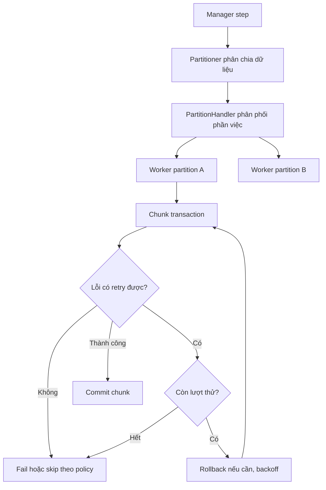

# Retry lỗi tạm thời trong worker Spring Batch

Khi Spring Batch xử lý hàng triệu bản ghi bằng **multi-threaded step**, **partitioning** hoặc các worker phân tán, lỗi mạng chập chờn, deadlock trong cơ sở dữ liệu và dịch vụ bên ngoài quá tải có thể xuất hiện dù dữ liệu đầu vào hoàn toàn hợp lệ. **Retry** cho phép worker thử lại một thao tác *có khả năng thành công ở lần sau* mà không cần khởi chạy toàn bộ job từ đầu.

Retry hiệu quả cần đồng thời trả lời bốn câu hỏi: **Lỗi nào có thể phục hồi? Thử lại ở phạm vi nào? Thử tối đa bao nhiêu lần và chờ bao lâu? Làm sao để thử lại không tạo ra tác dụng phụ trùng lặp?** Các câu hỏi này đặc biệt quan trọng với `SPRING_BATCH_SCALING_OPERATIONS`, vì nhiều worker cùng retry có thể biến một lỗi tạm thời thành nút thắt hoặc sự cố quá tải toàn hệ thống.

## 1. Khi nào một lỗi trong worker đáng retry?

Lỗi **tạm thời (transient)** là lỗi có khả năng tự hết khi điều kiện môi trường thay đổi, trong khi đầu vào và logic xử lý vẫn đúng. Retry là quyết định có điều kiện, không phải cách sửa mọi exception.

| Tình huống trong worker | Đặc điểm | Hành động thường phù hợp |
| --- | --- | --- |
| Deadlock hoặc lock timeout khi ghi database | Tranh chấp giữa các giao dịch có thể biến mất | Retry có giới hạn, có backoff; kiểm tra thời gian giữ lock |
| Mất kết nối ngắn, timeout mạng | Có thể phục hồi nhưng **không biết chắc server đã xử lý yêu cầu hay chưa** | Retry nếu thao tác idempotent hoặc có thể kiểm tra kết quả |
| HTTP `429 Too Many Requests` | Phụ thuộc hạn mức hoặc tải dịch vụ | Tôn trọng `Retry-After` khi có; giảm đồng thời, giới hạn tần suất |
| HTTP `503 Service Unavailable` | Dịch vụ tạm không sẵn sàng | Backoff, có thể áp dụng circuit breaker ở tầng tích hợp |
| HTTP `400`, dữ liệu sai schema, lỗi validation | Đầu vào sai và thử lại không đổi dữ liệu | Không retry; xử lý dữ liệu lỗi hoặc fail/skip theo nghiệp vụ |
| Lỗi lập trình, cấu hình, credential bị từ chối | Lỗi có tính bền vững cho đến khi sửa | Fail nhanh, cảnh báo; không che giấu bằng retry |
| Không đủ dung lượng lưu trữ, hết quota cố định | Retry liên tục thường không hiệu quả | Fail hoặc dừng chờ can thiệp; không tự tăng tần suất |

Không phân loại dựa vào tên exception một cách máy móc: cùng một `SocketTimeoutException` có thể xảy ra **trước** khi yêu cầu đến server hoặc **sau** khi server đã xử lý. Với thao tác ghi ra hệ thống ngoài, phải tính tới kết quả *không xác định* này.

## 2. Retry nằm ở đâu trong mô hình batch scaling?

Với partitioning, **manager step** chia phạm vi công việc; mỗi **worker step** thực hiện chunk hoặc tasklet trong partition của mình. Thông thường, retry lỗi đọc/xử lý/ghi dữ liệu được đặt tại worker, nơi Spring Batch quản lý lỗi và transaction của chunk.



Sơ đồ minh họa logic xử lý; chi tiết rollback, re-read và phục hồi state tùy reader, writer, loại exception và giao dịch. Trong chunk-oriented step, Spring Batch có cơ chế **fault tolerance** để quyết định retry/skip. Không nên tự bao quanh toàn bộ `workerStep.execute(...)` bằng một vòng `while` vô hạn, vì cách đó bỏ qua thông tin checkpoint và cơ chế điều phối chuẩn.

### Phân biệt ba phạm vi phục hồi

| Cơ chế | Phạm vi | Khi nào áp dụng? |
| --- | --- | --- |
| **Retry tại item/chunk** | Một lỗi khi đọc, xử lý hoặc ghi trong chunk của worker; Spring Batch quản lý trạng thái retry | Lỗi transient trong một lần thực thi worker step |
| **Restart một worker/partition** | Chạy tiếp hoặc chạy lại phần chưa hoàn thành dựa trên `StepExecution` và `ExecutionContext` | Worker thất bại sau khi hết retry hoặc tiến trình bị dừng |
| **Restart job** | Khởi chạy lại cùng `JobInstance` theo metadata trong `JobRepository` | Job thất bại, cần khôi phục các step/partition chưa hoàn thành |

**Retry không phải restart:** retry xảy ra trong quá trình worker đang chạy; restart dùng dữ liệu thực thi đã lưu sau khi worker/job lỗi hoặc bị gián đoạn. Retry count thông thường không phải một ngân sách toàn cục kéo dài xuyên qua mọi lần restart; cần thêm cơ chế lưu số lần tổng nếu nghiệp vụ yêu cầu giới hạn như vậy.

## 3. Thiết lập retry tại chunk-oriented worker step

Ví dụ dưới đây dùng API cấu hình Java của **Spring Batch 5.x**, trong đó worker đọc đơn hàng, xử lý và ghi kết quả. Ta chỉ retry họ lỗi truy cập dữ liệu tạm thời do Spring Data Access cung cấp, với tối đa ba lần thử.

```java
import org.springframework.batch.core.Step;
import org.springframework.batch.core.job.repository.JobRepository;
import org.springframework.batch.core.step.builder.StepBuilder;
import org.springframework.batch.item.ItemProcessor;
import org.springframework.batch.item.ItemReader;
import org.springframework.batch.item.ItemWriter;
import org.springframework.context.annotation.Bean;
import org.springframework.context.annotation.Configuration;
import org.springframework.dao.TransientDataAccessException;
import org.springframework.retry.backoff.BackOffPolicy;
import org.springframework.retry.backoff.ExponentialBackOffPolicy;
import org.springframework.transaction.PlatformTransactionManager;

@Configuration
public class WorkerRetryConfiguration {

    @Bean
    public BackOffPolicy workerBackOffPolicy() {
        ExponentialBackOffPolicy policy = new ExponentialBackOffPolicy();
        policy.setInitialInterval(200L); // 200 ms
        policy.setMultiplier(2.0);
        policy.setMaxInterval(2000L);     // Trần 2 giây
        return policy;
    }

    @Bean
    public Step workerStep(
            JobRepository jobRepository,
            PlatformTransactionManager transactionManager,
            ItemReader<Order> reader,
            ItemProcessor<Order, ProcessedOrder> processor,
            ItemWriter<ProcessedOrder> writer,
            BackOffPolicy workerBackOffPolicy) {

        return new StepBuilder("workerStep", jobRepository)
                .<Order, ProcessedOrder>chunk(100, transactionManager)
                .reader(reader)
                .processor(processor)
                .writer(writer)
                .faultTolerant()
                .retry(TransientDataAccessException.class)
                .retryLimit(3)
                .backOffPolicy(workerBackOffPolicy)
                .build();
    }
}
```

`Order` và `ProcessedOrder` là các kiểu dữ liệu ứng dụng; reader/processor/writer được cấu hình thành bean ở phần khác của ứng dụng. Đây là ví dụ xây dựng worker step, không phải toàn bộ cấu hình manager/partitioning. Việc cấu hình `BackOffPolicy` yêu cầu thư viện Spring Retry tương thích với phiên bản Spring Batch đang dùng.

Ý nghĩa cấu hình:

- `.faultTolerant()` kích hoạt các chính sách xử lý lỗi cho chunk.
- `.retry(TransientDataAccessException.class)` cho phép retry lỗi thuộc họ exception này, chẳng hạn những lỗi lock/deadlock mà tầng truy cập dữ liệu chuyển đổi thành exception transient.
- `.retryLimit(3)` giới hạn **tối đa ba lần thử gồm lần đầu**, tức tối đa hai lần thử lại cho một trường hợp lỗi đủ điều kiện.
- `.backOffPolicy(...)` giãn khoảng chờ giữa các lần thử; với ví dụ này khoảng chờ tăng dần theo cấp số nhân đến trần 2 giây.

Không tự động retry mọi `Exception` hoặc `RuntimeException` trong production. Cách đó có thể làm dữ liệu sai bị lặp lại vô ích, kéo dài thời gian lỗi và gây thêm tải. Nếu cơ sở dữ liệu/driver ném một exception chưa được chuyển đổi sang họ `TransientDataAccessException`, cần kiểm tra exception thực tế và chọn policy tương ứng.

### Chuyện gì xảy ra khi writer thất bại?

Giả sử chunk chứa 100 bản ghi. Writer ghi được một phần rồi gặp deadlock:

1. Transaction của chunk thất bại và **rollback các thay đổi thuộc chính transaction đó**.
2. Nếu exception được phân loại retryable và còn lượt thử, Spring Batch áp dụng chính sách retry/backoff rồi thử xử lý lại theo ngữ cảnh chunk.
3. Các thao tác đọc, xử lý hoặc ghi có thể được gọi lại. Đặc biệt, writer có thể thấy lại những item của chunk; không được giả định rằng mỗi item chỉ gọi writer một lần.
4. Nếu lần thử sau thành công, chunk có thể commit; nếu hết retry, step sẽ fail trừ khi có skip policy phù hợp và còn skip limit.

Nếu writer ghi qua HTTP, gửi email, ghi file ngoài giao dịch hoặc kích hoạt message ở hệ thống khác, rollback transaction cơ sở dữ liệu **không hoàn tác** những tác dụng phụ đó. Vì vậy, retry **phải đi kèm thiết kế idempotency hoặc ranh giới giao dịch rõ ràng**.

## 4. Retry, skip và rollback không thể dùng thay thế nhau

| Cơ chế | Mục tiêu | Ví dụ |
| --- | --- | --- |
| Retry | Chờ sự cố có thể phục hồi rồi thử lại | Deadlock, timeout tạm thời |
| Skip | Bỏ qua một item lỗi được nghiệp vụ cho phép và tiếp tục xử lý | Dòng CSV sai định dạng đã được ghi nhận để đối soát |
| Rollback | Hủy những thay đổi chưa commit trong transaction | Chunk ghi database lỗi |
| Restart | Khôi phục job/step sau khi đã thất bại hoặc dừng | Partition A hoàn tất, partition B lỗi |

Thứ tự xử lý phụ thuộc loại lỗi và cấu hình của Spring Batch, nhưng một ý cốt lõi là: **lỗi dữ liệu cố định không nên retry nhiều lần, lỗi hạ tầng transient không nên skip âm thầm**, và rollback cần được xác định bởi transaction boundary thật. Ví dụ, nếu nghiệp vụ cho phép bỏ qua dòng đầu vào sai:

```java
// Đoạn bổ sung trong chuỗi cấu hình faultTolerant() của worker step:
.skip(org.springframework.batch.item.validator.ValidationException.class)
.skipLimit(10)
```

Không dùng `skipLimit` làm ngưỡng bỏ qua deadlock hàng loạt. Nếu database đang lỗi, tiếp tục bỏ qua các item có thể làm đầu ra thiếu dữ liệu mà job vẫn có vẻ hoàn thành. Cũng không mặc định `noRollback(...)` cho exception ghi dữ liệu để giữ giao dịch đang lỗi; tùy transaction manager, có những exception khiến giao dịch bắt buộc phải rollback.

## 5. Trách nhiệm của worker khi xử lý retry

### 5.1. Thiết kế thao tác ghi có tính idempotent

Một writer **idempotent** tạo cùng trạng thái kết quả khi nhận lại một yêu cầu đã áp dụng thành công. Đây là nguyên tắc quan trọng vì hệ thống có thể không biết lần gọi trước đã commit ở đích hay chưa.

Các cách triển khai thường gặp:

- Dùng unique key cho bản ghi đầu ra và cơ chế `UPSERT`/`MERGE` phù hợp với hệ quản trị dữ liệu, ví dụ khóa nghiệp vụ `(order_id, processing_version)`.
- Gửi **idempotency key** ổn định theo dữ liệu nghiệp vụ tới API bên ngoài nếu API hỗ trợ; key không thay đổi giữa các lần retry.
- Với message/event, dùng outbox, deduplication hoặc thiết kế consumer idempotent khi yêu cầu.
- Tránh `balance = balance + amount` trên cùng giao dịch có thể được gửi lại nếu không có mã giao dịch duy nhất để chống áp dụng hai lần.

Ví dụ minh họa PostgreSQL:

```sql
INSERT INTO order_summary (order_id, total_amount)
VALUES (:orderId, :totalAmount)
ON CONFLICT (order_id)
DO UPDATE SET total_amount = EXCLUDED.total_amount;
```

Câu lệnh trên phù hợp khi kết quả cần lưu chính là giá trị cuối cùng cho từng `order_id`. Nó không tự bảo vệ tất cả tác dụng phụ khác (chẳng hạn phát thông báo hoặc thay đổi số dư). Với nghiệp vụ tạo lịch sử bất biến, cần thiết kế khóa nghiệp vụ và quy tắc ghi tương ứng.

### 5.2. Không chia sẻ trạng thái mutable giữa các worker

Trong **multi-threaded step** hoặc **local partitioning**, các worker có thể cùng chạy trong một JVM. Reader lưu con trỏ, writer chứa buffer, bộ đếm retry tự viết hoặc client có state không được chia sẻ tùy tiện giữa nhiều thread.

- Dùng `@StepScope` khi reader/writer cần nhận tham số riêng từ `stepExecutionContext` của từng partition.
- Giữ các bean singleton không có trạng thái mutable hoặc bảo đảm thread safety được kiểm chứng.
- Không lưu số lần retry trong biến `static` hay biến chung của worker để suy ra trạng thái từng item; dùng cơ chế retry policy/context được hỗ trợ.
- Trong remote partitioning, mỗi worker có vòng đời tiến trình riêng; thông tin partition và checkpoint cần nằm ở nơi có thể khôi phục, không dựa vào RAM của manager.

Ví dụ một worker nhận phạm vi dữ liệu đã do `Partitioner` tạo:

```java
@Bean
@StepScope
public ItemReader<Order> orderReader(
        @Value("#{stepExecutionContext['fromId']}") Long fromId,
        @Value("#{stepExecutionContext['toId']}") Long toId) {
    // Tạo reader riêng đọc miền [fromId, toId].
    // Cấu hình truy vấn, resource và cơ chế checkpoint tại đây.
    return createOrderReader(fromId, toId);
}
```

Đây là đoạn minh họa sử dụng `@StepScope`; `createOrderReader(...)` là hàm ứng dụng cần tự hiện thực. Nó cho thấy retry và partitioning phối hợp qua `ExecutionContext`, không biến `Partitioner` thành nơi thực hiện retry.

### 5.3. Phối hợp timeout, backoff và giới hạn tài nguyên

Nếu 20 worker cùng gọi một API và cùng nhận HTTP 503, retry ngay lập tức có thể tạo **retry storm**: các request lỗi quay trở lại cùng lúc, làm dịch vụ tiếp tục nghẽn.

Các biện pháp phòng ngừa:

1. Giới hạn `retryLimit`; đặt `connect timeout` và `read timeout` phù hợp ở HTTP/JDBC client để một lần thử không treo vô hạn.
2. Dùng **exponential backoff** và cân nhắc **jitter** (dao động ngẫu nhiên trong thời gian chờ) để các worker không cùng thức dậy và gửi request đồng loạt. `ExponentialBackOffPolicy` trong ví dụ chỉ cấu hình tăng thời gian; nếu cần jitter, chọn chính sách triển khai hỗ trợ hoặc tự xây chính sách phù hợp.
3. Tôn trọng `Retry-After` nếu dịch vụ cung cấp; cần viết tầng tích hợp/policy đọc header và điều chỉnh thời gian chờ thay vì giả định cấu hình exponential cố định tự làm việc này.
4. Giảm concurrency ở `PartitionHandler`/`TaskExecutor` hoặc bộ điều phối worker từ xa khi database/API đã bão hòa; số partition có thể lớn hơn số worker hoạt động đồng thời.
5. Kiểm tra giới hạn JDBC connection pool, DB locks, thread pool, HTTP connection pool, queue capacity và rate limit chung của toàn bộ hệ thống.

Ví dụ, 8 worker có tối đa 3 lần thử một request có thể tạo tới 24 lượt gọi từ nhóm công việc đó trong trường hợp mọi lượt đều bị lỗi. Tổng số không tăng vô hạn, nhưng nếu hàng trăm chunk cùng lỗi tại thời điểm gần nhau, số request dồn vào dịch vụ vẫn rất lớn. Giảm concurrency và phân tán lịch retry thường quan trọng hơn tăng `retryLimit`.

## 6. Retry và restart khi có nhiều partition

Giả sử job có ba partition:

```text
partition-000 [1..1000]     COMPLETED
partition-001 [1001..2000]  FAILED sau khi hết retry
partition-002 [2001..3000]  COMPLETED
```

Khi restart **cùng `JobInstance`**, Spring Batch dùng trạng thái các `StepExecution` trong `JobRepository` để quyết định partition nào cần xử lý lại theo chính sách restart. Các partition hoàn thành thường không cần chạy lại; partition thất bại có thể được thực hiện lại từ checkpoint phù hợp. Tuy nhiên, kết quả cụ thể phụ thuộc cấu hình step, tính ổn định của tên partition và state của reader/writer.

Những điều kiện cần bảo đảm:

- **Ranh giới partition giữ nguyên:** cùng tên và cùng phạm vi dữ liệu qua restart; nếu dữ liệu gốc thay đổi, phải có snapshot hoặc cơ chế xác định tập bản ghi cần xử lý.
- **Metadata bền vững:** `JobRepository` lưu trạng thái; `ExecutionContext` chỉ chứa thông tin cần thiết có thể tuần tự hóa. Một cache trong JVM không thay thế checkpoint bền vững.
- **Dữ liệu đầu ra chống trùng:** một chunk có thể được gọi lại sau rollback, restart hoặc khi kết quả gọi từ xa không rõ ràng. Dùng khóa idempotent và đối soát trạng thái đích.
- **Remote worker có thể mất liên lạc:** manager có thể không phân biệt worker đã hoàn thành ghi hay đã mất trước khi thông báo kết quả; giao thức phân phối và thao tác ghi phải chịu được khả năng giao lại công việc.
- **Retry và restart có ngân sách khác nhau:** nếu yêu cầu tối đa năm lần gọi API qua mọi lần chạy, phải lưu ngân sách ở tầng nghiệp vụ thay vì chỉ dùng `.retryLimit(5)`.

Với remote partitioning hoặc remote chunking, lỗi có thể nằm ở **đường truyền thông điệp** chứ không nằm ở item processor/writer. Retry tại messaging middleware có thể giao message lại độc lập với retry tại chunk của Spring Batch; cần xem chính sách ack, redelivery và idempotency của hệ thống truyền tin. Không cộng dồn retry không kiểm soát ở mọi tầng.

## 7. Quan sát và đo tác động của retry

Để biết retry cứu được job hay đang che giấu nút thắt, theo dõi ít nhất:

| Tín hiệu | Cách diễn giải |
| --- | --- |
| `retry attempts` theo exception và worker | Lỗi xảy ra ở đâu, có tăng đồng loạt không |
| `successful after retry` | Retry thực sự cứu được bao nhiêu thao tác |
| `retry exhausted` | Số thao tác hết lượt và làm step fail |
| `backoff time` tổng và trung bình | Thời gian chờ chiếm bao nhiêu thời gian job |
| `chunk commit/rollback counts` | Tỷ lệ giao dịch lỗi và chi phí thử lại |
| Throughput, p95/p99 latency từng partition | Partition bị chậm do tải, tranh chấp hoặc dữ liệu lệch |
| Connection pool wait, DB deadlocks, HTTP 429/503 | Nút thắt thực ở hệ thống bên ngoài |

Spring Batch có `StepExecution` và `JobRepository` để xem trạng thái step, các bộ đếm tổng như `commitCount`/`rollbackCount`, đọc/ghi và skip. **Bộ đếm retry attempts chi tiết theo nguyên nhân không tự xuất hiện đầy đủ chỉ từ các bộ đếm này**; có thể bổ sung `RetryListener`, log có cấu trúc hoặc metric ở tầng client để đo phù hợp.

Gắn thông tin `jobExecutionId`, `stepExecutionId`, tên partition, ID bản ghi/khóa nghiệp vụ (đã xử lý dữ liệu nhạy cảm), loại exception, lần thử và thời gian backoff vào log. Với remote worker, bổ sung correlation ID để lần theo cùng một đơn vị công việc giữa manager, message broker và worker.

## 8. Kịch bản kiểm thử thực tế

Không nên chỉ kiểm tra rằng `.retryLimit(3)` tồn tại trong cấu hình. Các bài kiểm thử có ý nghĩa gồm:

| Kịch bản | Kết quả mong đợi |
| --- | --- |
| Writer lỗi transient lần đầu, thành công lần thứ hai | Worker hoàn thành; số lần thử đúng giới hạn; dữ liệu ghi đúng một lần về mặt kết quả |
| Writer lỗi transient liên tục hơn giới hạn | Worker/step thất bại rõ ràng; không có commit một phần ngoài ý muốn |
| Item có dữ liệu validation sai | Không retry vô ích; fail hoặc skip theo đúng policy đã định |
| Worker chết sau khi hệ thống ngoài đã nhận request nhưng trước khi ack | Khi chạy lại, idempotency key ngăn tác dụng phụ nhân đôi |
| Nhiều worker cùng gặp 429/503 | Giới hạn request và backoff hoạt động; không làm connection pool hoặc downstream bão hòa |
| Partition thứ hai fail, hai partition còn lại completed | Restart đúng `JobInstance` xử lý phần cần thiết; kết quả cuối không thiếu/trùng |

Khi thử lỗi database, bảo đảm thao tác thử thuộc cùng transaction để quan sát rollback chính xác. Với API ngoài giao dịch, chủ động mô phỏng timeout **sau khi** server đã xử lý thành công để kiểm tra idempotency; đây là trường hợp dễ bị bỏ sót khi chỉ giả lập lỗi trước khi gửi request.

## 9. Quy tắc quyết định nhanh

Trước khi bật retry cho một worker, có thể tự hỏi theo thứ tự:

1. **Tạm thời hay vĩnh viễn?** Nếu lỗi không tự phục hồi, fail hoặc skip theo nghiệp vụ.
2. **Thử lại có an toàn không?** Nếu thao tác có side effect, thiết kế idempotency/transaction trước.
3. **Thử lại ở lớp nào?** Với item/chunk, dùng fault tolerance của worker step; với message/API, phối hợp chính sách của client/middleware để tránh retry nhiều tầng.
4. **Giới hạn và thời gian chờ?** Chọn số lần thử, timeout, exponential backoff và jitter theo SLA và khả năng chịu tải.
5. **Khi hết lượt thử thì sao?** Cho step thất bại đúng nghĩa hoặc xử lý lỗi nghiệp vụ rõ ràng; bảo đảm khả năng restart và đối soát.
6. **Làm sao biết retry hiệu quả?** Đo lỗi, rollback, thời gian chờ, throughput và tình trạng hệ thống đích khi tăng số worker.

> **Ghi nhớ:** Trong Spring Batch scaling, retry là một cơ chế **phục hồi có giới hạn tại worker**, không phải giải pháp chung cho mọi lỗi. Hệ thống vận hành an toàn khi retry đúng loại lỗi, backoff hợp lý, giới hạn concurrency, ghi idempotent và khôi phục được từng partition qua `JobRepository`.
