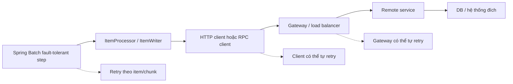
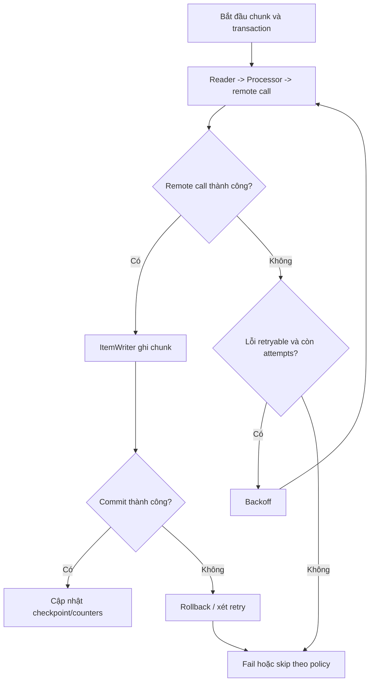

# Retry remote call trong Spring Batch: an toàn, có giới hạn và đo được

Khi một Spring Batch job gọi **HTTP API, RPC, gRPC hoặc dịch vụ bên ngoài**, lỗi không phải lúc nào cũng đồng nghĩa với thất bại vĩnh viễn. Kết nối có thể bị reset, dịch vụ trả `503 Service Unavailable` hoặc `429 Too Many Requests` rồi hoạt động bình thường sau vài giây. **Retry remote call** cho phép thử lại một thao tác bị lỗi tạm thời, nhưng nếu làm thiếu kiểm soát có thể tạo **ghi trùng**, retry storm, giữ transaction quá lâu, làm quá tải dịch vụ đích hoặc khiến job không đáp ứng batch window.

Bài thuộc chương **Retry** của module **SPRING_BATCH_SCALING_OPERATIONS**. Trọng tâm là retry remote call trong **chunk-oriented step của Spring Batch 5.x**, đồng thời giải thích khi các step được mở rộng bằng multi-threaded step, parallel steps, partitioning hoặc remote chunking. Mục tiêu không chỉ là làm request thành công, mà còn bảo đảm **tính đúng đắn nghiệp vụ, thread safety, khả năng restart và giới hạn tài nguyên đo được**.

## 1. Retry remote call giải quyết điều gì?

Giả sử một job mỗi đêm xử lý 500.000 đơn hàng và hỏi dịch vụ chấm điểm gian lận:

```text
ItemReader -> ItemProcessor -> HTTP /risk/score -> ItemWriter
                                 |
                            timeout / 503 / 429
```

Nếu job dừng vì một lần `503` ngắn, batch window có thể bị lãng phí. Retry vài lần với backoff giúp xử lý được lỗi tạm thời mà không phải chạy lại cả job.

Nhưng ba câu hỏi phải được trả lời **trước khi bật retry**:

1. **Lỗi có khả năng tự hết không?** `503`/connection reset thường đáng retry; JSON không hợp lệ hay `400` do sai dữ liệu thường không.
2. **Nếu request thực ra đã được dịch vụ xử lý thì gọi lại có an toàn không?** Timeout sau khi server commit là trường hợp điển hình: client thấy lỗi nhưng tác dụng phụ đã xảy ra.
3. **Có đủ thời gian và tài nguyên để thử lại không?** Hàng chục worker cùng retry với tần suất cao có thể phá SLA và làm dịch vụ đang lỗi càng quá tải.

Retry là **một phần của thiết kế chịu lỗi**, không phải cơ chế bảo đảm thành công hay thay thế validation, circuit breaker, rate limiting và idempotency.

## 2. Phân biệt retry, skip, restart và replay

| Cơ chế | Xảy ra ở đâu | Khi nào dùng | Điểm cần lưu ý |
| --- | --- | --- | --- |
| **Retry** | Thử lại thao tác read/process/write đang lỗi | Lỗi có thể phục hồi trong thời gian ngắn | Giới hạn attempts và backoff; request có thể đã gây side effect |
| **Skip** | Bỏ qua item theo chính sách lỗi cho phép | Item hỏng vĩnh viễn nhưng nghiệp vụ cho phép tiếp tục | Không được âm thầm bỏ các giao dịch tài chính/quan trọng |
| **Restart** | Khởi chạy lại `JobInstance` từ metadata/checkpoint | Job/step đã dừng hoặc thất bại | Không đồng nghĩa replay từng request theo đúng thứ tự cũ |
| **Message redelivery** | Broker gửi lại message | Worker chưa ACK hoặc lỗi vận chuyển | Có thể diễn ra **ngoài** retry policy của step |
| **Business reprocess** | Chạy lại dữ liệu đã xử lý theo yêu cầu | Sửa rule, backfill, điều chỉnh lịch sử | Phải version kết quả và lựa chọn JobParameters rõ ràng |

Với remote call trong `ItemProcessor` của một chunk step, `retryLimit` điều khiển các lần thử lại trong phạm vi step. Với **remote chunking**, một `ChunkRequest` còn có thể được broker giao lại sau khi worker đã commit. **Đừng coi hai cơ chế này là cùng một retry counter**.

## 3. Phân loại lỗi: thứ được retry phải là transient

Một chiến lược tốt bắt đầu bằng **taxonomy lỗi** và contract của remote service. Quy tắc dưới đây là gợi ý ban đầu, không phải mapping bất biến cho mọi API.

| Tín hiệu | Xử lý thường hợp lý | Vì sao |
| --- | --- | --- |
| Connection reset, connect timeout, read timeout | Có thể retry với giới hạn | Lỗi mạng tạm thời; nhưng kết quả request **có thể không xác định** |
| `502 Bad Gateway`, `503 Service Unavailable`, `504 Gateway Timeout` | Thường retry với backoff | Lỗi tạm thời của gateway/backend |
| `500 Internal Server Error` | Retry có chọn lọc | Có thể tạm thời hoặc bug logic/đã gây side effect |
| `429 Too Many Requests` | Retry theo `Retry-After` nếu được phép | Cần tôn trọng quota chung; không retry ngay |
| `408 Request Timeout` | Có thể retry nếu an toàn | Server/gateway timeout; kết quả nghiệp vụ vẫn có thể mơ hồ |
| `400`, `422` vì payload không hợp lệ | Thường **không** retry | Dữ liệu sai không tự hết |
| `401`/`403` | Thường fail và điều tra auth/config | Có thể refresh token theo cơ chế riêng, không lặp request vô hạn |
| `404` | Phụ thuộc nghiệp vụ | Resource chưa đồng bộ có thể eventual consistency; ID sai là lỗi vĩnh viễn |
| `409 Conflict` | Phụ thuộc contract | Có thể là trạng thái đang bận hoặc conflict bất biến |
| `501 Not Implemented` | Thường không retry | Gọi API không được hỗ trợ |
| TLS trust/certificate lỗi, JSON schema mismatch | Không retry mù quáng | Cần sửa cấu hình/contract |
| API trả mã `200` nhưng business error | Phân loại theo **mã lỗi nghiệp vụ** | HTTP thành công không bảo đảm nghiệp vụ thành công |

**Không retry dựa trên mọi `Exception`.** Một `NullPointerException`, `IllegalArgumentException` do lập trình sai hoặc lỗi mapping dữ liệu sẽ không tự khỏi vì đợi thêm 500 ms.

Một mô hình thuận tiện là ánh xạ lỗi remote sang hai nhóm exception rõ ràng:

- `RemoteTransientException`: có thể thử lại trong policy đã thiết kế.
- `RemotePermanentException`: thất bại vĩnh viễn với item/request hiện tại, cần fail hoặc skip theo nghiệp vụ.

Thông báo exception cần giữ **HTTP status, mã lỗi nghiệp vụ, request correlation và nguyên nhân gốc**, nhưng tránh lộ token/PII hoặc toàn bộ payload.

## 4. Điểm đặt retry: Spring Batch step hay HTTP client?

Có nhiều tầng có thể retry:



Nếu step retry ba lần, HTTP client retry ba lần bên trong mỗi attempt và gateway cũng retry hai lần, **số request thực tế có thể nhiều hơn nhiều** so với ba. Trong kịch bản lý tưởng hóa với cả ba tầng độc lập cùng lặp tối đa, số request có thể lên đến:

\[
A_{\mathrm{effective}}\le A_{\mathrm{step}}\times
A_{\mathrm{client}}\times A_{\mathrm{gateway}}
\]

Ví dụ `3 × 3 × 2 = 18` lần server có thể nhìn thấy cùng thao tác, trước khi tính thêm broker redelivery hoặc restart.

**Nguyên tắc thực hành:** Chọn một **tầng sở hữu retry chính** cho thao tác nghiệp vụ, hiểu retry ẩn ở các tầng khác và phân bổ tổng ngân sách thời gian/attempt. Với remote call trong processor của Spring Batch, cấu hình retry tại fault-tolerant step thường rõ ràng về lifecycle, counters và giới hạn. HTTP client vẫn nên có **connect/read timeouts** và xử lý status; không mặc định bật thêm nhiều vòng retry.

Có trường hợp cần retry ở client (ví dụ refresh token một lần hoặc retry connect trước khi request được gửi) nhưng phải định nghĩa rõ hành vi và tương tác với step.

## 5. Spring Batch 5.x: cấu hình retry cho ItemProcessor

Dưới đây là mẫu **chunk-oriented step** chạy Java 17 với Spring Batch 5.x. `ItemProcessor` gọi remote API và có thể ném `RemoteTransientException` cho lỗi đáng retry.

```java
import org.springframework.batch.core.Step;
import org.springframework.batch.core.repository.JobRepository;
import org.springframework.batch.core.step.builder.StepBuilder;
import org.springframework.batch.item.ItemProcessor;
import org.springframework.batch.item.ItemReader;
import org.springframework.batch.item.ItemWriter;
import org.springframework.context.annotation.Bean;
import org.springframework.context.annotation.Configuration;
import org.springframework.retry.backoff.ExponentialBackOffPolicy;
import org.springframework.transaction.PlatformTransactionManager;

@Configuration
public class RemoteCallRetryBatchConfig {

    @Bean
    public ExponentialBackOffPolicy remoteBackOffPolicy() {
        ExponentialBackOffPolicy policy = new ExponentialBackOffPolicy();
        policy.setInitialInterval(250L);
        policy.setMultiplier(2.0);
        policy.setMaxInterval(2_000L);
        return policy;
    }

    @Bean
    public Step scoreOrdersStep(
            JobRepository jobRepository,
            PlatformTransactionManager transactionManager,
            ItemReader<Order> orderReader,
            ItemProcessor<Order, ScoredOrder> riskProcessor,
            ItemWriter<ScoredOrder> scoreWriter,
            ExponentialBackOffPolicy remoteBackOffPolicy) {

        return new StepBuilder("scoreOrdersStep", jobRepository)
                .<Order, ScoredOrder>chunk(100, transactionManager)
                .reader(orderReader)
                .processor(riskProcessor)
                .writer(scoreWriter)
                .faultTolerant()
                .retry(RemoteTransientException.class)
                .retryLimit(3)
                .backOffPolicy(remoteBackOffPolicy)
                .build();
    }
}
```

**Ý nghĩa thực tế:**

- `faultTolerant()` chuyển step sang cấu hình hỗ trợ retry/skip theo chính sách.
- `retry(RemoteTransientException.class)` chỉ định **loại lỗi** được phép retry. Những exception khác không mặc nhiên retry.
- `retryLimit(3)` đặt **tối đa ba lần thử** cho thao tác được retry, **tính cả lần đầu**; đây không phải “ba lần thử lại sau lần đầu”.
- `backOffPolicy(...)` cho khoảng nghỉ trước khi thử lại, tránh đánh liên tục vào remote service.
- `chunk(100, transactionManager)` định nghĩa commit interval phía step. **Chunk size không bằng retry limit.**
- `ItemReader`, processor và writer là bean nghiệp vụ do ứng dụng định nghĩa; cấu hình ví dụ không tự chạy nếu chưa có các bean và JobRepository.

Với initial backoff 250 ms, multiplier 2 và ba attempts, khoảng nghỉ minh họa trước lần thử thứ hai và thứ ba có thể là **250 ms + 500 ms**, nếu không có policy khác can thiệp. Cần kiểm tra chính sách retry/backoff thực tế khi dùng custom `RetryPolicy` hoặc thay đổi phiên bản.

**Cảnh báo:** Retry limit áp dụng theo semantics retry của Spring Batch cho thao tác fault-tolerant; số lần gọi HTTP thực tế còn phụ thuộc rollback, retry state, client/gateway retry và restart. Muốn biết chính xác cần đo request ở client và service, không chỉ đọc thuộc tính cấu hình.

## 6. Viết processor ánh xạ status HTTP thành exception đúng loại

Ví dụ gọi REST endpoint chấm điểm rủi ro cho đơn hàng. Đây là một **POST có thể gây side effect**, vì vậy sử dụng một idempotency key ổn định; ở production remote service phải **thực sự triển khai semantics idempotency** cho key đó.

```java
import java.math.BigDecimal;
import org.springframework.batch.item.ItemProcessor;
import org.springframework.web.client.ResourceAccessException;
import org.springframework.web.client.RestClient;
import org.springframework.web.client.RestClientResponseException;

record Order(long id, long version, BigDecimal amount) {}
record ScoreRequest(long orderId, BigDecimal amount) {}
record ScoreResponse(int score) {}
record ScoredOrder(long orderId, int score) {}

class RemoteTransientException extends RuntimeException {
    RemoteTransientException(String message, Throwable cause) {
        super(message, cause);
    }
    RemoteTransientException(String message) {
        super(message);
    }
}

class RemotePermanentException extends RuntimeException {
    RemotePermanentException(String message, Throwable cause) {
        super(message, cause);
    }
}

public final class RiskScoringProcessor
        implements ItemProcessor<Order, ScoredOrder> {

    private final RestClient client;

    public RiskScoringProcessor(RestClient client) {
        this.client = client;
    }

    @Override
    public ScoredOrder process(Order order) {
        String operationId =
                "risk-score:" + order.id() + ":v" + order.version();

        try {
            ScoreResponse response = client.post()
                    .uri("/v1/risk-score")
                    .header("Idempotency-Key", operationId)
                    .body(new ScoreRequest(order.id(), order.amount()))
                    .retrieve()
                    .body(ScoreResponse.class);

            if (response == null || response.score() < 0
                    || response.score() > 100) {
                throw new RemotePermanentException(
                    "Invalid score response for order " + order.id(),
                    null);
            }
            return new ScoredOrder(order.id(), response.score());

        } catch (RestClientResponseException ex) {
            int status = ex.getStatusCode().value();
            if (status == 408 || status == 429
                    || status == 500 || status == 502
                    || status == 503 || status == 504) {
                throw new RemoteTransientException(
                    "Risk API temporary HTTP " + status, ex);
            }
            throw new RemotePermanentException(
                    "Risk API non-retryable HTTP " + status, ex);

        } catch (ResourceAccessException ex) {
            throw new RemoteTransientException(
                    "Risk API transport failure", ex);
        }
    }
}
```

Điều kiện của ví dụ:

1. Dùng `RestClient` của Spring Framework 6.1+; dự án phải cấu hình bean `RestClient` với base URL, connect timeout, response/read timeout, TLS và connection pool phù hợp.
2. `ScoreRequest`/`ScoreResponse` là DTO minh họa, chỉ đúng khi API có contract tương ứng; dùng schema và rule version thực tế của dịch vụ.
3. Retryable HTTP status là **quyết định thiết kế cụ thể cho dịch vụ này**. Với `500` không phục hồi hoặc `409` có thể phục hồi, phải đổi mapping dựa trên contract.
4. Không log access token, payload chứa dữ liệu khách hàng hoặc response body nhạy cảm.
5. Idempotency key dựa trên **business operation + phiên bản**, không đổi khi retry hoặc restart cùng thao tác. Server phải lưu/truy vấn kết quả cũ hoặc từ chối ghi trùng theo key; chỉ thêm HTTP header ở phía client **không bảo đảm** idempotency.

Mẫu trên xử lý timeout mà client thấy bằng `ResourceAccessException`. Một timeout **không chứng minh** request chưa đến server; phải dùng key hoặc cơ chế đối soát để gọi lại an toàn.

### Nếu remote endpoint là GET chỉ đọc

Với GET thực sự thuần đọc, không tạo side effect và cùng version dữ liệu, retry thường đơn giản hơn. Dù vậy, cần xác nhận API không có side effect ẩn, cache/data snapshot và rate limit. Không nên suy rằng mọi request có method GET đều an toàn trong một hệ thống bất kỳ.

## 7. Timeout phải được thiết kế trước retry

Không có timeout hữu hạn, một request có thể treo quá lâu; retry policy **chưa có cơ hội** thực thi.

Ví dụ cấu hình `RestClient` minh họa sử dụng request factory của Spring Framework:

```java
import org.springframework.context.annotation.Bean;
import org.springframework.web.client.RestClient;
import org.springframework.http.client.SimpleClientHttpRequestFactory;

@Bean
public RestClient riskRestClient() {
    SimpleClientHttpRequestFactory requestFactory =
            new SimpleClientHttpRequestFactory();
    requestFactory.setConnectTimeout(1_000); // 1 giây
    requestFactory.setReadTimeout(3_000);    // 3 giây

    return RestClient.builder()
            .baseUrl("https://risk-service.internal")
            .requestFactory(requestFactory)
            .build();
}
```

Đây là cấu hình minh họa cho client đơn giản. Với tải lớn nên đánh giá request factory sử dụng connection pooling, DNS, proxy, TLS, idle timeout và connection reuse phù hợp. Tham số `connectTimeout` và `readTimeout` không bảo đảm **total deadline** cho mọi bước của một request (ví dụ chờ pool connection hoặc DNS tùy client).

Giả sử mỗi attempt tối đa xấp xỉ ba giây ở giai đoạn xử lý HTTP và backoff 250 + 500 ms, thời gian một item thất bại sau ba attempts có thể gần **9,75 giây**, chưa tính kết nối, queue, broker hoặc chi phí khác:

\[
T_{\mathrm{item}}\approx
3\times3\text{ s}+0,25\text{ s}+0,5\text{ s}=9,75\text{ s}
\]

Nếu một chunk có 100 item được xử lý **tuần tự** và nhiều item liên tục fail, chunk có thể giữ transaction cực lâu. Cần cân nhắc deadline theo job/SLA, chunk size, chính sách dừng sớm và các quota ở service đích.

**Không mặc định retry vô hạn** cho remote call vì một sự cố kéo dài 20 phút có thể khiến job chạy hết cửa sổ và làm downstream quá tải.

## 8. Exponential backoff, jitter và Retry-After

Backoff tránh gửi lại ngay khi remote service đang phục hồi.

Với initial delay `d_0`, multiplier `m`, delay tối đa `d_max`, một dạng exponential backoff:

\[
d_n=\min(d_{\max}, d_0 m^{n-1})
\]

Ví dụ `d_0=250` ms, `m=2`, `d_max=2.000` ms: các khoảng nghỉ lần lượt khoảng 250, 500, 1.000, 2.000, 2.000 ms trước những lần retry tương ứng nếu budget cho phép.

**Jitter** giúp các worker không đồng loạt retry đúng cùng thời điểm. Khi hàng trăm item cùng nhận `503`, exponential backoff **không jitter** vẫn có thể tạo một làn sóng request đồng bộ. Có thể dùng backoff policy có randomization được hỗ trợ bởi version Spring Retry hoặc tự áp dụng chiến lược jitter đã được kiểm thử, thay vì mọi worker dùng cùng nhịp.

### Retry-After không tự được tôn trọng

Với `429`/`503`, server có thể gửi:

```http
HTTP/1.1 429 Too Many Requests
Retry-After: 5
```

Header `Retry-After` có thể là **số giây** hoặc **HTTP-date**. Đoạn code ở mục 6 chỉ ánh xạ status thành exception; `ExponentialBackOffPolicy` ở mục 5 **không tự đọc header này**. Nếu contract remote service yêu cầu tuân thủ `Retry-After`, cần thiết kế interceptor/policy giữ thông tin header và trì hoãn thích hợp, hoặc đưa item vào lịch xử lý lại thay vì chặn thread quá lâu.

Nếu server yêu cầu đợi 60 giây trong khi SLA/chunk transaction không chịu được, việc đúng có thể là **fail có kiểm soát rồi retry job sau**, không phải giữ tất cả worker ngủ 60 giây. Đặc biệt cần một **rate limiter dùng chung** giữa nhiều worker khi quota được áp dụng theo toàn ứng dụng/tenant.

## 9. Retry storm khi chạy multi-threaded step hoặc partitioning

Một cấu hình retry có vẻ nhỏ ở một thread có thể khuếch đại tải khi số partition/worker tăng.

Giả sử:

- Có **20 worker threads** xử lý item đồng thời.
- Mỗi item gọi remote API, tối đa **3 attempts**.
- Dịch vụ trả `503` cho toàn bộ request trong một khoảng thời gian.
- Các retry không có jitter và worker cùng thời điểm gặp lỗi.

Trong một đợt lỗi, 20 worker có thể tạo tối đa **60 request attempts**, chưa kể retry ở HTTP client/gateway, broker redelivery hoặc restart. Nếu mỗi request chờ gần 3 giây, các worker có thể chiếm thread, connection và transaction slot rất lâu.

Các biện pháp:

| Biện pháp | Tác dụng | Điều kiện |
| --- | --- | --- |
| Giới hạn đồng thời | Tránh quá nhiều request in-flight | Semaphore/bulkhead theo service hoặc tenant |
| Rate limiter | Tôn trọng req/s quota | Phải tính tổng qua nhiều JVM nếu quota toàn cục |
| Exponential backoff + jitter | Giảm đồng bộ retry | Giới hạn max delay/attempts |
| Circuit breaker | Ngừng thử ngay khi tỷ lệ lỗi cao | Cần phân biệt lỗi ngắn và lỗi kéo dài |
| Timeout hữu hạn | Giải phóng thread/connection khi dịch vụ không đáp ứng | Đo latency P95/P99 thực tế |
| Queue/backpressure | Hấp thụ spike có giới hạn | Không để backlog vô hạn; có SLA tuổi hàng đợi |
| Fail-fast/batch abort | Không tiếp tục đánh vào dịch vụ đang sập | Có cơ chế khôi phục sau incident |

**Đừng tăng cả thread count lẫn retryLimit cùng lúc** khi đang debug sự cố. Phép đo sẽ khó chỉ ra biến nào làm tăng tải, và có thể khiến tỷ lệ lỗi tệ hơn.

## 10. Mô hình capacity: retry làm tiêu tốn bao nhiêu công suất?

Nếu xác suất mỗi attempt thất bại độc lập là `p` và giới hạn tổng số attempts là `A`, số attempts kỳ vọng trong mô hình đơn giản:

\[
E[\mathrm{attempts}]=
\sum_{i=0}^{A-1}p^i
=\frac{1-p^A}{1-p}\quad(p\ne1)
\]

Ví dụ `A=3`, `p=0,1`:

\[
E[\mathrm{attempts}]=1+0,1+0,01=1,11
\]

Nghĩa là cần bình quân 1,11 HTTP requests cho một item, tăng khoảng 11% số request. Nhưng khi service bị outage, failures **có tương quan**, `p` có thể tiến gần 1; mức tải trở thành gần **ba attempts cho mỗi item**, cộng backoff và timeout. Công thức trên không mô hình hóa outage có tương quan hoặc timeout không rõ kết quả.

Nếu không có lỗi, một worker gọi API với latency trung bình `L` giây và mỗi thread chỉ có một request in-flight, thông lượng lý tưởng ở `C` concurrent requests:

\[
R_{\mathrm{ideal}}\approx\frac{C}{L}
\]

Với `C=20` và `L=0,4` giây, thông lượng lý tưởng khoảng 50 request/giây. Nếu quota là 40 req/s, phải giới hạn rate/concurrency; retry còn làm số request thực lớn hơn số item hoàn tất.

### Capacity theo batch window

Job có 1.200.000 item, SLA 15 phút:

\[
R_{\mathrm{business}}=
\frac{1.200.000}{15\times60}
\approx1.333\text{ item/giây}
\]

Nếu bình quân 1,11 attempts/item, API phải phục vụ ít nhất khoảng:

\[
R_{\mathrm{API}}\approx1.333\times1,11
\approx1.480\text{ request/giây}
\]

Chưa tính startup, reprocess, service latency tail và các job khác. Nếu API quota chỉ 1.000 requests/giây, tăng concurrency không giải quyết SLA; cần batch endpoint, giảm request/item, cache hoặc thỏa thuận tăng quota.

## 11. Retry trong processor khác retry trong writer

Chỗ gọi remote API ảnh hưởng trực tiếp đến semantics chunk và ranh giới side effect.

| Vị trí remote call | Ví dụ | Rủi ro chính |
| --- | --- | --- |
| `ItemReader` | Đọc API paginated | Retry phải giữ cursor/page, không nhảy/bỏ item |
| `ItemProcessor` | Chấm điểm gian lận, enrich | Gọi lại cùng item, cache/side effect, transaction đang mở |
| `ItemWriter` | Gửi kết quả đến API, ghi DB đích | Batch/partial success, duplicate side effect, response timeout |
| Step tasklet | Đồng bộ một tài nguyên từ xa | Retry policy do ứng dụng quyết định, không mặc nhiên có semantics fault-tolerant chunk |
| Worker remote chunking | Processor/writer nhận `ChunkRequest` | Ngoài retry nghiệp vụ còn có broker redelivery/lost reply |
| Remote partition worker | Reader/processor/writer trong partition StepExecution | Retry nội bộ step và restart theo partition |

**Với processor:** Nên giữ thao tác càng **thuần biến đổi** càng tốt. Nếu remote call là POST gây side effect, cần idempotency vì chunk rollback có thể gọi processor lần nữa. Spring Batch có tối ưu/caching cho kết quả processor trong một số kịch bản fault-tolerant chunk, nhưng **không được coi cache này thay thế idempotency xuyên restart**.

**Với writer:** Nếu gửi 100 item tới một batch API, server có thể ghi 60 rồi timeout. Gửi lại toàn bộ 100 có nguy cơ ghi trùng 60 item. Cần:

- Hợp đồng **all-or-nothing** thật sự ở remote service, hoặc
- Idempotency **theo từng item/business operation**, hoặc
- API truy vấn trạng thái theo operation ID để phân biệt đã commit, hoặc
- Compensating transaction có kiểm soát.

Không suy rằng HTTP status `500` đồng nghĩa 0 bản ghi được ghi. Remote service có thể thất bại **sau** khi commit.

## 12. Stateful retry, transaction và vì sao chunk có thể xử lý lại

Spring Batch fault-tolerant chunk processing dùng cơ chế retry gắn với lifecycle chunk/transaction. Khi một lỗi yêu cầu rollback, framework có thể phải đọc/đánh giá lại item/chunk theo chính sách. Chi tiết retry state phụ thuộc reader, processor, writer và transaction manager.

Một sơ đồ tổng quát:



Sơ đồ thể hiện **quyết định logic**, không phải trace chính xác mọi lần Spring Batch mở transaction. Trong thực tế có thể rollback, đọc lại hoặc tái xử lý item theo semantics fault-tolerant; không nên viết logic phụ thuộc vào chính xác số lần method `process()` sẽ được gọi.

### Transaction trong chunk và remote call

Một chunk step mở transaction tại ranh giới được cấu hình; remote HTTP call thường **không nằm trong cùng giao dịch ACID** với database nghiệp vụ hoặc JobRepository. Khi remote call chậm:

- Thread có thể bị giữ lâu.
- Transaction hoặc resource phía DB có thể tồn tại lâu hơn (tùy transaction manager/reader/writer).
- Lock, connection và timeout có thể tăng.
- Rollback của DB local **không hoàn tác được** side effect đã xảy ra ở API remote.

Nếu remote call thường mất vài giây và số item/chunk lớn, cân nhắc tách **ingest → enrich → write**, dùng staging/outbox, remote chunking với worker concurrency có giới hạn hoặc async orchestration theo trạng thái nghiệp vụ. Nhưng các cách này tăng độ phức tạp và phải kiểm chứng end-to-end.

## 13. Idempotency: lớp bảo vệ bắt buộc với remote write

**Idempotency** nghĩa là thực hiện lại cùng **thao tác nghiệp vụ** không làm kết quả cuối bị nhân đôi. Đối với remote call có side effect, đây là yêu cầu quan trọng nhất để retry/restart an toàn.

### Idempotency key đúng phạm vi

Một khóa tốt phải:

- Ổn định cho **cùng operation** qua retry, restart, broker redelivery.
- Phân biệt các operation thực sự khác nhau (ví dụ thay đổi rule version hoặc business transaction).
- Không chứa bí mật hoặc dữ liệu nhạy cảm không cần thiết.
- Được server kiểm tra/lưu bền vững, không chỉ ghi log.

Ví dụ:

```text
operation_id = "risk-score:order-123:rule-v5"
```

Khi server nhận lại cùng operation ID, server cần có cơ chế trả lại kết quả trước đó, hoặc từ chối thực hiện side effect lần hai theo contract. Nếu server không hỗ trợ, client phải có ledger/unique constraint/đối soát ở lớp nghiệp vụ khác.

### SQL minh họa dedupe operation ở đích

```sql
CREATE TABLE remote_operations (
    operation_id VARCHAR(120) PRIMARY KEY,
    business_id  BIGINT NOT NULL,
    status       VARCHAR(20) NOT NULL,
    result_hash  VARCHAR(128),
    updated_at   TIMESTAMP NOT NULL
);
```

Có thể dùng `operation_id` làm unique key trong cùng transaction với ghi dữ liệu nghiệp vụ. Ví dụ, nếu một yêu cầu đã ở trạng thái `COMPLETED`, server trả kết quả đã lưu thay vì áp dụng lại thao tác. **Tính đúng** phụ thuộc transaction/isolation và logic atomic ở server: chỉ tạo bản ghi operation rồi gọi API bên ngoài không làm side effect bên ngoài tự trở nên atomic.

Với khoản tiền, inventory hoặc email, cần idempotency ở đúng nơi phát sinh side effect: unique transfer ID tại payment API, outbox transactional để gửi event hoặc khóa nghiệp vụ để chống double submit.

### Timeout là kết quả không xác định, không phải chắc chắn thất bại

```text
Client gửi POST /transfer
  -> Server nhận request
  -> Server COMMIT chuyển tiền
  -> Response bị mất do mạng
Client thấy read timeout
  -> Retry POST
```

Nếu POST không idempotent, chuyển tiền có thể xảy ra hai lần. Cách an toàn hơn là gửi cùng operation key và/hoặc truy vấn trạng thái theo operation ID trước khi thực hiện lại. Không bao giờ “thử thêm cho chắc” với thao tác không có cơ chế chống trùng.

## 14. Skip hay fail khi retry hết attempts?

Một lỗi transient có thể tồn tại lâu hơn ngân sách retry. Khi hết số lần thử, cần định nghĩa **hành vi theo mức độ quan trọng của item**.

| Nghiệp vụ | Hành động nên cân nhắc | Lý do |
| --- | --- | --- |
| Giao dịch tài chính/chuyển trạng thái quan trọng | **Fail step/job**, có quy trình recovery | Mất một item là vi phạm tính đúng |
| Enrichment tùy chọn, giá trị fallback được chấp nhận | Có thể skip/fallback **nếu có hợp đồng rõ** | Job tiếp tục nhưng cần audit |
| Lỗi payload vĩnh viễn | Quarantine/skip theo policy | Retry không sửa được dữ liệu |
| API 429 trong đợt outage | Fail/dừng có kiểm soát, chạy lại theo lịch | Không spam service và vượt batch window |
| Remote writer timeout sau commit không rõ | Đối soát theo business key trước replay | Ngăn ghi trùng |

Trong Spring Batch, có thể cấu hình `skip(...)`/`skipLimit(...)` trên fault-tolerant step, nhưng **không tự bật skip cho mọi `RemoteTransientException`**. Nếu skip sau khi hết retry, item có thể bị loại khỏi kết quả dù lỗi chỉ vì dịch vụ tạm thời không sẵn sàng.

Ví dụ chỉ dùng khi nghiệp vụ cho phép bỏ qua item validation vĩnh viễn:

```java
.faultTolerant()
.retry(RemoteTransientException.class)
.retryLimit(3)
.skip(RemotePermanentException.class)
.skipLimit(10)
```

Mảnh code này chỉ minh họa cấu hình trên `StepBuilder`; không phải chuỗi method đứng độc lập trong Java. Với dữ liệu yêu cầu xử lý đầy đủ, thay vì skip, để step `FAILED` và khắc phục nguyên nhân rồi restart.

**Quan trọng:** Một exception chỉ nên được phân loại theo ý nghĩa nghiệp vụ. Việc gọi `.skip(Exception.class)` hoặc `.retry(Exception.class)` quá rộng thường khiến lỗi code và dữ liệu sai bị che khuất.

## 15. Restart sau khi remote call đã thành công một phần

Spring Batch checkpoint và `JobRepository` giúp restart từ trạng thái đã ghi nhận. Nhưng **không tạo được tính nguyên tử** cho side effect qua HTTP.

Một sự cố điển hình:

1. Manager/worker bắt đầu xử lý item A.
2. Remote API đã commit kết quả A.
3. JVM chết trước khi chunk transaction/metadata hoàn tất.
4. Restart cùng `JobInstance` có thể xử lý A lại tùy checkpoint.
5. Nếu API không idempotent, kết quả A có thể bị nhân đôi.

Do đó:

- Gắn operation ID ổn định theo item/business version.
- Đối soát trạng thái ở remote service trước khi replay các thao tác không rõ kết quả.
- Giữ reader sort key/checkpoint nhất quán và không đổi identifying `JobParameters` một cách tùy tiện.
- Không coi việc một chunk/partition có `COMPLETED` là bảo đảm mọi hệ thống ngoài DB đều không có lỗi bất đồng bộ.
- Khi remote service không hỗ trợ idempotency, đánh giá staging, outbox hoặc tách thao tác thành một workflow với reconciliation/compensation.

### Retry ở remote chunking khác với retry HTTP của worker

Trong remote chunking, worker có thể gọi HTTP trong `ItemProcessor` hoặc `ItemWriter`. Ngoài retry tại chỗ còn có **broker redelivery**: worker commit xong nhưng `ChunkResponse` bị mất khiến `ChunkRequest` có thể được thực hiện lại. Idempotency phải chịu được **cả hai cấp**.

Với remote partitioning, mỗi worker có `StepExecution`/`ExecutionContext` và cơ chế restart theo partition, nhưng vẫn có sự cố “API đã commit, metadata chưa ghi”. Không có chiến lược partitioning nào thay thế được kiểm soát side effect remote.

## 16. Observability: đo attempts chứ không chỉ completed items

Các chỉ số tối thiểu:

| Metric | Đặt ở đâu | Câu hỏi |
| --- | --- | --- |
| HTTP attempts/s theo service, endpoint, outcome | HTTP client | Có bao nhiêu request thực sự được gửi? |
| Retry attempts/s theo loại exception | Retry policy/listener | Có retry storm hay bug mapping status? |
| Success after retry / exhausted retries | Processor/step | Retry có hữu ích hay chỉ tăng tải? |
| Remote latency P50/P95/P99 | Client + service | Timeout/backoff có hợp lý? |
| `429`, `503`, timeout rates | Client/gateway | Dịch vụ đang throttling hay lỗi? |
| Active in-flight calls, connection pool pending | Runtime/HTTP client | Thread hoặc pool có bị chiếm? |
| `readCount`, `writeCount`, `rollbackCount`, skip counts | `StepExecution` | Item và chunk có tiến triển? |
| Duplicate/idempotency cache hits | Remote service | Có replay sau timeout hoặc restart? |
| Job duration so với SLA | JobRepository | Retry có làm trượt batch window? |
| Queue age, redelivery/DLQ | Broker (nếu có) | Có cấp retry ngoài step? |

**Không dùng `writeCount` làm số HTTP attempts.** Một item có thể gọi API nhiều lần trước khi được ghi một lần; một chunk rollback có thể lặp lại xử lý. Cần metrics riêng ở HTTP client (đã gửi request) và retry policy (lý do/mức thử).

Ví dụ log có cấu trúc:

```json
{
  "jobName": "nightlyRiskScoring",
  "stepName": "scoreOrdersStep",
  "businessOperationId": "risk-score:order-123:rule-v5",
  "remoteService": "risk-api",
  "httpStatus": 503,
  "attempt": 2,
  "retryable": true,
  "latencyMs": 1500
}
```

Đây là schema log **tự thiết kế**, không phải trường mặc định Spring Batch tự xuất. Không đưa ID nghiệp vụ ở mức item vào nhãn metric có cardinality cao; giữ chi tiết trong trace/log an toàn, dùng job/step/service/status group làm nhãn metric.

### Xem metadata chunk step để điều tra tổng thể

```sql
SELECT
    STEP_NAME,
    STATUS,
    READ_COUNT,
    WRITE_COUNT,
    COMMIT_COUNT,
    ROLLBACK_COUNT,
    READ_SKIP_COUNT,
    PROCESS_SKIP_COUNT,
    WRITE_SKIP_COUNT,
    START_TIME,
    END_TIME
FROM BATCH_STEP_EXECUTION
WHERE JOB_EXECUTION_ID = :jobExecutionId
ORDER BY STEP_EXECUTION_ID;
```

Schema mặc định của Spring Batch có thể được đổi prefix/kiểu cột. SQL này giúp đánh giá tiến trình và số skip/rollback, **không đủ** để kết luận một item đã phát bao nhiêu HTTP request. Kết hợp HTTP metrics và log theo correlation ID.

## 17. Tự kiểm thử retry với dịch vụ giả lập

Một cấu hình retry chưa thể được coi là đúng nếu chỉ test happy path. Nên sử dụng HTTP stub như WireMock/MockWebServer hoặc một server thử nghiệm độc lập, cùng database test để đối soát side effect.

| Test | Lịch phản hồi remote | Kỳ vọng |
| --- | --- | --- |
| Thành công ngay | `200` | Một attempt, item ghi chính xác một lần |
| Lỗi tạm thời rồi hồi phục | `503 → 503 → 200` | Thành công trong ba attempts, có backoff |
| Lỗi kéo dài | `503 → 503 → 503` | Retry exhausted, step fail hoặc xử lý theo policy |
| Payload sai | `400` | Không retry; fail/skip theo nghiệp vụ |
| Rate limit | `429` + `Retry-After` | Không retry tức thời; kiểm tra policy xử lý header |
| Timeout sau commit ở server | Server ghi xong rồi đóng kết nối | Client có thể retry, đích không được ghi trùng |
| Lỗi mapping JSON | `200` nhưng schema sai | Không tạo vòng retry vô nghĩa |
| Worker crash | Crash sau side effect nhưng trước checkpoint/reply | Restart/replay không nhân đôi output |
| Load test | Nhiều worker gặp `503` cùng lúc | Rate limiter/backoff/circuit breaker bảo vệ dịch vụ |
| Mixed failure | DNS lỗi rồi server trả `400` | Retry dừng đúng khi thành lỗi vĩnh viễn |

Với `retryLimit(3)`, test phải assert **attempts thực** ở client/server, không chỉ thời gian hoàn thành job. Khi HTTP client/gateway có retry ẩn, số requests có thể lớn hơn dự kiến.

### Ví dụ unit test ý tưởng cho phân loại lỗi

Để tránh phụ thuộc implementation của HTTP client trong test, có thể tách một classifier đơn giản:

```java
public final class RemoteStatusPolicy {
    public boolean shouldRetry(int httpStatus) {
        return httpStatus == 408
                || httpStatus == 429
                || httpStatus == 500
                || httpStatus == 502
                || httpStatus == 503
                || httpStatus == 504;
    }
}
```

```java
import static org.junit.jupiter.api.Assertions.*;
import org.junit.jupiter.api.Test;

class RemoteStatusPolicyTest {
    private final RemoteStatusPolicy policy = new RemoteStatusPolicy();

    @Test
    void retriesTemporaryFailures() {
        assertTrue(policy.shouldRetry(503));
        assertTrue(policy.shouldRetry(429));
        assertFalse(policy.shouldRetry(400));
        assertFalse(policy.shouldRetry(401));
    }
}
```

Đây là test cho **quy tắc mapping HTTP status**, chưa kiểm tra behavior của Spring Batch, backoff, transaction hoặc idempotency. Integration test qua job + HTTP stub mới xác nhận được toàn bộ đường xử lý và restart.

## 18. Runbook khi remote call lỗi hàng loạt

Một quy trình vận hành giúp tránh phản xạ “tăng retries” khi dịch vụ đang sập:

1. **Xác nhận phạm vi:** API nào, endpoint nào, từ thời điểm nào, những job/partition nào bị ảnh hưởng?
2. **Phân loại lỗi:** 429, 503, timeout, DNS, TLS, auth hay data contract? Tỷ lệ lỗi và P95/P99 latency?
3. **Kiểm tra tải:** Worker active, in-flight calls, retry attempts/s, pool pending, broker backlog, downstream quota.
4. **Giảm khuếch đại:** Giới hạn concurrency/rate, bật backoff/jitter đúng policy, cân nhắc circuit breaker hoặc dừng job theo SLA.
5. **Kiểm tra side effect đã xảy ra:** Với request timeout không rõ, dùng operation ID truy vấn dịch vụ đích trước khi replay.
6. **Khôi phục có kiểm soát:** Khi dịch vụ ổn định, restart đúng `JobInstance` hoặc chạy recovery workflow theo policy.
7. **Đối soát:** Kiểm tra output theo business key/version, item thiếu/trùng, trạng thái JobRepository và dữ liệu downstream.
8. **Cập nhật capacity plan:** Xác định có cần batch API, cache, tách enrichment, lịch retry ngoài giờ cao điểm hoặc SLA khác.

Không sửa thủ công `BATCH_JOB_EXECUTION`/`BATCH_STEP_EXECUTION` để “mở khóa” nếu chưa xác nhận worker cũ dừng và dữ liệu đích nhất quán. Không replay từ DLQ chỉ vì queue đã có message, khi cùng thao tác có thể đã được commit.

## 19. Case study: nhiều partition cùng gọi API bị 429

Một job xử lý **360.000 đơn hàng** trong 30 phút. Mỗi đơn gọi một API chấm điểm:

- API giới hạn **200 request/giây** cho cả tài khoản.
- Có 16 partition, mỗi partition một thread gọi API đồng bộ.
- Latency trung bình mỗi request khoảng **100 ms** khi khỏe.
- Chính sách retry tối đa ba attempts; 429 được retry với backoff.
- Item có operation ID ổn định; API hỗ trợ idempotency.

**Câu hỏi 1.** Throughput tối thiểu để đạt SLA?

\[
R_{\mathrm{required}}=
\frac{360.000}{30\times60}
=200\text{ item/giây}
\]

Job đã yêu cầu toàn bộ quota 200 req/s **ngay khi không có lỗi**. Không có headroom cho retry, startup, late item hoặc job khác. Vì vậy, bất kỳ phần trăm request retry đáng kể nào đều đẩy nhu cầu API attempts vượt quota.

**Câu hỏi 2.** 16 request đồng thời với latency trung bình 100 ms tạo bao nhiêu requests/s lý tưởng?

\[
R_{\mathrm{ideal}}\approx
\frac{16}{0,1}=160\text{ request/giây}
\]

Nếu mỗi thread chỉ có một call in-flight và chưa có processing overhead, mức này còn **thấp hơn throughput yêu cầu 200 item/s**. Thêm thread lên 20 có thể đưa lý tưởng tới 200 req/s nhưng vẫn không có headroom và quota sẽ trở thành rào cản. Phép tính này giả định latency ổn định; trong thực tế 429/backoff tăng thời gian đáng kể.

**Câu hỏi 3.** Nếu 10% attempts thất bại độc lập và policy A=3?

\[
E[\mathrm{attempts}]=1+0,1+0,01=1,11
\]

Để hoàn tất 200 item/s cần kỳ vọng khoảng **222 attempts/s**, vượt quota 200 req/s. Cần giảm lượng item/API calls, batch endpoint, cache hoặc thương lượng quota/SLA; chỉ tăng threads/retry limit không đủ.

**Câu hỏi 4.** Có thể skip các đơn hàng nhận 429 không?

Với chấm điểm gian lận là điều kiện bắt buộc trước khi xuất đơn, skip sẽ tạo **kết quả thiếu kiểm soát**. Nên giới hạn tốc độ và retry có chính sách; nếu vượt SLA, fail/dừng có kiểm soát rồi resume sau khi upstream/downstream sẵn sàng.

**Câu hỏi 5.** Nếu một call timeout sau khi API lưu score, làm sao tránh ghi hai lần?

Giữ nguyên operation ID, API phải trả lại kết quả cũ khi nhận cùng key; hoặc truy vấn trạng thái nghiệp vụ để reconcile trước replay. Đếm số items đã xử lý ở DB thay vì chỉ đếm responses client nhận.

## 20. Checklist review retry remote call trước production

- [ ] Đã phân biệt lỗi transient/permanent theo HTTP status **và** mã lỗi nghiệp vụ.
- [ ] Retry chỉ bật cho exception phù hợp; không bao trùm `Exception.class`/mọi lỗi không phân loại.
- [ ] `retryLimit` có số attempts tối đa rõ ràng; biết các tầng HTTP client/gateway/broker có retry ẩn hay không.
- [ ] Có connect/read timeout hữu hạn và deadline theo chunk/job/SLA.
- [ ] Backoff có giới hạn; thiết kế jitter/`Retry-After` khi dịch vụ rate limit.
- [ ] Concurrency/rate limiter tính trên **tổng** partition/worker JVM, không chỉ mỗi instance.
- [ ] Remote call gây side effect có idempotency key ổn định qua retry/restart.
- [ ] Remote service thực thi idempotency thực sự hoặc có ledger/reconciliation tương đương.
- [ ] Có chính sách fail/skip theo tầm quan trọng dữ liệu; không âm thầm mất item khi retry hết.
- [ ] Reader và writer vẫn checkpoint/restart nhất quán, không chia sẻ mutable state thiếu thread safety.
- [ ] Đã kiểm tra outage kéo dài, timeout sau commit, lost reply, worker crash và broker redelivery nếu áp dụng.
- [ ] Theo dõi HTTP attempts, success-after-retry, exhausted retries, latency, API quota, JobRepository và dữ liệu đích.
- [ ] Có phép đo request/s và budget retry dựa trên batch window cùng overhead thực tế.
- [ ] Có runbook dừng/khôi phục/đối soát; không cần chỉnh metadata thủ công để bỏ qua lỗi.

## 21. Tài liệu tham khảo

- [Spring Batch Reference — Retry Logic](https://docs.spring.io/spring-batch/reference/step/chunk-oriented-processing/retry-logic.html): cách dùng retry trong fault-tolerant chunk step.
- [Spring Batch Reference — Configuring Retry](https://docs.spring.io/spring-batch/reference/step/chunk-oriented-processing/configuring-retry.html): retryable exceptions, retry limit và skip.
- [Spring Batch Reference — Skip Logic](https://docs.spring.io/spring-batch/reference/step/chunk-oriented-processing/configuring-skip.html): chính sách skip tách biệt retry.
- [Spring Batch Reference — Controlling Rollback](https://docs.spring.io/spring-batch/reference/step/chunk-oriented-processing/controlling-rollback.html): rollback và xử lý lỗi chunk.
- [Spring Batch API — FaultTolerantStepBuilder](https://docs.spring.io/spring-batch/docs/5.2.x/api/org/springframework/batch/core/step/builder/FaultTolerantStepBuilder.html): `retryLimit`, `retry`, `backOffPolicy`, `skip`.
- [Spring Retry — RetryTemplate and Policies](https://docs.spring.io/spring-retry/docs/current/apidocs/org/springframework/retry/support/RetryTemplate.html): policy và vòng retry khi cần cấu hình tùy biến.
- [Spring Framework — REST Clients](https://docs.spring.io/spring-framework/reference/integration/rest-clients.html): `RestClient`, exception mapping và cấu hình transport.
- [Spring Batch Reference — Scaling and Parallel Processing](https://docs.spring.io/spring-batch/reference/scalability.html): khi retry diễn ra trong multi-threaded step, partitioning và remote chunking.
- [HTTP Semantics — RFC 9110](https://www.rfc-editor.org/rfc/rfc9110.html): idempotent methods, status codes và `Retry-After`.

> **Ghi nhớ:** Retry remote call **không phải** là “gặp exception thì gọi lại”. Cần phân loại lỗi, giới hạn attempts và thời gian, backoff/rate limiting phù hợp, **idempotency cho side effect**, xác nhận tính đúng khi chunk rollback, broker redelivery hoặc restart, và đo tải request thực tế khi số worker tăng. Một batch chỉ thành công khi **đủ dữ liệu, đúng kết quả và hoàn thành trong SLA**, không chỉ vì HTTP cuối cùng đã trả mã 200.
