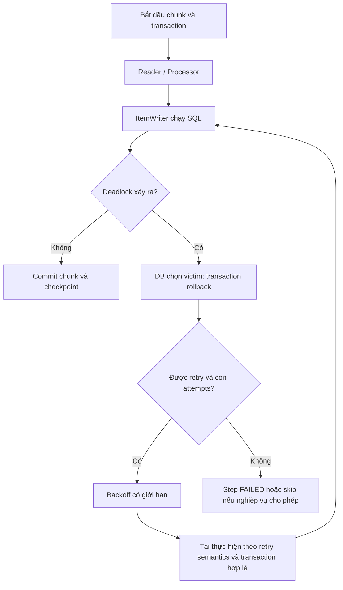

# Retry deadlock database trong Spring Batch: rollback đúng, thử lại an toàn và kiểm soát tải

Khi mở rộng Spring Batch bằng **multi-threaded step**, **parallel steps**, **partitioning** hoặc nhiều worker từ xa, các transaction có thể cùng giành khóa trên những hàng và bảng giống nhau. Một lỗi thường gặp là **database deadlock**: transaction A chờ tài nguyên B đang giữ, trong khi B lại chờ tài nguyên A đang giữ. Database phải chọn một transaction làm *victim* để rollback; nếu ứng dụng không có chiến lược retry phù hợp, một sự cố thoáng qua có thể làm cả batch thất bại.

**Retry deadlock database** không chỉ là bắt exception rồi chạy lại câu SQL. Với chunk-oriented Spring Batch, phải hiểu **ranh giới transaction**, rollback toàn bộ công việc bị ảnh hưởng, checkpoint, writer idempotency, số lần thử, backoff và hành vi khi restart. Bài thuộc chương **Retry** của module **SPRING_BATCH_SCALING_OPERATIONS**, dành cho việc vận hành các job dữ liệu lớn an toàn khi tăng concurrency.

Mục tiêu sau bài học: nhận diện deadlock khác lock timeout/serialization failure; cấu hình retry bằng Spring Batch 5.x; xử lý đúng một chunk thất bại; giảm xác suất deadlock bằng thứ tự khóa và thiết kế SQL; đo tỷ lệ lỗi để quyết định nên tăng hay giảm song song.

## 1. Deadlock là gì và khác “truy vấn chạy chậm” ra sao?

Database transaction có thể giữ một hay nhiều khóa cho đến khi commit/rollback. Khi các transaction chờ nhau theo một **chu trình phụ thuộc**, không transaction nào tự tiến tiếp được nếu các khóa đang giữ không được giải phóng.

Ví dụ đơn giản với hai bản ghi tài khoản:

- Transaction **A** đã khóa account 101, rồi cố cập nhật account 202.
- Transaction **B** đã khóa account 202, rồi cố cập nhật account 101.
- A đang đợi B; B đang đợi A → chu trình deadlock.

Database thường phát hiện vòng chờ, chọn một transaction thất bại và rollback để transaction còn lại tiếp tục. **Lựa chọn victim không phải lời hứa cố định**; cùng code có thể có transaction thắng khác nhau giữa các lần chạy.

```mermaid
sequenceDiagram
    participant A as Transaction A
    participant DB as Database
    participant B as Transaction B
    A->>DB: UPDATE account 101 (giữ lock 101)
    B->>DB: UPDATE account 202 (giữ lock 202)
    A->>DB: UPDATE account 202 (chờ lock 202)
    B->>DB: UPDATE account 101 (chờ lock 101)
    Note over A,B: Chu trình: A đợi B, B đợi A
    DB-->>B: Deadlock error; rollback B (ví dụ)
    DB-->>A: A tiếp tục khi lock được giải phóng
```

Deadlock thường phát sinh khi xử lý **nhiều item/chunk hoặc partition đồng thời** và mỗi transaction chạm đến nhiều business key. Nó có thể xảy ra ngay cả khi mỗi step riêng lẻ chạy đúng trên một thread.

### Deadlock khác gì các tình huống khác?

| Hiện tượng | Bản chất | Có thể retry? |
| --- | --- | --- |
| **Deadlock** | Có vòng chờ khóa; database rollback một victim | Thường có, sau khi transaction bị rollback hoàn toàn |
| **Lock wait** | Transaction đang chờ khóa nhưng chưa tạo vòng | Có thể chỉ cần chờ; phụ thuộc latency/SLA |
| **Lock timeout** | Chờ khóa quá thời hạn cho phép | Có thể retry, nhưng cần phân loại và điều chỉnh contention |
| **Serialization failure** | DB từ chối một transaction để bảo đảm isolation, thường gặp ở SERIALIZABLE | Thường retry **toàn transaction**, không mặc nhiên là deadlock |
| **Statement/query timeout** | Query vượt deadline, có thể do nhiều nguyên nhân | Chỉ retry nếu hiểu được nguyên nhân và kết quả commit |
| **Unique constraint violation** | Dữ liệu trùng khóa hoặc lỗi nghiệp vụ | Thường không giải quyết bằng retry mù quáng |
| **Connection/network failure** | Mất kết nối; kết quả transaction có thể không rõ | Cần xác định trạng thái commit và idempotency trước replay |

**Không dùng một nhãn “database transient error” cho tất cả các loại lỗi mà không phân biệt.** Deadlock victim đã rollback khác với lỗi mất kết nối **sau** lúc DB có thể đã commit.

## 2. Ví dụ SQL: vòng chờ do thứ tự cập nhật đảo nhau

Sơ đồ minh họa bằng PostgreSQL, giả sử đã có hai bản ghi account 101 và 202.

**Session A:**

```sql
BEGIN;
UPDATE account_balance
SET balance = balance + 10
WHERE account_id = 101;

-- Session B cập nhật account 202 trước.
UPDATE account_balance
SET balance = balance - 10
WHERE account_id = 202;

COMMIT;
```

**Session B, chạy đồng thời:**

```sql
BEGIN;
UPDATE account_balance
SET balance = balance + 20
WHERE account_id = 202;

-- Session A đã khóa account 101.
UPDATE account_balance
SET balance = balance - 20
WHERE account_id = 101;

COMMIT;
```

Nếu hai session giữ khóa trước khi chạm khóa thứ hai, một session có thể gặp:

```text
ERROR: deadlock detected
SQLSTATE: 40P01
```

Ví dụ chỉ minh họa **thứ tự khóa**, không phải giao dịch chuyển tiền nghiệp vụ hoàn chỉnh. Thực tế còn phải bảo đảm số dư, unique operation ID, kiểm tra invariant và audit log.

**Cách phòng ngừa trực tiếp:** Cả hai transaction cố gắng lấy khóa theo **cùng một thứ tự ổn định** (ví dụ account ID tăng dần), thay vì dựa vào thứ tự item đến từ reader, thread scheduling hoặc message broker. Cách này giảm một nhóm deadlock do cập nhật đảo chiều, nhưng không bảo đảm loại bỏ mọi deadlock: khóa index, foreign key, trigger, range lock hoặc transaction khác vẫn có thể tạo vòng chờ.

## 3. Nhận diện deadlock theo database và exception Java

Ứng dụng Spring thường không làm việc trực tiếp với thông báo text của JDBC driver. Spring JDBC/ORM dùng exception translation để chuyển `SQLException` thành nhóm `DataAccessException`.

| Database | Tín hiệu thường gặp | Điều cần lưu ý |
| --- | --- | --- |
| PostgreSQL | SQLSTATE **40P01** (*deadlock_detected*) | Khác **40001** (*serialization_failure*) |
| MySQL/InnoDB | Error code **1213**, thường SQLSTATE **40001** (*deadlock*) | Không đồng nhất với lỗi chờ khóa quá thời gian |
| MySQL/InnoDB lock timeout | Error code **1205**, thường SQLSTATE **HY000** | Cần kiểm tra rollback behavior theo engine/cấu hình |
| SQL Server | Error number **1205** (deadlock victim), thường báo SQLSTATE **40001** qua driver | Số 1205 ở SQL Server **không phải** cùng nghĩa với 1205 MySQL |
| Oracle | **ORA-00060** (*deadlock detected*) | Hành vi rollback/statement phải đối chiếu transaction thực |
| JDBC/Spring | Có thể gặp `CannotAcquireLockException` hoặc một subtype `PessimisticLockingFailureException` | Loại cụ thể phụ thuộc dialect, translator và phiên bản |

**Quan trọng:** `40001` là mã lớp “serialization failure”, không phải chỉ có deadlock. Một số database dùng cùng SQLSTATE cho nhiều dạng concurrency failure. Nếu chính sách nghiệp vụ chỉ cho phép retry **deadlock**, hãy phân loại theo **SQLSTATE + vendor error code + dialect**, kiểm tra exception gốc từ integration test; đừng đọc mỗi thông báo tiếng Anh và so chuỗi `"deadlock"`.

Trong Spring Framework 6.x, các exception thuộc nhóm `PessimisticLockingFailureException` có thể bao gồm cả lỗi không lấy được khóa và những biến thể khác. Chọn quá rộng sẽ retry cả trường hợp muốn fail nhanh. Bài này dùng cấu hình retry theo **nhóm lỗi khóa** để minh họa, rồi chỉ ra cách siết lại khi áp dụng thực tế.

## 4. Retry đúng nghĩa là chạy lại sau khi transaction cũ đã rollback

Khi PostgreSQL báo SQLSTATE 40P01, transaction bị chọn làm victim không còn hợp lệ để tiếp tục xử lý như thể không có gì xảy ra. Nếu ứng dụng bắt exception và **gọi lại cùng câu SQL trong transaction đã abort**, các câu tiếp theo có thể tiếp tục lỗi, chẳng hạn:

```text
ERROR: current transaction is aborted,
commands ignored until end of transaction block
SQLSTATE: 25P02
```

Sai lầm phổ biến:

```java
// PHẢN VÍ DỤ: không retry lại SQL ngay trong cùng
// transaction đã bị abort sau khi database phát hiện deadlock.
try {
    jdbcTemplate.update(sql, args);
} catch (DataAccessException ex) {
    jdbcTemplate.update(sql, args); // Vẫn dùng transaction lỗi.
}
```

**Cách đúng:** Để transaction hiện tại rollback và cho Spring Batch/fault-tolerant step quyết định **thử lại công việc trong transaction hợp lệ** theo chính sách retry. Việc retry ở cấp step phải được kiểm thử về rollback/re-read/write vì reader và writer có thể có state.

Không được nuốt exception rồi trả thành công: nếu một phần chunk chưa được commit nhưng step đánh dấu `COMPLETED`, checkpoint có thể vượt qua những item bị bỏ sót.

### Chu trình một chunk khi gặp deadlock



Sơ đồ là **luồng khái niệm**, không mô tả chính xác mọi vòng gọi processor/reader nội bộ trong Spring Batch. Đặc biệt, sau rollback framework có thể phải tái tạo state/đọc lại item hoặc retry write theo cách phù hợp cấu hình. Không thiết kế business logic dựa vào giả định mỗi `ItemProcessor.process()` được gọi đúng một lần.

## 5. Chọn đúng nơi retry: một transaction hay từng SQL statement?

Với deadlock, **ranh giới retry thường phải trùng với đơn vị transaction bị rollback**. Nếu writer thực hiện 10 SQL update trong một transaction và câu thứ 9 deadlock, retry riêng câu thứ 9 không thể phục hồi tám update trước đã bị rollback.

| Phương án | Có nên dùng? | Lý do |
| --- | --- | --- |
| Retry toàn đơn vị công việc transaction của chunk step | Thường phù hợp | Framework quản lý rollback, checkpoint và retry policy |
| Retry một SQL statement ngay trong transaction bị abort | **Không** | Transaction cũ đã bị rollback/invalid |
| Retry một transaction riêng ở service/repository layer | Có thể, nếu transaction mới bao trùm **toàn logic bị ảnh hưởng** | Phải tránh nested retries và mất checkpoint |
| Retry ở driver/client mà ứng dụng không biết | Chỉ khi được kiểm soát chặt | Có nguy cơ nhiều tầng retry, tạo tải và side effect bất ngờ |
| Restart cả JobInstance sau khi retry hết | Phương án recovery | Phải đối soát commit/checkpoint và bảo đảm idempotent |

Lưu ý đối với Spring Batch: writer thường được gọi **bên trong transaction do chunk step quản lý**, nên không nên tự ý thêm một `TransactionTemplate` quanh *mỗi item* nếu điều đó làm chia cắt atomicity của chunk. Nếu một item trong chunk thất bại, transaction commit ở những item khác phải tuân thủ chính sách thống nhất.

## 6. Cấu hình retry deadlock trong Spring Batch 5.x

Spring Batch 5.x dùng `StepBuilder` và `.faultTolerant()` cho chunk step. Ví dụ dưới đây retry nhóm exception lỗi lấy khóa với tối đa **3 attempts, tính cả lần đầu**.

```java
import org.springframework.batch.core.Step;
import org.springframework.batch.core.repository.JobRepository;
import org.springframework.batch.core.step.builder.StepBuilder;
import org.springframework.batch.item.ItemProcessor;
import org.springframework.batch.item.ItemReader;
import org.springframework.batch.item.ItemWriter;
import org.springframework.context.annotation.Bean;
import org.springframework.context.annotation.Configuration;
import org.springframework.dao.PessimisticLockingFailureException;
import org.springframework.retry.backoff.ExponentialBackOffPolicy;
import org.springframework.transaction.PlatformTransactionManager;

@Configuration
public class DeadlockRetryStepConfiguration {

    @Bean
    public ExponentialBackOffPolicy deadlockBackOffPolicy() {
        ExponentialBackOffPolicy policy =
                new ExponentialBackOffPolicy();
        policy.setInitialInterval(200L);
        policy.setMultiplier(2.0);
        policy.setMaxInterval(2_000L);
        return policy;
    }

    @Bean
    public Step applyAdjustmentsStep(
            JobRepository jobRepository,
            PlatformTransactionManager transactionManager,
            ItemReader<AccountAdjustment> reader,
            ItemProcessor<AccountAdjustment, AccountAdjustment> processor,
            ItemWriter<AccountAdjustment> writer,
            ExponentialBackOffPolicy deadlockBackOffPolicy) {

        return new StepBuilder("applyAdjustmentsStep", jobRepository)
                .<AccountAdjustment, AccountAdjustment>chunk(
                        50, transactionManager)
                .reader(reader)
                .processor(processor)
                .writer(writer)
                .faultTolerant()
                .retry(PessimisticLockingFailureException.class)
                .retryLimit(3)
                .backOffPolicy(deadlockBackOffPolicy)
                .build();
    }
}
```

**Cần hiểu chính xác:**

- `.chunk(50, transactionManager)`: commit interval 50 item; không phải 50 lần thử.
- `.faultTolerant()`: bật các semantics fault-tolerant của step.
- `.retry(PessimisticLockingFailureException.class)`: **ví dụ rộng** cho nhóm lỗi khóa. Nhóm này có thể bao gồm những lỗi không phải deadlock. Production nên kiểm tra exception do database/dialect tạo và **siết đúng danh sách retryable** (hoặc dịch ra một exception chuyên biệt) nếu chỉ muốn retry deadlock.
- `.retryLimit(3)`: giới hạn **ba attempts gồm attempt đầu** theo retry semantics của framework, không phải ba lần retry cộng thêm.
- `.backOffPolicy(...)`: nghỉ có giới hạn giữa các attempt; Spring Retry là dependency dùng cho backoff trong cấu hình này.
- `ItemReader`, processor, writer, repository và transaction manager do ứng dụng cung cấp; đoạn code là **cấu hình minh họa**, chưa phải chương trình batch độc lập.

Nếu translator của dự án trả về `CannotAcquireLockException`, exception này thuộc nhóm `PessimisticLockingFailureException` nên có thể được policy trên nhận diện. Nhưng nếu driver/ORM ném exception khác, cần dịch/khai báo thích hợp: **không suy rằng mọi 40P01 luôn được wrap giống nhau ở mọi công nghệ JDBC/JPA**.

### Vì sao dùng retryLimit thấp?

Deadlock thường là lỗi cạnh tranh thoáng qua; vài lần thử lại với backoff thường có ích. Nếu 50% chunk liên tục deadlock, tăng lên 50 attempts chỉ che giấu vấn đề lock ordering, transaction quá dài hoặc quá nhiều worker. Giới hạn retry nên được chọn theo SLA, contention, timeout và khả năng dữ liệu đích.

## 7. Writer minh họa: transaction của chunk và idempotency

Giả sử batch áp các điều chỉnh số dư, mỗi điều chỉnh có `operationId` riêng. Nếu một chunk phải chạy lại do deadlock, không được cộng tiền hai lần. Chúng ta dùng hai bảng ở cùng PostgreSQL:

```sql
CREATE TABLE account_balance (
    account_id BIGINT PRIMARY KEY,
    balance NUMERIC(19, 2) NOT NULL
);

CREATE TABLE applied_account_adjustment (
    operation_id VARCHAR(100) PRIMARY KEY,
    account_id BIGINT NOT NULL,
    amount_delta NUMERIC(19, 2) NOT NULL,
    applied_at TIMESTAMPTZ NOT NULL DEFAULT CURRENT_TIMESTAMP
);

-- Tùy nghiệp vụ, account_balance cần có những dòng account
-- tồn tại trước khi bắt đầu job và các ràng buộc số dư thích hợp.
```

Mẫu `ItemWriter` dùng `JdbcTemplate` trong **transaction do Spring Batch chunk step quản lý**. Writer không tự commit giữa các item. Cùng một `operation_id` đã commit thì không áp lại delta:

```java
import java.math.BigDecimal;
import java.util.Comparator;
import org.springframework.batch.item.ItemWriter;
import org.springframework.context.annotation.Bean;
import org.springframework.jdbc.core.JdbcTemplate;

record AccountAdjustment(
        String operationId,
        long accountId,
        BigDecimal delta) {}

@Bean
public ItemWriter<AccountAdjustment> adjustmentWriter(
        JdbcTemplate jdbc) {

    return chunk -> {
        // Thứ tự khóa có chủ đích, giảm vòng chờ giữa worker.
        var adjustments = chunk.getItems().stream()
                .sorted(Comparator
                        .comparingLong(AccountAdjustment::accountId)
                        .thenComparing(AccountAdjustment::operationId))
                .toList();

        for (AccountAdjustment item : adjustments) {
            int inserted = jdbc.update(
                """
                INSERT INTO applied_account_adjustment
                    (operation_id, account_id, amount_delta)
                VALUES (?, ?, ?)
                ON CONFLICT (operation_id) DO NOTHING
                """,
                item.operationId(), item.accountId(), item.delta());

            if (inserted == 0) {
                // Production cần kiểm tra cùng operationId có cùng
                // accountId, amountDelta và business version;
                // nếu khác phải fail, không im lặng bỏ qua.
                continue;
            }

            int changed = jdbc.update(
                """
                UPDATE account_balance
                SET balance = balance + ?
                WHERE account_id = ?
                """,
                item.delta(), item.accountId());

            if (changed != 1) {
                throw new IllegalStateException(
                    "Missing account " + item.accountId());
            }
        }
    };
}
```

**Giả định quan trọng:**

1. `JdbcTemplate`, bảng ledger và bảng số dư **dùng cùng DataSource/transaction manager**, để mỗi chunk ghi ledger + cập nhật số dư trong cùng transaction DB.
2. Account đã tồn tại, business rule cho phép cộng delta và điều chỉnh không yêu cầu cập nhật nhiều account theo một invariant khác.
3. `operationId` là khóa bất biến của **thao tác nghiệp vụ**, không đổi giữa retry, restart hoặc phân phối lại.
4. Producer **không gửi cùng operationId với payload khác**. Production phải kiểm tra bản ghi ledger đã tồn tại có account/delta/version khớp; ví dụ chỉ chú thích bước kiểm tra đó để giữ trọng tâm deadlock.
5. Sorting theo `accountId` tạo thứ tự lấy **khóa hàng số dư** tương đối nhất quán. Các unique-index/foreign-key/trigger vẫn có thể gây những kiểu contention khác.
6. Dùng `ON CONFLICT` là cú pháp PostgreSQL. Database khác cần cách upsert/dedup tương đương và test transaction riêng.

Với database deadlock, transaction chunk rollback **cả insert ledger và update số dư** của lần thử đó. Khi retry trên transaction mới, ledger của lần đã rollback không tồn tại. Nếu hệ thống đã commit dữ liệu thành công nhưng client/metadata bị mất phản hồi, ledger giúp tránh áp delta lần hai. Đây là hai loại lỗi khác nhau và đều cần được kiểm thử.

### Vì sao không nuốt SQL exception trong writer?

Nếu writer bắt `DataAccessException` rồi chỉ ghi log, Spring Batch có thể nghĩ chunk thành công mặc dù database đã rollback. Hãy để exception lan ra đúng tầng retry hoặc dịch sang exception mà policy hiểu. Chỉ ghi nhận thành công sau khi transaction commit thực sự được framework xác nhận.

## 8. Tạo processor và reader theo cách không phá retry

Writer được gọi lại có thể có nghĩa reader/processor cũng được gọi lại theo lifecycle của fault-tolerant step. Vì vậy:

- **Processor nên stateless/pure** nếu có thể; không phát email hoặc gọi API chuyển tiền rồi trông chờ DB rollback hoàn tác.
- **Reader có state** cần lưu checkpoint đúng trong `ExecutionContext`; không tự tăng offset vĩnh viễn trước khi chunk commit.
- Nếu dùng `@StepScope` với partitioning, tạo reader riêng cho mỗi `StepExecution`, nhận `minId`/`maxId` (hoặc key-range) từ context.
- Không chia sẻ một cursor/iterator mutable giữa nhiều thread của multi-threaded step nếu reader không thread-safe.
- Khi SQL writer phát deadlock, đừng “bỏ item lỗi” để đi tiếp nếu nghiệp vụ không cho phép mất item.

Một processor minh họa không có side effect:

```java
@Bean
public ItemProcessor<AccountAdjustment, AccountAdjustment>
        validateAdjustment() {
    return adjustment -> {
        if (adjustment.operationId() == null
                || adjustment.operationId().isBlank()
                || adjustment.delta() == null) {
            throw new IllegalArgumentException(
                "Invalid adjustment");
        }
        return adjustment;
    };
}
```

Nếu dữ liệu sai vĩnh viễn, cần policy lỗi dữ liệu riêng (fail/quarantine/skip theo nghiệp vụ), không phân loại thành deadlock để retry nhiều lần.

## 9. Backoff, jitter và giới hạn retry storm

Một deadlock đã được database giải quyết bằng rollback một victim. Retry ngay tức thì có thể khiến các worker **tái tạo cùng cạnh tranh** với thứ tự và thời điểm gần như y hệt.

Với exponential backoff:

\[
d_n=\min(d_{\max},d_0\times m^{n-1})
\]

Trong đó `d_0` là delay ban đầu, `m` là multiplier và `d_max` là delay tối đa.

Với ví dụ cấu hình trước: 200 ms rồi 400 ms trước hai lần retry; tổng backoff khoảng 600 ms khi dùng ba attempts. Đây là ước lượng theo chính sách thông thường, chưa bao gồm thời gian truy vấn, rollback và overhead.

**Jitter** thêm một thành phần ngẫu nhiên có giới hạn, giúp 20 worker không cùng retry đúng sau 200 ms. Có thể dùng một backoff policy ngẫu nhiên có sẵn phù hợp với phiên bản Spring Retry hoặc tự triển khai policy đã được kiểm thử.

```text
Không jitter: worker A --200ms-- retry
             worker B --200ms-- retry
             worker C --200ms-- retry

Có jitter:   worker A --180ms---- retry
             worker B --310ms------- retry
             worker C --245ms----- retry
```

Jitter giảm đồng bộ, nhưng không chữa được **thiết kế khóa đối nghịch** hay DB đích đã quá tải.

### Tổng ngân sách retry

Nếu một chunk tốn trung bình 4 giây trong điều kiện bình thường, ba attempts với hai lần backoff có thể tốn gần:

\[
T_{\mathrm{chunk}}\approx
3\times4\text{ s}+0,2\text{ s}+0,4\text{ s}
=12,6\text{ s}
\]

Thời gian thực có thể dài hơn do lock wait, deadlock detection, transaction rollback, GC hoặc jitter. Một số chunk chậm cuối cùng có thể quyết định thời gian hoàn tất toàn job. Cần giới hạn **tổng thời gian retry theo SLA**, không chỉ đếm attempts.

## 10. Chọn retry ở cấp item, chunk, partition hay job?

Spring Batch có nhiều cấp thực thi cần phân biệt:

| Cấp | Ví dụ | Điều đang được làm lại |
| --- | --- | --- |
| Lời gọi SQL trong transaction | Repository tự retry | Nguy hiểm nếu transaction đã abort mà không được khởi tạo lại |
| Chunk-oriented fault-tolerant step | Writer lỗi trong chunk | Xử lý lại theo semantics chunk/transaction với retry policy |
| Partition worker step | Partition 3 xử lý các chunk của nó | Chunk retry trước; khi hết retry, partition có thể FAILED |
| Job restart | Partition/job chưa hoàn thành từ lần trước | Chỉ phần cần restart theo trạng thái và cấu hình |
| Remote chunking redelivery | Broker giao lại `ChunkRequest` | Có thể chạy lại cả chunk **ngoài** policy retry JDBC của worker |

**Không nên chồng retry vô thức:** repository tự retry 5 lần, chunk step retry 3 lần, broker redelivery thêm 4 lần có thể làm cùng thao tác được thực hiện rất nhiều lần trong một sự cố. Cần chỉ định tầng nào “sở hữu” retry transaction, tầng nào chỉ vận chuyển, và giới hạn tổng thể.

Trường hợp database deadlock **trong writer của chunk step**, để Spring Batch quản lý rollback/retry ở cấp step thường là điểm bắt đầu phù hợp. Nếu transaction do service riêng quản lý, phải kiểm tra xem retry có tạo transaction mới cho **toàn business operation** hay không; không chia nhỏ giao dịch một cách âm thầm.

## 11. Phòng ngừa tốt hơn retry: thứ tự lấy khóa nhất quán

Retry chỉ là lưới an toàn. Deadlock thường giảm đáng kể khi mọi code path cập nhật tài nguyên theo **cùng một thứ tự**.

Ví dụ chuyển tiền giữa hai account, luôn lấy khóa theo account ID tăng dần bất kể chiều chuyển:

```java
long firstId = Math.min(fromAccountId, toAccountId);
long secondId = Math.max(fromAccountId, toAccountId);

// Trong transaction đã mở, khóa cùng thứ tự ở mọi code path.
lockAccount(firstId);
lockAccount(secondId);
applyTransfer(fromAccountId, toAccountId, amount);
```

`lockAccount(...)` và `applyTransfer(...)` là hàm nghiệp vụ do ứng dụng định nghĩa; ví dụ chỉ thể hiện **quy tắc thứ tự khóa**, không phải mã triển khai hoàn chỉnh.

Một phiên bản SQL minh họa với PostgreSQL:

```sql
-- Gọi trong transaction nghiệp vụ, hai ID có thứ tự ổn định.
SELECT account_id
FROM account_balance
WHERE account_id IN (:firstId, :secondId)
ORDER BY account_id
FOR UPDATE;
```

**Cảnh báo:** Planner, engine, isolation, join và index có thể ảnh hưởng thứ tự khóa thực tế. Không coi một câu `ORDER BY ... FOR UPDATE` là chứng minh tuyệt đối thứ tự lock trong mọi truy vấn/phương ngữ. Với invariant quan trọng, kiểm chứng bằng concurrency test trên DB thật và tránh các code path khác lấy khóa đảo chiều.

Ngoài ordering:

- Giữ transaction ngắn, không gọi HTTP chậm trong khi đang giữ lock DB nếu tránh được.
- Giảm số hàng bị cập nhật trong một transaction khi nghiệp vụ cho phép.
- Dùng predicate/index tốt để tránh khóa quá nhiều row hoặc scan không cần thiết.
- Phân chia theo business key tránh nhiều partition cùng cập nhật một hot account/aggregate.
- Đánh giá foreign key, trigger, cascade, index maintenance và lock trên cùng row kết quả.
- Thiết kế “một owner cho một key” ở tầng phân vùng nếu workload cho phép.

## 12. Chunk size và transaction duration ảnh hưởng contention thế nào?

Khi chunk size là 1.000, writer có thể cập nhật hàng nghìn bản ghi trong một transaction. Khóa giữ lâu hơn, tập khóa nhiều hơn, cơ hội một transaction khác cần một trong các khóa ấy cũng tăng.

| Chunk size | Điểm tốt | Rủi ro |
| ---: | --- | --- |
| 10 | Transaction ngắn, ít khóa mỗi commit | Nhiều commits, metadata/log overhead |
| 50 | Điểm bắt đầu benchmark vừa phải | Cần đo duration và số lock thật |
| 500 | Ít commits hơn, có thể tăng throughput | Lock lifetime lớn, rollback đắt hơn |
| 5.000 | Ít commit overhead | Tail latency, transaction/WAL lớn, deadlock/timeout và retry đắt |

Con số trên **không phải ngưỡng chính thức**. Nếu mỗi item rất nhỏ và key độc lập, chunk lớn có thể hiệu quả. Nếu chunk cập nhật nhiều hàng nóng, giảm chunk size có thể giúp.

Giảm từ 500 xuống 50 không bảo đảm loại bỏ deadlock nếu hai transaction vẫn lấy khóa theo thứ tự đối nghịch. Tuning chunk size phải đi cùng lock ordering và phép đo throughput.

### Lock order trong writer

Nếu reader trả item ngẫu nhiên, writer có thể sort item theo business key trước khi ghi; cách này làm thứ tự lấy lock dễ dự đoán hơn. Tuy nhiên, **không thay đổi semantics nghiệp vụ**: nếu xử lý item bắt buộc theo thứ tự thời gian/sequence, việc sort theo accountId có thể sai. Khi đó cần thiết kế partition theo account hoặc xử lý theo queue có ordering per key.

## 13. Isolation level không phải “nút tắt deadlock”

Các isolation level quyết định những hiện tượng đồng thời database cho phép, nhưng không đơn giản có nghĩa isolation càng cao thì càng ít lỗi.

- `READ COMMITTED` có thể giảm một số loại contention so với isolation cao, nhưng deadlock vẫn xảy ra khi hai transaction lấy lock đảo chiều.
- `REPEATABLE READ` có snapshot/locking semantics khác nhau theo database, có thể giữ lock lâu hơn trong một số tình huống.
- `SERIALIZABLE` bảo đảm semantics chặt hơn nhưng có thể phát sinh **serialization failures** cần retry toàn transaction, chẳng hạn PostgreSQL SQLSTATE **40001**.
- `SELECT ... FOR UPDATE` khóa trước có thể hữu ích để kiểm soát thứ tự, nhưng cũng làm tăng lock waiting nếu dùng rộng.

**Không dùng việc hạ isolation để che giấu lỗi nghiệp vụ** nếu bước xử lý cần một invariant mạnh như không chi vượt số dư. Chọn isolation theo tính đúng, rồi tối ưu transaction/SQL và concurrency phù hợp.

### Deadlock vs serialization failure

Một transaction PostgreSQL nhận `40P01` do deadlock và một transaction nhận `40001` do serialization failure đều thường cần **thực thi lại toàn transaction**. Nhưng nguyên nhân, tần suất và cách cải thiện có thể khác; dashboard và retry classification nên giữ phân biệt.

### Lock timeout là lỗi riêng

Cấu hình lock timeout giúp tránh chờ quá lâu, nhưng nếu đặt rất ngắn, những hàng nóng bình thường cũng timeout và gây retry storm. Cần đo P95/P99 transaction/lock wait và chọn deadline tương thích SLA; không dùng timeout siêu ngắn làm cách thay cho tối ưu contention.

## 14. Local partitioning, remote partitioning và multi-threaded step

Việc scale Spring Batch làm tăng xác suất nhiều transaction cùng chạm DB:

| Kiến trúc | Nơi phát sinh concurrency | Rủi ro deadlock đặc trưng |
| --- | --- | --- |
| Single-thread chunk step | Có thể cạnh tranh với transaction của hệ thống khác | Ít deadlock nội bộ job, nhưng vẫn có thể chạm hệ thống online |
| Multi-threaded step | Nhiều thread cùng một step/JVM | Reader/writer thread safety, nhiều chunk viết cùng key |
| Parallel steps | Nhiều flow độc lập chạy cùng lúc | Các flow tưởng độc lập nhưng cập nhật chung bảng/aggregate |
| Local partitioning | Các partition StepExecution trong một JVM | Dải dữ liệu chồng nhau hoặc cùng ghi bảng tổng hợp |
| Remote partitioning | Nhiều JVM worker tự đọc và ghi | Tổng concurrency cao, lock hot spots và pool bão hòa |
| Remote chunking | Nhiều worker xử lý/ghi chunk request | Broker phân phối chunk không đồng nghĩa phân tách business key |

**Partitioning không tự loại bỏ deadlock.** Chia khoảng ID nguồn không giao nhau nhưng cuối mỗi chunk lại cập nhật cùng một hàng `daily_summary` sẽ tạo hotspot ở đích. Tương tự, remote chunking không bảo đảm hai chunk có business key khác nhau.

Một hướng hiệu quả là **partition theo khóa gây khóa tại đích** (account/tenant/shard), để một key chỉ có một owner tại một thời điểm; nhưng phải xét data skew và worker chậm. Khi không chia được theo key, có thể áp concurrency limit/DB lock strategy hoặc gom thay đổi rồi merge tuần tự ở cuối.

## 15. Theo dõi deadlock và trạng thái khóa trong PostgreSQL

PostgreSQL thường ghi deadlock error có SQLSTATE `40P01`. Một số kỹ thuật quan sát:

- Bật cấu hình logging phù hợp như `log_lock_waits` và điều chỉnh `deadlock_timeout` theo chính sách DBA, tránh tăng noise trên production.
- Phân tích database error logs khi transaction bị chọn làm deadlock victim; xem những statement, quan hệ và process ID liên quan.
- Theo dõi `pg_stat_activity`, `pg_locks` và `pg_blocking_pids(...)` để nhìn lock wait **đang diễn ra**.
- Kết hợp application traces theo JobExecution, StepExecution, partition, thread và statement ID.

Ví dụ câu truy vấn quan sát **phiên đang bị chặn**:

```sql
SELECT
    a.pid,
    a.application_name,
    a.state,
    a.wait_event_type,
    a.wait_event,
    a.query_start,
    pg_blocking_pids(a.pid) AS blocking_pids,
    a.query
FROM pg_stat_activity AS a
WHERE cardinality(pg_blocking_pids(a.pid)) > 0
ORDER BY a.query_start;
```

Câu query hiển thị hiện tượng lock wait tại thời điểm chạy, **không phải danh sách lịch sử deadlock đã được database giải quyết**. Khi deadlock victim bị rollback, vòng chờ có thể biến mất rất nhanh; cần server logs hoặc quan sát có hệ thống để xác định nguyên nhân.

**Bảo mật:** Cột `query` có thể chứa literal/PII tùy cách ứng dụng gửi SQL và cấu hình logging. Giới hạn quyền truy cập, retention, masking trước khi đưa dữ liệu lên dashboard.

### Trên các database khác

- **MySQL/InnoDB:** xem deadlock gần nhất trong `SHOW ENGINE INNODB STATUS` và các công cụ monitoring liên quan; error 1213 thường là deadlock victim. Phân biệt với lock timeout error 1205.
- **SQL Server:** dùng Extended Events/deadlock graph để tìm các transaction/statement, error number 1205 cho deadlock victim.
- **Oracle:** xem ORA-00060, trace và lock/SQL diagnostics theo quyền DBA.
- **Spring JDBC/JPA:** log loại exception đã dịch, SQLSTATE/error code gốc khi có thể và tên transaction/step liên quan.

Không chỉ xử lý bằng cách tăng `retryLimit` trước khi thu thập deadlock graph: dữ liệu đó là bằng chứng trực tiếp giúp phát hiện code path lấy khóa đảo chiều.

## 16. Metrics Spring Batch và định nghĩa alert hữu ích

Ngoài database logs, cần theo dõi tình trạng job/step:

| Metric | Ý nghĩa | Cách dùng |
| --- | --- | --- |
| Deadlock errors / minute theo database, statement group | Tần suất vòng chờ | Tìm regression sau tăng worker |
| Retry attempts / item hoặc chunk | Chi phí phục hồi | Xem retry có giải quyết hay chỉ lặp lỗi |
| Retries exhausted / StepExecution | Retry thất bại cuối cùng | Alert để triage và recovery |
| `rollbackCount` | Số rollback do step ghi nhận | Không phải bộ đếm riêng cho deadlock |
| `commitCount` | Số commits của step | Đo tiến độ và transaction overhead |
| Chunk duration P50/P95/P99 | Thời gian transaction/processing | Tail latency ảnh hưởng SLA |
| DB lock wait P95/locks | Tình trạng tranh chấp khóa | Phát hiện khóa nóng trước deadlock |
| Active worker threads/partitions | Concurrency thực | Đối chiếu tăng worker với tăng deadlock |
| Connection pool pending | Thread chờ connection | Phân biệt deadlock với thiếu connection |
| End-to-end JobExecution duration | Kết quả toàn job | Retry phải vẫn đáp ứng batch window |

Ví dụ SQL đọc StepExecution metadata chuẩn (cần điều chỉnh prefix theo môi trường):

```sql
SELECT
    STEP_EXECUTION_ID,
    STEP_NAME,
    STATUS,
    READ_COUNT,
    WRITE_COUNT,
    COMMIT_COUNT,
    ROLLBACK_COUNT,
    START_TIME,
    END_TIME,
    EXIT_CODE
FROM BATCH_STEP_EXECUTION
WHERE JOB_EXECUTION_ID = :jobExecutionId
ORDER BY STEP_EXECUTION_ID;
```

Khi dùng partitioning, mỗi partition thường có StepExecution riêng. Có thể so sánh rollbackCount và duration theo partition để tìm vùng dữ liệu hot. **Một rollback không nhất thiết là deadlock**, và không phải mỗi retry đều được biểu diễn bằng một dòng trong `BATCH_STEP_EXECUTION`. Muốn đếm deadlock thật phải dùng metric exception/dialects ở tầng JDBC/ORM.

Một alert vận hành hữu ích cần điều kiện kết hợp: deadlock rate tăng kéo dài + rollback/retry tăng + throughput giảm hoặc SLA bị đe dọa; không coi một deadlock đơn lẻ đã được retry thành công là sự cố nghiêm trọng.

## 17. Công suất và xác suất retry khi số worker tăng

Một phép tính có điều kiện giúp thấy chi phí retry.

Giả sử mỗi attempt có xác suất thất bại deadlock **p**, độc lập giữa các lần thử, giới hạn `A` attempts:

\[
E[\mathrm{attempts}]
=\sum_{i=0}^{A-1}p^i
=\frac{1-p^A}{1-p}\quad(p\ne1)
\]

Ví dụ `p=0,05` và `A=3`:

\[
E[\mathrm{attempts}]=1+0,05+0,0025=1,0525
\]

Trong mô hình lý tưởng, mỗi chunk gây thêm khoảng **5,25%** số lần thử. Nhưng **deadlock attempts không độc lập**: chúng có thể bị tương quan bởi cùng lock hot spot, cùng thời điểm retry hoặc cùng batch window. Khi một database quá tải, `p` có thể tăng theo worker count.

Giả sử 2.000 chunk, mỗi chunk 50 item, thời gian xử lý trung bình 150 ms và tổng concurrency hữu hiệu là 8 thread:

\[
T_{\mathrm{ideal}}\approx
\left\lceil\frac{2.000}{8}\right\rceil\times0,15
=37,5\text{ giây}
\]

Con số chỉ là thời gian xử lý chunk lý tưởng **nếu không có contention/overhead**. Nếu deadlock làm tăng attempts và backoff, thời gian thực tăng. Nếu đồng thời các transaction tranh chấp một bảng tổng hợp, tăng từ 8 lên 32 worker có thể làm throughput **giảm** vì lock wait/rollback.

### Đo tốc độ thay vì đếm thread

Chạy thử ở 1, 2, 4, 8, 16 worker, giữ dataset và workload tương đương. Ghi:

- Items/giây **được commit**, không phải chỉ item đã đọc.
- Deadlock errors/1.000 transactions.
- Retry attempts/chunk và retries exhausted.
- Lock wait P95/P99, chunk duration P95.
- CPU, DB I/O, WAL/log, pool pending, GC.
- Tổng job duration và business record count.

Nếu throughput tăng ít nhưng deadlock rate tăng rất mạnh, nên tối ưu lock ordering/partitioning hoặc giảm concurrency thay vì tăng attempts.

## 18. Kiểm thử deadlock phải bao gồm transaction thực

Unit test một retry classifier là hữu ích nhưng **không chứng minh** transaction rollback và checkpoint đúng. Nên có ít nhất ba lớp test.

### 18.1. Test exception classification

Kiểm tra translator của đúng DB/driver/JDBC stack: với lỗi deadlock thực, exception Java là subtype nào? Với lock timeout/unique constraint, có bị policy retry nhầm không?

Có thể mô phỏng exception trong writer, nhưng khi dùng Spring Batch fault-tolerant step, phải kiểm tra **số attempts thực**. Ví dụ tạo writer giả ném `CannotAcquireLockException` hai lần rồi thành công trong lần thứ ba; assert job `COMPLETED` và dữ liệu đích chỉ một lần. Đây vẫn chỉ là test logic, chưa phải deadlock SQL thật.

### 18.2. Integration test với hai transaction trái thứ tự

Sử dụng PostgreSQL/MySQL/SQL Server phiên bản tương tự production trong môi trường test. Hai connection riêng cố ý giữ khóa chéo để tạo deadlock. Dùng synchronization primitive để điều khiển điểm giao nhau (không dựa vào `Thread.sleep` và may rủi).

```text
Connection A: BEGIN; lock(account 101); signal A_READY;
Connection B: BEGIN; lock(account 202); signal B_READY;
Barrier: cả A_READY và B_READY;
Connection A: lock(account 202); -- chờ B
Connection B: lock(account 101); -- tạo vòng chờ
DB: chọn victim, abort transaction
Ứng dụng: rollback và retry trong transaction mới
```

Test cần xác nhận:

1. Có đúng **deadlock** theo SQLSTATE/vendor error code, không phải chỉ timeout.
2. Transaction victim rollback toàn bộ thay đổi chưa commit.
3. Retry được kích hoạt qua exception translation và chính sách step.
4. Writer không áp cùng operation ID hai lần.
5. Metadata JobRepository phản ánh kết quả và checkpoint đúng.
6. Khi retries exhausted, step/job thất bại theo hợp đồng nghiệp vụ.

### 18.3. Test restart sau crash

Tạo tình huống đã commit một số chunk, chunk sau bị deadlock/lỗi và JVM/worker dừng. Restart cùng JobInstance (không tự đổi identifying parameters để tạo job mới). Đối soát:

- Những chunk đã commit không bị cộng lại dữ liệu.
- Chunk chưa commit được xử lý lại đúng.
- Operation ID trong ledger không bị nhân đôi.
- Reader không bỏ sót bản ghi do checkpoint/snapshot.
- Với partitioning, partition name/range không thay đổi tùy tiện giữa các lần restart.

**Không chạy test cố tình deadlock trên production**. Test này phải cô lập dữ liệu và timeout để không gây tắc DB của hệ thống khác.

## 19. Runbook khi deadlock tăng bất thường

Một runbook thực tế có thể đi theo thứ tự:

1. **Xác nhận đó là deadlock thật:** lấy SQLSTATE/vendor code, error logs/deadlock graph; phân biệt 40P01, 40001, lock timeout, connection pool pending.
2. **Đánh giá ảnh hưởng:** StepExecution nào thất bại, bao nhiêu worker/partition, write throughput, tỷ lệ rollback và SLA còn lại.
3. **Ổn định tải:** giới hạn concurrency, tạm dừng một số job/partition gây tranh chấp nếu vận hành cho phép; không tăng retryLimit ngay.
4. **Xác định cặp SQL và thứ tự khóa:** phân tích deadlock graph, trigger, foreign key, index, transaction boundaries.
5. **Kiểm tra data correctness:** nếu chunk rollback, đối chiếu ledger và output; nếu timeout/connection lost sau commit, cần xử lý kết quả không chắc chắn.
6. **Áp biện pháp:** thống nhất thứ tự khóa, tối ưu query/index, giảm transaction size hoặc phân vùng theo business key.
7. **Kiểm chứng lại:** chạy integration test, load test với concurrency giống production, đo deadlock rate và job duration.
8. **Khôi phục job:** dùng restart theo JobRepository và quy trình đối soát, không sửa metadata thủ công khi worker cũ có thể còn chạy.
9. **Theo dõi sau thay đổi:** so sánh trước/sau về throughput, rollbackCount, lock waits và số operations trùng.
10. **Ghi incident learnings:** loại statement/hot key, giới hạn concurrency an toàn, chính sách retry/backoff đã xác minh.

Nếu database logging cho thấy lỗi chủ yếu là **serialization failure** chứ không phải deadlock, kế hoạch điều tra có thể khác. Đừng sửa một vấn đề chưa được xác minh chỉ vì exception text chứa chữ “transaction rollback”.

## 20. Case study: tăng partition làm deadlock bùng phát

Một job tính điều chỉnh số dư cho 1.200.000 bản ghi. Ban đầu job có 4 partition, 4 worker threads; sau đó tăng lên 16 partition và 16 threads để rút ngắn batch window.

Số liệu minh họa sau đo:

| Cấu hình | Throughput committed | Deadlock/1.000 chunk attempts | Chunk P95 | DB lock wait |
| --- | ---: | ---: | ---: | --- |
| 4 workers, chunk 100 | 1.500 item/s | 2 | 200 ms | Thấp |
| 8 workers, chunk 100 | 2.200 item/s | 12 | 330 ms | Tăng |
| 16 workers, chunk 100 | 1.900 item/s | 65 | 1.100 ms | Rất cao |
| 8 workers, chunk 50, sort key | 2.500 item/s | 3 | 180 ms | Giảm |

Các con số là **dữ liệu giả định để phân tích**, không phải benchmark của Spring Batch.

### Câu hỏi 1: Tại sao 16 workers chậm hơn 8?

Nhiều chunk đồng thời cập nhật account của cùng một nhóm khách hàng. Số lock hot, transaction rollback và retry tăng, khiến throughput committed giảm dù worker count lớn hơn.

### Câu hỏi 2: Tăng retryLimit từ 3 lên 10 có phải giải pháp tốt nhất?

Không. Retry có thể giúp vượt vài deadlock thoáng qua, nhưng dữ liệu cho thấy contention cấu trúc. Cần giảm trùng phạm vi cập nhật, thống nhất lock ordering, tối ưu SQL và giới hạn concurrency. Tăng attempts có nguy cơ kéo dài latency và làm job trễ hơn.

### Câu hỏi 3: Vì sao vừa giảm chunk size vừa sort theo account ID có ích?

Giảm chunk size làm transaction ngắn hơn và giữ ít khóa hơn; sort theo key giúp các transaction lấy khóa theo thứ tự nhất quán hơn. Cả hai giảm xác suất vòng chờ, nhưng cần đánh giá tác động nghiệp vụ và đối soát input/output.

### Câu hỏi 4: Nếu 10% chunk phải thử hai lần, tăng bao nhiêu work?

Trong mô hình đơn giản với 10% chunk phải thực hiện thêm **một attempt** và số khác thành công lần đầu, tổng chunk attempts tăng khoảng **10%**. Nhưng throughput có thể giảm nhiều hơn 10% vì lock wait, backoff, rollback và các transaction phải xử lý lại sau contention.

### Câu hỏi 5: Làm sao phân biệt job chỉ đang bị chậm với có deadlock?

Đọc error code/log/deadlock graph tại DB, xem `rollbackCount` và counters exception, kết hợp lock waits, transaction duration và StepExecution. Worker chờ lock mà không có vòng chờ thì không nhất thiết là deadlock.

### Câu hỏi 6: Khi deadlock làm một partition FAILED, restart cả job có ghi trùng không?

Có nguy cơ nếu writer không idempotent hoặc checkpoint không chính xác. Thiết kế ledger operation ID và cùng transaction với update như ví dụ, giữ phạm vi partition ổn định, đối soát dữ liệu sau restart; không mặc định Spring Batch biến side effect ngoài DB thành exactly-once.

## 21. Checklist trước production

- [ ] Đã phân loại deadlock theo SQLSTATE/vendor error code, không chỉ so chuỗi thông báo.
- [ ] Đã xác minh exception translation của JDBC/JPA/driver/dialect được policy Spring Batch bắt đúng.
- [ ] Retry diễn ra sau rollback với **transaction hợp lệ mới**, không thử lại SQL trong transaction đã abort.
- [ ] Có `faultTolerant()`, `retry(...)` và `retryLimit(...)` phù hợp với phiên bản Spring Batch.
- [ ] Có backoff có giới hạn, cân nhắc jitter và giới hạn tổng thời gian theo SLA.
- [ ] Không có nhiều tầng retry vô tình nhân số attempts lên quá cao.
- [ ] Writer không nuốt exception, checkpoint chỉ phản ánh transaction đã commit.
- [ ] Operation ID và idempotency đủ bảo vệ retry/restart/redelivery, có kiểm tra payload trùng ID.
- [ ] Reader/processor/writer có thread safety phù hợp multi-threaded/partitioned step.
- [ ] Các code path cập nhật cùng tài nguyên theo thứ tự khóa nhất quán khi nghiệp vụ cho phép.
- [ ] Đã đo transaction duration/chunk size, DB index/query plan, hot keys và lock waits.
- [ ] Đã kiểm tra isolation level và phân biệt deadlock với serialization failure.
- [ ] Có metric deadlock rate, retries exhausted, rollback, throughput committed và job SLA.
- [ ] Có integration test tạo deadlock thật và test restart trong môi trường cô lập.
- [ ] Đã kiểm thử khi tăng worker/partition và khi hệ thống online dùng chung DB.
- [ ] Có runbook giảm tải, phân tích deadlock graph và restart đúng JobInstance.
- [ ] Không chỉnh trực tiếp metadata JobRepository để “bỏ qua” sự cố khi chưa đối soát.

## 22. Tài liệu tham khảo

- [Spring Batch Reference — Retry Logic](https://docs.spring.io/spring-batch/reference/step/chunk-oriented-processing/retry-logic.html): cơ chế retry trong chunk-oriented processing.
- [Spring Batch Reference — Configuring Retry](https://docs.spring.io/spring-batch/reference/step/chunk-oriented-processing/configuring-retry.html): cấu hình retryable exceptions và retry limit.
- [Spring Batch Reference — Transactions and Retry](https://docs.spring.io/spring-batch/reference/transaction-appendix.html): các tương tác giữa transaction, retry và rollback.
- [Spring Batch API — FaultTolerantStepBuilder](https://docs.spring.io/spring-batch/docs/5.2.x/api/org/springframework/batch/core/step/builder/FaultTolerantStepBuilder.html): `retry`, `retryLimit`, `backOffPolicy` và policy liên quan.
- [Spring Framework — Data Access Exception Hierarchy](https://docs.spring.io/spring-framework/reference/data-access/dao.html): exception translation và phân loại lỗi persistence.
- [Spring Retry — Backoff Policies](https://docs.spring.io/spring-retry/docs/current/apidocs/org/springframework/retry/backoff/ExponentialBackOffPolicy.html): exponential backoff.
- [PostgreSQL — Deadlocks](https://www.postgresql.org/docs/current/explicit-locking.html#LOCKING-DEADLOCKS): cơ chế deadlock detection và hướng phòng tránh.
- [PostgreSQL — Error Codes](https://www.postgresql.org/docs/current/errcodes-appendix.html): SQLSTATE 40P01 và 40001.
- [PostgreSQL — Monitoring Database Activity](https://www.postgresql.org/docs/current/monitoring-stats.html): `pg_stat_activity` và theo dõi locks.
- [MySQL — InnoDB Deadlocks](https://dev.mysql.com/doc/refman/8.4/en/innodb-deadlocks.html): deadlock, victim và cách giảm tranh chấp.
- [Spring Batch Reference — Scaling and Parallel Processing](https://docs.spring.io/spring-batch/reference/scalability.html): concurrency và partitioning làm tăng transaction song song.

> **Ghi nhớ:** Retry deadlock database chỉ an toàn khi **transaction lỗi đã rollback**, phần việc được thực hiện lại trên transaction hợp lệ, và mọi side effect có cơ chế chống trùng khi retry/restart. Bật retry trong Spring Batch là cần thiết cho lỗi thoáng qua, nhưng **thứ tự lấy khóa, transaction ngắn, phân vùng theo business key, giới hạn concurrency và phép đo deadlock rate** mới quyết định tính ổn định khi workload lớn dần. Đừng tối ưu số worker mà bỏ qua throughput đã commit và tính đúng của dữ liệu.
