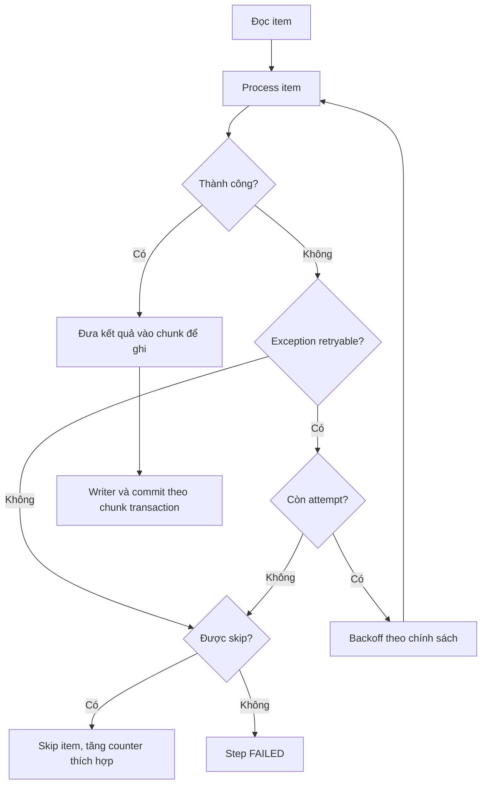
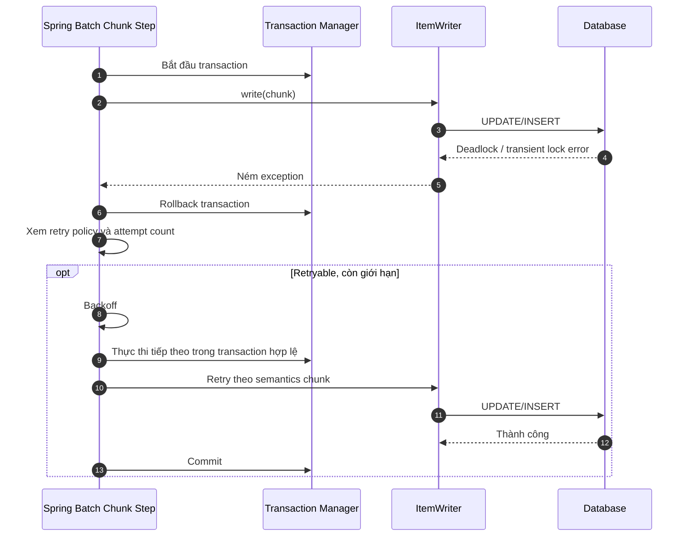

# Retry limit cho từng item trong Spring Batch

Khi Spring Batch xử lý hàng triệu item, một số item có thể gặp lỗi tạm thời: API trả `503`, database xảy ra deadlock, connection bị reset hoặc writer đụng một khóa đang bị tranh chấp. **Retry limit cho từng item** cho phép một item được thử xử lý lại một số lần hữu hạn thay vì làm thất bại cả job ngay ở lỗi đầu tiên. Tuy nhiên, cấu hình `retryLimit(3)` rất dễ bị hiểu sai: nó **không phải ngân sách ba lần retry cho toàn bộ job**, cũng **không phải cam kết mỗi side effect ngoài transaction chỉ được gọi đúng ba lần suốt mọi lần restart**.

Bài thuộc chương **Retry** của module **SPRING_BATCH_SCALING_OPERATIONS**. Ta tập trung vào ý nghĩa của retry limit theo item trong *fault-tolerant chunk step* của Spring Batch 5.x, cách nhận diện item qua rollback, tương tác với `skipLimit`, transaction, processor/writer, backoff và những thay đổi khi xử lý song song hoặc từ xa. Mục tiêu là giữ **tính đúng đắn, thread safety, khả năng retry/restart** và đáp ứng batch window khi mở rộng khối lượng dữ liệu.

## 1. “Cho từng item” có nghĩa gì?

Giả sử một step đọc bốn item `A, B, C, D` và processor gọi dịch vụ chấm điểm. A và C thành công ngay; B gặp hai lỗi tạm thời rồi thành công; D lỗi liên tiếp.

| Item | Attempt 1 | Attempt 2 | Attempt 3 | Kết quả với `retryLimit(3)` |
| --- | --- | --- | --- | --- |
| A | Success | — | — | Xử lý thành công |
| B | Transient error | Transient error | Success | Xử lý thành công |
| C | Success | — | — | Xử lý thành công |
| D | Transient error | Transient error | Transient error | **Exhausted**: xử lý theo fail/skip policy |

Với cơ chế retry theo item trong fault-tolerant step, B dùng ngân sách retry của **B**; A và C không mất lượt vì B lỗi. Đây là điểm khác với bộ đếm “tối đa ba lỗi trên toàn step”.

Trong Spring Batch 5.x, `retryLimit(3)` đặt giới hạn **tối đa ba attempts, kể cả lần thử đầu** theo chính sách retry thông dụng của framework. Nó thường tương đương **tối đa hai lần thử lại sau lần đầu**, không phải “ba lần thử lại cộng lần đầu”.

**Phạm vi của khẳng định:** semantics theo item đặc biệt trực quan với lỗi trong `ItemProcessor`. Với lỗi xảy ra trong `ItemWriter` đang ghi **cả chunk**, rollback và quá trình xác định item gây lỗi có thể làm nhiều item được gọi lại; không được coi số lần gọi writer/SQL/HTTP trong mọi tình huống là bằng đúng `retryLimit` cho từng item. Cần kiểm thử trên step thực tế.

## 2. Retry limit khác retry count và skip limit như thế nào?

Các thuật ngữ rất dễ lẫn nhau:

| Khái niệm | Phạm vi | Ý nghĩa |
| --- | --- | --- |
| `retryLimit(3)` | Chính sách retry áp dụng cho thao tác/item được phân loại retryable | Số attempts tối đa được phép trong một chu kỳ retry theo semantics framework |
| Retry attempt count | Một retry context/đơn vị retry | Số lần thử đã thực hiện với lỗi hiện tại |
| `skipLimit(10)` | Số skip được chấp nhận trong một `StepExecution` theo cấu hình | Ngân sách skip của step, **không** phải 10 skip cho mỗi item |
| `retry(ExceptionType.class)` | Phân loại lỗi | Chỉ định exception được phép retry |
| `skip(ExceptionType.class)` | Phân loại lỗi | Cho phép bỏ qua item khi thỏa policy |
| `noRetry(ExceptionType.class)` | Phân loại lỗi | Loại exception ra khỏi chính sách retry |
| Job restart | Vòng đời `JobInstance`, các `StepExecution` và checkpoint | Khôi phục công việc chưa hoàn thành, không đơn thuần là attempt mới của cùng retry context |
| Broker redelivery | Middleware | Một message có thể được giao lại độc lập với retry counter của Spring Batch |

Ví dụ:

```java
.faultTolerant()
.retry(TemporaryServiceException.class)
.retryLimit(3)
.skip(InvalidInputException.class)
.skipLimit(10)
```

Đoạn trên nghĩa là: thao tác gặp `TemporaryServiceException` có thể được thử tới ba attempts; item gặp `InvalidInputException` có thể được skip theo ngân sách step tối đa 10 skip. **Không suy ra** “mỗi item được phép skip 10 lần” hoặc “toàn job chỉ gọi API ba lần”.

Nếu item D lỗi retryable đến hết ba attempts mà **không** được phân loại skippable, step thường thất bại. Nếu D thuộc loại vừa được retry vừa được skip theo policy, sau khi retry hết Spring Batch có thể skip item theo cấu hình; chính sách nghiệp vụ phải cho phép điều đó.

## 3. Luồng xử lý item trong chunk-oriented step

Một chunk step thông thường có ba vai trò:

1. `ItemReader<I>` đọc các item.
2. `ItemProcessor<I, O>` tùy chọn biến đổi, lọc hoặc gọi dịch vụ.
3. `ItemWriter<O>` ghi danh sách item sau xử lý.

Fault-tolerant step bổ sung cơ chế phân loại lỗi, retry, skip và rollback. Khi retry cho một item, Spring Batch phải phối hợp với **transaction và checkpoint**, không chỉ gọi `process()` lần thứ hai một cách tùy tiện.



Sơ đồ mô tả **quyết định logic**, không phải trace chính xác toàn bộ callback và transaction. Trong Spring Batch, lỗi có thể khiến transaction rollback, retry state được lưu/tìm lại, và framework phải khôi phục đúng item sau rollback. Vì vậy:

- Không dựa vào giả định `read()` hoặc `process()` luôn được gọi đúng số lần nhìn thấy trong sơ đồ.
- Không sử dụng side effect ngoài transaction mà thiếu idempotency.
- Không đánh dấu một item đã xử lý xong chỉ vì processor từng trả kết quả thành công nếu chunk cuối cùng vẫn rollback.

## 4. Cấu hình Java Spring Batch 5.x: retry tối đa ba attempts cho item

Ví dụ một step làm giàu đơn hàng, trong đó processor gọi `CustomerProfileGateway`. Gateway chỉ được phép ném `TemporaryProfileException` khi lỗi có khả năng phục hồi; dữ liệu sai vĩnh viễn phải thuộc exception khác.

```java
import org.springframework.batch.core.Step;
import org.springframework.batch.core.repository.JobRepository;
import org.springframework.batch.core.step.builder.StepBuilder;
import org.springframework.batch.item.ItemProcessor;
import org.springframework.batch.item.ItemReader;
import org.springframework.batch.item.ItemWriter;
import org.springframework.context.annotation.Bean;
import org.springframework.context.annotation.Configuration;
import org.springframework.retry.backoff.ExponentialBackOffPolicy;
import org.springframework.transaction.PlatformTransactionManager;

@Configuration
public class PerItemRetryConfiguration {

    @Bean
    public ExponentialBackOffPolicy profileRetryBackOff() {
        ExponentialBackOffPolicy policy =
                new ExponentialBackOffPolicy();
        policy.setInitialInterval(200L);
        policy.setMultiplier(2.0);
        policy.setMaxInterval(1_500L);
        return policy;
    }

    @Bean
    public Step enrichOrdersStep(
            JobRepository jobRepository,
            PlatformTransactionManager transactionManager,
            ItemReader<OrderInput> reader,
            ItemProcessor<OrderInput, EnrichedOrder> processor,
            ItemWriter<EnrichedOrder> writer,
            ExponentialBackOffPolicy profileRetryBackOff) {

        return new StepBuilder("enrichOrdersStep", jobRepository)
                .<OrderInput, EnrichedOrder>chunk(
                        100, transactionManager)
                .reader(reader)
                .processor(processor)
                .writer(writer)
                .faultTolerant()
                .retry(TemporaryProfileException.class)
                .retryLimit(3)
                .backOffPolicy(profileRetryBackOff)
                .build();
    }
}
```

**Giải thích:**

- `chunk(100, transactionManager)` đặt commit interval, **không** nghĩa là mỗi item có 100 attempts.
- `faultTolerant()` bật các tính năng retry/skip của fault-tolerant chunk step.
- `retry(TemporaryProfileException.class)` chỉ chọn **loại exception** được thử lại.
- `retryLimit(3)` định nghĩa tối đa ba attempts, tính lần đầu, theo retry policy cho thao tác lỗi.
- `backOffPolicy(...)` thêm thời gian nghỉ giữa những lần retry; nó không đổi số attempts.
- Không thêm `skip(...)` ở đây nên khi một item vẫn lỗi sau khi retry hết, step được kỳ vọng thất bại theo chính sách mặc định.

Ví dụ dành cho Spring Batch 5.x; `OrderInput`, `EnrichedOrder`, reader, writer, exception và gateway phải được định nghĩa trong ứng dụng. Builder và các cấu hình tối ưu có thể thay đổi giữa các phiên bản; cần dùng đúng dependency đang triển khai.

### Ba tình huống đầu tiên nên thử

- Một item trả về ngay: tổng số attempts = 1.
- Một item ném `TemporaryProfileException` hai lần rồi thành công: tổng attempts = 3.
- Một item ném `TemporaryProfileException` liên tiếp: không được thử mãi; sau khi hết chính sách, step fail hoặc đi vào skip policy đã định nghĩa.

Nếu HTTP client hoặc gateway **có retry nội bộ**, số request gửi tới service có thể lớn hơn số attempts do Spring Batch tính; phải kiểm tra toàn stack.

## 5. Đưa lỗi remote về exception phù hợp

Retry limit không có tác dụng nếu mọi lỗi đều là `IllegalStateException` hoặc bị wrap thành loại không nằm trong danh sách retryable.

Ví dụ processor có nghiệp vụ minh họa:

```java
import java.math.BigDecimal;
import org.springframework.batch.item.ItemProcessor;

record OrderInput(long orderId, long version, BigDecimal amount) {}

record EnrichedOrder(
        long orderId,
        long version,
        BigDecimal amount,
        String customerTier) {}

record CustomerTier(String name) {}

interface CustomerProfileGateway {
    CustomerTier findTier(long orderId, long version);
}

class TemporaryProfileException extends RuntimeException {
    TemporaryProfileException(String message, Throwable cause) {
        super(message, cause);
    }
}

class InvalidOrderException extends RuntimeException {
    InvalidOrderException(String message) {
        super(message);
    }
}

public final class OrderEnrichmentProcessor
        implements ItemProcessor<OrderInput, EnrichedOrder> {

    private final CustomerProfileGateway gateway;

    public OrderEnrichmentProcessor(CustomerProfileGateway gateway) {
        this.gateway = gateway;
    }

    @Override
    public EnrichedOrder process(OrderInput item) {
        if (item.amount() == null
                || item.amount().signum() <= 0) {
            throw new InvalidOrderException(
                    "Invalid amount for order " + item.orderId());
        }

        // Gateway cần phân biệt timeout/503 với 400/schema lỗi.
        CustomerTier tier =
                gateway.findTier(item.orderId(), item.version());

        return new EnrichedOrder(
                item.orderId(),
                item.version(),
                item.amount(),
                tier.name());
    }
}
```

Thiết kế nên có hai lớp:

1. **HTTP/DB client adapter** chuyển lỗi cụ thể thành `TemporaryProfileException` hoặc exception nghiệp vụ vĩnh viễn, kèm nguyên nhân gốc.
2. **ItemProcessor** tập trung vào logic xử lý dữ liệu và để lỗi retryable được ném lên fault-tolerant step.

Đừng viết `catch (Exception ex) { return null; }` để “job không fail”: trong Spring Batch, processor trả `null` có nghĩa **lọc item**, khiến item biến mất khỏi output mà không được tính là lỗi cần retry. Đây là sai sót nghiêm trọng khi dữ liệu bắt buộc phải có đủ.

## 6. Truyền đúng loại exception qua nhiều tầng

Một request HTTP có thể thất bại theo nhiều cách. Không phải tất cả lỗi đều đáng retry.

| Lỗi ở gateway | Nhóm lỗi đề xuất | Hành động |
| --- | --- | --- |
| `503`, `502`, `504` do service tạm thời lỗi | Transient | Retry với backoff |
| Connection reset, connect timeout | Transient, nhưng kết quả có thể không rõ | Retry **nếu** thao tác an toàn/idempotent |
| `429` và `Retry-After` | Transient có điều kiện | Tôn trọng quota, deadline và lịch retry |
| `400`/`422` dữ liệu không hợp lệ | Permanent | Fail hoặc skip theo policy nghiệp vụ |
| `401`/`403` do cấu hình quyền | Thường permanent | Điều tra credentials/quyền, không retry vô hạn |
| JSON schema không tương thích | Permanent hoặc lỗi triển khai | Dừng để sửa contract |
| Lỗi logic Java, NPE | Lỗi code | Fail; không bao trùm bởi `retry(Exception.class)` |
| DB deadlock được xác nhận | Transient concurrency | Retry sau rollback transaction |
| DB unique violation do business key sai | Thường permanent | Kiểm tra idempotency/data integrity |

Bắt `Exception.class` hoặc `RuntimeException.class` quá rộng có thể làm lỗi code, sai schema và dữ liệu sai bị gọi lại ba lần vô ích cho **mọi item**. Trên workload hàng triệu item, tác hại rất lớn.

Nếu exception gốc bị wrap, cần biết builder/retry policy có phân loại theo **top-level exception** hay có traversal cause chain tùy cấu hình. Một lựa chọn rõ ràng là chuẩn hóa exception ngay tại adapter, sau đó viết test xác nhận exception mà step thực sự nhận được.

## 7. Tại sao item phải được nhận diện ổn định qua rollback?

Retry per item cần hiểu *“lần thử thứ hai này thuộc item B trước đó”*. Trong fault-tolerant chunk processing, framework có thể phải theo dõi retry context của item qua nhiều lần thử và **có thể qua rollback transaction**.

Nguy cơ phát sinh khi reader trả một object mới cho cùng bản ghi nhưng item không có cách nhận diện ổn định:

- Một lần đọc tạo `OrderInput(id=42)` ở địa chỉ object X.
- Rollback khiến framework có thể đọc lại bản ghi ấy thành object Y.
- Nếu logic đối chiếu item dựa vào identity/reference hoặc một thuộc tính mutable thay đổi giữa các lần đọc, retry context có thể không khớp như kỳ vọng.
- Retry counter có nguy cơ không được áp dụng đúng đơn vị nghiệp vụ mà bạn nghĩ.

Do đó:

- Ưu tiên object input immutable, có business key rõ ràng.
- Bảo đảm sort key/checkpoint của reader ổn định.
- Nếu cần, dùng `KeyGenerator` phù hợp với phiên bản Spring Batch để xác định **khóa retry ổn định cho item**, thay vì dựa vào object identity.
- Không dùng một khóa chung như `"default"` cho mọi item: retry context có thể va chạm, làm item này ảnh hưởng item khác.
- Nếu cùng business key có nhiều **phiên bản cần xử lý khác nhau**, khóa phải bao gồm version hoặc định danh thao tác chính xác.

### KeyGenerator minh họa

```java
// Đặt trong chuỗi cấu hình fault-tolerant step,
// dùng cùng kiểu OrderInput của reader.
.faultTolerant()
.retry(TemporaryProfileException.class)
.retryLimit(3)
.keyGenerator(item -> {
    OrderInput order = (OrderInput) item;
    return order.orderId() + ":" + order.version();
})
```

Đây là **mảnh cấu hình** gắn tiếp vào `StepBuilder`, không phải chương trình Java độc lập. `keyGenerator(...)` giúp quy định khóa nhận diện item trong retry state khi phù hợp. Cần xác nhận tính duy nhất của cặp `orderId/version` trong phạm vi StepExecution và hành vi của reader/processor khi rollback.

**Không phải mọi step đều cần cấu hình KeyGenerator:** một record immutable với `equals/hashCode` đúng và reader khôi phục ổn định có thể không cần tùy chỉnh. Chỉ thêm custom key khi có cơ sở thực tế, tránh tự tạo khóa dễ trùng.

## 8. Retry theo item có luôn giữ số lần thử trong suốt restart không?

**Không nên giả định như vậy.** Trong một execution đang chạy, retry policy có thể giữ context cho item đang lỗi và áp giới hạn. Nhưng một job được restart sau JVM crash, worker replacement hoặc một `StepExecution` mới **không mặc nhiên có retry counter được persist toàn cục theo item qua mọi lần chạy**.

Phân biệt:

| Ngữ cảnh | Giới hạn retry đang kiểm soát | Điều không được suy ra |
| --- | --- | --- |
| Cùng fault-tolerant step đang hoạt động | Attempts của item/chunk theo retry state hiện hành | Mọi API side effect đã “exactly once” |
| Transaction rollback rồi xử lý tiếp | Framework có thể nối lại retry context theo khóa/item | Bảo đảm reader không bao giờ trả lại object mới |
| Step FAILED rồi job restart | Một execution mới khôi phục từ JobRepository/ExecutionContext | Attempt cũ được trừ vĩnh viễn khỏi mọi budget của item |
| Worker remote được thay thế | Phụ thuộc trạng thái lưu ở worker/broker và giao thức | Bộ nhớ retry của worker trước còn nguyên |
| Business reprocess/JobInstance mới | Vòng xử lý mới theo nghiệp vụ | Chia sẻ retry budget cũ nếu không có ledger riêng |

Nếu yêu cầu nghiệp vụ là *“mỗi business operation chỉ được thử tối đa 5 lần trong mọi lần restart trong 30 ngày”*, cần **bảng ledger bền vững** hoặc điều phối retry theo operation ID, không chỉ dựa vào `retryLimit` của step.

Ví dụ schema:

```sql
CREATE TABLE operation_retry_budget (
    operation_id VARCHAR(120) PRIMARY KEY,
    attempts_used INTEGER NOT NULL,
    last_error_code VARCHAR(60),
    updated_at TIMESTAMP NOT NULL
);
```

Ledger phải được cập nhật **atomically** và có quy tắc reservation/commit phù hợp khi nhiều worker cùng xử lý operation. Một bảng đếm không có khóa/transaction có thể bị race; nếu cập nhật attempts nằm trong transaction bị rollback cùng chunk, counter cũng có thể rollback và **không còn biểu thị attempts đã thử**. Vì vậy, thiết kế global retry budget là bài toán nghiệp vụ/điều phối riêng.

## 9. Khi lỗi nằm ở ItemWriter, “từng item” cần được hiểu thận trọng

Writer của Spring Batch 5.x nhận một `Chunk<? extends T>`, thường gồm nhiều item. Giả sử chunk chứa A, B, C; writer thực hiện ba lệnh SQL và gặp deadlock khi xử lý C.

Điều có thể xảy ra:

1. Cả transaction chunk rollback; các ghi chưa commit của A, B không được giữ.
2. Framework có thể thử lại thao tác write/chunk theo fault-tolerant retry.
3. Nếu cấu hình skip, quá trình xác định item lỗi có thể cần thực hiện lại với các tập item khác nhau.
4. Số lần gọi vào SQL của A hoặc B có thể tăng, **dù A/B không phải item gây lỗi**.

Do đó, phát biểu *“retryLimit(3) bảo đảm SQL cho mỗi item chỉ chạy tối đa ba lần”* là **không chính xác** trong mọi trường hợp.

### Minh họa

```text
Chunk: [A, B, C]
Attempt write 1:
  SQL(A) -> OK, SQL(B) -> OK, SQL(C) -> deadlock
  => rollback toàn bộ transaction

Attempt write 2:
  SQL(A) -> OK, SQL(B) -> OK, SQL(C) -> OK
  => commit chunk
```

A và B đã được đưa vào SQL hai lần, nhưng chỉ lần commit cuối trở thành kết quả bền vững của transaction (giả định cùng một DB transaction). Điều này **không an toàn** nếu writer đồng thời phát email, gọi API thanh toán hoặc ghi sang DB khác không cùng transaction.

**Nguyên tắc:** Writer phải idempotent với replay và biết transaction thực sự bao trùm những side effect nào. Nếu batch writer không hỗ trợ rollback đầy đủ, đừng dùng retry để che đậy tính không nguyên tử.

## 10. Xử lý transaction đúng khi retry

Đối với lỗi như deadlock database, việc retry phải diễn ra **sau rollback của transaction lỗi**, không phải thử lại cùng câu SQL ngay trong transaction đã bị database abort.



Sơ đồ là **khái niệm về ranh giới rollback/retry**, không biểu thị chính xác mọi callback nội bộ hoặc mọi trường hợp retry stateless/stateful. Cần kiểm thử với database và transaction manager đang dùng.

### Rollback không hoàn tác side effect ngoài DB

Ví dụ processor gọi HTTP API tạo hóa đơn rồi writer ghi DB. Nếu writer deadlock, transaction DB rollback nhưng hóa đơn ở API có thể đã được tạo. Khi Spring Batch retry item/chunk, API có thể nhận lại yêu cầu.

Cần chọn một hoặc nhiều giải pháp:

- Processor chỉ làm tính toán/đọc dữ liệu, hạn chế tác dụng phụ.
- Dùng operation ID và idempotency key ổn định ở API đích.
- Ghi **outbox** cùng transaction với thay đổi DB rồi publish sau commit.
- Có ledger và công cụ reconciliation/compensating action khi side effect không thể transactional.
- Kiểm thử crash sau side effect nhưng trước khi Spring Batch commit checkpoint.

Không xem `retryLimit` như cơ chế thay thế transaction/idempotency.

## 11. Retry limit và skip limit khi item lỗi vĩnh viễn

Một bước có thể cho phép thử lại transient error, rồi skip item theo business policy nếu lỗi không phục hồi. Nhưng đây là quyết định **nghiệp vụ**, không chỉ vấn đề cấu hình.

Ví dụ dữ liệu cần làm giàu nhưng cho phép thiếu thông tin đối với tối đa 10 hồ sơ:

```java
.faultTolerant()
.retry(TemporaryProfileException.class)
.retryLimit(3)
.skip(TemporaryProfileException.class)
.skipLimit(10)
```

Trong cách cấu hình này, Spring Batch có thể retry transient exception rồi cho phép skip khi exhausted, miễn không vượt ngưỡng skip của step. Điều đó không phù hợp với quy trình bắt buộc xử lý đủ mọi giao dịch tài chính hoặc tính lương.

Thận trọng:

1. **Skip không làm dữ liệu tự đúng:** item bị bỏ qua có thể cần bảng quarantine, audit và một job bù riêng.
2. **Skip limit ở cấp step:** nếu 11 item bị skip trong một StepExecution với `skipLimit(10)`, step sẽ vượt ngân sách; không phải mỗi item được bỏ qua 10 lần.
3. **Không dùng `skip(Exception.class)` rộng:** có thể biến lỗi hệ thống thành mất dữ liệu âm thầm.
4. **Remote call timeout có kết quả không xác định:** trước khi skip, phải biết có side effect nào ở service ngoài đã xảy ra hay không.
5. **Writer skip phức tạp hơn processor skip:** framework có thể phải xác định item lỗi trong chunk và rollback/retry nhiều lần.

Nếu yêu cầu kinh doanh là **không mất bất kỳ item nào**, hãy để step fail sau exhausted retry và dùng cơ chế restart/recovery; đừng skip cho đủ KPI “job completed”.

## 12. Phân biệt lỗi retryable với không retryable trong cùng một step

Một step có thể gặp đồng thời lỗi dữ liệu và lỗi hạ tầng. Nên giữ quy tắc rõ ràng:

| Lỗi | Retry? | Skip? | Hành động gợi ý |
| --- | --- | --- | --- |
| Service `503` ngắn | Có | Chỉ nếu nghiệp vụ cho phép | Retry có backoff rồi fail/recover |
| DB deadlock | Có, sau rollback | Thường không đối với ghi bắt buộc | Retry transaction với giới hạn |
| `429` rate limit | Có, theo quota/Retry-After | Thường không nếu xử lý bắt buộc | Rate limit, backoff hoặc dừng có kiểm soát |
| Dữ liệu JSON schema sai | Không | Có thể nếu item lỗi không quan trọng | Quarantine + audit |
| Null field bắt buộc | Không | Theo chính sách | Validation fail/skip |
| Sai credentials/permission | Không retry liên tục | Không | Fail để điều tra cấu hình |
| Code `NullPointerException` | Không | Không | Sửa code, không giấu lỗi |

Trong Spring Batch, có thể điều chỉnh policy bằng `retry(...)`, `noRetry(...)` và `skip(...)` hoặc `RetryPolicy` tùy biến. Nhưng một lần thử retry có hiệu lực chỉ khi exception **thực sự tới được step** với loại/cause đã được phân loại.

## 13. Backoff theo item: đừng để tất cả worker cùng retry

Giới hạn số attempts mà không có backoff có thể làm vấn đề tệ hơn:

- 100 item đồng thời cùng gọi API bị 503.
- Cả 100 lập tức retry lần thứ hai.
- Service đang quá tải lại nhận thêm 100 requests trong thời gian ngắn.
- Lượt thứ ba cũng đồng thời, tạo một **retry storm**.

`ExponentialBackOffPolicy` giúp giãn khoảng cách. Với initial interval 200 ms, multiplier 2, max 1.500 ms, trước hai lần retry của `retryLimit(3)` có thể là 200 ms và 400 ms trong ví dụ đơn giản.

**Jitter** làm delay giữa các worker khác nhau, giảm đồng bộ retry. Đối với multi-threaded step hoặc remote worker, nên kiểm tra policy randomization mà phiên bản Spring Retry hỗ trợ, hoặc dùng một backoff tùy biến có kiểm thử. Retry-After từ dịch vụ HTTP không tự được đọc bởi `ExponentialBackOffPolicy` thông thường.

### Budget theo thời gian

Nếu mỗi attempt chờ tối đa `t_call` và delay giữa các attempts là `d_i`, thời gian một item xấu có thể xấp xỉ:

\[
T_{\mathrm{max,item}}\approx
A\,t_{\mathrm{call}}+\sum_{i=1}^{A-1}d_i
\]

Với `A=3`, timeout 2 giây/attempt, backoff 200 + 400 ms:

\[
T_{\mathrm{max,item}}\approx 3\times2+0,2+0,4
=6,6\text{ giây}
\]

Đây là **ước lượng**: timeout connect/read không nhất thiết là deadline tổng request; queue, DNS, rollback, jitter, connection pool và network có thể làm thời gian thật dài hơn.

Nếu một chunk chứa 100 item và nhiều item đều exhausted, thời gian tích lũy có thể làm chậm cả step. Đặt timeout, circuit breaker/rate limit và giới hạn tổng thời gian theo batch window; đừng chọn retryLimit chỉ dựa vào “ba lần là ít”.

## 14. Retry budget trên workload lớn: công thức đánh giá

Giả sử một item có xác suất thất bại ở mỗi attempt là `p` và các attempts **độc lập** (giả định đơn giản), với tối đa `A` attempts:

\[
E[\mathrm{attempts}]
=\sum_{k=0}^{A-1}p^k
=\frac{1-p^A}{1-p}
\quad (p\neq1)
\]

Nếu `p=0,1` và `A=3`:

\[
E[\mathrm{attempts}]=1+0,1+0,01=1,11
\]

Với 1.000.000 item, tổng remote attempts kỳ vọng khoảng **1.110.000**, tức tăng 110.000 requests so với mỗi item gọi một lần. Đây mới là mô hình không tính lỗi phụ thuộc lẫn nhau hoặc các tầng retry khác.

Nếu dịch vụ bị outage toàn hệ thống thì nhiều attempts **có tương quan**, `p` có thể gần 1. Khi đó một item có thể tiêu thụ gần ba lượt và thường vẫn thất bại; không dùng kỳ vọng 1,11 làm capacity plan cho sự cố outage.

### Ví dụ SLA

Một job xử lý 2.400.000 item trong 20 phút cần:

\[
R_{\mathrm{business}}=
\frac{2.400.000}{20\times60}
=2.000\text{ item/giây}
\]

Nếu số attempts trung bình là 1,11/item, API cần chịu khoảng:

\[
R_{\mathrm{remote}}=2.000\times1,11
=2.220\text{ requests/giây}
\]

Nếu API có quota 1.800 requests/giây, tăng từ 8 lên 16 worker có thể **không giúp**: bottleneck nằm ở quota, cần giảm calls/item, cache, batch endpoint hoặc thỏa thuận SLA/quota khác.

### Retry limit không phải giới hạn số request/giây

Ngay cả khi mỗi item chỉ thử ba lần, hàng chục worker xử lý hàng nghìn item đồng thời vẫn có thể gửi số lượng request cực lớn. Cần một rate limiter hoặc concurrency/bulkhead limit tính theo **tổng các JVM worker** khi downstream quota áp dụng toàn cụm.

## 15. Multi-threaded step, parallel steps và partitioning thay đổi điều gì?

| Kiến trúc | Đơn vị chạy đồng thời | Điều retryLimit không tự giải quyết |
| --- | --- | --- |
| Chunk step một thread | Các item/chunk tuần tự | Side effect ngoài transaction, lỗi kéo dài |
| Multi-threaded step | Nhiều chunk có thể xử lý đồng thời | Reader/writer thread safety, collision business key, retry storm |
| Parallel steps | Những flow/step độc lập | Hai flow cùng ghi đè dữ liệu, thứ tự phụ thuộc không rõ |
| Local partitioning | Nhiều `StepExecution` trong một JVM | Tổng requests/giây và shared DB contention |
| Remote partitioning | Partition StepExecution trên nhiều JVM | Retry budget không toàn cụm, recovery theo partition |
| Remote chunking | Worker xử lý các `ChunkRequest` | Broker redelivery, lost `ChunkResponse`, idempotency worker |

Khi có 12 partition, mỗi partition xử lý item với `retryLimit(3)`, không có nghĩa cả job chỉ có ba attempts tổng. Mỗi partition có lifecycle và item riêng; số remote attempts toàn hệ thống có thể rất lớn.

**Thread safety:** Retry có thể khiến processor cùng loại item được thực thi lại. Nếu processor dùng một biến counter singleton không thread-safe, kết quả theo item có thể sai hoặc metric đếm thiếu. Với partitioning, `@StepScope` giúp có reader theo `StepExecution`, nhưng nếu một partition còn xử lý chunk trên nhiều thread thì cần đánh giá thread safety trong chính partition ấy.

**Đích dữ liệu:** Dù input partition không chồng lấn, tất cả worker vẫn có thể cập nhật một bảng tổng hợp/hot account. Retry deadline không loại bỏ deadlock; cần lock ordering, giảm chunk size hoặc chia theo business key gây contention.

## 16. Remote chunking: broker redelivery không bị retryLimit của item kiểm soát

Trong remote chunking chuẩn, manager đọc item rồi gửi một `ChunkRequest` cho worker xử lý. Worker có thể gọi API/DB trong processor hoặc writer. Đây là một **hệ thống ít nhất hai ranh giới lỗi**:

```mermaid
sequenceDiagram
    autonumber
    participant M as Manager
    participant Q as Broker
    participant W as Worker
    participant D as DB/API đích
    M->>Q: ChunkRequest [A, B, C]
    Q-->>W: Nhận request
    W->>D: Xử lý A, B, C; commit
    D-->>W: Thành công
    Note over W,Q: Worker crash hoặc reply thất lạc
    Q-->>W: Redelivery request theo cấu hình
    W->>D: Xử lý lại A, B, C
    W-->>M: ChunkResponse
```

Nếu worker đã xử lý A thành công rồi reply thất lạc, một lần redelivery có thể dẫn đến A được xử lý lại **mặc dù lần xử lý trước không tiêu thụ hết retryLimit**. `retryLimit` của một step manager không tự giới hạn mọi retry của broker/worker và **không bảo vệ side effect**.

Do đó:

- Worker phải xử lý chunk idempotent, hoặc các operation trong chunk có business key ổn định.
- Retry broker có delivery attempts, DLQ, timeout và backoff **riêng**.
- Manager phải nhận `ChunkResponse` đúng correlation để hoàn thành step.
- Cần phân biệt lỗi processor ở worker với transport failure khi thiếu reply.
- Không replay một chunk chưa có reply chỉ vì “chưa thấy COMPLETED” mà không đối soát dữ liệu đích.

Worker của remote chunking được xây dựng qua Spring Batch Integration; **không mặc định** một worker consumer có đủ các semantics `faultTolerant().retryLimit(...)` của chunk step local trừ khi đã cấu hình/kiểm chứng rõ cơ chế xử lý worker và retry riêng. Không copy một tùy chọn builder của local step sang worker integration flow rồi cho rằng nó tự có hiệu lực.

## 17. Thiết kế idempotent writer cho retry/restart

Nếu output đi qua DB, có thể dùng unique business key và UPSERT/insert-on-conflict. Ví dụ một bản ghi làm giàu đơn hàng được xác định bằng `(order_id, source_version)`:

```sql
CREATE TABLE enriched_order (
    order_id BIGINT NOT NULL,
    source_version BIGINT NOT NULL,
    customer_tier VARCHAR(40) NOT NULL,
    amount NUMERIC(18, 2) NOT NULL,
    PRIMARY KEY (order_id, source_version)
);
```

Writer minh họa cho PostgreSQL trong transaction của chunk step:

```java
import org.springframework.batch.item.ItemWriter;
import org.springframework.context.annotation.Bean;
import org.springframework.jdbc.core.JdbcTemplate;

@Bean
public ItemWriter<EnrichedOrder> enrichedOrderWriter(
        JdbcTemplate jdbc) {

    return chunk -> {
        for (EnrichedOrder item : chunk) {
            jdbc.update(
                """
                INSERT INTO enriched_order
                    (order_id, source_version, customer_tier, amount)
                VALUES (?, ?, ?, ?)
                ON CONFLICT (order_id, source_version)
                DO UPDATE SET
                    customer_tier = EXCLUDED.customer_tier,
                    amount = EXCLUDED.amount
                """,
                item.orderId(),
                item.version(),
                item.customerTier(),
                item.amount());
        }
    };
}
```

Giả định `JdbcTemplate` thuộc cùng DataSource/transaction manager của chunk step. UPSERT này bảo đảm không có **hai row cùng khóa**, nhưng không tự chứng minh tính đúng nếu dữ liệu input cùng key có giá trị khác nhau: cần quyết định semantics version, phát hiện payload mismatch và ngăn bản cũ ghi đè kết quả mới.

Nếu writer là “cộng tiền”, “trừ hàng tồn” hoặc “gửi email”, UPSERT một bảng kết quả không đủ. Cần một operation ledger unique, atomic transaction hoặc idempotency API/outbox phù hợp. Nếu side effect đã commit mà checkpoint/response mất, input có thể được replay sau restart.

## 18. Mẫu unit test: ba attempts cho một item lỗi

Kiểm tra chính sách retry độc lập trước khi chạy job giúp tránh hiểu sai `retryLimit(3)`. Đoạn mã dùng Spring Retry `RetryTemplate` để chứng minh *max attempts* tính cả lần đầu.

```java
import static org.junit.jupiter.api.Assertions.assertEquals;
import static org.junit.jupiter.api.Assertions.assertThrows;

import java.util.concurrent.atomic.AtomicInteger;
import org.junit.jupiter.api.Test;
import org.springframework.retry.support.RetryTemplate;

class PerItemRetryPolicyTest {

    @Test
    void succeedsOnThirdAttempt() {
        AtomicInteger attempts = new AtomicInteger();

        RetryTemplate template = RetryTemplate.builder()
                .maxAttempts(3)
                .retryOn(TemporaryProfileException.class)
                .build();

        String result = template.execute(context -> {
            int current = attempts.incrementAndGet();
            if (current < 3) {
                throw new TemporaryProfileException(
                        "Temporary failure " + current, null);
            }
            return "OK";
        });

        assertEquals("OK", result);
        assertEquals(3, attempts.get());
    }

    @Test
    void stopsAfterThirdFailure() {
        AtomicInteger attempts = new AtomicInteger();

        RetryTemplate template = RetryTemplate.builder()
                .maxAttempts(3)
                .retryOn(TemporaryProfileException.class)
                .build();

        assertThrows(TemporaryProfileException.class,
                () -> template.execute(context -> {
                    attempts.incrementAndGet();
                    throw new TemporaryProfileException(
                            "Still unavailable", null);
                }));

        assertEquals(3, attempts.get());
    }
}
```

Đây là test của **Spring Retry trực tiếp**, không phải bằng chứng rằng Spring Batch writer trong mọi trường hợp gọi HTTP đúng ba lần. Nó cũng chưa kiểm tra transaction/rollback/checkpoint/skip của step. Cần unit test processor và **integration test qua Spring Batch Job/Step** để xác minh hành vi thực của `faultTolerant()`.

Để chạy test cần dependency JUnit và Spring Retry phù hợp; `TemporaryProfileException` được định nghĩa ở mục 5. Có thể bổ sung bộ kiểm thử step bằng Spring Batch Test để xác nhận cả retry, rollback và metadata.

## 19. Integration test để chứng minh “từng item” thực sự đúng

Chạy step trên một tập input có thứ tự ổn định, dùng HTTP stub hoặc service giả và DB test để kiểm tra toàn đường thực thi.

| Test | Item/lỗi đưa vào | Kiểm tra cần đạt |
| --- | --- | --- |
| Một item thành công ngay | A thành công attempt 1 | Một business output, không có retry |
| Một item hồi phục | B lỗi 2 lần, thành công lần 3 | B được ghi đúng một lần; HTTP attempts ghi nhận 3 |
| Một item exhausted | C lỗi cả 3 lần | Step FAILED nếu không cho skip; không chạy vô hạn |
| Hai item khác nhau lỗi | B và D mỗi item lỗi một lần rồi thành công | B và D có retry độc lập, không bị dùng chung một counter |
| Lỗi permanent | E gặp `400`/validation | Không retry; fail/skip theo policy |
| Writer deadlock | Chunk write rollback rồi hồi phục | Transaction không commit nửa chunk, output đúng |
| Writer API partial commit | Remote API ghi một phần rồi timeout | Replay không nhân đôi side effects |
| Restart | JVM/step dừng sau một số chunk | Không bỏ sót và không trùng business keys |
| Multi-threaded | Nhiều thread cùng gặp `503` | Không race ở retry state, retry storm được giới hạn |
| Remote chunking | Worker commit rồi reply mất | Redelivery không nhân đôi kết quả |
| Data key collision | Hai item khác nhau trùng khóa retry tùy biến | Test phát hiện khóa sai, không dùng chung retry context |
| Job lớn | Hàng trăm nghìn item với tỷ lệ lỗi đại diện | Thời gian, attempts và throughput đạt SLA |

**Đừng chỉ assert `StepExecution.getWriteCount()`:** con số này không cho biết có bao nhiêu HTTP request thực sự được gửi, và không tự xác nhận DB/API bên ngoài không bị tác dụng phụ trùng. Cần đối chiếu business key, số attempts quan sát từ HTTP stub/gateway và số dữ liệu đã commit.

### Một kịch bản cụ thể

Input gồm 100 item, chunk size 20. Hai item B và D lỗi hai lần rồi thành công. Với retryLimit 3 và writer transactional/idempotent:

- B và D **được xử lý thành công** trong attempt thứ ba của chính chúng.
- Không item nào phải skip hoặc làm step fail.
- Số HTTP calls kỳ vọng riêng cho B và D là 3 mỗi item **nếu không có client retry, rollback phát sinh và logic HTTP khác**.
- Output business cuối nên có đủ 100 khóa duy nhất.
- Không được suy rằng JobRepository sẽ biểu diễn “104 lần gọi HTTP” chỉ từ readCount/writeCount.

Tạo thêm test có writer rollback để kiểm chứng ngoại lệ của giả định attempts theo item ở cấp remote side effect.

## 20. Quan sát retry limit trong production

Dashboard nên phân biệt **counters Spring Batch** và **remote attempts thực tế**.

| Metric | Ý nghĩa | Cần lưu ý |
| --- | --- | --- |
| `batch.step.read.count` / `StepExecution.readCount` | Item được ghi nhận trong step lifecycle | Không đồng nghĩa số lần gọi processor/HTTP |
| `writeCount` | Số item ghi được theo metadata step | Không thay thế đối soát đích |
| `processSkipCount`/`writeSkipCount` | Item bị skip theo giai đoạn | Không phải số attempts |
| `rollbackCount` | Rollback step | Một rollback có thể do nhiều nguyên nhân |
| Attempts per operation (client/stub tracing) | Số request thực sự tới API | Có thể gồm client/gateway retry |
| Retry exhaustion count | Số đơn vị xử lý hết retry budget | Phải đo ở policy/listener phù hợp |
| Success after retry | Hiệu quả thật của retry | Nên xem tỷ lệ và latency |
| Backoff time / retry duration P95 | Chi phí thời gian của retry | Tác động trực tiếp tới SLA |
| Worker concurrency/rate | Tổng số request đồng thời | Phải gom trên nhiều JVM |
| DLQ/redelivery count | Retry từ broker | Độc lập với per-item retry của step |
| Duplicate business operation | Replay/idempotency hits | Đo tính đúng đắn end-to-end |

Một log có cấu trúc minh họa:

```json
{
  "jobName": "enrichOrdersJob",
  "stepName": "enrichOrdersStep",
  "operationId": "enrich:order-450:version-2",
  "attempt": 2,
  "maxAttempts": 3,
  "errorCode": "PROFILE_SERVICE_503",
  "retryable": true,
  "durationMs": 820
}
```

Đây là schema log do ứng dụng định nghĩa, **không phải dữ liệu Spring Batch tự xuất cho mọi request**. Không đặt `operationId` ở metric label vì cardinality rất cao; dùng structured log/trace để tra cứu chi tiết và metric tổng hợp theo service/step/error category.

## 21. Runbook khi quá nhiều item hết retry budget

Khi một tỷ lệ lớn item bị exhausted:

1. **Xác nhận lỗi:** 503/429/deadlock, lỗi cấu hình hay bug dữ liệu? Không tăng retryLimit trước khi phân loại.
2. **Đo attempts thật:** Kiểm tra retry ở HTTP client/gateway, broker, writer và step; tránh nhiều tầng nhân lẫn nhau.
3. **Xem tải của downstream:** API quota, connection pool pending, DB lock waits, latency P95/P99, backlog.
4. **Giảm retry storm:** Hạn chế concurrency, rate limit toàn cụm, backoff/jitter, circuit breaker hoặc fail-fast nếu SLA sắp hết.
5. **Quyết định fail hay skip:** Dữ liệu bắt buộc thì fail/recover; item tùy chọn có thể quarantine theo chính sách đã phê duyệt.
6. **Đối soát side effect:** Với timeout không rõ kết quả, kiểm tra operation ID ở API/DB trước replay.
7. **Khôi phục đúng JobInstance:** Sau khi sự cố được khắc phục, restart theo JobRepository và checkpoint, không tùy tiện đổi identifying JobParameters.
8. **Kiểm tra data correctness:** Số business keys thiếu/trùng, phiên bản output, retry ledger nếu có.
9. **Cập nhật capacity plan:** Ngân sách attempts theo SLA, rate limit, khả năng tăng worker và lưu lượng backlog.
10. **Test lại các failure windows:** Worker crash, deadlock, reply mất, rollback và restart.

**Không sửa thủ công** bảng `BATCH_STEP_EXECUTION` để bỏ qua item lỗi khi chưa đối soát hoặc khi worker cũ còn chạy. Retry limit thấp không phải lý do để bỏ kiểm chứng giao dịch.

## 22. Case study: retry limit bao nhiêu thì vừa?

Một job cần xử lý **1.800.000 item** trong **30 phút**, gọi remote API cho mỗi item; API áp quota **1.500 requests/giây**. Baseline khi không lỗi:

- Mỗi worker gửi tối đa 150 HTTP calls/giây ở workload đại diện.
- Có 10 worker; tổng lý tưởng 1.500 calls/giây.
- Khoảng 5% attempts gặp lỗi transient ngẫu nhiên trong giờ cao điểm.
- Các attempts giả định độc lập để dễ tính, không có retry ẩn ở client/gateway.
- API hỗ trợ idempotency theo operation ID.

**Câu hỏi 1 — Throughput nghiệp vụ tối thiểu?**

\[
R_{\mathrm{needed}}=
\frac{1.800.000}{30\times60}
=1.000\text{ item/giây}
\]

**Câu hỏi 2 — Nếu retryLimit=3, expected attempts/item?**

\[
E[\mathrm{attempts}]
=1+0,05+0,05^2=1,0525
\]

Nhu cầu API kỳ vọng khoảng:

\[
1.000\times1,0525=1.052,5\text{ calls/giây}
\]

Trong mô hình lý tưởng, quota 1.500 calls/s còn dư. Tuy vậy, retries làm tăng latency, một phần item vẫn exhausted, và job có thể cần recovery; không kết luận SLA chắc chắn chỉ từ kỳ vọng.

**Câu hỏi 3 — Xác suất một item lỗi đủ ba attempts?**

Nếu xác suất lỗi độc lập `p=0,05`:

\[
P(\text{exhausted})=p^3
=0,000125=0,0125\%
\]

Trong 1.800.000 item, số item exhausted kỳ vọng khoảng **225**. Nếu nghiệp vụ bắt buộc xử lý đủ, job **vẫn có nguy cơ fail** do những item ấy. Việc tăng retryLimit cần được đánh giá theo SLA, chi phí attempts và tần suất lỗi thực tế; có thể cần recovery ngoài batch window thay vì bắt tất cả item chờ thêm.

**Câu hỏi 4 — Nếu xảy ra outage khiến 100% requests thất bại trong 10 phút?**

Lỗi không còn độc lập. Mỗi item có thể thử đủ ba attempts nhưng vẫn fail; nhiều worker đồng thời làm tắc API và tài nguyên. Cần rate limiting, circuit breaker/backoff, fail có kiểm soát và kế hoạch restart sau sự cố. Không tăng retryLimit từ 3 lên 30 mà thiếu ngân sách thời gian.

**Câu hỏi 5 — Có thể dùng retryLimit=3 làm cam kết mỗi item được gọi tối đa ba lần trong suốt toàn bộ đời sống JobInstance?**

Không. Một item có thể được xử lý lại do transaction rollback, new StepExecution sau restart, client/gateway retry hoặc broker redelivery. Nếu cần giới hạn **toàn bộ lifetime nghiệp vụ**, triển khai durable operation ledger/budget và kiểm thử concurrency của ledger.

**Câu hỏi 6 — Khi tăng lên 20 worker, nên theo dõi gì?**

Tổng calls/s (không chỉ item/s), tỷ lệ `429/503`, độ trễ, active connections, retry exhausted, rollback, queue, quota và số business outputs duy nhất. Nếu API quota vẫn 1.500/s, tăng worker không tăng trần bền vững; còn có thể làm retry storm.

## 23. Checklist thiết kế retry limit theo item

- [ ] Đã làm rõ `retryLimit(3)` là **ba attempts gồm lần đầu** trong retry policy thông dụng.
- [ ] Đã phân biệt per-item retry với `skipLimit` ở cấp step, Job restart và broker redelivery.
- [ ] Lỗi retryable được ánh xạ chính xác; không vô tình retry lỗi dữ liệu/code.
- [ ] Input có business key ổn định và reader checkpoint/restart nhất quán.
- [ ] Đã đánh giá có cần `KeyGenerator` khi object identity/equals không ổn định.
- [ ] Processor không làm side effect không thể rollback nếu thiếu idempotency.
- [ ] Writer có transaction phù hợp, có thể replay an toàn và đối soát dữ liệu đích.
- [ ] Hiểu rằng writer xử lý chunk có thể gọi lại SQL của nhiều item khi rollback.
- [ ] Có backoff/giới hạn thời gian và cân nhắc jitter, Retry-After và rate limiter.
- [ ] Có kế hoạch cho trường hợp hết retry: fail, skip có audit hoặc quarantine theo nghiệp vụ.
- [ ] Không suy rằng retry counter được persist toàn cục qua mọi lần restart/worker replacement.
- [ ] Nếu cần budget theo lifetime operation, có ledger bền vững, atomic và xử lý được concurrency.
- [ ] Đã tính tổng attempts/API throughput theo retry rate và batch window/SLA.
- [ ] Có test mỗi item lỗi khác nhau, exhaustion, deadlock, rollback, restart và redelivery.
- [ ] Có metric HTTP attempts, retry-exhausted, rollback, skip và output business duy nhất.
- [ ] Không tăng worker/partition nếu downstream quota hoặc lock contention đang là nút thắt.

## 24. Tài liệu tham khảo

- [Spring Batch Reference — Configuring Retry](https://docs.spring.io/spring-batch/reference/step/chunk-oriented-processing/configuring-retry.html): giới hạn và phân loại exception được retry.
- [Spring Batch Reference — Retry Logic](https://docs.spring.io/spring-batch/reference/step/chunk-oriented-processing/retry-logic.html): retry trong chunk processing.
- [Spring Batch Reference — Skip Logic](https://docs.spring.io/spring-batch/reference/step/chunk-oriented-processing/configuring-skip.html): skip limit và skip policy.
- [Spring Batch Reference — Transactions and Retry](https://docs.spring.io/spring-batch/reference/transaction-appendix.html): transaction, stateful retry, rollback và xử lý lại chunk.
- [Spring Batch 5.2 API — FaultTolerantStepBuilder](https://docs.spring.io/spring-batch/docs/5.2.x/api/org/springframework/batch/core/step/builder/FaultTolerantStepBuilder.html): `retryLimit`, `retry`, `skipLimit`, `keyGenerator`, `backOffPolicy`.
- [Spring Retry — RetryTemplate](https://docs.spring.io/spring-retry/docs/current/apidocs/org/springframework/retry/support/RetryTemplate.html): retry policy, max attempts và callback.
- [Spring Retry — ExponentialBackOffPolicy](https://docs.spring.io/spring-retry/docs/current/apidocs/org/springframework/retry/backoff/ExponentialBackOffPolicy.html): backoff có giới hạn.
- [Spring Batch Reference — Scaling and Parallel Processing](https://docs.spring.io/spring-batch/reference/scalability.html): tăng concurrency ở step/partition/remote và các giới hạn thực tế.
- [Spring Batch Reference — ExecutionContext](https://docs.spring.io/spring-batch/reference/domain.html): metadata/checkpoint của JobExecution và StepExecution.
- [Spring Integration Reference](https://docs.spring.io/spring-integration/reference/): delivery/retry và message correlation khi xử lý remote chunking.

> **Ghi nhớ:** Retry limit theo item **là giới hạn attempts trong một retry context của fault-tolerant step**, không phải đồng hồ toàn cục của job hay cam kết exactly-once. Một item có thể được xử lý lại do rollback, restart, HTTP client retry hoặc broker redelivery. Hãy cấu hình exception đúng, dùng backoff và rate limit phù hợp, giữ khóa item ổn định, thiết kế writer idempotent và đo cả **attempts thật lẫn kết quả nghiệp vụ đã commit**. Trong workload lớn, độ tin cậy đến từ transaction, checkpoint và kiểm chứng dữ liệu — không chỉ từ con số trong `retryLimit(...)`.
