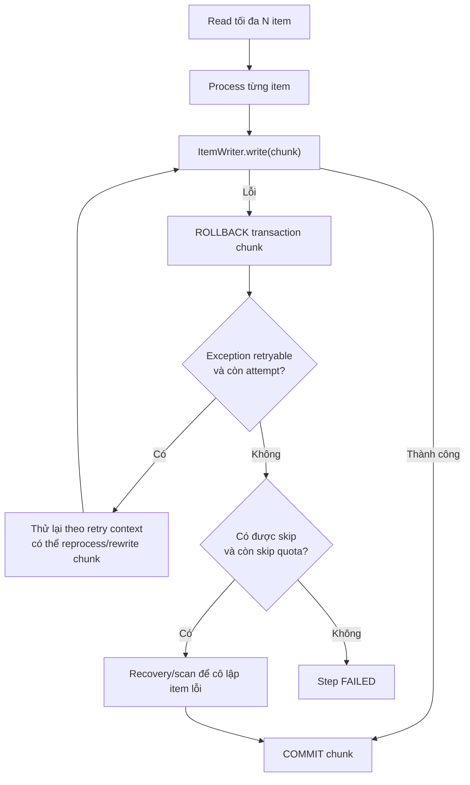
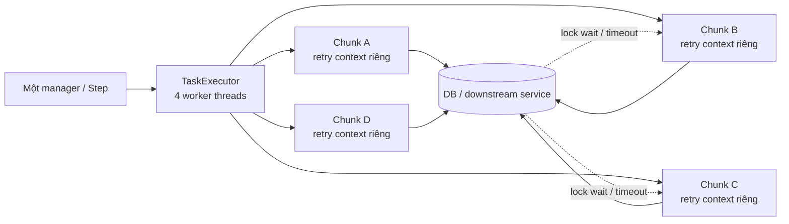

# Retry limit cho chunk trong Spring Batch

> **Chương:** Retry  
> **Mục tiêu:** Hiểu chính xác ý nghĩa của `retryLimit` trong chunk-oriented step, số lần thử được tính như thế nào, vì sao retry một item có thể khiến **cả chunk rollback và chạy lại**, và cách kết hợp giới hạn retry với phân loại exception, backoff, skip, restart, idempotency và scale nhiều worker. Ví dụ dùng **Spring Batch 5.2.x**, Java 17 và Spring Retry.

## 1. Bài toán: Một lỗi tạm thời làm cả chunk thất bại

Một batch job nhập 10 triệu giao dịch, mỗi chunk gồm 100 item. Worker đọc dữ liệu, xử lý và ghi vào PostgreSQL. Khi hai transaction tranh cùng một khóa, database có thể chọn một transaction làm *deadlock victim*. Lần ghi đầu thất bại, nhưng thử lại sau đó có thể thành công.

Nếu job **không cấu hình retry**, exception từ writer mặc định khiến transaction của chunk rollback và step có thể chuyển sang `FAILED`. Với dữ liệu lớn, dừng hẳn job vì một deadlock thoáng qua là tốn kém.

Nếu cấu hình retry **vô hạn**, một lỗi hệ thống kéo dài có thể giữ job chạy mãi, gây áp lực lên database và làm hàng trăm worker đồng loạt gửi lại request.

Giải pháp: **retry có giới hạn**, theo **loại lỗi có thể phục hồi** và theo **ngữ cảnh item**; khi không phục hồi được, chuyển sang skip nếu nghiệp vụ cho phép hoặc fail để điều tra.

Một cấu hình tiêu biểu:

```java
.faultTolerant()
.retry(TransientDataAccessException.class)
.retryLimit(3)
```

Ba dòng trên không có nghĩa “chạy lại toàn bộ chunk đúng ba lần” và cũng không có nghĩa “retry mọi exception”. Để hiểu đúng, cần tách khái niệm *chunk transaction*, *retryable item* và *attempt count*.

## 2. retryLimit thực sự đếm điều gì?

Theo `FaultTolerantStepBuilder` của Spring Batch 5.2, `retryLimit(int)` đặt **số lần thử tối đa cho một item bị lỗi**, trong trường hợp dùng cơ chế retry policy được cấu hình qua builder.

**Lần thử đầu tiên được tính vào giới hạn.** Vì vậy, với một item xác định và một chuỗi lỗi retryable ổn định:

| Cấu hình | Tổng số lần thử tối đa với item đó | Số lần thử lại sau lần đầu | Ý nghĩa |
| --- | ---: | ---: | --- |
| `retryLimit(0)` | 1 | 0 | Không retry |
| `retryLimit(1)` | 1 | 0 | Không retry |
| `retryLimit(2)` | 2 | 1 | Có một cơ hội thử lại |
| `retryLimit(3)` | 3 | 2 | Có tối đa hai lần thử lại |
| `retryLimit(5)` | 5 | 4 | Cần cân nhắc chi phí và backoff |

`retryLimit(0)` và `retryLimit(1)` đều tương đương “chỉ thử một lần” theo API builder 5.2. Nếu không có chính sách retry được bật, đặt limit cao **không làm một exception tự nhiên trở thành retryable**.

Cần phân biệt:

- **Attempt:** Một lần framework thử xử lý thao tác nằm trong retry context.
- **Retry:** Lần thử bổ sung **sau** attempt đầu.
- **Writer invocation:** Một lần `ItemWriter.write(chunk)` được gọi — có thể chứa nhiều item và có thể phát sinh ngoài một đường retry đơn giản do rollback hoặc write scan.
- **Chunk transaction:** Đơn vị commit/rollback. Khi writer gặp exception, **cả transaction chunk** thường rollback.
- **StepExecution:** Metadata của cả lượt chạy step; không đồng nghĩa một retry context cho toàn bộ item.

**Cảnh báo về cách đếm:** Giới hạn áp dụng theo *retry context/item*, không dùng để khẳng định số lần gọi `write()` trên một chunk, tổng số câu SQL, `rollbackCount` hoặc số message redelivery luôn bằng một con số cố định.

### Có phải retryLimit là quota toàn Job không?

**Không.** Ví dụ một job có 100.000 item, mỗi item đều gặp hai lỗi tạm thời rồi thành công. `retryLimit(3)` không có nghĩa cả job chỉ được retry ba lần; nó cho phép chính sách retry được áp dụng cho các item phù hợp trong quá trình xử lý.

Với partitioning, mỗi worker step/`StepExecution` có quá trình xử lý và trạng thái riêng; cũng không có **một quota retry toàn job** tự động được suy ra từ `retryLimit`. Nếu muốn dừng toàn bộ job khi retry storm vượt ngưỡng vận hành, cần thêm monitoring, circuit breaker hoặc chính sách điều phối.

## 3. Chunk, transaction và rollback khi retry

Chunk processing thông thường đi theo chuỗi:



Sơ đồ nhằm giải thích nguyên lý. Spring Batch có những đường xử lý khác nhau cho lỗi ở `read`, `process` và `write`; không phải mọi exception đều đi đúng một chu trình giống nhau.

Trong ví dụ chunk `[A, B, C, D]`:

1. Framework đọc/xử lý bốn item.
2. Writer đã thực hiện lệnh ghi A, B; đến C thì database báo deadlock.
3. Transaction của chunk rollback. Nếu các lệnh JDBC cùng tham gia transaction này, cả A/B cũng được hoàn tác.
4. Framework áp dụng retry policy cho lỗi tương ứng. Lần retry có thể làm các thao tác của A/B được **gọi lại**, dù A/B không phải nguyên nhân gây lỗi.
5. Khi lỗi được phục hồi, một transaction hợp lệ commit các item cần ghi.
6. Nếu hết giới hạn, step xét khả năng skip/fail theo cấu hình.

**Một lỗi ở item C có thể khiến công việc của A, B được làm lại.** Đây chính là lý do retry limit liên quan trực tiếp đến chi phí chunk và tính idempotent của writer.

### Vì sao không giữ transaction đã bị deadlock để thử SQL thêm?

Khi transaction bị database đánh dấu rollback-only hoặc không còn hợp lệ, không thể đơn giản bắt exception rồi tiếp tục trên transaction ấy như chưa có gì xảy ra. Đối với lỗi ghi có rollback, Spring Batch dùng quá trình retry/recovery phù hợp với ranh giới transaction của step.

Tránh dùng `try/catch` trong writer để “nuốt” mọi exception: điều đó có thể khiến framework tưởng chunk thành công, bỏ sót dữ liệu và không theo dõi được retry/rollback thực sự.

## 4. Ví dụ từng attempt với retryLimit(3)

Giả sử một item `INV-42` được xử lý và writer gặp lỗi retryable ở hai attempt đầu:

| Attempt | Kết quả | Framework có thể làm tiếp? |
| ---: | --- | --- |
| 1 | Deadlock/transient exception | Còn retry |
| 2 | Transient exception lần nữa | Còn retry |
| 3 | Ghi thành công | Commit khi transaction/chunk hợp lệ |
| 4 | Không cần thực hiện | Item đã thành công |

Nếu attempt thứ 3 cũng thất bại, retry policy không cho thêm attempt thứ 4 **đối với cùng retry context**. Sau đó hệ thống chọn nhánh recovery/skip/fail tùy các policy khác.

```text
retryLimit(3):
    Attempt #1 : FAIL (retryable)
    Attempt #2 : FAIL (retryable)
    Attempt #3 : SUCCESS
    Result     : Item có thể được ghi/commit trong chunk
```

Ví dụ thứ hai:

```text
retryLimit(3):
    Attempt #1 : FAIL (retryable)
    Attempt #2 : FAIL (retryable)
    Attempt #3 : FAIL (retryable)
    Retry exhausted
    → Skip chỉ nếu có policy skip hợp lệ và chưa quá hạn mức
    → Ngược lại step FAILED
```

Đây là cách mô tả **giới hạn retry logic của một item**, không phải bản ghi trace cam kết chính xác ba lần gọi SQL. Trong fault-tolerant writer có batch scan và transaction rollback, nhiều item hợp lệ cũng có thể được gọi lại; hãy kiểm thử và đo số invocation thực tế nếu nghiệp vụ có side effect nhạy cảm.

### Khi retryable đổi thành lỗi non-retryable

Nếu attempt đầu ném `TransientDataAccessException` nhưng attempt sau ném `IllegalArgumentException` do dữ liệu, policy thường **không tiếp tục retry chỉ vì còn limit**. Loại exception và các quy tắc include/exclude quyết định có được phép thử nữa hay không.

Cũng không mặc định rằng exception được bọc trong mọi lớp wrapper đều sẽ khớp retry classifier như mong muốn. Hãy quan sát exception thực tế từ JDBC driver, Spring DAO hoặc ORM và kiểm thử policy tương ứng.

## 5. Cấu hình Java 17 / Spring Batch 5.2

Ví dụ import invoice từ reader đã có, xác thực qua processor và ghi vào PostgreSQL. Chỉ retry những lỗi database thuộc nhóm tạm thời; lỗi dữ liệu được skip với hạn mức thấp; lỗi conflict business không được nuốt.

Bảng đích minh họa:

```sql
CREATE TABLE invoice_import (
    event_id VARCHAR(128) PRIMARY KEY,
    invoice_id VARCHAR(128) NOT NULL,
    amount NUMERIC(18, 2) NOT NULL
);
```

Cấu hình worker step:

```java
package com.example.batch.retry;

import java.math.BigDecimal;

import org.springframework.batch.core.Step;
import org.springframework.batch.core.repository.JobRepository;
import org.springframework.batch.core.step.builder.StepBuilder;
import org.springframework.batch.item.ItemProcessor;
import org.springframework.batch.item.ItemReader;
import org.springframework.batch.item.ItemWriter;
import org.springframework.beans.factory.annotation.Qualifier;
import org.springframework.context.annotation.Bean;
import org.springframework.context.annotation.Configuration;
import org.springframework.dao.TransientDataAccessException;
import org.springframework.jdbc.core.JdbcTemplate;
import org.springframework.retry.backoff.FixedBackOffPolicy;
import org.springframework.transaction.PlatformTransactionManager;

@Configuration(proxyBeanMethods = false)
public class InvoiceRetryStepConfig {

    public record Invoice(
            String eventId,
            String invoiceId,
            BigDecimal amount) {
    }

    public static class InvalidInvoiceException
            extends RuntimeException {
        public InvalidInvoiceException(String eventId) {
            super("Invalid invoice event: " + eventId);
        }
    }

    @Bean
    public ItemProcessor<Invoice, Invoice> validateInvoiceProcessor() {
        return invoice -> {
            if (invoice.eventId() == null
                    || invoice.eventId().isBlank()
                    || invoice.invoiceId() == null
                    || invoice.invoiceId().isBlank()
                    || invoice.amount() == null
                    || invoice.amount().signum() < 0) {
                throw new InvalidInvoiceException(
                        invoice.eventId());
            }
            return invoice;
        };
    }

    @Bean
    public ItemWriter<Invoice> invoiceWriter(JdbcTemplate jdbc) {
        return chunk -> {
            for (Invoice item : chunk) {
                jdbc.update("""
                    INSERT INTO invoice_import
                        (event_id, invoice_id, amount)
                    VALUES (?, ?, ?)
                    ON CONFLICT (event_id) DO NOTHING
                    """,
                    item.eventId(),
                    item.invoiceId(),
                    item.amount());
            }
        };
    }

    @Bean
    public Step invoiceImportStep(
            JobRepository repository,
            PlatformTransactionManager transactionManager,
            @Qualifier("invoiceReader") ItemReader<Invoice> reader,
            @Qualifier("validateInvoiceProcessor")
                    ItemProcessor<Invoice, Invoice> processor,
            @Qualifier("invoiceWriter") ItemWriter<Invoice> writer) {

        FixedBackOffPolicy backOff = new FixedBackOffPolicy();
        backOff.setBackOffPeriod(300L); // 300 ms giữa các retry

        return new StepBuilder("invoiceImportStep", repository)
                .<Invoice, Invoice>chunk(100, transactionManager)
                .reader(reader)
                .processor(processor)
                .writer(writer)
                .faultTolerant()
                .retry(TransientDataAccessException.class)
                .retryLimit(3)
                .backOffPolicy(backOff)
                .skip(InvalidInvoiceException.class)
                .skipLimit(5)
                .build();
    }
}
```

**Diễn giải từng cấu hình quan trọng:**

- `chunk(100, transactionManager)`: mỗi chunk có tối đa khoảng 100 input items theo cơ chế chunk, giao dịch do transaction manager quản lý.
- `faultTolerant()`: dùng fault-tolerant builder; **không tự biến mọi lỗi thành retryable/skippable**.
- `retry(TransientDataAccessException.class)`: những exception thuộc nhóm truy cập dữ liệu tạm thời của Spring DAO được đưa vào retry policy. Có thể cần **thu hẹp hơn** tùy nguồn lỗi.
- `retryLimit(3)`: tối đa ba attempt cho item theo policy, bao gồm lần đầu.
- `backOffPolicy(backOff)`: thêm độ trễ trước attempt tiếp theo; mặc định builder không tự có backoff hữu ích cho lỗi hệ thống kéo dài.
- `skip(InvalidInvoiceException.class)`: cho phép loại bỏ item sai **nghiệp vụ**; nó không có nghĩa thử lại item đó.
- `skipLimit(5)`: giới hạn tổng số skip read/process/write cho `StepExecution`; khi cần skip vượt hạn mức, step fail.
- Nếu exception không thuộc nhóm retry/skip được phép, step đi vào đường failure mặc định.

**Giới hạn của mã mẫu:** `invoiceReader`, `Job`, `JobRepository`, datasource PostgreSQL và các bean hạ tầng chưa được triển khai ở đây. Cần dự án Spring Batch 5.2/Spring Retry tương thích và kiểm thử integration test với DB thật.

**Giới hạn idempotency:** `ON CONFLICT DO NOTHING` chỉ bảo vệ việc chèn lại cùng `event_id`; nó có thể che giấu tình huống cùng event ID nhưng amount khác nhau. Trong production, hãy dùng business version/payload hash để phát hiện conflict, không coi mọi duplicate đều hợp lệ.

## 6. Không phải exception nào cũng nên retry

Retry có giá trị khi lỗi **không tất định**: lần thử sau có khả năng thành công mà không cần sửa dữ liệu hoặc code.

| Loại lỗi | Ví dụ | Retry? | Vì sao? |
| --- | --- | --- | --- |
| Transient database contention | Deadlock, lock timeout | Có giới hạn | Transaction mới có thể chạy khi lock được giải phóng |
| Kết nối tạm thời mất | Connection timeout thoáng qua | Tùy trạng thái resource | Có thể phục hồi, nhưng cần kiểm tra client/cursor |
| Rate limiting downstream | HTTP 429 với `Retry-After` | Có điều kiện | Chỉ khi request idempotent, tôn trọng backoff |
| Dữ liệu CSV không hợp lệ | Sai định dạng số, thiếu cột | Thường không | Đọc lại không tự sửa dữ liệu |
| Vi phạm business rule | Amount âm, currency không hỗ trợ | Không | Cần skip/quarantine hoặc fail |
| Duplicate business key không tương đương | Một ID, hai payload khác nhau | Không | Là xung đột, cần điều tra |
| Sai schema / thiếu quyền DB | SQL syntax, permission denied | Không | Retry không thay đổi cấu hình |
| Transaction đã rollback-only | DB transaction hỏng | Không dùng lại cùng TX | Cần transaction hợp lệ theo framework |
| `OutOfMemoryError`, lỗi JVM nặng | Hết heap hoặc stack | Không | Không xử lý như exception nghiệp vụ retryable |
| Lỗi metadata optimistic locking | Hai updater ghi `StepExecution` stale | Không retry mù | Cần sửa ownership và điều phối execution |

Không nên:

```java
// PHẢN VÍ DỤ: che lỗi lập trình/dữ liệu/hạ tầng.
.faultTolerant()
.retry(Exception.class)
.retryLimit(1000)
```

Cấu hình quá rộng có thể gây **retry storm**, giữ DB và CPU bận trong khi nguyên nhân thực tế không thể tự phục hồi. Nếu cần quy tắc nhiều loại lỗi, hãy dùng `retry(...)`/`noRetry(...)` với whitelist rõ ràng, hoặc `retryPolicy(...)` có kiểm thử.

### Lỗi đến từ ItemProcessor

Nếu processor ném exception có thể retry (ví dụ đọc cache/dịch vụ tạm thời), framework có thể gọi lại `process(item)`. Processor phải bảo đảm kết quả ổn định hoặc việc gọi lặp không tạo side effect nguy hiểm.

Nếu processor luôn ném cùng `InvalidInvoiceException`, cấu hình `skip(InvalidInvoiceException.class)` phù hợp hơn việc thử lại liên tục. `ItemProcessor` trả `null` là **filter**, không phải một retry/skip do exception.

## 7. Retry ở reader, processor và writer khác nhau

Ba vị trí lỗi có hợp đồng khác nhau:

| Pha | Framework biết item cụ thể không? | Điều cần kiểm tra |
| --- | --- | --- |
| `ItemReader.read()` | Chưa chắc: call đọc bị lỗi trước khi trả item | Reader có giữ nguyên vị trí khi ném exception không? |
| `ItemProcessor.process(item)` | Có item được truyền vào | Processor có an toàn khi gọi lại? |
| `ItemWriter.write(chunk)` | Nhận **nhiều item**, lỗi không luôn chỉ ra item nào | Rollback, gọi lại writer, scan/skip, side effect và idempotency |

### Retry ở ItemReader: Không tự bảo đảm đọc lại đúng dòng

Một reader tùy biến làm như sau:

```java
// PHẢN VÍ DỤ: cursor đã tiến trước khi validate.
@Override
public Invoice read() {
    Invoice item = underlyingReader.read(); // đã consume nguồn
    validateOrThrow(item);                   // exception
    return item;
}
```

Lần retry gọi lại `read()` có thể nhận **item tiếp theo**, làm item lỗi bị bỏ qua mà không đi vào cơ chế skip như mong muốn. Nếu đọc từ queue có transaction thì rollback có thể làm message được giao lại; nếu từ file/cursor thường, semantics khác.

Với lỗi đọc transient, hãy thiết kế reader chỉ cập nhật checkpoint/con trỏ sau khi đọc thành công hoặc có khả năng tái định vị đáng tin cậy. Không retry một lỗi parsing cố định để hy vọng dòng đó tự trở nên hợp lệ.

### Retry ở ItemProcessor

Đầu vào `item` đã có; việc gọi lại processor không phải đọc lại nguồn từ đầu theo nghĩa API. Tuy nhiên khi transaction rollback, **các item khác trong chunk** có thể được process lại. Nếu processor gọi HTTP hoặc viết cache, side effect ấy cũng có thể bị lặp.

### Retry ở ItemWriter

Một exception từ writer có thể xảy ra sau khi các item đầu chunk đã được ghi trong transaction. Nếu rollback, cả những thay đổi đã làm nhưng chưa commit của chunk được hoàn tác **nếu chúng tham gia cùng transaction**.

Khi retry hoặc khi tìm item lỗi có thể skip, writer có thể được gọi lại cho một hoặc nhiều item. Vì vậy không suy ra `retryLimit(3)` là “writer chạy đúng ba lần” cho tất cả chunk, và không dùng writer invocation count làm số giao dịch commit.

## 8. Stateful retry và bản sắc item qua rollback

Trong xử lý chunk có transaction, retry đối với `process/write` thường cần giữ **trạng thái lỗi của item qua các lần rollback**. Khái niệm này được gọi là *stateful retry*.

```text
Attempt 1 của item K
    PROCESS/WRITE thất bại
    ROLLBACK chunk
    lưu trạng thái retry của K

Lần item K được đưa lại vào đường xử lý
    tra cứu retry context của K
    nếu còn budget → attempt tiếp
    nếu hết budget → recovery/skip/fail
```

Spring Batch 5.2 có các extension point như:

- `keyGenerator(KeyGenerator)`: xác định danh tính item để tra cứu retry context khi cần phân biệt item qua rollback.
- `retryContextCache(RetryContextCache)`: bộ nhớ context phục vụ stateful retry giữa những transaction.
- `retryPolicy(RetryPolicy)`: định nghĩa quy tắc retry thay cho limit + classifier đơn giản.
- `backOffPolicy(BackOffPolicy)`: điều chỉnh thời gian trước retry trong trường hợp builder dùng policy tương ứng.

Một lỗi thiết kế thường gặp: kiểu item mutable không có identity ổn định; field được đổi khi processor chạy và `equals/hashCode` cũng thay đổi. Khi framework cần nhận diện item sau rollback, cache có thể không tìm được context cũ.

**Khuyến nghị:** Dùng item immutable (`record` với business identity ổn định) hoặc cấu hình key generator đáng tin cậy nếu cần; kiểm tra implementation của reader, processor và cơ chế retry thực sự trong project.

### Retry context có tồn tại qua JVM crash không?

Không nên coi cache retry stateful mặc định là một **kho phục hồi bền vững**. Khi worker JVM chết rồi job restart, `JobRepository` và checkpoint quyết định phần dữ liệu cần đọc lại; retry attempts trong bộ nhớ thường **không được tái sử dụng như một quota xuyên mọi lần khởi động**.

Nếu cần giới hạn “một event chỉ được thử tối đa 5 lần qua nhiều ngày, nhiều JVM”, phải thiết kế **attempt ledger bền vững** hoặc policy ở tầng message/workflow, đồng thời giữ writer idempotent.

## 9. retryLimit, retryPolicy và noRetry: Đừng cấu hình xung đột

Trong Spring Batch 5.2:

```java
.faultTolerant()
.retry(TransientDataAccessException.class)
.retryLimit(3)
```

là cách cấu hình đơn giản để có classifier + giới hạn. Nhưng khi ứng dụng cung cấp `retryPolicy(customPolicy)`, policy tùy chỉnh được dùng **thay** các thiết lập retry limit và retryable exceptions cơ bản của builder.

```java
// Minh họa nguyên lý: customPolicy phải do ứng dụng định nghĩa.
.faultTolerant()
.retryPolicy(customPolicy)
```

Không viết:

```java
// DỄ HIỂU SAI: retryLimit(3) không còn điều khiển
// giới hạn nếu đã dùng retryPolicy(customPolicy).
.faultTolerant()
.retry(TransientDataAccessException.class)
.retryLimit(3)
.retryPolicy(customPolicy)
```

Nếu cần các giới hạn khác nhau theo exception, một `RetryPolicy` tùy biến có thể phù hợp hơn một số chung. Tuy nhiên khi đưa policy tùy biến vào, người triển khai phải tự kiểm tra logic phân loại exception, số attempt, thời gian chờ và tính tương thích với stateful retry của step.

`noRetry(SomeException.class)` có thể loại trừ cụ thể một nhóm exception khỏi retry classifier. Đây là thao tác **không cho retry**, không tương đương `skip(...)`; exception bị loại khỏi retry vẫn có thể làm step fail nếu không có recovery/skip hợp lệ.

## 10. Backoff: Retry limit mà không chờ có thể gây bão tải

Giới hạn attempt kiểm soát **bao nhiêu lần**, còn backoff kiểm soát **khi nào thử lại**.

Nếu 20 worker cùng gặp lock contention rồi retry ngay, các request có thể lại tranh khóa và thất bại thêm. Đợi một khoảng thời gian có thể giúp hệ thống giảm tranh chấp.

| Chính sách | Ví dụ | Ưu điểm | Điểm cần chú ý |
| --- | --- | --- | --- |
| Không backoff | Retry ngay | Latency thấp khi lỗi rất ngắn | Tăng khả năng retry storm |
| Fixed backoff | 300 ms giữa các lần | Dễ cấu hình và đo | Các worker có thể đồng bộ nhịp |
| Exponential backoff | 200 → 400 → 800 ms | Giảm áp lực khi outage kéo dài | Cần max delay và deadline |
| Backoff với jitter | Delay khác nhau giữa workers | Hạn chế “thundering herd” | Cần library/policy hỗ trợ và kiểm thử |
| Phụ thuộc server hint | HTTP `Retry-After` | Tôn trọng quota phía dịch vụ | Chỉ hợp lệ nếu operation an toàn retry |

Giả sử `retryLimit(3)` và fixed backoff 300 ms. Trong một đường retry tuần tự lý tưởng, có **tối đa hai khoảng chờ** trước hai attempt bổ sung (≈ 600 ms delay), **chưa tính** DB latency, rollback, reprocessing hoặc thời gian queue. Đây chỉ là ví dụ về mặt số học, không phải SLA chính xác của toàn chunk.

Một executor có bốn worker threads bị block chờ backoff có thể làm giảm mức công việc hữu ích song song. Nếu lỗi kéo dài, circuit breaker hoặc dừng job có chủ đích sẽ tốt hơn việc mở nhiều worker để bù.

## 11. Retry exhausted và skipLimit: Hai giới hạn độc lập

`retryLimit` và `skipLimit` trả lời **hai câu hỏi khác nhau**:

- **Retry limit:** Một item bị lỗi retryable còn được thử thêm không?
- **Skip limit:** Khi không xử lý thành công, item đó có được **bỏ qua** theo chính sách nghiệp vụ và quota không?

Ví dụ:

```java
.faultTolerant()
.retry(TransientDataAccessException.class)
.retryLimit(3)
.skip(InvalidInvoiceException.class)
.skipLimit(5)
```

| Tình huống | Retry? | Skip? | Kết quả thường gặp |
| --- | --- | --- | --- |
| Transient DB lỗi 2 lần rồi thành công | Có | Không cần | Item được xử lý thành công |
| Transient DB lỗi liên tục, không thuộc skip policy | Có tới limit | Không | Step FAIL sau khi retry exhausted |
| Invoice amount âm, `InvalidInvoiceException` | Không | Có, nếu còn quota | Item bị skip và step tiếp tục |
| Invoice thứ 6 bị skip khi quota là 5 | Theo classifier | Không còn quota | Step FAIL |
| Duplicate event với payload conflict (fatal) | Không mặc định | Không mặc định | Step FAIL/quarantine theo thiết kế |

Nếu một exception nằm **trong cả retry và skip classifier**, framework có thể thử lại trước, rồi mới xét recovery/skip sau khi hết retry. Tuy nhiên đừng cấu hình skip lỗi database hệ thống chỉ để job báo `COMPLETED`; điều đó có thể bỏ qua hàng nghìn invoice hoàn toàn hợp lệ trong lúc DB down.

**Quota skip thường tính theo `StepExecution`**, không tự gộp toàn job khi dùng partitioning. Nếu có 10 partition mỗi partition `skipLimit(5)`, số item bỏ qua trên toàn job có thể lớn hơn 5; cần thêm quality gate để chặn publish nếu tổng skip vượt SLA.

### Retry exhausted không tự chuyển thành skip

Không có `skip(...)` phù hợp thì hết retry sẽ dẫn tới lỗi/failure. Không có cơ chế “cứ thử ba lần rồi bỏ item” chỉ nhờ `retryLimit(3)`.

### Phân biệt noRollback

Writer exception mặc định làm rollback chunk, kể cả khi có logic retry/skip. `noRollback(...)` chỉ là cấu hình rollback đặc biệt cho những exception/resources đã hiểu rõ; không biến item thành retryable/skippable và **không dùng để cố tiếp tục một transaction database đã bị đánh dấu lỗi**.

## 12. Idempotency: Điều kiện để retry an toàn

Với workload lớn, item có thể được gọi lại vì:

- retry processor hoặc writer;
- rollback và reprocess chunk;
- scan để cô lập một item lỗi writer;
- restart sau worker crash;
- broker redelivery của remote chunking;
- remote partition dispatch trùng hoặc timed-out.

Khi toàn bộ side effect nằm trong **cùng DB transaction của chunk**, rollback có thể hủy thay đổi chưa commit. Nhưng các hệ thống ngoài transaction như HTTP, email, file output, Kafka/JMS hoặc một transaction `REQUIRES_NEW` có thể đã commit trước.

| Writer/effect | Rủi ro khi retry | Biện pháp |
| --- | --- | --- |
| `INSERT` mỗi lần với ID tự sinh | Row trùng | Unique business key, upsert/ledger |
| `UPDATE balance=balance+amount` | Cộng tiền nhiều lần | Unique event/transfer ID và effect cùng transaction |
| `ON CONFLICT DO NOTHING` | Có thể che payload khác với cùng ID | So hash/version hoặc compare stored value |
| HTTP charge payment | Thu tiền trùng | Idempotency key được provider hỗ trợ |
| Gửi Kafka sau SQL | DB/message không nguyên tử | Transactional outbox + consumer dedup |
| Ghi một file đích chung | File bị append hai lần/chồng dữ liệu | Output theo partition, checkpoint và publish protocol |
| Processor sinh random UUID mỗi lần | Retry không còn cùng business identity | Stable source ID, immutable result |

### Ví dụ business key tồn tại qua restart

```sql
CREATE TABLE imported_event (
    source_system VARCHAR(64) NOT NULL,
    event_id VARCHAR(128) NOT NULL,
    payload_sha256 CHAR(64) NOT NULL,
    amount NUMERIC(18, 2) NOT NULL,
    PRIMARY KEY (source_system, event_id)
);
```

Key `(source_system,event_id)` không phụ thuộc `JobExecution ID`, thread hay chunk sequence. Vì vậy retry/restart vẫn nhận diện cùng event.

**Một database unique constraint không thay thế idempotency ở dịch vụ bên ngoài.** Nếu item cần gọi API thanh toán, phải mang cùng idempotency key từ đầu đến cuối, kể cả khi retry xảy ra ở Spring Batch hoặc broker.

## 13. Scale nhiều thread/partition: Retry giới hạn không phải giới hạn tải toàn hệ thống

Một local multi-threaded step có thể chạy bốn chunk đồng thời trên bốn thread. Mỗi chunk gặp lỗi transient khác nhau và đều có retry context. Khi tăng pool từ 4 lên 16, `retryLimit(3)` không thay đổi, nhưng **số transaction đang tranh DB và số request trong một đợt retry** có thể tăng đáng kể.



**Những gì retryLimit không giới hạn:**

- Tổng số item có thể retry trong cả job.
- Số chunk đang retry cùng thời điểm.
- Số request tới database hoặc HTTP endpoint trên tất cả worker.
- Thời gian chạy tối đa của job.
- Số lần broker giao lại message qua JMS/AMQP.
- Số lần job được restart sau failure.

### Partitioning

Mỗi partition có `StepExecution` riêng và worker step thực thi fault-tolerance của nó. Một partition hết retry có thể fail trong khi partition khác đã commit. Khi restart, các partition đã hoàn thành có thể được bỏ qua theo quy tắc thông thường, nhưng writer cần idempotent cho những item bị phát lại.

### Remote chunking và remote partitioning

- **Remote chunking:** Manager gửi `ChunkRequest` qua middleware; broker có thể redeliver. `retryLimit` của fault-tolerant chunk step ở manager **không tự giới hạn số lần broker phát lại** hay số lượt worker xử lý request. Cấu hình retry ở đúng nơi tác vụ process/write thực sự diễn ra, theo contract Spring Batch Integration đang dùng.
- **Remote partitioning:** Worker chạy một step riêng cho partition; `retryLimit` có thể cấu hình **trong worker step**. Nhưng transport/dispatch duplicate, reply timeout và retry/job restart là những tầng khác.
- **Nhiều JVM:** Mỗi process có bộ nhớ retry context riêng; không coi chúng là quota chung hay đồng hồ đếm bền vững toàn cluster.

Để chống retry storm, kết hợp limit, backoff, circuit breaker/điều tiết ở tầng worker, giới hạn concurrency, timeout thích hợp và monitor DB/broker.

## 14. Tác động đến checkpoint, restart và JobRepository

Khi writer gây rollback, `JobRepository` và `ExecutionContext` phải phản ánh được checkpoint đã **commit**, không phải chỉ vị trí reader từng đọc qua.

Lỗi nếu checkpoint được ghi theo cách tùy biến:

```text
Chunk A: đọc ID 101..200
Writer lỗi ở ID 190
DB transaction ROLLBACK
Custom code vẫn ghi lastProcessedId=200 vào nơi riêng

Restart: đọc từ ID 201
→ mất toàn bộ dữ liệu 101..200 chưa commit
```

Hãy để reader/writer `ItemStream` quản lý trạng thái thông qua lifecycle của Batch, giữ nguồn snapshot bất biến và kiểm chứng crash/restart. Không ghi checkpoint vào một key chung từ nhiều worker/partition nếu không có ownership và điều phối rõ ràng.

### Retry state không phải restart state

| Trạng thái | Nơi quản lý thường gặp | Vòng đời |
| --- | --- | --- |
| Attempt count cho một item đang retry | Retry context/cache | Trong quá trình xử lý step hiện tại, có thể mất khi JVM chết |
| Reader position/checkpoint | `ExecutionContext` + `JobRepository` | Phục vụ restart |
| `readCount/writeCount/rollbackCount` | `StepExecution` metadata | Thống kê execution |
| Số lần event đã được thử qua nhiều run | Attempt ledger ứng dụng | Chỉ có nếu thiết kế bền vững riêng |
| Marker event đã commit effect | Business database | Có thể phục vụ dedup qua nhiều JobExecution |

Nếu `JobRepository` ở database khác với output database, hai transaction có thể commit lệch. Một item có thể đã ghi business data nhưng metadata chưa update; retry/restart có thể đọc lại item. Đây là lý do **unique key/idempotent writer** vẫn cần ngay cả khi retry limit rất nhỏ.

### Optimistic locking metadata không phải lỗi để skip

`OptimisticLockingFailureException` của `JobRepository` có thể báo hai updater cạnh tranh ghi cùng `StepExecution`. Không biến nó thành `skip(Exception.class)` hay tăng retry limit mù quáng. Hãy tìm updater trùng, duplicate remote execution, race hoặc misuse của metadata.

## 15. Kiểm thử retry limit bằng lỗi giả lập

Một bài test dễ quan sát nhất là **một item/chunk**, một writer giả lập lỗi transient trong những lần đầu. Không dùng timeout DB thật trong unit test nếu cần kết quả xác định.

```java
import java.util.concurrent.atomic.AtomicInteger;

import org.springframework.batch.item.ItemWriter;
import org.springframework.dao.TransientDataAccessResourceException;

// Dành riêng cho test với 1 item / một chunk.
// Không dùng AtomicInteger toàn cục này để tính retry mỗi item
// trong một job chạy đa luồng với nhiều item.
AtomicInteger attempts = new AtomicInteger();

ItemWriter<String> flakyWriter = chunk -> {
    int attempt = attempts.incrementAndGet();
    if (attempt <= 2) {
        throw new TransientDataAccessResourceException(
                "test-only temporary outage");
    }
    // Thực hiện ghi hoặc ghi nhận thành công trong test.
};
```

Kết hợp worker step `chunk(1, transactionManager)`, `retry(TransientDataAccessResourceException.class)` và `retryLimit(3)`. Với một input item ổn định, mong đợi job vượt qua hai lỗi đầu rồi thành công ở attempt thứ ba; số invocation thực tế và counters cần được khẳng định bằng integration test của step.

Thử các trường hợp:

| Ca kiểm thử | Retry limit | Writer giả lập | Kỳ vọng |
| --- | ---: | --- | --- |
| T1 | 1 | Lỗi transient ngay lần đầu | Không retry; step fail nếu không có skip |
| T2 | 2 | Lỗi một lần rồi thành công | Có cơ hội phục hồi |
| T3 | 3 | Lỗi hai lần rồi thành công | Có cơ hội phục hồi |
| T4 | 3 | Lỗi liên tục | Hết retry; fail nếu không được skip |
| T5 | 3 | Ném exception không retryable | Fail/skip theo loại lỗi; limit không giúp |
| T6 | 3 | Lỗi dữ liệu cố định, `skip` riêng | Không cần retry; skip khi còn quota |
| T7 | 3 | Database commit rồi mất reply | Writer phải idempotent khi replay |
| T8 | 3 | Nhiều partition cùng lỗi | Không có quota retry chung toàn job |

### Test ở processor cũng cần giữ item ổn định

Dùng processor fake có `Map<BusinessKey, AtomicInteger>` đếm theo **khóa nghiệp vụ**, không đếm theo instance object được tái tạo. Nếu reader tạo item có identity thay đổi sau rollback, kết quả retry context có thể sai và test phải phát hiện vấn đề đó.

**Lưu ý:** Một test sử dụng reader không reset được sau rollback, output side effect không transactional hoặc custom listener sửa `StepExecution` có thể làm kết quả khác với lý thuyết một item/ba attempts. Khi đó cần sửa môi trường test, không tự tăng retry limit để “qua”.

## 16. Đo đúng retries, rollbacks và throughput

Chỉ nhìn `StepExecution.rollbackCount` chưa đủ để biết đã retry bao nhiêu lần:

- Một rollback có thể do retryable exception, skip scan, transaction error hoặc lỗi khác.
- Một retry attempt có thể tạo nhiều invocation ở những pha khác nhau.
- Một item đã xử lý thành công có thể được process/write lại do chunk chứa item khác lỗi.
- `writeCount` trong Batch không nhất thiết bằng số row DB **mới insert** nếu writer dùng idempotent upsert/no-op.
- Step có thể `FAILED` dù một số chunk/partition đã commit.

Các tín hiệu nên lưu:

| Metric/log | Mục đích |
| --- | --- |
| `retry_attempt_total` theo exception family | Biết loại lỗi và mức độ retry |
| `retry_exhausted_total` | Biết item/context đã hết budget |
| `rollbackCount` | Nhìn chi phí rollback và tình trạng transaction |
| `commitCount` | Theo dõi số transaction hoàn tất trong step |
| `readCount/writeCount/skipCount` | Theo dõi sản lượng theo semantics Batch |
| `chunk_duration_p95` | Đo tác động của retry và backoff |
| `db_lock_wait`, `db_pool_pending` | Tìm bottleneck database |
| `worker_active`, `executor_queue_depth` | Nhận diện quá tải do concurrency |
| `duplicate_effect_detected` | Kiểm tra idempotency khi replay |
| `dead_letter_backlog` | Biết những công việc chưa phục hồi |

Lấy tổng quan từ `StepExecution` trong `StepExecutionListener.afterStep`:

```java
@Override
public ExitStatus afterStep(StepExecution execution) {
    log.info(
        "stepExecutionId={} status={} commits={} rollbacks={} " +
        "read={} written={} skipped={}",
        execution.getId(),
        execution.getStatus(),
        execution.getCommitCount(),
        execution.getRollbackCount(),
        execution.getReadCount(),
        execution.getWriteCount(),
        execution.getSkipCount());
    return null;
}
```

Đoạn mã giả định một `StepExecutionListener` và logger đã được khai báo. Listener ở cuối step giúp đọc counters, nhưng **không thay thế RetryListener/metrics** nếu cần số attempt chính xác.

Khi ghi metric Prometheus, tránh dùng `eventId`, `stepExecutionId` hay `jobExecutionId` làm nhãn động có cardinality cao. Dùng tag ổn định như jobName, stepName, exception family và outcome; đưa ID vào structured logs/traces.

## 17. Tuning retryLimit theo chi phí thật

Không có một con số retry limit lý tưởng cho mọi workload. Nên cân nhắc:

1. Xác suất lỗi tạm thời hết sau bao nhiêu thời gian?
2. Mỗi attempt có thể giữ bao nhiêu connection, lock và bộ nhớ?
3. Backoff có giúp DB hoặc API hồi phục không?
4. Có bao nhiêu chunk/partition/worker đồng thời?
5. Retry có side effect ngoài transaction không?
6. Job có deadline/SLA và yêu cầu dừng sau một ngưỡng lỗi không?
7. Khả năng restart từ checkpoint có rẻ hơn giữ retry lâu không?

### Mô hình chi phí minh họa

Giả sử một item cần 40 ms để process/write, mỗi lần thất bại cần thêm 200 ms backoff. Với `retryLimit(3)`, đường tệ nhất trước khi exhausted có thể tiêu khoảng:

```text
3 attempts × 40 ms + 2 backoffs × 200 ms = 520 ms
```

Đây chỉ là **ước lượng theo giả định một item và ba attempts**. Trong thực tế, rollback/reprocess toàn chunk, SQL lock waits, listener overhead, read buffer và concurrency có thể làm chi phí lớn hơn nhiều.

Một phép đo giả định:

| Cấu hình | Worker threads | Retry limit | Backoff | Thời gian job | Nhận xét |
| --- | ---: | ---: | --- | ---: | --- |
| A | 4 | 1 | Không | 8 phút nhưng FAILED | Lỗi transient khiến step dừng |
| B | 4 | 3 | 250 ms | 9 phút, COMPLETED | Hồi phục được mà ít áp lực hơn |
| C | 8 | 3 | Không | 14 phút, nhiều rollback | Contention và retry storm |
| D | 4 | 10 | 250 ms | 22 phút, nhiều request | Có thể vượt SLA khi lỗi kéo dài |

Bảng **chỉ minh họa cách phân tích**, không phải benchmark sản phẩm. Một job FAILED sau 8 phút không được coi tốt hơn job COMPLETED sau 9 phút chỉ vì elapsed time thấp hơn.

### Phương pháp điều chỉnh

- Bắt đầu với whitelist exception rõ ràng và limit thấp, ví dụ 2–3 attempts, dựa trên test/SLI.
- Đo số lỗi phục hồi tại attempt thứ 2, thứ 3, thứ 4 ở môi trường gần production.
- Xác định **ngưỡng dừng** khi nhiều item liên tiếp cùng lỗi hệ thống; không tiếp tục retry toàn tập dữ liệu bị ảnh hưởng.
- Thử tăng/giảm worker count trong khi giữ nguyên retry limit/backoff.
- Kiểm tra tính đúng sau kill/restart và khi broker redelivery, không chỉ throughput.
- Đặt alert cho retry exhaustion, p95 chunk duration, DB pool pending và DLQ backlog.

## 18. Triệu chứng thường gặp và hướng khắc phục

| Triệu chứng | Nguyên nhân có thể | Cách xử lý |
| --- | --- | --- |
| Đã đặt `retryLimit(3)` nhưng không retry | Chưa gọi `retry(ExceptionType.class)` hoặc exception không khớp | Xem exception thực tế và classifier |
| Tưởng retry ba lần bổ sung nhưng chỉ có ba attempts | Lần đầu đã được tính trong limit | Diễn giải `retryLimit(3)` là 3 attempts tối đa |
| `retryLimit(1)` không retry | Đây là hành vi đúng | Tăng lên tối thiểu 2 nếu muốn một lần thử lại |
| Writer bị gọi nhiều lần hơn retry limit | Chunk rollback, reprocess, write scan hoặc item khác gây lỗi | Log theo item/attempt; không dùng invocation count làm quota |
| Retry DB vẫn lỗi dù sleep | DB down hoặc transaction/resource hỏng | Fail và khắc phục hạ tầng; đừng retry vô hạn |
| Batch đã retry thành công nhưng row đích trùng | Writer ngoài transaction, replay hoặc không có unique key | Chỉnh transaction và idempotency |
| `skipLimit` bị vượt khi nhiều partition | Skip quota theo StepExecution | Quality gate theo tổng job |
| `retryPolicy(custom)` có hiệu lực khác `retryLimit` | Policy tùy chỉnh thay cài đặt builder | Kiểm tra policy và các giới hạn của nó |
| Tăng số worker làm rollback nhiều hơn | DB lock contention/retry storm | Hạn chế concurrency, backoff/jitter phù hợp |
| Retry đọc file khiến mất dòng | Reader đã advance cursor trước khi ném exception | Thiết kế reader retry-safe và checkpoint đúng |
| Retry không nhận ra cùng item | Business identity/`equals/hashCode` không ổn định | Dùng immutable item/key generator phù hợp |
| Sau restart attempts lại từ đầu | Retry context mặc định không phải ledger bền vững | Dùng persisted attempt tracking nếu nghiệp vụ cần |
| Job vẫn chạy mãi dù limit nhỏ | Có vô số item, mỗi item có quota riêng; hoặc tầng broker redelivery riêng | Thêm SLA/circuit breaker/monitoring tổng |
| `OptimisticLockingFailureException` xuất hiện | Metadata được cập nhật từ nhiều updater | Sửa ownership, không skip/retry mù |
| Message được giao lại 20 lần dù retryLimit(3) | Broker redelivery khác item retry | Cấu hình listener/broker DLQ và dedup độc lập |

## 19. Bài thực hành và tiêu chí nghiệm thu

**Bài A — Đếm attempts chính xác.** Tạo một item và writer giả lập ném `TransientDataAccessResourceException` hai lần đầu. Cấu hình `retryLimit(3)`, `chunk(1)`. Kiểm tra item thành công và hiểu rằng giới hạn tính cả lần đầu.

**Bài B — Hết limit.** Writer luôn ném lỗi transient. Cấu hình `retryLimit(2)`, không có `skip` tương ứng. Kiểm tra step `FAILED`, không lặp vô hạn.

**Bài C — Phân loại exception.** Trong cùng nguồn input, sinh một deadlock giả lập, một lỗi parsing cố định và một lỗi business rule. Chỉ retry deadlock; lỗi dữ liệu thực thi theo skip/quarantine có quota hoặc fail.

**Bài D — Retry và chunk rollback.** Tạo chunk bốn item, writer dùng database transaction, gây lỗi ở item thứ ba. Kiểm tra các thao tác trước lỗi rollback và dữ liệu sau lần retry không trùng, dù writer có thể nhận lại item trước lỗi.

**Bài E — So sánh backoff.** Thử không backoff, fixed 200 ms và exponential backoff có giới hạn trên workload giả lập DB contention. Ghi attempt count, rollback, p95 chunk duration và thời gian hoàn thành.

**Bài F — Retry vs skip.** Cấu hình `retryLimit(3)` cho lỗi transient và `skipLimit(2)` cho lỗi dữ liệu. Xác nhận item transient được thử lại, item invalid được skip, và lần skip thứ ba làm step fail.

**Bài G — Multi-threaded step.** Dùng pool 2/4/8 worker, nguồn cố định và writer idempotent. Đo DB lock wait, số attempts và throughput; kết luận tăng worker có thể làm retry nhiều hơn.

**Bài H — Partitioned restart.** Chia dữ liệu thành bốn partition với reader step-scoped, gây lỗi ở partition C. Restart cùng JobInstance, kiểm tra partition đã COMPLETED không bị ghi lặp và phần chưa hoàn thành phục hồi đúng.

**Bài I — Remote redelivery.** Cho worker commit business transaction rồi chết trước broker ACK/reply. Xác nhận message được giao lại theo cấu hình broker, writer vẫn no-op với event đã commit và số lần redelivery không bị `retryLimit` của step tự giới hạn.

**Bài J — Retry context identity.** Dùng item mutable có `equals/hashCode` phụ thuộc một trường mà processor thay đổi. Quan sát hành vi không đáng tin trong kịch bản rollback; sửa bằng immutable identity hoặc key generator và kiểm tra lại.

**Bài K — Restart state và metadata.** Kill tiến trình ngay sau một chunk đã commit trong môi trường test. Dùng `JobExplorer` quan sát StepExecution, kiểm tra dữ liệu đích trước/sau restart và chứng minh writer idempotent bảo vệ replay.

### Checklist nghiệm thu trước production

- [ ] Phân biệt rõ **retryLimit = tổng attempts** với số retry sau lần đầu.
- [ ] Exception retryable được whitelist; lỗi dữ liệu/fatal không bị retry vô ích.
- [ ] Có backoff phù hợp, giới hạn tổng tải retry và timeout/SLA.
- [ ] Hiểu transaction rollback theo chunk và khả năng processor/writer được gọi lại.
- [ ] Reader retry-safe; processor stateless; writer idempotent.
- [ ] `skipLimit` được cấu hình riêng, có quota chất lượng dữ liệu toàn job nếu cần.
- [ ] Không dùng `retryPolicy` tùy biến mà bỏ qua semantics của các cấu hình khác.
- [ ] Phân biệt item retry, broker redelivery và JobInstance restart.
- [ ] Đã kiểm thử retry exhausted, rollback, concurrency và kill/restart.
- [ ] Có log/metrics cho attempt, retry exhaustion, rollback, DB waits và duplicate effects.

## 20. Tài liệu tham khảo chính thức

- [Spring Batch 5.2 — Configuring Retry Logic](https://docs.spring.io/spring-batch/reference/5.2/step/chunk-oriented-processing/retry-logic.html)
- [Spring Batch 5.2 — FaultTolerantStepBuilder API](https://docs.spring.io/spring-batch/docs/5.2.6/api/org/springframework/batch/core/step/builder/FaultTolerantStepBuilder.html)
- [Spring Batch 5.2 — Chunk-Oriented Processing](https://docs.spring.io/spring-batch/reference/5.2/step/chunk-oriented-processing.html)
- [Spring Batch 5.2 — Batch Processing and Transactions](https://docs.spring.io/spring-batch/reference/5.2/transaction-appendix.html)
- [Spring Batch 5.2 — Controlling Rollback](https://docs.spring.io/spring-batch/reference/5.2/step/chunk-oriented-processing/controlling-rollback.html)
- [Spring Batch 5.2 — Configuring Skip Logic](https://docs.spring.io/spring-batch/reference/5.2/step/chunk-oriented-processing/configuring-skip.html)
- [Spring Batch 5.2 — Configuring a Step for Restart](https://docs.spring.io/spring-batch/reference/5.2/step/chunk-oriented-processing/restart.html)
- [Spring Batch 5.2 — Scaling and Parallel Processing](https://docs.spring.io/spring-batch/reference/5.2/scalability.html)
- [Spring Retry — Backoff Policies](https://github.com/spring-projects/spring-retry#backoff-policies)
- [Spring Framework — Transaction Management](https://docs.spring.io/spring-framework/reference/data-access/transaction.html)

> **Giới hạn phiên bản:** Ví dụ dùng API builder của **Spring Batch 5.2.x**, trong đó `retryLimit(3)` được mô tả là giới hạn **ba attempts bao gồm lần đầu** và `retryLimit(0/1)` không tạo retry. Các phiên bản Spring Batch mới hơn có thể thay đổi builder, type và API retry; không trộn code Spring Batch 5.2 với Spring Batch 6 nếu chưa đối chiếu Javadoc. Mô hình time/cost và những tình huống failure injection là ví dụ giảng dạy, không phải benchmark đã chạy trên project này.

**Ghi nhớ:** `retryLimit` điều khiển **ngân sách thử lại cho item theo retry policy**, trong khi **chunk** là ranh giới transaction có thể bị rollback và thực hiện lại. `retryLimit(3)` cho tối đa ba attempts, không phải ba retry bổ sung, không phải ba lần `ItemWriter.write()` cho toàn chunk và không phải quota toàn job/cluster. Retry an toàn cần phân loại đúng exception, backoff, transaction rõ ràng, writer idempotent và kiểm chứng restart khi nhiều worker xử lý song song.
