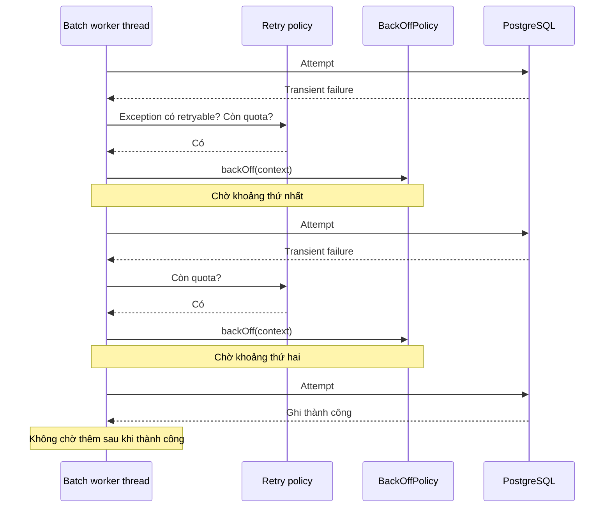
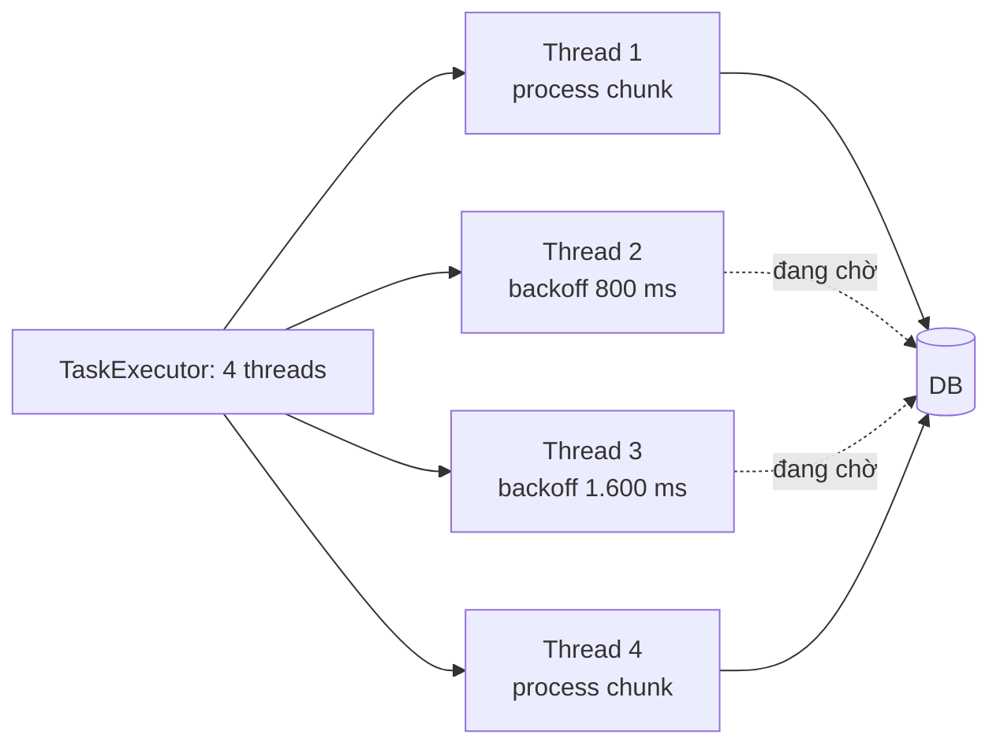
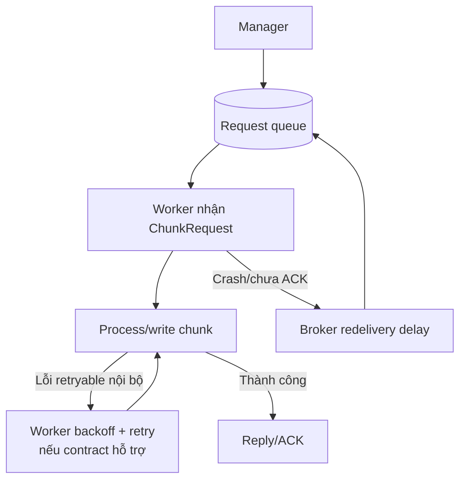

# Backoff giữa các lần thử trong Spring Batch

> **Chương:** Retry  
> **Mục tiêu:** Thiết kế khoảng chờ (*backoff*) giữa những lần retry khi xử lý chunk, tránh retry storm trên database/API, lựa chọn fixed/exponential/jitter, tính toán ngân sách thời gian và kiểm chứng thread safety, rollback, restart khi Spring Batch chạy song song hoặc phân tán. Ví dụ minh họa sử dụng **Spring Batch 5.2.x**, Java 17 và Spring Retry tương thích.

## 1. Vấn đề: Retry ngay lập tức có thể làm lỗi nặng hơn

Một job đối soát 8 triệu giao dịch sử dụng tám worker để đọc, xử lý và ghi PostgreSQL. Trong giờ cao điểm, writer gặp một số lỗi `TransientDataAccessException` do deadlock hoặc connection tạm thời không khả dụng.

Cấu hình đơn giản:

```java
.faultTolerant()
.retry(TransientDataAccessException.class)
.retryLimit(4)
```

cho phép item bị lỗi có tối đa **bốn lần thử tính cả lần đầu**. Nhưng nếu lỗi do quá tải, việc worker lập tức thử lại có thể tạo vòng lặp:

```text
Worker A: deadlock → retry ngay → deadlock → retry ngay
Worker B: deadlock → retry ngay → deadlock → retry ngay
Worker C: timeout  → retry ngay → timeout  → retry ngay
Database: vẫn bão hòa, connection pool tiếp tục cạn
```

**Backoff** bổ sung thời gian chờ trước attempt tiếp theo. Mục đích không phải “làm job chậm đi cho an toàn” mà là **cho tài nguyên có thời gian phục hồi, giảm tranh chấp và phân tán các đợt retry**, nhất là khi scale nhiều thread, partition hoặc remote worker.

Với dịch vụ bên ngoài, backoff còn giúp tôn trọng rate limit. Với database, backoff có thể giảm tình trạng nhiều transaction cùng quay lại tranh một nhóm khóa vừa gây deadlock.

**Thông điệp cốt lõi:** `retryLimit` quyết định **còn bao nhiêu lần được thử**, `BackOffPolicy` quyết định **chờ bao lâu giữa các lần đó**. Hai cơ chế phối hợp nhưng không thay thế nhau.

## 2. Định nghĩa và vòng đời một lần retry

Giả sử một item `INV-10042` lỗi ở lần thử đầu rồi thành công tại lần thứ ba:



Trong chu trình này:

- **Attempt đầu tiên không có backoff trước nó** do chính retry policy của step.
- **Backoff xảy ra khi lỗi đủ điều kiện retry và vẫn còn attempt kế tiếp.**
- Khi attempt đã thành công, không có lý do chờ thêm.
- Khi exception không retryable hoặc đã hết retry budget, không có attempt kế tiếp để chờ; step đi theo nhánh fail/skip/recovery tương ứng.
- Backoff **không tự sửa transaction bị rollback-only**. Framework phải xử lý đúng rollback và thiết lập transaction hợp lệ cho lần thử tiếp theo.

Sơ đồ trên là diễn giải khái niệm. Với `ItemWriter` lỗi, Spring Batch có thể rollback transaction chunk, gọi lại processor/writer và thực hiện recovery scan; số lần gọi method thực tế không luôn tương ứng một-một với số attempt của *một item*.

## 3. Bốn đại lượng cần tách biệt

| Đại lượng | Trả lời câu hỏi | Ví dụ |
| --- | --- | --- |
| **Retryable exception** | Lỗi này có được thử lại không? | `TransientDataAccessException` |
| **Retry limit** | Được thử tối đa bao nhiêu lần? | `retryLimit(4)` = tối đa 4 attempts |
| **Backoff policy** | Chờ bao lâu trước lần thử tiếp? | 200 ms → 400 ms → 800 ms |
| **Execution deadline** | Toàn bộ công việc được phép kéo dài bao lâu? | SLA 30 giây cho một thao tác downstream |

Ngoài ra còn có **chunk size**, **transaction timeout**, **worker concurrency** và **message redelivery policy**. Những tham số này ảnh hưởng đến thời gian thực tế nhưng **không được `backOffPolicy(...)` tự động cấu hình**.

Một ví dụ tính toán với `retryLimit(4)`:

```text
Attempt #1  → lỗi
Backoff #1  → 200 ms
Attempt #2  → lỗi
Backoff #2  → 400 ms
Attempt #3  → lỗi
Backoff #3  → 800 ms
Attempt #4  → thành công hoặc hết attempts

Tổng delay theo kế hoạch = 200 + 400 + 800 = 1.400 ms
```

**1.400 ms chỉ là tổng thời gian chờ**, chưa bao gồm DB latency, rollback transaction, đọc/xử lý lại chunk, scheduling hoặc queue wait. Nếu attempt nào thành công sớm hơn, số khoảng chờ thực tế ít hơn.

### Backoff không phải giới hạn tổng thời gian

Nếu một attempt bị kẹt 20 giây vì socket timeout, `backOffPolicy(200 ms)` không cắt attempt ấy xuống 200 ms. Hãy cấu hình timeout đúng ở JDBC driver, HTTP client, transaction và môi trường runtime. Deadline toàn job cần được thiết kế/giám sát riêng.

## 4. Spring Batch 5.2: Nơi cấu hình BackOffPolicy

Trong Spring Batch 5.2, `FaultTolerantStepBuilder` cung cấp:

```java
backOffPolicy(org.springframework.retry.backoff.BackOffPolicy policy)
```

Đây là policy được áp dụng ở **fault-tolerant chunk processing step**, không phải setting của `JobLauncher` hay `TaskExecutorPartitionHandler`.

Mẫu cấu hình:

```java
return new StepBuilder("invoiceImportStep", jobRepository)
        .<Invoice, Invoice>chunk(100, transactionManager)
        .reader(reader)
        .processor(processor)
        .writer(writer)
        .faultTolerant()
        .retry(TransientDataAccessException.class)
        .retryLimit(4)
        .backOffPolicy(backOffPolicy)
        .build();
```

`reader`, `processor`, `writer` và `backOffPolicy` là những dependency do ứng dụng cung cấp. Cần khai báo đúng `JobRepository`, `PlatformTransactionManager`, datasource và job trước khi chạy.

**Lưu ý API quan trọng:** Theo Javadoc của `FaultTolerantStepBuilder` 5.2, cấu hình `backOffPolicy(...)` ở builder **bị bỏ qua khi đã cung cấp `retryPolicy(...)` tường minh**. Không coi hai lựa chọn là cấu hình độc lập luôn được ghép tự động; hãy chọn một đường cấu hình nhất quán và kiểm thử retry thực tế.

## 5. Fixed backoff: Chờ một khoảng bằng nhau

`FixedBackOffPolicy` của Spring Retry là lựa chọn dễ bắt đầu và kiểm thử. Mỗi lần cần chờ, policy sử dụng cùng khoảng thời gian.

```java
import org.springframework.retry.backoff.BackOffPolicy;
import org.springframework.retry.backoff.FixedBackOffPolicy;
import org.springframework.context.annotation.Bean;

@Bean
BackOffPolicy invoiceFixedBackoff() {
    FixedBackOffPolicy policy = new FixedBackOffPolicy();
    policy.setBackOffPeriod(250L); // milliseconds
    return policy;
}
```

Với `retryLimit(4)` và item thất bại ở ba attempt đầu:

| Thời điểm logic | Hành động | Delay trước hành động |
| --- | --- | ---: |
| Lần 1 | Attempt #1 | 0 ms |
| Lần 2 | Attempt #2 | 250 ms |
| Lần 3 | Attempt #3 | 250 ms |
| Lần 4 | Attempt #4 | 250 ms |
| Tổng delay | Chờ ba lần | **750 ms** |

**Ưu điểm:** Đơn giản, dễ lập kế hoạch latency và xác minh bằng integration test. Phù hợp khi lỗi thường biến mất sau một khoảng tương đối cố định.

**Nhược điểm:** Nếu 100 worker cùng gặp lỗi tại một thời điểm, tất cả có thể đồng loạt thức dậy sau 250 ms và lại tranh tài nguyên. Đây là vấn đề **thundering herd**: backoff cố định giảm tần suất retry, nhưng không tự tách thời điểm thử lại của các worker.

Với một nhóm worker nhỏ và lỗi DB nhẹ, fixed backoff có thể đủ. Với cluster lớn hoặc rate limit của API, cân nhắc exponential + jitter.

## 6. Exponential backoff: Tăng dần khoảng chờ

`ExponentialBackOffPolicy` tăng delay sau mỗi lần retry của cùng context, có `initialInterval`, `multiplier` và `maxInterval`.

```java
import org.springframework.retry.backoff.BackOffPolicy;
import org.springframework.retry.backoff.ExponentialBackOffPolicy;
import org.springframework.context.annotation.Bean;

@Bean
BackOffPolicy invoiceExponentialBackoff() {
    ExponentialBackOffPolicy policy = new ExponentialBackOffPolicy();
    policy.setInitialInterval(200L); // 200 ms
    policy.setMultiplier(2.0);       // Mỗi delay tiếp tăng gấp đôi
    policy.setMaxInterval(2_000L);   // Cap tại 2 giây
    return policy;
}
```

Với exponential **không jitter**, công thức lý tưởng cho khoảng chờ thứ `k` (bắt đầu từ `k=1`) là:

\[
d_k = \min(d_{\max},\ d_0 \times m^{k-1})
\]

Trong đó:

- `d_0`: `initialInterval`, ví dụ 200 ms;
- `m`: `multiplier`, ví dụ 2;
- `d_max`: `maxInterval`, ví dụ 2.000 ms;
- `k`: số thứ tự khoảng chờ, **không phải** số thứ tự attempt.

| Khoảng chờ | Công thức | Delay |
| ---: | --- | ---: |
| #1 | 200 × 2⁰ | 200 ms |
| #2 | 200 × 2¹ | 400 ms |
| #3 | 200 × 2² | 800 ms |
| #4 | 200 × 2³ | 1.600 ms |
| #5 | min(200 × 2⁴, 2.000) | 2.000 ms |
| #6 | Đã đạt cap | 2.000 ms |

Nếu `retryLimit(4)`, có **tối đa ba khoảng chờ** (200 + 400 + 800 = 1.400 ms), không phải cứ cấu hình `maxInterval(2_000)` là chắc chắn sẽ chờ 2 giây.

**Lợi ích:** Khi một dịch vụ chưa hồi phục, các attempt kế tiếp cách nhau lâu dần, giảm tải so với retry liên tục.

**Giới hạn:** Nhiều worker bắt đầu cùng thời điểm vẫn có thể dùng các delay giống nhau (200 → 400 → 800) và **tái tạo các đợt tải đồng bộ**. Exponential không jitter **không giải quyết hoàn toàn** thundering herd.

## 7. Jitter: Phân tán thời điểm retry của nhiều worker

Trong workload phân tán, worker A, B, C có thể gặp cùng lỗi “HTTP 503” hoặc “DB connection exhausted” tại gần một thời điểm. Nếu tất cả chờ chính xác 500 ms, chúng có thể lại đồng loạt gửi request.

**Jitter** thêm yếu tố ngẫu nhiên vào thời gian chờ để các worker quay lại ở những thời điểm khác nhau.

Spring Retry cung cấp `ExponentialRandomBackOffPolicy`:

```java
import org.springframework.retry.backoff.BackOffPolicy;
import org.springframework.retry.backoff.ExponentialRandomBackOffPolicy;
import org.springframework.context.annotation.Bean;

@Bean
BackOffPolicy invoiceBackoffWithJitter() {
    ExponentialRandomBackOffPolicy policy =
            new ExponentialRandomBackOffPolicy();
    policy.setInitialInterval(200L);
    policy.setMultiplier(2.0);
    policy.setMaxInterval(2_000L);
    return policy;
}
```

**Chi tiết quan trọng:** `ExponentialRandomBackOffPolicy` của Spring Retry 2.x không phải thuật toán “full jitter” với delay chọn đều từ 0 đến cap. Theo Javadoc, nó chọn một **hệ số ngẫu nhiên giữa 1 và multiplier** áp vào khoảng exponential xác định. Do vậy:

- Cùng `initialInterval=200`, `multiplier=2.0`, lần chờ đầu có thể nằm khoảng 200–400 ms.
- Các lần chờ tiếp được ngẫu nhiên hóa trong những khoảng tương ứng với exponential policy.
- Không nên khẳng định một bảng delay cố định khi dùng jitter.
- Khi đặt cap, cần hiểu semantics thực tế của phiên bản thư viện và đo delay quan sát được; nếu yêu cầu một **hard deadline**, áp dụng thêm timeout/deadline riêng, không chỉ dựa vào max interval.

Ví dụ các giá trị **giả định** để trực quan hóa:

```text
Retry round      Worker A     Worker B     Worker C
Delay #1         235 ms       378 ms       294 ms
Delay #2         540 ms       720 ms       435 ms
Delay #3         920 ms     1.410 ms     1.150 ms
```

Những giá trị trên không phải output đã đo từ Spring Retry và không đại diện một seed cố định. Chúng cho thấy ba worker không phải cùng thức dậy sau đúng một khoảng.

### Khi nào jitter đặc biệt hữu ích?

- Cluster có hàng chục hoặc hàng trăm remote workers.
- Downstream có rate limit hoặc đang giảm tải vì outage.
- Các worker thường được khởi động cùng lúc sau deploy/restart.
- Database bị hotspot trên một số business key.
- Mọi request thất bại gần đồng thời do lỗi network hoặc service restart.

Jitter không thay thế **circuit breaker** hoặc **backpressure**. Khi API down hoàn toàn, hàng nghìn retry được rải đều vẫn là hàng nghìn request vô ích nếu deadline và quota tổng không được kiểm soát.

## 8. Cấu hình đầy đủ cho một chunk step

Ví dụ dưới đây dùng dữ liệu hóa đơn, PostgreSQL và writer idempotent. Đây là cấu hình giảng dạy theo Spring Batch 5.2.x; reader, job và datasource phải được ứng dụng cung cấp.

```java
package com.example.batch.retry;

import java.math.BigDecimal;

import org.springframework.batch.core.Step;
import org.springframework.batch.core.repository.JobRepository;
import org.springframework.batch.core.step.builder.StepBuilder;
import org.springframework.batch.item.ItemProcessor;
import org.springframework.batch.item.ItemReader;
import org.springframework.batch.item.ItemWriter;
import org.springframework.beans.factory.annotation.Qualifier;
import org.springframework.context.annotation.Bean;
import org.springframework.context.annotation.Configuration;
import org.springframework.dao.TransientDataAccessException;
import org.springframework.jdbc.core.JdbcTemplate;
import org.springframework.retry.backoff.BackOffPolicy;
import org.springframework.retry.backoff.ExponentialRandomBackOffPolicy;
import org.springframework.transaction.PlatformTransactionManager;

@Configuration(proxyBeanMethods = false)
public class InvoiceChunkRetryConfig {

    public record Invoice(
            String eventId,
            String invoiceId,
            BigDecimal amount) {
    }

    public static final class InvalidInvoiceException
            extends RuntimeException {
        public InvalidInvoiceException(String eventId) {
            super("Invalid invoice: " + eventId);
        }
    }

    @Bean
    BackOffPolicy chunkRetryBackoffPolicy() {
        ExponentialRandomBackOffPolicy policy =
                new ExponentialRandomBackOffPolicy();
        policy.setInitialInterval(200L);
        policy.setMultiplier(2.0);
        policy.setMaxInterval(2_000L);
        return policy;
    }

    @Bean
    ItemProcessor<Invoice, Invoice> invoiceValidator() {
        return invoice -> {
            if (invoice.eventId() == null
                    || invoice.eventId().isBlank()
                    || invoice.invoiceId() == null
                    || invoice.amount() == null
                    || invoice.amount().signum() < 0) {
                throw new InvalidInvoiceException(invoice.eventId());
            }
            return invoice;
        };
    }

    @Bean
    ItemWriter<Invoice> invoiceWriter(JdbcTemplate jdbc) {
        return chunk -> {
            for (Invoice item : chunk) {
                jdbc.update("""
                    INSERT INTO invoice_import
                        (event_id, invoice_id, amount)
                    VALUES (?, ?, ?)
                    ON CONFLICT (event_id) DO NOTHING
                    """,
                    item.eventId(), item.invoiceId(), item.amount());
            }
        };
    }

    @Bean
    Step invoiceImportStep(
            JobRepository repository,
            PlatformTransactionManager transactionManager,
            @Qualifier("invoiceReader") ItemReader<Invoice> reader,
            @Qualifier("invoiceValidator") ItemProcessor<Invoice, Invoice> processor,
            @Qualifier("invoiceWriter") ItemWriter<Invoice> writer,
            @Qualifier("chunkRetryBackoffPolicy") BackOffPolicy backoff) {

        return new StepBuilder("invoiceImportStep", repository)
                .<Invoice, Invoice>chunk(100, transactionManager)
                .reader(reader)
                .processor(processor)
                .writer(writer)
                .faultTolerant()
                .retry(TransientDataAccessException.class)
                .retryLimit(4)
                .backOffPolicy(backoff)
                .skip(InvalidInvoiceException.class)
                .skipLimit(5)
                .build();
    }
}
```

Bảng PostgreSQL tối thiểu cho ví dụ:

```sql
CREATE TABLE invoice_import (
    event_id VARCHAR(128) PRIMARY KEY,
    invoice_id VARCHAR(128) NOT NULL,
    amount NUMERIC(18, 2) NOT NULL
);
```

**Giải thích:**

1. `@Bean BackOffPolicy` tạo một instance policy cấu hình bất biến sau startup. Spring Retry exponential policy hỗ trợ dùng đồng thời nhờ mỗi retry set có context độc lập; không sửa thông số bean trong lúc workload đang chạy rồi giả định các retry đang diễn ra cũng đổi theo.
2. `retry(TransientDataAccessException.class)` chỉ retry nhóm lỗi data access tạm thời. `InvalidInvoiceException` được skip theo quota vì đây là lỗi dữ liệu, không phải lỗi hạ tầng cần chờ.
3. `retryLimit(4)` cho tối đa bốn attempts đối với item theo retry policy, gồm lần đầu.
4. `backOffPolicy(backoff)` áp dụng policy trong fault-tolerant builder; không cần thêm `Thread.sleep()` trong `ItemProcessor` hoặc `ItemWriter`.
5. `chunk(100, transactionManager)` xác định ranh giới transaction; writer JDBC phải dùng datasource được transaction manager này quản lý.
6. `ON CONFLICT DO NOTHING` giúp chèn lại cùng event ID không sinh row thứ hai, nhưng **không xác minh payload tương đương**. Production cần so fingerprint/version, đặc biệt với hóa đơn/thanh toán.
7. `retryLimit` và `skipLimit` là hai policy khác nhau; skip quota được tính theo `StepExecution` và có thể cần bước tổng hợp toàn job khi partitioning.
8. Ví dụ không khai báo `invoiceReader`, `Job`, `DataSource` hoặc migration tool. Đây là **mảnh cấu hình** cần tích hợp và kiểm thử, không phải ứng dụng chạy ngay.

Nếu backend dùng một API ngoài DB, thay vì retry mọi HTTP response, cần một exception classifier phân biệt `429/503` với `400/409` và kiểm tra idempotency của thao tác remote.

## 9. Fixed hay exponential+jitter: Chọn theo loại lỗi

| Tình huống | Chính sách phù hợp để thử đầu tiên | Lý do |
| --- | --- | --- |
| Deadlock SQL xuất hiện thưa, transaction ngắn | Fixed thấp (ví dụ 100–300 ms) hoặc exponential nhẹ | Có khả năng lock được giải phóng nhanh |
| Connection pool cạn do spike | Exponential + jitter, đồng thời giảm concurrency | Tránh cùng thời điểm lấy lại connection |
| HTTP 429 có `Retry-After` | Tôn trọng server hint, thêm jitter nếu hợp đồng cho phép | Tránh vi phạm quota nhiều lần |
| HTTP 503 do service khởi động lại | Exponential + jitter có cap và deadline | Giảm tải trong thời gian phục hồi |
| File parse sai cấu trúc | **Không retry** | Backoff không sửa được dữ liệu |
| Business constraint sai | **Không retry** | Cần fail hoặc skip/quarantine |
| Duplicate business key khác payload | **Không retry** | Đây là xung đột dữ liệu |
| DB permission/syntax/schema error | **Không retry** | Cần sửa hệ thống hoặc SQL |
| `OptimisticLockingFailureException` metadata | Điều tra ownership, không retry mù | Có thể là hai updater cùng một `StepExecution` |
| Payment API có tác dụng không thể đảo ngược | Chỉ retry khi có idempotency key và reconciliation | Tránh thu tiền hai lần |

**Không áp một backoff policy cho mọi exception** chỉ vì chúng cùng là `RuntimeException`. Khi retry không giúp ích, khoảng chờ chỉ trì hoãn việc báo lỗi và giữ worker bận.

### Chọn ban đầu có cơ sở

- Nếu một lỗi thường biến mất sau vài trăm mili giây và số worker nhỏ: fixed backoff dễ vận hành.
- Nếu lỗi kéo dài không đoán trước và nhiều worker cùng retry: exponential+jitter có lợi.
- Nếu upstream quy định rõ thời điểm retry (`Retry-After`): ưu tiên hợp đồng upstream.
- Nếu outage kéo dài nhiều phút: chuyển sang dừng job/requeue có delay phù hợp thay vì giữ hàng trăm thread ngủ.

Không có con số 200 ms, multiplier 2 hay cap 2 giây tối ưu cho mọi doanh nghiệp. Đây là **giá trị khởi đầu để benchmark**, không phải cấu hình bắt buộc.

## 10. Backoff có thể chiếm thread và tài nguyên

Các `BackOffPolicy` phổ biến của Spring Retry sử dụng `Sleeper`, mặc định dựa vào cơ chế chờ của thread. Trong một chunk step chạy trên `TaskExecutor`, **worker thread đang chờ không xử lý chunk khác**.



Nếu 2 trong 4 thread đang sleep, trong khoảng ấy chỉ còn 2 thread có thể đang thực hiện công việc hữu ích. Khi số worker tăng lên để bù, DB có thể lại quá tải.

**Hai điểm không nên đánh đồng:**

- “Thread đang chờ” **không chắc** transaction/connection đã được giải phóng. Nó phụ thuộc backoff xảy ra tại pha nào, ranh giới transaction và cách resource được quản lý. Với writer exception gây rollback, transaction có thể được rollback trước lần thử tiếp; với các nhánh khác, cần quan sát thực tế.
- “Backoff giúp throughput” không có nghĩa mỗi item nhanh hơn. Nó có thể **tăng latency một item** nhưng giảm contention, số lỗi và thời gian hoàn thành toàn job.

### Khi nào nên dùng cơ chế trì hoãn không giữ thread?

Với lỗi kéo dài hàng phút, có thể cân nhắc:

- Dừng worker/job và khởi chạy lại theo scheduler có backoff;
- đưa request vào **delayed retry queue** của middleware với TTL/DLQ phù hợp;
- dùng workflow orchestration có trạng thái bền vững và lịch đánh thức lại.

Các chiến lược trên là **tầng retry khác** với `FaultTolerantStepBuilder.backOffPolicy(...)`. Chúng cần protocol delivery, idempotency và tracking riêng; không thể đổi trực tiếp một `BackOffPolicy` thành delayed queue mà vẫn giữ nguyên ngữ nghĩa chunk/restart.

## 11. Backoff, transaction và rollback ở writer

Trong chunk-oriented processing, khi `ItemWriter.write(chunk)` ném lỗi, Spring Batch thường rollback **transaction của chunk**, sau đó retry/recovery theo chính sách.

Ví dụ chunk chứa bốn item:

```text
Chunk = [A, B, C, D]
BEGIN TX
  INSERT A
  INSERT B
  INSERT C → deadlock / transient error
ROLLBACK TX
BACKOFF (nếu retryable và còn budget)
BEGIN TX hợp lệ
  Writer được gọi lại với các item cần xử lý
COMMIT nếu thành công
```

Đây là chuỗi khái niệm. Trong `FaultTolerantChunkProcessor` có thể có write scan, replay và cách retry khác nhau; không suy rằng mọi retry writer đều là một transaction mới với **chính xác** bốn item ban đầu và đúng một lời gọi `write()`.

### Vì sao không tự ngủ trong writer?

```java
// PHẢN VÍ DỤ — tránh tự viết cơ chế retry bên trong writer.
for (int attempt = 0; attempt < 100; attempt++) {
    try {
        jdbc.update(sql);
        return;
    } catch (Exception ignored) {
        Thread.sleep(500);
    }
}
```

Vấn đề:

- Không phân loại exception;
- có thể đang giữ transaction đã bị rollback-only;
- nuốt nguyên nhân lỗi và báo sai trạng thái;
- làm framework không quan sát được retry;
- tạo hai tầng retry chồng nhau khi Step cũng `.retry(...)`;
- có nguy cơ tiếp tục sau khi thread bị yêu cầu dừng;
- không giải quyết idempotency nếu statement đã commit ở hệ ngoài.

**Nên để framework quản lý retry, transaction và backoff** ở đúng tầng. Writer tập trung vào business effect an toàn khi được gọi lại.

### InterruptedException và stop

Khi job/step bị stop hoặc thread bị interrupt, một policy đang chờ có thể phát sinh lỗi liên quan interruption. Không bắt `InterruptedException` rồi bỏ qua để tiếp tục retry mãi. Worker cần tôn trọng lifecycle dừng của Spring Batch và bảo đảm kết quả/metadata phản ánh việc không hoàn tất.

## 12. Stateful retry: Backoff context sống ở đâu?

Trong chunk step có rollback, retry ở processor/writer thường mang tính **stateful** qua nhiều transaction. Spring Batch/Spring Retry có thể giữ retry context để biết một item đã thất bại bao nhiêu lần.

```text
Execution #1:
  item X thử lần 1 → FAIL
  retry context của X ghi nhận failure
  chunk rollback

Execution tiếp theo trong cùng step:
  item X trở lại
  khôi phục retry context tương ứng
  áp retry limit và backoff policy
```

Các extension point Spring Batch 5.2:

- `keyGenerator(KeyGenerator)`: xác định identity item cho stateful retry;
- `retryContextCache(RetryContextCache)`: giữ retry context giữa các transaction;
- `retryPolicy(RetryPolicy)`: quyết định còn retry được không;
- `backOffPolicy(BackOffPolicy)`: kiểm soát độ trễ trên đường retry builder mặc định.

**Quan trọng:** Không phải mọi item đều có retry context mới nếu object bị tạo lại. Nếu `equals/hashCode` dựa trên một trường thay đổi sau processor, việc nhận diện lại item có thể không ổn định. Dùng business identity ổn định hoặc cấu hình key generator theo nhu cầu.

**Backoff context không phải checkpoint bền vững.** Khi JVM/process chết, bộ nhớ retry và lịch sử khoảng chờ có thể mất. `JobRepository`/`ExecutionContext` phục vụ restart theo metadata, không tự lưu “đã ngủ 800 ms, lần tới phải 1.600 ms” cho mỗi item.

Nếu nghiệp vụ cần trì hoãn retry xuyên giờ/ngày và nhiều process, phải có **persistent retry schedule/attempt ledger** hoặc cơ chế điều phối bên ngoài phù hợp.

## 13. Cấu hình retryPolicy tùy biến: Một bẫy API quan trọng

Javadoc Spring Batch 5.2 về `FaultTolerantStepBuilder` nêu:

- `retryLimit(...)` xác định số lần thử tối đa; có thể bị bỏ qua khi đã thiết lập `retryPolicy(...)` tường minh.
- `backOffPolicy(...)` cũng **bị bỏ qua khi một `retryPolicy(...)` tường minh được cấu hình**.

Ví dụ dễ gây hiểu sai:

```java
// PHẢN VÍ DỤ — không suy rằng các config tự ghép lại.
.faultTolerant()
.retry(TransientDataAccessException.class)
.retryLimit(4)
.backOffPolicy(invoiceBackoffWithJitter)
.retryPolicy(customRetryPolicy)
```

Nếu muốn định nghĩa một retry policy hoàn toàn tùy biến (ví dụ mỗi exception có số attempts riêng), hãy kiểm tra hợp đồng builder **đúng phiên bản**, thiết kế đường retry/backoff tương thích và **đo thời gian chờ trong integration test**. Đừng chỉ nhìn Java code rồi kết luận backoff chắc chắn đang chạy.

**Phương án đơn giản và ít lỗi khi chưa cần custom policy:**

```java
.faultTolerant()
.retry(TransientDataAccessException.class)
.retryLimit(4)
.backOffPolicy(invoiceBackoffWithJitter)
```

`noRetry(FatalException.class)` có thể loại trừ một loại lỗi khỏi retry classifier nếu đang dùng chính sách cơ bản. Tuy nhiên `noRetry(...)` **không đồng nghĩa skip**, và nó không khắc phục được xung đột cấu hình với custom `retryPolicy(...)`.

### Đừng trộn `@Retryable` tùy ý với Step retry

Nếu một HTTP client method dùng `@Retryable(maxAttempts=3)` rồi Spring Batch Step cũng `retryLimit(4)`, về mặt worst case thao tác client có thể được gọi tới **12 lần** cho một đường lỗi (4 attempts ở step × 3 attempts ở client), chưa tính broker redelivery hoặc job restart.

Nếu cả hai tầng đều backoff, tổng latency/calls có thể lớn hơn nhiều so với cấu hình một tầng. Hãy **chỉ định rõ tầng sở hữu retry** và có deadline/ngưỡng tải tổng.

## 14. Backoff trong multi-threaded step và partitioning

Một step đa luồng có nhiều chunk cùng chạy, mỗi chunk/item có quá trình retry riêng. Backoff ở một thread **không làm các thread khác dừng**.

Ví dụ pool 8 thread, `retryLimit=4`, exponential policy:

- Worker 1 đang xử lý chunk A, không lỗi.
- Worker 2 retry chunk B với delay 400 ms.
- Worker 3 retry chunk C với delay 800 ms.
- Worker 4–8 tiếp tục các chunk khác.
- Database có thể vẫn bị contention vì tổng concurrency không giảm khi chỉ vài worker chờ.

Trong **local partitioning** với `TaskExecutorPartitionHandler`, mỗi partition có một `StepExecution` riêng và worker step riêng. Khi partition 3 backoff, partition 4 vẫn có thể ghi database.

Trong **remote partitioning**, worker trên JVM khác có chính sách retry/backoff riêng; manager không điều khiển một đồng hồ backoff duy nhất cho cả cluster.

### Bài toán hot key

Nếu 100 partition cùng update một row “tổng số dư cuối ngày”, dù dữ liệu đọc chia tách tốt, các transaction vẫn tranh **cùng business key**. Jitter giúp giảm đồng thời retry, nhưng sửa thiết kế (aggregate theo partition rồi merge) thường hiệu quả hơn.

| Vấn đề | Backoff giúp? | Thay đổi kiến trúc có thể cần |
| --- | --- | --- |
| Contention nhẹ/thỉnh thoảng | Có | Giữ concurrency hợp lý |
| Cùng row bị 100 worker cập nhật liên tục | Chỉ giảm triệu chứng | Partition-local aggregation + merge |
| DB pool chỉ 8 connections, 32 workers | Hạn chế đợt retry | Giảm worker và sửa pool sizing |
| Một partition chứa 90% dữ liệu | Ít tác dụng | Chia lại workload, giảm data skew |
| Network partition kéo dài 10 phút | Chỉ trì hoãn | Circuit breaker, fail/requeue, kiểm tra SLA |
| Deadlock do thứ tự lock ngược nhau | Không sửa nguyên nhân | Chuẩn hóa thứ tự ghi/lock |

## 15. Backoff trong remote chunking: Đừng nhầm với broker redelivery

Ở remote chunking, manager gửi `ChunkRequest` cho workers qua Spring Integration và middleware như RabbitMQ/JMS. Có **ít nhất hai** cơ chế lặp khác nhau:

1. **Retry nghiệp vụ trong chunk processing:** Retry tại tầng Spring Batch/Spring Retry nếu được cấu hình ở đúng worker/step xử lý.
2. **Broker redelivery:** Message được giao lại vì consumer mất kết nối, chưa ACK, transaction messaging rollback hoặc policy broker.

`backOffPolicy(...)` ở fault-tolerant step **không tự cấu hình delay của broker**. Ngược lại, delayed queue/dead-letter exchange **không tự điều chỉnh retry policy của Spring Batch**.



**Cửa sổ nguy hiểm:** Worker đã commit DB nhưng chết trước khi gửi `ChunkResponse`/ACK. Broker redeliver và worker khác ghi lại. Backoff **không ngăn duplicate effect**; cần business key idempotent, unique constraint hoặc ledger/outbox tùy side effect.

Nếu middleware cấu hình 5 lần redelivery và worker retry nội bộ tối đa 4 attempts, một request có thể tạo nhiều lần gọi nghiệp vụ hơn 4, chưa kể restart. Vì vậy phải có tổng quan về **retry amplification** trên tất cả tầng.

### Poison message

Nếu một chunk chứa lỗi schema/data cố định, backoff rất dài chỉ trì hoãn thất bại. Dùng phân loại permanent/transient, max delivery attempts, DLQ/quarantine và báo trạng thái job đúng. Không để worker tự ý ACK request lỗi mà manager vẫn tưởng chunk hoàn tất.

## 16. Timeout, SLA và bài toán ngân sách retry

Để chọn delay có cơ sở, đặt giới hạn cho **toàn bộ vòng thử**, không chỉ mỗi lần backoff.

Mô hình ước lượng:

\[
T_{\text{total}} \lesssim \sum_{i=1}^{N} T_{\text{attempt},i}
 + \sum_{i=1}^{N-1} d_i
 + T_{\text{rollback/recovery/queue}}
\]

Trong đó:

- `N` là số attempts tối đa theo retry policy;
- `T_attempt,i` là thời gian attempt thứ i, gồm DB/API latency;
- `d_i` là backoff trước attempt kế tiếp;
- overhead gồm rollback, process lại item/chunk, scheduling và metadata update.

Dấu `≲` chỉ là ước lượng khi các thành phần đầu vào được chặn bởi timeout rõ ràng; không phải một giới hạn cứng nếu network call có thể treo.

### Ví dụ tính toán

Giả sử:

- `retryLimit(4)`;
- mỗi attempt có timeout riêng tối đa 1 giây;
- exponential không jitter, delay 200, 400 và 800 ms;
- rollback/recovery giả định tối đa 500 ms trong toàn chuỗi.

Tổng **ngân sách lý thuyết**:

```text
4 × 1.000 ms   = 4.000 ms cho attempts
200+400+800    = 1.400 ms cho backoff
Rollback/extra =   500 ms (giả định)
-------------------------------------
Tổng           ≈ 5.900 ms
```

Nếu SLA toàn thao tác là 3 giây, bộ thông số này **không đạt**, dù từng timeout/backoff riêng nghe có vẻ nhỏ.

Với jitter, thời gian chờ không cố định; tính envelope hoặc mô phỏng phân bố delay theo chính sách thực tế, rồi đo p95/p99, thay vì chỉ cộng một bảng deterministic.

### Về transaction timeout

Không giả định transaction timeout 3 giây bao trùm toàn bộ một chuỗi retry và các transaction sau rollback. Những transaction/connection mới có thể được tạo theo cơ chế retry của framework. Cần định nghĩa timeout ở đúng tầng, đo wall-clock duration của item/chunk/job và có deadline ở tầng điều phối nếu cần.

## 17. Observability: Đo delay thật, không chỉ rollbackCount

Một lỗi thường gặp là xem `StepExecution.rollbackCount` rồi kết luận “đã retry 17 lần”. Điều này không chính xác:

- Rollback có thể xảy ra do retry, skip scan, transaction timeout hoặc lỗi khác.
- Một retry attempt có thể khiến processor/writer được gọi nhiều lần.
- Backoff có thể diễn ra nhưng không có thêm một rollback tương ứng ngay tại thời điểm chờ.
- Retry ở HTTP client, broker hoặc workflow bên ngoài không được Spring Batch tự đếm vào `StepExecution`.

Cần tách ba nhóm số liệu:

| Nhóm | Metric/log | Ý nghĩa |
| --- | --- | --- |
| Retry | `retry_attempt_total`, `retry_exhausted_total` | Bao nhiêu lần thử lại và hết budget |
| Backoff | `retry_backoff_seconds` histogram, p95/p99 | Worker chờ bao lâu |
| Chunk/DB | `rollbackCount`, `chunk_duration`, `db_lock_wait` | Chi phí transaction và bottleneck |
| Workload | `items_committed_per_second` | Throughput nghiệp vụ thành công |
| Worker | `executor_active`, `queue_depth` | Bao nhiêu thread đang hoạt động/chờ |
| Network | `http_429/503`, `db_pool_pending` | Downstream có đang quá tải? |
| Messaging | `redelivery_total`, `DLQ_depth` | Retry tại tầng broker |

Log minh họa:

```text
INFO  job=invoiceImportJob step=invoiceImportStep
      eventKeyHash=... worker=partition-2
      retryAttempt=2 exception=TransientDataAccessException
      plannedBackoffMs=426

INFO  job=invoiceImportJob step=invoiceImportStep
      retryAttempt=3 outcome=SUCCESS elapsedMs=1150

WARN  job=invoiceImportJob step=invoiceImportStep
      retryAttempt=4 outcome=EXHAUSTED
      downstream=db-primary errorFamily=transient-db
```

Các field trên **không phải log mặc định** của Spring Batch; cần listener/instrumentation để sinh ra chúng. Với Spring Retry có `RetryListener` để quan sát attempt; để đo chính xác backoff hãy instrument policy hoặc test `Sleeper` phù hợp, thay vì lấy chênh lệch log làm delay tuyệt đối (vì còn có rollback, thread scheduling).

**Không dùng** `jobExecutionId`, `stepExecutionId`, `eventId` hay raw payload làm Prometheus metric labels vì cardinality rất cao. Dùng chúng trong structured logs/traces có phân quyền; metric tag ổn định theo job, step, exception family và worker role.

## 18. Test: Backoff có chạy thật không?

Một test có giá trị phải phân biệt **policy tính delay đúng** với **Step thực sự gọi policy khi retry**.

### Test A — Fixed backoff

Cấu hình:

```text
chunkSize=1
retryable=TransientDataAccessResourceException
retryLimit=3
fixedBackoff=100 ms
Writer: lỗi hai lần đầu, lần thứ ba thành công
```

Kỳ vọng logic:

- Có tối đa ba attempts cho item;
- có hai khoảng chờ trước attempt #2 và #3;
- tổng **planned delay** 200 ms;
- wall-clock time không được dùng làm bằng chứng chính xác 200 ms vì scheduling/transaction overhead;
- writer được gọi lặp nhưng business effect chỉ commit một lần.

### Test B — Exponential

Cấu hình initial 100 ms, multiplier 2.0, cap 1.000 ms, đủ attempts để có bốn backoffs.

```text
Backoff #1 = 100 ms
Backoff #2 = 200 ms
Backoff #3 = 400 ms
Backoff #4 = 800 ms
Planned sum = 1.500 ms
```

Dùng một cơ chế đo/thay `Sleeper` được hỗ trợ bởi phiên bản Spring Retry của project để kiểm tra **các interval được yêu cầu**, thay vì chỉ `Thread.sleep` rồi kiểm tra elapsed time bằng một ngưỡng quá chặt khiến test flaky.

### Test C — Jitter

Với cùng thông số exponential random, chạy nhiều retry sets và ghi các delay. Xác nhận:

1. Không có chuỗi delay luôn giống nhau ở mọi retry set;
2. delay phù hợp semantics random multiplier trong Javadoc;
3. không có negative delay;
4. có giới hạn thời gian toàn tác vụ nếu hệ thống yêu cầu.

**Không đặt kỳ vọng “retry #2 phải là 400 ms”** cho random policy.

### Test D — Không retry với lỗi dữ liệu

Cho `ItemProcessor` ném `InvalidInvoiceException`. Cấu hình chỉ retry `TransientDataAccessException`. Kiểm tra policy **không backoff** cho lỗi non-retryable và xử lý đúng skip/fail.

### Test E — Hết retries

Với `retryLimit(3)`, writer luôn ném lỗi transient. Kiểm tra có retry exhaustion, step không chạy vô hạn, thông báo failure đầy đủ và không có output nghiệp vụ thiếu/nhân đôi.

### Test F — Hai cách wiring

So sánh một step dùng `retryLimit(3).backOffPolicy(exponential)` với step đưa `retryPolicy(custom)` tường minh. Dùng instrumentation để xác minh cách builder áp dụng hoặc bỏ qua backoff; không mặc định hai cấu hình cho cùng kết quả.

### Test G — DB outage dưới tải

Dùng pool 2/4/8 worker. Tạo lỗi hạ tầng có kiểm soát. Đo:

- tổng retry attempts;
- p95 worker wait/DB connection pending;
- throughput sau khi DB phục hồi;
- rollback và thời gian hoàn thành;
- có “đồng loạt thức dậy” với fixed delay không;
- mức khác biệt khi dùng jitter.

### Test H — Kill/restart

Kill worker ngay sau chunk commit trong môi trường test. Restart cùng JobInstance, xác minh business key không bị ghi lặp và không giả định RetryContext/backoff counter trong RAM còn tồn tại.

## 19. Một số lựa chọn tuning theo workload

| Workload | Gợi ý bắt đầu | Kiểm tra thêm |
| --- | --- | --- |
| JDBC deadlock hiếm | 2–4 attempts, fixed 100–300 ms | Thứ tự lock, index, DB lock waits |
| JDBC pool bị cạn do quá nhiều partitions | Giảm concurrency, exponential+jitter hữu hạn | Pool pending, connection lifetime, chunk size |
| API có rate limit rõ | Tôn trọng `Retry-After` và cap + deadline | Idempotency key, 429 rate, SLA |
| API 503 thoáng qua | Exponential+jitter, 2–5 attempts theo SLI | Circuit breaker, p95/p99 latency |
| Remote workers hàng trăm JVM | Jitter + max in-flight + retry budget tổng | Retry amplification, broker redelivery |
| ETL file CPU-heavy | Thường không retry lỗi CPU/dữ liệu cố định | Data quality, chia partition |
| Job có strict deadline | Delay và attempts tính từ thời gian còn lại | Không cho retry vượt hạn chót |
| Batch kết nối hệ thống thanh toán | Retry cực kỳ thận trọng | Dedup/idempotency provider và reconciliation |

Các thông số là **đề xuất thử nghiệm**, không phải giá trị khuyến nghị cứng. Một hệ thống có 3 workers, DB nhỏ và job đêm có thể tối ưu bằng fixed backoff; hệ thống có 300 workers và API rate-limited thường cần jitter và điều phối tải tốt hơn.

### Ba câu hỏi trước khi tăng multiplier

1. Lỗi có thật sự transient không, hay tăng thời gian chỉ che sai dữ liệu/schema?
2. Worker đang **ngủ** có giữ tài nguyên khan hiếm không?
3. Tổng deadline/throughput có chấp nhận thêm các delay mới không?

Nếu không trả lời được, hãy đo trước khi tăng multiplier từ 2 lên 5 chỉ vì “retry chưa đủ lâu”.

## 20. Lỗi cấu hình thường gặp

| Triệu chứng | Nguyên nhân | Cách khắc phục |
| --- | --- | --- |
| Có `backOffPolicy(...)` nhưng không thấy delay | Chưa bật retry hoặc exception không retryable | Kiểm tra `faultTolerant()`, `retry(...)`, classifier và retry limit |
| Đã cấu hình `retryPolicy(custom)` nhưng backoff bị bỏ qua | Builder 5.2 ưu tiên explicit retry policy | Đối chiếu Javadoc và thiết kế wiring được kiểm thử |
| `retryLimit(3)` nhưng chỉ thấy hai khoảng chờ | Lần đầu được tính vào ba attempts | Đây là kết quả đúng |
| Exponential policy gây request dồn cùng lúc | Các workers cùng dùng delay deterministic | Dùng jitter hoặc sửa cơ chế điều phối |
| Jitter delay không giống bảng 200/400/800 | Chính sách có random multiplier | Kiểm tra khoảng/phân bố, không so giá trị chính xác |
| Worker pool nhiều thread ngủ | Backoff blocking giữ slot | Giảm concurrency, deadline hoặc delayed queue |
| Retry làm transaction/DB lock kéo dài | Backoff và transaction boundary chưa hợp lý | Quan sát lock/connection, sửa workflow |
| Lỗi dữ liệu vẫn retry lâu | Retry classifier quá rộng (`Exception.class`) | Whitelist transient, noRetry/fail/quarantine |
| HTTP 429 retry quá nhanh | Bỏ qua `Retry-After` | Respect server hints và tổng quota |
| Chọn cap rất lớn, job vượt SLA | Chỉ tính retries mà quên tổng delay | Tính time budget và stop condition |
| Worker commit nhưng reply mất, output bị ghi trùng | Backoff không bảo đảm idempotency | Business unique key, outbox, replay test |
| Broker vẫn redeliver nhiều lần | Broker retry độc lập Spring Batch | Cấu hình message retry/DLQ/ACK riêng |
| Restart reset nhịp backoff | Retry context trong RAM không bền vững | Attempt ledger/delayed scheduling nếu cần |
| `rollbackCount` cao nhưng retry metric thấp | Rollback không chỉ do retry | Tách metrics retry và rollback |
| Có deadlock sau khi thêm worker | Cùng key/lock order hoặc DB saturation | Giảm song song, sửa transaction/partition strategy |

## 21. Bài thực hành tổng hợp

**Bài 1 — Cố định delay.** Tạo một step `chunk(1)`, writer giả lập lỗi transient hai lần. Cấu hình `retryLimit(3)` và fixed backoff 100 ms. Xác nhận có tối đa hai khoảng chờ, không phải ba.

**Bài 2 — Exponential có cap.** Cấu hình initial 150 ms, multiplier 2, max 900 ms và đủ attempts để sử dụng các khoảng 150, 300, 600, 900 ms. Tính planned sum và đối chiếu với instrumentation.

**Bài 3 — Jitter và thundering herd.** Cho 16 workers bắt đầu cùng thời điểm, giả lập downstream 503. So sánh phân bố thời điểm retry giữa fixed, exponential và `ExponentialRandomBackOffPolicy`. Đo số request dồn vào cửa sổ 100 ms.

**Bài 4 — Lỗi cố định.** Tạo CSV record sai schema, cấu hình chỉ retry transient DB exception. Chứng minh không có backoff cho lỗi parse; chọn fail hoặc skip có quota.

**Bài 5 — Hết budget.** Writer luôn lỗi, `retryLimit(4)`. Kiểm tra không có lần thử thứ năm trong retry context của item và job thất bại/skip đúng policy.

**Bài 6 — Transaction.** Viết vào một bảng PostgreSQL trong cùng chunk TX, gây lỗi sau vài item. Kiểm tra rollback và không có partial commit. Thử một side effect ngoài TX để thấy vì sao cần idempotency.

**Bài 7 — Multi-threaded Step.** Chạy pool 1/4/8 với DB contention giả lập. Đo successful throughput, retry attempts, backoff wait time, pool utilization và lock waits.

**Bài 8 — Remote chunking.** Để worker commit rồi chết trước ACK/reply. Xác minh broker redelivery vẫn có thể xảy ra dù worker đã dùng backoff; kiểm tra writer idempotent.

**Bài 9 — Custom RetryPolicy.** Thêm `retryPolicy(custom)` trong một step và đo liệu builder-level backoff còn có hiệu lực theo Javadoc phiên bản 5.2. Viết test ngăn cấu hình bị thay đổi vô ý.

**Bài 10 — SLA.** Với yêu cầu “item phải hoàn thành trong 5 giây”, thử `retryLimit(4)`, attempt timeout 1 giây, exponential delay 200/400/800 ms và rollback overhead giả định. Chứng minh khi nào cấu hình vượt deadline và đề xuất sửa.

**Bài 11 — Restart.** Dừng worker tại attempt đang backoff rồi restart. Quan sát checkpoint, số event đã commit và việc retry context trong bộ nhớ không phải nguồn phục hồi bền vững.

### Checklist trước khi vận hành

- [ ] Exception retryable được whitelist, lỗi vĩnh viễn không bị trì hoãn vô ích.
- [ ] `retryLimit` được hiểu là **tổng attempts**, bao gồm lần đầu.
- [ ] Backoff policy phù hợp với số worker, loại lỗi và SLA.
- [ ] Có cap và/hoặc deadline rõ ràng; không chỉ tính một lần delay.
- [ ] Đã cân nhắc jitter để tránh hàng loạt workers thức dậy đồng thời.
- [ ] Có đo active threads/queue/DB waits khi backoff giữ thread.
- [ ] Cấu hình `retryPolicy(...)` tùy chỉnh đã được kiểm thử cùng backoff.
- [ ] Reader, processor, writer phù hợp với rollback/retry; side effect idempotent.
- [ ] Phân biệt item retry, broker redelivery và JobInstance restart.
- [ ] Có metrics cho attempts, exhausted, backoff duration và successful throughput.
- [ ] Đã diễn tập lỗi DB/API, lost reply, kill/restart và kiểm tra dữ liệu đích.

## 22. Tài liệu tham khảo chính thức

- [Spring Batch 5.2 — Configuring Retry Logic](https://docs.spring.io/spring-batch/reference/5.2/step/chunk-oriented-processing/retry-logic.html)
- [Spring Batch 5.2.6 — FaultTolerantStepBuilder Javadoc](https://docs.spring.io/spring-batch/docs/5.2.6/api/org/springframework/batch/core/step/builder/FaultTolerantStepBuilder.html)
- [Spring Batch 5.2 — Chunk-oriented Processing](https://docs.spring.io/spring-batch/reference/5.2/step/chunk-oriented-processing.html)
- [Spring Batch 5.2 — Batch Processing and Transactions](https://docs.spring.io/spring-batch/reference/5.2/transaction-appendix.html)
- [Spring Batch 5.2 — Controlling Rollback](https://docs.spring.io/spring-batch/reference/5.2/step/chunk-oriented-processing/controlling-rollback.html)
- [Spring Batch 5.2 — Configuring a Step for Restart](https://docs.spring.io/spring-batch/reference/5.2/step/chunk-oriented-processing/restart.html)
- [Spring Batch 5.2 — Scaling and Parallel Processing](https://docs.spring.io/spring-batch/reference/5.2/scalability.html)
- [Spring Retry 2.x — FixedBackOffPolicy Javadoc](https://docs.spring.io/spring-retry/docs/2.0.x/apidocs/spring.retry/org/springframework/retry/backoff/FixedBackOffPolicy.html)
- [Spring Retry 2.x — ExponentialBackOffPolicy Javadoc](https://docs.spring.io/spring-retry/docs/2.0.x/apidocs/spring.retry/org/springframework/retry/backoff/ExponentialBackOffPolicy.html)
- [Spring Retry 2.x — ExponentialRandomBackOffPolicy Javadoc](https://docs.spring.io/spring-retry/docs/2.0.x/apidocs/spring.retry/org/springframework/retry/backoff/ExponentialRandomBackOffPolicy.html)
- [Spring Framework — Transaction Management](https://docs.spring.io/spring-framework/reference/data-access/transaction.html)

> **Lưu ý phiên bản:** Ví dụ dùng **Spring Batch 5.2.x** và Spring Retry 2.x. Javadoc `FaultTolerantStepBuilder` 5.2 nêu rõ builder-level `backOffPolicy` bị bỏ qua khi cấu hình `retryPolicy` tường minh; hãy kiểm chứng lại ở phiên bản đang triển khai, đặc biệt khi nâng lên Spring Batch 6. Các bảng delay và benchmark trong bài là phép tính minh họa, **không phải số đo thực tế** của hệ thống người học.

**Ghi nhớ:** Backoff không làm một lỗi vĩnh viễn trở nên phục hồi được; nó chỉ điều chỉnh **thời điểm thử lại** để giảm tranh chấp và bảo vệ downstream. Cấu hình tốt kết hợp **exception classifier + retry limit + fixed/exponential/jitter + deadline + giới hạn concurrency**, đồng thời giữ transaction/checkpoint đúng và writer idempotent. Khi nhiều worker và middleware cùng retry, phải đo tổng tải thay vì chỉ nhìn `backOffPolicy(...)` của một step.
