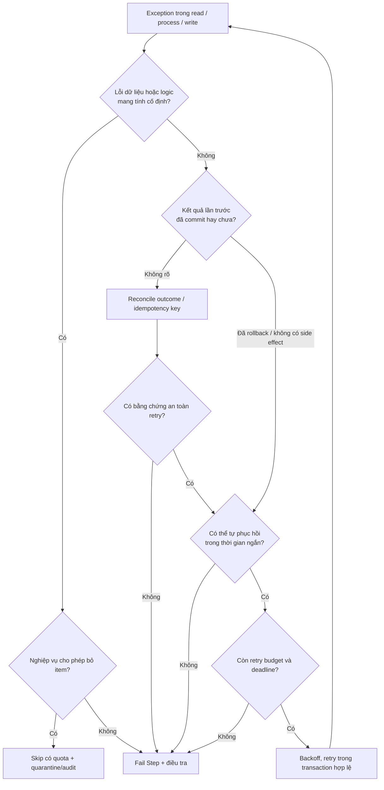
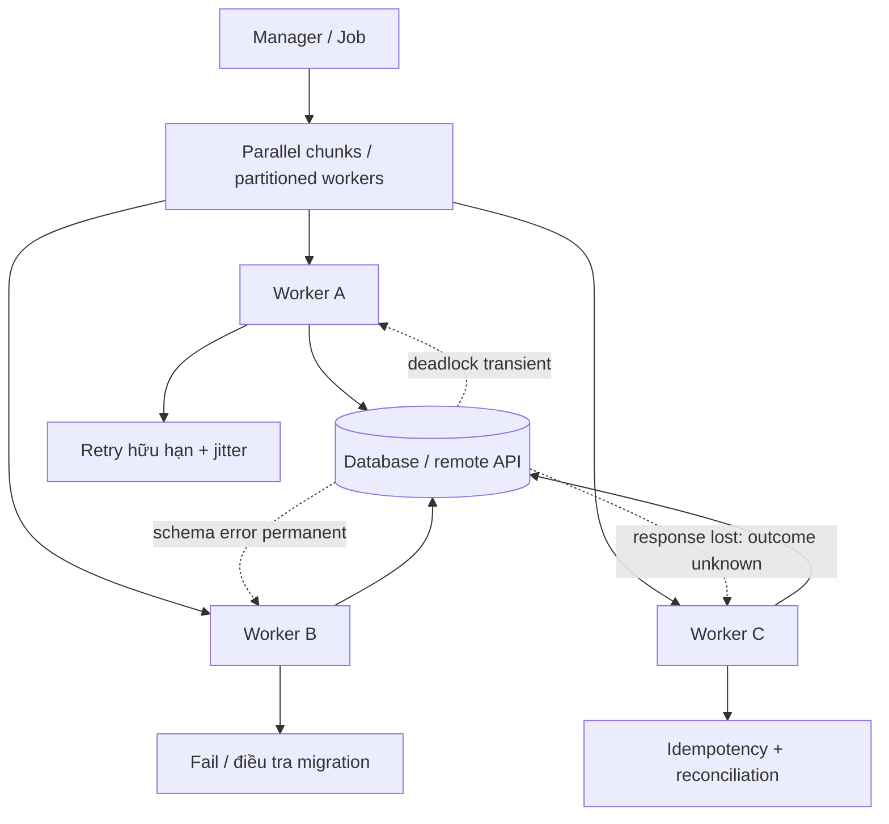

# Phân biệt retryable và non-retryable trong Spring Batch

> **Chương:** Retry  
> **Mục tiêu:** Xác định **lỗi nào có thể thử lại** (*retryable*), lỗi nào **không nên thử lại** (*non-retryable*) khi xử lý dữ liệu lớn; cấu hình `retry/noRetry`, `skip/noSkip`, rollback, backoff và retry budget theo **Spring Batch 5.2.x**; kiểm tra tính đúng đắn khi chạy nhiều thread, partition hoặc worker phân tán. Ví dụ sử dụng Java 17, Spring JDBC và PostgreSQL.

## 1. Bài toán thực tế: Không phải lỗi nào cũng nên thử lại

Giả sử job nhập 10 triệu hóa đơn từ CSV, chia thành nhiều partition và ghi vào database. Một worker đang xử lý chunk 200 bản ghi gặp một trong các lỗi:

- DB báo deadlock vì transaction khác đang giữ khóa.
- File CSV thiếu dấu phân cách, không parse được amount.
- Một hóa đơn có amount âm, trái business rule.
- HTTP enrichment service trả 503 vì đang khởi động lại.
- Hóa đơn trùng business key nhưng nội dung mới **khác** nội dung đã lưu.
- Kết nối DB mất **ngay sau lệnh COMMIT**, chưa biết transaction đã thành công hay chưa.

Nếu ứng dụng gọi lại tất cả các thao tác với `retry(Exception.class)`, nó có thể liên tục đọc bản ghi CSV không hợp lệ, tạo retry storm lên DB, hoặc gửi lại yêu cầu thanh toán vốn đã thành công.

Nếu ứng dụng **không retry bất kỳ lỗi nào**, một deadlock thoáng qua cũng khiến step thất bại và phải restart cả job.

Vì vậy, phân loại lỗi phải trả lời ít nhất **ba câu hỏi**:

1. **Tính phục hồi:** Thử lại cùng một thao tác có khả năng thành công **mà không cần sửa dữ liệu/code** không?
2. **Tính an toàn:** Nếu lần thử trước đã tạo side effect, gọi lại có làm dữ liệu trùng, ghi đè hoặc gây thiệt hại không?
3. **Giới hạn vận hành:** Có thể retry bao nhiêu lần, chờ bao lâu và đến khi nào phải fail/quarantine?

Câu hỏi 1 liên quan *retryability*, câu hỏi 2 liên quan *idempotency/transaction*, câu hỏi 3 liên quan *retry policy, backoff, deadline và vận hành*.

**Không có quy tắc “cứ ném RuntimeException thì retry”.** Một exception chỉ retryable khi **nguyên nhân, vị trí lỗi và semantics của thao tác** đều cho phép.

## 2. Định nghĩa retryable và non-retryable

**Retryable:** Lỗi có nguyên nhân tạm thời hoặc phụ thuộc điều kiện có thể thay đổi, nên một attempt sau có cơ hội thành công. Ví dụ deadlock, lock timeout, dịch vụ HTTP tạm trả 503. Retry phải **có giới hạn**, có backoff phù hợp và an toàn lặp.

**Non-retryable:** Lỗi chắc chắn hoặc gần như chắc chắn sẽ tái xuất hiện với cùng dữ liệu và cấu hình, nên thử lại không có ích. Ví dụ CSV sai định dạng cố định, thiếu trường bắt buộc, vi phạm business rule, SQL sai cú pháp, database permission denied.

Có thêm một nhóm **outcome uncertain**: Không biết thao tác trước **đã commit hay chưa**, ví dụ TCP đứt đúng sau khi gửi request thanh toán hoặc JDBC connection mất khi COMMIT. Đây không thể được coi an toàn retry chỉ vì lỗi xuất phát từ network.

| Thuộc tính | Retryable | Non-retryable | Outcome uncertain |
| --- | --- | --- | --- |
| Nguyên nhân | Tạm thời, cạnh tranh tài nguyên | Dữ liệu/cấu hình/quy tắc cố định | Phản hồi mất, trạng thái commit chưa rõ |
| Thử lại nguyên trạng | Có thể thành công | Thường vẫn thất bại | Có thể tạo side effect lần hai |
| Hành động chính | Retry hữu hạn + backoff | Skip/quarantine hoặc fail | Tra cứu trạng thái, dedup/idempotency, reconcile |
| Ví dụ | Deadlock DB, 503 thoáng qua | Số tiền âm, SQL grammar sai | Mất response sau payment/DB COMMIT |
| Điều kiện để hoàn thành | Thành công/commit sau retry | Dữ liệu được xử lý theo policy | Kết quả cuối xác minh được và không bị nhân đôi |

**Non-retryable không đồng nghĩa skippable.** Một record amount âm có thể được phép skip kèm quarantine, nhưng thiếu bảng DB do migration sai thì phải fail job. Ngược lại, một lỗi tạm thời đã retry hết ngân sách cũng không mặc nhiên được skip.

## 3. Sơ đồ quyết định cho từng exception



Trong code, quyết định này được cụ thể hóa bằng **exception classification** cùng chính sách transaction, retry, skip và recovery. Không cố gói toàn bộ logic nghiệp vụ vào một `catch(Exception)`.

Một cách phân định hữu ích:

- **Retry policy:** “Exception này **được phép** retry?”
- **Retry limit:** “Còn cơ hội thử nào?”
- **Backoff policy:** “Bao lâu mới thử lại?”
- **Skip policy:** “Nếu item không xử lý được, có được bỏ qua?”
- **Rollback rules:** “Transaction hiện tại có cần rollback?”
- **Idempotency:** “Nếu thử lại, side effect có được áp dụng đúng một lần không?”

Những cấu hình trên liên quan nhau nhưng **không hoán đổi cho nhau**.

## 4. Bảng phân loại exception thực tế

| Lỗi gặp trong batch | Ví dụ exception/tín hiệu | Quyết định ban đầu | Lưu ý |
| --- | --- | --- | --- |
| DB deadlock | `CannotAcquireLockException`, DB SQLSTATE 40P01 trên PostgreSQL | **Retryable** | Rollback transaction cũ, backoff hữu hạn |
| Lock timeout tạm thời | `CannotAcquireLockException` hoặc subtype được dịch từ driver | **Retryable có điều kiện** | Kiểm tra tình trạng tranh chấp kéo dài |
| Connection pool hoặc DB tạm không sẵn sàng | `TransientDataAccessResourceException` | **Có thể retry** | Cần connection/transaction mới; không giữ cursor hỏng |
| HTTP 503/502 tạm thời | Domain exception do client ánh xạ | **Retryable có điều kiện** | Client timeout + idempotency + backoff |
| HTTP 429 | Rate-limit exception | **Retryable có điều kiện** | Tôn trọng `Retry-After` và quota |
| HTTP 400/422 | Invalid payload/validation | **Non-retryable** | Quarantine hoặc fail tùy business contract |
| CSV sai cấu trúc | `FlatFileParseException` | **Non-retryable** | Skip theo policy nếu có thể xác định item lỗi |
| Amount âm / thiếu field | `InvalidInvoiceException` | **Non-retryable** | Không retry, skip hạn chế hoặc fail |
| Duplicate key cùng payload đã commit | Unique constraint + policy đối chiếu | **Không cần retry** | No-op idempotent nếu thật sự tương đương |
| Duplicate key nhưng payload khác | `BusinessConflictException` | **Non-retryable** | Fail/quarantine; không dùng `DO NOTHING` che lỗi |
| SQL sai cú pháp | `BadSqlGrammarException` | **Non-retryable** | Sửa migration/code |
| Thiếu quyền hoặc bảng | SQL permission/schema error | **Non-retryable** | Sửa hạ tầng trước rồi restart job |
| Transaction outcome chưa rõ | Mất mạng lúc COMMIT hoặc mất reply | **Không retry mù** | Reconcile rồi replay với business key |
| Lỗi JobRepository optimistic locking | `OptimisticLockingFailureException` | **Không retry mù** | Tìm hai updater cùng `StepExecution` |
| OOM hoặc lỗi JVM nghiêm trọng | `OutOfMemoryError` | **Không retry item** | Dừng/phục hồi process, giảm tải |

Đây là bảng **khuyến nghị khởi đầu**, không phải classifier tự động của mọi JDBC driver hoặc HTTP client. Một timeout HTTP GET idempotent có tính chất khác timeout POST chuyển tiền; cùng thông báo “connection reset” có thể cần quyết định khác nhau.

### Vì sao transient không đồng nghĩa retry an toàn?

Một lỗi “DB connection lost” trong lúc **đọc** có thể khiến `JdbcCursorItemReader` không còn cursor hợp lệ. Retry `read()` trên **cùng cursor** chưa chắc phục hồi được vị trí dữ liệu; việc retry có ích còn phụ thuộc reader implementation.

Ngược lại, một lỗi “connection reset” khi gọi **POST charge payment** có thể xảy ra sau khi server đã thu tiền, nên phải có idempotency key và tra cứu trạng thái trước khi gửi lại.

**Phân loại dựa trên cả exception lẫn thao tác**: `exception class + processing phase + side-effect/commit semantics`.

## 5. Retry, skip, fail và rollback không phải một khái niệm

Các API của `FaultTolerantStepBuilder` trong Spring Batch 5.2:

| API | Hành vi định hướng | Điều API **không** làm |
| --- | --- | --- |
| `retry(T.class)` | Đưa exception T và subtype vào nhóm được retry | Không đặt vô hạn attempts hay tự bảo đảm idempotency |
| `noRetry(T.class)` | Loại exception T và subtype khỏi nhóm retry | Không đồng nghĩa cho phép skip |
| `retryLimit(n)` | Tối đa n attempts trong chính sách mặc định | Không phải quota retry cho toàn chunk/job |
| `backOffPolicy(policy)` | Chờ giữa các lần retry theo builder | Không tự phân loại lỗi, không ngắt attempt đang treo |
| `skip(T.class)` | Cho phép skip item gây exception T | Không bảo đảm bản ghi bị skip là hợp lệ về SLA |
| `noSkip(T.class)` | Cấm skip exception T và subtype | Không nhất thiết cấm retry |
| `skipLimit(n)` | Giới hạn tổng skip trên `StepExecution` | Không phải số retry attempts |
| `noRollback(T.class)` | Điều chỉnh rollback trong phạm vi được hỗ trợ | Không biến exception thành retryable/skippable |
| `retryPolicy(custom)` | Dùng chính sách retry tùy chỉnh | Có thể làm builder-level retry settings không còn hiệu lực |

### Một lỗi có thể đi qua nhiều giai đoạn

Ví dụ worker gặp deadlock:

1. Exception được classifier nhận diện là **retryable**.
2. Framework rollback transaction chunk bị lỗi.
3. Nếu còn retry budget, thực hiện backoff và thử lại theo retry context.
4. Nếu thành công, chunk được commit khi điều kiện transaction hợp lệ.
5. Nếu hết retry budget, framework kiểm tra cơ chế recovery/skip phù hợp.
6. Nếu không có skip policy cho lỗi ấy, step **FAILED**.

Không có quy tắc “mọi lỗi retryable khi hết limit sẽ bị skip”. Muốn skip phải **cấu hình rõ** và nghiệp vụ cho phép.

## 6. Cấu hình Step Java: Retry transient, skip dữ liệu xấu, fail conflict

Một job nhập invoice từ file CSV, có người dùng tạo lỗi dữ liệu và những lần PostgreSQL deadlock. Ta muốn:

- Retry **chỉ** các lỗi JDBC có khả năng phục hồi.
- Không retry lỗi parsing/validation/business conflict.
- Cho phép bỏ một số dòng parse lỗi nếu nghiệp vụ cho phép.
- Không cho phép skip xung đột payload của cùng event ID.
- Chấp nhận duplicate **tương đương**, nhưng không chấp nhận duplicate có cùng key mà khác nội dung.

Định nghĩa schema minh họa:

```sql
CREATE TABLE invoice_import (
    source_event_id VARCHAR(120) PRIMARY KEY,
    invoice_id VARCHAR(120) NOT NULL,
    amount NUMERIC(18, 2) NOT NULL,
    payload_hash CHAR(64) NOT NULL
);
```

Định nghĩa item, exception và processor:

```java
package com.example.batch.retry;

import java.math.BigDecimal;

import org.springframework.batch.item.ItemProcessor;
import org.springframework.context.annotation.Bean;
import org.springframework.context.annotation.Configuration;

@Configuration(proxyBeanMethods = false)
public class InvoiceProcessingConfig {

    public record Invoice(
            String sourceEventId,
            String invoiceId,
            BigDecimal amount,
            String payloadHash) {}

    public static final class InvalidInvoiceException
            extends RuntimeException {
        public InvalidInvoiceException(String id) {
            super("Invalid invoice event: " + id);
        }
    }

    public static final class BusinessConflictException
            extends RuntimeException {
        public BusinessConflictException(String id) {
            super("Same source event ID has different payload: " + id);
        }
    }

    @Bean
    public ItemProcessor<Invoice, Invoice> invoiceProcessor() {
        return invoice -> {
            if (invoice.sourceEventId() == null
                    || invoice.sourceEventId().isBlank()
                    || invoice.invoiceId() == null
                    || invoice.invoiceId().isBlank()
                    || invoice.amount() == null
                    || invoice.amount().signum() < 0
                    || invoice.payloadHash() == null
                    || !invoice.payloadHash().matches("[0-9a-f]{64}")) {
                throw new InvalidInvoiceException(
                        invoice.sourceEventId());
            }
            return invoice;
        };
    }
}
```

Writer sử dụng business key và đối chiếu hash khi duplicate:

```java
package com.example.batch.retry;

import java.util.Objects;

import org.springframework.batch.item.ItemWriter;
import org.springframework.context.annotation.Bean;
import org.springframework.context.annotation.Configuration;
import org.springframework.jdbc.core.JdbcTemplate;

import com.example.batch.retry.InvoiceProcessingConfig.Invoice;
import com.example.batch.retry.InvoiceProcessingConfig.BusinessConflictException;

@Configuration(proxyBeanMethods = false)
public class InvoiceWriterConfig {

    @Bean
    public ItemWriter<Invoice> invoiceWriter(JdbcTemplate jdbc) {
        return chunk -> {
            for (Invoice item : chunk) {
                int inserted = jdbc.update("""
                    INSERT INTO invoice_import (
                        source_event_id, invoice_id, amount, payload_hash
                    ) VALUES (?, ?, ?, ?)
                    ON CONFLICT (source_event_id) DO NOTHING
                    """,
                    item.sourceEventId(), item.invoiceId(),
                    item.amount(), item.payloadHash());

                if (inserted == 1) {
                    continue;
                }
                if (inserted != 0) {
                    throw new IllegalStateException(
                            "Unexpected JDBC update count: " + inserted);
                }

                String storedHash = jdbc.queryForObject("""
                    SELECT payload_hash
                    FROM invoice_import
                    WHERE source_event_id = ?
                    """,
                    String.class, item.sourceEventId());

                if (!Objects.equals(storedHash, item.payloadHash())) {
                    throw new BusinessConflictException(
                            item.sourceEventId());
                }
            }
        };
    }
}
```

Worker `Step` cấu hình fault tolerance:

```java
package com.example.batch.retry;

import org.springframework.batch.core.Step;
import org.springframework.batch.core.repository.JobRepository;
import org.springframework.batch.core.step.builder.StepBuilder;
import org.springframework.batch.item.ItemProcessor;
import org.springframework.batch.item.ItemReader;
import org.springframework.batch.item.ItemWriter;
import org.springframework.batch.item.file.FlatFileParseException;
import org.springframework.beans.factory.annotation.Qualifier;
import org.springframework.context.annotation.Bean;
import org.springframework.context.annotation.Configuration;
import org.springframework.dao.CannotAcquireLockException;
import org.springframework.dao.TransientDataAccessResourceException;
import org.springframework.retry.backoff.ExponentialBackOffPolicy;
import org.springframework.transaction.PlatformTransactionManager;

import com.example.batch.retry.InvoiceProcessingConfig.Invoice;
import com.example.batch.retry.InvoiceProcessingConfig.InvalidInvoiceException;
import com.example.batch.retry.InvoiceProcessingConfig.BusinessConflictException;

@Configuration(proxyBeanMethods = false)
public class InvoiceRetryStepConfig {

    @Bean
    public Step invoiceImportStep(
            JobRepository repository,
            PlatformTransactionManager transactionManager,
            @Qualifier("invoiceReader") ItemReader<Invoice> reader,
            @Qualifier("invoiceProcessor") ItemProcessor<Invoice, Invoice> processor,
            @Qualifier("invoiceWriter") ItemWriter<Invoice> writer) {

        ExponentialBackOffPolicy backoff =
                new ExponentialBackOffPolicy();
        backoff.setInitialInterval(200L);
        backoff.setMultiplier(2.0);
        backoff.setMaxInterval(2_000L);

        return new StepBuilder("invoiceImportStep", repository)
                .<Invoice, Invoice>chunk(200, transactionManager)
                .reader(reader)
                .processor(processor)
                .writer(writer)
                .faultTolerant()
                // Chỉ whitelist exception DB có thể thử lại.
                .retry(CannotAcquireLockException.class)
                .retry(TransientDataAccessResourceException.class)
                .retryLimit(3)
                .backOffPolicy(backoff)
                // Lỗi business conflict không được retry/skip.
                .noRetry(BusinessConflictException.class)
                .noSkip(BusinessConflictException.class)
                // Lỗi dữ liệu được cách ly theo quota có kiểm soát.
                .skip(InvalidInvoiceException.class)
                .skip(FlatFileParseException.class)
                .skipLimit(10)
                .build();
    }
}
```

**Điểm cần hiểu về code:**

1. `invoiceReader`, `Job`, `DataSource`, `JobRepository` và schema PostgreSQL phải được ứng dụng cung cấp. Những bean trên là **mẫu cấu hình**, chưa phải dự án runnable hoàn chỉnh.
2. `retry(CannotAcquireLockException.class)` và `retry(TransientDataAccessResourceException.class)` minh họa **whitelist hẹp**. Một số lỗi connection có thể khiến reader cursor không phục hồi được; cần test pha `read()` và resource thực tế trước khi đưa cả class vào retry.
3. `noRetry(BusinessConflictException.class)` và `noSkip(...)` là **rào chắn thể hiện business policy**. Với whitelist retry hẹp hiện tại, `noRetry` không làm thay đổi thực tế classifier cho exception này, nhưng giúp chính sách rõ và chống thay đổi cấu hình rộng hơn sau này.
4. `skip(InvalidInvoiceException.class)` và `skip(FlatFileParseException.class)` chỉ hợp lệ khi nghiệp vụ chấp nhận bỏ các item ấy và có quarantine/audit. Nếu nhập hóa đơn tài chính yêu cầu tuyệt đối không mất record, nên **fail** thay vì skip.
5. `skipLimit(10)` giới hạn tổng số item bị skip trong `StepExecution`, gồm read/process/write skip theo hợp đồng Spring Batch.
6. `retryLimit(3)` là tối đa **ba attempts cho một item**, tính cả attempt đầu; không phải ba retry bổ sung hoặc ba lần gọi writer cho toàn chunk.
7. Writer xử lý duplicate cùng hash bằng no-op; duplicate khác hash ném exception non-retryable để **không che dữ liệu mâu thuẫn**.
8. `JdbcTemplate` phải dùng datasource được transaction manager của chunk quản lý. Nếu writer chạy autocommit ngoài transaction, retry/rollback có thể tạo trạng thái khác dự kiến.
9. Ví dụ dùng PostgreSQL `ON CONFLICT`. Với database khác, cú pháp và transaction/error semantics phải được thay bằng cách tương thích.

## 7. Vì sao cấu hình retry quá rộng là một anti-pattern?

Một cấu hình dễ viết nhưng khó vận hành:

```java
// PHẢN VÍ DỤ — đừng copy vào production.
.faultTolerant()
.retry(Exception.class)
.retryLimit(100)
```

Hệ quả:

- Parse sai 100 lần vẫn sai; chỉ làm job chậm.
- Business conflict được retry dù bản ghi nguồn không đổi.
- Lỗi network không rõ commit có thể làm side effect lặp.
- Worker giữ thread/bộ nhớ trong khi DB chưa phục hồi.
- Mỗi chunk/item có retry budget riêng nên toàn job có thể tạo rất nhiều request bổ sung.
- Một lỗi metadata `OptimisticLockingFailureException` có thể bị retry dù nguyên nhân là **hai updater sở hữu cùng StepExecution**.

### Khi nào dùng noRetry có ý nghĩa?

Giả sử một codebase cũ đang có:

```java
// VÍ DỤ DI SẢN: quá rộng, chỉ để minh họa cơ chế loại trừ.
.retry(org.springframework.dao.DataAccessException.class)
.noRetry(org.springframework.dao.NonTransientDataAccessException.class)
.retryLimit(3)
```

`noRetry(NonTransientDataAccessException.class)` loại trừ exception và subclass thuộc nhóm non-transient của Spring DAO ngay cả khi nhóm cha đã được cho retry. Tuy nhiên **đây vẫn không phải policy an toàn mặc định**: những lỗi `DataAccessException` khác có thể không phù hợp retry dù chưa nằm trong `NonTransientDataAccessException`.

**Hướng tốt hơn:** Chọn một whitelist đủ hẹp theo **SQLSTATE/exception cụ thể** mà hệ thống đã quan sát, rồi bổ sung `noRetry` cho trường hợp bắt buộc fail-fast có thể phát sinh từ đường wrapping hoặc cấu hình thay đổi.

### Phân loại theo superclass và subclass

`retry(T.class)` và `noRetry(T.class)` áp dụng cho exception T **và các subclass** theo Javadoc Spring Batch 5.2. Vì vậy, một rule trên superclass có thể ảnh hưởng rộng hơn dự tính.

Không suy đoán thứ tự `.retry(...).noRetry(...)` sẽ luôn cho phép “rule cuối cùng thắng” trong mọi cấu hình hoặc khi dùng custom retryPolicy. Với hierarchy giao nhau, nên dùng classifier rõ ràng và **test bằng exception subtype thật**.

## 8. Exception wrapping: Nhìn class ngoài cùng chưa đủ

Trong ứng dụng production, cùng nguyên nhân có thể bị bọc qua nhiều tầng:

```text
MessageHandlingException
└── ExternalServiceException
    └── SocketTimeoutException

CompletionException
└── CannotAcquireLockException

BusinessValidationException
└── IllegalArgumentException
```

Nếu chỉ retry một class ở gốc nhưng exception thoát ra khỏi processor/writer là wrapper, retry policy có thể không nhận ra nguyên nhân theo cách bạn kỳ vọng.

**Điểm mấu chốt:** Có nên duyệt `getCause()` để phân loại hay không là quyết định **có chủ đích**. Đôi khi wrapper chứa business context quan trọng (ví dụ “payment outcome unknown”) và việc tự lột wrapper rồi retry `SocketTimeoutException` sẽ là sai.

### Ví dụ custom RetryPolicy có duyệt cause chain

Spring Retry 2.x hỗ trợ `SimpleRetryPolicy` với bản đồ exception và `traverseCauses`:

```java
import java.util.Map;

import org.springframework.dao.TransientDataAccessException;
import org.springframework.dao.NonTransientDataAccessException;
import org.springframework.retry.RetryPolicy;
import org.springframework.retry.policy.SimpleRetryPolicy;

Map<Class<? extends Throwable>, Boolean> allowList = Map.of(
        TransientDataAccessException.class, true,
        NonTransientDataAccessException.class, false);

RetryPolicy customPolicy = new SimpleRetryPolicy(
        3,      // maxAttempts, tính cả lần đầu
        allowList,
        true,   // traverseCauses
        false   // unmatched exceptions => do not retry
);
```

Ví dụ áp policy vào step:

```java
.faultTolerant()
.retryPolicy(customPolicy)
```

**Cảnh báo:** Khi chọn `retryPolicy(customPolicy)`, Javadoc `FaultTolerantStepBuilder` 5.2 nêu rằng `retryLimit(...)` và builder-level `backOffPolicy(...)` bị **bỏ qua**. Nếu cần backoff với custom policy, phải thiết kế và test cách tích hợp phù hợp; đừng thêm cả hai vào builder rồi tưởng đã có retry budget + delay như trước.

Ngoài ra:

- Duyệt cause chain chỉ hữu ích nếu **chuỗi cause phản ánh đúng nghiệp vụ**. Không retry một thao tác có outcome uncertain dù root cause là timeout network.
- Cần xác định hành vi khi nhiều class trong hierarchy khớp. Test theo exception thực tế, không chỉ nhìn map.
- Hạn chế retry lỗi đã bị wrap để “giữ nguyên kiểu” nhưng mất thông tin commit/operation context.
- Nếu dùng `RetryListener` hoặc metric, log cả **outer exception**, **root cause** và **phase** nhưng không log payload nhạy cảm.

### Nên chuyển đổi exception ở đâu?

Tại ranh giới integration (JDBC/HTTP/queue), nên chuyển lỗi công nghệ sang **domain exception có ý nghĩa**:

```java
// Pseudocode chủ đích, không phải REST client đầy đủ.
try {
    paymentGateway.charge(requestWithIdempotencyKey);
} catch (Http429Exception e) {
    throw new RetryableRateLimitException(e.retryAfter(), e);
} catch (Http422Exception e) {
    throw new NonRetryablePaymentDataException(e);
} catch (TransportTimeoutException e) {
    throw new PaymentOutcomeUnknownException(e);
}
```

Cách này ngăn một policy “retry mọi IOException” vô tình retry cả payment đã xử lý. `PaymentOutcomeUnknownException` nên đưa vào reconciliation, **không** vào whitelist retry tự động.

## 9. Phân loại lỗi tại ItemReader: Cẩn thận mất dòng

`ItemReader.read()` có hợp đồng đặc biệt: khi ném exception, framework **chưa chắc có item cụ thể** để nhận diện. Retry có an toàn hay không phụ thuộc reader có giữ được vị trí nguồn không.

Phản ví dụ:

```java
// PHẢN VÍ DỤ — cursor/nguồn đã tiến rồi mới ném exception.
@Override
public Invoice read() {
    Invoice item = delegate.read();
    validate(item); // ném RuntimeException
    return item;
}
```

Nếu `delegate.read()` đã consume bản ghi, một lần retry `read()` có thể đọc **bản ghi tiếp theo**, còn item lỗi bị rơi mất mà framework không biết.

**Hướng thiết kế:**

- Lỗi parse cố định của file nên được **non-retryable**; cân nhắc `skip(FlatFileParseException.class)` có quota nếu reader biết cách tiến qua record lỗi và nghiệp vụ cho phép.
- Lỗi network DB tạm thời chỉ retry read khi reader có thể phục hồi connection/cursor hoặc tái thực thi query **đúng vị trí**.
- Ưu tiên reader paging hoặc thiết kế đọc theo stable key khi có nhu cầu restart/retry; nhưng vẫn phải giữ snapshot, ordering và checkpoint.
- Không nhầm lỗi trả `null` với lỗi non-retryable: trong `ItemReader`, `null` nghĩa là **hết input**, có thể khiến job hoàn thành mà thiếu dữ liệu nếu code nuốt exception.
- Reader dùng chung trong multi-threaded step cần kiểm chứng thread safety riêng; retry classifier không sửa được race của con trỏ.

### Lỗi đọc “không tìm thấy file” thường không retry item

Nếu input file bị xóa sau khi job bắt đầu, cứ retry `FileNotFoundException` 50 lần có thể chỉ làm job trì hoãn. Thường nên fail với thông tin source/manifest rõ ràng, sửa hạ tầng rồi restart khi file/snapshot được khôi phục. Nếu file nằm trên storage eventually consistent có contract riêng, cần reader/launcher-level wait policy được kiểm chứng thay vì retry bừa.

## 10. Phân loại lỗi trong ItemProcessor: Tách business validation và remote call

`ItemProcessor.process(item)` nhận item đã xác định; về mặt API, gọi lại một processor thuần (pure) thường dễ kiểm soát hơn retry reader.

Ví dụ:

```java
public Invoice process(Invoice input) {
    if (input.amount().signum() < 0) {
        throw new InvalidInvoiceException(input.sourceEventId());
    }
    return normalize(input);
}
```

`InvalidInvoiceException` mang tính quyết định với cùng input: retry không làm amount trở thành số dương. Nếu yêu cầu nhập chính xác toàn bộ số tiền, hãy **fail/quarantine**, không skip ngầm.

Ngược lại:

```java
public Invoice process(Invoice input) {
    ExchangeRate rate = rateClient.lookup(input.currency());
    return applyRate(input, rate);
}
```

Nếu rate service trả HTTP 503, có thể thử lại **nếu** thao tác lookup không gây side effect. Nhưng cần:

- timeout từng attempt;
- retry limit + backoff/jitter;
- cache/circuit breaker khi downstream lỗi hàng loạt;
- cùng tỷ giá snapshot nếu nghiệp vụ yêu cầu kết quả nhất quán qua restart;
- không gọi lại side effect ở processor mà không có idempotency.

**Nếu processor tự gọi API để tạo giao dịch thanh toán**, nó không còn là pure processor. Việc retry/rollback chunk có thể làm thanh toán xảy ra nhiều lần; phải chuyển sang mô hình idempotent API hoặc outbox/workflow thích hợp.

## 11. Phân loại lỗi ở ItemWriter: Rollback và tác dụng lặp

`ItemWriter.write(Chunk)` nhận **nhiều item**. Khi một lệnh trong chunk thất bại, writer có thể đã thực hiện một số câu SQL trước lỗi.

Ví dụ chunk `[A, B, C, D]`:

```text
BEGIN transaction
  INSERT A
  INSERT B
  INSERT C → deadlock
ROLLBACK transaction
BACKOFF / RETRY nếu policy cho phép
  A, B và C có thể được đưa vào writer lại
COMMIT khi thành công
```

Với JDBC cùng transaction, rollback bảo vệ những insert chưa commit. Nhưng nếu writer gọi HTTP, ghi file, gửi Kafka hoặc dùng `REQUIRES_NEW`, những side effect ấy có thể **không rollback** cùng chunk.

### Lỗi duplicate unique key không đồng nghĩa retryable

Nếu `source_event_id=E-7` đã ghi trước:

- **Payload tương đương:** Writer có thể no-op theo idempotency contract.
- **Payload khác:** Phải báo `BusinessConflictException` để điều tra/đưa quarantine.
- **Update state version mới:** Có thể dùng upsert với `WHERE existing.version < excluded.version`, không coi bản cũ là lỗi cần retry.

Bắt `DuplicateKeyException` rồi retry vô hạn **không** biến bản ghi mâu thuẫn thành hợp lệ. Với PostgreSQL, một unique violation không được xử lý bằng `ON CONFLICT` còn có thể đánh dấu transaction hiện tại là lỗi; không catch rồi tiếp tục SQL trong transaction ấy như bình thường.

### Retryable writer exception vẫn cần writer idempotent

Ngay cả lỗi network/transient, lần thử trước có thể đã commit ở downstream nhưng phản hồi bị mất. Unique business key, payload hash, outbox hoặc idempotency key ở hệ đích phải bảo vệ replay. **“Retryable” không có nghĩa “không cần chống ghi trùng”.**

## 12. RetryLimit, backoff và retry exhaustion

Một exception được xác định **retryable** vẫn không được phép thử vô hạn.

Ví dụ:

```java
.retry(CannotAcquireLockException.class)
.retryLimit(3)
.backOffPolicy(backoff)
```

Với một item bị lỗi liên tục:

| Attempt | Kết quả | Hành động tiếp |
| ---: | --- | --- |
| 1 | Deadlock | Backoff rồi attempt 2 |
| 2 | Deadlock | Backoff rồi attempt 3 |
| 3 | Deadlock | Retry exhausted → recovery/skip/fail theo policy |
| 4 | Không có | Không được tạo thêm attempt thứ tư cho cùng retry context |

**`retryLimit(3)` tính cả lần đầu** theo Spring Batch 5.2. `retryLimit(0)` và `retryLimit(1)` về hiệu quả đều chỉ thử một lần (không retry) trong builder 5.2.

### Backoff là một phần của quyết định retry

| Chính sách | Lợi ích | Khi nào phù hợp |
| --- | --- | --- |
| Fixed delay | Dễ đoán và test | Deadlock ngắn, số worker ít |
| Exponential | Giảm tần suất khi outage kéo dài | DB/API hồi phục từ từ |
| Exponential + jitter | Phân tán thời điểm retry giữa workers | Cluster lớn, 429/503, thundering herd |
| Tôn trọng `Retry-After` | Phù hợp quota server | API có contract retry rõ |
| Không retry | Báo lỗi sớm | Dữ liệu sai, schema sai, conflict không thể tự hết |

Nếu 50 worker cùng retry lỗi DB với fixed 100 ms, chúng có thể đồng thời thức dậy và gây contention trở lại. Jitter giúp tách pha; giảm concurrency/circuit breaker có thể còn quan trọng hơn tăng delay.

**Không dùng backoff để “chờ dữ liệu tự sửa”** khi một CSV chứa amount sai: retry classification phải từ chối lỗi non-retryable trước khi tính delay.

## 13. Skip policy: Một lỗi không retryable vẫn có thể tiếp tục hoặc dừng

Ba kết quả khi gặp lỗi cố định:

1. **Fail step:** Dữ liệu bắt buộc phải đúng tuyệt đối hoặc không thể cách ly an toàn.
2. **Skip item có hạn mức:** Nghiệp vụ cho phép bỏ một số item lỗi, lưu quarantine/audit.
3. **Filter có chủ đích:** Processor trả `null` khi item không thuộc phạm vi xử lý. Đây **không phải skip do exception**.

Ví dụ:

```java
.faultTolerant()
.retry(CannotAcquireLockException.class)
.retryLimit(3)
.skip(FlatFileParseException.class)
.skip(InvalidInvoiceException.class)
.skipLimit(10)
.noSkip(BusinessConflictException.class)
```

`skipLimit(10)` tính theo tổng read/process/write skips **trên mỗi `StepExecution`**, không phải 10 của toàn JobInstance khi dùng nhiều partition.

### Vì sao không skip lỗi SQL/system?

Nếu database down trong hai giờ và job cho phép `skip(DataAccessException.class)`, job có thể bỏ hàng nghìn record hợp lệ rồi báo `COMPLETED` với output thiếu trầm trọng. Đây là **sai dữ liệu, không phải fault tolerance tốt**.

Nên áp dụng **quality gate sau manager/partitioning**: tổng skip, tỷ lệ dữ liệu bị loại, checksum/record count và danh sách quarantine phải đạt điều kiện trước khi publish.

### Custom SkipPolicy có thể thay đổi skipLimit

Khi dùng `skipPolicy(custom)`, Spring Batch 5.2 không tự áp `skipLimit(...)` theo mặc định như khi dùng classifier chuẩn. Custom policy phải tự thực thi logic hạn mức nếu nghiệp vụ yêu cầu. Tương tự, custom `retryPolicy(...)` thay thế đường cấu hình retry cơ bản; xem phần tiếp theo.

## 14. noRollback không phải là cách đánh dấu lỗi non-retryable

Một nhầm lẫn nguy hiểm: “Exception này non-retryable nên không cần rollback”.

**Sai.** Retryability và rollback là hai chiều độc lập. Một lỗi business conflict không cần retry nhưng transaction vừa ghi hai row trước đó vẫn phải rollback nếu chunk không thể commit hợp lệ.

Spring Batch 5.2 có `noRollback(Class<? extends Throwable>)` với hợp đồng **giới hạn**; Javadoc ghi đây là loại exception có thể được bỏ qua ở pha read/process. Đối với lỗi ở **ItemWriter**, cấu hình này bị bỏ qua theo javadoc vì không thể bảo đảm skip/retry mà không rollback.

| Pha | Lỗi non-retryable | Rollback/cách xử lý |
| --- | --- | --- |
| Read | Parse lỗi có thể skip | Theo quy tắc read/skip của step; không nhất thiết rollback |
| Process | Business validation fail | Skip hoặc fail; rollback tùy lifecycle/policy |
| Write | Constraint/business conflict | Thường rollback chunk để tránh partial write |
| External API | Timeout chưa rõ outcome | DB rollback không hoàn tác side effect API |
| JobRepository | Metadata optimistic conflict | Không dùng noRollback để che trạng thái sai |

**Không** thêm `noRollback(Exception.class)` để “giữ dữ liệu đã ghi” khi writer fail. Với PostgreSQL, nhiều lỗi SQL khiến transaction không còn hợp lệ và cần rollback; ép logic bỏ qua có thể dẫn đến checkpoint lệch dữ liệu.

## 15. Stateful retry và identity của item khi rollback

Đối với process/write failures trong chunk, Spring Batch dùng cơ chế **stateful retry** để theo dõi những lần thất bại của một item qua rollback.

Ví dụ:

```text
item E-42 attempt #1: deadlock → rollback
item E-42 attempt #2: deadlock → rollback
item E-42 attempt #3: success → commit
```

Các extension point của `FaultTolerantStepBuilder` 5.2:

- `keyGenerator(KeyGenerator)`: xác định định danh ổn định cho retry context.
- `retryContextCache(RetryContextCache)`: giữ context giữa các transaction.
- `retryPolicy(RetryPolicy)`: cấu hình classifier/quota tùy chỉnh.
- `backOffPolicy(BackOffPolicy)`: chờ trước attempt tiếp theo khi builder dùng đường retry cơ bản.

Nếu item mutable thay đổi field dùng trong `equals/hashCode` giữa các attempts, framework có thể khó nhận diện item cũ. Nên dùng immutable record với business key ổn định hoặc key generator có kiểm thử.

**Retry state không tự bền vững qua JVM crash.** Sau khi worker chết, `JobRepository`/`ExecutionContext` phục vụ restart; số attempts trong retry cache có thể bắt đầu lại. Nếu cần giới hạn “một event được thử tối đa năm lần **qua nhiều JobExecution và broker redelivery**”, phải có attempt ledger/workflow riêng.

### Non-retryable sau một lần retryable

Một item lần đầu gặp deadlock (retryable) nhưng attempt kế tiếp phát hiện source ID conflict (non-retryable) thì policy phải dừng thử theo lỗi **hiện tại**. Không cố dùng hết retry budget chỉ vì lỗi đầu tiên là transient.

## 16. Scale: Nhiều worker làm phân loại lỗi quan trọng hơn



Nếu có 100 partition và mỗi partition gặp ba lần lỗi retryable, tổng workload bổ sung có thể lớn. `retryLimit(3)` là giới hạn trên **retry context/item**, không phải một quota chung cho cả cluster.

### Multi-threaded step

Nhiều chunk cùng chia sẻ tài nguyên, có thể tăng deadlock và lock timeout. Lỗi có thể thực sự transient, nhưng nếu mọi chunk luôn tranh cùng hot key thì retry là **triệu chứng**, không phải sửa nguyên nhân. Cần kiểm tra reader/writer thread safety, thứ tự khóa và dữ liệu chia vùng.

### Parallel steps

Hai flow độc lập có thể cập nhật các bảng/row chung. Nếu lỗi DB do thiếu index hoặc thứ tự khóa ngược nhau, tăng retry chỉ làm giảm triệu chứng phần nào. Khi business rule fail, nên tách error handling theo từng flow thay vì một classifier quá rộng.

### Local partitioning

Mỗi partition có `StepExecution` riêng. Một partition có thể fail do dữ liệu cố định, các partition còn lại đã commit. Retry budget cũng theo worker step, và restart phải giữ partition identity/manifest ổn định.

### Remote partitioning

Manager gửi partition tới worker process. Lỗi message delivery, timeout và worker crash là **tầng điều phối**, không mặc nhiên cùng loại exception được retry ở `ItemWriter`. Nếu worker cũ còn chạy khi partition được giao lại, có thể xuất hiện duplicate execution và metadata optimistic locking conflict.

### Remote chunking

Broker giao lại `ChunkRequest` khác với retry một item do Spring Batch. Một chunk đã commit DB nhưng mất ACK/reply có thể được gửi lại. **Không** coi broker redelivery là lỗi non-retryable cần bỏ message; phải có idempotent writer và giao thức khôi phục reply/manager hợp lệ.

## 17. Phân biệt retry tại ba tầng để tránh nhân số lần gọi

Giả sử:

- HTTP client có `@Retryable(maxAttempts=3)`;
- worker step có `retryLimit(3)` cho exception được ném ra;
- broker có thể redeliver chunk 4 lần theo policy.

Trong đường lỗi liên tục, một request nghiệp vụ có thể bị thử rất nhiều lần, theo mô hình cực đại đơn giản:

```text
3 HTTP attempts / step attempt
× 3 step attempts / broker delivery
× 4 broker deliveries
= tới 36 HTTP invocations (theo giả định của ví dụ)
```

Đây không phải số đếm Spring Batch tự cam kết; chunk rollback/scan, concurrency hoặc việc policy dừng sớm có thể thay đổi thực tế.

**Chọn tầng sở hữu retry:**

| Tầng | Lỗi nên xử lý | Không thể thay thế |
| --- | --- | --- |
| HTTP/JDBC client | Timeout ngắn/connection retry theo operation an toàn | Retry item/chunk và transaction state |
| Spring Batch Step | Lỗi process/write retryable của item/chunk | Broker redelivery/Job restart |
| JMS/AMQP broker | Consumer disconnect, message chưa ACK | Retry nghiệp vụ và DB idempotency |
| Scheduler/JobOperator | Step/job FAILED, worker node chết | Exactly-once business effect |

Không cấu hình retry rộng ở mọi tầng rồi giả định throughput sẽ tăng. Retry amplification thường tạo ra **công việc nhiều hơn** khi downstream đang quá tải.

## 18. Giám sát: Phát hiện classifier sai bằng dữ liệu

Một retry classifier tốt phải được đo lường và điều chỉnh theo lỗi thực tế.

| Tín hiệu | Ý nghĩa |
| --- | --- |
| `retry_attempt_total` theo exception family và processing phase | Có bao nhiêu lỗi transient được thử lại |
| `retry_success_after_attempt` | Phần trăm lỗi phục hồi tại attempt 2/3 |
| `retry_exhausted_total` | Các lỗi được cho retry nhưng vẫn thất bại |
| `non_retryable_failure_total` | Lỗi cố định bị fail ngay |
| `skipped_item_total` + quarantine count | Dữ liệu đã bỏ theo business policy |
| `rollbackCount`, `commitCount` | Chi phí transaction và recovery |
| `chunk_duration_p95/p99` | Tác động của backoff và rollback |
| DB lock wait/connection pending | Retry có đang gây thêm contention |
| Broker redelivery/DLQ depth | Lỗi tầng transport, tách khỏi retry Step |
| Business duplicate conflicts | Writer idempotency có đang bắt lỗi không |

**Không dùng `rollbackCount` thay cho số lần retry.** Một rollback có thể do nhiều nguyên nhân; mỗi attempt có thể kéo theo reprocessing hoặc write scan.

Structured log ví dụ:

```text
INFO  job=invoiceImport step=invoiceImportStep
      phase=WRITE eventKeyHash=... retryable=true
      exception=CannotAcquireLockException attempt=2
      decision=BACKOFF_AND_RETRY

WARN  job=invoiceImport step=invoiceImportStep
      phase=PROCESS eventKeyHash=... retryable=false
      exception=InvalidInvoiceException decision=QUARANTINE

ERROR job=invoiceImport step=invoiceImportStep
      phase=WRITE eventKeyHash=... retryable=false
      exception=BusinessConflictException decision=FAIL
```

Các trường trên là **mẫu log ứng dụng**, không phải format Spring Batch tự sinh. Với `RetryListener`, `SkipListener` và `StepExecutionListener` có thể bổ sung observability theo đúng điểm lifecycle; không log toàn payload hoặc PII.

Không đưa `eventId`, `stepExecutionId`, `jobExecutionId` vào Prometheus labels để tránh cardinality cao. Giữ correlation IDs trong logs/traces có phân quyền, metric chỉ gắn nhãn ổn định như jobName, stepName, exceptionFamily, outcome.

## 19. Kiểm thử exception classification một cách hệ thống

Test không chỉ xác nhận **Step COMPLETED hay FAILED**, mà còn phải xác nhận từng exception có **đường retry/skip/fail chính xác**, số side effect và khả năng restart.

### Ma trận bắt buộc

| Case | Lỗi được tiêm | Cấu hình | Kỳ vọng |
| --- | --- | --- | --- |
| T1 | `CannotAcquireLockException` hai lần, lần ba thành công | Retry limit 3 | Phục hồi và commit, không trùng |
| T2 | `CannotAcquireLockException` liên tục | Retry limit 3 | Exhausted → fail khi không skip |
| T3 | `InvalidInvoiceException` | Chỉ skip validation | Không retry; skip nếu quota còn |
| T4 | `FlatFileParseException` | Skip parse lỗi | Reader tiếp tục đúng item kế tiếp, không mất dòng khác |
| T5 | `BusinessConflictException` | `noRetry + noSkip` | Fail nhanh, không silent ignore |
| T6 | `BadSqlGrammarException` | Không trong whitelist | Fail nhanh, không retry |
| T7 | `CompletionException(CannotAcquireLockException)` | Default/custom cause policy | Quan sát chính xác policy có duyệt cause |
| T8 | Timeout sau DB commit | Idempotent key + reconciliation | Không có side effect lần hai |
| T9 | Nhiều worker cùng chèn cùng key | Unique DB | Một effect duy nhất; conflict được phân loại |
| T10 | Custom retryPolicy | Chính sách riêng | Builder-level retryLimit/backoff không bị hiểu sai |
| T11 | Job restart sau crash | Snapshot input ổn định | Không thiếu/trùng business event |
| T12 | Broker redelivery chunk | At-least-once transport | Dedup không phụ thuộc Step retryLimit |

### Fake writer cho test retry classifier

```java
import java.util.concurrent.atomic.AtomicInteger;

import org.springframework.batch.item.ItemWriter;
import org.springframework.dao.CannotAcquireLockException;

// Test chỉ một item/chunk để attempts dễ quan sát.
AtomicInteger attempts = new AtomicInteger();

ItemWriter<String> flakyWriter = chunk -> {
    int n = attempts.incrementAndGet();
    if (n <= 2) {
        throw new CannotAcquireLockException(
                "Synthetic transient lock contention");
    }
    // Thực hiện effect test; với DB thật dùng transaction.
};
```

Dùng `chunk(1)`, `retry(CannotAcquireLockException.class)` và `retryLimit(3)` để kiểm tra hai lần lỗi rồi thành công. Với lỗi `InvalidInvoiceException`, dùng một processor fake ném exception cố định và xác nhận writer không nhận item ấy nếu đã skip.

**Cảnh báo:** `AtomicInteger` ở test chỉ minh họa **một item**. Không dùng counter toàn cục để quyết định retry theo từng item trong production multi-threaded step. Khi retry stateful, test cần giữ định danh item ổn định và quan sát behavior qua rollback.

### Kiểm tra số lần retry bằng công cụ phù hợp

- Theo dõi `RetryListener` để ghi exception type/attempts.
- Theo dõi `SkipListener` để xác nhận item lỗi được skip đúng pha.
- Đọc `JobExplorer` để xác nhận `StepExecution` status, skip/rollback counts.
- Đếm business rows/unique keys ở output DB và kiểm tra payload.
- Chạy integration test với datasource, transaction manager và connector thực, không chỉ mock `ItemWriter`.
- Kiểm thử kill process trước/sau commit và restart cùng JobInstance khi dữ liệu nguồn bất biến.

Một unit test “retry được một lần” không chứng minh luồng xử lý an toàn khi remote worker chết sau DB commit.

## 20. Troubleshooting: Khi lỗi bị phân loại sai

| Triệu chứng | Nguyên nhân có thể | Cách khắc phục |
| --- | --- | --- |
| Lỗi DB transient không được retry | Exception class thực tế không khớp whitelist | Log wrapper/root cause/SQLSTATE, cập nhật classifier có test |
| Lỗi dữ liệu bị retry nhiều lần | `retry(Exception.class)` quá rộng | Whitelist transient; skip/fail permanent |
| `noRetry` không có hiệu lực như dự tính | Đang dùng `retryPolicy(custom)` hoặc type hierarchy khác | Kiểm tra Javadoc/policy và test exception subtype |
| `retryLimit(3)` chỉ có hai lần thử lại | Attempt đầu tính trong limit | Đúng hợp đồng Batch 5.2 |
| Exception non-retryable lại được skip | `skip(...)` quá rộng hoặc custom skipPolicy | Dùng `noSkip(...)`, sửa policy theo nghiệp vụ |
| DB permission error retry mãi | Classifier coi mọi DataAccessException là transient | Thu hẹp whitelist, fail và sửa quyền/schema |
| Đã retry nhưng mất record ở reader | Reader tăng cursor trước khi lỗi | Thiết kế reader retry-safe, snapshot/offset đúng |
| Retry writer tạo duplicate | Side effect không tham gia chunk TX hoặc thiếu business key | Idempotency/unique constraint/outbox |
| Retry làm pool DB tệ hơn | Nhiều worker + no backoff + lock hotspot | Jitter, giảm concurrency, sửa thứ tự khóa |
| Thấy optimistic locking metadata | Hai updater dùng StepExecution stale/remote duplicate | Sửa ownership, không skip metadata exception |
| Custom retryPolicy nhưng backoff không chạy | Builder-level backoff bị bỏ qua | Sửa wiring theo API 5.2 và test timing |
| Job COMPLETED nhưng thiếu output | Lỗi hệ thống bị cấu hình skippable | Siết skip classifier/quality gate |
| Broker retry nhiều hơn RetryLimit | Middleware có redelivery policy riêng | Thiết kế backoff/DLQ riêng và idempotency |
| Chạy lại job reset retry attempts | Context in-memory không phải persisted attempts | Durable attempt ledger nếu cần quota xuyên run |
| HTTP timeout khiến double charge | Outcome uncertain nhưng bị retry như idempotent GET | Provider idempotency key, tra cứu/reconciliation |

### Runbook ngắn

1. Lấy `jobExecutionId`/`stepExecutionId`, tên job, phase read/process/write, stack trace và thời gian sự cố.
2. Xác định exception **outer/root cause**, SQLSTATE hoặc HTTP code; không tự suy từ message string.
3. Kiểm tra transaction outcome: có khả năng DB/API đã commit chưa?
4. Đối chiếu lỗi với bảng classifier và policy phiên bản đang deploy.
5. Kiểm tra giới hạn retry/skip, backoff, số worker, DB lock waits và nguồn dữ liệu.
6. Đánh giá effect đã commit, dedup key, checkpoint và khả năng restart.
7. Sửa policy/nguồn/hạ tầng, thử kịch bản fault injection trên môi trường gần production.
8. Chỉ restart qua lifecycle hợp lệ sau khi dữ liệu và metadata được đối soát.

Không giải quyết bằng cách chỉnh thủ công `BATCH_STEP_EXECUTION.VERSION` hoặc ép `BatchStatus.COMPLETED` để qua job fail.

## 21. Bài thực hành tổng hợp

**Bài 1 — Lập bảng phân loại.** Cho 20 lỗi từ JDBC, parser, processor và HTTP. Với mỗi lỗi, ghi cause, phase, side-effect state, quyết định `retry/skip/fail/reconcile`, timeout/backoff và lý do.

**Bài 2 — Whitelist transient.** Tạo step với `retry(CannotAcquireLockException.class)`, `retryLimit(3)`. Tiêm lỗi hai lần rồi thành công, đo attempts và DB rows được commit.

**Bài 3 — Permanent validation.** Tiêm một invoice amount âm và một dòng CSV malformed. Bật skip quota 2. Kiểm tra không retry những lỗi này và có quarantine; item thứ ba cần skip phải làm step fail.

**Bài 4 — Payload conflict.** Ghi `eventId=E-5` với amount 100, gửi lại cùng ID nhưng amount 999. Kiểm tra writer ném `BusinessConflictException`, noRetry/noSkip và row cũ không bị thay đổi.

**Bài 5 — Wrapped cause.** Tạo `CompletionException` có cause `CannotAcquireLockException`. So sánh policy builder mặc định với `SimpleRetryPolicy(..., traverseCauses=true, defaultValue=false)`; ghi kết quả thực tế trong test.

**Bài 6 — Retry exhausted.** Cho DB deadlock luôn xảy ra, `retryLimit(3)`. Xác nhận step fail sau khi hết budget, không tăng retries đến vô hạn và không chuyển sang skip nếu không có policy.

**Bài 7 — Read retry safety.** Tạo custom reader đọc/consume item rồi ném exception; quan sát item bị mất. Sửa reader để chỉ advance position khi đọc thành công, sau đó test restart/rollback.

**Bài 8 — Retry writer.** Tạo chunk bốn item, gây lỗi ở item C sau khi writer đã xử lý A/B trong cùng transaction. Xác nhận rollback hợp lệ, sau retry dữ liệu không trùng.

**Bài 9 — Parallel worker contention.** So sánh pool 1/4/8 và backoff fixed/jitter trên cùng snapshot; đo deadlocks, retries, successful throughput, p95 chunk duration và DB pool pending.

**Bài 10 — Remote chunking.** Cho worker commit rồi chết trước reply/ACK. Broker redeliver; chứng minh business key bảo vệ idempotency dù lỗi ở tầng broker không do `retryLimit` điều khiển.

**Bài 11 — Quality gate toàn job.** Partition dữ liệu thành bốn StepExecutions, mỗi partition được skip hai item. Xây bước tổng hợp reject nếu tổng skip vượt ba và bảo đảm không publish output thiếu chất lượng.

**Bài 12 — Outcome uncertain.** Giả lập HTTP charge thành công nhưng client timeout. Dùng cùng idempotency key để tra cứu kết quả; chứng minh vì sao retry mù có thể tạo double charge khi provider không hỗ trợ dedup.

### Checklist trước production

- [ ] Mỗi exception quan trọng có quyết định **retryable/non-retryable/outcome-uncertain** rõ ràng.
- [ ] Retry whitelist đủ hẹp, không dùng `retry(Exception.class)` vô điều kiện.
- [ ] Lỗi dữ liệu cố định không bị retry, skip có hạn mức và quarantine khi cho phép.
- [ ] Business conflict, schema/permission và metadata corruption không bị skip im lặng.
- [ ] Đã test wrapper/cause-chain và class hierarchy của exception thực tế.
- [ ] `retryLimit`, `backOffPolicy`, `retryPolicy`, `skipLimit` không bị cấu hình chồng chéo.
- [ ] Reader retry-safe, processor không side effect nguy hiểm, writer idempotent.
- [ ] Có strategy cho network timeout/outcome uncertain và outbox/idempotency key nếu cần.
- [ ] Retry/skip theo StepExecution không làm vượt SLA toàn job/cluster.
- [ ] Đã test rollback, crash/restart, duplicate remote delivery và nhiều worker.
- [ ] Có metrics/logs cho attempts, exhausted, skipped, non-retryable failure và quality gate.
- [ ] Không sửa JobRepository metadata bằng SQL thủ công khi xử lý lỗi.

## 22. Tài liệu tham khảo chính thức

- [Spring Batch 5.2 — Configuring Retry Logic](https://docs.spring.io/spring-batch/reference/5.2/step/chunk-oriented-processing/retry-logic.html)
- [Spring Batch 5.2 — Configuring Skip Logic](https://docs.spring.io/spring-batch/reference/5.2/step/chunk-oriented-processing/configuring-skip.html)
- [Spring Batch 5.2 — Controlling Rollback](https://docs.spring.io/spring-batch/reference/5.2/step/chunk-oriented-processing/controlling-rollback.html)
- [Spring Batch 5.2 — Chunk-oriented Processing](https://docs.spring.io/spring-batch/reference/5.2/step/chunk-oriented-processing.html)
- [Spring Batch 5.2 — Configuring a Step for Restart](https://docs.spring.io/spring-batch/reference/5.2/step/chunk-oriented-processing/restart.html)
- [Spring Batch 5.2 — Scaling and Parallel Processing](https://docs.spring.io/spring-batch/reference/5.2/scalability.html)
- [Spring Batch 5.2.6 — FaultTolerantStepBuilder Javadoc](https://docs.spring.io/spring-batch/docs/5.2.6/api/org/springframework/batch/core/step/builder/FaultTolerantStepBuilder.html)
- [Spring Retry 2.x — SimpleRetryPolicy Javadoc](https://docs.spring.io/spring-retry/docs/2.0.x/apidocs/spring.retry/org/springframework/retry/policy/SimpleRetryPolicy.html)
- [Spring Framework — DataAccessException hierarchy](https://docs.spring.io/spring-framework/docs/current/javadoc-api/org/springframework/dao/DataAccessException.html)
- [Spring Framework — Transaction Management](https://docs.spring.io/spring-framework/reference/data-access/transaction.html)
- [PostgreSQL — INSERT ON CONFLICT](https://www.postgresql.org/docs/current/sql-insert.html)
- [PostgreSQL — Error Codes / SQLSTATE](https://www.postgresql.org/docs/current/errcodes-appendix.html)

> **Giới hạn phiên bản và phạm vi:** Bài sử dụng API `FaultTolerantStepBuilder` của **Spring Batch 5.2.x** và `SimpleRetryPolicy` của Spring Retry 2.x. Một số API thay đổi khi nâng cấp Spring Batch 6; cần đối chiếu Javadoc theo phiên bản ứng dụng. Các ví dụ phân loại HTTP/JDBC là **chính sách thiết kế** phải xác nhận với semantics nguồn dữ liệu, driver, transaction manager và downstream thật. Code mẫu chỉ là các bean/mảnh cấu hình, không thay thế integration test.

**Ghi nhớ:** **Retryable** là lỗi có thể phục hồi khi thử lại, **non-retryable** là lỗi nên skip/quarantine hoặc fail thay vì lặp vô ích, và **outcome uncertain** cần xác minh trạng thái trước khi replay. Hãy phân loại theo **exception + pha xử lý + ranh giới transaction/side effect**, chỉ retry loại lỗi cho phép, giới hạn attempts/backoff, giữ reader retry-safe và writer idempotent. Khi scale Spring Batch, retry policy đúng làm tăng khả năng phục hồi; retry policy quá rộng có thể làm **quá tải hệ thống và sai dữ liệu**.
