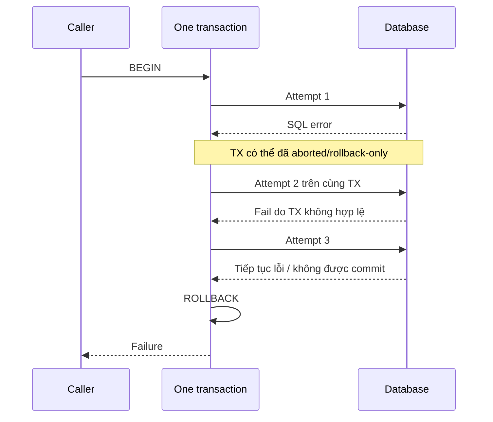
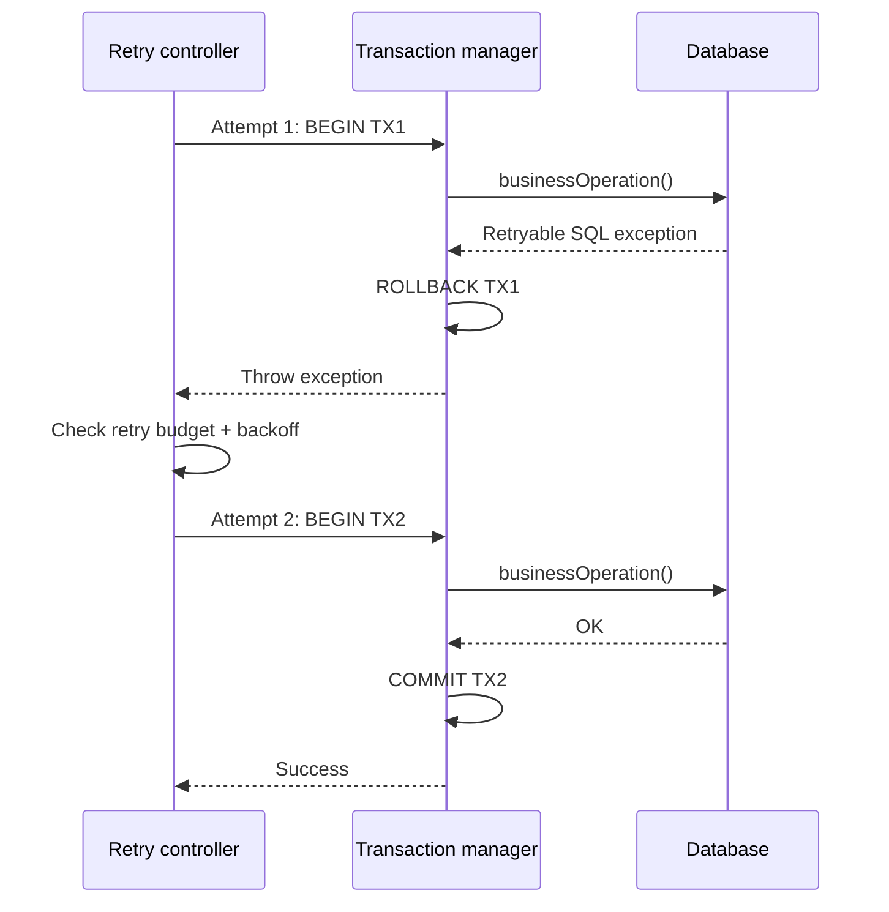
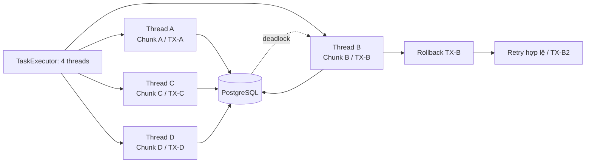
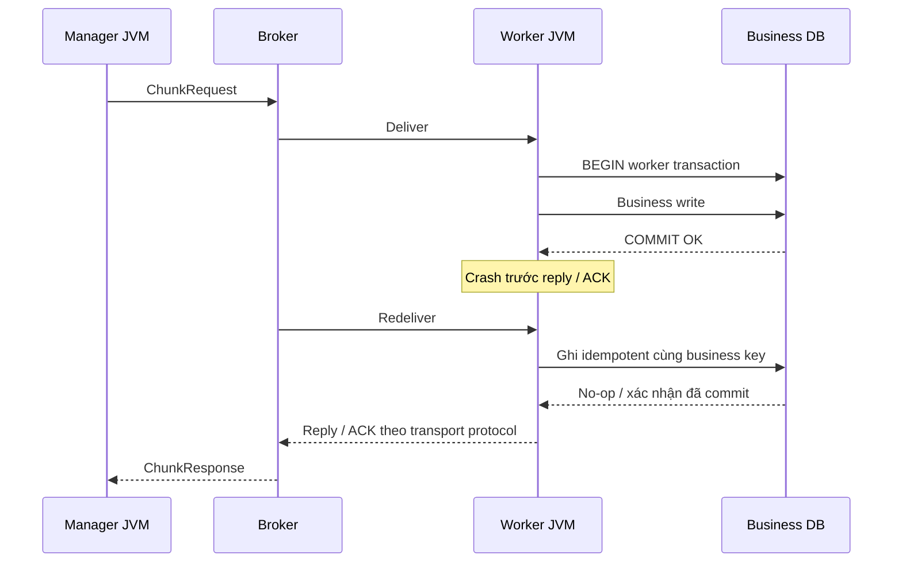

# Retry cùng transaction hay transaction mới trong Spring Batch

> **Chương:** Retry  
> **Mục tiêu:** Hiểu lúc nào retry còn có thể thực hiện **trong cùng transaction**, lúc nào phải **rollback rồi thử trong transaction mới**, phân biệt *stateless retry* với *stateful retry* trong chunk processing, và tránh dùng `REQUIRES_NEW` sai cách khi chạy Spring Batch đa luồng hoặc phân tán. Các ví dụ sử dụng **Spring Batch 5.2.x**, **Spring Retry 2.x**, Java 17, Spring JDBC và PostgreSQL.

## 1. Bài toán: Retry đúng số lần nhưng vẫn thất bại

Một job nhập hàng triệu giao dịch theo `chunk(100)`. Chunk có 100 item, writer dùng JDBC ghi vào PostgreSQL. Lần ghi đầu gặp deadlock; code bắt exception và gọi lại câu SQL ngay:

```java
// PHẢN VÍ DỤ — không dùng trong writer của một chunk transaction.
for (int attempt = 0; attempt < 3; attempt++) {
    try {
        jdbcTemplate.update(sql, args);
        break;
    } catch (DataAccessException ex) {
        // Hy vọng lần sau hết deadlock.
    }
}
```

Vấn đề: **Transaction hiện tại có thể đã không còn sử dụng được**. Sau một lỗi SQL, PostgreSQL thường đưa transaction vào trạng thái *aborted*, còn Spring transaction management có thể đã đánh dấu nó *rollback-only*. Lần gọi SQL tiếp theo trong cùng transaction có thể thất bại ngay, dù lỗi deadlock ban đầu đã biến mất.

Một lập trình viên khác giải quyết bằng `@Transactional(propagation = REQUIRES_NEW)` trên từng lệnh ghi. Lần thử mới có transaction riêng, nhưng giờ có một rủi ro khác: **dữ liệu ghi có thể commit riêng trước khi chunk/metadata JobRepository commit**, khiến retry/restart sau crash phát lại item đã ghi.

Vì vậy có hai câu hỏi **khác nhau**:

1. **Có thử lại được hay không?** Quyết định bằng phân loại lỗi, retry budget và idempotency.
2. **Thử lại trong transaction nào?** Quyết định bằng ranh giới rollback, trạng thái resource và cấu trúc retry/transaction.

**Quy tắc ưu tiên đối với lỗi writer JDBC có rollback:** Để Spring Batch rollback chunk và thử lại trong một **transaction hợp lệ ở lượt tiếp theo**, thay vì giữ transaction đã hỏng hoặc tự tạo transaction con quanh mọi item.

## 2. Transaction boundary và retry boundary là gì?

Một **transaction** là đơn vị nguyên tử của những thay đổi tham gia cùng tài nguyên/giao dịch: tất cả cùng commit hoặc rollback theo hợp đồng. Trong chunk-oriented step tiêu chuẩn:

```text
BEGIN chunk transaction
    ItemReader.read() / ItemProcessor.process(...)
    ItemWriter.write(Chunk<...>)
    cập nhật trạng thái reader/StepExecution khi phù hợp
COMMIT chunk transaction

Nếu có lỗi cần rollback:
    ROLLBACK chunk transaction
    áp retry/recovery theo policy
```

Sơ đồ trên giản lược thứ tự nội bộ. Spring Batch có các chi tiết như buffering, stream update, skip scan và stateful retry; **không được suy rằng mọi lần gọi ItemReader đều luôn xảy ra trong cùng transaction trên mọi reader**.

Một **retry boundary** xác định thao tác nào được gọi lại và trạng thái retry nào cần được giữ giữa các attempt.

- **Retry nằm trong transaction:** Một outer transaction bao trùm nhiều attempts. Chỉ an toàn khi lỗi có thể được phục hồi mà **không làm hỏng outer transaction**, không đánh dấu rollback-only và không tạo side effect lặp.
- **Retry nằm ngoài transaction:** Mỗi attempt mở một transaction riêng, thất bại thì rollback rồi trả quyền điều khiển về retry. Attempt kế tiếp dùng transaction mới; phù hợp với lỗi JDBC thường buộc rollback.
- **Retry xuyên chunk transaction:** Spring Batch dùng stateful retry/recovery phù hợp để tiếp tục xử lý item sau khi chunk đã rollback. Quá trình này phải tôn trọng checkpoint và `StepExecution`.

### Đừng nhầm các scope

| Scope | Bảo vệ hoặc kiểm soát | Không đồng nghĩa |
| --- | --- | --- |
| Một chunk transaction | Các writes tham gia transaction đó | Toàn bộ job là một transaction |
| Một retry context | Lỗi/attempts của thao tác hoặc item | Một kết nối DB duy nhất |
| Một `StepExecution` | Metadata của một lượt thực thi step | Một worker thread, một transaction |
| Một `JobInstance` | Danh tính logic của job | Một lần chạy duy nhất; có thể restart |
| Broker delivery | Một lượt giao `ChunkRequest` | Chunk transaction đã commit hay chưa |

**Retry transaction mới** không có nghĩa luôn phải có **JobExecution mới**; nhiều lần thử lại có thể xảy ra trong cùng một lần chạy step trước khi JobExecution thất bại.

## 3. Hai thứ tự lồng nhau dẫn đến hành vi khác nhau

Có thể hình dung kết hợp `RETRY` và `TX` theo hai cách:

```text
A. Một TX bao quanh mọi retry attempts:

TX {
    RETRY {
        businessOperation();
    }
}

B. Retry bao quanh những TX độc lập:

RETRY {
    TX {
        businessOperation();
    }
}
```

### Mẫu A — Retry cùng outer transaction



**Điểm không an toàn:** Ngay cả khi lần cuối thao tác trả thành công, nếu outer transaction đã `rollback-only`, `commit()` vẫn không thể thành công như mong đợi; Spring có thể phát sinh `UnexpectedRollbackException`.

### Mẫu B — Rollback rồi retry bằng transaction mới



Ở mẫu B, lỗi của `TX1` không làm `TX2` bị đánh dấu rollback-only. Tuy nhiên, nếu lần thử đầu có **side effect bên ngoài TX** đã thành công, retry trên TX2 vẫn có thể nhân đôi side effect ấy; transaction mới không thay thế idempotency.

## 4. Vì sao PostgreSQL không cho retry SQL trong transaction đã lỗi?

Ví dụ độc lập để hiểu semantics của PostgreSQL:

```sql
BEGIN;

CREATE TEMP TABLE demo_tx(id BIGINT PRIMARY KEY);

INSERT INTO demo_tx(id) VALUES (1);
INSERT INTO demo_tx(id) VALUES (1); -- duplicate key, SQLSTATE 23505

-- Nếu vẫn đang trong cùng transaction đã lỗi:
INSERT INTO demo_tx(id) VALUES (2);
-- PostgreSQL báo: current transaction is aborted,
-- commands ignored until end of transaction block.

ROLLBACK;

-- Sau rollback có thể mở giao dịch khác.
BEGIN;
CREATE TEMP TABLE demo_tx(id BIGINT PRIMARY KEY);
INSERT INTO demo_tx(id) VALUES (2);
COMMIT;
```

**Mã SQL chỉ là thí nghiệm về transaction aborted**, không phải đề xuất retry `duplicate key`: duplicate key do dữ liệu trùng không nên thử lại chỉ vì đổi transaction. Tình huống này minh họa tại sao *transaction hỏng* và *lỗi retryable* là hai thuộc tính khác nhau.

Với deadlock, PostgreSQL có thể chọn transaction làm nạn nhân rồi abort transaction ấy (SQLSTATE `40P01`). Muốn thử lại công việc của transaction đã bị abort, cần mở transaction hợp lệ mới.

| Lỗi PostgreSQL | Mức retry nên cân nhắc | Transaction hiện tại |
| --- | --- | --- |
| Deadlock `40P01` | Retry hữu hạn, ưu tiên sửa lock order | Transaction bị hủy; dùng TX mới |
| Serialization failure `40001` | Retry **toàn transaction** với snapshot mới | Transaction thất bại |
| Unique violation `23505` | Thường **non-retryable** hoặc xử lý conflict có chủ đích | Transaction có thể bị aborted nếu không dùng savepoint/`ON CONFLICT` |
| Bad SQL syntax `42601` | Không retry | Transaction có thể đã lỗi |
| Connection lost near COMMIT | Outcome **không chắc chắn** | Cần xác minh đã commit trước khi replay |
| Query không tìm thấy item | Phụ thuộc business semantics | Không nhất thiết là lỗi transaction |

**Quyết định retry phải dựa trên nguyên nhân và contract của thao tác**, không dựa đơn thuần vào việc có thể tạo transaction mới.

## 5. Khi nào có thể retry trong cùng transaction?

Có những trường hợp retry không nhất thiết cần rollback toàn outer transaction:

1. **Thao tác không tham gia giao dịch đang mở**, ví dụ tính toán thuần trong bộ nhớ không có side effect.
2. **Lỗi tạm thời ở dịch vụ đọc thuần** bên ngoài DB transaction, nếu operation an toàn lặp và transaction hiện tại không giữ resource quá lâu.
3. **Thao tác đã được bảo vệ bằng savepoint/nested transaction**, driver và transaction manager hỗ trợ, lỗi được rollback về savepoint và outer transaction còn hợp lệ.
4. **Lỗi nghiệp vụ không làm hỏng transaction**, được xử lý cục bộ theo semantics đã thiết kế; vẫn phải xem quy tắc rollback của Spring.

Nhưng “có thể” không đồng nghĩa “nên”. Gọi HTTP trong khi giữ transaction DB mở nhiều giây làm tăng thời gian giữ locks/connections và khiến throughput giảm khi tăng workers.

### Ví dụ tính toán thuần

```java
// Pseudocode cho một phép tính idempotent không tác động resource.
String normalized = retryTemplate.execute(ctx ->
        normalizeDeterministically(input));
```

Nếu `normalizeDeterministically` chỉ đọc dữ liệu bất biến và lỗi vì nguồn phụ trợ tạm thời, retry có thể lặp an toàn. Trong trường hợp này transaction bao quanh phép tính là không cần thiết; đưa nó ra khỏi transaction thường rõ ràng hơn.

### Trường hợp savepoint không đơn giản như bắt exception

Với JDBC, savepoint có thể cho phép khôi phục **một đoạn công việc bên trong cùng outer transaction**:

```sql
BEGIN;

INSERT INTO business_table(id) VALUES (10);

SAVEPOINT attempt_point;
INSERT INTO business_table(id) VALUES (10); -- lỗi duplicate
ROLLBACK TO SAVEPOINT attempt_point;

-- Transaction có thể tiếp tục sau rollback về savepoint.
INSERT INTO business_table(id) VALUES (11);
COMMIT;
```

Điều này **không biến duplicate thành retryable**; chỉ minh họa savepoint cô lập lỗi. Trong Spring, dùng `PROPAGATION_NESTED` cần transaction manager và JDBC driver hỗ trợ savepoint; không mặc định có trong mọi JPA/JTA setup. Spring Batch fault-tolerant chunk step cũng **không tự chọn NESTED savepoints cho mọi lỗi writer**.

## 6. Spring Batch chunk retry: Tại sao stateful retry quan trọng?

Trong một `TaskletStep` hướng chunk, transaction được quản lý quanh quá trình xử lý chunk, và framework cần nhớ **item đã lỗi** dù transaction bị rollback.

Khái niệm **stateful retry**:

```text
Lượt A:
  BEGIN chunk TX1
  xử lý item E-42 → transient failure
  lưu thông tin retry của E-42 theo retry context
  ROLLBACK TX1

Lượt B:
  BEGIN chunk TX2 hợp lệ
  nhận diện lại item E-42 / retry context
  nếu còn budget thì retry
  COMMIT TX2 nếu thành công

Nếu hết budget:
  đi theo recovery/skip/fail policy
```

Spring Batch sử dụng cơ chế stateful retry cho các trường hợp phù hợp ở `process/write`; hạ tầng duy trì context giữa những lần transaction rollback trong quá trình step chạy. Nội dung thực tế còn phụ thuộc reader buffering, lỗi ở pha nào và cách `FaultTolerantChunkProcessor` xử lý.

**Ý nghĩa:** Khi cần rollback database, không được giữ lỗi SQL trong một transaction hỏng chỉ để hoàn tất vài attempt; **trạng thái retry phải sống qua ranh giới transaction**, còn resource state của transaction cũ được giải phóng.

### Stateless retry khác gì?

- **Stateless retry:** Thử lại trong một lời gọi retry, context không nhất thiết phải nhận diện lại item sau rollback. Với thao tác không ảnh hưởng transaction, nó có thể phù hợp.
- **Stateful retry:** Có danh tính item/retry key và khả năng ghi nhớ attempt giữa những lần lỗi bị ném ra để transaction rollback; hữu ích trong chunk processing.
- **Không nên suy:** Stateless luôn bằng “một transaction”, hoặc stateful luôn bằng “nhiều JobExecution”. Transaction manager và vị trí đặt retry boundary mới quyết định ranh giới thực tế.

Ví dụ reader gọi lại `read()` sau một lỗi tạm thời không giống writer phải rollback cả chunk. Đừng áp một mô hình chung cho tất cả read/process/write.

### Các extension point liên quan

| Extension point trong Batch 5.2 | Dùng để làm gì? | Cạm bẫy |
| --- | --- | --- |
| `retry(Class)` | Chọn exception retryable | Quá rộng gây retry cả lỗi dữ liệu |
| `retryLimit(int)` | Giới hạn số attempts cho item theo policy | Không giới hạn tổng retries toàn job |
| `backOffPolicy(BackOffPolicy)` | Chờ giữa các lần thử | Không chữa transaction đã aborted |
| `keyGenerator(KeyGenerator)` | Stable key của item để tra retry context | Item mutable làm nhận dạng sai |
| `retryContextCache(RetryContextCache)` | Giữ stateful retry context | Mặc định không phải durable restart ledger |
| `retryPolicy(RetryPolicy)` | Policy tùy biến | Có thể thay thế cơ chế cấu hình limit/backoff của builder |

**Quan trọng:** `RetryContextCache` thường nằm trong bộ nhớ của worker trong lần chạy step; sau JVM crash/Job restart, không được coi nó là nguồn lưu attempt count bền vững. Để có quota theo event xuyên nhiều ngày, cần business attempt ledger riêng.

## 7. Cấu hình Spring Batch 5.2: Retry writer đúng cách

Giả sử input có `eventId` bất biến. Database đích cần một hàng cho mỗi event, writer phải idempotent khi chunk được xử lý lại.

Schema PostgreSQL:

```sql
CREATE TABLE imported_invoice (
    source_event_id VARCHAR(128) PRIMARY KEY,
    invoice_id VARCHAR(128) NOT NULL,
    amount NUMERIC(18,2) NOT NULL
);
```

Writer:

```java
package com.example.batch.retrytx;

import java.math.BigDecimal;
import org.springframework.batch.item.ItemWriter;
import org.springframework.context.annotation.Bean;
import org.springframework.context.annotation.Configuration;
import org.springframework.jdbc.core.JdbcTemplate;

@Configuration(proxyBeanMethods = false)
public class InvoiceWriterConfig {

    public record Invoice(
            String eventId, String invoiceId, BigDecimal amount) {}

    @Bean
    public ItemWriter<Invoice> invoiceWriter(JdbcTemplate jdbc) {
        return chunk -> {
            for (Invoice item : chunk) {
                jdbc.update("""
                    INSERT INTO imported_invoice
                        (source_event_id, invoice_id, amount)
                    VALUES (?, ?, ?)
                    ON CONFLICT (source_event_id) DO NOTHING
                    """,
                    item.eventId(), item.invoiceId(), item.amount());
            }
        };
    }
}
```

Worker step với retry:

```java
package com.example.batch.retrytx;

import org.springframework.batch.core.Step;
import org.springframework.batch.core.repository.JobRepository;
import org.springframework.batch.core.step.builder.StepBuilder;
import org.springframework.batch.item.ItemReader;
import org.springframework.batch.item.ItemWriter;
import org.springframework.beans.factory.annotation.Qualifier;
import org.springframework.context.annotation.Bean;
import org.springframework.context.annotation.Configuration;
import org.springframework.dao.CannotAcquireLockException;
import org.springframework.dao.TransientDataAccessResourceException;
import org.springframework.retry.backoff.FixedBackOffPolicy;
import org.springframework.transaction.PlatformTransactionManager;

import com.example.batch.retrytx.InvoiceWriterConfig.Invoice;

@Configuration(proxyBeanMethods = false)
public class InvoiceStepConfig {

    @Bean
    public Step invoiceImportStep(
            JobRepository repository,
            PlatformTransactionManager transactionManager,
            @Qualifier("invoiceReader") ItemReader<Invoice> reader,
            @Qualifier("invoiceWriter") ItemWriter<Invoice> writer) {

        FixedBackOffPolicy backoff = new FixedBackOffPolicy();
        backoff.setBackOffPeriod(200L);

        return new StepBuilder("invoiceImportStep", repository)
                .<Invoice, Invoice>chunk(100, transactionManager)
                .reader(reader)
                .writer(writer)
                .faultTolerant()
                .retry(CannotAcquireLockException.class)
                .retry(TransientDataAccessResourceException.class)
                .retryLimit(3)
                .backOffPolicy(backoff)
                .build();
    }
}
```

Các điểm cần nhớ:

1. `chunk(100, transactionManager)` để Spring Batch quản lý chunk transaction; **không tự gọi `TransactionTemplate` trong writer** chỉ để retry lại một câu SQL.
2. `retry(...)` whitelist các exception có khả năng phục hồi. Không cho `BadSqlGrammarException`, lỗi dữ liệu cố định hoặc business conflict vào danh sách chỉ vì có thể rollback.
3. `retryLimit(3)` là **ba attempts tổng cộng, gồm lần đầu**, cho một retry context/item; không phải ba lần retry bổ sung.
4. `backOffPolicy(backoff)` giảm nguy cơ retry storm khi nhiều workers gặp contention.
5. `JdbcTemplate` phải dùng cùng datasource/transaction manager với chunk để rollback database write đúng như mong đợi.
6. `ON CONFLICT DO NOTHING` chống insert hai row cho cùng event ID, nhưng **chưa kiểm tra payload conflict**. Production cần fingerprint/version để phát hiện event cùng ID mang giá trị khác.
7. Code là **mảnh cấu hình**; còn thiếu `invoiceReader`, bean `Job`, datasource, schema initialization và JobLauncher. Không sao chép vào project khác mà chưa kiểm tra phiên bản Spring Batch.

Không có dòng `@Transactional(REQUIRES_NEW)` nào trong writer. Đó là **chủ đích**: ranh giới transaction của chunk do step và Spring Batch nắm quyền.

## 8. Java minh họa độc lập: Đặt RetryTemplate ngoài TransactionTemplate

Để thấy rõ khác biệt giữa retry boundary và transaction boundary, dùng Spring Retry `RetryTemplate` và Spring `TransactionTemplate` trong một ví dụ **độc lập**, **không được gắn trực tiếp vào ItemWriter đang chạy dưới chunk transaction**.

```java
package com.example.batch.retrytx;

import java.util.Map;
import org.springframework.dao.CannotAcquireLockException;
import org.springframework.retry.support.RetryTemplate;
import org.springframework.retry.policy.SimpleRetryPolicy;
import org.springframework.retry.backoff.FixedBackOffPolicy;
import org.springframework.transaction.PlatformTransactionManager;
import org.springframework.transaction.support.TransactionTemplate;

public final class StandaloneRetriedOperation {

    private final TransactionTemplate tx;
    private final RetryTemplate retry;

    public StandaloneRetriedOperation(
            PlatformTransactionManager transactionManager) {

        this.tx = new TransactionTemplate(transactionManager);

        this.retry = new RetryTemplate();
        this.retry.setRetryPolicy(new SimpleRetryPolicy(
                3,
                Map.of(CannotAcquireLockException.class, true)));

        FixedBackOffPolicy backoff = new FixedBackOffPolicy();
        backoff.setBackOffPeriod(200L);
        this.retry.setBackOffPolicy(backoff);
    }

    public void execute() {
        // Không có outer transaction ở thời điểm gọi execute().
        retry.execute(retryContext ->
                tx.execute(status -> {
                    // Thao tác DB; exception phải lan ra ngoài callback
                    // để TX rollback và RetryTemplate nhìn thấy nó.
                    writeBusinessData();
                    return null;
                }));
    }

    private void writeBusinessData() {
        // Tích hợp JDBC thực tế ở đây.
    }
}
```

Mô hình gọi:

```text
RetryTemplate.execute
  ├─ TransactionTemplate.execute  → TX1 → ROLLBACK nếu exception
  ├─ Backoff
  ├─ TransactionTemplate.execute  → TX2 → ROLLBACK nếu exception
  ├─ Backoff
  └─ TransactionTemplate.execute  → TX3 → COMMIT nếu thành công
```

**Điều kiện then chốt:** `TransactionTemplate` mặc định dùng `PROPAGATION_REQUIRED`. Trong ví dụ này, **không có transaction bên ngoài**, nên mỗi lần gọi `tx.execute(...)` mở một transaction mới. Nếu gọi nó từ một phương thức đã có outer `@Transactional`, `REQUIRED` **tham gia transaction đang có**; khi ấy **không còn bảo đảm mỗi attempt là một TX độc lập**.

Ngoài ra, retry ở ví dụ là **stateless trong một lời gọi RetryTemplate**. Trong Spring Batch chunk step, cơ chế retry/recovery thực tế do framework quản lý; không chuyển nguyên vòng template này vào `ItemWriter` nếu không hiểu transaction của step.

### Tại sao không viết ngược thứ tự?

```java
// CHỈ ĐỂ ĐỐI CHIẾU — không dùng cho JDBC deadlock.
tx.execute(status ->
        retry.execute(retryContext -> {
            writeBusinessData();
            return null;
        }));
```

Với cách này, toàn bộ attempts ở **cùng outer transaction**. Nếu attempt đầu gây transaction aborted/rollback-only, attempt tiếp không có transaction sạch. Việc chạy thêm retry có thể vô ích hoặc tạo `UnexpectedRollbackException` ở cuối.

**Nguyên tắc diễn giải:** Vị trí các wrapper quyết định ai “bao” ai. Không phải việc có đủ hai class `RetryTemplate` và `TransactionTemplate` bảo đảm transaction mới cho mỗi lần thử.

## 9. PROPAGATION_REQUIRED, REQUIRES_NEW và NESTED không tương đương

Spring cung cấp nhiều propagation behavior; những tên này thường bị dùng để “sửa retry” nhưng có ngữ nghĩa khác nhau:

| Propagation | Khi đã có outer transaction | Ảnh hưởng đến retry |
| --- | --- | --- |
| `REQUIRED` | Tham gia outer transaction | Lỗi có thể làm cả outer TX rollback-only; **không** tạo TX mới cho mỗi attempt |
| `REQUIRES_NEW` | Suspend outer và mở transaction độc lập | Có TX mới, nhưng có thể **commit riêng khỏi chunk** |
| `NESTED` | Dùng savepoint trong một physical TX nếu được hỗ trợ | Có thể rollback phần nested nhưng outer TX vẫn tồn tại; cần hỗ trợ thực tế |
| `SUPPORTS` | Tham gia TX nếu có, nếu không thì chạy không TX | Không phải giải pháp retry/atomicity |
| `NOT_SUPPORTED` | Chạy không có transaction | Không phù hợp với thao tác cần ghi DB nguyên tử |

### Vì sao REQUIRES_NEW không phải câu trả lời mặc định?

Phản ví dụ trong writer:

```java
// PHẢN VÍ DỤ — đừng dùng chỉ để tránh deadlock/retry rollback.
@Transactional(propagation = Propagation.REQUIRES_NEW)
public void insertOneInvoice(Invoice item) {
    jdbc.update(...);
}
```

Nếu nó được gọi qua Spring proxy đúng cách, inner transaction có thể **commit ngay**, còn outer chunk transaction vẫn chưa commit. Khi writer xử lý 100 item:

```text
Outer chunk TX:
    insert item 1  → REQUIRES_NEW commits
    insert item 2  → REQUIRES_NEW commits
    ...
    item 70 → lỗi khiến outer chunk rollback
    Step checkpoint chưa commit

Restart hoặc retry chunk:
    item 1..69 có thể được phát lại dù đã commit
```

Với writer idempotent, hệ quả dữ liệu có thể được giảm nhẹ, nhưng **atomicity của chunk đã bị phá**, đồng thời tăng số transaction/connection và chi phí khi scale.

Một lỗi khác: `@Transactional` trên phương thức được gọi **nội bộ trong cùng bean (self-invocation)** có thể không đi qua proxy Spring, nên cấu hình propagation tưởng có hiệu lực nhưng thực tế không được áp dụng.

### Khi nào REQUIRES_NEW có thể hợp lý?

- Ghi audit độc lập **với quyết định rõ ràng rằng audit phải tồn tại dù transaction nghiệp vụ rollback**.
- Lưu notification/attempt metadata theo giao thức riêng, có idempotency và reconciliation.
- Một workflow độc lập không phải phần commit nguyên tử của chunk.

Nhưng ngay cả với audit, phải nêu rõ trạng thái “attempt thất bại” khác “item đã xử lý thành công”. Không được dùng một marker `SUCCESS` trong `REQUIRES_NEW` trước khi effect của chunk commit.

### NESTED/savepoints có thay thế được stateful retry?

Không tự động. Savepoint có thể cô lập một lỗi mà outer TX chưa hỏng toàn bộ, nhưng:

- không phải driver/transaction manager nào cũng hỗ trợ nested;
- JPA flush/persistence context có thể không khôi phục đơn giản theo savepoint;
- deadlock hoặc serialization failure có thể cần **retry toàn transaction**, không chỉ một câu SQL;
- Spring Batch chunk skip/retry/checkpoint có semantics riêng.

Nên coi NESTED là lựa chọn có chủ đích cho một kiến trúc được kiểm thử, không phải default của fault-tolerant step.

## 10. Spring transaction rollback-only: Đừng nuốt exception

Khi một method `@Transactional(REQUIRED)` bên trong đánh dấu outer transaction là rollback-only, việc caller bắt exception **không tự xóa cờ rollback-only**:

```java
@Transactional
public void importChunkManually() {
    try {
        anotherTransactionalService.write(); // tham gia outer TX
    } catch (DataAccessException ex) {
        // Đã bắt lỗi không nghĩa là transaction đã được phục hồi.
    }

    // COMMIT bên ngoài vẫn có thể fail do rollback-only.
}
```

Trong Spring, điều này có thể xuất hiện dưới dạng `UnexpectedRollbackException` khi commit. Với PostgreSQL, một lỗi SQL cũng có thể khiến toàn transaction bị aborted dù phía Java đã bắt exception.

**Đường xử lý đúng:** Cho exception thoát ra đến tầng quản lý transaction để rollback, sau đó retry từ ngoài transaction trên retry boundary hợp lệ. Với `TaskletStep`, ưu tiên cấu hình `faultTolerant()`, không tự điều phối transaction trong writer.

### Timeout khi COMMIT: Không thể đơn giản “ROLLBACK rồi thử”

Nếu network mất sau khi client gửi `COMMIT`, client có thể **không biết DB đã commit hay chưa**. Tạo transaction mới để thử lại không chứng minh lần đầu chưa ghi.

Giải pháp cần thêm:

- business key ổn định và unique constraint;
- query/reconciliation kết quả theo event ID;
- writer idempotent (cùng payload no-op, payload khác báo conflict);
- hoặc outbox/transactional ledger nếu có side effect khác.

**Transaction mới giải quyết TX đã hỏng; idempotency giải quyết việc không biết TX trước đã thực sự tạo effect hay chưa.**

## 11. Read, process và write: Vị trí lỗi quyết định cách retry

Một chunk step có ba pha quan trọng:

| Pha | Lỗi có thể gặp | Retry cùng TX? | Khuyến nghị |
| --- | --- | --- | --- |
| `ItemReader.read()` | File parse lỗi cố định | Không có ích | Skip/quarantine/fail theo business |
| `ItemReader.read()` | Network/cursor bị mất | Phụ thuộc reader state | Thiết kế reader có checkpoint/reopen đúng, tránh mất dòng |
| `ItemProcessor.process(item)` | Tính toán thuần, lỗi external lookup | Có thể, nếu an toàn và TX không bị hỏng | Backoff/timeout, không giữ DB locks vô ích |
| `ItemProcessor.process(item)` | Business validation fail | Không | Fail hoặc skip có quota |
| `ItemWriter.write(chunk)` | DB deadlock/serialization failure | **Không** trên TX đã abort | Rollback chunk rồi retry trên TX hợp lệ |
| `ItemWriter.write(chunk)` | Unique conflict cùng payload | Không cần retry | Idempotent no-op có kiểm chứng |
| `ItemWriter.write(chunk)` | Unique conflict payload khác | Không | Business conflict, fail/quarantine |
| `ItemWriter.write(chunk)` | HTTP payment timeout | Không biết outcome | Reconcile và dùng idempotency key |

### Reader có thể đã tiến trước khi ném exception

```java
// PHẢN VÍ DỤ — reader đã consume item trước khi validate.
Invoice item = delegate.read();
validateMayThrow(item);
return item;
```

Một lần gọi lại `read()` có thể lấy item tiếp theo, làm mất item trước nếu cursor không được phục hồi. “Retry trong transaction mới” cũng không tự trả cursor về vị trí cũ nếu nguồn đọc không transactional.

Reader cần:

1. Input snapshot bất biến;
2. ordering ổn định;
3. checkpoint và `ItemStream` lifecycle phù hợp;
4. chính sách rõ cho read exception và lỗi không thể xác định item;
5. test rollback/restart.

### Processor có side effect thì phải cẩn thận

Nếu processor gọi API gửi email, tạo UUID hoặc charge payment, rollback DB **không rollback external API**. Cần tách side effect ra outbox hoặc dùng idempotency key, ngay cả khi retry chỉ diễn ra trong một TX mới.

### Writer là điểm thường cần TX mới nhất

Với writer JDBC, rollback chunk và retry trong transaction hợp lệ là mô hình an toàn hơn retry SQL liên tục trên TX đang aborted. Dù vậy, **không phải mọi lỗi JDBC đều retryable**: SQL syntax, permission, invalid data và business conflict phải được phân loại riêng.

## 12. Có phải cả chunk được xử lý lại khi một item lỗi?

Trong chunk-oriented processing, transaction được commit theo chunk. Nếu writer đã ghi A/B nhưng lỗi ở C:

```text
Chunk [A, B, C, D], transaction TX1
    write A → thành công tạm thời
    write B → thành công tạm thời
    write C → deadlock
    ROLLBACK TX1
```

Trong một lần thử tiếp theo, A/B có thể được process/write lại cùng với C hoặc theo cơ chế write scan/recovery của framework. Điều này dẫn tới:

- `retryLimit(3)` **không** chứng minh `ItemWriter.write()` cho cả chunk chỉ được gọi đúng ba lần.
- `writeCount` của `StepExecution` không bằng số SQL statements đã chạy.
- `rollbackCount` không phải số attempts chính xác.
- Processor/writer có side effect ngoài transaction có nguy cơ nhân đôi.
- Checkpoint reader phải phản ánh **phần dữ liệu đã commit**, không phải số item từng được gọi vào writer.

**Không tự viết vòng lặp “retry chỉ item C” bằng cách commit riêng A/B** trong transaction khác nếu mục tiêu là giữ nguyên atomicity của chunk.

### Skip sau khi exhausted không phải commit tùy ý

Nếu lỗi C retry exhausted và được cấu hình `skip(...)` hợp lệ, Spring Batch có thể cô lập item lỗi để tiếp tục. Cơ chế này còn chịu skip quota và việc writer phải an toàn gọi lại. Không tự động coi lỗi database hệ thống là skippable chỉ để job chạy hết file.

## 13. RetryLimit, backoff và deadline khi transaction phải mở lại

Ví dụ:

```java
.faultTolerant()
.retry(CannotAcquireLockException.class)
.retryLimit(3)
.backOffPolicy(backoff)
```

Ý nghĩa theo Spring Batch 5.2: **tối đa ba attempts, tính cả lần đầu**, không phải ba lần retry bổ sung. Với lỗi buộc rollback, chi phí thực tế gồm rollback transaction, mở transaction mới, xử lý lại item/chunk, chờ backoff và các câu SQL chạy lại.

Mô hình ước lượng:

\[
T_{\mathrm{total}} \approx
\sum_{i=1}^{N}T_{\mathrm{attempt},i}
+\sum_{i=1}^{N-1}d_i
+T_{\mathrm{rollback/recovery/queue}}
\]

Trong đó `N` là tổng attempts theo policy và `d_i` là delay trước attempt kế tiếp.

Ví dụ giả định:

```text
retryLimit            = 3 attempts
Time mỗi attempt      = 500 ms
Backoff               = 200 ms, 400 ms
Rollback/recovery     = 2 × 100 ms

Ước lượng tối đa = 3×500 + 200+400 + 2×100 = 2.300 ms
```

Đây là phép tính minh họa, không phải bound cứng nếu một attempt có network I/O bị treo. Cần timeout transaction/JDBC/HTTP phù hợp và deadline toàn job.

### Backoff có giữ transaction mở không?

**Tùy đường thực thi.** Không suy rằng mọi backoff tự giải phóng connection/lock. Một retry trong cùng outer TX có thể giữ locks khi sleep; trong cơ chế rollback rồi retry, transaction cũ đã rollback trước lần thử kế tiếp nhưng tài nguyên còn phụ thuộc framework/driver.

Đo `db_pool_pending`, lock waits và `active threads`; không chỉ nhìn giá trị `backOffPeriod`.

### Đừng để retryPolicy tùy biến vô hiệu hóa cấu hình

Trong Spring Batch 5.2, nếu đã cung cấp `retryPolicy(customPolicy)`, các cấu hình builder-level như `retryLimit(...)` và `backOffPolicy(...)` có thể bị bỏ qua theo Javadoc. Nếu cần một policy tùy chỉnh, hãy kiểm tra cách policy sở hữu backoff/quota, test đường thực thi thực tế thay vì ghép cấu hình mà không xác minh.

## 14. Chunk transaction và JobRepository metadata: Không phải lúc nào cũng cùng DB

Spring Batch lưu `JobExecution`, `StepExecution` và `ExecutionContext` qua `JobRepository`. Business writer có thể ghi vào **cùng DB** hoặc một **DB khác**.

| Cấu hình | Khi writer lỗi trước commit | Rủi ro khi restart |
| --- | --- | --- |
| JobRepository và business writes cùng DataSource/transaction | Có thể rollback metadata và business changes cùng nhau khi đúng wiring | Vẫn phải kiểm tra reader/side effect ngoài DB |
| Business DB và JobRepository khác DataSource/TM | Business effect và checkpoint có thể commit lệch | Replay đã ghi hoặc metadata tiến trước output |
| Writer gọi API/email/Kafka ngoài TX | DB rollback không undo external effect | Side effect lặp hoặc mất nếu không có outbox |
| Writer dùng `REQUIRES_NEW` nội bộ | Effect có thể commit trước chunk | Replay item đã ghi khi chunk rollback |
| Remote worker khác JVM | Worker DB TX độc lập với manager metadata TX | Lost reply, duplicate delivery, fencing |

**Không suy rằng mọi `JobRepository.update(...)` được gọi trực tiếp trong cùng transaction của business writer.** Phạm vi TX phụ thuộc hạ tầng Step, datasource, transaction manager và các listener/writer thực tế.

Để bảo đảm restart an toàn:

1. Dùng business key ổn định qua mọi `JobExecution`.
2. Dùng idempotent writer với unique constraint/fingerprint.
3. Đóng băng input snapshot/manifest.
4. Để framework quản lý checkpoint `ItemStream`, `ExecutionContext` và step state.
5. Chạy integration test kill process ở các điểm trước/sau commit.
6. Đối chiếu dữ liệu đích, không coi `BatchStatus.COMPLETED` là chứng minh đầy đủ mọi side effect.

### Không sửa metadata khi lỗi optimistic locking

`OptimisticLockingFailureException` trong `JobRepository` có thể là dấu hiệu hai updater ghi một `StepExecution` stale. Đây không phải lỗi deadlock nghiệp vụ cần tăng retry limit mù quáng, và không được “sửa” bằng SQL tăng cột `VERSION` hoặc ép status `COMPLETED`.

## 15. Local multi-threaded step: Retry và transaction trên nhiều thread

Giả sử một step dùng pool bốn worker threads. Mỗi chunk transaction thường nằm trên **thread đang xử lý chunk**; Spring transaction context theo mô hình imperative là thread-bound.



Các điều cần phân biệt:

- **TX-B rollback không làm TX-A/C/D tự rollback.** Những chunk khác có thể đã commit.
- Retry có thể thay đổi thứ tự commit so với thứ tự đọc.
- Reader/processor/writer dùng chung phải thread-safe hoặc có scope đúng.
- `@StepScope` không tự tạo một `StepExecution` cho từng chunk trong **multi-threaded step**. Khi cần metadata/checkpoint tách biệt theo phần việc, cân nhắc partitioning.
- DB pool cần đủ connection cho concurrent transactions và metadata. Tăng worker count có thể làm lock contention và retry rate cao hơn.
- `ThreadLocal` hoặc `TransactionSynchronizationManager` không được tùy tiện truyền qua thread/executor khác.

**Một anti-pattern:** Bắt exception trong worker A rồi dùng `CompletableFuture.supplyAsync(...)` thực hiện SQL tiếp trong thread B mà giả định nó tham gia transaction của A. Transaction context không tự đi theo task async; kết quả có thể chạy autocommit hoặc thuộc transaction khác.

## 16. Partitioning: Mỗi partition có StepExecution và transaction riêng

Trong local hoặc remote partitioning:

- Manager chia dữ liệu thành những partition với `ExecutionContext` riêng.
- Mỗi worker partition chạy một `StepExecution` và những chunk transaction của chính nó.
- Một partition fail/retry không tự đảo ngược output đã commit của partition khác.
- Restart cần giữ mapping tên partition ↔ dữ liệu ổn định.

```text
partition00000: StepExecution 101, chunk TX 1..N
partition00001: StepExecution 102, chunk TX 1..M
partition00002: StepExecution 103, chunk TX 1..K
partition00003: StepExecution 104, chunk TX 1..J
```

Khi `partition00002` gặp deadlock:

1. Chunk transaction tương ứng rollback.
2. Worker áp retry policy phù hợp; attempt sau dùng transaction hợp lệ.
3. Những partition khác tiếp tục hoặc đã commit độc lập.
4. Nếu partition 2 hết retry budget, partition có thể `FAILED`, manager tổng hợp status.
5. Restart cần xử lý phần đã commit an toàn bằng idempotency/reader checkpoint.

**Không sử dụng `REQUIRES_NEW` để cố làm từng partition “an toàn”**; mỗi worker partition đã có lifecycle transaction theo step. Hãy sửa nguyên nhân deadlock, chọn chunk size/concurrency hợp lý và dùng backoff.

## 17. Remote chunking: Transaction của worker không phải transaction của manager

Remote chunking có luồng khái niệm:



**Đây là mô hình nguyên lý, không phải mô tả ACK order mặc định của mọi JMS/AMQP adapter.** Ranh giới TX manager, worker DB và broker thường khác nhau.

Quan trọng:

- Worker có thể commit DB rồi mất reply.
- Broker có thể redeliver request ngay cả khi business write trước đó đã commit.
- Retry nội bộ của Spring Retry **khác với** broker redelivery và khác JobInstance restart.
- `retryLimit(3)` trong một step không tự giới hạn số lần broker giao message.
- Writer/worker phải idempotent theo **business item key**, không chỉ `chunkSequence`.
- Nếu worker xử lý request ở một `IntegrationFlow` thay vì chunk step local chuẩn, **đừng giả định Spring Batch đã mở chunk transaction như ở `TaskletStep`**. Phải xác minh transaction boundary thực tế của worker processor/writer và cấu hình listener.

Thêm `@Transactional(REQUIRES_NEW)` lên mỗi worker write không thể tạo một transaction xuyên JVM bao trùm manager + broker + database. Muốn có delivery/recovery chắc chắn cần protocol ACK/reply, dedup/ledger, outbox và observability.

## 18. Một bảng quyết định cho từng loại lỗi và transaction

| Lỗi / tình huống | Có retry trong cùng TX không? | Có thể retry trên TX mới không? | Điều kiện bổ sung |
| --- | --- | --- | --- |
| PostgreSQL deadlock/serialization | **Không** dùng TX đã abort | **Có**, retry transaction hợp lệ | Giới hạn, backoff, giảm contention |
| SQL syntax/permission error | Không | Không hữu ích trước khi sửa | Fail và sửa code/hạ tầng |
| Unique key nhưng cùng event đã commit | Không cần | Không cần thử ghi lại | Kiểm tra payload, no-op idempotent |
| Unique key khác payload | Không | Không | Báo business conflict/quarantine |
| HTTP GET thuần tạm 503 | Có thể nếu không ảnh hưởng TX và không giữ locks | Có thể | Timeout, rate-limit, cache/snapshot |
| HTTP charge timeout, không biết commit | **Không retry mù** | **Không retry mù** | Idempotency key, tra cứu/reconcile |
| Reader cursor bị mất | Không mặc định | Chỉ nếu mở lại/seek đúng offset | Checkpoint + source bất biến |
| Processor thuần báo lỗi transient external lookup | Có thể | Có thể | Processor an toàn lặp |
| Writer có side effect ngoài chunk TX | Cùng TX DB không giúp undo external effect | TX mới vẫn có nguy cơ lặp | Idempotency/outbox |
| JobRepository optimistic lock failure | Không retry mù | Không retry mù | Xác định duplicate updater/ownership |
| Chunk transaction rollback do timeout | Không tiếp tục TX đó | Có thể, nếu lỗi retryable | Tổng deadline, resource và checkpoint |

**Đừng rút gọn bảng thành “mọi exception có chữ transient đều retry với `REQUIRES_NEW`”.** Transaction state, item identity và commit outcome quan trọng ngang exception class.

## 19. Fault injection: Kiểm chứng thực sự đã đổi transaction

Các test dưới đây phải chạy trong môi trường test/cô lập, không cố gây deadlock trên database production.

### Test A — PostgreSQL transaction aborted

Thử hai câu SQL trong một transaction sau khi gây duplicate key. Quan sát statement thứ hai bị từ chối do transaction đã aborted. Rollback, mở transaction mới và xác nhận statement hợp lệ có thể chạy.

**Mục tiêu:** Bắt exception trong Java không phục hồi transaction hỏng.

### Test B — Cấu trúc lồng wrapper

Dùng `RetryTemplate` ngoài `TransactionTemplate` **không có outer transaction**. Tiêm `CannotAcquireLockException` hai lần rồi thành công, log transaction ID ở DB mỗi attempt:

```sql
SELECT txid_current();
```

Trên PostgreSQL, một giá trị transaction ID có thể cho thấy các attempt được thực thi trong transaction khác nhau nếu logging đúng cách. Không dùng chỉ phép đo này để kết luận commit/rollback thành công; xác minh bằng data/counters.

### Test C — Anti-pattern cùng outer transaction

Đổi thứ tự gọi thành `TransactionTemplate.execute(... RetryTemplate.execute(...))`. Tiêm một lỗi SQL abort transaction rồi kiểm tra lần thử tiếp không thể thực hiện như trên transaction sạch.

### Test D — Spring Batch chunk rollback

Tạo chunk bốn item, writer dùng cùng DataSource với transaction manager, cố tình gây deadlock sau khi ghi hai row đầu. Sau rollback, không có partial effects của transaction đó; retry trên transaction hợp lệ và final output không thiếu/trùng.

### Test E — Writer REQUIRES_NEW

Trong sandbox test, tạo một inner service `REQUIRES_NEW` thực sự qua Spring proxy, ghi các row đầu rồi ném exception ở cuối chunk. Quan sát những row đã commit vẫn có thể tồn tại dù chunk rollback. Sau đó **gỡ inner REQUIRES_NEW**, chạy lại và xác nhận chunk atomicity.

### Test F — Commit outcome unknown

Giả lập mất kết nối sau `COMMIT`. Phát lại event cùng business key với writer idempotent, xác minh chỉ một effect. Lặp với payload khác cùng ID, phải báo conflict.

### Test G — Multi-threaded

Chạy pool 1/4/8, cùng snapshot input. Đo DB lock waits, retry attempts, rollbackCount, successful throughput và số row unique cuối. Kiểm tra reader thread safety riêng.

### Test H — Partition và restart

Chia input thành bốn partition, gây lỗi ở một partition. Các partition khác có thể commit độc lập. Restart cùng JobInstance và partition mapping, xác minh kết quả đúng bằng đối soát business key.

### Test I — Remote chunking redelivery

Worker commit DB rồi crash trước ACK/reply. Broker redeliver chunk; kiểm tra idempotency và khả năng manager nhận/khôi phục reply, không dựa vào riêng retryLimit.

### Test J — Retry context identity

Dùng item có identity mutable rồi đổi field dùng trong `equals/hashCode` giữa các attempts. Quan sát stateful retry không ổn định; chuyển sang immutable business key hoặc `keyGenerator(...)` phù hợp.

### Test K — Transaction timeout/SLA

Đặt thời gian một attempt tối đa 1 giây và retryLimit 3, backoff 200/400 ms. Đối chiếu deadline toàn thao tác; xác nhận không để worker ngủ qua thời hạn vận hành mà vẫn tiếp tục retry.

## 20. Observability: Phân biệt retry attempt và transaction mới

Một hệ thống vận hành cần biết:

1. **Exception type và phase:** đọc/xử lý/ghi gì bị lỗi?
2. **Retry attempt:** Đây là lần thử thứ mấy của item/request?
3. **Transaction outcome:** Transaction trước rollback, commit hay uncertain?
4. **StepExecution:** Worker đang thuộc step/partition nào?
5. **Business effect:** Có row mới, duplicate no-op hay payload conflict?
6. **Tài nguyên:** DB pool pending, lock waits, active threads, queue depth?
7. **Restart:** JobInstance/JobExecution nào chứa dữ liệu đã commit?

Ví dụ structured log ứng dụng:

```text
INFO  job=invoiceImport step=invoiceWorker
      jobExecutionId=401 stepExecutionId=9021
      partition=partition00003 eventKeyHash=...
      attempt=1 txOutcome=ROLLED_BACK
      exception=CannotAcquireLockException

INFO  job=invoiceImport step=invoiceWorker
      jobExecutionId=401 stepExecutionId=9021
      partition=partition00003 eventKeyHash=...
      attempt=2 txOutcome=COMMITTED result=APPLIED_NEW
```

Đây là **log minh họa**, không phải các key Spring Batch tự sinh. Có thể dùng `RetryListener`, `ChunkListener`, `StepExecutionListener`, Micrometer và tracing được instrument đúng chỗ.

Không suy ra số lần retry từ một mình `rollbackCount`. Một rollback có thể do retry, skip scan hoặc lỗi transaction khác; ngược lại, một invocation retry có thể không tạo rollback riêng trong mọi pha.

**Đề xuất metrics:**

| Metric | Ý nghĩa |
| --- | --- |
| `retry_attempt_total` theo exception family | Có bao nhiêu retry được thực hiện |
| `retry_exhausted_total` | Hết số attempts của policy |
| `chunk_rollback_total` | Số rollback chunk |
| `transaction_start_to_commit_seconds` | Chi phí transaction |
| `db_lock_wait_seconds` | Mức contention |
| `db_pool_pending_connections` | Thời gian/độ sâu chờ connection |
| `duplicate_business_event_total` | Số replay được idempotency bảo vệ |
| `uncertain_commit_reconcile_total` | Các kết quả chưa rõ cần xác minh |
| `worker_active_threads` | Mức song song thực |
| `job_restart_total` | Tần suất khôi phục job |

Không đưa `jobExecutionId`, `stepExecutionId`, `eventId` hay SQL transaction ID vào Prometheus labels; cardinality cao. Giữ ID trong structured logs/traces có kiểm soát truy cập.

## 21. Lỗi triển khai thường gặp

| Triệu chứng | Nguyên nhân có thể | Cách xử lý |
| --- | --- | --- |
| Retry JDBC nhưng luôn nhận “transaction aborted” | Cố retry SQL trong cùng TX sau lỗi | Rollback TX và thử lại trên transaction hợp lệ |
| `UnexpectedRollbackException` khi method trả về bình thường | Inner operation đánh dấu outer TX rollback-only nhưng caller nuốt lỗi | Để exception thoát khỏi TX boundary; sửa retry ngoài transaction |
| RetryTemplate + TransactionTemplate mà không tạo TX mới | `PROPAGATION_REQUIRED` tham gia outer `@Transactional` | Xem wrapper order và ambient transaction |
| Dùng `REQUIRES_NEW` trong writer làm row commit trước chunk | Transaction writer tách khỏi TX của step | Bỏ inner REQUIRES_NEW, để Step quản lý chunk |
| Có partial business rows sau step rollback | Autocommit/transaction manager khác/HTTP side effect | Kiểm tra DataSource, TM, outbox và idempotency |
| Retry deadlock gây lỗi trùng business key | Writer không idempotent hoặc commit outcome uncertain | Stable business key + conflict handling |
| Retry hết budget nhưng step vẫn fail | Không có skip policy cho exception ấy | Đây là đúng; đừng skip system error vô tội vạ |
| `retryLimit(3)` nhưng writer được gọi hơn ba lần | Chunk rollback/reprocess/skip scan | Theo dõi per-item retry context và invocation riêng |
| Multi-threaded step có checkpoint sai | Reader/context shared mutable không an toàn | Step scope/partitioning, snapshot và test restart |
| Remote chunk đã commit vẫn được giao lại | Mất reply/ACK sau commit | At-least-once + idempotent writer |
| Retry state mất sau JVM crash | RetryContextCache ở RAM | JobRepository restart + durable attempt ledger nếu cần |
| `backOffPolicy` không được áp dụng | Có explicit `retryPolicy` thay thế builder config | Kiểm tra Javadoc 5.2 và integration test |
| Metadata optimistic lock tăng sau scale | Hai updater/worker dùng StepExecution stale | Sửa ownership/dedup, không tự sửa VERSION |
| Tăng worker làm chậm job | DB pool cạn, lock contention và rollback tăng | Đo bottleneck, giảm concurrency hoặc đổi chiến lược partition |
| Dùng `noRollback(Exception.class)` để giữ partial write | Transaction có thể đã bị DB đánh dấu lỗi | Cấm anti-pattern, giữ atomicity của chunk |

## 22. Bài tập quyết định kiến trúc

**Bài 1 — Bản đồ transaction.** Cho sơ đồ `RETRY{TX{work}}` và `TX{RETRY{work}}`. Vẽ trình tự BEGIN/ROLLBACK/COMMIT khi attempt đầu gặp deadlock, rồi giải thích vì sao PostgreSQL không chấp nhận chạy tiếp SQL trong TX đã abort.

**Bài 2 — Tạo Step fault-tolerant.** Dùng Spring Batch 5.2 với `chunk(100)`, `retry(CannotAcquireLockException.class)`, `retryLimit(3)`, fixed backoff 200 ms. Đếm số attempts và rollback khi DB deadlock hai lần.

**Bài 3 — Phân loại lỗi.** Với SQLSTATE `40P01`, `40001`, `23505`, `42601` và network timeout khi COMMIT, xác định trường hợp nào nên retry TX mới, trường hợp nào phải fail và trường hợp nào cần reconcile.

**Bài 4 — Test `REQUIRES_NEW`.** Ghi ba item vào DB qua inner `REQUIRES_NEW`, cho chunk thất bại ở item cuối và quan sát output. Sửa về một chunk transaction rồi đối chiếu kết quả.

**Bài 5 — Savepoint/NESTED.** Trong test DB có hỗ trợ, dùng savepoint để rollback phần lỗi bên trong outer TX. Giải thích vì sao kỹ thuật này không tự thay thế stateful retry của chunk writer.

**Bài 6 — RetryTemplate và outer TX.** Dùng ví dụ phần 8. Thêm outer `@Transactional` quanh `execute()` và kiểm tra vì sao `PROPAGATION_REQUIRED` có thể không mở TX riêng. Đề xuất thiết kế tránh nhầm lẫn boundary.

**Bài 7 — Crash sau commit.** Worker commit DB rồi process chết trước reply. Gửi lại cùng event với unique key. Kiểm tra business output chỉ có một effect, bất kể lần trước trả exception gì ở client.

**Bài 8 — Multi-threaded step.** Cho bốn thread cùng cập nhật hai hot keys. So sánh retry rate trước và sau khi ổn định lock order/reduce contention. Không dùng retry thay cho tối ưu concurrency.

**Bài 9 — Partition/restart.** Bốn partition có StepExecution riêng; một partition FAILED. Restart với input snapshot/mapping bất biến, xác nhận không thiếu hoặc nhân đôi dữ liệu các partition đã commit.

**Bài 10 — Remote chunking.** Phân biệt worker TX, manager metadata TX và broker ACK. Đưa ra phương án idempotency + reply recovery cho lỗi mất ACK sau DB commit.

**Bài 11 — Deadline.** Tính chi phí với retryLimit 3, attempt timeout 1 s, backoff 200/400 ms, rollback 100 ms/lần. Nếu job có SLA ngắn hơn tổng dự kiến, đề xuất giới hạn retry hoặc fail/requeue có delay.

**Bài 12 — Runbook sự cố.** Nhận log `UnexpectedRollbackException` và DB “current transaction is aborted”. Lập quy trình điều tra: exception đầu tiên, TX boundary, ownership metadata, side effects, checkpoint, test rollback và restart.

### Checklist nghiệm thu production

- [ ] Xác định chính xác **retry boundary** và **transaction boundary** ở read/process/write.
- [ ] Lỗi DB abort transaction không được retry bằng cùng TX đã hỏng.
- [ ] Retry transaction mới không được tạo bằng cách bừa bãi thêm `REQUIRES_NEW` vào writer.
- [ ] `@Transactional` propagation và self-invocation đã được kiểm thử, không chỉ suy từ annotation.
- [ ] Có retry whitelist, giới hạn attempts, backoff và deadline rõ ràng.
- [ ] Reader/restart checkpoint an toàn; input snapshot bất biến.
- [ ] Writer idempotent và không che conflict cùng business key khác payload.
- [ ] Side effect ngoài DB có outbox/idempotency hoặc cơ chế reconciliation.
- [ ] Multi-thread/partition/remote workers không chia sẻ sai transaction state.
- [ ] Phân biệt retry, message redelivery và Job restart.
- [ ] Log transaction outcome và các metrics retry/rollback/DB waits độc lập.
- [ ] Đã thử crash trước/sau commit, retry exhausted và optimistic metadata conflict.

## 23. Tài liệu tham khảo chính thức

- [Spring Batch 5.2 — Batch Processing and Transactions](https://docs.spring.io/spring-batch/reference/5.2/transaction-appendix.html)
- [Spring Batch 5.2 — Configuring Retry Logic](https://docs.spring.io/spring-batch/reference/5.2/step/chunk-oriented-processing/retry-logic.html)
- [Spring Batch 5.2 — Controlling Rollback](https://docs.spring.io/spring-batch/reference/5.2/step/chunk-oriented-processing/controlling-rollback.html)
- [Spring Batch 5.2 — Chunk-oriented Processing](https://docs.spring.io/spring-batch/reference/5.2/step/chunk-oriented-processing.html)
- [Spring Batch 5.2 — Configuring a Step for Restart](https://docs.spring.io/spring-batch/reference/5.2/step/chunk-oriented-processing/restart.html)
- [Spring Batch 5.2 — Scaling and Parallel Processing](https://docs.spring.io/spring-batch/reference/5.2/scalability.html)
- [Spring Batch 5.2.6 — FaultTolerantStepBuilder Javadoc](https://docs.spring.io/spring-batch/docs/5.2.6/api/org/springframework/batch/core/step/builder/FaultTolerantStepBuilder.html)
- [Spring Retry 2.x — RetryTemplate Javadoc](https://docs.spring.io/spring-retry/docs/2.0.x/apidocs/spring.retry/org/springframework/retry/support/RetryTemplate.html)
- [Spring Retry 2.x — SimpleRetryPolicy Javadoc](https://docs.spring.io/spring-retry/docs/2.0.x/apidocs/spring.retry/org/springframework/retry/policy/SimpleRetryPolicy.html)
- [Spring Framework — Transaction Propagation](https://docs.spring.io/spring-framework/reference/data-access/transaction/declarative/tx-propagation.html)
- [Spring Framework — Programmatic Transaction Management](https://docs.spring.io/spring-framework/reference/data-access/transaction/programmatic.html)
- [PostgreSQL — Transaction Isolation / Serialization Failure](https://www.postgresql.org/docs/current/transaction-iso.html)
- [PostgreSQL — Error Codes](https://www.postgresql.org/docs/current/errcodes-appendix.html)
- [PostgreSQL — SAVEPOINT](https://www.postgresql.org/docs/current/sql-savepoint.html)

> **Giới hạn phiên bản:** Code hướng **Spring Batch 5.2.x**, Spring Retry 2.x, Spring JDBC và PostgreSQL. Những API, transaction semantics hoặc cấu hình retry có thể đổi ở Spring Batch 6/JPA/JTA/driver khác. Các sơ đồ TX và phép tính thời gian là mô hình giảng dạy; phải kiểm thử với JobRepository, DataSource, transaction manager và middleware cụ thể. Ví dụ `RetryTemplate` + `TransactionTemplate` được dùng **ngoài chunk step** để giải thích thứ tự wrapper, không phải đề nghị thay retry engine của Spring Batch.

**Ghi nhớ:** Với lỗi làm **transaction bị aborted hoặc rollback-only**, không thể biến retry thành an toàn bằng cách bắt exception và chạy lại SQL trong **cùng transaction**. Cần rollback, mở transaction hợp lệ rồi thử lại theo retry policy. Trong chunk step, hãy để Spring Batch quản lý rollback/retry/checkpoint; **đừng tự thêm `REQUIRES_NEW` vào writer** để né lỗi vì nó có thể phá atomicity của chunk. Dù retry đã dùng transaction mới, vẫn cần business idempotency để xử lý trường hợp lần trước **đã commit nhưng mất phản hồi**, nhất là khi scale nhiều thread, partition hoặc remote workers.
