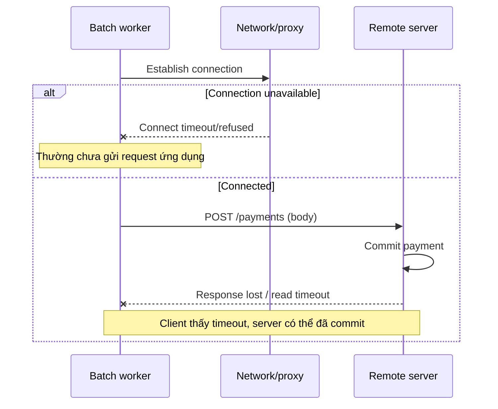
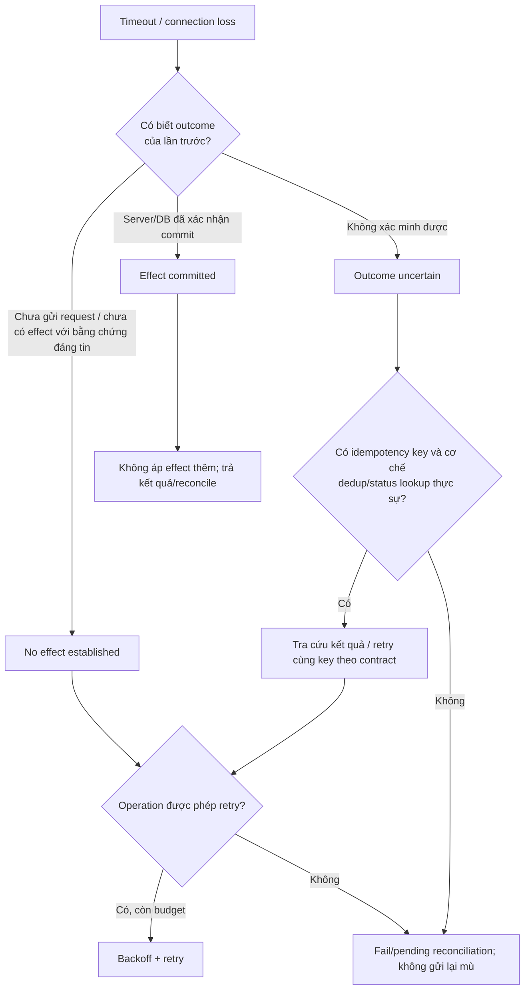
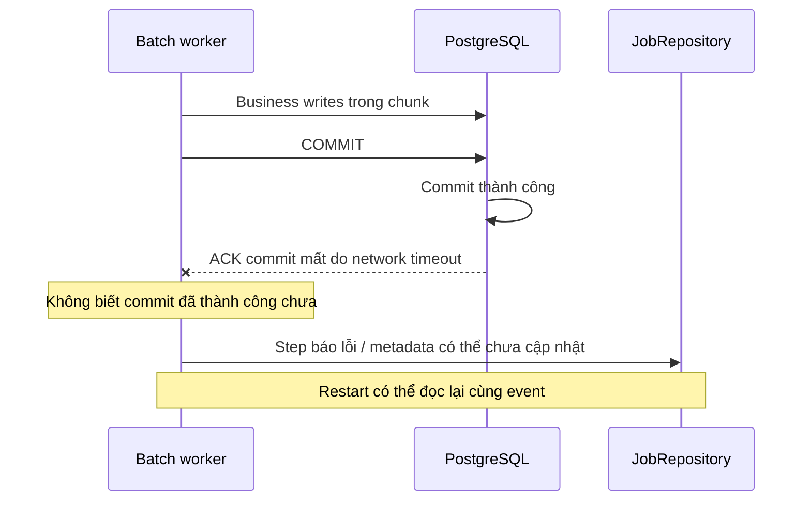
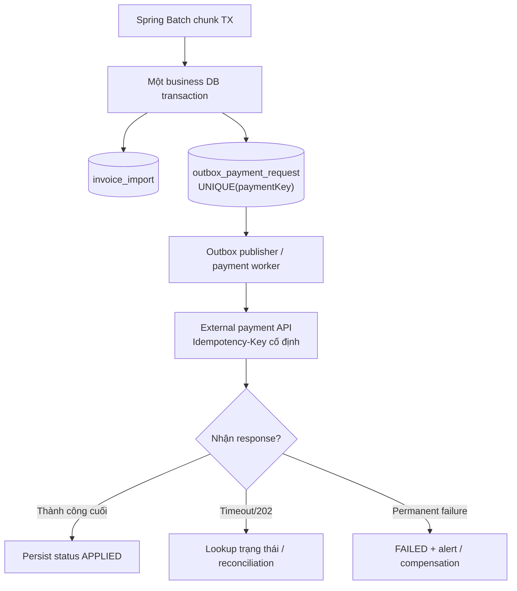
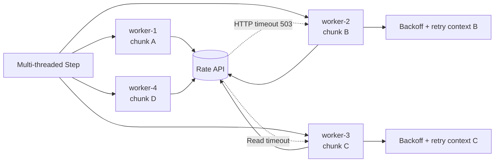
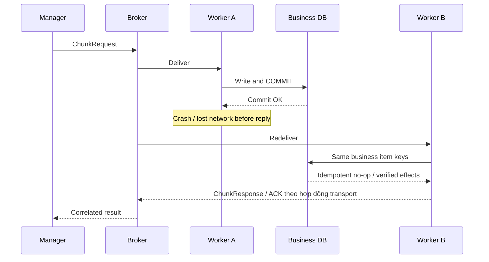

# Retry sau network timeout trong Spring Batch

> **Chương:** Retry  
> **Mục tiêu:** Phân biệt timeout kết nối, timeout khi gửi/nhận phản hồi và timeout quanh thời điểm commit; quyết định khi nào Spring Batch được retry, khi nào phải đối soát trạng thái; kết hợp `retryLimit`, backoff, timeout, idempotency, transaction và restart khi workload được xử lý bằng multi-threaded step, partitioning hoặc remote workers. Các ví dụ hướng đến **Spring Batch 5.2.x**, Java 17, Spring Retry 2.x và PostgreSQL.

## 1. Bài toán: Timeout không chứng minh thao tác đã thất bại

Một job xử lý 5 triệu hóa đơn. Trong pha `ItemProcessor`, job gọi dịch vụ tỷ giá qua HTTP; trong pha `ItemWriter`, worker ghi dữ liệu xuống database. Một số worker gặp `HttpTimeoutException`, `SocketTimeoutException` hoặc lỗi mất kết nối JDBC.

Lần gọi HTTP hết thời gian chờ. Client không nhận được response, nhưng điều gì đã xảy ra ở server?

- Yêu cầu có thể **chưa bao giờ tới** server.
- Yêu cầu đã tới, nhưng **server chưa xử lý xong**.
- Server đã **xử lý thành công**, chỉ có response bị mất.
- Server đã ghi một phần tác dụng bên ngoài transaction mà client không biết.
- Thao tác database có thể đã **commit thành công** nhưng kết nối đứt trước khi client nhận xác nhận.

Đó là sự khác biệt giữa **request outcome** và **client observation**. Lỗi timeout là một bằng chứng về **việc client không nhận kết quả đúng hạn**, không tự chứng minh kết quả nghiệp vụ là thất bại.

```text
Client nhìn thấy:    network timeout
Server thực tế:      chưa nhận / đang xử lý / đã thành công / đã rollback
Kết luận an toàn:    kết quả có thể chưa xác định
Hành động tiếp:     phân loại operation + xác minh side effect + quyết định retry
```

**Thông điệp chính:** **Không đặt `retry(SocketTimeoutException.class)` cho mọi thao tác một cách mù quáng.** Retry sau network timeout chỉ an toàn khi thao tác là **idempotent**, hoặc có idempotency key/transaction/reconciliation đủ để xử lý kết quả không chắc chắn.

## 2. Có nhiều loại timeout, không phải một lỗi duy nhất

| Loại timeout / mất kết nối | Xảy ra ở đâu? | Có thể kết luận gì? | Hướng xử lý |
| --- | --- | --- | --- |
| **Connect timeout** | Tạo kết nối TCP/TLS/qua proxy | Client không thiết lập kết nối đúng hạn; thường chưa gửi request ứng dụng qua kết nối đó | Có thể retry có hạn mức nếu nguồn/endpoint phù hợp |
| **Connection refused** | Không mở được TCP session | Endpoint không chấp nhận kết nối tại thời điểm đó | Retry có backoff nếu sự cố dự kiến tạm thời |
| **Write/send timeout** | Khi truyền headers/body | Không chắc server đã nhận một phần/toàn bộ request | Đánh giá idempotency trước retry |
| **Read/response timeout** | Chờ status/body từ server | Server **có thể đã xử lý xong** | Với lệnh có side effect: tra cứu/dedup trước khi resend |
| **Request deadline** | Tổng thời gian một lời gọi HTTP | Lời gọi vượt ngân sách thời gian cục bộ | Không có nghĩa server đã hủy công việc |
| **JDBC query timeout** | Chờ truy vấn | Có thể đã phát câu SQL; transaction còn hay đã fail tùy driver/DB | Đánh giá transaction state và rollback |
| **JDBC COMMIT timeout / connection lost** | Ngay khi commit | **Có thể không biết DB đã commit hay chưa** | Reconcile theo business key; không retry mù |
| **Broker ACK / reply timeout** | Worker/manager với middleware | Message/DB effect có thể đã hoàn tất dù reply chưa tới | At-least-once + idempotent worker và correlation |

### Connect timeout không giống response timeout



Các ranh giới này là **mô hình suy luận**, không phải cam kết rằng mọi proxy, load balancer, TLS handshake hoặc HTTP client phơi bày các lỗi với cùng exception class. Khi có retry tự động ở tầng client/proxy, số lần request thực đến server còn có thể lớn hơn số lần application gọi method.

## 3. Idempotent operation quyết định an toàn retry

Một thao tác **idempotent** cho cùng định danh và cùng ý nghĩa có thể được lặp lại mà không làm thay đổi kết quả cuối ngoài lần áp dụng hợp lệ đầu tiên.

| Thao tác | Có thể retry khi timeout? | Điều kiện quan trọng |
| --- | --- | --- |
| HTTP `GET` tra cứu tỷ giá bất biến tại một snapshot/date | Thường có thể | Endpoint read-only, version dữ liệu cố định, limit/backoff |
| HTTP `HEAD` kiểm tra metadata nguồn | Thường có thể | Không gây side effect nghiệp vụ |
| HTTP `PUT` đặt trạng thái tuyệt đối với resource ID | Có thể nếu API thực sự idempotent | Cùng payload, ETag/version, không đếm effect ở server |
| HTTP `DELETE` một resource | Thường idempotent về **intended effect** | Có thể trả 404 khi gọi lại; xử lý theo contract |
| HTTP `POST` tạo invoice với server-generated ID mỗi lần | **Không retry mù** | Cần idempotency key ổn định/server dedup |
| HTTP `POST` charge payment | **Không retry mù** | Provider hỗ trợ idempotency key, status lookup/reconciliation |
| SQL `INSERT` với ID tự sinh mỗi attempt | Có thể sinh row trùng | Unique business key hoặc ledger |
| SQL `UPDATE balance = balance + amount` | Không idempotent | Unique event ID + effect chung transaction |
| SQL `UPSERT` theo business ID/version | Có thể | So sánh payload/version, đảm bảo ordering |
| Gửi email/SMS | Có thể phát trùng | Delivery ID, outbox và provider semantics |

**Đừng suy chỉ từ HTTP method.** Một endpoint `GET` triển khai sai có thể vẫn có side effect. Ngược lại, một `POST` có idempotency key được server lưu bền vững có thể được retry có kiểm soát. **Hợp đồng thực tế của API** quan trọng hơn tên method.

### Idempotency key phải tồn tại xuyên mọi lần thử

Giả sử payment event có `tenantId=acme` và `paymentRequestId=PAY-00042`. Dùng:

```text
Idempotency-Key = acme:PAY-00042
```

Mọi attempt, retry, broker redelivery và job restart của **cùng một yêu cầu thanh toán** phải mang đúng key đó. **Không tạo UUID mới cho từng attempt**.

Server cần:

1. Xác định phạm vi unique của key theo tenant/operation.
2. Lưu trạng thái và fingerprint payload có cùng key.
3. Nếu key trùng, trả kết quả đã biết hoặc trạng thái đang xử lý.
4. Nếu key trùng **nhưng payload khác**, báo conflict có kiểm soát.
5. Giữ key đủ lâu so với retry/replay window thực tế.

Client chỉ gửi key **không tự bảo đảm** server thực thi dedup; phải xác minh contract và SLA giữ idempotency key của nhà cung cấp.

## 4. Ba trạng thái outcome cần phân biệt

Tại thời điểm một attempt gặp lỗi network, có thể chia kết quả thành ba nhóm:



Đặc biệt, **“không nhận phản hồi” không đồng nghĩa “chưa commit”**. Với một lệnh đọc thuần, không biết server đã xử lý hay chưa thường ít rủi ro side effect. Với chuyển tiền, gửi email hoặc ghi database, sự bất định có thể dẫn tới tổn thất nếu retry tạo tác dụng lần hai.

Khi không có status lookup/idempotency, trạng thái an toàn có thể là **`PENDING_RECONCILIATION` ở tầng workflow** và dừng job có kiểm soát. Không tự ý ép `BatchStatus.COMPLETED` hoặc mark item thành công chỉ vì client timeout.

## 5. Spring Batch retry hoạt động ở pha nào?

Trong một step hướng chunk:

```text
ItemReader.read() → ItemProcessor.process(item) → ItemWriter.write(Chunk)
                                  ↑                       ↑
                         read-only HTTP GET          DB/remote side effect
```

Một network timeout có thể xuất hiện ở:

- **Reader:** Đọc HTTP/page/file từ network; cursor/offset có thể bị mất.
- **Processor:** Enrich item bằng API đọc; thường dễ retry nếu không có side effect.
- **Writer:** Ghi API/DB; dễ gặp tình huống **effect đã commit nhưng response mất**.
- **Middleware:** Manager/worker trao đổi chunk request/reply; không phải cùng retry context với step.
- **Job control:** Remote job launch hoặc poll status; không nhất thiết thuộc retry policy của ItemProcessor/ItemWriter.

**Điều cần quyết định đầu tiên:** Ai sở hữu retry — HTTP client, Spring Batch step, broker hay job scheduler? Chồng nhiều retry policy lên nhau có thể làm số request tăng theo cấp số nhân.

### Trong chunk, lỗi writer có thể rollback toàn transaction

Nếu chunk `[A, B, C, D]` ghi vào DB và C gặp network timeout:

1. Writer có thể đã chạy câu SQL cho A và B.
2. Transaction của chunk có thể bị rollback nếu DB/driver xác nhận chưa commit.
3. Spring Batch quyết định retry/recovery theo policy.
4. A và B có thể được writer gọi lại, dù không phải item bị lỗi.
5. Nếu DB đã commit nhưng response bị mất hoặc metadata nằm ngoài transaction, restart có thể phát lại dữ liệu đã ghi.

Vì vậy `retryLimit(3)` không có nghĩa cả chunk có tối đa ba lời gọi `write()`, và `rollbackCount` không phải số attempts chính xác.

## 6. Exception class không đủ để quyết định retry

Java 17 có những exception liên quan network như:

- `java.net.http.HttpTimeoutException` và `HttpConnectTimeoutException` của `HttpClient`.
- `java.net.ConnectException` khi kết nối không thiết lập được.
- `java.net.SocketTimeoutException` ở nhiều HTTP/JDBC clients khác.
- `java.net.SocketException` cho các sự cố socket.
- `java.net.UnknownHostException` khi không phân giải tên.
- `javax.net.ssl.SSLHandshakeException` do lỗi TLS/certificate.
- `java.io.IOException` bao quát nhiều lỗi rất khác nhau.
- `InterruptedException` khi task bị yêu cầu ngắt.

**Không retry mọi `IOException`** nếu ở đường xử lý có payment, request không idempotent, lỗi xác thực TLS hoặc bug serialization. Một `SocketTimeoutException` ở pha **đọc phản hồi** có mức rủi ro khác timeout **trước khi gửi request**.

### Dùng domain exception tại ranh giới HTTP

Một chiến lược rõ ràng là tạo các loại exception thể hiện **ngữ nghĩa hoạt động**:

| Domain exception | Ý nghĩa | Chính sách |
| --- | --- | --- |
| `RetryableReadTimeoutException` | Timeout của thao tác GET/read-only đã được xác minh an toàn lặp | Retry hữu hạn |
| `RetryableServiceUnavailableException` | GET 503/429 hoặc API trả tín hiệu tạm thời theo contract | Retry + backoff, có deadline |
| `PermanentRemoteDataException` | 400/422/schema sai, dữ liệu không thể dùng | Fail/quarantine; không retry |
| `OutcomeUnknownException` | Side effect có thể đã commit nhưng mất response | Reconcile/idempotency; không retry như lỗi đọc |
| `DownstreamConfigurationException` | DNS/TLS/auth sai cấu hình dài hạn | Fail nhanh, cảnh báo hạ tầng |

Không giả định đây là những class Spring Batch có sẵn; **đó là exception do ứng dụng tự định nghĩa**. Mapper phải xét cả HTTP method, endpoint, idempotency contract và tình huống runtime.

### Không coi 404 luôn là lỗi non-retryable

Nếu một file/object vừa được publish trên hạ tầng có eventual consistency, 404 tạm thời có thể xảy ra theo contract cụ thể. Nhưng 404 của `GET /invoice/{id}` với nguồn chuẩn thường là dữ liệu không tồn tại. Chính sách phải theo nguồn và nghiệp vụ, không áp một bảng HTTP status duy nhất cho mọi hệ thống.

## 7. Ví dụ Java 17: HTTP GET có timeout và domain exception

Ví dụ an toàn hơn để bắt đầu là **tra cứu tỷ giá theo snapshot bất biến**, vì thao tác chỉ đọc. API demo trả về body một số decimal, ví dụ `1.2345`, không phải JSON.

```java
package com.example.batch.networkretry;

import java.io.IOException;
import java.math.BigDecimal;
import java.net.URI;
import java.net.SocketException;
import java.net.http.HttpClient;
import java.net.http.HttpRequest;
import java.net.http.HttpResponse;
import java.net.http.HttpTimeoutException;
import java.time.Duration;

import org.springframework.batch.item.ItemProcessor;
import org.springframework.context.annotation.Bean;
import org.springframework.context.annotation.Configuration;

@Configuration(proxyBeanMethods = false)
public class RateLookupConfig {

    public record Invoice(
            String eventId,
            String currency,
            BigDecimal amount,
            String rateSnapshotId) {}

    public record EnrichedInvoice(
            String eventId,
            BigDecimal originalAmount,
            BigDecimal rate,
            String rateSnapshotId) {}

    public static class RetryableRateLookupException
            extends RuntimeException {
        public RetryableRateLookupException(
                String message, Throwable cause) {
            super(message, cause);
        }
        public RetryableRateLookupException(String message) {
            super(message);
        }
    }

    public static class PermanentRateLookupException
            extends RuntimeException {
        public PermanentRateLookupException(
                String message, Throwable cause) {
            super(message, cause);
        }
        public PermanentRateLookupException(String message) {
            super(message);
        }
    }

    @Bean
    HttpClient rateHttpClient() {
        return HttpClient.newBuilder()
                .connectTimeout(Duration.ofSeconds(2))
                .build();
    }

    @Bean
    ItemProcessor<Invoice, EnrichedInvoice> rateProcessor(
            HttpClient rateHttpClient) {

        return invoice -> {
            // API demo: path version hóa và đã URL-safe.
            // Production cần encode/validate mọi path component.
            URI uri = URI.create(
                    "https://rates.example.invalid/v1/snapshots/"
                    + invoice.rateSnapshotId()
                    + "/currencies/" + invoice.currency());

            HttpRequest request = HttpRequest.newBuilder(uri)
                    .timeout(Duration.ofSeconds(3))
                    .GET()
                    .build();

            HttpResponse<String> response;
            try {
                response = rateHttpClient.send(
                        request, HttpResponse.BodyHandlers.ofString());
            } catch (HttpTimeoutException | SocketException ex) {
                // CHỈ vì endpoint này là read-only + immutable snapshot.
                throw new RetryableRateLookupException(
                        "Temporary timeout during rate GET", ex);
            } catch (InterruptedException ex) {
                Thread.currentThread().interrupt();
                throw new PermanentRateLookupException(
                        "Worker interrupted; stop processing", ex);
            } catch (IOException ex) {
                // DNS/TLS và nhiều loại IOException cần điều tra.
                // Không retry rộng chỉ vì cùng superclass IOException.
                throw new PermanentRateLookupException(
                        "Unexpected I/O failure during rate GET", ex);
            }

            int status = response.statusCode();
            if (status == 429 || status == 502
                    || status == 503 || status == 504) {
                throw new RetryableRateLookupException(
                        "Rate service temporary response: " + status);
            }
            if (status != 200) {
                throw new PermanentRateLookupException(
                        "Rate service rejected/changed contract: " + status,
                        null);
            }

            try {
                BigDecimal rate = new BigDecimal(response.body().trim());
                return new EnrichedInvoice(
                        invoice.eventId(), invoice.amount(),
                        rate, invoice.rateSnapshotId());
            } catch (NumberFormatException ex) {
                throw new PermanentRateLookupException(
                        "Unexpected numeric response format", ex);
            }
        };
    }
}
```

**Giới hạn của ví dụ:**

1. `rates.example.invalid` là **địa chỉ placeholder không truy cập được**. Cần thay bằng API thật và hợp đồng response được xác minh.
2. Snapshot ID/currency cần validate và URL-encode đúng; không ghép chuỗi URL từ input tùy ý ở production.
3. `HttpClient.connectTimeout` quản lý thời gian thiết lập kết nối; `HttpRequest.timeout` đặt giới hạn cho lời gọi request của client. Hai timeout **không thay thế** deadline tổng retry của step.
4. Endpoint được giả định **read-only và version bất biến**. Nếu tỷ giá có thể thay đổi giữa attempts, retry có thể tạo kết quả không tái lập dù không ghi trùng.
5. HTTP 429 có thể kèm `Retry-After`. Chính sách backoff cố định trong step **không tự đọc và tôn trọng header**; phải xây policy/orchestrator phù hợp với server contract.
6. `InterruptedException` phải được xử lý bằng cách khôi phục cờ interrupt; **không retry** vô hạn một worker đang bị yêu cầu stop.
7. Mọi lỗi `IOException` còn lại không được tự cho phép retry. Ứng dụng thực tế có thể đưa thêm nhóm lỗi mạng đã được kiểm chứng vào whitelist.
8. Không đặt logic gửi payment ở processor này rồi giữ nguyên classifier GET; POST có side effect cần hợp đồng khác.
9. `EnrichedInvoice` giữ `eventId` ổn định để writer về sau dùng business key chống trùng.

## 8. Cấu hình Spring Batch 5.2: Retry read-only timeout có giới hạn

Mẫu `StepBuilder` dùng processor ở phần trước và writer JDBC. Chỉ retry **domain exception có ngữ nghĩa an toàn** thay vì toàn bộ `SocketTimeoutException` ở mọi pha.

```java
package com.example.batch.networkretry;

import org.springframework.batch.core.Step;
import org.springframework.batch.core.repository.JobRepository;
import org.springframework.batch.core.step.builder.StepBuilder;
import org.springframework.batch.item.ItemProcessor;
import org.springframework.batch.item.ItemReader;
import org.springframework.batch.item.ItemWriter;
import org.springframework.beans.factory.annotation.Qualifier;
import org.springframework.context.annotation.Bean;
import org.springframework.context.annotation.Configuration;
import org.springframework.retry.backoff.ExponentialRandomBackOffPolicy;
import org.springframework.transaction.PlatformTransactionManager;

import com.example.batch.networkretry.RateLookupConfig.Invoice;
import com.example.batch.networkretry.RateLookupConfig.EnrichedInvoice;
import com.example.batch.networkretry.RateLookupConfig.RetryableRateLookupException;

@Configuration(proxyBeanMethods = false)
public class RateEnrichmentStepConfig {

    @Bean
    Step rateEnrichmentStep(
            JobRepository repository,
            PlatformTransactionManager transactionManager,
            @Qualifier("invoiceReader") ItemReader<Invoice> reader,
            @Qualifier("rateProcessor")
                    ItemProcessor<Invoice, EnrichedInvoice> processor,
            @Qualifier("invoiceWriter")
                    ItemWriter<EnrichedInvoice> writer) {

        ExponentialRandomBackOffPolicy backoff =
                new ExponentialRandomBackOffPolicy();
        backoff.setInitialInterval(200L);
        backoff.setMultiplier(2.0);
        backoff.setMaxInterval(2_000L);

        return new StepBuilder("rateEnrichmentStep", repository)
                .<Invoice, EnrichedInvoice>chunk(100, transactionManager)
                .reader(reader)
                .processor(processor)
                .writer(writer)
                .faultTolerant()
                .retry(RetryableRateLookupException.class)
                .retryLimit(3)
                .backOffPolicy(backoff)
                .build();
    }
}
```

Diễn giải:

- `retry(RetryableRateLookupException.class)` chỉ kích hoạt với lỗi đã được mapper xác định là an toàn retry.
- `retryLimit(3)` nghĩa là **tối đa ba attempts cho một retry context/item, gồm lần đầu**; không phải ba lần retry bổ sung.
- `backOffPolicy(backoff)` tạo độ trễ với jitter giúp giảm request đồng thời từ các workers.
- Khi lỗi processor không thuộc nhóm retry, step sẽ đi theo cơ chế failure mặc định nếu không có skip thích hợp.
- `chunk(100, transactionManager)` quản lý giao dịch chunk; không có giao dịch HTTP thống nhất với DB. Lời gọi GET có thể xảy ra khi chunk transaction đang hoạt động và giữ worker thread chờ.
- `writer` cần idempotent vì chunk có thể rollback/retry và job có thể restart.

**Chú ý cấu hình nâng cao:** Theo Javadoc `FaultTolerantStepBuilder` 5.2, nếu cung cấp `retryPolicy(customPolicy)` tường minh, `retryLimit(...)` và `backOffPolicy(...)` ở builder có thể **bị bỏ qua**. Không ghép chúng rồi cho rằng mọi lựa chọn tự được kết hợp.

### Một writer DB có business key

```java
@Bean
ItemWriter<RateLookupConfig.EnrichedInvoice> invoiceWriter(
        JdbcTemplate jdbc) {

    return chunk -> {
        for (RateLookupConfig.EnrichedInvoice item : chunk) {
            int inserted = jdbc.update("""
                INSERT INTO imported_invoice_rate (
                    source_event_id, original_amount,
                    applied_rate, rate_snapshot_id
                ) VALUES (?, ?, ?, ?)
                ON CONFLICT (source_event_id) DO NOTHING
                """,
                item.eventId(), item.originalAmount(),
                item.rate(), item.rateSnapshotId());

            if (inserted == 0) {
                // Production: xác minh lại stored payload/hash/version
                // để không che sự khác nhau giữa hai lần replay.
            }
        }
    };
}
```

Bảng tương ứng (PostgreSQL):

```sql
CREATE TABLE imported_invoice_rate (
    source_event_id VARCHAR(128) PRIMARY KEY,
    original_amount NUMERIC(18, 2) NOT NULL,
    applied_rate NUMERIC(20, 8) NOT NULL,
    rate_snapshot_id VARCHAR(128) NOT NULL
);
```

Mẫu `ON CONFLICT DO NOTHING` chỉ chống **insert trùng event ID**, không chứng minh output tương đương. Với nghiệp vụ tài chính, phải kiểm tra fingerprint/version, hoặc dùng ledger và báo lỗi conflict khi cùng ID nhưng payload khác. Mã là ví dụ tích hợp cần hoàn thiện nguồn reader/job, test DB và validation; không phải ứng dụng có thể chạy nguyên trạng.

## 9. Vì sao retryLimit không phải giới hạn tất cả network requests?

Một retry policy của Spring Batch chỉ áp dụng cho **retry context của step ở vị trí được cấu hình**. Có thể tồn tại những tầng retry khác:

```text
Client SDK HTTP retry tối đa 2 attempts
    × Spring Batch retryLimit(3)
    × Broker redelivery tối đa 4 lượt
    × Job restart nếu FAILED
```

Trong một đường lỗi kéo dài, một operation có thể được gọi **nhiều hơn** `3` lần, thậm chí nhiều hơn `2×3×4` tùy số item/chunk, skip scan và restart. `retryLimit(3)` không phải quota toàn job, toàn cluster hay hạn mức bền vững qua các lần restart.

Hãy xác định **tầng sở hữu retry**:

| Tầng | Có thể điều khiển | Không tự điều khiển |
| --- | --- | --- |
| Java HttpClient / HTTP client SDK | Socket/request timeout, SDK retry nếu có | Spring Batch checkpoint |
| Spring Batch `FaultTolerantStepBuilder` | Retry theo item/exception trong step | Broker delivery và Job restart |
| JMS/AMQP broker | Consumer redelivery/TTL/DLQ theo broker | Business idempotency |
| Scheduler/JobOperator | Restart/khởi chạy execution | Atomic commit của hệ thống ngoài DB |
| Remote API | Server idempotency key và status lookup | Retry budget của client |

**Kế hoạch vận hành tốt** cần giới hạn tổng số attempt, độ dài hàng đợi, worker concurrency và thời gian job, thay vì chỉ chỉnh một tham số.

## 10. Network timeout trong ItemReader: Cẩn thận mất dòng và cursor

Lỗi HTTP read có thể xảy ra trong `ItemReader.read()`. Khác processor, reader phải bảo toàn vị trí nguồn khi đọc thất bại.

Phản ví dụ:

```java
// PHẢN VÍ DỤ: item đã bị consume trước khi request lỗi.
Invoice item = delegate.read();       // đã advance nguồn
validateOrFetchRemoteData(item);       // network timeout
return item;
```

Nếu retry `read()` lập tức, lần kế tiếp có thể lấy **item kế tiếp** và bỏ mất item vừa consume. Điều này đặc biệt nguy hiểm với file stream, cursor, paging không có stable sort hoặc nguồn remote có offset.

Các điều kiện cần:

1. Nguồn dữ liệu hoặc snapshot phải đủ bất biến để restart.
2. Reader phải có `ItemStream` checkpoint hoặc cơ chế replay/seek đúng vị trí.
3. Nếu đọc page từ API, dùng stable sort/continuation token và xác minh token bền vững; page mới có thể thay đổi khi nguồn cập nhật.
4. Nếu reader ném exception sau khi đã advance, phải thiết kế buffering hoặc rollback position chứ không trông chờ retry tự sửa.
5. Cùng reader trong multi-threaded step phải thread-safe; network retry không giải quyết race của cursor.
6. Mất kết nối ở JDBC cursor có thể yêu cầu mở lại reader/transaction, không chỉ gọi lại `read()` trên handle hỏng.

**Không bắt timeout rồi trả `null` từ `ItemReader`.** Trong Spring Batch, `null` nghĩa là đã hết input; việc đó có thể khiến step hoàn thành sớm mà thiếu dữ liệu.

## 11. Timeout trong ItemProcessor: Read-only và thay đổi dữ liệu nguồn

Processor gọi HTTP GET thường dễ retry hơn writer gọi POST, nhưng vẫn có một vấn đề: **tính tái lập của kết quả**.

Giả sử hệ thống tra tỷ giá:

```text
Attempt #1: GET /rate/USD → server lấy rate 1.1000
Response timeout
Attempt #2: GET /rate/USD → rate mới 1.1200
Step hoàn thành với rate 1.1200
```

Không có duplicate effect tại HTTP server, nhưng kết quả batch phụ thuộc thời điểm retry. Nếu job restart sau vài giờ, cùng invoice có thể nhận rate khác.

Giải pháp:

- Dùng endpoint **có snapshot/date/version** thay vì “latest rate”.
- Ghi `rateSnapshotId` vào `JobParameters`/`ExecutionContext` hoặc manifest bất biến.
- Cache kết quả một cách có kiểm soát theo business key/snapshot.
- Kiểm tra tính hợp lệ của response trước khi ghi.
- Nếu snapshot không tồn tại, fail/quarantine thay vì tự động chuyển sang dữ liệu mới hơn.

Với HTTP GET trả dữ liệu nhất quán theo snapshot, timeout có thể được retry bằng `RetryableRateLookupException`. Với GET không có snapshot nhưng business yêu cầu exact reproducibility, cần thay kiến trúc nguồn trước khi scale workers.

## 12. Timeout trong ItemWriter: Khi nào phải đối soát thay vì retry?

Writer thường là nơi có **side effect** lớn nhất: insert DB, cập nhật số dư, gọi API tạo đơn hàng, phát event.

### Trường hợp A — JDBC update thất bại và transaction chắc chắn rollback

Nếu driver/transaction manager xác nhận chunk transaction đã rollback, một lần retry trên **transaction mới hợp lệ** có thể được cân nhắc khi lỗi tạm thời và writer idempotent. Không tiếp tục chạy SQL trên transaction PostgreSQL đã aborted.

### Trường hợp B — Mất phản hồi ngay sau DB COMMIT



Đây là ví dụ **hai hệ thống/ranh giới commit có thể khác nhau**, không phải một chuỗi transaction duy nhất của mọi JobRepository và DB configuration. Khi business DB và JobRepository cùng resource, failure semantics khác; vẫn phải kiểm tra bằng integration test.

Với outcome uncertain, lần retry nên **tra cứu business event ID/unique key** và xử lý idempotent:

- Nếu effect đã commit với cùng payload: coi việc ghi là đã áp dụng, không thực hiện lần hai.
- Nếu chưa có effect: thực hiện lại theo business contract.
- Nếu key đã tồn tại nhưng payload khác: báo conflict, không tự chèn hay ghi đè.
- Nếu không thể tra cứu nhất quán: dừng/đưa trạng thái reconcile, không tự suy đoán.

### Trường hợp C — HTTP POST có side effect

Một request `POST /payments` có thể đã trừ tiền ở server. Nếu client timeout trước response, **retry POST bằng request ID mới có thể thu tiền hai lần**.

Cần idempotency key bền vững và status lookup hoặc giao thức retry cùng key đã được provider chứng minh. Nếu provider không hỗ trợ, workflow phải lưu trạng thái chưa rõ và đối soát thủ công/qua API riêng.

### Không nên bọc mỗi write bằng REQUIRES_NEW

`@Transactional(propagation = REQUIRES_NEW)` trên từng lệnh ghi có thể commit business data trước khi chunk transaction/reader checkpoint commit. Sau crash, Batch phát lại item và tạo side effect lặp. Chỉ dùng transaction độc lập với hợp đồng rõ; không dùng nó như “thuốc chữa” network timeout.

## 13. Mẫu xử lý POST có idempotency key: Không retry mù

Ví dụ Java 17 minh họa **một request có side effect**, khác hẳn read-only GET ở phần 7.

```java
package com.example.batch.networkretry;

import java.io.IOException;
import java.net.URI;
import java.net.http.HttpClient;
import java.net.http.HttpRequest;
import java.net.http.HttpResponse;
import java.net.http.HttpTimeoutException;
import java.time.Duration;

// Chỉ là ví dụ boundary của HTTP client; không phải ItemWriter hoàn chỉnh.
public final class PaymentApiClient {

    public static class PaymentOutcomeUnknownException
            extends RuntimeException {
        public PaymentOutcomeUnknownException(
                String paymentKey, Throwable cause) {
            super("Payment outcome unknown; reconcile key=" + paymentKey,
                    cause);
        }
    }

    private final HttpClient client;

    public PaymentApiClient(HttpClient client) {
        this.client = client;
    }

    public String submitOnce(
            String stablePaymentKey,
            String canonicalJsonBody) {

        HttpRequest request = HttpRequest.newBuilder(
                        URI.create("https://payments.example.invalid/v1/payments"))
                .timeout(Duration.ofSeconds(5))
                .header("Content-Type", "application/json")
                .header("Idempotency-Key", stablePaymentKey)
                .POST(HttpRequest.BodyPublishers.ofString(
                        canonicalJsonBody))
                .build();

        try {
            HttpResponse<String> response = client.send(
                    request, HttpResponse.BodyHandlers.ofString());

            // Tùy API: 200/201/202 có hợp đồng khác nhau.
            if (response.statusCode() == 200
                    || response.statusCode() == 201) {
                return response.body();
            }
            if (response.statusCode() == 202) {
                // Đã chấp nhận nhưng chưa chắc xử lý xong.
                throw new PaymentOutcomeUnknownException(
                        stablePaymentKey, null);
            }
            // 409 hay 5xx cũng phải xét API contract trước khi resend.
            throw new IllegalStateException(
                    "Payment response requires explicit handling: "
                    + response.statusCode());
        } catch (HttpTimeoutException ex) {
            // Không tự gửi POST lần nữa trong catch này.
            throw new PaymentOutcomeUnknownException(
                    stablePaymentKey, ex);
        } catch (IOException ex) {
            // Có thể đã gửi request; fail về trạng thái chưa rõ.
            throw new PaymentOutcomeUnknownException(
                    stablePaymentKey, ex);
        } catch (InterruptedException ex) {
            Thread.currentThread().interrupt();
            throw new PaymentOutcomeUnknownException(
                    stablePaymentKey, ex);
        }
    }
}
```

**Đây là đoạn code mô tả ranh giới rủi ro, chưa phải production payment client:**

1. `payments.example.invalid` chỉ là placeholder; API thật phải có hợp đồng idempotency được kiểm chứng.
2. Không log nguyên payment key nếu nó chứa PII/secret; ví dụ đưa key vào exception để dễ giảng giải, production nên log hash/correlation có phân quyền.
3. Trạng thái 202 `Accepted` **không phải thành công cuối cùng**; phải theo dõi async job/payment status.
4. Với `409`/`5xx`, không mặc định kết quả thất bại; tham khảo hợp đồng của provider để biết có nên lookup/retry cùng key.
5. Catch `IOException` ở đây **không retry**, vì ngay cả socket reset cũng có thể xảy ra sau khi server commit.
6. Khi timeout, cần **tra cứu trạng thái qua key** (ví dụ GET status endpoint được provider hỗ trợ), hoặc đưa request vào durable reconciliation workflow.
7. Idempotency key phải được lưu lâu dài và tái sử dụng khi JobExecution thay đổi.
8. Provider phải dedup theo key **và** payload; nếu cùng key nhưng payload khác, không chấp nhận kết quả như thể retry tương đương.
9. Không đặt `.retry(PaymentOutcomeUnknownException.class)` trong Batch Step trừ khi đã có một chính sách reconciliation/idempotent replay hợp lệ.
10. Side effect thanh toán không nên nằm trực tiếp trong chunk writer nếu có thể thiết kế outbox + worker chuyên trách.

## 14. Transactional outbox: Tránh mất hoặc lặp side effect giữa DB và HTTP

Nếu business transaction cần vừa lưu invoice vừa kích hoạt payment hoặc notification, DB transaction **không bao trùm** HTTP server. Mẫu *transactional outbox* giúp ghi bền vững ý định gửi yêu cầu:



- Invoice data và outbox event được commit **cùng DB transaction**.
- Publisher đọc outbox sau commit, gọi API với **stable idempotency key**.
- Nếu publisher crash sau khi API xử lý nhưng trước khi đánh dấu outbox done, publisher có thể gửi lại **cùng key**; provider phải thực sự dedup.
- Khi API không cung cấp idempotency, cần trạng thái `PENDING_RECONCILIATION` và cơ chế đối soát/compensation; outbox một mình không tạo exactly-once ở server ngoài.
- Không chuyển `ChunkResponse` của remote chunking thành outbox tùy ý nếu chưa đảm bảo correlation và tổng hợp step contributions của Spring Batch Integration.

Outbox giúp tách lỗi mạng dài hạn khỏi chunk transaction đang giữ lock/connection. Nó là **một lựa chọn kiến trúc**, không phải tính năng tự bật bằng `.faultTolerant()`.

## 15. Backoff, timeout và deadline: Thiết kế cùng một ngân sách

Retry không chỉ quyết định **bao nhiêu attempts**, mà còn tổng thời gian worker chiếm tài nguyên.

Giả sử:

- Mỗi HTTP request có timeout 3 giây.
- `retryLimit(3)`: tối đa ba attempts tính cả lần đầu.
- Exponential backoff có các delay **dự kiến** 200 ms, 400 ms (không jitter).
- Xử lý/rollback/chunk overhead khoảng 300 ms tổng.

Nếu cả ba attempts đều timeout:

```text
Request timeouts = 3 × 3.000 ms = 9.000 ms
Backoff          = 200 + 400 ms =   600 ms
Overhead         =                 300 ms (giả định)
--------------------------------------------------
Tổng ước lượng   =               9.900 ms
```

**Đó chưa phải giới hạn cứng**: scheduling, connection acquisition, queue wait, reader reprocessing và server behavior có thể làm wall-clock khác giả định.

### Bảng các giới hạn khác nhau

| Thông số | Kiểm soát | Không kiểm soát |
| --- | --- | --- |
| Connect timeout | Thời gian thiết lập kết nối | Server processing sau khi kết nối |
| Request/read timeout | Thời gian chờ request/response theo HTTP client | Số attempts trên toàn job |
| `retryLimit` | Attempts cho retry context/item của Step | Tổng attempts qua client/broker/restart |
| `backOffPolicy` | Delay trước retry ở Step | Timeout một request đang treo |
| Chunk transaction timeout | Thời lượng transaction theo transaction manager | Response/commit ở remote API khác |
| Overall deadline | Thời gian nghiệp vụ cho toàn operation | Tự ngăn side effect nếu không có cancellation/idempotency |
| Broker redelivery delay | Thời gian giao lại message | Retry trong Batch processor |

Một yêu cầu SLA 5 giây sẽ **không phù hợp** với cấu hình có thể mất gần 10 giây chỉ riêng HTTP và backoff. Cần giảm attempts/timeout hoặc chuyển sang durable async/reconciliation thay vì giữ worker chờ lâu.

### Backoff với jitter

`ExponentialRandomBackOffPolicy` (Spring Retry 2.x) phân tán delay giữa worker. Với nhiều partition cùng gặp 503, jitter giảm *thundering herd*. Nhưng jitter không phải deadline và không tự đọc `Retry-After`; muốn tuân thủ rate-limit chính xác phải tích hợp policy theo server hint.

### Tránh giữ transaction DB quá lâu

Nếu `ItemProcessor` gọi API có timeout 30 giây **bên trong chunk transaction**, worker có thể giữ connection/transaction lâu hơn dự kiến tùy wiring. Với workload dữ liệu lớn, cân nhắc prefetch/enrich theo batch, snapshot nguồn, hoặc tách luồng để giảm thời gian transaction không cần thiết.

## 16. Retry sau timeout khi multi-threaded step

Khi `TaskExecutor` chạy nhiều chunk song song:



- Một chunk retry không đồng nghĩa các chunk khác bị rollback.
- Nếu cả 20 workers cùng timeout lúc API down, tổng retry request có thể khiến API vừa hồi phục **bị quá tải lần hai**.
- `RetryContextCache` trong worker JVM không phải bộ đếm attempts bền vững qua restart.
- `HttpClient` của Java có thể dùng chung để tận dụng pooling nếu cấu hình an toàn, còn state của từng request/idempotency key phải giữ độc lập.
- Reader dùng chung phải thread-safe, tránh race khi checkpoint; network retry không sửa được lỗi reader.
- Worker thread có thể bị chiếm trong lúc backoff hoặc chờ HTTP, làm giảm throughput hữu ích.
- Hạn chế concurrency trước khi tăng timeout/retry budget; đo DB pool, executor queue và downstream p95 latency.

### Vì sao tăng số workers chưa chắc cải thiện?

Nếu API giới hạn 50 requests/giây, tăng từ 10 lên 100 worker có thể tăng rate-limit/timeouts. Mỗi worker lại retry, tạo thêm traffic. Cách sửa thường là **rate limiting toàn cluster**, queue/backpressure, fixed snapshot/cache và circuit breaker, không chỉ mở rộng thread pool.

## 17. Partitioning và retry: Tách lỗi của worker và trạng thái job

Với partitioning, mỗi partition có `StepExecution` riêng. Khi partition 3 gặp timeout:

- Partition 3 retry theo policy của worker step.
- Partition 1/2/4 có thể đã commit và hoàn thành.
- Manager cần tổng hợp trạng thái; một partition fail có thể làm step/job fail theo flow đã cấu hình.
- Restart theo tên partition và `ExecutionContext` ổn định; output phải idempotent nếu partition được xử lý lại.
- Nếu timeout xảy ra sau business commit nhưng metadata partition chưa cập nhật, có thể cần reconciliation trước replay.

**Không dùng `stepExecutionId` làm idempotency key cho từng event**: execution mới sau restart có thể thay ID. Dùng `sourceSystem + sourceEventId + businessVersion` phù hợp hợp đồng.

### Remote partitioning

Manager có thể timeout khi chờ kết quả worker cũ. Nếu manager giao lại partition trong khi worker cũ **vẫn đang chạy**, có thể có hai worker cạnh tranh cùng dữ liệu, metadata và side effect. Phải có ownership/lease/fencing hoặc dispatcher contract phù hợp, cùng writer idempotent.

Một lỗi `OptimisticLockingFailureException` ở JobRepository không tự được giải quyết bằng retry HTTP hay tăng retryLimit. Nó có thể báo cập nhật cùng `StepExecution` từ hai tiến trình; cần tìm nguyên nhân điều phối.

## 18. Remote chunking: Network timeout không phải bằng chứng chunk chưa ghi

Manager gửi `ChunkRequest` qua broker. Worker nhận request, xử lý và ghi database, rồi phát `ChunkResponse`/ACK theo transport.



Ba loại “thử lại” khác nhau:

1. **Item retry:** Spring Batch/Spring Retry trong luồng xử lý worker/step khi được cấu hình.
2. **Broker redelivery:** Middleware giao lại message chưa được xác nhận theo ACK/transaction policy.
3. **Job restart:** `JobRepository` tạo một lượt `JobExecution` mới cho JobInstance còn có thể restart.

`retryLimit(3)` trong một worker **không tự giới hạn** số lần broker redelivery hay Job restart. Cần giới hạn từng tầng và giám sát tổng tải.

### Đừng ACK sớm

Nếu broker request được ACK trước khi business write commit/reply được bảo đảm, worker chết có thể khiến request **không được giao lại**, làm mất chunk. Nhưng ACK muộn sau DB commit lại có thể gây duplicate khi worker chết. Đây là lý do thiết kế phổ biến là **at-least-once delivery + idempotent effect**, thay vì giả định messaging và database tự commit nguyên tử.

### DLQ không tự làm job thành công

Poison chunk chứa lỗi vĩnh viễn nên có max delivery attempts và DLQ/quarantine. Tuy nhiên khi request sang DLQ, manager vẫn cần tín hiệu thất bại/recovery; không im lặng coi chunk đã xử lý xong. Phải kiểm tra reply correlation, transaction và trạng thái StepExecution theo phiên bản Spring Batch Integration đang dùng.

## 19. Database commit outcome uncertain: Kịch bản nghiêm trọng nhất

Một transaction có thể đi qua các mốc:

```text
t0  BEGIN
t1  INSERT/UPDATE nghiệp vụ
t2  COMMIT được gửi từ client
t3  Database có thể commit
t4  Connection mất trước khi client nhận acknowledgement
t5  Batch ghi nhận lỗi, nhưng outcome tại DB có thể đã là COMMITTED
```

Khi đó **retry SQL ở transaction mới không đủ** vì một lần commit đã có thể xảy ra.

### Thiết kế database bảo vệ replay

```sql
CREATE TABLE applied_payment_event (
    source_system VARCHAR(64) NOT NULL,
    event_id VARCHAR(128) NOT NULL,
    payload_sha256 CHAR(64) NOT NULL,
    committed_at TIMESTAMPTZ NOT NULL DEFAULT CURRENT_TIMESTAMP,
    PRIMARY KEY (source_system, event_id)
);
```

Transaction nghiệp vụ cần gắn **marker/event unique key** với effect bằng cùng transaction:

```text
BEGIN;
  INSERT applied_payment_event(key, hash)
    ON CONFLICT DO NOTHING

  IF key newly inserted:
      perform business write trong CÙNG transaction
  ELSE:
      compare stored hash
      nếu cùng hash → no-op / return previous outcome
      nếu khác hash → FAIL conflict
COMMIT;
```

Đây là **pseudocode**, không phải cú pháp PL/pgSQL runnable. Cần xử lý unique-key race, transaction isolation và hash tương đương; nếu marker commit riêng trước business effect thì replay có thể bỏ sót effect.

Nếu phải ghi sang nhiều database/API, cần outbox, saga hoặc endpoint idempotency. Một unique key trong một database không làm atomic commit với hệ thống khác.

## 20. Phân loại network timeout theo rủi ro side effect

| Tín hiệu lỗi | Read-only GET/snapshot | DB business write | HTTP POST payment |
| --- | --- | --- | --- |
| Connect timeout trước request theo bằng chứng client | Retry có hạn mức | Chỉ retry sau khi xác minh transaction/resource | Có thể retry cùng key theo provider contract |
| Read timeout sau khi gửi | Retry GET nếu dữ liệu nhất quán | Outcome có thể chưa rõ | **Outcome uncertain**, tra cứu/dedup |
| HTTP 429 | Retry sau `Retry-After`/quota | Tùy service nghiệp vụ | Chỉ khi idempotent và provider cho phép |
| HTTP 503/504 | Retry GET nếu read-only | Không mặc định chứng minh rollback | Kiểm tra key/status trước resend |
| HTTP 400/422 | Thường non-retryable | Sửa payload/schema | Thường non-retryable |
| TLS certificate/hostname lỗi | Fail cấu hình | Fail cấu hình | Fail cấu hình |
| DNS lỗi kéo dài | Điều tra hạ tầng, tránh storm | Điều tra hạ tầng | Không retry POST mù |
| Thread interrupted / job STOP | Dừng có kiểm soát | Transaction rollback nếu phù hợp | Reconcile in-flight request |
| Lost DB COMMIT ACK | Không áp dụng | **Tra cứu theo business ID** | Tương tự nếu payment API xác nhận mơ hồ |
| Reply của remote worker bị mất | Không áp dụng | Idempotent effect + correlated reply recovery | Không đánh đồng với Step retry |

**Quan trọng:** `503` không tự bảo đảm server chưa xử lý request; nó chỉ là tín hiệu HTTP. Với một side effect, phải dùng API contract/idempotency, không quy kết từ status code đơn lẻ.

## 21. Observability: Log đủ để biết nên retry hay reconcile

Một log hữu ích cho network timeout nên chứa:

- `jobName`, `stepName`, `jobExecutionId`, `stepExecutionId`.
- `phase=READ/PROCESS/WRITE/MESSAGING`.
- `operation=RATE_LOOKUP/PAYMENT/DB_COMMIT`.
- `eventKeyHash` hoặc idempotency correlation thay vì raw PII.
- `requestAttempt` và `retryLayer` (http-client, batch-step, broker, scheduler).
- `exceptionFamily`, HTTP status/SQLSTATE nếu có.
- `connectTimeoutMs`, `requestTimeoutMs`, `elapsedMs`.
- `outcome=NO_EFFECT/COMMITTED/UNKNOWN` **chỉ khi có chứng cứ phù hợp**.
- `decision=RETRY/NO_RETRY/RECONCILE/FAIL/DLQ`.
- `workerId`/host/partition và `correlationId` với remote chunking.

Ví dụ structured logs ứng dụng:

```text
WARN job=invoiceImport step=rateEnrichment phase=PROCESS
     operation=RATE_GET eventKeyHash=...
     attempt=2 elapsedMs=3000 exception=HttpTimeoutException
     outcome=UNKNOWN_REMOTE_READ decision=BACKOFF_RETRY

ERROR job=paymentStep phase=WRITE operation=PAYMENT_POST
      eventKeyHash=... attempt=1 exception=HttpTimeoutException
      outcome=UNCERTAIN decision=RECONCILE

INFO job=paymentStep phase=WRITE operation=PAYMENT_RECONCILE
     eventKeyHash=... outcome=ALREADY_APPLIED decision=NOOP
```

Các field trên là **ví dụ instrumentation**, không phải format do Spring Batch sinh mặc định.

### Metrics có giá trị

| Metric | Giải thích |
| --- | --- |
| `network_timeout_total` theo operation/phase | Phân biệt API đọc và API ghi |
| `retry_attempt_total` theo layer | Phát hiện retry amplification |
| `retry_exhausted_total` | Quá giới hạn retry |
| `outcome_uncertain_total` | Các lần cần đối soát |
| `reconcile_success_total` / backlog | Khả năng giải quyết trạng thái chưa rõ |
| `http_client_latency_p95/p99` | Điều chỉnh timeout và deadline |
| `chunk_duration_p95` | Tác động của retry/backoff tới transaction |
| `db_pool_pending`, `db_lock_wait` | Nút thắt DB khi scale |
| `broker_redelivery_total`, `dlq_depth` | Lỗi messaging, không trộn với Step retry |
| `duplicate_effect_conflict_total` | Phát hiện idempotency key bị tái sử dụng sai |

Không gắn `eventId`, `jobExecutionId`, `stepExecutionId` hoặc idempotency key từng request vào Prometheus metric labels vì cardinality rất cao. Giữ chúng trong structured logs/traces có phân quyền.

**Không coi `rollbackCount` bằng số lần network retry.** Rollback có thể do retry, skip scan hoặc lỗi khác; HTTP client/broker cũng có retries độc lập.

## 22. Runbook xử lý network timeout trong job đang chạy

Một quy trình vận hành đề xuất:

1. **Xác định thao tác:** GET/read-only, DB writer, POST payment hay broker ACK/reply?
2. **Xác định thời điểm lỗi:** Connect, send, response, DB COMMIT hay message reply?
3. **Thu thập bằng chứng:** Stack trace, cause, HTTP status/SQLSTATE, correlation key, trạng thái DB/API và log server nếu có.
4. **Xác định side effect:** Chắc chắn chưa xảy ra, đã commit, hay **không thể kết luận**?
5. **Phân loại:** Retryable idempotent, permanent failure hoặc outcome uncertain cần reconciliation.
6. **Kiểm tra quota:** RetryLimit, backoff, HTTP client retries, broker redelivery, concurrency, overall deadline.
7. **Kiểm tra idempotency:** Business key có ổn định qua restart không, server có hỗ trợ key bền vững không?
8. **Quyết định:** Retry trong transaction hợp lệ, trả kết quả đã áp dụng, quarantine/fail hoặc đưa vào durable reconciliation workflow.
9. **Đối soát:** Source snapshot vs business DB rows, các side effect ngoài DB, metadata `StepExecution` và pending messages.
10. **Phòng ngừa tái diễn:** Cải thiện timeouts, rate limit, concurrency, circuit breaker, alert và fault-injection tests.

Không **xóa JobRepository metadata**, sửa `VERSION` hoặc ép `COMPLETED` để bỏ qua trạng thái chưa rõ. Không xóa message còn pending nếu chưa đối chiếu DB effect.

### Một tình huống minh họa

```text
Sự cố: POST /payments nhận read timeout sau 5 giây
Log: paymentRequestId=PAY-42
API provider: GET status by idempotency key → COMPLETED
Database địa phương: outbox vẫn PENDING
Hành động: Ghi nhận provider outcome, đánh dấu outbox APPLIED
           theo transaction nội bộ, không POST lần hai
```

Nếu provider chỉ trả trạng thái `PROCESSING`, chưa thể coi payment hoàn tất. Cần tiếp tục theo dõi hoặc cảnh báo theo timeout/SLA, không phát lại với ID mới.

## 23. Kiểm thử lỗi có kiểm soát

**Bài A — Connect timeout.** Chọn endpoint test cố tình không kết nối được. Cấu hình `HttpClient.connectTimeout` và `HttpRequest.timeout`, xác nhận exception thực tế trên JDK/OS; không mặc định luôn nhận cùng class ở mọi môi trường.

**Bài B — Read timeout cho GET an toàn.** Dùng mock HTTP server nhận request, ngủ lâu hơn request timeout nhưng không có side effect. Cho retry limit 3, fixed/exponential backoff; xác nhận có tối đa ba attempts theo Step policy và writer chỉ commit output một lần.

**Bài C — RetryLimit và budget.** Dùng request timeout 3 giây, limit 3, backoff 200/400 ms. Tính planned delay và đo thời gian step thực tế. Điều chỉnh để không vượt SLA.

**Bài D — HTTP 429/503.** Cho test server trả `429 Retry-After: 2` và `503` theo kịch bản. Chứng minh `backOffPolicy` cơ bản không tự đọc header; xây policy tôn trọng server hint hoặc chuyển việc retry tới tầng client/workflow thích hợp.

**Bài E — POST thành công nhưng response mất.** Mock payment server ghi effect rồi đóng kết nối trước response. Không retry POST mù; dùng stable key và status lookup để nhận ra `ALREADY_APPLIED`.

**Bài F — POST cùng key nhưng payload khác.** Gửi cùng `Idempotency-Key` với amount mới. Server/mock phải báo conflict; client/Batch không được coi đây là một retry tương đương.

**Bài G — JDBC COMMIT ambiguous.** Trong môi trường test cô lập, giả lập mất kết nối quanh thời điểm commit. Sau khi client thấy lỗi, truy vấn DB theo business event key để xác minh đã commit hay rollback; writer phải chịu replay an toàn.

**Bài H — Reader advancement.** Viết custom reader consume item rồi ném timeout. Quan sát item bị mất nếu retry lại `read()` không reset cursor. Sửa bằng snapshot/offset và kiểm tra restart.

**Bài I — Source version cố định.** Cho GET trả rate thay đổi khi retry. Xác minh output không nhất quán; chuyển sang endpoint có `snapshotId` và đối chiếu dữ liệu qua restart.

**Bài J — Parallel workers và rate limit.** Dùng 1/4/8/16 worker, giả lập API quota. So sánh fixed vs jitter, đo `429`, timeout, throughput hữu ích, số requests thực và queue depth.

**Bài K — Remote chunking lost reply.** Worker commit DB, chết trước ACK/reply. Broker redeliver; output không trùng nhờ idempotent writer, manager khôi phục reply theo hợp đồng.

**Bài L — Nhiều tầng retry.** Bật client retries 2, Spring Batch attempts 3 và broker redelivery test. Ghi số request thực tới downstream; đề xuất tầng sở hữu retry và giới hạn tải tổng.

**Bài M — Restart sau lỗi không rõ outcome.** Cho job `FAILED` khi business output đã commit một số item. Restart cùng JobInstance với snapshot bất biến; đối soát event key, bảo đảm không thiếu hoặc nhân đôi data.

### Checklist trước production

- [ ] Phân biệt **connect**, **send**, **read/response** và **commit/reply** timeout.
- [ ] Không suy “timeout = server chưa commit”.
- [ ] HTTP GET được retry chỉ khi thao tác thật sự read-only và dữ liệu đủ ổn định.
- [ ] POST có side effect phải có stable idempotency key và provider contract được kiểm chứng.
- [ ] Có reconciliation/status lookup cho outcome uncertain.
- [ ] Retry whitelist dùng domain exception theo operation, không bắt mọi IOException rồi retry.
- [ ] `retryLimit`, backoff, connect/request timeout và overall deadline thống nhất.
- [ ] Không chồng retry vô kiểm soát giữa client, Spring Batch, broker và scheduler.
- [ ] Reader bảo toàn vị trí khi lỗi và restart; input snapshot bất biến.
- [ ] Writer có unique business key/hash, không che payload conflict.
- [ ] Transaction DB và side effect ngoài DB được phân tách bằng outbox/idempotency khi cần.
- [ ] Có giới hạn worker concurrency và rate limit toàn cluster.
- [ ] Đã test lost response sau commit, crash/restart, broker redelivery và quality gate.
- [ ] Metrics/logs cho timeout, attempts, unknown outcome và reconciliation.

## 24. Tài liệu tham khảo

- [Spring Batch 5.2 — Configuring Retry Logic](https://docs.spring.io/spring-batch/reference/5.2/step/chunk-oriented-processing/retry-logic.html)
- [Spring Batch 5.2 — Chunk-Oriented Processing](https://docs.spring.io/spring-batch/reference/5.2/step/chunk-oriented-processing.html)
- [Spring Batch 5.2 — Batch Processing and Transactions](https://docs.spring.io/spring-batch/reference/5.2/transaction-appendix.html)
- [Spring Batch 5.2 — Configuring a Step for Restart](https://docs.spring.io/spring-batch/reference/5.2/step/chunk-oriented-processing/restart.html)
- [Spring Batch 5.2 — Scaling and Parallel Processing](https://docs.spring.io/spring-batch/reference/5.2/scalability.html)
- [Spring Batch 5.2.6 — FaultTolerantStepBuilder API](https://docs.spring.io/spring-batch/docs/5.2.6/api/org/springframework/batch/core/step/builder/FaultTolerantStepBuilder.html)
- [Spring Batch 5.2 — Spring Batch Integration](https://docs.spring.io/spring-batch/reference/5.2/spring-batch-integration.html)
- [Java 17 — java.net.http.HttpClient API](https://docs.oracle.com/en/java/javase/17/docs/api/java.net.http/java/net/http/HttpClient.html)
- [Java 17 — HttpRequest.Builder.timeout API](https://docs.oracle.com/en/java/javase/17/docs/api/java.net.http/java/net/http/HttpRequest.Builder.html)
- [Java 17 — HttpTimeoutException API](https://docs.oracle.com/en/java/javase/17/docs/api/java.net.http/java/net/http/HttpTimeoutException.html)
- [Spring Retry 2.x — ExponentialRandomBackOffPolicy](https://docs.spring.io/spring-retry/docs/2.0.x/apidocs/spring.retry/org/springframework/retry/backoff/ExponentialRandomBackOffPolicy.html)
- [Spring Framework — Transaction Management](https://docs.spring.io/spring-framework/reference/data-access/transaction.html)
- [PostgreSQL — Transaction Isolation](https://www.postgresql.org/docs/current/transaction-iso.html)
- [PostgreSQL — INSERT ON CONFLICT](https://www.postgresql.org/docs/current/sql-insert.html)

> **Giới hạn phiên bản và phạm vi:** Code dùng **Spring Batch 5.2.x**, Spring Retry 2.x và Java 17 `HttpClient`. Các ví dụ HTTP sử dụng domain exception/placeholder URL, cần thay bằng hợp đồng endpoint thật, xử lý TLS/auth/serialization/URL encoding và kiểm thử với datasource, transaction manager, broker, HTTP client library đúng phiên bản. Cơ chế timeout/automatic retry có thể khác giữa clients/proxies; không copy exception mapping cho một API thanh toán khi chưa xác minh semantics của provider. Những bảng số liệu/thời gian và kịch bản lỗi là minh họa thiết kế, **không phải benchmark đã đo**.

**Ghi nhớ:** **Network timeout chỉ nói rằng client không nhận được kết quả đúng hạn; không chứng minh server chưa xử lý hoặc chưa commit.** Với thao tác đọc thuần và snapshot bất biến, có thể retry hữu hạn bằng `retryLimit` + backoff + deadline. Với DB commit hoặc HTTP POST có side effect, phải xác minh outcome và dùng **business idempotency key/unique constraint, reconciliation hoặc outbox** trước khi replay. Khi mở rộng Spring Batch qua nhiều thread, partition và remote workers, phải kiểm soát **tổng các tầng retry** chứ không chỉ một exception class.
