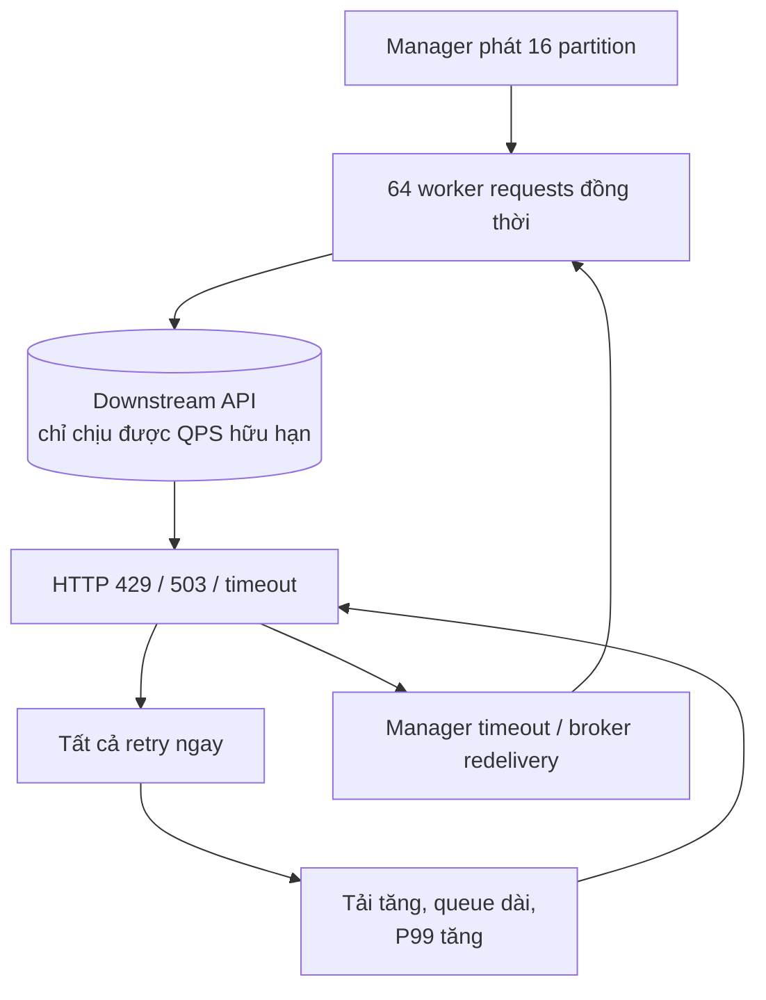
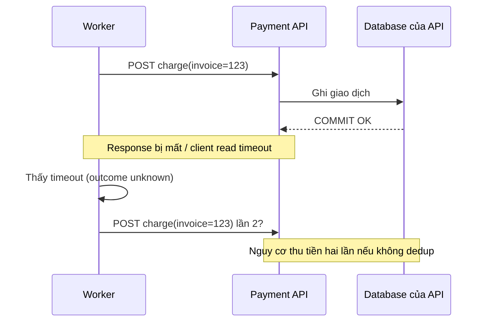
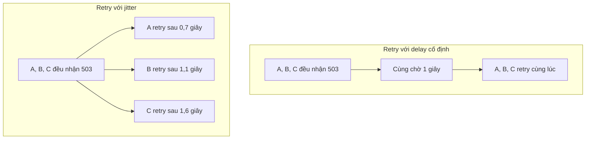
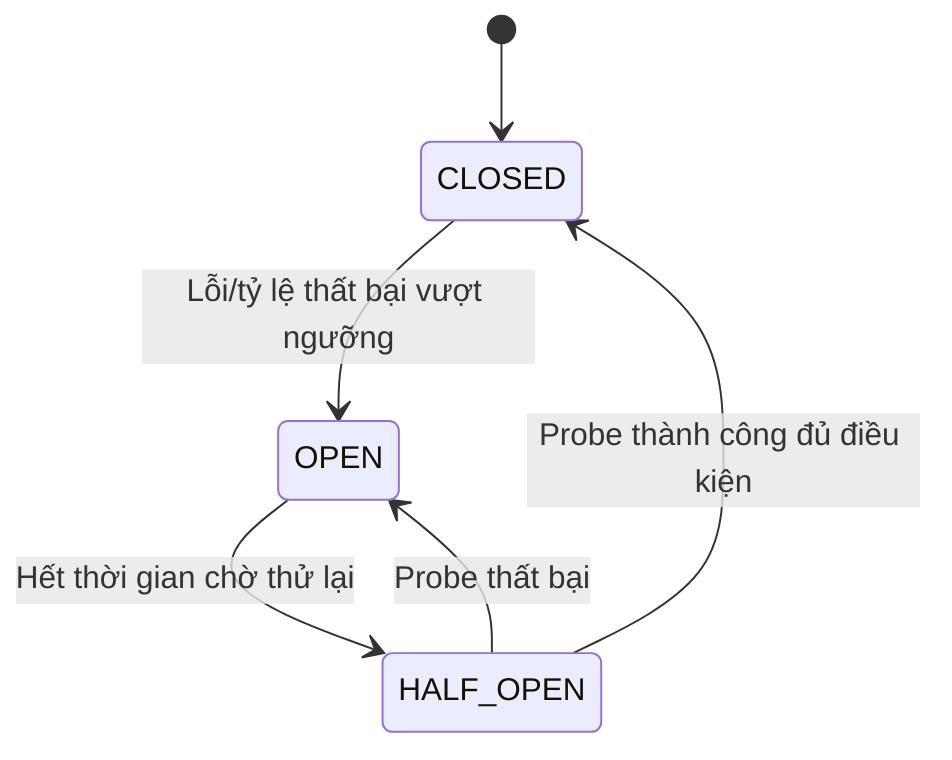
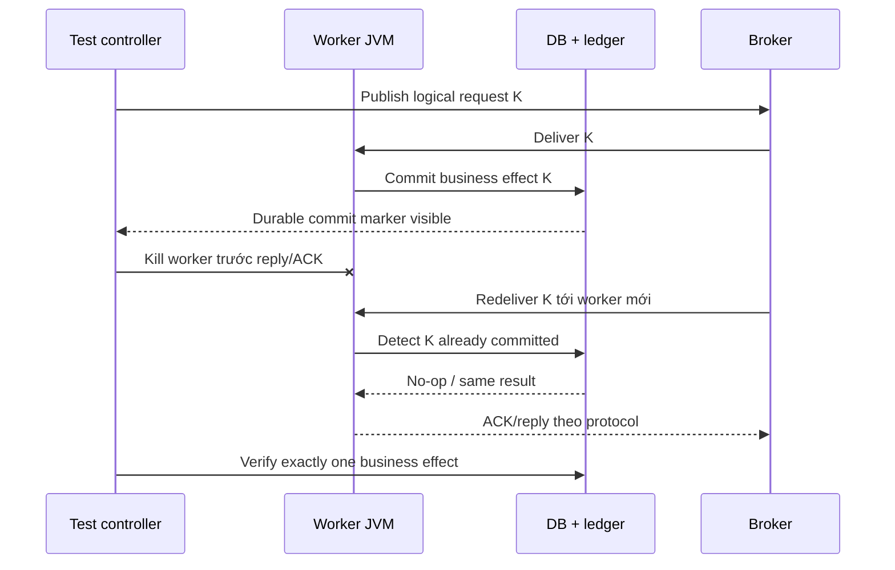

# Giới hạn retry tránh bão request

## 1. Bối cảnh: retry có thể làm sự cố nghiêm trọng hơn

Trong chương **Retry** của module **SPRING_BATCH_SCALING_OPERATIONS**, chúng ta nghiên cứu cách vận hành Spring Batch ở quy mô lớn với multi-threaded step, parallel steps, partitioning và worker phân tán. Retry là công cụ cần thiết khi một API, database hoặc broker gặp lỗi tạm thời. Nhưng nếu nhiều worker cùng thử lại ngay lập tức, **retry có thể biến một sự cố nhỏ thành bão request (retry storm)**.

Ví dụ một job chuẩn hóa 4 triệu giao dịch gọi API tra cứu rủi ro. Bình thường API trả lời sau 200 ms. Khi API quá tải, 80% request nhận HTTP 503, mỗi worker thử thêm ba lần không có khoảng nghỉ, và broker cũng giao lại chunk khi reply chậm. Trong lúc API cần giảm tải để phục hồi, số request phát sinh lại tăng mạnh. Hệ quả thường thấy:

- HTTP 429/503 tăng liên tục, P99 latency xấu hơn, nhiều request timeout hơn.
- Thread, connection pool, queue và transaction bị giữ lâu; throughput hữu ích giảm.
- Manager thấy worker chậm rồi timeout và gửi lại việc, tạo thêm những attempt cạnh tranh.
- Database ghi metadata `StepExecution`, rollback và retry nhiều hơn, tăng lock contention.
- Worker crash do heap hoặc quá nhiều task đang đợi, khiến broker tiếp tục redeliver.
- Trường hợp API đã xử lý một POST nhưng client không nhận được response, retry còn có thể **tạo side effect trùng**.

**Giới hạn retry** không chỉ là `retryLimit(3)`. Một thiết kế đáng tin cậy cần phối hợp **số lần thử, thời gian chờ, khoảng nghỉ, tổng deadline, mức đồng thời, tốc độ gửi request, phân loại lỗi và idempotency** tại nhiều lớp.

### Mục tiêu học tập

Sau bài này, bạn có thể:

1. Giải thích cơ chế retry storm và cách request bị khuếch đại qua nhiều tầng.
2. Phân biệt retry theo item, chunk, HTTP client, message delivery, step restart và job restart.
3. Dùng `retryLimit`, `BackOffPolicy` và phân loại exception trong Spring Batch 5.x.
4. Áp dụng exponential backoff có jitter, giới hạn tổng thời gian và tôn trọng `Retry-After`.
5. Phối hợp concurrency limit, rate limiting, circuit breaker, bulkhead và backpressure.
6. Thiết kế retry an toàn cho HTTP API, JDBC, remote chunking và remote partitioning.
7. Đảm bảo retry không tạo tác dụng phụ trùng hoặc làm sai checkpoint.
8. Đo retry amplification, retry rate, queue age, downstream saturation và thời gian phục hồi.
9. Lập kế hoạch chaos/fault-injection để kiểm chứng hệ thống **phục hồi thay vì tiếp tục bão request**.

> **Nguyên tắc:** Retry chỉ có ích khi lỗi có khả năng tự hết và thêm một lần thử có **ngân sách, độ trễ và tính an toàn** rõ ràng. Nếu downstream đang quá tải, retry không giới hạn chính là một dạng **tự khuếch đại tải**.

## 2. Cơ chế của retry storm

### 2.1. Hiệu ứng đám đông khi nhiều worker cùng thử lại



Nếu mọi worker nhận 503 vào cùng một thời điểm và cùng ngủ đúng 1 giây, chúng lại thức dậy **đồng loạt** sau một giây. Đây là hiện tượng *synchronized retries* hoặc *thundering herd*. Backoff không có jitter có thể vẫn tạo các đỉnh lưu lượng lặp lại.

### 2.2. Retry storm có thể xuất hiện dù mỗi tầng đều “chỉ thử vài lần”

Giả sử:

- Spring Batch fault-tolerant step cho tối đa 3 attempt của một thao tác logic.
- HTTP client nội bộ cũng thử tối đa 2 attempt.
- Broker có thể giao lại cùng đơn vị việc tối đa 4 delivery theo policy.

Nếu tất cả tầng này thực sự lồng nhau trên một item, số lần gọi HTTP **có thể tiến gần**:

\[
A_{\max}=3\times 2\times 4=24
\]

đối với **một logical item** trong điều kiện lỗi kéo dài. Đây là **mô hình worst-case minh họa**, không phải công thức Spring Batch tự tạo ra. Trong thực tế, broker thường phát lại chunk/request, không nhất thiết chính xác một item, và một số lỗi không kích hoạt mọi tầng.

Nếu có 64 item đang được xử lý đồng thời, worst-case minh họa có thể phát sinh:

\[
64\times24=1536\text{ HTTP attempts}
\]

trong khi chỉ có 64 logical requests cần được phục vụ. Số attempt cao chưa tự nói lên QPS vì còn phụ thuộc timeout/backoff và thời gian thực thi; tuy nhiên nó cho thấy **không được xem các retry budget ở từng tầng là độc lập**.

**Cách giải:** chọn một tầng làm nơi điều phối retry cho một lỗi cụ thể, giới hạn các retry “ẩn” ở các tầng còn lại và có **ngân sách tổng** theo operation/job/downstream.

### 2.3. Ba dạng bão phổ biến

| Dạng | Cơ chế | Biểu hiện |
| --- | --- | --- |
| **Immediate retry storm** | Lỗi 503/timeout rồi retry không nghỉ | RPS tăng, downstream càng quá tải |
| **Synchronized retry storm** | Tất cả dùng backoff cố định giống nhau | RPS nhọn theo chu kỳ 1 s, 2 s, 4 s |
| **Nested retry storm** | Item retry + SDK retry + broker redelivery + job restart | Amplification lớn, khó truy vết một logical request |

Ngoài ra, một đợt redeploy khiến hàng nghìn worker khởi động lại đồng thời cũng có thể tạo *recovery storm* dù retry logic từng worker có giới hạn hợp lý.

## 3. Lỗi nào đáng retry, lỗi nào phải fail?

Retry policy nên dựa vào **khả năng phục hồi của lỗi**, không chỉ dựa vào exception có phải `RuntimeException` hay không.

| Tình huống | Retry? | Giới hạn và điều kiện |
| --- | --- | --- |
| HTTP 503/502 từ downstream tạm thời | Thường có | Bounded backoff, timeout, circuit breaker; tôn trọng server hint |
| HTTP 429 Too Many Requests | Có điều kiện | Tôn trọng `Retry-After`, quota chung và deadline |
| HTTP connect/read timeout | Có điều kiện | Chỉ tự động retry side effect khi idempotent/có key hoặc biết trạng thái |
| JDBC deadlock victim | Thường có | Retry transaction bị rollback với giới hạn; đo DB contention |
| JDBC connection pool timeout | Cẩn trọng | Có thể là nghẽn nội bộ; thêm retry dễ làm nghẽn hơn |
| HTTP 400/422 validation | Thường không | Sửa dữ liệu hoặc quarantine theo chính sách |
| HTTP 401/403 | Thường không | Sửa cấu hình/permission; retry ngay không giúp |
| Resource not found 404 | Tùy API | Nếu eventual consistency đã được định nghĩa mới retry |
| Payload/schema/serialization sai | Không mặc định | Fail hoặc DLQ/quarantine; tránh poison loop |
| Bug `NullPointerException` | Không | Fail step và sửa code |
| Worker JVM/process crash | Không phải retry trong cùng process | Recovery theo `JobRepository` và ownership |
| Broker không nhận ACK | Có thể redeliver | Consumer business effect phải idempotent |
| HTTP POST đã được server xử lý, response mất | **Không retry mù** | Stable idempotency key hoặc tra cứu trạng thái effect |

**Không dùng `.retry(Exception.class)`** để “chống lỗi mọi loại”. Cũng không nên `.skip(Exception.class)`: skip lỗi hạ tầng có thể làm job `COMPLETED` với dữ liệu thiếu.

### 3.1. Retryable không đồng nghĩa safe-to-retry

Một timeout có thể xảy ra **sau khi server đã commit hiệu lực**:



Với các API có side effect, cần **idempotency key được phía server thực thi**, hoặc `GET status`/lookup theo business key, hoặc quy trình reconciliation. Không thể coi HTTP timeout luôn nghĩa là server chưa làm gì.

## 4. Các cấp retry trong kiến trúc Spring Batch

| Cấp | Đơn vị thử lại | Ai điều phối? | Hậu quả nếu không giới hạn |
| --- | --- | --- | --- |
| **HTTP SDK/client** | Một HTTP request | HTTP library/custom interceptor | Khuếch đại ngầm trong từng item |
| **Spring Batch fault-tolerant step** | Lỗi read/process/write của chunk/item theo policy | `FaultTolerantStepBuilder`/Spring Retry | Giữ worker/transaction lâu, retry nhiều item |
| **Database driver/pool** | Connect/query | Driver/pool/database | Chờ quá lâu, nghẽn connection pool |
| **Message broker** | Message/chunk/partition request | ACK/nack, retry topic, delivery policy | Redelivery storm, duplicate side effects |
| **Remote worker handler** | Một chunk/step request | Handler/consumer service | Tranh chấp checkpoint/owner |
| **Spring Batch job restart** | `JobExecution` cho cùng `JobInstance` | Job operator/scheduler | Replay chunk, job storm nếu scheduler launch lặp |
| **Process/orchestrator restart** | JVM/container | Kubernetes/systemd/process supervisor | Cold-start storm, request gửi lại hàng loạt |

### 4.1. Retry trong chunk khác replay message

Trong Spring Batch chunk step, khi read/process/write lỗi, framework có thể rollback và thực thi lại một phần xử lý theo `retry` và `skip`. Với remote chunking, broker có thể gửi lại **cả chunk** sau khi worker đã ghi một số side effect. Hai loại này **không chia sẻ một retry counter tự động** trừ khi ứng dụng thiết kế.

Một `retryLimit(3)` tại worker không khiến broker dừng redelivery sau đúng ba lần. Một `maxRedeliveries=5` ở broker không giới hạn số attempt nội bộ của HTTP client khi worker xử lý mỗi delivery. Cần khai báo chính sách tổng thể và đo số **physical attempts trên một logical business effect key**.

### 4.2. Retry budget theo thời gian và theo số lần

Ba loại ngân sách nên phối hợp:

1. **Attempt budget:** tối đa bao nhiêu lần thử cho một lỗi/item/request logic.
2. **Elapsed-time budget:** tính từ lần thử đầu, deadline còn bao lâu để retry hữu ích.
3. **Capacity budget:** tối đa bao nhiêu request đồng thời và bao nhiêu request/giây với một downstream.

Ví dụ nghiệp vụ cần hoàn tất partition trong 15 phút. Nếu một item đã tốn 14 phút 55 giây, kế hoạch thêm ba retry có delay 4 giây mỗi lần **không còn phù hợp deadline**; worker nên fail/escalate theo chính sách thay vì trễ vô hạn.

## 5. Tính ngân sách retry và request amplification

Gọi:

- `L`: số tầng có thể retry cùng logical request.
- `a_i`: số attempt tối đa tại tầng `i` (bao gồm lần đầu).
- `C`: số logical requests **đang đồng thời xử lý**.

Giới hạn khuếch đại lý thuyết khi các tầng thực sự lồng nhau:

\[
A_{\max}=\prod_{i=1}^{L}a_i,\qquad
N_{\text{attempt, peak-window}}\lesssim C A_{\max}.
\]

Dấu `\lesssim` ở đây chỉ mô tả **số attempts tích lũy trong một cửa sổ đủ dài cho mọi lần thử**, không phải QPS tại một thời điểm. Backoff, timeout, queue, cancellations và failure modes quyết định con số thực tế.

### 5.1. Ví dụ định lượng

Một cluster có:

| Thành phần | Giá trị minh họa |
| --- | ---: |
| Worker JVM | 16 |
| Chunk/HTTP calls chạy đồng thời trên mỗi JVM | 4 |
| Tổng in-flight logical HTTP calls | 64 |
| Spring Batch max attempts | 3 |
| SDK HTTP max attempts | 2 |
| Broker max deliveries của cùng chunk | 4 |
| Worst-case amplification per logical item | 24 |

Thay vì để cả ba tầng retry, có thể:

- Đặt SDK max attempts = 1 cho operation được Spring Batch điều phối.
- Dùng Spring Batch max attempts = 3 với backoff/jitter.
- Giới hạn broker delivery cho lỗi vận chuyển và chuyển DLQ/escalation nếu lỗi lặp.
- Đặt **global rate limit** và không tự phát lại partition khi worker có thể còn sống.

Nếu chọn 3 attempts ở worker và 2 broker deliveries, upper bound minh họa giảm còn 6 per logical item (khi cả hai tầng được kích hoạt). Tuy nhiên 6 lần vẫn có thể là quá nhiều với một POST không idempotent hoặc downstream đang ngừng hoạt động.

### 5.2. Retry budget toàn hệ thống

Một downstream có quota 500 RPS cho cả cluster. Nếu riêng batch đã phát 400 request đầu tiên/giây, phần headroom chỉ còn 100 RPS (giả sử quota được chia rõ). Việc retry thêm 200 RPS sẽ **vượt quota**, dù mỗi worker chỉ retry tối đa 2 lần.

Nên quản lý **global permit/token bucket** theo service/tenant/API operation khi nhiều JVM cùng gọi. `Semaphore(4)` ở từng worker chỉ giới hạn **in-flight concurrency** của worker đó; nó **không tự áp đặt 500 RPS cho cả cluster**.

## 6. Backoff có jitter: giảm đỉnh đồng bộ

### 6.1. Exponential backoff

Một dãy delay cơ bản:

\[
d_k=\min(d_{\max},d_0\times 2^k),
\]

trong đó `k=0` là khoảng chờ trước retry đầu tiên, `d_0` có thể là 200 ms và `d_{\max}` là 8 giây.

| Retry number | Delay chưa jitter |
| ---: | ---: |
| 1 | 200 ms |
| 2 | 400 ms |
| 3 | 800 ms |
| 4 | 1.600 ms |
| 5 | 3.200 ms |
| 6 trở đi | Tăng tới cap 8.000 ms |

Thời gian thực tế của một request còn gồm **connect timeout, read timeout, retry processing, queue/pool wait và GC pauses**. Không nên cộng mỗi delay rồi kết luận tổng retry duration.

### 6.2. Full jitter

Một biến thể phân tán đều thời điểm thử lại:

\[
d_k^{\text{full-jitter}}
\sim U\left(0,\min(d_{\max},d_0\,2^k)\right).
\]

Full jitter có thể cho delay rất nhỏ, kể cả gần 0; nếu API yêu cầu khoảng chờ tối thiểu, dùng floor hoặc tuân thủ `Retry-After`. Có nhiều chiến lược jitter (equal jitter, decorrelated jitter, exponential random multiplier); **chúng không tương đương hoàn toàn**.



Sơ đồ chỉ nhằm trực quan hóa việc **phân tán thời điểm retry**. Trong triển khai thực, random delay cần tạo độc lập theo request hoặc worker attempt, đồng thời có cap/deadline và được đo trong metrics.

### 6.3. Vì sao không nên chờ vô hạn trong worker?

Nếu `ItemProcessor` gọi API trong một chunk transaction và backoff tổng kéo dài 30–60 giây, transaction có thể giữ database resources trong khi worker chỉ đang chờ. Khi 64 worker cùng làm vậy:

- JDBC connections có thể bị giữ hoặc chờ pool, tùy cách transaction/reader dùng connection.
- Database locks có thể kéo dài nếu đã có SQL write trong transaction.
- Task executor không còn slot xử lý việc khác.
- Manager tưởng job kẹt vì `StepExecution` chưa có checkpoint mới.

Với workload có HTTP I/O chậm, cân nhắc **tách fetch/enrichment khỏi write transaction**, staging/outbox, hoặc chia step thành các giai đoạn riêng để retry không giữ transaction nghiệp vụ quá lâu. Khi vẫn dùng chunk fault tolerance, phải kiểm tra **transaction span** và cách client/backoff được gọi trong implementation.

## 7. Retry-After, 429 và giới hạn deadline

HTTP `429 Too Many Requests` có thể đi kèm `Retry-After`, biểu thị số giây cần chờ hoặc một HTTP date. Không phải server nào cũng gửi header này, và client không nên tin vô điều kiện một ngày quá xa hoặc giá trị không hợp lệ.

Một chính sách:

1. Nếu response là 429/503 có `Retry-After` hợp lệ, dùng nó như một **gợi ý tối thiểu** theo hợp đồng API.
2. So sánh với **deadline còn lại**; nếu không thể chờ lâu như yêu cầu, fail/defer thay vì retry sớm hơn và vượt quota.
3. Có cap vận hành, nhưng cap không có nghĩa được phép **bỏ qua hướng dẫn server** để gửi sớm hơn.
4. Nếu không có header, dùng exponential backoff + jitter.
5. Rate limiter chung vẫn quyết định thời điểm có permit, kể cả khi `Retry-After` đã hết.

### 7.1. Các trường hợp phải làm rõ

| Response | Xử lý đề xuất |
| --- | --- |
| 429 với `Retry-After: 10` | Không retry trước khoảng 10 giây, nếu deadline cho phép |
| 429 với HTTP date | Chuyển theo đồng hồ/clock-skew policy, có deadline |
| 503 không header | Backoff + jitter, retry giới hạn |
| 503 liên tục sau N attempts | Mở circuit/stop theo policy, không loop |
| 401 từ mọi worker | Fail/escalate; có thể credentials sai |
| 400 validation trên cùng item | Quarantine/skip theo chính sách, không retry |

**Một `BackOffPolicy` exponential thông thường không tự động đọc và thực thi `Retry-After`.** Nếu API yêu cầu tuân thủ header, cần wrapper/exception classifier/handler hoặc thư viện resilience phù hợp, được tích hợp và kiểm thử rõ.

## 8. Spring Batch 5.x: cấu hình retry có giới hạn

Spring Batch cho phép cấu hình fault tolerance trên chunk-oriented step bằng `FaultTolerantStepBuilder`. Ví dụ dưới dùng **Java 17+, Spring Batch 5.x**, `ItemReader` đọc hóa đơn, `ItemProcessor` gọi API tra cứu (không có side effect nghiệp vụ) và `ItemWriter` ghi database.

### 8.1. Bắt đầu từ chính sách exception hẹp

Các loại exception minh họa:

- `ResourceAccessException`: lỗi truyền tải HTTP của Spring Web, cần kiểm tra từng nguyên nhân.
- `HttpServerErrorException.ServiceUnavailable`: HTTP 503.
- `HttpClientErrorException.TooManyRequests`: HTTP 429, nên xem thêm `Retry-After`.

Không cấu hình `retry(Exception.class)`, vì nó có thể retry validation error, authorization error hoặc bug không bao giờ tự hết.

### 8.2. BackOffPolicy có giới hạn

```java
import org.springframework.context.annotation.Bean;
import org.springframework.retry.backoff.BackOffPolicy;
import org.springframework.retry.backoff.ExponentialRandomBackOffPolicy;

@Bean
BackOffPolicy riskRetryBackoff() {
    ExponentialRandomBackOffPolicy backoff =
        new ExponentialRandomBackOffPolicy();
    backoff.setInitialInterval(250);   // milliseconds
    backoff.setMultiplier(2.0);
    backoff.setMaxInterval(4_000);      // cap 4 seconds
    return backoff;
}
```

`ExponentialRandomBackOffPolicy` có yếu tố ngẫu nhiên trong hệ số nhân; **không khẳng định đây chính xác là công thức full jitter** ở mục 6. Nếu hệ thống có yêu cầu jitter hoặc `Retry-After` cụ thể, phải kiểm thử phân phối delay và chọn/customize policy tương ứng.

### 8.3. Chunk step với retryLimit

```java
import org.springframework.batch.core.Step;
import org.springframework.batch.core.repository.JobRepository;
import org.springframework.batch.core.step.builder.StepBuilder;
import org.springframework.batch.item.ItemReader;
import org.springframework.batch.item.ItemProcessor;
import org.springframework.batch.item.ItemWriter;
import org.springframework.context.annotation.Bean;
import org.springframework.retry.backoff.BackOffPolicy;
import org.springframework.transaction.PlatformTransactionManager;
import org.springframework.web.client.HttpClientErrorException;
import org.springframework.web.client.HttpServerErrorException;
import org.springframework.web.client.ResourceAccessException;

@Bean
Step riskEnrichmentWorker(
        JobRepository jobRepository,
        PlatformTransactionManager transactionManager,
        ItemReader<Invoice> invoiceReader,
        ItemProcessor<Invoice, ScoredInvoice> riskProcessor,
        ItemWriter<ScoredInvoice> invoiceWriter,
        BackOffPolicy riskRetryBackoff) {

    return new StepBuilder("riskEnrichmentWorker", jobRepository)
        .<Invoice, ScoredInvoice>chunk(100, transactionManager)
        .reader(invoiceReader)
        .processor(riskProcessor)
        .writer(invoiceWriter)
        .faultTolerant()
        .retry(ResourceAccessException.class)
        .retry(HttpServerErrorException.ServiceUnavailable.class)
        .retry(HttpClientErrorException.TooManyRequests.class)
        .retryLimit(3)
        .backOffPolicy(riskRetryBackoff)
        .build();
}
```

Trong Spring Batch/Spring Retry 5.x với policy thông thường, `retryLimit(3)` tương ứng **tối đa ba attempt của thao tác được retry, gồm lần thử ban đầu**, chứ không mặc định là ba retry thêm sau lần đầu. Tuy nhiên số lần gọi `ItemProcessor` hoặc `ItemWriter` quan sát được trong **cả một chunk** có thể khác do rollback, stateful retry, item filtering và transaction reprocessing. **Hãy đo/test thực tế** thay vì lấy một số `retryLimit` nhân đơn giản để khẳng định số method invocations.

Các kiểu `Invoice`/`ScoredInvoice` và bean reader/processor/writer là DTO/service nghiệp vụ của ứng dụng; snippet thể hiện **cấu hình step**, chưa phải chương trình tự chạy nếu thiếu datasource, job, metadata schema và các bean tương ứng.

### 8.4. Không tự động skip khi retry hết

Ví dụ trên **không gọi `skip(...)`**, vì khi API đang quá tải, bỏ qua các invoice chưa được chấm điểm có thể vi phạm hợp đồng nghiệp vụ. Khi attempts đã hết, exception phù hợp khiến step thất bại, có thể restart sau khi downstream phục hồi.

Nếu business thực sự cho phép dùng “risk score unavailable”:

1. Cần xác định trạng thái fallback có ý nghĩa nghiệp vụ và cách audit.
2. Không đánh đồng **temporary unavailability** với **invalid input**.
3. Dùng bước/replay queue riêng cho những item cần bổ sung, hoặc một kết quả `PENDING_SCORE` được lưu bền vững.
4. Chỉ publish dữ liệu khi quality gate cho phép; không coi `COMPLETED` tự động là “đủ mọi score”.

Đặc biệt **không dùng `noRollback(...)` hoặc `skip(...)` một cách ngẫu nhiên** để tránh job thất bại khi chưa hiểu tính nguyên tử của business write và checkpoint.

## 9. HTTP timeout: giới hạn một attempt trước khi tính retry

Nếu một attempt có thể chờ vô hạn, `retryLimit(3)` gần như vô nghĩa: worker không bao giờ tới lần retry thứ hai.

### 9.1. RestClient với connect/read timeout

Ví dụ Spring Framework 6.1+:

```java
import org.springframework.context.annotation.Bean;
import org.springframework.http.client.SimpleClientHttpRequestFactory;
import org.springframework.web.client.RestClient;

@Bean
RestClient riskRestClient() {
    SimpleClientHttpRequestFactory factory =
        new SimpleClientHttpRequestFactory();
    factory.setConnectTimeout(1_500);
    factory.setReadTimeout(3_000);

    return RestClient.builder()
        .baseUrl("https://risk.example.internal")
        .requestFactory(factory)
        .build();
}
```

URL ở đây là endpoint nội bộ **minh họa**, không phải service thật. `SimpleClientHttpRequestFactory` dùng để trình bày timeout đơn giản; production có thể dùng Apache HttpClient, JDK HttpClient hoặc client khác hỗ trợ connection pooling, request deadline, TLS và tracing.

**Phải phân biệt**:

- **Connect timeout:** thiết lập kết nối quá lâu.
- **Read/response timeout:** chờ dữ liệu/phản hồi quá lâu theo semantics client.
- **Pool acquisition timeout:** chờ lấy connection từ pool.
- **Overall request deadline:** tổng thời gian request được phép kéo dài, không phải client nào cũng cung cấp cùng semantics.
- **Retry budget deadline:** tổng thời gian của **tất cả attempts + backoff**.

Read timeout 3 giây **không bảo đảm cả item chỉ mất 3 giây**. Với ba attempts, delay giữa các lần thử và thời gian chờ pool, một item có thể mất trên 9 giây ngay cả khi không tính processing/DB commit.

### 9.2. Processor minh họa gọi API

```java
import java.math.BigDecimal;
import org.springframework.batch.item.ItemProcessor;
import org.springframework.context.annotation.Bean;
import org.springframework.web.client.RestClient;

record Invoice(long id, BigDecimal amount) {}
record RiskResponse(String grade) {}
record ScoredInvoice(long id, BigDecimal amount, String grade) {}

@Bean
ItemProcessor<Invoice, ScoredInvoice> riskProcessor(
        RestClient riskRestClient) {

    return invoice -> {
        RiskResponse response = riskRestClient.get()
            .uri("/scores/{invoiceId}", invoice.id())
            .retrieve()
            .body(RiskResponse.class);

        if (response == null || response.grade() == null) {
            throw new IllegalStateException(
                "Risk API returned invalid response schema");
        }
        return new ScoredInvoice(
            invoice.id(), invoice.amount(), response.grade());
    };
}
```

Đây là **GET không làm thay đổi dữ liệu** theo hợp đồng API giả định, do đó retry tương đối đơn giản hơn POST có side effect. Dù vậy, GET vẫn có chi phí/quota và có thể không an toàn về cache/consistency nếu API thay đổi dữ liệu theo thời gian. `IllegalStateException` về schema sai **không nằm trong danh sách retry** của step.

### 9.3. HTTP 429 và 503 không giống nhau hoàn toàn

`RestClient.retrieve()` có thể ném exception ứng với status 4xx/5xx. Cấu hình Spring Batch ở mục 8 cho phép retry cả 429 và 503; tuy nhiên backoff chung ở đó **chưa tôn trọng `Retry-After`**. Với API có quota nghiêm ngặt, cần xử lý status/header ở tầng client hoặc retry coordinator, có global limiter và deadline.

Nếu downstream có quota theo tenant, không dùng một global bucket trộn mọi tenant khi điều này khiến tenant A vượt quota hoặc tenant B bị starve; chọn key quota đúng contract (service, endpoint, tenant, operation).

## 10. Concurrency limit, rate limit, bulkhead và backpressure

Tăng retry delay là chưa đủ nếu vẫn có 1.000 new requests/giây từ hàng trăm worker.

### 10.1. Giới hạn mức đồng thời

Với local partitioning:

```java
import org.springframework.context.annotation.Bean;
import org.springframework.core.task.TaskExecutor;
import org.springframework.scheduling.concurrent.ThreadPoolTaskExecutor;

@Bean
TaskExecutor boundedPartitionExecutor() {
    ThreadPoolTaskExecutor executor = new ThreadPoolTaskExecutor();
    executor.setCorePoolSize(4);
    executor.setMaxPoolSize(4);
    executor.setQueueCapacity(12);
    executor.setThreadNamePrefix("risk-worker-");
    executor.initialize();
    return executor;
}
```

Nếu một worker `StepExecution` chạy tuần tự, executor này cho tối đa bốn worker tasks cùng hoạt động trong một JVM. **Không có nghĩa tối đa bốn HTTP requests cho cả cluster**: nếu có 12 JVM như vậy, có thể có tới khoảng 48 worker tasks hoạt động (chưa tính async/concurrent client trong mỗi worker).

`gridSize` là hint số partition gửi tới `Partitioner`; **không phải limiter QPS**, không thay thế executor pool và không bảo đảm số task đồng thời.

### 10.2. Semaphore khác token bucket

| Cơ chế | Giới hạn | Ví dụ | Không bảo đảm |
| --- | --- | --- | --- |
| `Semaphore(8)` | Tối đa 8 requests **in-flight** | Chặn quá nhiều kết nối chờ API | 8 requests/giây |
| Token bucket 100 tokens/s | Tốc độ trung bình + burst capacity | Quota 100 RPS | Tối đa 100 concurrent |
| Bounded queue | Số task/request đang chờ | Không cho queue tăng vô hạn | Downstream RPS |
| Circuit breaker | Tạm ngừng gọi khi lỗi vượt ngưỡng | API trả 503 hàng loạt | Thay thế rate limit |
| Bulkhead per endpoint | Cô lập tài nguyên từng dependency | Risk API chậm không chặn payment DB | Idempotency |

Một request cực nhanh có thể hoàn tất trong 10 ms: `Semaphore(8)` khi đó có thể cho **hàng trăm requests/giây**, không phải 8 RPS. Ngược lại, token bucket 100 RPS có thể cấp permit nhanh trong lúc 1.000 requests đang đợi response, nếu không có concurrency cap.

### 10.3. Giới hạn toàn cluster

Trong remote partitioning, mỗi worker JVM có semaphore riêng. Nếu API giới hạn **200 RPS cho toàn cluster**, quota phải được áp dụng tại nơi có khả năng điều phối tất cả worker, ví dụ:

- API gateway/service mesh có quota chung.
- Distributed token bucket/lease trên Redis hoặc một hệ thống đáng tin tương đương.
- Bộ cấp permit tập trung với batch prefetch có giới hạn và xử lý lỗi coordinator.
- Chia quota tĩnh cho worker pools/tenants nếu topology ổn định và cần simplicity.

Một khóa rate limiter phổ biến có thể là:

```text
downstream = risk-service
operation  = GET /scores/{id}
tenant     = vendor-A
quota      = 200 req/s across the deployment
```

**Không dùng một counter Redis với `GET` rồi `SET` không nguyên tử** để điều phối hàng trăm worker. Nếu dùng Lua/transaction hoặc một thư viện distributed limiter, phải test race, clock drift, TTL, failure mode và cách limiter phản ứng khi Redis unavailable.

### 10.4. Rate limiting ưu tiên trước retry

Thứ tự hợp lý:

```text
Reader -> validate item
       -> còn deadline và retry tokens?
       -> circuit breaker có cho gọi?
       -> xin global rate-limit permit
       -> xin local concurrency permit / HTTP connection
       -> gọi downstream với per-attempt timeout
       -> success / bounded retry + backoff
       -> ghi business result / fail có kiểm soát
```

Không cho worker chiếm connection hoặc giữ DB lock lâu trong lúc đợi token nếu có thể thiết kế khác. Nếu limiter không cấp permit trong deadline, **defer/fail theo hợp đồng**, không bypass limiter để “cứu job”.

### 10.5. Backpressure giữa manager và worker

Một manager có 100.000 chunks chờ xử lý không nên publish tất cả ngay nếu worker chỉ chịu được 20 chunks in flight. Tùy mô hình:

- **Remote chunking:** giới hạn số chunk outstanding, consumer prefetch, queue depth và broker TTL/DLQ. Nếu manager không được backpressure, backlog tích tụ và latency/reply timeout kích hoạt thêm redelivery.
- **Remote partitioning:** giới hạn số worker/partitions active; khi broker backlog tăng, điều chỉnh dispatch và worker concurrency. Mỗi partition có thể xử lý nhiều chunk; đừng đồng nhất số message với số item.
- **Local partitioning:** dùng bounded executor queue và kiểm tra saturation; không dùng unbounded queue làm nơi giấu nghẽn.

Backpressure là **giảm tốc nguồn phát công việc trước khi hệ thống đầy**, không phải chỉ tăng timeout để chịu thêm queue.

## 11. Circuit breaker và bulkhead không thay thế retry budget

Một circuit breaker có thể chuyển qua ba trạng thái logic:



Khi circuit `OPEN`, worker nên **không tiếp tục gửi request thật** tới downstream trong một khoảng thời gian. Tuy nhiên:

- Nếu mỗi worker có circuit riêng, hàng trăm worker có thể cùng half-open và tạo **probe storm**.
- Phải giới hạn số half-open probes trên cluster hoặc có jitter/coordination phù hợp.
- Việc circuit mở không tự động làm chunk/checkpoint hoàn tất; cần retry/defer/fail step theo policy.
- Circuit breaker không bảo vệ khỏi trùng business effects do message replay.
- Không cần “retry” một exception `CallNotPermittedException` nhiều lần ngay: circuit đã yêu cầu ngừng gọi.

**Bulkhead** tách tài nguyên của từng dependency: nếu API chấm điểm bị kẹt, nó không nên tiêu thụ hết connection/thread cần cho JobRepository, broker ACK hoặc database writer. Với Java, có thể dùng thread pool/semaphore riêng cho HTTP call, listener container riêng, JDBC pool sizing và queue hữu hạn.

## 12. Retry và transaction: tránh giữ khóa quá lâu

### 12.1. Chunk transaction có thể bao quanh I/O

Trong cấu hình chunk step thông thường, framework quản lý transaction theo chunk. Nếu `ItemProcessor` gọi HTTP rồi backoff, tùy reader/writer/transaction manager, transaction có thể vẫn đang mở. Khi nhiều partition đồng thời retry, connection pool/DB lock có thể trở thành nút thắt lớn hơn lỗi API ban đầu.

Hãy đo:

- Chunk transaction duration P95/P99.
- JDBC active/pending connections, lock wait, deadlock và timeouts.
- HTTP latency/connection pool wait và backoff time.
- `COMMIT_COUNT`/`ROLLBACK_COUNT` và thời gian giữa hai checkpoint.

Nếu HTTP độc lập với transaction business, tách giai đoạn **fetch/enrich → staging → validate/write** có thể giảm việc giữ transaction trong lúc I/O chậm. Phải bảo đảm staging có idempotency và source identity khi restart.

### 12.2. Một lỗi JDBC cần retry cả transaction

Giả sử writer áp dụng:

```sql
BEGIN;
INSERT INTO item_dedup(effect_key) VALUES (:key)
    ON CONFLICT DO NOTHING;
UPDATE account_balance SET balance = balance + :amount
WHERE account_id = :accountId;
COMMIT;
```

**Đây chỉ là ví dụ cấu trúc, chưa an toàn** vì câu `UPDATE` vẫn chạy cả khi INSERT dedup bị conflict. Bản triển khai đúng phải **chỉ UPDATE khi INSERT ledger thành công**, và cả hai trong cùng transaction. Khi database báo deadlock, retry phải replay transaction **đầy đủ**, không chỉ gửi lại riêng lệnh UPDATE sau khi transaction đã rollback.

### 12.3. Retry không tự bảo đảm exactly-once effect

| Cửa sổ lỗi | Điều có thể xảy ra | Bảo vệ cần có |
| --- | --- | --- |
| HTTP timeout trước khi request tới server | Chưa có side effect | Retry có hạn |
| HTTP timeout sau server commit | Side effect đã xảy ra, client không biết | Server-side idempotency key/status lookup |
| JDBC deadlock trước commit | Transaction rollback | Retry transaction, same effect key |
| Business DB commit, JobRepository metadata chưa lưu do datasource khác | Replay chunk dù effect đã tồn tại | Item ledger/unique key và reconciliation |
| Worker commit DB, reply bị mất | Broker có thể redeliver | Idempotent consumer + reply correlation |
| Manager timeout nhưng remote worker còn sống | Hai attempt có thể cạnh tranh | Claim/lease/fencing và stop/recovery |

Với batch có nhiều chunks, **partition-level key** không thay thế item-level business key. Nếu một partition đã commit 40/100 chunks rồi crash, replay có thể xử lý lại chunk đã commit; mỗi effect cần idempotency hoặc checkpoint+transaction liên kết đáng tin.

## 13. Retry budget theo nguồn lỗi và tầng trách nhiệm

Để tránh “ai cũng retry”, tài liệu vận hành nên ghi **tầng nào có quyền retry loại lỗi nào**.

| Lỗi | Tầng chủ trách nhiệm | Tầng khác nên làm gì? |
| --- | --- | --- |
| HTTP 503 tạm thời trong xử lý item | Worker retry coordinator/Spring Batch | HTTP SDK không âm thầm retry thêm N lần |
| HTTP 429 theo tenant | Global rate limiter + worker policy | Broker không lập tức phát lại cùng chunk |
| JDBC deadlock ở writer | Chunk transaction / Spring Batch | Không mở retry vô hạn ở DAO bên dưới |
| Broker consumer bị mất khi chưa ACK | Broker delivery + consumer idempotency | Manager không tự tạo cùng partition attempt song song |
| Worker JVM crash | Process supervisor + Batch recovery | Không coi restart process là restart `JobInstance` |
| Manager reply timeout | Remote handler/runbook | Kiểm tra worker/repository/commit trước khi dispatch lại |
| Business validation sai | Validator/quarantine policy | Không retry network/HTTP vô ích |
| API outage kéo dài | Circuit breaker + job scheduler | Tạm dừng/defer job có kiểm soát, tránh launch storm |

Một policy có thể chọn:

```text
Logical operation: risk-lookup(invoiceId)
  total wall-clock deadline : 15 seconds
  HTTP SDK max attempts     : 1
  Spring Batch max attempts : 3 (bao gồm lần đầu)
  per-attempt HTTP timeout  : connect 1.5s, read 3s
  backoff                   : exponential random, 250ms..4s
  global quota              : 200 RPS
  concurrent calls          : 48 across cluster
  broker redelivery         : for transport failures, bounded
  outage action             : fail/defer step, do not drop invoice
```

**Những con số là ví dụ, không phải cấu hình tự động được bảo đảm bởi code ở mục 8–10.** Muốn deadline 15 giây thực sự được thi hành, phải triển khai **deadline coordinator** hoặc các policy có tính đến elapsed time; `retryLimit` và `BackOffPolicy` riêng lẻ chưa đủ.

## 14. Remote partitioning: retry không được tạo hai owner cùng ghi

Trong **remote partitioning**, manager `PartitionStep` tạo worker `StepExecution`, gửi yêu cầu thực thi qua middleware và nhận kết quả theo `PartitionHandler`. Nếu worker không trả reply hoặc mất heartbeat, manager có thể chưa biết worker đã dừng hay vẫn đang ghi dữ liệu.

### 14.1. Kịch bản nguy hiểm

```mermaid
sequenceDiagram
    participant M as Manager
    participant Q as Broker
    participant A as Worker A
    participant B as Worker B
    participant DB as Business DB
    M->>Q: Dispatch partition P
    Q->>A: Deliver P
    A->>DB: Commit chunk 1..10
    Note over A,M: Reply chậm / heartbeat mất
    M->>M: Timeout; tưởng A đã chết
    M->>Q: Dispatch P lần nữa
    Q->>B: Deliver P
    A->>DB: Vẫn có thể ghi chunk 11
    B->>DB: Có thể ghi chunk 1..11
    Note over DB: Có nguy cơ duplicate / xung đột
```

**Retry một `StepExecutionRequest` cũ không tự tương đương restart hợp lệ** của Spring Batch. Worker handler có thể tải `StepExecution` từ repository, kiểm tra trạng thái và thực thi theo lifecycle; hành vi với request trùng phụ thuộc phiên bản, handler/transport và cấu hình. Nếu hai worker cùng sửa metadata một `StepExecution`, có thể có tranh chấp `VERSION`/optimistic locking, nhưng **optimistic locking failure không thay cho idempotency của side effect**.

### 14.2. Chính sách recovery hợp lý

1. Manager phát request có **logical partition identity** ổn định.
2. Worker claim quyền xử lý qua một protocol atomic khi architecture có nguy cơ delivery trùng.
3. Claim có owner và **generation**; lease renew failure được xử lý chứ không bỏ qua.
4. Khi heartbeat cũ hoặc reply timeout, manager chỉ đánh dấu **SUSPECT**, không tự kết luận worker chết.
5. Chỉ chuyển owner khi worker cũ đã ngừng **hoặc** sink có cơ chế fencing từ chối generation cũ.
6. Các side effect đã commit phải có business idempotency key độc lập với `StepExecutionId`.
7. Đối chiếu `JobRepository`, input snapshot và output trước khi restart cùng `JobInstance`.

Điều này không ngăn mọi duplicate handler invocation, nhưng bảo vệ **quyền ghi** và **hiệu lực nghiệp vụ**. Nếu bên nhận là API không hỗ trợ fencing hoặc idempotency, không nên kích hoạt failover tự động chỉ vì timeout.

### 14.3. Giới hạn tải khi một partition chậm

Một partition chứa 500.000 item có thể chạy vài phút. Nếu timeout request/reply của manager chỉ 30 giây, manager có thể coi mọi partition hợp lệ là lỗi và bắt đầu vòng retry. Cần phân biệt:

- **Dispatch timeout:** request chưa vào queue hoặc chưa có worker claim.
- **Worker liveness timeout:** không có heartbeat mới.
- **Progress deadline:** worker sống nhưng không commit trong khoảng bất thường.
- **Total partition SLA:** ngân sách thời gian dựa trên lượng dữ liệu.
- **Reply wait timeout:** thiếu kết quả theo transport, không chứng minh worker chưa commit.

Không đưa tất cả vào một cấu hình `timeout=30s`. Mỗi loại cần metrics, hành động và giới hạn retry riêng.

## 15. Remote chunking: chunk redelivery có thể nhân số HTTP calls

Trong **remote chunking**, manager đọc item, tạo `ChunkRequest` và gửi cho worker; worker process/write chunk rồi gửi `ChunkResponse`. Mỗi request chứa nhiều item, và **không có một `StepExecution` riêng cho mỗi chunk mặc định**.

### 15.1. Vòng lặp có thể gây bão

```text
Manager -> ChunkRequest #42 (100 items)
Worker -> gọi API cho 100 items
  50 items đã gọi thành công
  50 items nhận 503, mỗi item retry 3 lần
Worker/handler chậm -> manager chưa thấy ChunkResponse #42
Broker / ứng dụng -> redeliver ChunkRequest #42
Worker mới -> gọi lại API cho nhiều hoặc tất cả 100 items
```

**Khi nào được retry cả chunk?** Chỉ khi business effects có thể replay an toàn và manager/worker protocol xử lý correlation đúng. Nếu API GET có quota, replay 100 GET có thể không gây trùng business effects nhưng vẫn làm quá tải downstream. Nếu API POST có side effect, bắt buộc có stable item idempotency key hoặc phương án reconciliation.

### 15.2. Những giới hạn cần phối hợp

| Giới hạn | Đơn vị | Mục đích |
| --- | --- | --- |
| `retryLimit` của worker step/handler (nếu áp dụng) | Item/chunk lỗi theo cách framework cấu hình | Hạn chế vòng thử nội bộ |
| HTTP SDK attempts | Một HTTP operation | Tránh retry ẩn lồng thêm |
| Broker redelivery limit | Một message | Tránh poison chunk quay lại vô hạn |
| Outstanding chunk cap | Số chunk chưa có response | Tạo backpressure từ manager |
| Consumer concurrency/prefetch | Request/chunk đang xử lý | Không làm worker tràn tài nguyên |
| Global API RPS | Call trên tất cả worker JVM | Không vượt quota downstream |
| Retry total deadline | Logical business operation | Không lặp vượt SLA |
| DLQ/quarantine | Request quá ngưỡng | Có nơi điều tra và replay sau khi sửa |

### 15.3. Correlation không bị thay đổi khi retry

Một `ChunkRequest` có correlation/sequence theo giao thức Spring Batch Integration. Khi retry/redelivery, ứng dụng phải giữ đúng **logical request identity** và phân biệt message mới thực sự với attempt mới. Nếu manager tạo một logical request mới nhưng dùng idempotency key hoàn toàn mới cho cùng item, consumer có thể áp dụng side effect lại.

**Không tự thay payload/headers nội bộ của `ChunkRequest` bằng format tự chế** nếu chưa kiểm tra protocol của Spring Batch version đang dùng. Tầng message routing có thể dùng thêm headers/registry của ứng dụng, nhưng không được phá giả định của `ChunkMessageChannelItemWriter` và `ChunkProcessorChunkHandler`.

### 15.4. Khi 100 items có 1 poison record

Nếu lỗi schema/validation vĩnh viễn xuất hiện ở một item, retry toàn chunk 20 lần sẽ không giúp record đó hợp lệ. Cần:

1. Phân loại lỗi xác định: validation vs transient.
2. Áp dụng skip/quarantine khi nghiệp vụ cho phép, có source identity.
3. Không cho poison chunk tạo vòng redelivery vô hạn.
4. Giới hạn retry tại consumer và broker, chuyển DLQ/escalation có kiểm soát.
5. Cho phép replay sau khi **sửa dữ liệu hoặc code**, không phát lại cùng payload sai liên tục.

## 16. Job restart và process restart có thể tạo retry storm cấp cao

Khi một job nhận lỗi HTTP 503 và `FAILED`, một scheduler có thể tự launch lại ngay. Nếu job đang chứa 16 partition x 200.000 item, restart toàn job có thể mở lại hàng loạt worker, đọc lại dữ liệu và gọi API trước khi service phục hồi.

### 16.1. Restart đúng JobInstance

`JobInstance` được xác định bởi tên job và identifying `JobParameters`. Restart hợp lệ thường tạo `JobExecution` mới của **cùng JobInstance** khi trạng thái cho phép. Không tự thêm `run.id=now()` làm identifying parameter để “cứ chạy lại”, bởi điều đó có thể tạo **JobInstance khác** và replay toàn bộ dữ liệu.

Khi job restart:

- Dùng cùng manifest/snapshot/partition keys.
- Kiểm tra các worker `StepExecution` `COMPLETED` và các worker còn lỗi.
- Không sửa `BATCH_JOB_EXECUTION.STATUS`/`VERSION` bằng SQL tùy tiện khi `STARTED` còn sót sau crash.
- Không khởi động worker mới khi owner cũ còn có thể ghi.
- Dùng delay/backoff **giữa các job restart attempts**, có alert/escalation, không lập vòng scheduler 1 giây/job.
- Nếu downstream outage toàn cục, có thể **đợi service phục hồi** trước khi launch tiếp, thay vì dùng restart như circuit breaker.

### 16.2. Process supervisor và Kubernetes

Container restart không đồng nghĩa Batch restart đúng checkpoint. Khi nhiều pod cùng restart:

- Có **startup surge**: connection pool, consumer registration và API requests tăng đột ngột.
- Queue backlog có thể được drain quá nhanh, gây 429.
- Dữ liệu reply cũ có thể còn nằm trong broker.
- Worker có thể cần khôi phục ownership/lease và kiểm tra generation.

Cân nhắc worker startup jitter, progressive rollout/canary, consumer concurrency ramp-up và rate limiter toàn cluster. Các cấu hình này phải được tích hợp với orchestration thực tế; Spring Batch `retryLimit` không tự điều khiển pod startup.

### 16.3. Deadline cho job và deadline cho item

Một job SLA 60 phút không có nghĩa mỗi item được retry 60 phút. Có thể phân bổ:

| Scope | Ví dụ budget | Cần thiết vì |
| --- | --- | --- |
| Một HTTP attempt | 3 s read timeout | Không block lâu trong một call |
| Một logical item | 12 s tổng attempts/backoff | Không giữ worker lâu |
| Một chunk | 60 s cảnh báo progress | Phát hiện stalls/slow API |
| Một partition | 15 phút dự kiến + threshold | Đánh giá skew/straggler |
| Một job | 60 phút SLA | Quyết định hold/escalation |
| Một service outage | Circuit open 30 s rồi probe có hạn | Không đánh sập service đang phục hồi |

Các số này minh họa và cần benchmark với volume, P99 latency, database/broker capacity và hợp đồng nghiệp vụ.

## 17. Tính đúng đắn: idempotency key phải sống qua mọi attempt

Thử lại một GET thường dễ hơn, nhưng nhiều batch thực tế ghi database, gửi message hoặc gọi POST. Một trong những biện pháp quan trọng nhất để retry an toàn là **key ổn định theo business effect**, không phải key ngẫu nhiên cho từng retry.

### 17.1. Ba nhóm key cần phân biệt

```text
Partition key:
  riskJob|snapshot-v7|ids:0000001-0025000
  -> Identifies one logical partition

Attempt/generation:
  workerA-try4 / fencing generation 18
  -> Identifies current owner, changes on failover

Business effect key:
  invoice:INV-1024|operation:POST_RISK_RESULT_V1
  -> Stable across retry, worker replacement and replay
```

Nếu business effect key dùng `JobExecutionId` hoặc random UUID mỗi attempt, restart sẽ vượt qua deduplication. Nếu key dùng riêng `partitionKey` cho hàng nghìn POST của các item trong partition, bên nhận có thể dedupe **nhầm tất cả items thành một effect**.

### 17.2. Ledger và business write cùng transaction

Với một side effect JDBC có thể đặt trong cùng database:

```sql
CREATE TABLE batch_effect_ledger (
    dataset_version TEXT NOT NULL,
    effect_key      TEXT NOT NULL,
    payload_hash    CHAR(64) NOT NULL,
    created_at      TIMESTAMPTZ NOT NULL DEFAULT CURRENT_TIMESTAMP,
    PRIMARY KEY (dataset_version, effect_key)
);
```

Trong **một transaction**:

```text
INSERT effect ledger ON CONFLICT DO NOTHING
if inserted:
    apply business effect
else:
    verify same key has same canonical payload hash
    same hash -> no-op
    different hash -> fail
COMMIT both together
```

Đừng chỉ ghi ledger trước trong transaction A rồi gọi business API ở transaction B: nếu worker chết giữa hai bước, retry thấy ledger đã tồn tại và có thể **bỏ sót effect**. Với hệ thống khác DB, cần server-side idempotency contract hoặc **transactional outbox + idempotent consumer**, không tuyên bố có một ACID transaction xuyên HTTP/JMS/S3 chỉ vì dùng Spring Batch.

### 17.3. Retry đồng thời cùng key

Nếu hai workers cùng xử lý một item, unique constraint và transaction ở đích có thể đảm bảo chỉ một effect được commit. Nhưng điều đó **không thay thế claim/fencing cho file writer, remote API chưa idempotent hoặc cùng `StepExecution` metadata**. Retry storm thường kích hoạt đúng race này, nên cần kiểm thử concurrent duplicate delivery bên cạnh retryLimit.

## 18. Quan sát retry storm và truy vấn vận hành

Một hệ thống không thể tối ưu retry nếu không phân biệt request **ban đầu**, request **retry** và business effect **đã commit**.

### 18.1. Bộ metrics tối thiểu

| Metric | Scope | Ý nghĩa |
| --- | --- | --- |
| `original_requests_total` | Endpoint/operation | Số logical requests mới |
| `retry_attempts_total` | Exception/status/downstream | Số lần thử lại do lỗi |
| `physical_http_calls_total` | HTTP client | Tổng requests thật tới API |
| `retry_exhausted_total` | Worker operation | Số item hết retry budget |
| `retry_wait_seconds` | Worker | Thời gian chờ backoff |
| `rate_limit_wait_seconds` | Downstream/tenant | Thời gian đợi permit |
| `circuit_open_rejections_total` | Downstream | Lượt request không được phép gọi |
| `http_status_total` | Endpoint/status class | 429/503/5xx cùng xu hướng |
| `http_latency_seconds` | Endpoint | P50/P95/P99 latency |
| `jdbc_pool_pending` | Worker/DB | DB pool bị cạn không |
| `broker_redeliveries_total` | Consumer queue | Số message bị giao lại |
| `broker_oldest_message_age` | Queue | Backlog có tăng không |
| `step_commit_rollback_total` | Step/partition group | Chunk có rollback/tiến triển không |
| `unique_business_effects_total` | Business sink | Hiệu lực duy nhất đã commit |

Một tỷ lệ khuếch đại có thể tính:

\[
\text{retryAmplification} =
\frac{\text{physical downstream attempts}}
     {\text{unique logical downstream requests}}.
\]

Trong cửa sổ quan sát ngắn, numerator và denominator có thể khác **do requests bắt đầu ở cửa sổ trước nhưng retry ở cửa sổ sau**. Để tính chính xác cần correlation theo logical key và khoảng thời gian đủ dài; với dashboard tổng hợp, ghi chú đây là **ước lượng**.

Ví dụ 1.000 invoice cần risk lookup nhưng HTTP client thực gửi 2.700 attempts cho cùng dataset, amplification khoảng **2,7 lần**. Nếu throughput nghiệp vụ không tăng mà attempts/s tăng, đó là tín hiệu cảnh báo retry storm.

### 18.2. Truy vấn StepExecution trong JobRepository

```sql
SELECT
    STEP_EXECUTION_ID,
    JOB_EXECUTION_ID,
    STEP_NAME,
    STATUS,
    EXIT_CODE,
    READ_COUNT,
    WRITE_COUNT,
    READ_SKIP_COUNT,
    PROCESS_SKIP_COUNT,
    WRITE_SKIP_COUNT,
    COMMIT_COUNT,
    ROLLBACK_COUNT,
    START_TIME,
    END_TIME,
    LAST_UPDATED
FROM BATCH_STEP_EXECUTION
WHERE JOB_EXECUTION_ID = ?
ORDER BY STEP_EXECUTION_ID;
```

**Không có một cột chuẩn `RETRY_COUNT` thể hiện mọi HTTP retry** trong bảng `BATCH_STEP_EXECUTION`. `ROLLBACK_COUNT` phản ánh rollback của step, nhưng một số retry/HTTP attempts có thể xảy ra mà không tương ứng 1:1 với rollback; để quan sát retry thật cần metric ứng dụng/Spring Retry, interceptor hoặc tracing phù hợp.

Trong partitioning, manager `StepExecution` có thể tổng hợp counters từ worker; **đừng cộng manager counters với worker counters** để suy tổng item duy nhất. Khi restart, các `JobExecution` lịch sử có thể đọc/ghi lại cùng items, cần đối soát source/business keys.

### 18.3. Tìm những partition chậm

```sql
SELECT
    STEP_NAME,
    STATUS,
    READ_COUNT,
    WRITE_COUNT,
    COMMIT_COUNT,
    ROLLBACK_COUNT,
    START_TIME,
    END_TIME,
    LAST_UPDATED
FROM BATCH_STEP_EXECUTION
WHERE JOB_EXECUTION_ID = ?
  AND STEP_NAME LIKE 'riskEnrichmentWorker:%'
ORDER BY ROLLBACK_COUNT DESC, LAST_UPDATED ASC;
```

Truy vấn này chỉ là điểm bắt đầu. `LAST_UPDATED` không phải heartbeat cố định; một chunk đang chờ HTTP 90 giây có thể chưa cập nhật metadata dù process còn sống. Phải kiểm tra worker liveness, API metrics, pool saturation và retry count ngoài repository.

### 18.4. Theo dõi queue và API cùng nhau

Nếu:

- 503 tăng,
- retry attempts/s tăng,
- queue age tăng,
- useful commits/s giảm,

thì **khả năng cao retry không còn giúp**. Hành động nên giảm concurrency, mở circuit/defer, kiểm tra downstream và đánh giá budget. Ngược lại, nếu API phục hồi, 503 giảm và useful commits tăng, có thể tăng worker concurrency từng bước theo quan sát.

**Không gắn `invoiceId`, `partitionKey` hoặc full URI query có cardinality rất cao làm metric label**. Dùng service, operation, tenant tier, status class, exception class; đặt correlation IDs trong logs/traces có phân quyền.

## 19. Kiểm thử retry budget, backoff và khả năng phục hồi

Một hệ thống không thể được coi là an toàn chỉ vì cấu hình `retryLimit(3)` nhìn đúng. Phải có test chứng minh **số attempts hữu hạn**, **lỗi không retry được bị fail ngay**, **retry có khoảng nghỉ đúng policy**, **global quota không bị vượt**, và **business output không thiếu/trùng**.

### 19.1. Unit test Spring Retry để xác minh attempts

Test dưới dùng `RetryTemplate` và `NoBackOffPolicy` để nhanh và deterministic. Đây là test **semantics maxAttempts của Spring Retry**, không thay thế test lifecycle của Spring Batch chunk step.

```java
import java.util.concurrent.atomic.AtomicInteger;
import org.junit.jupiter.api.Test;
import org.springframework.retry.support.RetryTemplate;
import org.springframework.retry.policy.SimpleRetryPolicy;
import org.springframework.retry.backoff.NoBackOffPolicy;

import static org.junit.jupiter.api.Assertions.*;

class RetryBudgetTest {

    @Test
    void maxAttemptsIncludesInitialInvocation() {
        RetryTemplate template = new RetryTemplate();
        template.setRetryPolicy(new SimpleRetryPolicy(3));
        template.setBackOffPolicy(new NoBackOffPolicy());

        AtomicInteger invocations = new AtomicInteger();

        assertThrows(IllegalStateException.class,
            () -> template.execute(context -> {
                invocations.incrementAndGet();
                throw new IllegalStateException("temporary failure");
            }));

        assertEquals(3, invocations.get());
    }
}
```

Test với `NoBackOffPolicy` **không chứng minh production có backoff/jitter**. Mục đích của nó là loại bỏ độ trễ khi xác minh attempt budget. Sau đó cần một test riêng cho `BackOffPolicy` thực tế (dùng fake clock/testable scheduler khi có thể) và một integration test trên chunk step để xác minh số lần gọi downstream.

### 19.2. Test không retry lỗi validation

Nếu processor gặp một record sai định dạng hoặc nghiệp vụ:

1. Cấu hình test step chỉ `retry` các exception transient cụ thể.
2. Cho một item ném `IllegalArgumentException` hoặc exception validation đã định nghĩa.
3. Assert processor không được retry theo policy transient; step fail hoặc quarantine/skip **nếu được cấu hình hợp lệ**.
4. Assert không có HTTP request ra downstream cho dữ liệu đã được xác định sai.

Một bug phổ biến là ứng dụng dùng wrapper `RuntimeException` cho mọi lỗi, khiến classifier không phân biệt được 503 và validation. Cần bảo tồn nguyên nhân hoặc ánh xạ exception theo taxonomy, tránh vô tình retry lỗi vĩnh viễn.

### 19.3. Test Retry-After

Tạo fake HTTP server trả:

```text
Response 1:
  HTTP/1.1 429 Too Many Requests
  Retry-After: 5

Response 2:
  HTTP/1.1 200 OK
```

Kiểm thử:

- Retry coordinator **không gọi lần hai trước thời gian tối thiểu** do contract yêu cầu.
- Nếu deadline còn 2 giây, nó **không ngủ 5 giây rồi vượt SLA**, mà defer/fail theo policy.
- Nếu header là HTTP date, parser tính đúng thời gian còn lại có xét clock skew.
- Nếu `Retry-After` quá lớn hoặc không parse được, ứng dụng có fallback/cap được tài liệu hóa và **không phá quota server**.
- Tốc độ request sau khi retry vẫn chịu global rate limiter.

Nếu đang dùng `ExponentialRandomBackOffPolicy` chuẩn ở mục 8 mà không có custom handler, **test này phải thất bại** với kỳ vọng tuân thủ `Retry-After`: điều đó là kết quả hữu ích, cho biết còn thiếu integration trước khi production.

### 19.4. Test bão retry tại một downstream giả lập

Một fault-injection server cho phép định nghĩa:

```text
Từ giây 0 tới giây 20:
  80% requests -> 503
  20% requests -> 200, latency P95 200 ms
  capacity giả lập 100 RPS

Từ giây 20 trở đi:
  100% requests -> 200
  capacity 100 RPS
```

Chạy so sánh hai cấu hình:

| Scenario | Retry | Backoff/jitter | Global quota | Kỳ vọng |
| --- | --- | --- | --- | --- |
| **Bad baseline** | Không giới hạn ở nhiều tầng | Immediate | Không | Khuếch đại tải, P99 tăng |
| **Bounded** | Tổng attempts hữu hạn | Exponential random | 100 RPS | Không vượt giới hạn định nghĩa, có đường phục hồi |

**Không chạy test gây bão trên endpoint production.** Dùng fake server/broker và test quota cô lập. Khi so sánh, giữ cùng input/snapshot và seed/tải; đo **physical attempts/s**, queue age, latency, useful commits/s, số item còn pending và kết quả cuối.

Một kết quả tốt không phải “cả hai đều eventually COMPLETED” mà là **bounded policy không gây quá tải tiếp diễn và vẫn xử lý đủ dữ liệu khi service phục hồi**. Nếu thời gian phục hồi quá lâu so với SLA, fail/defer có kiểm soát cũng có thể là kết quả đúng.

### 19.5. Test hai cấp retry lồng nhau

Tạo HTTP client có 2 attempts nội bộ và Spring Batch có 3 attempts:

1. API luôn trả 503.
2. Ghi số HTTP requests **thực tế** bằng fake server.
3. So sánh với số lần gọi processor.
4. Xác minh có thể có tối đa ~6 HTTP attempts cho một logical item trong đường lỗi này (phụ thuộc implementation/cancellation).
5. Tắt retry nội bộ của HTTP client và xác minh giảm về tối đa ~3 attempts theo đường test.

**Không dùng số rollback của JobRepository làm số HTTP attempts.** Một chunk rollback có thể chứa nhiều lời gọi HTTP; một HTTP client có thể retry nhiều lần trong một lời gọi processor.

### 19.6. Test concurrent global rate limit

Chạy 4 JVM worker, mỗi JVM xử lý tối đa 8 HTTP calls đồng thời. Nếu downstream có quota 80 requests/s:

- Assert tổng outbound requests/s **qua tất cả JVM** không vượt contract limiter đã thiết kế, có xét burst capacity.
- Đo số permits bị từ chối/chờ, độ trễ và worker starvation.
- Cố tình kill một worker khi đang giữ local semaphore permit; bảo đảm tài nguyên được cleanup theo lifecycle.
- Làm distributed limiter unavailable; xác nhận fail-open/fail-closed **đúng policy**, không âm thầm bypass quota.
- Khởi động lại cả 4 JVM cùng lúc để test startup surge.

Nếu limiter cho phép burst 40 tokens, **đỉnh tức thời có thể lớn hơn quota trung bình 80 RPS**; assertion phải đúng semantics token bucket, không áp một phép đếm request trong cửa sổ 1 giây thiếu căn cứ.

### 19.7. Test crash và broker redelivery



Không thay `SIGKILL` bằng exception ném **trước commit** rồi tuyên bố đã kiểm tra “crash sau commit”. Test controller nên chờ một **durable marker** cùng transaction với business effect, sau đó mới kill JVM tại hook test-only sau commit. Broker redelivery phải được quan sát thật; nếu message không đến lại vì ACK policy khác dự kiến, testcase là **INCONCLUSIVE/FAIL cấu hình**, không được tự ghi PASS.

### 19.8. Test restart cùng JobInstance

Chạy job với identifying parameters cố định, làm một worker `FAILED` sau vài chunks, để những partition khác `COMPLETED`. Restart bằng đường Spring Batch hợp lệ:

- Các partition hoàn tất không bị xử lý lại trái policy.
- Partition lỗi dùng đúng input manifest và checkpoint đã lưu.
- Business effects đã commit không bị nhân đôi khi reader xử lý lại.
- Tổng item hợp lệ/source keys có đủ ở output cuối.
- Không phát sinh JobInstance mới chỉ vì restart.
- Retry attempts/recovery latency nằm trong giới hạn vận hành đã đề ra.

Nếu worker bị `SIGKILL` và repository còn `STARTED`, cần **recovery metadata có kiểm soát sau khi xác minh worker cũ đã dừng**, không tự sửa `STATUS`/`VERSION` bằng SQL để vượt qua điều kiện restart.

## 20. Runbook khi phát hiện retry storm trong production

### Giai đoạn 1 — Xác nhận hiện tượng

1. **Xác định nguồn lỗi:** downstream nào có 429/503/timeouts, tenant/endpoint nào và từ thời điểm nào.
2. **So sánh traffic:** original requests/s, physical attempts/s, retry amplification, successful business commits/s.
3. **Đối chiếu tài nguyên:** worker threads, HTTP/JDBC pool pending, CPU/GC, database lock waits, broker queue age, DLQ.
4. **Tách job đang chạy với request cũ:** xem `JobInstance`, `JobExecutionId`, worker `StepExecution`, partition ownership và backlog.

### Giai đoạn 2 — Giảm tải mà không làm mất dữ liệu

5. **Bật hoặc siết rate limiter** theo downstream quota nếu có cơ chế vận hành được kiểm thử.
6. **Giảm consumer/worker concurrency** theo mức có thể chịu; tránh cho mọi pod khởi động lại cùng lúc.
7. **Tạm ngừng new dispatch** hoặc defer job mới nếu downstream đang outage; không xóa queue/message/input.
8. **Circuit breaker** có thể tạm ngừng HTTP calls; giới hạn half-open probes để tránh retry đồng loạt.
9. **Không tự ACK/drop item** chỉ để queue giảm nếu chưa có durable fallback và business approval.

### Giai đoạn 3 — Khôi phục có kiểm soát

10. Kiểm tra API/DB đã phục hồi và quota cho phép tăng tải chưa.
11. Đưa worker concurrency lên từng mức nhỏ, theo dõi P95/P99 latency và useful commits/s.
12. Giữ nguyên business idempotency keys khi retry/redelivery/restart.
13. Đối chiếu outstanding chunks, partition statuses và reply correlation; không gửi lại mù khi worker cũ có thể còn sống.
14. Sau khi job hoàn tất, đối soát source keys, skip/quarantine, business effects và output.

### Giai đoạn 4 — Phòng tránh tái phát

15. Kiểm tra có retry ẩn trong HTTP client, database driver wrapper, broker và scheduler không.
16. Bổ sung elapsed-time budget và `Retry-After` khi API yêu cầu.
17. Benchmark global quota/backpressure trên môi trường giả lập sự cố.
18. Tạo alert khi `retryAmplification` tăng trong lúc useful throughput giảm.
19. Cập nhật runbook: ai được phép stop job, mở circuit, replay DLQ hoặc restart sau process crash.
20. Kiểm thử tình huống service phục hồi theo từng giai đoạn, không chỉ test API luôn 503.

> **Lưu ý:** `JobOperator.stop(jobExecutionId)` yêu cầu stop hợp tác, **không giết ngay** worker đang block I/O hoặc một remote JVM mất liên lạc. Trước khi cấp việc cho owner khác phải xác minh worker cũ đã dừng hoặc có fencing/side-effect guard. Đây là bước an toàn dữ liệu, không chỉ giảm retry traffic.

## 21. Những sai lầm thường gặp

| Ngộ nhận | Hậu quả | Cách làm đúng |
| --- | --- | --- |
| “`retryLimit(3)` nghĩa là toàn hệ thống chỉ gọi API ba lần.” | SDK/broker/job restart có thể nhân attempts | Lập budget xuyên tầng, đo physical requests |
| “Retry ngay giúp job nhanh hơn.” | Downstream quá tải hơn | Backoff, jitter, quota và circuit |
| “Exponential backoff không jitter là đủ.” | Thundering herd đồng bộ theo chu kỳ | Chọn jitter phù hợp và benchmark |
| “HTTP read timeout 3 s tức total retry 3 s.” | Mỗi attempt + delay + pool wait cộng dồn | Per-attempt timeout và overall deadline |
| “Chỉ cần `Semaphore(8)` là giới hạn 8 RPS.” | Semaphore giới hạn concurrency, không phải rate | Token bucket/distributed rate limiter |
| “Mỗi JVM 100 RPS là toàn cluster 100 RPS.” | 16 JVM có thể vượt quota rất xa | Global limiter/quota allocation |
| “Retry mọi `Exception` để chống lỗi tốt.” | Retry validation/schema/bug vô ích | Classifier hẹp theo transient errors |
| “HTTP 429 giống HTTP 503, retry luôn sau 200 ms.” | Vi phạm `Retry-After`, tiếp tục bị throttle | Đọc header, global quota và deadline |
| “Circuit OPEN nên retry liên tục chờ mở.” | Probe storm, task bị giữ | Defer/stop theo policy, giới hạn probes |
| “Broker redelivery không liên quan `retryLimit`.” | Hai budget có thể nhân nhau | Thiết kế scope và correlation riêng |
| “Manager timeout tức worker đã chết.” | Hai owner cùng ghi | Ownership/fencing và repository reconciliation |
| “`@StepScope` tạo bean riêng cho mọi chunk thread.” | Mutable reader/writer có thể bị chia sẻ | Scope theo `StepExecution`, thread safety |
| “Có JobRepository thì POST retry an toàn.” | HTTP side effect không rollback với JDBC | Server idempotency key/status lookup |
| “Ledger insert rồi commit riêng trước side effect là đủ.” | Gây missing effect khi crash | Atomic ledger+business hoặc outbox |
| “Thêm `run.id` là restart job.” | Tạo JobInstance mới, replay toàn input | Restart đúng identifying parameters |
| “Chỉ theo dõi `ROLLBACK_COUNT` là đủ.” | HTTP retries có thể không tạo rollback tương ứng | HTTP/Retry metrics riêng |
| “Nhiều worker hơn luôn cải thiện retry throughput.” | DB/API/queue saturation và retry storm | Benchmark theo bottleneck, bounded concurrency |
| “Service phục hồi thì bật full concurrency ngay.” | Recovery surge làm service quá tải lần hai | Ramp-up có theo dõi và jitter |
| “Job COMPLETED nghĩa output không thiếu/trùng.” | Skip, filter, side effects ngoài transaction | Business reconciliation và quality gate |

## 22. Bài thực hành: thiết kế giới hạn retry cho cluster Spring Batch

**Tình huống:** Job xử lý 3,2 triệu records chia thành 32 partition. Có 8 JVM worker; mỗi worker xử lý tối đa 4 partition tasks đồng thời. Mỗi item cần gọi API risk-score; downstream bình thường hỗ trợ 120 RPS, đôi lúc trả HTTP 429/503 trong 20–90 giây. Broker có thể redeliver request. Hệ thống không được tạo bão request và không được bỏ sót dữ liệu.

### Nhiệm vụ

1. **Tính concurrency:** xác định tối đa 32 worker tasks hoạt động, nhưng giải thích vì sao số HTTP calls đồng thời có thể khác khi worker dùng async client hoặc semaphore riêng.
2. **Phân loại lỗi:** tạo classifier cho 429/503/transient I/O, validation 400/422, 401/403 và lỗi schema; định nghĩa lỗi nào retry, skip/quarantine, fail.
3. **Tắt retry lồng nhau:** kiểm tra HTTP SDK, Spring Batch, broker và scheduler. Quy định một tầng chủ trách nhiệm cho mỗi dạng lỗi.
4. **Cấu hình chunk step:** dùng `retryLimit(3)`, `ExponentialRandomBackOffPolicy`, chunk size 100; xác minh số method invocations bằng test.
5. **Đặt I/O timeout:** connect 1,5 giây, read 3 giây; xác định overall logical item deadline và lý giải con số dựa trên SLA.
6. **Global quota:** thiết kế distributed token bucket 120 RPS (hoặc chia quota tĩnh có điều kiện), local concurrency cap và bounded queue.
7. **Retry-After:** fake server trả 429 với `Retry-After: 10`; kiểm tra worker không retry sớm, không vượt total deadline và không bypass global quota.
8. **Jitter:** chạy 32 worker nhận lỗi cùng lúc; so sánh histogram thời điểm retry giữa fixed delay và jitter.
9. **Circuit breaker:** mô phỏng API 503 liên tục 60 giây, đo tỉ lệ retry attempts và số half-open probes; không để tất cả worker probe đồng thời.
10. **Transaction:** ghi invoice results bằng JDBC trong chunk transaction; kiểm tra HTTP call chậm có kéo dài DB transaction/pool wait không.
11. **Remote chunking:** mô phỏng reply mất sau worker commit, broker redelivery cả chunk. Kiểm tra business effect keys/idempotency và số HTTP calls thực.
12. **Remote partitioning:** làm manager timeout khi worker còn sống; thử dispatch lại cùng partition. Xác minh claim/fencing hoặc ghi nhận vì sao phải giữ recovery thủ công.
13. **Crash:** kill một JVM worker sau business commit nhưng trước ACK/reply; xác minh data không trùng và retry policy không nổ thành storm.
14. **Job restart:** cho job `FAILED` trong outage; khi API phục hồi, restart cùng `JobInstance` và manifest, không tạo `run.id` mới.
15. **Quota test:** dùng fake downstream có capacity 120 RPS và 429 khi vượt; đo attempts/s trên **cả cluster**.
16. **Bottleneck test:** chạy 8, 16, 32, 64 worker tasks; đo DB/HTTP pool pending, chunk duration, `ROLLBACK_COUNT`, physical attempts/s và useful commits/s.
17. **Poison item:** đưa một item invalid vĩnh viễn; xác minh không bị retry vô hạn và đi quarantine nếu chính sách cho phép.
18. **Quality gate:** đối chiếu toàn bộ source records với business output, intentional filters và quarantine; không tuyên bố thành công chỉ từ `JobExecution.COMPLETED`.
19. **Runbook:** soạn các bước giảm tải khi retry amplification tăng, quy trình mở lại circuit và ramp-up sau phục hồi.
20. **Kết luận:** giải thích trade-off latency vs durability vs resource cost, chọn cấu hình dựa trên measurements thay vì số hard-coded.

### Câu hỏi tự kiểm tra

1. Retry storm là gì và vì sao retry tức thời có thể làm HTTP 503 tăng?
2. Ba tầng retry `3×2×4` có thể khuếch đại một logical request ra sao?
3. Vì sao phép nhân attempts không thể dùng trực tiếp làm QPS tại một thời điểm?
4. `retryLimit(3)` của Spring Batch tương ứng bao nhiêu attempts theo policy thông thường?
5. Vì sao một processor có thể được gọi nhiều lần hơn số retry attempts tưởng tượng từ config?
6. Khi nào HTTP timeout là transient, và khi nào outcome của side effect không rõ?
7. Làm sao phân biệt connect/read timeout, pool acquisition timeout và total deadline?
8. Exponential backoff không jitter có thể gây lỗi đồng bộ nào?
9. Full jitter khác `ExponentialRandomBackOffPolicy` ra sao?
10. Với HTTP 429 có `Retry-After`, điều gì xảy ra nếu deadline không đủ chờ?
11. Vì sao `Semaphore(8)` không phải rate limiter 8 RPS?
12. Vì sao cần limiter toàn cluster khi có nhiều worker JVM?
13. Circuit breaker và rate limiter giải quyết hai vấn đề khác nhau nào?
14. Vì sao một chunk transaction có HTTP retry dài làm DB chịu tải xấu hơn?
15. Tại sao ledger và business write phải atomic nếu dùng JDBC dedup?
16. Worker A mất heartbeat nhưng vẫn sống; manager được phép retry partition ngay không?
17. Remote chunking retry cả `ChunkRequest` có thể làm số HTTP calls tăng thế nào?
18. Vì sao JobInstance mới không tương đương restart một execution lỗi?
19. `BATCH_STEP_EXECUTION.ROLLBACK_COUNT` có phải tổng HTTP retry count không?
20. Một test chỉ trả 503 liên tục có đủ chứng minh hệ thống phục hồi sau outage không?
21. Làm sao kiểm tra broker redelivery thật sự đã xảy ra sau commit?
22. Những metrics nào cùng tăng/giảm là tín hiệu retry storm?
23. Khi nào nên fail/defer step thay vì tiếp tục retry để giữ trạng thái “job xanh”?
24. Cần đối soát gì trước khi publish kết quả sau nhiều retry/crash?

## 23. Tài liệu tham khảo

- [Spring Batch 5.2 — Configuring Retry Logic](https://docs.spring.io/spring-batch/reference/5.2/step/chunk-oriented-processing/retry-logic.html).
- [Spring Batch 5.2 — Configuring Skip Logic](https://docs.spring.io/spring-batch/reference/5.2/step/chunk-oriented-processing/configuring-skip.html).
- [Spring Batch 5.2 — Chunk-oriented Processing](https://docs.spring.io/spring-batch/reference/5.2/step/chunk-oriented-processing.html).
- [Spring Batch 5.2 — Scaling and Parallel Processing](https://docs.spring.io/spring-batch/reference/5.2/scalability.html).
- [Spring Batch 5.2 — JobRepository](https://docs.spring.io/spring-batch/reference/5.2/job/configuring-repository.html).
- [Spring Batch 5.2 — Batch Meta-Data Schema](https://docs.spring.io/spring-batch/reference/5.2/schema-appendix.html).
- [Spring Batch 5.2 — Externalizing Batch Process Execution](https://docs.spring.io/spring-batch/reference/5.2/spring-batch-integration/externalizing-execution.html).
- [Spring Retry — Reference](https://docs.spring.io/spring-retry/docs/current/reference/html/).
- [Spring Framework — RestClient](https://docs.spring.io/spring-framework/reference/integration/rest-clients.html).
- [Spring Integration — AMQP Support](https://docs.spring.io/spring-integration/reference/amqp.html).
- [Spring Integration — JMS Support](https://docs.spring.io/spring-integration/reference/jms.html).
- [HTTP Semantics — Retry-After](https://www.rfc-editor.org/rfc/rfc9110.html#section-10.2.3).
- [PostgreSQL — INSERT ON CONFLICT](https://www.postgresql.org/docs/current/sql-insert.html).

**Ghi nhớ:** Giới hạn retry để tránh bão request là bài toán **xuyên nhiều tầng**, không phải riêng `retryLimit`. Hãy phân loại lỗi đúng, giới hạn attempts và tổng thời gian, dùng backoff có jitter, tôn trọng `Retry-After`, kiểm soát concurrency và tốc độ gửi request **trên cả cluster**, đồng thời triển khai circuit breaker/backpressure khi downstream quá tải. Khi worker crash hoặc broker redeliver, **idempotency, checkpoint và ownership** bảo vệ tính đúng đắn nghiệp vụ. Đo physical attempts và useful commits cùng lúc; nếu attempts tăng nhưng hiệu lực hữu ích giảm, hãy giảm tải và khôi phục có kiểm soát thay vì tiếp tục retry.


