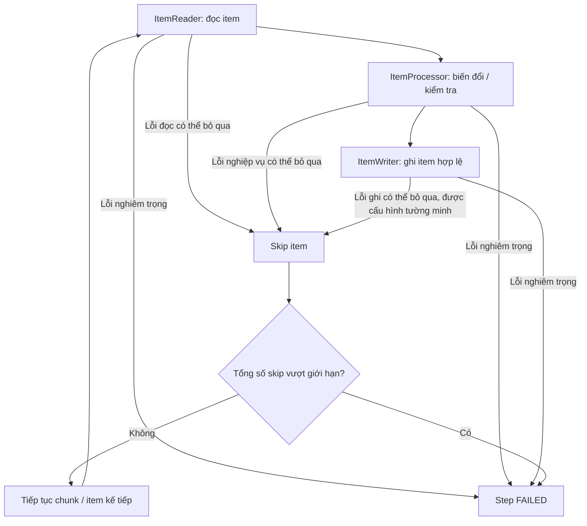

# Skip item lỗi trong chunk với Spring Batch

Trong một job xử lý hàng triệu bản ghi, một dòng CSV sai định dạng hoặc một giao dịch nghiệp vụ có dữ liệu không hợp lệ không nhất thiết phải làm hỏng toàn bộ lần chạy. Spring Batch cho phép một **chunk-oriented step** bỏ qua (*skip*) những item lỗi đã được phân loại trước, tiếp tục xử lý các item hợp lệ và lưu lại số lượng lỗi. Cơ chế này đặc biệt hữu ích trong module **SPRING_BATCH_SCALING_OPERATIONS**: khi mở rộng bằng multi-threaded step, parallel steps hoặc partitioning, khả năng phục hồi cần được thiết kế cùng với giới hạn tài nguyên, tính an toàn luồng và khả năng restart.

Tuy nhiên, skip cũng có thể che giấu lỗi hệ thống hoặc làm mất dữ liệu nếu cấu hình quá rộng. Bài học tập trung vào **skip item lỗi trong chunk**: lúc nào dùng, cách thiết lập `faultTolerant()`, `skip()`, `skipLimit()`, cách theo dõi item bị loại và vận hành an toàn ở quy mô lớn.

> **Phạm vi phiên bản:** Ví dụ dùng Java 17+, Spring Batch 5.x, Spring Boot 3.x và PostgreSQL. Một số API có thể khác trên Spring Batch 4 hoặc 6; cần đối chiếu phiên bản ứng dụng trước khi sao chép vào production.

## 1. Phân biệt skip, filter, retry, rollback và restart

Một chunk step thường chạy qua ba giai đoạn:



| Cơ chế | Ý nghĩa | Ví dụ | Tác động |
| --- | --- | --- | --- |
| **Skip** | Bỏ qua item có lỗi được cho phép | Dòng CSV sai định dạng hoặc đơn hàng có số tiền âm | Tăng `readSkipCount`, `processSkipCount` hoặc `writeSkipCount` |
| **Filter** | Chủ động loại item bằng cách trả về `null` từ processor | Bỏ đơn hàng đã hủy theo quy tắc nghiệp vụ | Tăng `filterCount`; **không** tính vào skip |
| **Retry** | Thử lại thao tác sau lỗi có thể phục hồi | Deadlock hoặc lỗi kết nối tạm thời | Có thể thành công mà không cần skip |
| **Rollback** | Hoàn tác transaction khi thao tác trong chunk thất bại | Lệnh ghi SQL lỗi giữa chunk | Có thể dẫn đến retry, skip hoặc step thất bại |
| **Restart** | Chạy lại job instance đã thất bại dựa trên metadata/checkpoint | Batch dừng ở bản ghi thứ 80.000 | Tiếp tục từ trạng thái được lưu, theo chính sách restart |

**Nguyên tắc chọn cơ chế:** lỗi dữ liệu cục bộ, có thể khoanh vùng một item, mới phù hợp với skip. Lỗi mạng, deadlock hoặc nghẽn tài nguyên thường cần retry có giới hạn. Lỗi schema, sai cấu hình, thiếu dữ liệu hệ thống hoặc vi phạm tính toàn vẹn quan trọng nên làm step thất bại để được xử lý dứt điểm.

## 2. Skip xảy ra ở ba giai đoạn nào?

### 2.1. Skip khi đọc — `onSkipInRead`

Reader có thể không chuyển một dòng đầu vào thành item được. Ví dụ file CSV chứa `id` không phải số:

```csv
id,customerCode,amount
1,C001,120.50
broken,C002,20.00
3,C003,80.00
```

Khi `FlatFileItemReader` dùng `FieldSet.readLong("id")`, dòng thứ hai có thể dẫn đến `FlatFileParseException`. Nếu exception này được khai báo có thể skip, Spring Batch sẽ bỏ dòng lỗi và tiếp tục dòng tiếp theo. Không có một đối tượng item hợp lệ để truyền vào `onSkipInRead`; listener nhận exception để biết lý do.

Không dùng `skip(Exception.class)` chỉ để tránh job dừng. Định dạng file thay đổi hoàn toàn, reader mất kết nối tới nguồn hoặc lỗi phân quyền cần được phát hiện rõ ràng.

### 2.2. Skip khi xử lý — `onSkipInProcess`

Reader đã đọc thành công, nhưng processor nhận ra item vi phạm quy tắc nghiệp vụ. Ví dụ số tiền âm là dữ liệu không chấp nhận được:

```java
if (amount.signum() < 0) {
    throw new InvalidOrderException("Amount must not be negative");
}
```

Nếu `InvalidOrderException` được cấu hình `skip`, chỉ item này bị bỏ qua; các item hợp lệ khác vẫn được xử lý. Exception nên là loại riêng cho quy tắc có thể bỏ qua, thay vì sử dụng `IllegalArgumentException` chung cho mọi vấn đề.

**Phân biệt với filter:** nếu đơn hàng đã hủy được chủ động loại khỏi pipeline và đó là hành vi bình thường, processor có thể `return null`. Việc đó làm tăng `filterCount`, không làm tăng skip và không kích hoạt `SkipListener`.

### 2.3. Skip khi ghi — `onSkipInWrite`

Writer gặp lỗi đối với một item trong chunk, ví dụ giá trị không đáp ứng ràng buộc dữ liệu. Nếu exception được chỉ định là skippable, Spring Batch có thể rollback và thực hiện lại các thao tác cần thiết để cô lập item ghi lỗi, rồi tiếp tục với item khác. Việc xác định item lỗi có thể làm tăng đáng kể số lần gọi writer, đặc biệt khi một chunk lớn.

Skip ở writer chỉ an toàn khi có thể **cô lập và bỏ đúng item lỗi** mà không làm hỏng kết quả item khác. Với thao tác ghi có side effect không thể rollback như HTTP call, gửi email, publish message, hoặc writer thiếu tính idempotent, không được xem việc bật `skip` là giải pháp mặc định. Ví dụ bên dưới **không skip lỗi database**: lỗi truy cập tạm thời được retry; lỗi dữ liệu hoặc hạ tầng còn lại làm step thất bại.

## 3. Giới hạn skip và chính sách phân loại exception

Cấu hình cốt lõi của một chunk step:

```java
new StepBuilder("importOrdersStep", jobRepository)
    .<RawOrder, AcceptedOrder>chunk(100, transactionManager)
    .reader(orderReader)
    .processor(orderProcessor)
    .writer(orderWriter)
    .faultTolerant()
    .skip(FlatFileParseException.class)
    .skip(InvalidOrderException.class)
    .skipLimit(2)
    .retry(TransientDataAccessException.class)
    .retryLimit(3)
    .build();
```

Trong ví dụ:

- `faultTolerant()` kích hoạt các tùy chọn xử lý lỗi của chunk step.
- Hai lời gọi `skip(...)` định nghĩa **loại exception** được phép bỏ qua ở giai đoạn thích hợp; subclass của các exception này cũng có thể được phân loại theo quan hệ kế thừa.
- `skipLimit(2)` cho phép **tối đa hai item skip trong một `StepExecution`**, tính tổng từ cả ba giai đoạn đọc, xử lý và ghi. Lỗi skip thứ ba vượt ngân sách sẽ khiến step thất bại.
- `retry(TransientDataAccessException.class)` cho phép thử lại lỗi truy cập dữ liệu tạm thời; `retryLimit(3)` quy định tổng số lần thử của một thao tác thuộc loại retry, kể cả lần ban đầu.
- Vì không cấu hình skip cho `TransientDataAccessException`, khi retry hết hạn mà lỗi còn tồn tại, step sẽ thất bại.

`skipLimit` là ngân sách số lượng, **không phải tỷ lệ phần trăm** dữ liệu lỗi. Với 1 triệu dòng, `skipLimit(2)` có nghĩa rất khác với 100 dòng. Nếu yêu cầu nghiệp vụ là không quá 0,1% lỗi, cần chính sách đo và quyết định dựa trên tổng đầu vào đã xác định rõ, chẳng hạn giám sát chất lượng sau bước xử lý hoặc triển khai `SkipPolicy` phù hợp; không tùy tiện tăng ngưỡng để job luôn có trạng thái xanh.

```text
Ví dụ với skipLimit = 2

Dòng A: đọc sai định dạng   => readSkipCount    = 1
Dòng B: dữ liệu nghiệp vụ sai => processSkipCount = 1
Dòng C: lỗi có thể skip      => lần skip thứ 3, vượt giới hạn
Kết quả: step FAILED; các transaction đã commit trước đó không tự mất đi.
```

Khi cần loại trừ một exception cụ thể khỏi nhóm skip rộng hơn, API còn có `noSkip(...)`; quy tắc này phải được kiểm tra cùng loại exception có thứ bậc kế thừa. Ví dụ, tránh skip `RuntimeException` chung vì nó bao phủ cả lỗi lập trình và cấu hình.

## 4. Ví dụ hoàn chỉnh: nhập CSV, bỏ dòng lỗi, ghi đơn hàng hợp lệ

Giả sử file `src/main/resources/data/orders.csv` có dữ liệu:

```csv
id,customerCode,amount
1,C001,120.50
2,C002,-15.00
broken,C003,19.90
4,C004,250.00
```

Mục tiêu: nhập dòng 1 và 4; skip dòng 2 do số tiền âm trong processor; skip dòng 3 do trường ID sai định dạng tại reader. `skipLimit(2)` đủ cho tập dữ liệu ví dụ này.

Tạo bảng PostgreSQL để ghi kết quả:

```sql
CREATE TABLE accepted_orders (
    id BIGINT PRIMARY KEY,
    customer_code VARCHAR(40) NOT NULL,
    amount NUMERIC(18, 2) NOT NULL
);
```

Cấu hình Java:

```java
package example.batch;

import java.math.BigDecimal;
import javax.sql.DataSource;

import org.slf4j.Logger;
import org.slf4j.LoggerFactory;
import org.springframework.batch.core.Job;
import org.springframework.batch.core.SkipListener;
import org.springframework.batch.core.Step;
import org.springframework.batch.core.configuration.annotation.StepScope;
import org.springframework.batch.core.job.builder.JobBuilder;
import org.springframework.batch.core.repository.JobRepository;
import org.springframework.batch.core.step.builder.StepBuilder;
import org.springframework.batch.item.ItemProcessor;
import org.springframework.batch.item.database.JdbcBatchItemWriter;
import org.springframework.batch.item.database.builder.JdbcBatchItemWriterBuilder;
import org.springframework.batch.item.file.FlatFileItemReader;
import org.springframework.batch.item.file.FlatFileParseException;
import org.springframework.batch.item.file.builder.FlatFileItemReaderBuilder;
import org.springframework.beans.factory.annotation.Qualifier;
import org.springframework.context.annotation.Bean;
import org.springframework.context.annotation.Configuration;
import org.springframework.core.io.ClassPathResource;
import org.springframework.dao.TransientDataAccessException;
import org.springframework.transaction.PlatformTransactionManager;

@Configuration
public class SkipOrdersJobConfig {

    private static final Logger log =
        LoggerFactory.getLogger(SkipOrdersJobConfig.class);

    record RawOrder(long id, String customerCode, String amountText) {}

    record AcceptedOrder(long id, String customerCode, BigDecimal amount) {}

    static class InvalidOrderException extends RuntimeException {
        InvalidOrderException(String message) {
            super(message);
        }
    }

    // Reader có trạng thái cursor và checkpoint.
    @Bean("skipOrderReader")
    @StepScope
    public FlatFileItemReader<RawOrder> skipOrderReader() {
        return new FlatFileItemReaderBuilder<RawOrder>()
            .name("skipOrderReader")
            .resource(new ClassPathResource("data/orders.csv"))
            .linesToSkip(1)
            .delimited()
            .names("id", "customerCode", "amount")
            .fieldSetMapper(fields -> new RawOrder(
                fields.readLong("id"),
                fields.readString("customerCode"),
                fields.readString("amount")))
            .saveState(true)
            .build();
    }

    @Bean("skipOrderProcessor")
    public ItemProcessor<RawOrder, AcceptedOrder> skipOrderProcessor() {
        return raw -> {
            BigDecimal amount;
            try {
                amount = new BigDecimal(raw.amountText());
            } catch (NumberFormatException ex) {
                throw new InvalidOrderException(
                    "Invalid amount for order " + raw.id());
            }
            if (amount.signum() < 0) {
                throw new InvalidOrderException(
                    "Negative amount for order " + raw.id());
            }
            return new AcceptedOrder(
                raw.id(), raw.customerCode(), amount);
        };
    }

    // UPSERT hỗ trợ chạy lại khi job restart hoặc chunk bị retry.
    @Bean("skipOrderWriter")
    public JdbcBatchItemWriter<AcceptedOrder> skipOrderWriter(
            DataSource dataSource) {

        return new JdbcBatchItemWriterBuilder<AcceptedOrder>()
            .dataSource(dataSource)
            .sql("INSERT INTO accepted_orders "
                + "(id, customer_code, amount) VALUES (?, ?, ?) "
                + "ON CONFLICT (id) DO UPDATE SET "
                + "customer_code = EXCLUDED.customer_code, "
                + "amount = EXCLUDED.amount")
            .itemPreparedStatementSetter((item, ps) -> {
                ps.setLong(1, item.id());
                ps.setString(2, item.customerCode());
                ps.setBigDecimal(3, item.amount());
            })
            .build();
    }

    @Bean("skipOrdersListener")
    public SkipListener<RawOrder, AcceptedOrder> skipOrdersListener() {
        return new SkipListener<>() {
            @Override
            public void onSkipInRead(Throwable cause) {
                // Không có RawOrder hợp lệ ở thời điểm reader lỗi.
                log.warn("Skipped invalid input line: {}",
                    cause.getClass().getSimpleName());
            }

            @Override
            public void onSkipInProcess(RawOrder item, Throwable cause) {
                log.warn("Skipped invalid order id={}: {}",
                    item.id(), cause.getMessage());
            }

            @Override
            public void onSkipInWrite(AcceptedOrder item, Throwable cause) {
                // Chỉ gọi nếu đã cho phép skip lỗi write phù hợp.
                log.warn("Skipped write for order id={}: {}",
                    item.id(), cause.getMessage());
            }
        };
    }

    @Bean("importOrdersStep")
    public Step importOrdersStep(
            JobRepository jobRepository,
            PlatformTransactionManager transactionManager,
            @Qualifier("skipOrderReader")
                FlatFileItemReader<RawOrder> reader,
            @Qualifier("skipOrderProcessor")
                ItemProcessor<RawOrder, AcceptedOrder> processor,
            @Qualifier("skipOrderWriter")
                JdbcBatchItemWriter<AcceptedOrder> writer,
            @Qualifier("skipOrdersListener")
                SkipListener<RawOrder, AcceptedOrder> listener) {

        return new StepBuilder("importOrdersStep", jobRepository)
            .<RawOrder, AcceptedOrder>chunk(100, transactionManager)
            .reader(reader)
            .processor(processor)
            .writer(writer)
            .faultTolerant()
            .skip(FlatFileParseException.class)
            .skip(InvalidOrderException.class)
            .skipLimit(2)
            .retry(TransientDataAccessException.class)
            .retryLimit(3)
            .listener(listener)
            .build();
    }

    @Bean("importOrdersJob")
    public Job importOrdersJob(
            JobRepository jobRepository,
            @Qualifier("importOrdersStep") Step step) {

        return new JobBuilder("importOrdersJob", jobRepository)
            .start(step)
            .build();
    }
}
```

Ứng dụng cần cấu hình `DataSource`, `PlatformTransactionManager`, `JobRepository`, các bảng metadata Spring Batch và vị trí resource CSV. Ví dụ dùng `ClassPathResource` để minh họa; trong hệ thống chạy định kỳ, nên dùng nguồn đầu vào bất biến theo `JobParameters` (ví dụ file có version hoặc snapshot), tránh nội dung file thay đổi giữa các lần restart. `ON CONFLICT` là cú pháp PostgreSQL; ở DB khác phải thay bằng cơ chế tương đương.

### Kết quả mong đợi

Với CSV mẫu, các bản ghi 1 và 4 có mặt trong `accepted_orders`. Bản ghi 2 bị skip trong processor; dòng có ID `broken` bị skip khi đọc. Step có thể `COMPLETED` dù có hai item bị skip, vì tổng chưa vượt giới hạn.

| Chỉ số `StepExecution` | Giá trị minh họa |
| --- | ---: |
| `readSkipCount` | 1 |
| `processSkipCount` | 1 |
| `writeSkipCount` | 0 |
| `skipCount` | 2 |
| `writeCount` | 2 |
| `filterCount` | 0 |

Các số đếm nên được xem cùng `ExitStatus`, `BatchStatus`, thời gian chạy, exception cụ thể và tỷ lệ lỗi nghiệp vụ. Không nên đánh giá thành công chỉ bằng trạng thái `COMPLETED`.

## 5. Chunk transaction xử lý skip ra sao?

Với `chunk(100, transactionManager)`, Spring Batch thực hiện ghi và commit theo chunk. Một item bị skip **không có nghĩa** mọi thay đổi trước đó đã được hoàn tác; cũng không có nghĩa một transaction duy nhất bao phủ cả job.

Tùy giai đoạn phát sinh lỗi và rollback classification:

1. Reader ném `FlatFileParseException`: framework kiểm tra skip policy; item lỗi không đưa sang processor. Với nguồn đọc dạng file không transactional, vị trí đọc và checkpoint cần được quản lý để không lặp vô hạn dòng lỗi.
2. Processor ném `InvalidOrderException`: nếu được skip, item không được chuyển tới writer. Thông thường skip trong processor không cần rollback transaction của cả chunk, nhưng có thể có cấu hình rollback/retry khác tác động hành vi.
3. Writer ném exception: việc rollback và retry/cô lập item phụ thuộc loại lỗi, transaction manager và cấu hình fault tolerance. Những write đã thực hiện trong cùng transaction nhưng chưa commit phải có khả năng rollback đúng.
4. Sau khi transaction chunk commit, metadata/checkpoint giúp Spring Batch restart; các thay đổi bên ngoài transaction có thể cần idempotency hoặc quy trình bù.

Ví dụ với chunk gồm item `A`, `B`, `C`: `A` hợp lệ, `B` có số tiền âm (process skip), `C` hợp lệ. Writer nhận các item hợp lệ và commit theo chunk. Nếu DB ghi `A`, `C` bằng JDBC trong cùng transaction, rollback sẽ hoàn tác cả hai khi lỗi ghi yêu cầu rollback.

**Cẩn trọng với `noRollback(...)`:** cấu hình không rollback tùy tiện cho exception ở writer có thể để lại một phần thay đổi không nhất quán. Chỉ sử dụng sau khi hiểu rõ writer, giới hạn transaction và cách phục hồi.

## 6. Quan sát và lưu item bị bỏ qua bằng `SkipListener`

`SkipListener<I,O>` cung cấp ba callback:

| Callback | Dữ liệu nhận được | Mục đích |
| --- | --- | --- |
| `onSkipInRead(Throwable t)` | Exception, không có item đã map thành công | Ghi nhận dòng đầu vào lỗi đọc |
| `onSkipInProcess(I item, Throwable t)` | Item đầu vào và exception | Quarantine item sai nghiệp vụ |
| `onSkipInWrite(O item, Throwable t)` | Item đầu ra và exception | Ghi nhận item không ghi được |

Spring Batch cố gắng gọi các callback cho item bị skip ngay trước commit của transaction thích hợp, nhằm hỗ trợ thao tác audit/quarantine nhất quán. Nhưng **không được mặc định callback là kênh exactly-once xuyên qua sự cố tiến trình**: nếu callback gửi HTTP, message hoặc email ra ngoài, thao tác đó không nhất thiết rollback cùng chunk. Có thể cần idempotency key và cơ chế outbox.

Trong hệ thống dữ liệu lớn, một bảng quarantine thường lưu:

```text
job_instance_key | step_name | partition_name | input_key
source_reference  | failure_phase | exception_type
reason_code       | recorded_at | resolution_status
```

Hạn chế ghi nguyên văn dữ liệu nhạy cảm hoặc stack trace khổng lồ vào log. Với nguồn CSV, có thể lưu số dòng hoặc đường dẫn input và mã lỗi; với dữ liệu cá nhân, tuân thủ chính sách che thông tin. Xác định khóa duy nhất của bản ghi quarantine để tránh tạo bản ghi lặp do retry hoặc restart.

Nếu ghi quarantine vào database, cần làm rõ nó tham gia **cùng transaction** với bước xử lý hay được gửi qua outbox. Việc gọi một hệ thống bên ngoài ngay từ listener có thể tạo bản ghi quarantine dù chunk cuối cùng rollback.

### Theo dõi số lỗi thực tế

Các bộ đếm trên `StepExecution` gồm:

- `readCount`, `writeCount`, `filterCount`.
- `readSkipCount`, `processSkipCount`, `writeSkipCount`; tổng của ba bộ đếm này tạo thành `skipCount`.
- `rollbackCount`, `commitCount`, trạng thái và thời gian chạy.
- Exception/cause thường xuyên nhất, phân bố lỗi theo file, partition hoặc nhóm nghiệp vụ.

Một job `COMPLETED` nhưng có hàng nghìn skip có thể là **sự cố chất lượng dữ liệu**. Báo cáo vận hành nên có ngưỡng cảnh báo skip, đối chiếu số input và output, danh sách item quarantine, và cơ chế reprocess sau khi đã sửa dữ liệu.

## 7. Skip kết hợp retry và restart

### Retry trước khi quyết định lỗi hệ thống

Không nên skip ngay một item chỉ vì DB timeout. Ví dụ `TransientDataAccessException` có thể đến từ khóa tạm thời hoặc kết nối chập chờn; thử lại ba lần có thể thành công. Nếu cả ba lần vẫn thất bại, step nên thất bại để job có thể restart sau khi hạ tầng ổn định.

| Lỗi | Chính sách đề xuất | Vì sao |
| --- | --- | --- |
| CSV sai trường hoặc không parse được ID | Skip có giới hạn và quarantine | Lỗi cục bộ của một dòng |
| Số tiền âm trái quy tắc | Skip có giới hạn, ghi reason code | Dữ liệu nghiệp vụ riêng lẻ |
| Bản ghi không thuộc phạm vi xử lý | Filter (`return null`) | Hành vi bình thường, không phải lỗi |
| Deadlock hoặc lỗi DB tạm thời | Retry có giới hạn | Có thể thành công khi thử lại |
| Thiếu bảng DB, sai SQL/schema | Fail step, cảnh báo | Lỗi hệ thống; skip sẽ che giấu vấn đề |
| Kết nối DB mất kéo dài | Retry hữu hạn, sau đó fail/restart | Tránh lặp vô tận hoặc làm quá tải |
| Một phần side effect ngoài DB đã diễn ra | Thiết kế idempotency/outbox trước | Transaction không bao trùm hệ thống ngoài |

### Restart sau khi vượt `skipLimit`

Giả sử bước xử lý đã commit 10 chunk rồi gặp skip vượt giới hạn ở chunk tiếp theo. Khi restart cùng **job instance**, Spring Batch dùng `ExecutionContext` và metadata đã lưu để bắt đầu lại từ checkpoint hợp lệ. Các chunk đã commit không tự rollback; item quanh checkpoint có thể được đọc/xử lý lại tùy giao dịch và thời điểm lỗi.

Vì vậy:

- Reader phải hỗ trợ lưu trạng thái phù hợp (`ItemStream`, `saveState(true)` nếu được áp dụng), với **tên reader ổn định**.
- File/source nên bất biến cho cùng job instance; không sửa file rồi hy vọng checkpoint cũ sẽ tự tìm đúng item.
- Writer cần idempotent hoặc hỗ trợ rollback đầy đủ để tránh trùng khi xử lý lại.
- Restart với cùng tham số định danh job instance khác việc tạo job instance mới bằng các `JobParameters` khác nhau.
- Khi một bản ghi bị skip và sau đó sửa dữ liệu đầu vào, phải chọn rõ chiến lược **reprocess có kiểm soát**. Không dựa vào restart tự động để xử lý lại tất cả item đã skip thành công trong lần chạy trước.

Một phương án thực tế là: ghi item lỗi vào quarantine có lý do; hoàn thành batch hợp lệ trong phạm vi ngân sách; tạo một job reprocess riêng sau khi dữ liệu được chỉnh sửa và được phê duyệt.

## 8. Skip khi mở rộng xử lý song song

Trong **SPRING_BATCH_SCALING_OPERATIONS**, skip policy phải được đánh giá cùng mô hình chạy:

| Kiến trúc | Skip được tính như thế nào? | Điều cần chú ý |
| --- | --- | --- |
| Chunk step tuần tự | Theo một `StepExecution` | Dễ kiểm soát ngân sách và thứ tự |
| Multi-threaded step | Các chunk có thể chạy đồng thời trong một `StepExecution` | Reader/writer/listener cần thread safety; checkpoint và số thứ tự item khó dự đoán hơn |
| Local partitioning (`TaskExecutorPartitionHandler`) | **Mỗi partition có `StepExecution` riêng** và có thể áp dụng ngưỡng skip riêng | Tổng skip của job cần được tổng hợp từ các partition |
| Remote partitioning | Worker partition chạy trên node khác, metadata và kết quả tập hợp ở manager | Quan sát thất bại mạng, điều phối restart và xử lý trùng message |
| Parallel steps | Mỗi step có thống kê skip riêng | Tổng hợp báo cáo cấp job, không nhầm với một step duy nhất |

Ví dụ manager tạo 8 partition, mỗi worker step có `skipLimit(10)`. Điều đó **không có nghĩa cả job chỉ được skip tối đa 10 item**: nếu các worker đều chạm ngưỡng cho phép, tổng lỗi có thể lên tới 80 trước khi áp dụng bất kỳ ngân sách toàn job nào. Với yêu cầu tuyệt đối “không quá 10 item lỗi trên toàn tập”, cần cơ chế tổng hợp và quyết định riêng ở cấp job; trong môi trường phân tán, một bộ đếm đồng bộ đơn giản có thể thành nút thắt hoặc nguồn race condition.

**Thread safety:**

- Không chia sẻ một `FlatFileItemReader` có state cho nhiều luồng. Với partitioning, dùng reader `@StepScope` và gắn partition context để mỗi worker đọc đúng phạm vi dữ liệu.
- Listener dùng chung nên stateless hoặc sử dụng công cụ thu thập concurrent an toàn; không lưu “item lỗi gần nhất” trong biến instance dùng chung.
- Quarantine writer cần khóa tự nhiên/idempotency key để chống ghi trùng do retry và restart.
- Tăng concurrency có thể làm xuất hiện nhiều lỗi DB tạm thời; không nên biến chúng thành skip để đạt tỷ lệ “thành công” đẹp hơn.

**Tài nguyên:** skip write có thể khiến framework chạy lại hoặc kiểm tra từng item, làm số statement, transaction và log tăng đột biến. Với chunk lớn hoặc parallel partition, cần đo thời gian retry, `rollbackCount`, tốc độ đọc/ghi, kích thước connection pool và mức DB contention thay vì chỉ đo throughput.

## 9. Kiểm thử recovery trước khi đưa vào production

Nên xây dựng bộ dữ liệu kiểm tra có chủ ý:

| Tình huống | Kết quả mong đợi |
| --- | --- |
| 100 item đều hợp lệ | `skipCount = 0`, output đầy đủ |
| Một dòng CSV sai ID | `readSkipCount = 1`, các dòng hợp lệ khác được ghi |
| Một số tiền âm | `processSkipCount = 1`, item âm được quarantine |
| Processor `return null` vì nghiệp vụ | `filterCount` tăng, `skipCount` không tăng |
| Ba item lỗi với `skipLimit(2)` | Step `FAILED` ở lần skip vượt ngưỡng |
| DB timeout có thể phục hồi | Thao tác retry thành công, không tính thành skip |
| DB không phục hồi sau retry | Step `FAILED`, metadata ghi nhận lỗi |
| Dừng tiến trình sau một chunk đã commit | Restart không tạo output trùng hoặc thiếu |
| 4 partition, mỗi partition có dữ liệu lỗi | Skip count đúng theo từng worker và tổng hợp cấp job |
| Nhiều item ghi lỗi trong một chunk lớn | Đo số lần retry/rollback, kiểm tra tính nhất quán output |

Khi test restart, dùng database và `JobRepository` thật hoặc môi trường kiểm thử tương đương, cố ý phát sinh exception sau một số lần commit, sau đó chạy lại **cùng job instance**. Đối chiếu input, các item filter, item skip, output, quarantine và số đếm metadata. Kiểm tra cả việc gửi cảnh báo khi skip vượt ngưỡng chất lượng dữ liệu, dù step vẫn hoàn thành.

## 10. Các lỗi cấu hình thường gặp

| Sai lầm | Hệ quả | Cách xử lý |
| --- | --- | --- |
| `skip(Exception.class)` hoặc `skip(RuntimeException.class)` | Che lỗi logic/hạ tầng; mất dữ liệu khó phát hiện | Chỉ định chính xác exception nghiệp vụ có thể bỏ qua |
| `skipLimit` rất cao để job luôn hoàn thành | Dữ liệu bị loại hàng loạt mà không có cảnh báo | Xây ngân sách chất lượng, quarantine và cảnh báo |
| Xem `return null` là skip | Nhầm `filterCount` và `skipCount` | Phân biệt filter nghiệp vụ và skip do lỗi |
| Retry mọi lỗi dữ liệu sai | Tốn thời gian nhưng dữ liệu vẫn không hợp lệ | Retry lỗi tạm thời, skip lỗi dữ liệu đã phân loại |
| Skip writer có side effect ngoài transaction | Ghi trùng hoặc một phần output không thể rollback | Dùng transaction, idempotency hoặc outbox |
| Dùng chung stateful reader khi chạy nhiều thread | Race condition, dữ liệu lẫn hoặc thiếu | Reader riêng theo partition/step scope |
| Thay đổi nguồn khi restart | Checkpoint không còn khớp dữ liệu | Cố định snapshot/version và partition |
| Chỉ xem `BatchStatus.COMPLETED` | Bỏ qua tỷ lệ skip nguy hiểm | Theo dõi reason code, bộ đếm skip và đối soát dữ liệu |

## 11. Câu hỏi tự luyện

1. Một chunk gồm 100 item; có 3 item trả về `null` ở processor và 2 item ném `InvalidOrderException` đã được phép skip. Với `skipLimit(2)`, hãy giải thích vì sao step có thể hoàn thành và phân biệt `filterCount` với `processSkipCount`.
2. Giả sử 8 partition chạy trên 4 thread, mỗi worker `skipLimit(5)`. Hãy đề xuất cách kiểm soát ngân sách lỗi toàn job không quá 10 item mà vẫn quan sát được tổng lỗi sau khi chạy.
3. Một writer gửi dữ liệu qua HTTP và thất bại giữa chunk. Hãy phân tích nguy cơ khi bật skip cho mọi exception và thiết kế lại để retry/restart không tạo side effect trùng lặp.
4. Mô phỏng input bị lỗi ở lần đọc thứ 10, lỗi DB tạm thời ở lần ghi thứ 20 và tiến trình bị dừng sau chunk thứ 3. Chỉ ra trường hợp nào nên skip, retry và restart; mô tả số đếm kỳ vọng.

**Kết luận:** Skip item lỗi là công cụ kiểm soát chất lượng và tăng khả năng hoàn thành của chunk step khi một phần nhỏ dữ liệu bị lỗi có thể cô lập. Dùng đúng cần phân loại exception chặt chẽ, đặt `skipLimit` có ý nghĩa, lưu dấu vết item bị loại, bảo đảm transaction/idempotency và kiểm thử restart. Khi mở rộng Spring Batch bằng multi-threaded step hoặc partitioning, phải đồng thời tính đến phạm vi `StepExecution`, thread safety và tổng ngân sách lỗi ở cấp job.
