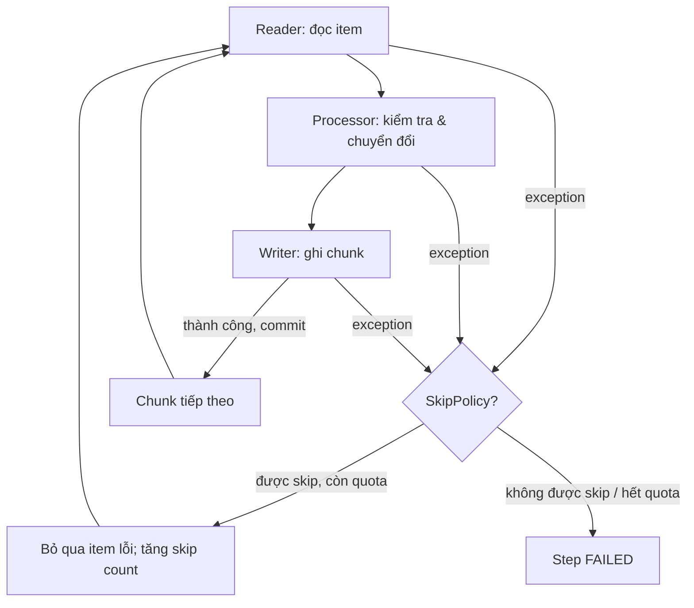
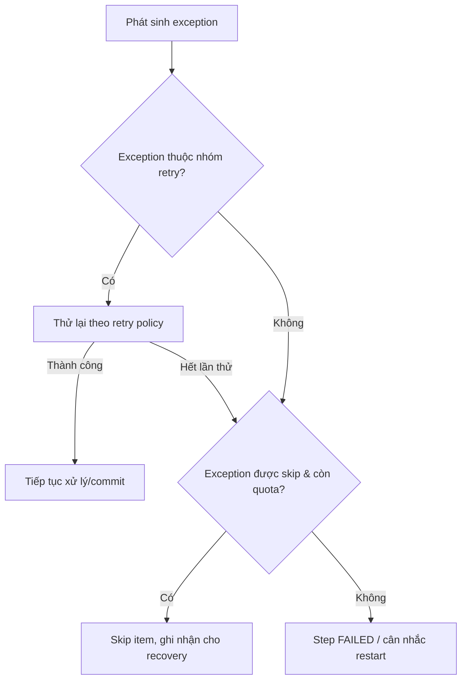

# Skip policy theo exception trong Spring Batch

> **Chương:** Skip và recovery  
> **Mục tiêu:** Phân loại lỗi theo exception để quyết định **bỏ qua bản ghi**, **thử lại** hay **dừng step**; kiểm soát số lượng bản ghi lỗi, lưu dấu vết phục hồi và đảm bảo dữ liệu vẫn đúng khi mở rộng Spring Batch cho workload lớn.

## 1. Bài toán: Có nên bỏ qua bản ghi lỗi?

Hệ thống nhập 5 triệu dòng khách hàng mỗi đêm. Trong lúc xử lý có thể gặp những lỗi rất khác nhau:

- Dòng CSV sai định dạng: thiếu cột bắt buộc, không đọc được ngày sinh. Có thể tách dòng lỗi để sửa sau, trong khi những dòng hợp lệ vẫn được nhập.
- Email không đúng quy tắc nghiệp vụ: có thể bỏ qua bản ghi, nhưng phải ghi lý do và kiểm soát tỷ lệ lỗi.
- Database mất kết nối: tiếp tục bỏ qua các bản ghi sẽ che giấu sự cố hạ tầng; nên thử lại có giới hạn rồi thất bại nếu chưa phục hồi.
- Không tìm thấy file nguồn hoặc thiếu cấu hình bí mật: phải dừng job và phát cảnh báo.

Trong Spring Batch, **skip** là quyết định chấp nhận không xử lý thành công một item cụ thể, sau đó tiếp tục những item khác. Quyết định này chỉ an toàn khi nghiệp vụ cho phép thiếu item ấy, có ngưỡng chất lượng rõ ràng và có phương án xử lý phần dữ liệu bị loại.

Mục tiêu của **exception-based skip policy** là chuyển phân loại lỗi từ các khối `try/catch` rải rác sang quy tắc nhất quán tại chunk-oriented step: exception nào được skip, tối đa bao nhiêu lần, exception nào buộc step thất bại.

## 2. Skip diễn ra ở đâu trong chunk?

Một chunk-oriented step thường đi qua ba pha: `ItemReader.read()`, `ItemProcessor.process()` và `ItemWriter.write(Chunk<O>)`.



Sơ đồ chỉ minh họa **quyết định phân loại**. Trong thực tế còn có transaction, rollback, retry và logic quét lại chunk khi ghi lỗi:

| Pha | Ví dụ exception | Cách Spring Batch có thể phục hồi |
| --- | --- | --- |
| **Read** | `FlatFileParseException` khi một dòng CSV sai định dạng | Bỏ qua dòng đọc lỗi nếu reader có thể tiến tới bản ghi tiếp theo và exception được phân loại skippable |
| **Process** | `InvalidCustomerException` do dữ liệu không đạt chuẩn | Bỏ qua item đang xử lý, tiếp tục item còn lại |
| **Write** | Lỗi ghi do một item vi phạm quy tắc đã được nhận diện | Có thể rollback chunk và thử ghi từng item để cô lập item gây lỗi; tốn thêm transaction và thời gian |

Không phải mọi reader đều có khả năng tiến tiếp sau một lỗi đọc: nếu nguồn đã hỏng hoặc reader cứ ném cùng exception mà không dịch chuyển vị trí, skip có thể không giúp hệ thống tiến lên. Cần thiết kế reader và kiểm tra khả năng restart.

**Skip khác filter:** `ItemProcessor` trả về `null` là *lọc item theo nghiệp vụ* và tăng `filterCount`; không tính là lỗi skip. Ném exception skippable là *ghi nhận dữ liệu bất thường* và làm tăng một trong các skip count.

## 3. Cấu hình skip theo exception class

Ví dụ sau dành cho **Spring Batch 5.2.x**. Giả định ứng dụng đã cung cấp các bean `ItemReader<String>`, `ItemProcessor<String, String>` và `ItemWriter<String>` cho nghiệp vụ import; tên qualifier có thể đổi theo hệ thống thực tế.

```java
import org.springframework.batch.core.Step;
import org.springframework.batch.core.repository.JobRepository;
import org.springframework.batch.core.step.builder.StepBuilder;
import org.springframework.batch.item.ItemProcessor;
import org.springframework.batch.item.ItemReader;
import org.springframework.batch.item.ItemWriter;
import org.springframework.batch.item.file.FlatFileParseException;
import org.springframework.beans.factory.annotation.Qualifier;
import org.springframework.context.annotation.Bean;
import org.springframework.context.annotation.Configuration;
import org.springframework.dao.TransientDataAccessException;
import org.springframework.transaction.PlatformTransactionManager;

@Configuration(proxyBeanMethods = false)
class CustomerImportStepConfig {

    static class InvalidCustomerException extends RuntimeException {
        InvalidCustomerException(String message) {
            super(message);
        }
    }

    @Bean
    Step importCustomersStep(
            JobRepository jobRepository,
            PlatformTransactionManager transactionManager,
            @Qualifier("customerReader") ItemReader<String> reader,
            @Qualifier("customerProcessor") ItemProcessor<String, String> processor,
            @Qualifier("customerWriter") ItemWriter<String> writer) {

        return new StepBuilder("importCustomersStep", jobRepository)
                .<String, String>chunk(100, transactionManager)
                .reader(reader)
                .processor(processor)
                .writer(writer)
                .faultTolerant()
                // Lỗi dữ liệu xác định: chấp nhận bỏ item.
                .skip(FlatFileParseException.class)
                .skip(InvalidCustomerException.class)
                .skipLimit(10)
                // Lỗi hạ tầng tạm thời: thử lại, không âm thầm skip.
                .retry(TransientDataAccessException.class)
                .retryLimit(3)
                .build();
    }
}
```

Đây là **cấu hình Step**, không phải toàn bộ ứng dụng có thể chạy độc lập. Reader, processor và writer phải được cung cấp qua bean tương ứng. `InvalidCustomerException` nên được ném từ processor khi xác định bản ghi có lỗi dữ liệu có thể bỏ qua. Đặt tên step ổn định và dùng `JobRepository` bền vững để hỗ trợ theo dõi và restart.

### Skip limit được tính thế nào?

- `skipLimit(10)` cho phép **tối đa 10 item bị skip** trong một `StepExecution`. Lỗi skippable tiếp theo (lần thứ 11) khiến step thất bại.
- Giới hạn dùng **tổng** `readSkipCount + processSkipCount + writeSkipCount`, không phải 10 lần *cho mỗi pha*.
- Nếu không gọi `skipLimit` khi dùng chính sách skip mặc định, Spring Batch 5.2 sử dụng giới hạn mặc định **10**; nên khai báo tường minh để code thể hiện yêu cầu chất lượng.
- `skipLimit(0)` có nghĩa **không cho phép skip**.
- Class được khai báo trong `skip(...)` bao gồm các subclass của nó. Exception không được phân loại là skippable được coi là fatal đối với logic skip.

Ví dụ `skipLimit(10)` và thống kê cuối step:

| Read skip | Process skip | Write skip | Tổng skip | Kết quả xét ngưỡng |
| ---: | ---: | ---: | ---: | --- |
| 2 | 3 | 4 | 9 | Vẫn còn quota cho một item |
| 2 | 4 | 4 | 10 | Đã dùng hết quota; nếu không còn lỗi, step có thể hoàn thành |
| 2 | 4 | 5 | 11 | Lần skip thứ 11 **không được chấp nhận**, step thất bại |

Trong hàng cuối, số 11 biểu thị **số lần skip được yêu cầu nếu tiếp tục**; số lần skip đã thực sự được chấp nhận có thể dừng ở 10 trước khi step thất bại.

### `skip` và `noSkip`

`skip(FooException.class)` cho phép skip loại lỗi đã chỉ định, `noSkip(BarException.class)` loại trừ một loại lỗi khỏi tập skippable. Chúng xét **quan hệ kế thừa** exception: cấu hình gần nhất trong cây lớp được áp dụng; thứ tự gọi `skip` và `noSkip` không quyết định ưu tiên.

```java
.faultTolerant()
.skip(Exception.class)
.noSkip(java.io.FileNotFoundException.class)
.skipLimit(10)
```

Ví dụ trên minh họa cách **loại trừ** `FileNotFoundException` khỏi nhóm `Exception` có thể skip. **Không dùng cấu hình `.skip(Exception.class)` cho import production**: nó có thể bỏ qua lỗi nghiệp vụ/hạ tầng quan trọng khác. Hãy khai báo tập exception cụ thể và chỉ mở rộng sau khi xem xét tác động của từng loại lỗi.

Nếu thư viện hoặc driver bọc lỗi trong một exception khác, hãy kiểm tra exception **thực sự được ném ra tại ranh giới reader/processor/writer** và xây dựng ánh xạ chính xác. Không tự giả định classifier luôn đi qua toàn bộ chuỗi `cause`.

## 4. Tùy biến `SkipPolicy.shouldSkip(Throwable, long)`

Khi quy tắc phức tạp hơn vài `.skip(...)` và `.noSkip(...)`, có thể triển khai `org.springframework.batch.core.step.skip.SkipPolicy`. Hợp đồng của Spring Batch 5.x/6.x là:

```java
boolean shouldSkip(Throwable error, long skipCount);
```

Trong đó:

- `error` là lỗi được framework đưa tới chính sách phân loại.
- `skipCount` là **số lượng item đã skip** trong ngữ cảnh thực thi của step, trước khi xét lỗi hiện tại.
- `true` nghĩa là cho phép tiếp tục bằng cách skip; `false` nghĩa là lỗi không được skip.
- Framework có thể truyền `skipCount < 0` để **thăm dò loại exception có thể skip** mà chưa thực hiện skip. Một policy tùy chỉnh phải xử lý trường hợp này hợp lệ.

Ví dụ chỉ cho phép hai loại lỗi dữ liệu, tối đa 20 item:

```java
import org.springframework.batch.core.step.skip.SkipPolicy;
import org.springframework.batch.item.file.FlatFileParseException;
import org.springframework.context.annotation.Bean;

@Bean
SkipPolicy customerDataSkipPolicy() {
    final long maxSkips = 20;

    return (error, skipCount) -> {
        boolean dataError =
                error instanceof FlatFileParseException
                || error instanceof InvalidCustomerException;

        if (!dataError) {
            return false;  // Không skip lỗi ngoài danh sách cho phép.
        }

        // Lúc framework chỉ hỏi về loại exception, chưa áp dụng quota.
        if (skipCount < 0) {
            return true;
        }

        // Đã skip 20 lần thì lỗi tiếp theo phải làm step thất bại.
        return skipCount < maxSkips;
    };
}
```

Gắn policy vào step:

```java
// Phần sau .reader(...).processor(...).writer(...) của StepBuilder:
.faultTolerant()
.skipPolicy(customerDataSkipPolicy())
.build();
```

**Lưu ý quan trọng:** Khi đã cung cấp `skipPolicy(customPolicy)`, cấu hình `skipLimit(...)` **không được framework áp dụng thay cho policy tùy chỉnh**. Trong ví dụ này, điều kiện `skipCount < maxSkips` tự thực thi giới hạn. Nếu xóa điều kiện ấy, hệ thống có thể bỏ qua số lượng lỗi lớn hơn mức mong muốn. Khi cần hệ phân loại theo class với giới hạn, cũng có thể sử dụng các implementation có sẵn như `LimitCheckingExceptionHierarchySkipPolicy` (Spring Batch 6) hoặc `LimitCheckingItemSkipPolicy` (Spring Batch 5), sau khi đối chiếu API chính xác của phiên bản đang dùng.

Một số nguyên tắc thiết kế `SkipPolicy`:

1. **Không có side effect:** `shouldSkip` có thể được gọi nhiều lần và cả trong pha probe; không ghi database, đẩy message hay tăng counter riêng trong callback này.
2. **Không lưu số skip trong field mutable của singleton:** dùng `skipCount` do framework truyền vào để tránh đếm sai khi nhiều step/job chạy song song.
3. **Phân loại theo lỗi có chủ đích:** policy chỉ nhận `Throwable` và count, không tự biết item gốc hay pha read/process/write. Nếu quy tắc phụ thuộc dữ liệu, hãy phân loại ở processor và ném exception nghiệp vụ phù hợp; nếu cần ghi thông tin item, dùng skip listener.
4. **Ưu tiên fail khi không nhận diện lỗi:** exception mới phát sinh phải được đánh giá trước khi thêm vào whitelist.

## 5. Skip, retry, rollback và recovery khác nhau thế nào?

| Cơ chế | Ý nghĩa | Lỗi phù hợp | Hành vi cuối |
| --- | --- | --- | --- |
| **Skip** | Bỏ item lỗi và tiếp tục | Dữ liệu đầu vào sai rõ ràng, được nghiệp vụ chấp nhận | Tăng skip count; item không được ghi thành công |
| **Retry** | Thử lại thao tác thất bại một số lần | Deadlock, timeout tạm thời hoặc API chập chờn | Thành công sau retry hoặc hết retry và chuyển sang xử lý lỗi theo cấu hình |
| **Rollback** | Hoàn tác transaction/chunk chưa commit khi lỗi | Lỗi ghi, lỗi transaction | Có thể phát sinh replay/reprocess của item trong chunk |
| **Restart** | Chạy tiếp JobInstance đã FAILED/STOPPED dựa vào metadata | Job ngắt hoặc bước xử lý thất bại | Tiếp tục tại checkpoint phù hợp, không tương đương retry một item |
| **Recovery/quarantine** | Giữ lại thông tin item lỗi cho quy trình sửa/chạy bù | Bản ghi được skip theo quy tắc | Có audit trail, sửa nguyên nhân và nhập lại có kiểm soát |

Với cấu hình ở phần 3, một `InvalidCustomerException` không phải loại retryable: step có thể bỏ qua item ngay nếu còn quota. Một `TransientDataAccessException` thuộc nhóm retryable nhưng không thuộc nhóm skip; nếu không phục hồi sau giới hạn retry, step sẽ thất bại. Trường hợp cùng một exception được đưa vào cả nhóm retry và skip đòi hỏi hiểu rõ trình tự thử lại và rollback; cần thử nghiệm riêng trước khi áp dụng.

Đặc biệt ở **write phase**, writer nhận *cả chunk* chứ không chỉ một item. Khi ghi lỗi skippable, Spring Batch có thể rollback chunk rồi chuyển sang cơ chế quét/thử ghi từng item để cô lập item lỗi. Vì vậy:

- Một lỗi ghi có thể khiến số lần gọi writer tăng mạnh; đừng suy throughput chỉ từ kích thước chunk.
- Transaction rollback **không hoàn tác** các side effect ngoài transaction, chẳng hạn gửi email, gọi API thanh toán hoặc ghi file ở hệ thống khác. Muốn dùng skip/retry an toàn phải thiết kế idempotency, outbox hoặc ghi staging có khóa riêng.
- Nếu writer làm biến đổi đối tượng được truyền vào, việc cache output của processor qua các lần retry có thể tạo trạng thái không còn hợp lệ. Chỉ sử dụng `processorNonTransactional()` khi đã chứng minh output có thể tái sử dụng an toàn sau rollback.



Lưu đồ thể hiện **cách tư duy thiết kế chính sách**; đường thực thi cụ thể phụ thuộc pha lỗi và transaction/rollback của Spring Batch.

## 6. Ghi nhận bản ghi bị skip bằng `SkipListener`

Nếu chấp nhận bỏ bản ghi, hệ thống cần trả lời được: **bản ghi nào bị loại, vì sao, thuộc job nào, đang chờ xử lý ở đâu?**

Spring Batch cung cấp `SkipListener<I, O>` với ba callback:

```java
import org.slf4j.Logger;
import org.slf4j.LoggerFactory;
import org.springframework.batch.core.SkipListener;
import org.springframework.stereotype.Component;

@Component
public class CustomerSkipListener implements SkipListener<String, String> {
    private static final Logger log =
            LoggerFactory.getLogger(CustomerSkipListener.class);

    @Override
    public void onSkipInRead(Throwable error) {
        // Không có item vì reader chưa đọc thành công.
        log.warn("SKIP_READ cause={}",
                error.getClass().getSimpleName());
    }

    @Override
    public void onSkipInProcess(String item, Throwable error) {
        log.warn("SKIP_PROCESS cause={}",
                error.getClass().getSimpleName());
        // Trong hệ thống thực, lưu định danh an toàn + mã lỗi vào quarantine.
    }

    @Override
    public void onSkipInWrite(String item, Throwable error) {
        log.warn("SKIP_WRITE cause={}",
                error.getClass().getSimpleName());
    }
}
```

Đăng ký listener vào cấu hình step:

```java
.faultTolerant()
.skip(FlatFileParseException.class)
.skip(InvalidCustomerException.class)
.skipLimit(10)
.listener(customerSkipListener)
.build();
```

Trong đó `customerSkipListener` là bean được inject cùng kiểu dữ liệu với reader/processor/writer. Đoạn trên là phần tiếp nối khi xây dựng step, không phải một cấu hình độc lập. Listener chỉ ghi **loại lỗi** ra log, tránh đưa PII hoặc toàn bộ dữ liệu khách hàng vào log.

Khác với `ItemReadListener.onReadError` hoặc `ItemWriteListener.onWriteError`, một lần **gặp lỗi** có thể được retry rồi thành công; **`onSkip...`** biểu thị item đã được quyết định bỏ qua. Spring Batch thiết kế callback skip để phục vụ ghi nhận gần thời điểm commit, nhưng quá trình rollback, crash hoặc phát lại event vẫn đòi hỏi cơ chế lưu audit **idempotent**.

Một bảng quarantine có thể chứa:

| Trường | Ý nghĩa |
| --- | --- |
| `source_id`, `source_offset` hoặc `record_key` | Định danh bản ghi nguồn ổn định |
| `job_instance_id`, `step_name` | Xác định lượt/step xử lý |
| `error_code`, `error_phase` | Phân loại lỗi và pha read/process/write |
| `event_time`, `attempt` | Phục vụ quan sát và xử lý lại |
| `payload_ref` | Đường dẫn kho dữ liệu được bảo vệ để tra cứu bản gốc, tránh log dữ liệu nhạy cảm |
| `recovery_status` | `NEW`, `FIXED`, `REPLAYED`, `REJECTED` |

Khi ghi audit bằng cơ sở dữ liệu, cân nhắc dùng **cùng transaction** với nghiệp vụ cho các tác vụ cần nhất quán, hoặc kiến trúc outbox có khả năng phát lại. Thiết lập unique key theo định danh bản ghi và ngữ cảnh xử lý để không nhân bản quarantine khi restart.

## 7. Quan sát skip count và đảm bảo chất lượng dữ liệu

Ở cuối `StepExecution`, Spring Batch cung cấp các bộ đếm hữu ích:

```java
long readSkipped = stepExecution.getReadSkipCount();
long processSkipped = stepExecution.getProcessSkipCount();
long writeSkipped = stepExecution.getWriteSkipCount();
long allSkipped = stepExecution.getSkipCount();
long filtered = stepExecution.getFilterCount();
long rollbacks = stepExecution.getRollbackCount();
```

Các số đếm này phục vụ giám sát và điều tra; `filterCount` không nằm trong `skipCount`. Tùy phiên bản, số đếm có thể là `long` hoặc `int`; ví dụ gán vào `long` để đọc an toàn.

Chỉ giám sát số lỗi tuyệt đối là chưa đủ. Với job mỗi ngày có quy mô thay đổi, nên có cả:

- **Ngưỡng tuyệt đối:** chẳng hạn `skipLimit=10` cho một step nhạy cảm.
- **Ngưỡng tỷ lệ:** chẳng hạn quá 0,1% item bị loại thì không phát hành dữ liệu; tính từ mẫu số được định nghĩa nhất quán (ví dụ tổng bản ghi nguồn đã xử lý).
- **Ngưỡng theo loại lỗi:** một lỗi dữ liệu nhẹ có thể chấp nhận, nhưng lỗi mất tính nhất quán khóa chính phải dừng ngay dù chỉ một item.

Ví dụ giám sát giả định:

| Chỉ số | Baseline | Phiên chạy hiện tại | Hành động |
| --- | ---: | ---: | --- |
| Tổng bản ghi nguồn | 1.000.000 | 1.000.000 | Kiểm tra độ đầy đủ |
| Skip do format | 120 | 1.200 | Tăng 10 lần, điều tra upstream |
| Skip do validation | 30 | 80 | Đánh giá lỗi dữ liệu |
| Retry DB | 2 | 1.700 | Kiểm tra connection pool, lock contention |
| Tỷ lệ skip | 0,015% | 0,128% | Chặn bước publish nếu ngưỡng tối đa là 0,1% |

Các con số trên chỉ là dữ liệu minh họa. `SkipPolicy.shouldSkip` chỉ nhận exception và số skip, **không có sẵn mẫu số** để tính tỷ lệ trên toàn job. Để chặn phát hành theo tỷ lệ, sử dụng một **step kiểm tra chất lượng riêng** sau import, đọc số liệu đã lưu và đánh dấu lỗi khi vượt ngưỡng.

## 8. Skip policy trong workload lớn, multi-threaded step và partitioning

Module mở rộng Spring Batch cần xem skip như một phần của chiến lược scale:

| Mô hình | Ranh giới giám sát | Điểm cần chú ý |
| --- | --- | --- |
| Step tuần tự | Một `StepExecution` | Skip limit được áp dụng trực tiếp theo step |
| Multi-threaded step | Một step nhưng nhiều thread/chunk | Policy nên stateless, tuyệt đối không quản lý quota bằng field mutable không đồng bộ; reader/writer phải an toàn khi truy cập đồng thời |
| Parallel flows (`split`) | Mỗi nhánh chứa các step riêng | Một nhánh skip thành công không nghĩa mọi nhánh đều hợp lệ; bước hội tụ phải xét chất lượng đầu ra |
| Partitioning | Mỗi partition thường có `StepExecution` riêng | Nếu từng worker cho phép 10 skip, tổng có thể vượt quota nghiệp vụ; cần tổng hợp số liệu ở manager/validation step |
| Remote chunking/partitioning | Xuyên tiến trình | Cần định danh item, giao thức xử lý trùng, audit tập trung và thống kê toàn job |

Một điểm dễ nhầm: `skipLimit(10)` **không tự động có nghĩa tối đa 10 bản ghi lỗi trên toàn bộ job phân tán**. Giới hạn được kiểm soát ở đơn vị step thực thi; khi chia dữ liệu thành nhiều partition/worker, phải tổng hợp để áp dụng giới hạn nghiệp vụ tổng.

Skip cũng có thể làm sai lệch đánh giá hiệu năng. Job “nhanh hơn” vì bỏ qua quá nhiều bản ghi thì không phải scale hiệu quả. Hãy theo dõi đồng thời throughput **bản ghi ghi thành công**, tỷ lệ skip, retry, rollback và backlog quarantine.

## 9. Restart và replay dữ liệu đã skip

**Restart JobInstance thất bại** và **chạy bù các item đã skip** là hai hoạt động khác nhau:

1. **Restart:** Spring Batch dùng `JobRepository`, trạng thái `StepExecution` và checkpoint của reader/writer để tiếp tục theo cơ chế restart. Nếu step đã hoàn thành với các item được skip, nó vẫn có thể được đánh dấu `COMPLETED`; restart không tự đưa các item đã skip vào xử lý lại.
2. **Replay dữ liệu bị skip:** một job riêng đọc nguồn quarantine sau khi dữ liệu được sửa, áp dụng kiểm tra lại và ghi output theo khóa idempotent. Cần chính sách chống ghi trùng với những item đã thành công từ lần nhập trước.
3. **Full rerun:** tạo JobInstance mới có thể xử lý lại toàn bộ dữ liệu. Phải kiểm soát side effect và mã định danh bản ghi; đổi JobParameters không đồng nghĩa tiếp tục checkpoint cũ.

Khi crash giữa chunk, có thể xảy ra đọc hoặc tính toán lại item chưa commit. Nếu hệ thống phát sinh side effect bên ngoài database trong processor hoặc writer, xử lý lại có thể sinh kết quả trùng. Thiết kế ghi dữ liệu với unique constraint, upsert hoặc outbox; quan sát vị trí checkpoint thực tế của reader.

Không nên giữ một tập ID đã skip chỉ trong RAM rồi coi đó là dữ liệu phục hồi: restart hoặc worker chuyển máy có thể làm mất nó.

## 10. Lỗi cấu hình thường gặp và cách xử lý

| Triệu chứng | Nguyên nhân có thể | Cách kiểm tra/khắc phục |
| --- | --- | --- |
| Dữ liệu sai nhưng step vẫn FAILED | Exception ném ra không khớp class đã skip, hoặc hết quota | Xem root cause, loại exception bọc ngoài, các skip count |
| Job `COMPLETED` nhưng thiếu dữ liệu nghiêm trọng | Skip quá rộng như `Exception.class`, ngưỡng quá cao | Thu hẹp whitelist; thêm kiểm tra tỷ lệ chất lượng trước publish |
| Đã cấu hình `skipLimit(10)` nhưng custom policy bỏ qua nhiều hơn | `skipPolicy(...)` thay thế chính sách limit mặc định | Tự kiểm tra quota trong custom policy, bao gồm tình huống probe |
| Writer bị gọi nhiều lần | Lỗi ghi khiến rollback và quét lại chunk | Theo dõi rollback/transaction; làm writer idempotent; xác định lỗi ở từng item |
| Cùng lỗi xuất hiện hàng nghìn lần nhưng không tiến | Reader không thể tiến qua bản ghi lỗi hoặc lỗi nguồn mang tính hệ thống | Sửa reader/nguồn; phân biệt fatal với lỗi của một record |
| Quarantine chứa nhiều bản ghi trùng | Restart, rollback hoặc ghi audit thiếu khóa định danh | Dùng idempotency key và giao dịch/outbox phù hợp |
| Worker partition đều thành công nhưng tổng skip vượt SLA | Quota áp dụng riêng theo `StepExecution` | Tổng hợp skip toàn job và validation sau join |

## 11. Thực hành: Thiết kế và kiểm chứng skip policy

**Bài tập A — Phân loại lỗi.** Với bộ dữ liệu 1.000 bản ghi, tạo 4 dòng sai CSV, 3 dòng email không hợp lệ và mô phỏng một lỗi kết nối DB. Cấu hình `skipLimit(10)`, skip hai loại lỗi dữ liệu và retry lỗi DB. Kỳ vọng các bản ghi dữ liệu lỗi được bỏ qua (nếu có thể tiến tiếp), DB được retry; nếu DB không phục hồi thì step thất bại.

**Bài tập B — Hết quota.** Tạo 11 bản ghi sai format với giới hạn skip 10. Kiểm tra step thất bại ở lần lỗi được skip thứ 11; đọc metadata để xác nhận tổng skip đã chấp nhận và lý do thất bại.

**Bài tập C — Custom policy.** Thay `.skip(...).skipLimit(...)` bằng `SkipPolicy` với giới hạn 5. Tự kiểm tra ba trường hợp: exception không thuộc whitelist, `skipCount < 0`, và `skipCount == 5`. Đảm bảo policy không ghi side effect.

**Bài tập D — Recovery.** Ghi định danh + mã lỗi của các item bị skip vào quarantine có unique key; sửa dữ liệu rồi chạy job replay. Chạy replay lần thứ hai và kiểm tra không có bản ghi đầu ra trùng.

**Bài tập E — Scale.** Chia dữ liệu thành 4 partition, cho phép 5 skip mỗi partition. Nếu quota toàn job là 5, hãy chứng minh cấu hình local chưa đáp ứng SLA và bổ sung một bước kiểm tra tổng sau khi các partition kết thúc.

### Checklist trước khi vận hành

- [ ] Danh sách exception skippable được duyệt theo ảnh hưởng nghiệp vụ.
- [ ] Lỗi hạ tầng, bảo mật và mất nhất quán dữ liệu luôn có đường fail/retry phù hợp.
- [ ] Hạn mức skip và tỷ lệ lỗi trên toàn job có người chịu trách nhiệm.
- [ ] `SkipPolicy` stateless, xử lý `skipCount < 0`, không có side effect.
- [ ] Dữ liệu bỏ qua có audit/quarantine và kế hoạch replay.
- [ ] Reader/writer và idempotency được kiểm tra dưới rollback, restart, nhiều thread và partition.
- [ ] Dashboard hiển thị read/process/write skip, retry, rollback, throughput ghi thành công và backlog phục hồi.

## 12. Tài liệu chính thức

- [Spring Batch 5.2 — Configuring Skip Logic](https://docs.spring.io/spring-batch/reference/5.2/step/chunk-oriented-processing/configuring-skip.html)
- [Spring Batch 5.2 — Configuring Retry Logic](https://docs.spring.io/spring-batch/reference/5.2/step/chunk-oriented-processing/retry-logic.html)
- [Spring Batch 5.2 — Intercepting Step Execution, SkipListener](https://docs.spring.io/spring-batch/reference/5.2/step/chunk-oriented-processing/intercepting-execution.html)
- [Spring Batch 5.2 — FaultTolerantStepBuilder API](https://docs.spring.io/spring-batch/docs/5.2.1/api/org/springframework/batch/core/step/builder/FaultTolerantStepBuilder.html)
- [Spring Batch 6 — SkipPolicy API](https://docs.spring.io/spring-batch/reference/api/org/springframework/batch/core/step/skip/SkipPolicy.html)
- [Spring Batch 6 — Configuring Skip Logic](https://docs.spring.io/spring-batch/reference/step/chunk-oriented-processing/configuring-skip.html)

> **Lưu ý phiên bản:** Mã builder ở bài này sử dụng Spring Batch **5.2.x** với `chunk(size, transactionManager)`. Spring Batch 6 có thay đổi API builder và một số package của item infrastructure; cần đối chiếu tài liệu tương ứng trước khi chép mã vào dự án dùng Spring Batch 6.

**Ghi nhớ:** Skip là quyết định về **tính chấp nhận được của dữ liệu đầu ra**, không chỉ là thủ thuật để job không thất bại. Một skip policy đúng phải phân biệt lỗi dữ liệu và lỗi hệ thống, áp dụng quota rõ ràng, ghi đủ dấu vết phục hồi và được kiểm chứng dưới retry, rollback, restart cũng như xử lý song song.
