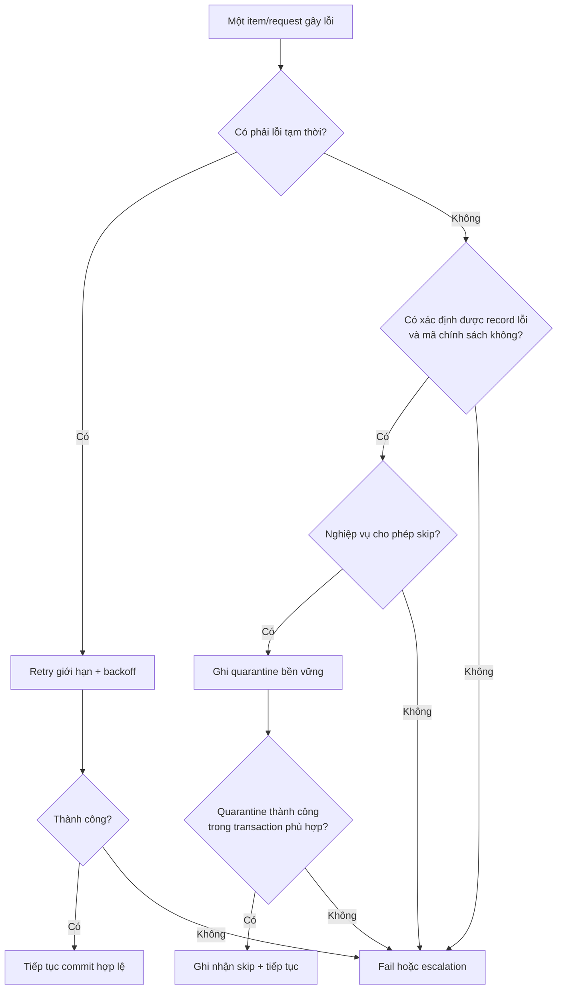
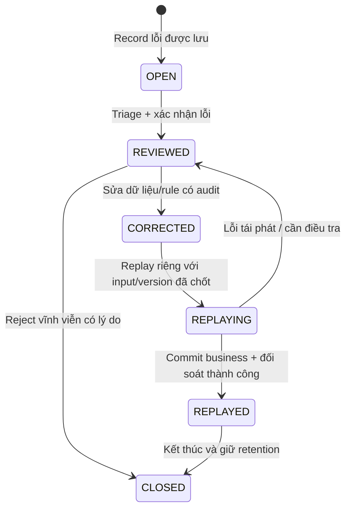
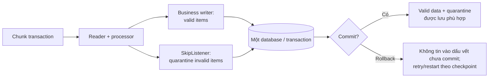
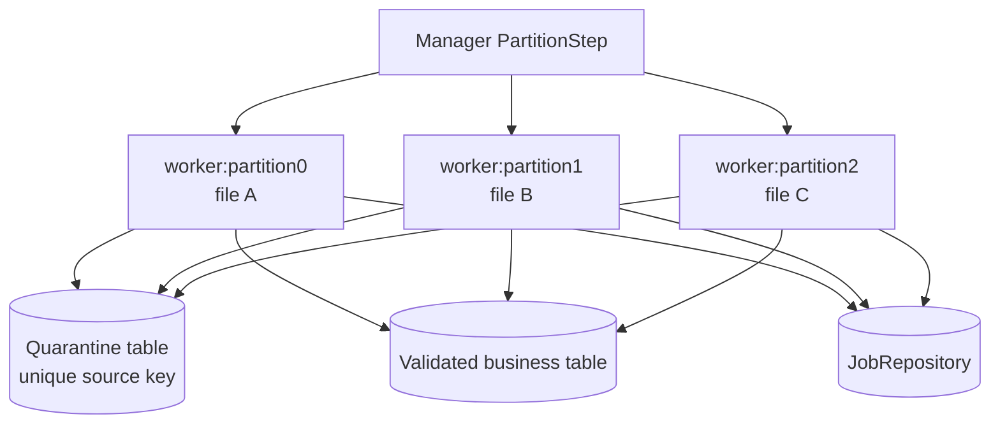
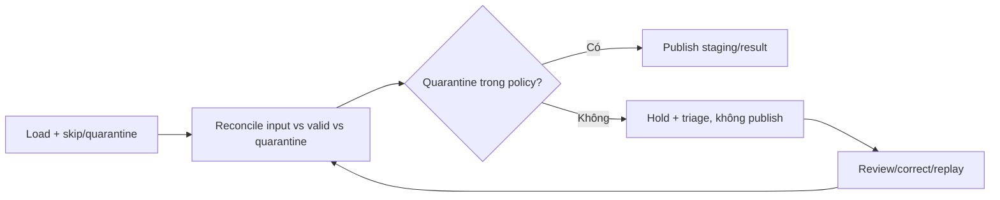

# Quarantine dữ liệu lỗi

## 1. Vì sao cần quarantine trong batch dữ liệu lớn?

Trong chương **Skip và recovery** thuộc module **SPRING_BATCH_SCALING_OPERATIONS**, chúng ta cần mở rộng Spring Batch cho workload dữ liệu lớn bằng multi-threaded step, parallel steps, partitioning và những mô hình xử lý phân tán phù hợp, đồng thời giữ được thread safety, retry/restart và khả năng vận hành. Một khó khăn thực tế là **một phần nhỏ dữ liệu đầu vào không hợp lệ**: sai định dạng ngày tháng, amount âm, thiếu mã khách hàng, schema cũ hoặc vi phạm quy tắc nghiệp vụ.

Nếu job nhận 5 triệu bản ghi CSV mà chỉ một dòng malformed khiến toàn bộ job thất bại, thời gian khôi phục có thể rất đắt. Ngược lại, nếu bật `skip(Exception.class)` để bỏ qua mọi lỗi, hệ thống có thể **âm thầm làm mất dữ liệu** và che giấu các sự cố nghiêm trọng như database mất kết nối hay lỗi lập trình.

**Quarantine dữ liệu lỗi** là cơ chế **cách ly những bản ghi không thể xử lý theo hợp đồng hiện tại**, lưu đủ bằng chứng để kiểm toán và sửa/replay về sau, trong khi cho phép phần dữ liệu hợp lệ tiếp tục được xử lý theo chính sách. Quarantine có quan hệ với cơ chế `skip` của Spring Batch nhưng **không đồng nhất với skip**:

- `skip` quyết định có cho phép step tiếp tục khi gặp một exception hay không.
- **Quarantine** quyết định lưu **bản ghi nào, lỗi gì, nguồn/version nào, khi nào, ai được phép sửa và cách replay**.
- **Recovery** quyết định điều kiện thử lại, dừng, xử lý phần chưa hoàn tất và đối soát đầu ra.

Ví dụ khi nhập file hóa đơn:

```text
File invoices-2026-11-26.csv (1.000.000 records)

  997.800 records hợp lệ   -> xử lý -> bảng invoice_validated
    1.900 records nghiệp vụ sai -> quarantine BUSINESS_RULE
      300 records CSV lỗi  -> quarantine PARSE

Job có thể hoàn tất theo chính sách skip của từng step,
nhưng chỉ được publish nếu tỷ lệ/lý do lỗi nằm trong ngưỡng chấp nhận.
```

Những con số trên là giả định minh họa. Trong hệ thống thanh toán hoặc dữ liệu bắt buộc đầy đủ, **có thể không được phép skip bất cứ bản ghi nào**. Quarantine chỉ hữu ích khi **chính sách nghiệp vụ đã cho phép cách ly và đối soát**.

### Mục tiêu học tập

Sau bài này, bạn có thể:

1. Phân biệt lỗi dữ liệu **có thể quarantine**, lỗi tạm thời **nên retry**, lỗi hệ thống **phải fail** và lỗi transport **nên vào DLQ**.
2. Hiểu `SkipListener` và ba callback `onSkipInRead`, `onSkipInProcess`, `onSkipInWrite`.
3. Thiết kế **source identity** bền vững để quarantine không bị trùng hoặc mất sau restart.
4. Lưu quarantine **trong cùng transaction phù hợp** với business writer, hoặc dùng outbox khi có hệ thống ngoài transaction.
5. Cấu hình chunk step Spring Batch 5.x với `faultTolerant()`, `skip(...)`, `skipLimit(...)`, processor và listener.
6. Phân tích giới hạn skip theo mỗi `StepExecution` trong partitioning, và xây dựng **ngưỡng chất lượng toàn job**.
7. Thiết kế quy trình review/correct/replay an toàn, không ghi đè dữ liệu đầu vào và không tạo vòng lặp poison record.
8. Dùng metadata, SQL, metrics và fault-injection để kiểm tra khả năng retry/restart/idempotency.

> **Nguyên tắc:** Một bản ghi được skip **không đồng nghĩa đã được quarantine thành công**. Nếu nghiệp vụ yêu cầu có dấu vết mọi bản ghi bị bỏ qua, hệ thống phải thiết kế để **không commit trạng thái xử lý tiếp tục mà thiếu record quarantine tương ứng**; không đặt toàn bộ trách nhiệm vào log.

## 2. Phân loại lỗi trước khi bật skip

Không phải exception nào cũng là lỗi dữ liệu. Một chính sách quarantine đúng bắt đầu từ **taxonomy lỗi**.

| Nhóm lỗi | Ví dụ | Chính sách thường phù hợp | Vì sao |
| --- | --- | --- | --- |
| **Dữ liệu không parse được** | CSV sai amount, ngày không hợp lệ, thiếu field | Skip + quarantine nếu reader có thể tiếp tục an toàn | Lỗi gắn với một source record cụ thể |
| **Quy tắc nghiệp vụ** | Số tiền âm, thiếu định danh bắt buộc | Skip + quarantine với mã rule và source key | Record không đạt hợp đồng hiện tại |
| **Xung đột dữ liệu có thể xác minh** | Business key đã tồn tại nhưng value mâu thuẫn | Có thể quarantine hoặc fail theo chính sách | Không được coi tất cả duplicate là vô hại |
| **Lỗi I/O tạm thời** | HTTP timeout, database deadlock, broker mất kết nối | Retry có giới hạn/backoff; nếu vượt ngưỡng thường fail | Dữ liệu có thể hoàn toàn hợp lệ |
| **Lỗi hạ tầng nghiêm trọng** | Database down, permission denied, disk full | Fail/escalate; không skip hàng loạt | Tiếp tục có thể làm mất dữ liệu hoặc phá giao dịch |
| **Lỗi chương trình** | `NullPointerException` do bug, cấu hình sai | Fail, sửa code và restart | Không được ngụy trang thành lỗi người dùng |
| **Poison message transport** | JMS payload sai schema, deserialize không được | Retry transport có giới hạn → DLQ/quarantine message | Có thể chưa thành một item Spring Batch |
| **Lỗi tích hợp side effect** | HTTP POST đã được server xử lý nhưng response timeout | Điều tra/idempotency, không skip mù | Trạng thái nghiệp vụ chưa chắc đã rõ |

### 2.1. Quy tắc phân loại có thể mô tả bằng decision tree



Sơ đồ thể hiện **ý định thiết kế**, không phải thứ tự thực thi nội bộ chính xác của tất cả callback Spring Batch. Trong thực tế, `SkipListener` có thể được gọi ở những điểm framework xác định sau khi quyết định skip; tính nguyên tử còn phụ thuộc transaction manager và nơi lưu quarantine.

**Tránh `.skip(Exception.class)` hoặc `.skip(RuntimeException.class)`** trên production khi chưa chứng minh được mọi exception thuộc nhóm dữ liệu không hợp lệ. Cấu hình quá rộng sẽ bỏ qua deadlock, lỗi network, lỗi serialization hay bug code thay vì dừng có kiểm soát.

## 3. Skip, retry, filter, quarantine và DLQ khác nhau thế nào?

| Cơ chế | Khi nào xảy ra? | Kết quả | Vấn đề cần nhớ |
| --- | --- | --- | --- |
| **Retry** | Lỗi tạm thời và có thể thử lại an toàn | Item có cơ hội thành công | Side effect có thể bị lặp nếu không idempotent |
| **Skip** | Exception được `SkipPolicy` chấp nhận | Step tiếp tục, tăng skip counter | Không mặc định lưu record lỗi ở kho riêng |
| **Filter** | `ItemProcessor` trả `null` | Không đưa item xuống writer | **Không phải skip**; không gọi `SkipListener` |
| **Quarantine** | Record lỗi được ghi vào kho cách ly | Có chứng cứ để sửa/replay/audit | Phải có source identity và transaction |
| **DLQ** | Messaging transport không xử lý được message sau policy retry | Giữ message để điều tra | Không mặc nhiên là quarantine một business record |
| **Fail step** | Lỗi vượt policy hoặc lỗi nghiêm trọng | Step/job thất bại theo luồng | Các chunk đã commit không tự rollback |

Ví dụ một processor:

```java
return invoice -> {
    if (invoice.customerId().startsWith("TEST-")) {
        return null; // filter, không phát sinh skip/quarantine
    }
    if (invoice.amount().signum() < 0) {
        throw new InvalidInvoiceException("NEGATIVE_AMOUNT");
    }
    return validate(invoice);
};
```

Nếu hợp đồng yêu cầu lưu mọi bản ghi không được ghi vào bảng đích, **`return null` là không đủ**: cần cơ chế ghi trạng thái “filtered/rejected” khác hoặc biến nó thành loại lỗi được quarantine theo chính sách. Ngược lại, các record test được loại bỏ có chủ đích có thể chỉ cần `filterCount` và không nên đẩy vào kho dữ liệu lỗi.

### 3.1. Skip limit hoạt động ở cấp nào?

Với:

```java
.faultTolerant()
.skip(FlatFileParseException.class)
.skip(InvalidInvoiceException.class)
.skipLimit(100)
```

`100` là ngưỡng skip của **một worker step execution theo chính sách này**, xét tổng các skip ở read/process/write; bản ghi thứ 101 phải skip sẽ làm step thất bại vì vượt ngưỡng. Nếu có 20 partition độc lập, **không được suy ra toàn job chỉ cho phép 100 skip**: mỗi worker có phạm vi counters/policy riêng. Với multi-threaded chunks trong cùng step, các chunk dùng chung ngữ cảnh step và phải kiểm tra implementation/thread safety.

Các ngưỡng chất lượng toàn bộ kỳ dữ liệu như “quarantine không quá 0,5% input” cần **một bước tổng hợp/reconciliation cấp job**. Có thể manager nhìn thấy các partition đã `COMPLETED` nhưng business gate vẫn không cho publish vì số lượng record lỗi quá lớn.

### 3.2. Skip limit không phải quota cho mọi lần thử trong lịch sử

Sau rollback, retry hoặc restart, cùng business record có thể được đọc/đánh giá lại. Counters của `StepExecution` là metadata kỹ thuật theo execution, **không phải số bản ghi lỗi duy nhất xuyên mọi lần chạy**. Khi báo cáo chất lượng, nên đếm **quarantine unique source records** theo manifest/kỳ xử lý, tránh cộng các attempt lịch sử và đếm trùng.

## 4. Thiết kế kho quarantine và vòng đời bản ghi

Một quarantine record tốt phải trả lời được:

1. **Nguồn:** file/URI/version, bảng nguồn hoặc message stream/topic/offset nào?
2. **Định danh:** một ID ổn định để nhận ra **cùng source record** khi restart/replay.
3. **Lý do:** lỗi thuộc read/parse, business validation hay write, có `reasonCode` nào?
4. **Bằng chứng:** mã rule, error class, thông điệp đã sanitize, checksum hoặc pointer tới dữ liệu gốc.
5. **Ngữ cảnh:** job/manifest, partition, first/last attempt, thời điểm được phát hiện.
6. **Xử lý tiếp:** status review/replay, ai sửa, phiên bản rule và kết quả đối soát.

### 4.1. Data contract được khuyến nghị

| Trường | Ví dụ | Vai trò |
| --- | --- | --- |
| `manifest_id` | `invoice-close-20261126-v1` | Giữ input snapshot ổn định qua restart |
| `file_id` | `vendorA-001@sha256:...` | Phân biệt file/version có thể trùng tên |
| `source_ref` | `line:145` hoặc `record:INV-003` | Định danh record tại nguồn |
| `stage` | `READ`, `PROCESS`, `WRITE` | Biết bước nào không xử lý được |
| `reason_code` | `BAD_AMOUNT`, `NEGATIVE_AMOUNT` | Phân tích nguyên nhân bằng mã ổn định |
| `error_class` | `FlatFileParseException` | Hỗ trợ debug, không thay thế reason code |
| `safe_summary` | `amount không hợp lệ` | Không lộ raw PII hay stack trace |
| `payload_digest` / `payload_ref` | SHA-256 hoặc URI mã hóa | Dò nguồn, kiểm chứng file không đổi |
| `status` | `OPEN`, `REVIEWED`, `CORRECTED`, `REPLAYED`, `CLOSED` | Quy trình xử lý hậu kiểm |
| `first_seen_at` / `last_seen_at` | Timestamps | Audit và quan sát |

### 4.2. Chọn source identity đủ ổn định

**Đối với file:** `(manifestId, fileId/version, lineNumber)` có thể là khóa ổn định nếu file bất biến, một dòng tương đương một record và parser dùng cùng quy tắc line. Đối với CSV **quoted multiline**, line number vật lý chưa chắc là một record; có thể cần record offset, ID trích được hoặc một parser cấp manifest.

**Đối với JDBC:** ưu tiên business key hoặc khóa nguồn bất biến, kết hợp source snapshot/version nếu hàng có thể thay đổi. **Không** dùng “item thứ 1000 trong query” nếu thứ tự và tập row có thể biến động sau restart.

**Đối với message:** dùng event ID/business event ID ổn định hoặc `topic/partition/offset` kèm stream identity và retention contract; đừng coi broker delivery ID mới trên redelivery là record mới.

**Đối với lỗi read:** `onSkipInRead(Throwable)` **không nhận đối tượng item**, vì reader chưa trả về item thành công. Phải dùng nguồn thông tin từ exception/reader, ví dụ `FlatFileParseException.getLineNumber()`, `getInput()`, manifest file ID; nếu không xác định được record cụ thể, **nên fail hoặc dùng intake-level quarantine**, không bịa một khóa `unknown` làm nhiều lỗi ghi đè nhau.

### 4.3. State machine quarantine



Đây là state machine **nghiệp vụ đề xuất**, không phải các `BatchStatus` mặc định của Spring Batch. Một record quarantine `OPEN` có thể tồn tại trong khi job chính `COMPLETED` vì chính sách cho phép skip; hai trạng thái đó cần được báo cáo riêng.

## 5. Transaction: làm sao tránh “skip thành công nhưng mất dấu lỗi”?

Đây là vấn đề quan trọng nhất của quarantine.

### 5.1. Mẫu an toàn: business write và quarantine cùng DB transaction

Với một chunk step có `DataSourceTransactionManager` và cùng `DataSource` cho bảng nghiệp vụ + bảng quarantine:



Theo contract Spring Batch, `SkipListener` được gọi khi framework xác định item bị skip; tài liệu mô tả các callback được bố trí **trước commit transaction** và một lần cho item thực sự bị skip theo cách xử lý của framework. Điều này giúp có thể ghi quarantine trong transaction hiện hành **khi repository/DAO tham gia đúng transaction**.

**Điều kiện phải kiểm tra thực tế:**

- `JdbcTemplate` ghi quarantine dùng **cùng datasource và transaction manager** với business writer.
- Không gắn `@Transactional(REQUIRES_NEW)` một cách vô tình cho quarantine: nó có thể commit “record lỗi” trong khi chunk nghiệp vụ rollback, tạo **quarantine mồ côi**.
- Callback không được nuốt exception ghi quarantine; nếu không lưu được dấu vết, **fail chunk/step** thay vì âm thầm skip.
- Tính nhất quán với **JobRepository** còn phụ thuộc repository sử dụng cùng hay khác transaction manager/database.
- Không gọi HTTP, email, S3 upload hoặc publish Kafka trực tiếp từ listener rồi tin rằng JDBC rollback sẽ rollback những side effect đó.

### 5.2. Mẫu khác DB/remote store: transactional outbox

Khi quarantine phải vào search index, object storage hoặc topic:

1. Trong transaction nguồn/đích thích hợp, lưu **quarantine record và outbox event** vào cùng database.
2. Sau commit, một relay phát outbox event tới storage/broker.
3. Consumer dùng **event ID ổn định + dedup** để bảo đảm phát lại không tạo nhiều quarantine entries.
4. Chỉ đánh dấu event delivered theo giao thức đáng tin; retry/backoff/DLQ cho lỗi transport.

```text
Chunk transaction (DB A):
  ├── valid business writes
  ├── quarantine rows
  └── outbox(event_id, payload_pointer, state=PENDING)
COMMIT
  ↓
Outbox relay -> broker/object store/index (at-least-once, idempotent)
```

**Không có transaction ACID tự động xuyên JDBC + HTTP + broker + object store** chỉ vì dùng Spring Batch. Outbox giảm cửa sổ “DB commit rồi publish thất lạc” nhưng vẫn phải xử lý duplicate delivery ở phía consumer.

### 5.3. So sánh các cách ghi quarantine

| Phương án | Ưu điểm | Rủi ro | Khi phù hợp |
| --- | --- | --- | --- |
| Insert JDBC cùng transaction chunk | Dễ đạt atomicity với business DB | Tăng tải transaction/DB | Cùng datasource, lượng lỗi vừa phải |
| Processor trả đối tượng `Accepted/Rejected`, writer phân luồng trong transaction | Không phụ thuộc callback skip, phản ánh trạng thái business rõ | Phải tự triển khai logic writer/counters | Từ chối record là nghiệp vụ bình thường |
| Outbox + relay | Vận chuyển tới hệ thống khác có replay | Có thêm worker/outbox lag | Quarantine tập trung, indexing/notification |
| Ghi file/S3 trực tiếp ở listener | Triển khai nhanh trong demo | Rollback không xóa được side effect, dễ trùng/thiếu | Chỉ khi có contract idempotency và reconciliation |
| Chỉ log exception | Ít code | Không có nguồn record để replay/audit | Không phù hợp nếu cần lưu mọi lỗi |

## 6. SQL PostgreSQL: bảng quarantine có khóa chống trùng

Một schema minh họa cho lỗi ở cấp record:

```sql
-- Đây là bảng nghiệp vụ, KHÔNG thuộc schema BATCH_*.
CREATE TABLE batch_quarantine_record (
    manifest_id   VARCHAR(160) NOT NULL,
    file_id       VARCHAR(256) NOT NULL,
    source_ref    VARCHAR(256) NOT NULL,
    stage         VARCHAR(16) NOT NULL
                  CHECK (stage IN ('READ', 'PROCESS', 'WRITE')),
    reason_code   VARCHAR(80) NOT NULL,
    error_class   VARCHAR(220) NOT NULL,
    safe_summary  VARCHAR(500) NOT NULL,
    payload_ref   VARCHAR(1000),
    status        VARCHAR(20) NOT NULL DEFAULT 'OPEN'
                  CHECK (status IN ('OPEN', 'REVIEWED', 'CORRECTED',
                                   'REPLAYING', 'REPLAYED', 'CLOSED')),
    first_seen_at TIMESTAMPTZ NOT NULL DEFAULT CURRENT_TIMESTAMP,
    updated_at    TIMESTAMPTZ NOT NULL DEFAULT CURRENT_TIMESTAMP,
    PRIMARY KEY (manifest_id, file_id, source_ref, stage)
);

CREATE INDEX idx_batch_quarantine_status
    ON batch_quarantine_record (status, reason_code, first_seen_at);
```

**Khóa chính** bảo đảm callback/restart không tạo thêm row cho cùng `manifest_id/file_id/source_ref/stage`. Với record thực sự có thể phát sinh **nhiều lỗi ở cùng stage**, hãy thiết kế bảng event/history riêng có `event_id` và một bảng “current quarantine state” có unique key; không ép các lỗi khác nhau thành một record không thể audit.

### 6.1. Insert idempotent

```sql
INSERT INTO batch_quarantine_record (
    manifest_id, file_id, source_ref, stage,
    reason_code, error_class, safe_summary
)
VALUES (
    :manifestId, :fileId, :sourceRef, :stage,
    :reasonCode, :errorClass, :safeSummary
)
ON CONFLICT (manifest_id, file_id, source_ref, stage)
DO NOTHING;
```

`DO NOTHING` có nghĩa “record lỗi này đã được ghi trước đó” **chỉ khi khóa và manifest thật sự bất biến**. Nó không có nghĩa mọi thông tin mới được bỏ qua là an toàn. Muốn ghi nhận attempt mới hoặc rule version thay đổi, tạo audit event riêng hoặc cập nhật bằng quy tắc có kiểm soát; **không tự overwrite bản gốc đã được review**.

### 6.2. Không lưu bừa dữ liệu nhạy cảm

Quarantine có thể chứa dòng CSV chưa hợp lệ, PII, số tài khoản hoặc dữ liệu tài chính. Vì thế:

- Ưu tiên `sourceRef + contentVersion + digest` và pointer tới nguồn immutable thay vì copy toàn bộ raw payload.
- Nếu bắt buộc giữ payload gốc, mã hóa ở nơi lưu, phân quyền theo mục đích, giới hạn retention và audit truy cập.
- Không lưu `Throwable.getMessage()` nguyên văn vào `safe_summary` nếu parser/driver có thể chèn raw dữ liệu nhạy cảm.
- Giới hạn độ dài/error class, không lưu stack trace vào bảng hot path.
- Bảo vệ quyền **replay** tách khỏi quyền chỉ xem, tránh dùng quarantine để tạo side effect tùy ý.

## 7. Ví dụ Spring Batch 5.x: CSV reader, validation và quarantine listener

Ví dụ dưới đây nhập CSV hóa đơn vào PostgreSQL. File đã được snapshot trong manifest, mỗi file là một partition; worker đọc và validate record, những dòng parse sai hoặc vi phạm nghiệp vụ được quarantine, bản ghi hợp lệ được ghi idempotent vào bảng đích.

**Giả định môi trường:**

- Java 17+, Spring Batch 5.x và Spring Framework tương thích.
- Đã cấu hình `JobRepository`, `PlatformTransactionManager` kiểu JDBC thích hợp, `DataSource` và Spring Batch schema.
- `invoice_source` ở đây là file CSV có header `recordId,customerId,amount`; `recordId` duy nhất trong một `fileId`.
- Tập input cố định; `manifestId` là identifying JobParameter, `fileId`/`inputUri` nằm trong partition `ExecutionContext`.
- Bảng `invoice_validated(file_id,record_id,customer_id,amount)` có unique key `(file_id,record_id)`.
- Bảng `batch_quarantine_record` được tạo theo mục 6 và nằm **cùng datasource/transaction** với bảng đích.
- Format demo là CSV đơn giản: không có quoted multiline field. Với CSV phức tạp, cần tokenizer/parser và source identity phù hợp.

### 7.1. Mô hình dữ liệu và exception nghiệp vụ

```java
import java.math.BigDecimal;

record RawInvoice(
    String fileId,
    String recordId,
    String customerId,
    BigDecimal amount
) {}

record ValidInvoice(
    String fileId,
    String recordId,
    String customerId,
    BigDecimal amount
) {}

final class InvalidInvoiceException extends RuntimeException {
    private final String reasonCode;

    InvalidInvoiceException(String reasonCode) {
        super(reasonCode);
        this.reasonCode = reasonCode;
    }

    String reasonCode() {
        return reasonCode;
    }
}
```

Các record/class này đặt trong package ứng dụng và được import vào `@Configuration` bên dưới nếu tách thành file Java riêng.

### 7.2. Reader một file cho mỗi partition

```java
import org.springframework.batch.core.configuration.annotation.StepScope;
import org.springframework.batch.item.file.FlatFileItemReader;
import org.springframework.batch.item.file.builder.FlatFileItemReaderBuilder;
import org.springframework.beans.factory.annotation.Value;
import org.springframework.context.annotation.Bean;
import org.springframework.core.io.ResourceLoader;

@Bean
@StepScope
FlatFileItemReader<RawInvoice> invoiceFileReader(
        ResourceLoader resourceLoader,
        @Value("#{stepExecutionContext['inputUri']}") String inputUri,
        @Value("#{stepExecutionContext['fileId']}") String fileId) {

    return new FlatFileItemReaderBuilder<RawInvoice>()
        .name("invoiceFileReader")
        .resource(resourceLoader.getResource(inputUri))
        .encoding("UTF-8")
        .strict(true)
        .linesToSkip(1)
        .saveState(true)
        .delimited()
        .names("recordId", "customerId", "amount")
        .fieldSetMapper(fs -> new RawInvoice(
            fileId,
            fs.readString("recordId"),
            fs.readString("customerId"),
            fs.readBigDecimal("amount")))
        .build();
}
```

`@StepScope` tạo reader theo `StepExecution`, nên mỗi partition có cursor/checkpoint riêng. `saveState(true)` giúp framework lưu trạng thái reader qua `ExecutionContext` tại ranh giới checkpoint, **không** chứng minh input file sẽ bất biến. Nếu manifest file/version hoặc parser thay đổi sau crash, offset theo dòng có thể không còn hợp lệ.

### 7.3. ItemProcessor phân loại lỗi nghiệp vụ

```java
import org.springframework.batch.item.ItemProcessor;
import org.springframework.context.annotation.Bean;

@Bean
ItemProcessor<RawInvoice, ValidInvoice> invoiceValidator() {
    return item -> {
        if (item.recordId() == null || item.recordId().isBlank()) {
            throw new InvalidInvoiceException("MISSING_RECORD_ID");
        }
        if (item.customerId() == null || item.customerId().isBlank()) {
            throw new InvalidInvoiceException("MISSING_CUSTOMER");
        }
        if (item.amount() == null ||
            item.amount().signum() < 0) {
            throw new InvalidInvoiceException("NEGATIVE_AMOUNT");
        }

        return new ValidInvoice(
            item.fileId(),
            item.recordId(),
            item.customerId(),
            item.amount().setScale(
                2, java.math.RoundingMode.HALF_UP));
    };
}
```

Ở đây, processor **ném exception xác định** thay vì trả `null`. Điều này đưa lỗi vào chính sách `skip` và `SkipListener`. `InvalidInvoiceException` đại diện lỗi business không sửa được chỉ bằng retry ngay lúc chạy; không dùng nó cho database outage hay các lỗi lập trình.

### 7.4. Writer JDBC cho dữ liệu hợp lệ

```java
import javax.sql.DataSource;
import org.springframework.batch.item.database.JdbcBatchItemWriter;
import org.springframework.batch.item.database.builder.JdbcBatchItemWriterBuilder;
import org.springframework.context.annotation.Bean;
import org.springframework.jdbc.core.namedparam.MapSqlParameterSource;

@Bean
JdbcBatchItemWriter<ValidInvoice> invoiceWriter(
        DataSource dataSource) {

    return new JdbcBatchItemWriterBuilder<ValidInvoice>()
        .dataSource(dataSource)
        .sql("""
            INSERT INTO invoice_validated
                (file_id, record_id, customer_id, amount)
            VALUES (:fileId, :recordId, :customerId, :amount)
            ON CONFLICT (file_id, record_id)
            DO UPDATE SET
                customer_id = EXCLUDED.customer_id,
                amount = EXCLUDED.amount
            """)
        .itemSqlParameterSourceProvider(item ->
            new MapSqlParameterSource()
                .addValue("fileId", item.fileId())
                .addValue("recordId", item.recordId())
                .addValue("customerId", item.customerId())
                .addValue("amount", item.amount()))
        .build();
}
```

PostgreSQL `ON CONFLICT` giúp tránh thêm nhiều row cùng khóa sau replay. Nó chỉ an toàn nghiệp vụ nếu **cùng fileId đại diện cùng nội dung bất biến**, validator deterministic và chính sách cập nhật “last writer wins” được chấp nhận. Trong hệ thống chốt sổ, đôi khi nên dùng conditional update/version check thay vì tự động ghi đè kết quả lịch sử.

## 8. Quarantine DAO và SkipListener

### 8.1. DAO ghi quarantine trong transaction hiện tại

```java
import org.springframework.jdbc.core.JdbcTemplate;
import org.springframework.stereotype.Repository;

@Repository
class QuarantineDao {
    private final JdbcTemplate jdbc;

    QuarantineDao(JdbcTemplate jdbc) {
        this.jdbc = jdbc;
    }

    void record(
            String manifestId, String fileId, String sourceRef,
            String stage, String reasonCode, Throwable error) {

        // Không lưu error.getMessage(): có thể lộ raw input/PII.
        String safeSummary = switch (stage) {
            case "READ" -> "Không thể parse bản ghi đầu vào";
            case "PROCESS" -> "Không thỏa quy tắc nghiệp vụ";
            case "WRITE" -> "Writer từ chối bản ghi theo chính sách";
            default -> "Record bị cách ly";
        };

        jdbc.update("""
            INSERT INTO batch_quarantine_record
              (manifest_id, file_id, source_ref, stage,
               reason_code, error_class, safe_summary)
            VALUES (?, ?, ?, ?, ?, ?, ?)
            ON CONFLICT (manifest_id, file_id, source_ref, stage)
            DO NOTHING
            """,
            manifestId, fileId, sourceRef, stage,
            reasonCode, error.getClass().getName(), safeSummary);
    }
}
```

DAO này **không** tự mở transaction `REQUIRES_NEW`. Nó sử dụng connection gắn với transaction hiện tại **nếu `JdbcTemplate` và transaction manager được cấu hình trên cùng `DataSource`**. Đây là ràng buộc thiết kế cần kiểm thử, không phải tính chất tự có của mọi datasource.

Nếu `jdbc.update(...)` thất bại, không bắt rồi bỏ qua. **Hãy cho exception lan lên** để chunk/step fail; nếu không, số skip sẽ tăng nhưng kho quarantine không lưu được bằng chứng.

### 8.2. Listener cho ba loại skip

```java
import org.springframework.batch.core.SkipListener;
import org.springframework.batch.core.configuration.annotation.StepScope;
import org.springframework.batch.item.file.FlatFileParseException;
import org.springframework.beans.factory.annotation.Value;
import org.springframework.context.annotation.Bean;

@Bean
@StepScope
SkipListener<RawInvoice, ValidInvoice> invoiceQuarantineListener(
        @Value("#{jobParameters['manifestId']}") String manifestId,
        @Value("#{stepExecutionContext['fileId']}") String fileId,
        QuarantineDao quarantineDao) {

    return new SkipListener<RawInvoice, ValidInvoice>() {

        @Override
        public void onSkipInRead(Throwable error) {
            if (!(error instanceof FlatFileParseException parseError)) {
                // Không định danh được record: không tự bịa sourceRef.
                throw new IllegalStateException(
                    "Unexpected read skip without source identity", error);
            }

            String sourceRef = "line:" + parseError.getLineNumber();
            quarantineDao.record(
                manifestId, fileId, sourceRef,
                "READ", "CSV_PARSE_ERROR", error);
        }

        @Override
        public void onSkipInProcess(RawInvoice item, Throwable error) {
            String reason = (error instanceof InvalidInvoiceException e)
                ? e.reasonCode() : "PROCESS_REJECTED";

            quarantineDao.record(
                manifestId, item.fileId(),
                "record:" + item.recordId(),
                "PROCESS", reason, error);
        }

        @Override
        public void onSkipInWrite(ValidInvoice item, Throwable error) {
            // Chỉ được gọi khi một write exception thực sự được
            // cho phép skip theo chính sách của worker step.
            quarantineDao.record(
                manifestId, item.fileId(),
                "record:" + item.recordId(),
                "WRITE", "WRITE_REJECTED", error);
        }
    };
}
```

**Những điểm quan trọng:**

1. `onSkipInRead(Throwable)` không nhận `RawInvoice`. Với `FlatFileParseException`, có thể dùng số dòng và thông tin input từ exception; ví dụ **chỉ lưu line reference**, không copy raw CSV/PII vào DB.
2. `onSkipInProcess(item, error)` nhận item ban đầu; dùng `fileId + recordId` ổn định để chống trùng sau restart.
3. `onSkipInWrite(item, error)` nhận item đầu ra được xác định là bị skip. **Không tự động được gọi cho mọi lỗi writer**. Ví dụ cấu hình step ở dưới **không cho phép skip lỗi JDBC**, nên callback này chỉ minh họa đường mở rộng khi có chính sách write skip hẹp, được kiểm chứng.
4. Listener có `@StepScope` để nhận đúng `fileId` và `manifestId` cho từng partition; không dùng một trường mutable singleton như `currentFileId` giữa nhiều worker.
5. Không phụ thuộc `StepExecutionId` làm khóa quarantine duy nhất: ID execution có thể đổi giữa các lần restart cùng `JobInstance`.

**Giới hạn read quarantine:** Một số lỗi read xảy ra trước khi parser xác định dòng hoặc giữa I/O đọc file; không phải lỗi nào cũng có `FlatFileParseException`. Nếu không có source identity đủ tin cậy, **fail hoặc chuyển sang intake-level quarantine của cả file**, thay vì ghi một record `unknown` và tiếp tục.

## 9. Cấu hình fault-tolerant chunk step

```java
import org.springframework.batch.core.Step;
import org.springframework.batch.core.repository.JobRepository;
import org.springframework.batch.core.step.builder.StepBuilder;
import org.springframework.batch.core.SkipListener;
import org.springframework.batch.item.ItemProcessor;
import org.springframework.batch.item.database.JdbcBatchItemWriter;
import org.springframework.batch.item.file.FlatFileItemReader;
import org.springframework.batch.item.file.FlatFileParseException;
import org.springframework.beans.factory.annotation.Bean;
import org.springframework.transaction.PlatformTransactionManager;

@Bean
Step invoiceImportWorker(
        JobRepository jobRepository,
        PlatformTransactionManager transactionManager,
        FlatFileItemReader<RawInvoice> invoiceFileReader,
        ItemProcessor<RawInvoice, ValidInvoice> invoiceValidator,
        JdbcBatchItemWriter<ValidInvoice> invoiceWriter,
        SkipListener<RawInvoice, ValidInvoice> invoiceQuarantineListener) {

    return new StepBuilder("invoiceImportWorker", jobRepository)
        .<RawInvoice, ValidInvoice>chunk(500, transactionManager)
        .reader(invoiceFileReader)
        .processor(invoiceValidator)
        .writer(invoiceWriter)
        .faultTolerant()
        .skip(FlatFileParseException.class)
        .skip(InvalidInvoiceException.class)
        .skipLimit(100)
        .listener(invoiceQuarantineListener)
        .build();
}
```

Mã trên là **cấu hình cốt lõi** của Spring Batch 5.x. Để chạy được cần đặt các `@Bean` vào `@Configuration`, cung cấp schema/datasource/transaction manager, đóng băng manifest file và cấu hình `Job` hoặc `PartitionStep`. Ví dụ intentionally chỉ skip **parse** và **business validation**, không skip database errors.

### 9.1. Tại sao không skip mọi writer exception?

`JdbcBatchItemWriter` có thể ném exception vì:

- DB connection mất, transaction bị timeout.
- Deadlock hoặc lock contention.
- Unique constraint do logic nghiệp vụ có vấn đề.
- Schema sai hoặc câu SQL không tương thích.

Nếu cấu hình `.skip(DataAccessException.class)` quá rộng, job có thể “thành công” nhưng bỏ qua hàng loạt bản ghi khi DB đang hỏng. Với transient DB exceptions, nên **retry có giới hạn**, ví dụ:

```java
.faultTolerant()
.retry(org.springframework.dao.DeadlockLoserDataAccessException.class)
.retryLimit(3)
.skip(FlatFileParseException.class)
.skip(InvalidInvoiceException.class)
.skipLimit(100)
```

Đây là snippet chính sách; phải chọn exception thực tế theo driver/datasource và cân nhắc backoff, idempotency. Không cho phép một lỗi writer được quarantine đơn giản chỉ vì muốn “job xanh”.

### 9.2. Một write error có thể làm rollback cả chunk

Writer JDBC thường nhận **nhiều item** trong một chunk. Nếu một item gây lỗi, transaction của chunk có thể rollback, rồi fault-tolerant step xác định item lỗi theo logic retry/skip. Quá trình này có thể gọi writer/processor lại và **không chắc chỉ xảy ra một lần ở mức method call**.

`SkipListener` có contract dành cho item đã xác định là skipped, nhưng bạn vẫn phải giữ **quarantine write idempotent**; tuyệt đối không dựa vào “writer được gọi đúng một lần” để đảm bảo không trùng side effect bên ngoài.

### 9.3. Nếu record bị filter?

`ItemProcessor.return null` làm tăng `filterCount`, **không gọi `onSkipInProcess`**. Nếu nghiệp vụ muốn audit các record “đã được kiểm tra và loại có chủ đích”, dùng một loại record trạng thái khác hoặc một writer nhận các kết quả `Accepted/Rejected`. Đừng gán tất cả các trường hợp bị lọc vào `skipCount`.

## 10. Quarantine khi dùng partitioning hoặc multi-threaded step

### 10.1. Partitioning: một ExecutionContext cho mỗi partition



Với local/remote partitioning, mỗi worker `StepExecution` thường có `ExecutionContext` riêng. `@StepScope` giúp reader và listener nhận đúng `fileId`; bảng quarantine dùng unique key xuyên workers để tránh duplicate delivery tạo nhiều record lỗi.

**Các ngưỡng cần tách biệt:**

- `skipLimit(100)` áp dụng cho mỗi worker step execution theo chính sách cấu hình.
- Tổng quarantine của **toàn `JobInstance`** phải được tính từ **source records duy nhất** trong kho quarantine hoặc aggregate đúng phạm vi.
- Manager có thể tổng hợp counters từ worker vào `StepExecution` manager. Khi làm dashboard, **không cộng manager counts với mọi worker counts**.
- Nếu worker file A bị lỗi sau 20 chunk, những chunk của file B đã commit không tự rollback. Khi restart, phải dùng cùng manifest/file versions và checkpoint.

### 10.2. Multi-threaded step: shared state và source identity

Một multi-threaded chunk step có thể chạy nhiều chunk threads trong **cùng `StepExecution`**. `@StepScope` là **scope theo StepExecution**, không theo thread; nếu một listener giữ mutable field `currentRecord` hoặc reader có cursor không thread-safe, các thread có thể ghi nhầm quarantine hoặc mất checkpoint.

Hãy:

1. Truyền source identity **bên trong item** hoặc từ một context bất biến của partition, không dùng mutable singleton/thread-local thiếu lifecycle.
2. Dùng listener stateless hoặc state đồng bộ hóa đúng cách.
3. Ghi quarantine bằng DB transaction và unique constraint.
4. Kiểm thử skip/retry/restart khi chunk commit ngoài thứ tự.
5. Nếu nguồn file lớn có thể chia thành nhiều file/range an toàn, ưu tiên **partitioning với reader riêng** thay vì một `FlatFileItemReader` bị nhiều chunk thread tranh chấp.

### 10.3. Remote chunking: manager đọc và worker ghi

Trong remote chunking, manager đọc và gửi `ChunkRequest` sang worker. Worker xử lý/ghi và trả `ChunkResponse`. Không có một `StepExecution` riêng cho từng chunk mặc định.

Rủi ro đặc biệt:

- **Read/parse error** xảy ra ở manager, trước khi chunk được gửi.
- **Process/write error** xảy ra ở worker và phải được báo về theo giao thức remote chunking.
- Chunk đã ghi vào DB nhưng reply mất có thể được phát lại; quarantine writer và business writer phải idempotent.
- Đường callback `SkipListener`/fault-tolerance và vị trí đặt listener **phụ thuộc worker flow/builder và phiên bản Spring Batch Integration**. Không tự áp Java snippet local chunk step cho remote worker rồi mặc định skip metadata được tổng hợp y như local.

Khi dùng remote chunking, thiết kế **contract trả lỗi cấp item/chunk** rõ ràng, cấu hình handler/retry và kiểm thử integration end-to-end với broker thật; không chỉ unit test `onSkipInProcess`.

## 11. Khôi phục sau crash: quarantine phải ổn định cùng JobInstance

Một ví dụ:

```text
T0: worker xử lý file A (manifest M)
T1: read 500 item, 7 item sai -> quarantine candidate
T2: business writer ghi 493 item
T3: callback quarantine ghi 7 entries
T4: chunk commit
T5: worker crash trước khi gửi reply
T6: job restart, file A được đọc lại từ checkpoint hợp lệ
```

Ở T5, nếu transaction tại T4 đã commit thành công và checkpoint tương ứng được lưu, restart thường không xử lý lại chunk đó. Nhưng nếu metadata repository và business database có **transaction độc lập** hoặc worker gửi side effect bên ngoài DB, có cửa sổ lệch trạng thái: chunk có thể được thực hiện lại. Bởi vậy:

- Business writer dùng unique business key và kiểm tra version phù hợp.
- Quarantine table dùng unique source key và **không thêm bản ghi trùng** vì retry.
- Input manifest/file version không đổi khi restart.
- Không dùng random `jobParameters.runId` identifying để “restart”: có thể tạo `JobInstance` mới, làm cả file được xử lý lại.
- Không sửa `BATCH_STEP_EXECUTION.STATUS`/`VERSION` bằng SQL để giải quyết worker còn `STARTED` sau crash khi chưa xác minh owner cũ.
- Sau recovery, đối chiếu **count nguồn hợp lệ + unique quarantine + intentional filters** với input snapshot; không chỉ dùng `READ_COUNT`.

### 11.1. Nếu callback quarantine thành công nhưng chunk rollback?

Khi quarantine cùng database transaction, insert của callback cũng rollback; lần xử lý lại có thể tạo record quarantine khi skip được xác định và chunk commit thành công.

Nếu callback dùng `REQUIRES_NEW` hoặc gọi remote API, record quarantine có thể đã được commit **trước** rollback của business chunk. Đây là nguồn **phantom quarantine**. Không dùng “quarantine còn tồn tại” để suy rằng business step đã skip bền vững, trừ khi hệ thống có reconciliation/transaction contract rõ ràng.

### 11.2. Nếu callback không ghi được quarantine?

Ví dụ bảng quarantine hết disk hoặc bị permission denied. Nếu hệ thống chỉ `log.warn` rồi bỏ qua exception, worker tiếp tục, nhưng mất dấu record. Với hệ thống yêu cầu “mọi skip phải truy vết được”, **phải fail step**, mở cảnh báo và restart sau khi lưu trữ đã hoạt động trở lại. Điều này có thể khiến job gián đoạn, nhưng tốt hơn một kết quả hoàn tất không thể kiểm toán.

### 11.3. Ngưỡng lỗi và trạng thái publish

Đừng đánh đồng `JobExecution.COMPLETED` với “dữ liệu đủ chuẩn để công bố”. Một pattern:



Nếu gate thất bại sau khi một số partition đã commit, dữ liệu có thể vẫn ở staging. Bước publish phải có **quy tắc idempotent**; không giả định fail cuối job rollback mọi chunk đã commit ở trước.

## 12. Replay dữ liệu quarantine: một pipeline riêng có kiểm soát

Quarantine không có nhiều giá trị nếu thiếu đường sửa và tái xử lý dữ liệu.

### 12.1. Đề xuất quy trình review/replay

1. **Triage:** người hoặc hệ thống có quyền kiểm tra `reasonCode`, nguồn/version và bằng chứng đã sanitize.
2. **Phân loại:** sai source data, sai mapping, thiếu reference data hay bug code.
3. **Correction:** tạo bản sửa riêng hoặc input correction event có `correctionId` và audit; không âm thầm sửa file gốc đã snapshot.
4. **Phê duyệt:** định nghĩa policy cho tự sửa, sửa thủ công và trường hợp không được replay.
5. **Replay job:** dùng một job/pipeline riêng đọc **chỉ các quarantine record đã được chấp nhận**, không tự động quét tất cả `OPEN` mãi mãi.
6. **Ghi đích:** áp dụng business idempotency key và version/expected state; nếu bản ghi đã được nhập từ nguồn khác, tránh ghi đè không kiểm soát.
7. **Đối soát:** xác nhận kết quả business và cập nhật trạng thái quarantine `REPLAYED`/`CLOSED` có audit.
8. **Giới hạn retry:** một record không thể sửa không được quay lại vòng lặp retry–quarantine vô hạn.

### 12.2. Bảng replay events để giữ lịch sử

```sql
CREATE TABLE batch_quarantine_replay_event (
    replay_id       VARCHAR(160) PRIMARY KEY,
    manifest_id     VARCHAR(160) NOT NULL,
    file_id         VARCHAR(256) NOT NULL,
    source_ref      VARCHAR(256) NOT NULL,
    stage           VARCHAR(16) NOT NULL,
    correction_id   VARCHAR(160),
    status          VARCHAR(20) NOT NULL,
    attempt_count   INT NOT NULL DEFAULT 0,
    created_at      TIMESTAMPTZ NOT NULL DEFAULT CURRENT_TIMESTAMP,
    completed_at    TIMESTAMPTZ,
    CONSTRAINT replay_quarantine_fk
      FOREIGN KEY (manifest_id, file_id, source_ref, stage)
      REFERENCES batch_quarantine_record
        (manifest_id, file_id, source_ref, stage)
);
```

Ví dụ chỉ có các trường cơ bản; trong production cần enum/check constraint, người phê duyệt, kết quả lỗi, audit detail, optimistic locking/lease nếu nhiều replay workers đồng thời.

`replay_id` phải ổn định cho **một replay request logic**; khi broker gửi lại message, không tạo một replay mới chỉ vì delivery ID khác. Nếu cùng quarantine item có nhiều lần correction/replay được phê duyệt, dùng replay ID khác nhau có chủ đích và có audit.

### 12.3. Replay không phải restart job chính

**Restart** một `JobInstance` thất bại để hoàn tất dữ liệu theo snapshot ban đầu khác với **replay** những record đã bị cách ly và được sửa. Replay có thể dùng nguồn/version/rule mới, cần một execution và contract riêng, nhưng phải bảo vệ business key của kỳ dữ liệu trước. Đừng trộn hai loại thao tác rồi làm mất lịch sử nguyên nhân gốc.

## 13. Đo quarantine và đối soát dữ liệu

### 13.1. Truy vấn StepExecution

```sql
SELECT
    STEP_EXECUTION_ID,
    JOB_EXECUTION_ID,
    STEP_NAME,
    STATUS,
    READ_COUNT,
    WRITE_COUNT,
    FILTER_COUNT,
    READ_SKIP_COUNT,
    PROCESS_SKIP_COUNT,
    WRITE_SKIP_COUNT,
    COMMIT_COUNT,
    ROLLBACK_COUNT,
    START_TIME,
    END_TIME
FROM BATCH_STEP_EXECUTION
WHERE JOB_EXECUTION_ID = ?
ORDER BY STEP_EXECUTION_ID;
```

**Cách đọc:**

- `READ_SKIP_COUNT`: số skip được framework ghi nhận ở reader.
- `PROCESS_SKIP_COUNT`: số skip khi processor gặp lỗi được phép bỏ qua.
- `WRITE_SKIP_COUNT`: số item bị skip ở writer theo chính sách.
- `FILTER_COUNT`: item bị processor trả `null`, **không phải skip**.
- `COMMIT_COUNT` và `ROLLBACK_COUNT` giúp đánh giá retry/chunk transaction, không phải số quarantine record duy nhất.

Trong partitioning, manager có thể tổng hợp counters của worker; tránh cộng `READ_COUNT` của manager với tất cả worker rồi suy số dòng đã đọc. Khi có restart, các `StepExecution` qua nhiều `JobExecution` có thể xử lý lại item; **không cộng mọi skip count lịch sử thành số record lỗi duy nhất**.

### 13.2. Truy vấn phân bố lý do lỗi

```sql
SELECT
    stage,
    reason_code,
    status,
    COUNT(*) AS unique_records
FROM batch_quarantine_record
WHERE manifest_id = :manifestId
GROUP BY stage, reason_code, status
ORDER BY unique_records DESC, stage, reason_code;
```

Đây là số **quarantine rows** theo khóa `(manifest_id,file_id,source_ref,stage)`. Một source record có thể xuất hiện ở nhiều stage trong những tình huống đặc biệt; muốn đếm **source records duy nhất**, dùng khóa nguồn không bao gồm stage:

```sql
SELECT COUNT(DISTINCT (file_id, source_ref))
       AS distinct_source_records
FROM batch_quarantine_record
WHERE manifest_id = :manifestId;
```

**Đừng trộn `line:145` và `record:INV-145` như thể chúng chắc chắn là cùng record** nếu chưa có mapping; lỗi parse có thể không trích được business ID. Để đối soát chặt chẽ, thiết kế source record ID thống nhất ở intake/parser hoặc lưu mapping audit giữa physical line/record ordinal và business key.

### 13.3. Công thức chất lượng dữ liệu

Giả sử manifest chứa tổng cộng `N` source records, và `Q` là số source records duy nhất bị quarantine:

\[
\text{quarantineRate} = \frac{Q}{N}\times 100\%.
\]

Nếu `N=1.000.000` và `Q=2.200` thì tỷ lệ là `0,22%`. Tuy nhiên không phải tất cả tỷ lệ nhỏ đều chấp nhận được: một bản ghi sai ở dữ liệu thanh toán trọng yếu có thể buộc job phải hold. Nên kết hợp:

- **Tỷ lệ lỗi chung** và tỷ lệ theo từng đối tác/file/partition.
- **Mức độ nghiêm trọng của reasonCode**; ví dụ thiếu customerId khác với mismatch số tiền thanh toán.
- **Số bản ghi đã ghi ở đích**, intentional filter và checksum/amount reconciliation.
- **Trạng thái replay/correction** còn mở, không chỉ tổng skip.
- **Tính đầy đủ của input manifest**: file nào chưa READY, chưa xử lý hoặc đã bị quarantine toàn file.

### 13.4. Metric và cảnh báo

| Chỉ số | Nguồn | Mục đích |
| --- | --- | --- |
| Quarantine unique records theo reason/stage | Quarantine DB | Đánh giá chất lượng input |
| Skip count và skip limit exceeded | `StepExecution` | Phát hiện step bị lỗi do ngưỡng |
| Parse error rate theo source/file/version | Reader + manifest | Phát hiện upstream schema drift |
| Retry/rollback rate | Batch metadata/observability | Tách lỗi hệ thống khỏi lỗi dữ liệu |
| Quarantine insert latency/errors | JDBC/DB | Đảm bảo cơ chế giữ bằng chứng hoạt động |
| Outbox backlog và delivery age | Outbox/broker | Phát hiện việc sao chép quarantine bị trễ |
| Replay success/failure/age | Replay job | Đánh giá xử lý hậu kiểm |
| Business key duplicates/missing | Đích/reconciliation | Kiểm chứng restart đúng dữ liệu |
| Quarantine OPEN age P95/P99 | Quarantine DB | Phát hiện tồn đọng không được xử lý |
| Worker/partition duration | `JobRepository` | Phát hiện skew và nút thắt |

Metric có `reason_code` đã chuẩn hóa; **không dùng raw exception message, business key hay file URI có độ đa dạng cực lớn làm label** vì vừa tăng cardinality vừa có thể lộ dữ liệu nhạy cảm.

## 14. Hiệu năng: quarantine cũng có thể trở thành bottleneck

Với job 20 triệu items, tỷ lệ lỗi 2%, có thể có 400.000 quarantine records. Nếu mỗi callback ghi một SQL insert riêng trong transaction, chi phí ghi/index/lock và `JobRepository` metadata có thể làm giảm throughput.

### Các lựa chọn tối ưu có điều kiện

1. Tối ưu index, bảng dữ liệu, connection pool và transaction trước khi tăng workers.
2. Quarantine chỉ lưu **source key + reason code + pointer**, tránh chép payload lớn vào bảng hot path.
3. Dùng **batch insert có transaction** nếu thiết kế callback/worker cho phép gom an toàn; không phá hợp đồng phải giữ lại bằng chứng khi chunk commit.
4. Với nhiều sự kiện cần đưa ra hệ thống khác, dùng transactional outbox và relay theo batch.
5. Dùng partitioning có `ExecutionContext` riêng để giảm shared mutable state, nhưng kiểm tra unique constraint contention trong quarantine DB.
6. Có thể phân vùng bảng quarantine theo ngày/manifest nếu DB và retention cần; không tùy tiện thay đổi unique key toàn kỳ.
7. Khi lỗi đột ngột tăng từ 0,1% lên 40%, **fail fast hoặc hold** theo chính sách thay vì ghi hàng triệu hàng lỗi và bão hòa database.

**Không cache quarantine records vô hạn trong memory rồi flush ở `afterStep()`.** Worker có thể crash và `afterStep()` không chạy, làm mất mọi bằng chứng. Nếu phải buffer, buffer phải được gắn với transaction/checkpoint bền vững và có giới hạn rõ ràng.

## 15. Bảo mật, retention và quyền truy cập

Kho quarantine thường nguy hiểm về bảo mật hơn bảng dữ liệu hợp lệ vì chứa input chưa qua validation. Cần:

- **Quyền tối thiểu:** chỉ ingest worker được insert; chỉ nhóm review có quyền đọc dữ liệu nhạy cảm, chỉ replay service được phát lại.
- **Không thực thi nội dung quarantine:** JSON/CSV/log fragment chỉ là dữ liệu; không coi nó là SQL, shell, URL hay template đáng tin.
- **Payload validation và giới hạn kích thước** để chống line cực dài, zip bomb, unexpected encoding.
- **Encryption at rest/in transit**, audit người xem và người sửa.
- **Retention** theo quy định nghiệp vụ/pháp lý; khi hết hạn cần dọn cả raw payload/pointer/outbox/replay artifacts tương ứng.
- **Mã hóa/ẩn danh** các trường không cần thiết cho chẩn đoán, không copy toàn bộ stack trace chứa PII.
- **Versioning** của rule/mapping/schema và công cụ correction, để replay có thể giải thích được vì sao kết quả thay đổi.

Không được bỏ qua nghĩa vụ xóa dữ liệu cá nhân chỉ vì record đang ở trạng thái `OPEN` trong quarantine.

## 16. Những sai lầm thường gặp

| Ngộ nhận | Vấn đề thực tế | Hướng xử lý |
| --- | --- | --- |
| “Bật `skip(Exception.class)` là đủ.” | Che giấu DB outage và lỗi chương trình | Chỉ skip exception dữ liệu xác định |
| “Một item skip chắc chắn có record quarantine.” | `skip` không tự lưu dữ liệu lỗi | Listener/dual-write/outbox có transaction |
| “Processor trả null là skip.” | Đó là filter, không gọi `SkipListener` | Phân biệt filter/reject policy |
| “Lỗi read sẽ có item trong callback.” | `onSkipInRead` chỉ nhận `Throwable` | Dùng source location/parse exception |
| “`skipLimit(100)` là quota 100 cho toàn job phân vùng.” | Mỗi worker `StepExecution` áp dụng policy riêng | Reconciliation/gate cấp job |
| “Có `StepExecutionId` thì khóa quarantine ổn định.” | Execution ID có thể đổi khi restart | Manifest + file version + source ref |
| “Ghi quarantine bằng HTTP trong listener vẫn rollback theo JDBC.” | Side effect HTTP không cùng transaction | JDBC cùng DB hoặc outbox/idempotency |
| “`REQUIRES_NEW` luôn an toàn hơn.” | Quarantine có thể commit dù chunk rollback | Đánh giá atomicity thật |
| “Writer exception nào cũng đáng skip.” | Có thể là hạ tầng lỗi hoặc schema sai | Retry/fail theo taxonomy |
| “Một file bị thay thế vẫn resume bằng saved line.” | Checkpoint không còn cùng input | Manifest/version/hash bất biến |
| “Broker redelivery tương đương record mới.” | Có thể là cùng công việc đã commit | Business key/idempotency |
| “Quarantine OPEN có thể replay liên tục đến khi được.” | Poison loop và tác dụng phụ trùng | Review/correct + retry budget |
| “Job COMPLETED nghĩa dữ liệu đủ chuẩn publish.” | Có thể có nhiều skipped records | Quality gate + reconciliation |
| “Chỉ cần log raw input cho dễ debug.” | Có thể làm lộ PII/credential | Sanitize, payload pointer, audit |
| “Tăng worker thì quarantine không cần đo tải.” | Quarantine DB/index có thể nghẽn | Insert latency, pool, backlog, partition |

## 17. Bài thực hành: pipeline quarantine cho dữ liệu hóa đơn

**Tình huống:** Một job nhập 4 triệu hóa đơn từ 40 file CSV qua tám partition. Khoảng 0,4% dòng lỗi parser hoặc quy tắc nghiệp vụ, một số lỗi database là tạm thời. Yêu cầu: không mất dấu bản ghi bị bỏ qua, restart an toàn, không ghi trùng, có quy trình review/replay và chỉ công bố nếu tổng lỗi không vượt giới hạn đã phê duyệt.

Thực hiện:

1. **Manifest:** đóng băng 40 file theo `manifestId`, mỗi file có `fileId`/checksum/version/format và một partition name ổn định.
2. **Schema:** tạo `batch_quarantine_record` cùng unique key ở mục 6. Tạo bảng `invoice_validated` với unique business key phù hợp.
3. **Parse errors:** thêm dòng CSV có amount không parse được. Bật `skip(FlatFileParseException.class)` và kiểm tra `onSkipInRead` lưu `fileId + lineNumber`.
4. **Business validation:** thêm invoice có amount âm hoặc thiếu customerId. Dùng `InvalidInvoiceException` và `onSkipInProcess` để lưu recordId/reasonCode.
5. **Lỗi hạ tầng:** ngắt database tạm thời. Kiểm tra job **không skip toàn bộ DB errors** và không báo xanh giả.
6. **Skip limit:** đặt `skipLimit(10)` và tạo 11 lỗi trong một partition; xác minh worker `FAILED` và các chunk đã commit vẫn tồn tại.
7. **Transaction:** làm callback insert quarantine ném lỗi sau khi writer đã chạy nhưng trước commit; xác nhận chunk rollback hoặc step fail phù hợp, không silently skip.
8. **Crash:** kill worker ngay sau commit và trước reply trong mô hình remote; restart với cùng manifest. Xác nhận unique quarantine keys và business keys không tăng trùng.
9. **Scope:** chạy tám partition cùng lúc, kiểm tra listener/reader `@StepScope` dùng đúng fileId, không ghi chéo source reference.
10. **Filter:** cho processor trả `null` với bản ghi test; xác nhận `filterCount` tăng mà quarantine không tăng nếu đó là chính sách.
11. **Quality gate:** tổng hợp số distinct source records bị quarantine so với input manifest. Hold publish khi có reason nghiêm trọng, dù tổng skip thấp.
12. **Replay:** sửa một record thiếu customerId thành correction event có `correctionId`, chạy replay riêng, đối chiếu kết quả và chuyển `OPEN → REPLAYED → CLOSED` có audit.
13. **Mất reply:** giả lập worker đã ghi quarantine rồi broker mất reply. Kiểm tra redelivery không tạo duplicate và không tự mở một JobInstance mới.
14. **Benchmark:** so sánh 4/8/16 workers, chunk 100/500/1000; đo item/s, quarantine insert latency, DB lock wait, retry, heap và thời gian reconciliation.

### Câu hỏi tự kiểm tra

1. `skip` và quarantine khác nhau ở đâu? Vì sao skip có thể được phép nhưng publish không được phép?
2. Khi nào nên `retry` thay vì `skip` và quarantine?
3. `onSkipInRead` có nhận input item không? Với malformed CSV, làm sao xác định source record?
4. Vì sao `ItemProcessor.return null` không kích hoạt `onSkipInProcess`?
5. `skipLimit(100)` trong 16 partition có phải một budget toàn job là 100 không?
6. Vì sao khóa quarantine không nên chỉ dựa trên `StepExecutionId` hay JMS delivery ID?
7. Nếu quarantine DAO dùng `REQUIRES_NEW` và chunk rollback, dấu vết nào có thể sai?
8. Nếu phải gửi quarantine sang object storage, outbox giúp giảm những cửa sổ lỗi nào?
9. Tại sao `onSkipInWrite` không nên được dùng để bỏ qua mọi `DataAccessException`?
10. Một lần restart có thể gọi lại writer/processor thế nào, và vì sao vẫn cần idempotency?
11. Vì sao không được replay một record đã được sửa bằng cách âm thầm đổi file snapshot cũ?
12. Cách tính `quarantineRate` nào tránh đếm trùng qua retry/restart?
13. Những metric nào cho thấy quarantine DB trở thành điểm nghẽn của hệ phân tán?
14. Quyền truy cập, redaction và retention nào đặc biệt quan trọng với dữ liệu bị cách ly?

## 18. Tài liệu tham khảo

- [Spring Batch 5.2 — Configuring Skip Logic](https://docs.spring.io/spring-batch/reference/5.2/step/chunk-oriented-processing/configuring-skip.html).
- [Spring Batch 5.2 — Configuring Retry Logic](https://docs.spring.io/spring-batch/reference/5.2/step/chunk-oriented-processing/retry-logic.html).
- [Spring Batch 5.2 — Intercepting Step Execution / SkipListener](https://docs.spring.io/spring-batch/reference/5.2/step/chunk-oriented-processing/intercepting-execution.html).
- [Spring Batch 5.2 — Chunk-oriented Processing](https://docs.spring.io/spring-batch/reference/5.2/step/chunk-oriented-processing.html).
- [Spring Batch 5.2 — ItemStream](https://docs.spring.io/spring-batch/reference/5.2/readers-and-writers/item-stream.html).
- [Spring Batch 5.2 — Batch Meta-Data Schema](https://docs.spring.io/spring-batch/reference/5.2/schema-appendix.html).
- [Spring Batch 5.2 — Scaling and Parallel Processing](https://docs.spring.io/spring-batch/reference/5.2/scalability.html).
- [Spring Batch 5.2 — FlatFileItemReader](https://docs.spring.io/spring-batch/reference/5.2/readers-and-writers/flat-files/file-item-reader.html).

**Ghi nhớ:** Quarantine dữ liệu lỗi là **quy trình có transaction, danh tính nguồn và vòng đời xử lý**, không phải chỉ một dòng `skip(...)`. Spring Batch `SkipListener` giúp ghi nhận record được phép bỏ qua; muốn restart và scale đáng tin cậy cần source key ổn định, quarantine insert idempotent, phân loại exception hẹp, quality gate toàn job và replay có audit. Khi worker hoặc broker lỗi, hãy đối chiếu `JobRepository`, dữ liệu nghiệp vụ và quarantine thực tế trước khi phát lại; ưu tiên giữ dấu vết đầy đủ hơn một trạng thái “job xanh” nhưng không giải thích được bản ghi đã mất.
