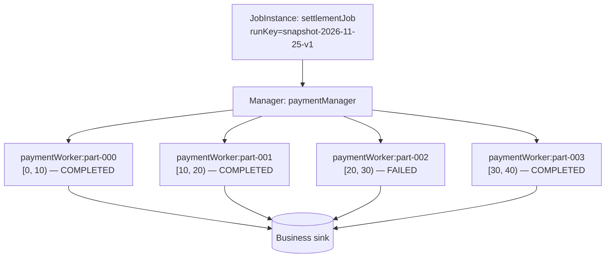
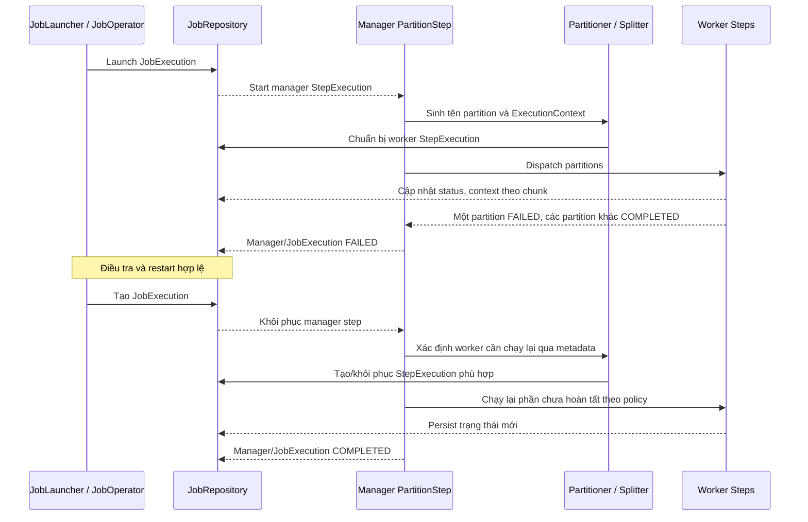
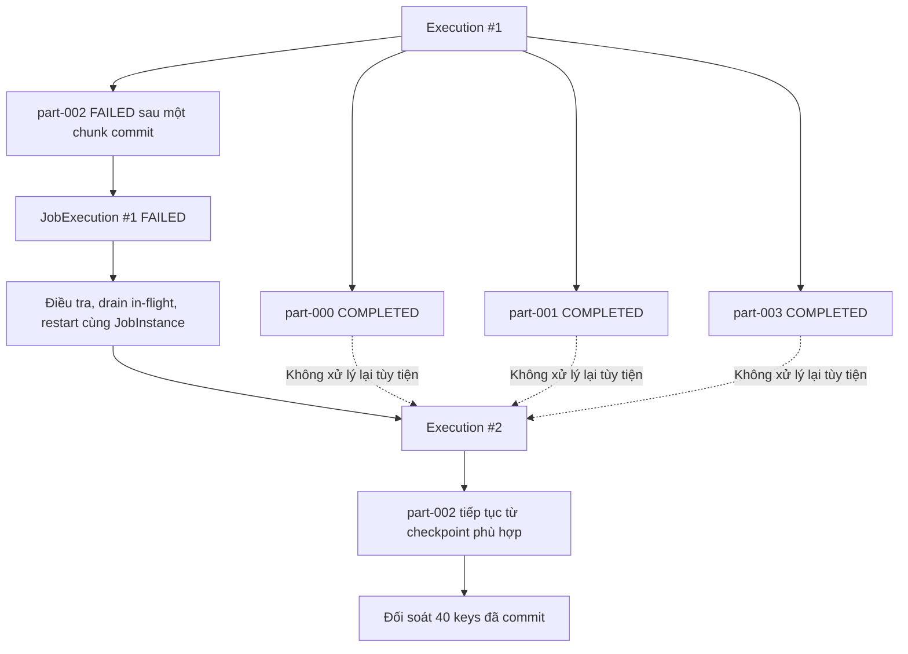
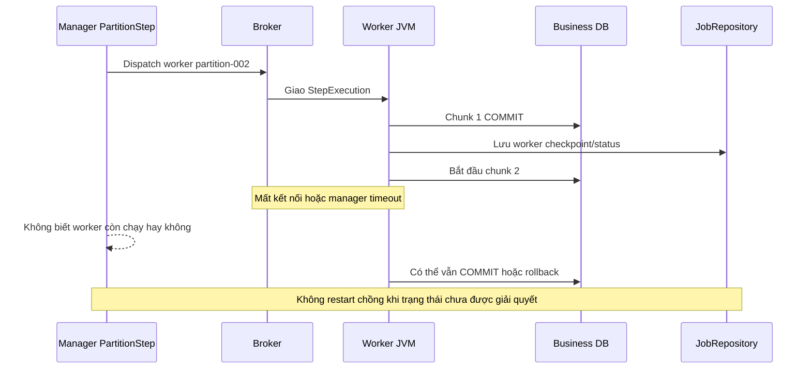

# Khôi phục partition thất bại trong Spring Batch: trạng thái, checkpoint và idempotency

## Mục tiêu bài học

Trong chương **Skip và recovery** của module **SPRING_BATCH_SCALING_OPERATIONS**, ta không chỉ học cách bỏ qua item lỗi mà còn phải biết **khôi phục phần việc đã thất bại khi job chạy song song hoặc phân tán**. Ở mô hình *partitioning*, một manager chia tập dữ liệu thành nhiều worker `StepExecution`. Nếu một worker thất bại trong khi các worker khác đã commit thành công, việc restart phải xử lý được tình trạng hoàn tất **không đồng đều** này.

Sau bài học, bạn có thể:

- Phân biệt **partition bị FAILED**, **item được skip**, **item được retry**, **chunk rollback** và **JobInstance restart**.
- Giải thích cấu trúc manager `PartitionStep`, worker `StepExecution`, `Partitioner`, `PartitionHandler` và `JobRepository`.
- Xác định partition nào thường được bỏ qua, partition nào phải chạy lại trong một restart hợp lệ, cùng những điều kiện khiến framework không thể tự tiếp tục.
- Thiết kế tên partition, phạm vi dữ liệu và `ExecutionContext` **ổn định giữa các JobExecution**.
- Dùng snapshot, checkpoint và writer idempotent để phục hồi mà không bỏ sót hoặc ghi trùng dữ liệu.
- Xây dựng ví dụ local partitioning Spring Batch 5.2.x, sau đó xác định phần phải bổ sung cho remote partitioning.
- Kiểm thử một worker lỗi sau khi commit một số chunk, restart cùng JobInstance, đối soát output và quan sát metadata.
- Vận hành an toàn khi manager timeout, worker còn in-flight, trạng thái `STARTED` không rõ ràng, hoặc một partition liên tục thất bại.

> **Phiên bản:** Ví dụ sử dụng Java 17+, Spring Batch **5.2.x**, Spring Framework 6.x và PostgreSQL. Các snippet mô tả một cấu hình tham khảo, cần import, bean hạ tầng, migrations và fixture test khi ghép thành project. SQL `ON CONFLICT` là cú pháp PostgreSQL. Không trộn API 5.2 với API Spring Batch 6.x khi chưa đối chiếu thay đổi.

## 1. Partition thất bại khác step thất bại thông thường ở đâu?

Chunk step tuần tự chỉ có một StepExecution đang xử lý input tại một thời điểm. Với partitioning, manager step giao nhiều vùng dữ liệu cho các worker step:



Các dải `[startId, endId)` bao gồm cận dưới và loại trừ cận trên. Mỗi partition có tên **duy nhất và ổn định** trong một lần xử lý logic, ví dụ `part-000`. Với local partitioning, worker chạy trong cùng JVM nhưng có **StepExecution riêng**; với remote partitioning, worker có thể chạy trên host khác nhưng vẫn cần metadata tương ứng.

Khi `part-002` FAILED, không có nghĩa dữ liệu từ các partition khác tự động rollback. Transaction của một worker không phủ toàn bộ các worker; các chunk đã commit tại `part-000`, `part-001` và `part-003` vẫn có thể nằm ở hệ thống đích.

**Mục tiêu recovery:** xác nhận các partition đã hoàn tất, tiếp tục hoặc chạy lại đúng phần bị lỗi, đồng thời bảo đảm **tập business item cuối cùng đầy đủ, không trùng, không sai phiên bản**.

### Phân biệt ba phạm vi

| Phạm vi | Ví dụ | Dùng để làm gì? |
| --- | --- | --- |
| **JobInstance** | `settlementJob` + identifying `runKey/snapshotId` | Đơn vị công việc logic cần hoàn tất qua nhiều attempts |
| **Manager StepExecution** | `paymentManager` | Điều phối partition, chờ/thu kết quả và tổng hợp trạng thái |
| **Worker StepExecution** | `paymentWorker:part-002` | Thực thi chunk trên một vùng dữ liệu, có counts và checkpoint riêng |

**Không có JobInstance riêng cho từng partition** trong kiến trúc `PartitionStep` thông thường. Nếu ứng dụng chạy một Job độc lập cho mỗi shard, đó là kiến trúc khác và phải điều phối restart ở cấp JobInstance của từng shard.

## 2. Cơ chế Spring Batch khi restart partition

Trong Spring Batch, `Partitioner` tạo mapping `partitionName → ExecutionContext`; `PartitionHandler` quyết định cách thực thi các worker `StepExecution`. Manager dùng `JobRepository` để theo dõi lịch sử, trạng thái của worker và khả năng khôi phục khi job được restart.

Sơ đồ khái niệm:



Các chi tiết implementation phụ thuộc splitter, partition handler, tên step và restart policy. **Không mô tả recovery như việc luôn dispatch lại mọi partition** hoặc như việc chỉ kiểm tra một biến Boolean trong memory.

### Trạng thái partition trước restart

| Worker `BatchStatus` ở lần trước | Hướng xử lý điển hình | Điều phải xác minh |
| --- | --- | --- |
| **`COMPLETED`** | Thường **không thực thi lại** khi restart cùng JobInstance, theo policy mặc định | Tên partition không đổi; output thật đã commit |
| **`FAILED`** | Có thể tạo StepExecution mới, khôi phục context và chạy tiếp | Reader/checkpoint hợp lệ, input không đổi, writer idempotent |
| **`STOPPED`** | Có thể được tiếp tục khi JobInstance đủ điều kiện | Stop đã hoàn tất; không còn worker cũ ghi DB |
| **`ABANDONED`** | Thường được **bỏ qua** theo semantics restart step | Chỉ sử dụng khi nghiệp vụ chấp nhận bỏ qua |
| **`UNKNOWN`** | Không tự coi tương đương `FAILED` | Phải điều tra tính nhất quán metadata và side effect |
| **`STARTING/STARTED/STOPPING`** | Chưa an toàn để tự tạo execution chồng | Kiểm tra worker cũ, broker và transaction in-flight |

Một worker `COMPLETED` được framework bỏ qua khi restart **không có nghĩa** mọi dữ liệu của nó chắc chắn đúng: nếu worker gửi side effect bên ngoài transaction hoặc input thay đổi, vẫn cần business reconciliation.

**Điều kiện trước hết:** `JobInstance` phải đủ điều kiện restart. Lần thực thi trước ở trạng thái `FAILED`/`STOPPED` không tự động cho phép chạy lại nếu job bị cấu hình `restartable(false)`, đã vượt `startLimit`, metadata bị hỏng hoặc phiên chạy cũ thực tế vẫn còn hoạt động.

## 3. Skip, retry, rollback và partition restart là bốn cơ chế khác nhau

Trong chương **Skip và recovery**, cần phân biệt cơ chế ở từng tầng:

| Cơ chế | Tầng tác động | Kích hoạt | Kết quả dự kiến |
| --- | --- | --- | --- |
| **Filter** | Processor item | `process(item)` trả `null` | Không ghi output; `filterCount` tăng theo semantics framework |
| **Skip** | Reader/processor/writer khi fault-tolerant | Exception được cấu hình skip trong giới hạn | Item lỗi bị bỏ qua có chủ đích; step vẫn có thể COMPLETED |
| **Retry** | Xử lý lỗi tạm thời trong step | Exception được cấu hình retry | Thử lại thao tác, có thể rollback/replay |
| **Rollback** | Transaction chunk | Exception hoặc rollback policy | DB writes trong cùng transaction bị hủy |
| **Restart** | JobInstance/StepExecution | JobExecution cũ FAILED/STOPPED và restartable | Tạo JobExecution mới; worker chưa hoàn tất có thể chạy lại |
| **Broker redelivery** | Remote transport | Consumer crash, ack timeout, reconnect | Message được gửi lại, không mặc nhiên tạo JobExecution |

Một `skipLimit(5)` ở **worker step** không có nghĩa cả job partitioned có một giới hạn skip toàn cục chính xác 5 item. Mỗi worker có **StepExecution và policy thực thi riêng**; cần đọc semantics cấu hình và kiểm tra số skip tổng hợp theo nghiệp vụ.

Ví dụ fault tolerance:

```java
new StepBuilder("paymentWorker", jobRepository)
        .<Payment, NormalizedPayment>chunk(100, transactionManager)
        .reader(reader)
        .processor(processor)
        .writer(writer)
        .faultTolerant()
        .retry(TransientDataAccessException.class)
        .retryLimit(3)
        .skip(InvalidPaymentException.class)
        .skipLimit(2)
        .build();
```

`InvalidPaymentException` là exception **ứng dụng tự định nghĩa**. `TransientDataAccessException` thuộc Spring DAO; chọn exception cụ thể theo driver và nghiệp vụ thay vì retry mọi `Exception`. Đoạn này chỉ là **policy mở rộng**, không tự tạo bước quarantine hoặc tự sửa dữ liệu nguồn.

### Khi nào nên skip một item?

Ví dụ 1 payment chứa currency không hợp lệ nhưng nghiệp vụ cho phép chuyển sang bảng quarantine. Worker có thể skip theo chính sách, nhưng cần **ghi bằng chứng bền vững** về item bị bỏ qua và quyết định có được publish job hay không. Nếu item đó bắt buộc phải có output, skip để job COMPLETED có thể che mất dữ liệu.

### Khi nào phải fail cả partition?

Ví dụ mất kết nối DB kéo dài, schema mismatch, hoặc không thể xác định snapshot đang dùng. Những lỗi này không phải một item xấu đơn lẻ: fail worker để bảo toàn trạng thái, điều tra rồi restart là hợp lý hơn việc skip tùy tiện.

**Quy tắc:** Skip được dùng cho dữ liệu lỗi **đã có chính sách nghiệp vụ**, retry cho lỗi **có khả năng hồi phục tạm thời**, restart cho **đơn vị công việc chưa hoàn tất**. Không dùng cả ba để che lỗi hệ thống.

## 4. Danh tính partition phải ổn định qua restart

Spring Batch cần phân biệt chính xác partition nào đã hoàn tất trong cùng JobInstance. Danh tính đó dựa trên **tên step/partition**, không phải vị trí ngẫu nhiên trong một danh sách tạo lại.

Ví dụ:

```text
paymentWorker:part-000 -> [0, 10)
paymentWorker:part-001 -> [10, 20)
paymentWorker:part-002 -> [20, 30)
paymentWorker:part-003 -> [30, 40)
```

Nếu ở lần restart đổi thuật toán và tạo:

```text
paymentWorker:part-000 -> [0, 20)
paymentWorker:part-001 -> [20, 40)
```

thì trạng thái `part-000 COMPLETED` cũ có thể bị áp cho **vùng dữ liệu khác**, tạo thiếu item. Đổi `gridSize`, thay thứ tự phân vùng hoặc dùng hash phụ thuộc phiên bản có thể gây rủi ro tương tự.

### Không gắn tên partition với tham số thay đổi giữa attempts

**Tránh**:

```java
String name = "part-" + UUID.randomUUID();
String name = "part-" + System.currentTimeMillis();
String name = "part-" + jobExecutionId; // ID đổi khi restart.
```

**Ưu tiên** ID ổn định theo kế hoạch:

```java
String name = String.format(Locale.ROOT, "part-%03d", partitionNo);
```

`partitionNo` đến từ **partition plan đã freeze**. Tham số identifying của JobInstance như `runKey` và `snapshotId` cũng phải ổn định; thêm timestamp/`run.id` mới chỉ để “cho job chạy lại” sẽ tạo JobInstance mới và làm mất logic resume checkpoint cũ.

### Tên partition không thay thế bảo vệ business data

Ngay cả khi framework bỏ qua partition đã COMPLETED, một hệ thống phân tán có thể còn worker cũ gửi side effect trễ. Writer vẫn phải có business key/unique constraint và policy xử lý replay rõ ràng.

## 5. Input snapshot và ranh giới partition

Một partition có thể được mô tả bằng:

```text
runKey       = settlement-2026-11-25-v1
snapshotId   = snapshot-2026-11-25-v1
partition    = part-002
startId      = 20       inclusive
endId        = 30       exclusive
```

Worker chỉ đọc:

```sql
SELECT payment_id, gross_amount
FROM payment_snapshot
WHERE snapshot_id = :snapshotId
  AND payment_id >= :startId
  AND payment_id < :endId
ORDER BY payment_id ASC;
```

Với các dải không chồng lấn, mỗi input item thuộc tối đa một worker. Nhưng để chứng minh **phủ đủ** snapshot, còn phải đảm bảo các dải không để lọt item, snapshot không đổi và query lọc đúng tenant/date/version.

### SQL schema mẫu PostgreSQL

```sql
CREATE TABLE payment_snapshot (
    snapshot_id   varchar(100) NOT NULL,
    payment_id    bigint NOT NULL,
    gross_amount  numeric(18, 2) NOT NULL,
    PRIMARY KEY (snapshot_id, payment_id)
);

CREATE TABLE payment_result (
    run_key      varchar(160) NOT NULL,
    payment_id   bigint NOT NULL,
    net_amount   numeric(18, 2) NOT NULL,
    PRIMARY KEY (run_key, payment_id)
);
```

Composite primary key ở nguồn hỗ trợ equality `snapshot_id`, range và `ORDER BY payment_id`. Writer có unique key `(run_key,payment_id)` để chống hai hàng trùng cho cùng item trong một run.

Dữ liệu ví dụ có 40 payment ID `0..39`, mỗi payment có `gross_amount` dương. Snapshot này được coi là **bất biến suốt JobInstance**. Nếu nguồn thực tế tiếp tục INSERT/UPDATE/DELETE trong khi job chạy, chỉ dùng `snapshotId` như một nhãn **không tự tạo snapshot vật lý**.

### Bảng lưu partition plan

```sql
CREATE TABLE payment_partition_plan (
    run_key        varchar(160) NOT NULL,
    partition_no   integer NOT NULL,
    start_id       bigint NOT NULL,
    end_id         bigint NOT NULL,
    PRIMARY KEY (run_key, partition_no),
    CHECK (start_id < end_id)
);
```

Tạo một lần theo run:

```sql
INSERT INTO payment_partition_plan
    (run_key, partition_no, start_id, end_id)
VALUES
    ('settlement-2026-11-25-v1', 0,  0, 10),
    ('settlement-2026-11-25-v1', 1, 10, 20),
    ('settlement-2026-11-25-v1', 2, 20, 30),
    ('settlement-2026-11-25-v1', 3, 30, 40);
```

Bảng này là **thiết kế ứng dụng**, không phải bảng do Spring Batch tự tạo. Constraint mỗi row chỉ kiểm tra `start_id < end_id`, **không đảm bảo các dải không chồng lấn hoặc không có gap**; cần validation trước khi launch và đối soát sau đó.

### Kiểm tra chồng lấn giữa các dải

```sql
WITH ordered AS (
    SELECT partition_no, start_id, end_id,
           LAG(end_id) OVER (ORDER BY start_id, partition_no) AS previous_end
    FROM payment_partition_plan
    WHERE run_key = :runKey
)
SELECT *
FROM ordered
WHERE previous_end IS NOT NULL
  AND start_id < previous_end;
```

Kết quả phải **rỗng**. Muốn kiểm tra gap, thay phép so bằng `start_id > previous_end`; nhưng một gap miền ID chỉ có lỗi nghiệp vụ khi có input item của snapshot nằm trong gap.

## 6. Java Partitioner đọc kế hoạch đã cố định

### 6.1. `Partitioner` và `ExecutionContext`

```java
public record PaymentRange(int number, long startId, long endId) {}

public final class FrozenPlanPartitioner implements Partitioner {

    private final JdbcTemplate jdbc;
    private final String runKey;

    public FrozenPlanPartitioner(JdbcTemplate jdbc, String runKey) {
        this.jdbc = jdbc;
        this.runKey = runKey;
    }

    @Override
    public Map<String, ExecutionContext> partition(int gridSize) {
        List<PaymentRange> ranges = jdbc.query("""
                SELECT partition_no, start_id, end_id
                FROM payment_partition_plan
                WHERE run_key = ?
                ORDER BY partition_no
                """,
                (rs, rowNum) -> new PaymentRange(
                        rs.getInt("partition_no"),
                        rs.getLong("start_id"),
                        rs.getLong("end_id")),
                runKey);

        if (ranges.isEmpty()) {
            throw new IllegalStateException(
                    "Missing partition plan for runKey=" + runKey);
        }

        Map<String, ExecutionContext> result = new LinkedHashMap<>();

        for (PaymentRange range : ranges) {
            if (range.startId() >= range.endId()) {
                throw new IllegalStateException(
                        "Invalid bounds for partition " + range.number());
            }

            String name = String.format(
                    Locale.ROOT, "part-%03d", range.number());

            ExecutionContext ec = new ExecutionContext();
            ec.putLong("startId", range.startId());
            ec.putLong("endId", range.endId());

            if (result.put(name, ec) != null) {
                throw new IllegalStateException("Duplicate name " + name);
            }
        }

        return result;
    }
}
```

`gridSize` ở đây không được dùng để **tính lại** dải, vì kế hoạch cố định là nguồn sự thật cho một JobInstance. `gridSize` vẫn có ý nghĩa như gợi ý lập kế hoạch trong các partitioner khác; với cách đọc plan này, **số partition thực tế** do số row kế hoạch quyết định.

`Partitioner` chỉ xây context, không tự tạo transaction business và không quyết định partition nào chạy lại. Framework splitter/handler kết hợp context với lịch sử JobRepository, tên worker và restart policy.

### 6.2. Late binding run key ở manager

```java
@Bean("paymentPartitioner")
@StepScope
Partitioner paymentPartitioner(
        JdbcTemplate jdbc,
        @Value("#{jobParameters['runKey']}") String runKey) {

    return new FrozenPlanPartitioner(jdbc, runKey);
}
```

Đặt bean này trong một class `@Configuration`. `runKey` lấy từ JobParameters đã chốt; không lưu `currentRunKey` trong một singleton mutable mà mọi job dùng chung.

**Phạm vi:** `@StepScope` ở manager không phải là một partitioner độc lập cho từng worker. Worker sẽ nhận `ExecutionContext` của partition, không phải tự tính lại plan.

## 7. Worker reader/writer phải hỗ trợ restart thật

### 7.1. DTO và reader theo partition bounds

```java
public record RawPayment(long paymentId, BigDecimal grossAmount) {}

public record NormalizedPayment(
        String runKey,
        long paymentId,
        BigDecimal netAmount) {}
```

`JdbcPagingItemReader` đọc input của một worker:

```java
@Bean("partitionReader")
@StepScope
JdbcPagingItemReader<RawPayment> partitionReader(
        DataSource dataSource,
        @Value("#{jobParameters['snapshotId']}") String snapshotId,
        @Value("#{stepExecutionContext['startId']}") Long startId,
        @Value("#{stepExecutionContext['endId']}") Long endId) {

    return new JdbcPagingItemReaderBuilder<RawPayment>()
            .name("partitionReader")
            .dataSource(dataSource)
            .selectClause("SELECT payment_id, gross_amount")
            .fromClause("FROM payment_snapshot")
            .whereClause("""
                    WHERE snapshot_id = :snapshotId
                      AND payment_id >= :startId
                      AND payment_id < :endId
                    """)
            .parameterValues(Map.of(
                    "snapshotId", snapshotId,
                    "startId", startId,
                    "endId", endId))
            .sortKeys(Map.of("payment_id", Order.ASCENDING))
            .pageSize(100)
            .rowMapper((rs, n) -> new RawPayment(
                    rs.getLong("payment_id"),
                    rs.getBigDecimal("gross_amount")))
            .saveState(true)
            .build();
}
```

**Đúng với partitioning:** mỗi worker `StepExecution` có `ExecutionContext` riêng, và reader `@StepScope` được bind theo context đó. Dù reader có cùng tên `partitionReader`, state của các worker tách ở những StepExecution khác nhau.

- `payment_id` là khóa sort **duy nhất trong snapshot**, giúp paging ổn định.
- `pageSize(100)` không phải `chunkSize`; điều chỉnh sau benchmark.
- `saveState(true)` cho reader lưu checkpoint. Không đổi thành `false` nếu chưa có cơ chế khôi phục thay thế.
- Không đặt `TaskExecutor` bên trong worker chunk step này khi reader chưa được audit multi-thread safety.
- Nếu bounds hoặc dữ liệu snapshot đổi giữa restart, checkpoint đọc từ StepExecution trước có thể không còn hợp lệ.

### 7.2. Processor stateless và writer idempotent

```java
@Bean("paymentProcessor")
@StepScope
ItemProcessor<RawPayment, NormalizedPayment> paymentProcessor(
        @Value("#{jobParameters['runKey']}") String runKey) {

    BigDecimal factor = new BigDecimal("0.98");

    return p -> new NormalizedPayment(
            runKey,
            p.paymentId(),
            p.grossAmount()
                    .multiply(factor)
                    .setScale(2, RoundingMode.HALF_EVEN));
}
```

Trong ví dụ, `factor` bất biến và processor không có counter/state mutable. Writer PostgreSQL:

```java
@Bean("paymentWriter")
JdbcBatchItemWriter<NormalizedPayment> paymentWriter(
        DataSource dataSource) {

    return new JdbcBatchItemWriterBuilder<NormalizedPayment>()
            .dataSource(dataSource)
            .sql("""
                    INSERT INTO payment_result
                        (run_key, payment_id, net_amount)
                    VALUES (:runKey, :paymentId, :netAmount)
                    ON CONFLICT (run_key, payment_id) DO NOTHING
                    """)
            .itemSqlParameterSourceProvider(item ->
                    new MapSqlParameterSource()
                            .addValue("runKey", item.runKey())
                            .addValue("paymentId", item.paymentId())
                            .addValue("netAmount", item.netAmount()))
            .assertUpdates(false)
            .build();
}
```

`ON CONFLICT DO NOTHING` + unique key là chính sách **first write wins**, phù hợp sample khi input bất biến; `assertUpdates(false)` cho phép một item ghi lại không làm số row bị tác động tăng.

**Giới hạn quan trọng:** Nếu cùng `runKey/paymentId` xuất hiện với giá trị `netAmount` khác, `DO NOTHING` có thể **che mismatch**. Production nên so checksum/version hoặc reject conflict bất thường, có audit và quy trình reprocess riêng.

Unique constraint chống **duplicate row**, không tự bảo đảm reader phủ đủ input, worker không gọi API hai lần, hay chỉ một message được gửi tới broker.

## 8. Cấu hình local partitioning Spring Batch 5.2

### 8.1. Worker chunk Step

```java
@Bean("paymentWorker")
Step paymentWorker(
        JobRepository jobRepository,
        PlatformTransactionManager transactionManager,
        @Qualifier("partitionReader")
        ItemStreamReader<RawPayment> reader,
        @Qualifier("paymentProcessor")
        ItemProcessor<RawPayment, NormalizedPayment> processor,
        @Qualifier("paymentWriter")
        ItemWriter<NormalizedPayment> writer) {

    return new StepBuilder("paymentWorker", jobRepository)
            .<RawPayment, NormalizedPayment>chunk(3, transactionManager)
            .reader(reader)
            .processor(processor)
            .writer(writer)
            .build();
}
```

`chunk(3)` được chọn để dễ mô phỏng một worker commit vài item rồi fail ở chunk tiếp theo. Trong production, commit interval sẽ do benchmark CPU/I/O/transaction xác định.

### 8.2. TaskExecutor và manager Step

```java
@Bean("partitionTaskExecutor")
ThreadPoolTaskExecutor partitionTaskExecutor() {
    ThreadPoolTaskExecutor executor = new ThreadPoolTaskExecutor();
    executor.setCorePoolSize(4);
    executor.setMaxPoolSize(4);
    executor.setQueueCapacity(8);
    executor.setThreadNamePrefix("partition-worker-");
    executor.initialize();
    return executor;
}

@Bean("paymentManager")
Step paymentManager(
        JobRepository jobRepository,
        @Qualifier("paymentWorker") Step worker,
        @Qualifier("paymentPartitioner") Partitioner partitioner,
        @Qualifier("partitionTaskExecutor") TaskExecutor executor) {

    return new StepBuilder("paymentManager", jobRepository)
            .partitioner(worker.getName(), partitioner)
            .step(worker)
            .gridSize(4)
            .taskExecutor(executor)
            .build();
}

@Bean("paymentJob")
Job paymentJob(
        JobRepository jobRepository,
        @Qualifier("paymentManager") Step manager) {

    return new JobBuilder("paymentJob", jobRepository)
            .start(manager)
            .build();
}
```

Đây là **local partitioning**: `TaskExecutorPartitionHandler` thực thi worker steps trên thread pool, không cần broker. Worker StepExecution riêng giúp lưu status và checkpoint theo partition.

**Không nhầm**:

- `gridSize(4)` là giá trị hướng dẫn partitioning, không phải bảo đảm mọi lúc có chính xác bốn thread active.
- `ThreadPoolTaskExecutor` ở **manager partition handler** khác với việc gắn `taskExecutor` vào **worker chunk step**. Worker ở đây vẫn xử lý một chunk tại một thời điểm.
- `@StepScope` của reader không làm nó thread-safe nếu bạn cố chạy nhiều chunk đồng thời **trong cùng worker StepExecution**.
- Số kết nối DB phải tính cả workers, JobRepository, writer và các job khác.

## 9. Một lần thất bại và restart diễn ra thế nào?

Với 40 input IDs `0..39`, các dải `[0,10)`, `[10,20)`, `[20,30)`, `[30,40)`:

1. Manager tạo bốn worker StepExecution có tên ổn định.
2. Mỗi worker đọc/ghi các chunk của phạm vi mình.
3. Giả lập worker `part-002` commit chunk `[20,21,22]`, sau đó writer ném lỗi **trước khi ghi** chunk `[23,24,25]`.
4. Worker `part-002` `FAILED` và manager/job thường `FAILED` khi điều phối hoàn tất theo chính sách.
5. Những worker đã `COMPLETED` giữ output đã commit. Worker `part-002` có thể đã commit một phần.
6. Sau khi xác minh các worker cũ đã dừng, gọi restart cho **cùng JobInstance**.
7. Framework dùng lịch sử worker StepExecutions và tên partition để tránh chạy lại phần đã hoàn tất theo policy mặc định, còn worker chưa hoàn tất được chạy tiếp.
8. Reader bị lỗi khôi phục checkpoint trước chunk lỗi; writer idempotent chịu được item bị replay.
9. Chạy đối soát output: kỳ vọng đủ **40 business keys** và không có key thừa.



**Chú ý về thứ tự hoàn thành:** Khi chạy 4 worker song song, không thể giả định `part-000`, `part-001` và `part-003` luôn `COMPLETED` trước khi manager phản ứng với `part-002 FAILED`. Trạng thái thực tế phụ thuộc thời gian mỗi worker, executor và handler. Nếu cần test một bộ trạng thái cụ thể, phải điều khiển lịch thực thi bằng latch/barrier hoặc executor đồng bộ trong test.

### Vì sao không “xóa dữ liệu của partition FAILED rồi chạy lại”?

Nếu worker đã commit chunk đầu và gặp lỗi ở chunk sau, xóa mọi row trong dải của partition có thể gây mất dữ liệu trong lúc worker cũ còn in-flight. Nếu output đang được đọc bởi downstream, việc xóa/ghi lại còn tạo khoảng trống quan sát được. Khôi phục an toàn thường dựa trên **checkpoint + writer idempotent**, còn xóa và reprocess phải là workflow riêng có khóa, version và transaction/audit rõ.

## 10. Checkpoint của từng worker: commit point mới có ý nghĩa

`ItemStream` cung cấp `open(ExecutionContext)`, `update(ExecutionContext)` và `close()`. `JdbcPagingItemReader` lưu vị trí để khôi phục khi restart; framework persist `StepExecutionContext` tại các ranh giới checkpoint/commit.

Với `part-002` và `chunk(3)`:

| Thời điểm | Input đã đọc | Dữ liệu đã commit ở partition | Checkpoint bền vững mô hình |
| --- | --- | --- | --- |
| Bắt đầu | Chưa có | Chưa có | Đầu dải 20 |
| Chunk đầu thành công | 20, 21, 22 | 20, 21, 22 | Sau 22 |
| Chunk tiếp theo đang xử lý | 23, 24, 25 | Vẫn chỉ 20–22 | Vẫn sau 22 |
| Writer ném lỗi trước commit | 23–25 có thể đã đọc trong memory | Vẫn chỉ 20–22 | Vẫn sau 22 |
| Restart | Reader khôi phục context đã persist | Giữ output cũ | Tiếp tục tại item phù hợp |
| Hoàn tất | 20–29 | Đủ 10 keys | Cuối dải |

Bảng là **mô hình đơn giản**. Key checkpoint cụ thể của `JdbcPagingItemReader` phụ thuộc phiên bản và cách reader xử lý page; không tự sửa nội dung context theo một tên key nội bộ chưa được công bố.

### Cần phân biệt ba loại state

| State | Nơi lưu | Bị ảnh hưởng khi restart? |
| --- | --- | --- |
| **Reader cursor trong memory** | Object reader của worker | Mất khi worker/JVM chết; được tạo lại |
| **StepExecutionContext đã persist** | `JobRepository` | Có thể phục hồi vào StepExecution mới phù hợp |
| **Business output đã commit** | `payment_result` hoặc sink thực tế | Tồn tại độc lập với status của worker và cần đối soát |

Nếu writer và JobRepository tham gia các transaction/resource khác nhau, hoặc có side effect ngoài DB, **không mặc định checkpoint và output commit nguyên tử**. Đây là lý do vẫn cần idempotency.

## 11. Khi worker bị timeout hoặc process chết: đặc biệt với remote partitioning

Local partitioning có thể kiểm soát thread pool trong một JVM tương đối trực tiếp. Nhưng **remote partitioning** giao `StepExecution` cho worker ở máy/process khác qua messaging. Manager nhận request/reply/status theo thiết kế transport và framework.



**Timeout của manager không đồng nghĩa worker đã dừng.** Nếu operator restart job trong khi worker cũ vẫn ghi cùng `runKey/paymentId`, hai attempts có thể xử lý một item đồng thời. Unique constraint bảo vệ duplicate rows nhưng không tự ngăn side effect API, lock contention hoặc ghi đè sai version.

### Ma trận lỗi ở ranh giới phân tán

| Sự cố | Metadata có thể thấy | Business data có thể đã xảy ra | Recovery an toàn |
| --- | --- | --- | --- |
| Worker lỗi trước commit chunk | Worker FAILED hoặc không có reply đúng hạn | Chunk lỗi rollback nếu transaction đúng | Điều tra và retry/restart theo policy |
| Worker commit chunk rồi crash trước cập nhật status cuối | Trạng thái có thể không phản ánh đủ progress | Một phần output đã commit | Dedupe per-item, đọc checkpoint đã persist và đối soát |
| Manager crash khi worker còn chạy | Manager JobExecution có thể vẫn STARTED | Worker tiếp tục ghi | Drain/stop workers, xác nhận trạng thái trước restart |
| Broker redelivery request | Có thể hai delivery cùng partition | Nguy cơ thực thi lặp hoặc chồng | Correlation, consumer policy, idempotency, bảo vệ ownership |
| Reply mất hoặc đến trễ | Manager timeout/FAILED hoặc chưa rõ | Worker có thể COMPLETED | Tra `JobRepository` và sink, xử lý late reply |
| Worker status UNKNOWN | Không thể kết luận commit thành công | Có thể đã commit hoặc chưa | Quarantine/investigation, không tự ép FAILED |
| Worker đã COMPLETED nhưng downstream publish fail | Worker COMPLETED, Job FAILED | Output có thể đã sẵn sàng | Restart phần publish đúng policy, không replay workers tùy tiện |

**Remote partitioning khác remote chunking:**

- **Remote partitioning:** worker chạy **worker StepExecution**, thường chia sẻ/truy cập `JobRepository` tương ứng và checkpoint riêng.
- **Remote chunking:** **manager giữ reader**, gửi `ChunkRequest`; worker xử lý chunk/reply, không mặc định có StepExecution riêng cho từng chunk ở worker.

Không dùng `MessageChannelPartitionHandler` như một replacement trực tiếp cho remote chunk manager writer; hai kiến trúc có recovery semantics khác nhau.

## 12. JobRepository, StepExecution status và lệnh restart

Một JobInstance được xác định bằng **job name + identifying JobParameters**. Ví dụ:

```java
JobParameters params = new JobParametersBuilder()
        .addString("runKey", "settlement-2026-11-25-v1", true)
        .addString("snapshotId", "snapshot-2026-11-25-v1", true)
        .toJobParameters();
```

Khi job FAILED nhưng đủ điều kiện restart, có thể launch lại với **cùng identifying parameters**:

```java
JobExecution restartAttempt =
        jobLauncher.run(paymentJob, params);
```

Hoặc dùng `JobOperator` với **ID của JobExecution thất bại**, không phải ID JobInstance:

```java
Long nextExecutionId =
        jobOperator.restart(failedJobExecutionId);
```

Hai cách cần được gọi trong đúng lifecycle và điều kiện của framework. `restart(...)` hướng tới **JobInstance cũ**, còn `startNextInstance(...)` hoặc thêm `run.id` identifying mới có thể tạo **JobInstance mới**, không dùng checkpoint worker đã FAILED.

### Trạng thái sau process crash

JobRepository có thể còn `STARTED` nếu JVM bị kill trước khi cập nhật status. Đừng tự:

```sql
-- KHÔNG làm theo cách này để "mở khóa" job:
UPDATE BATCH_JOB_EXECUTION SET STATUS = 'FAILED'
WHERE JOB_EXECUTION_ID = :id;
```

Mà phải xác minh manager/worker đã dừng, kiểm tra in-flight broker và transaction, quyết định quy trình khôi phục metadata theo framework/operational API, rồi mới restart an toàn.

### `allowStartIfComplete` và `startLimit`

- `allowStartIfComplete(false)` mặc định giúp không lặp lại worker step đã COMPLETED khi restart bình thường. Nếu `true`, một worker có thể được phép chạy lại theo policy/flow; cần bảo vệ output.
- `startLimit(n)` giới hạn số lần một step được **bắt đầu** trong cùng JobInstance; khác `retryLimit(n)` ở tầng item/chunk.
- Đừng thay chính sách này chỉ để che một lỗi partition liên tục mà chưa khắc phục nguyên nhân.

Lưu ý khi phối hợp splitter/partition manager: manager và worker có những StepExecution riêng; đánh giá policy trên đúng step và quan sát behavior thực của cấu hình 5.2.

## 13. SQL điều tra partition thất bại

### 13.1. Xem mọi JobExecution của cùng JobInstance

```sql
SELECT ji.JOB_INSTANCE_ID,
       ji.JOB_NAME,
       je.JOB_EXECUTION_ID,
       je.STATUS,
       je.EXIT_CODE,
       je.START_TIME,
       je.END_TIME
FROM BATCH_JOB_INSTANCE ji
JOIN BATCH_JOB_EXECUTION je
  ON je.JOB_INSTANCE_ID = ji.JOB_INSTANCE_ID
WHERE ji.JOB_INSTANCE_ID = :jobInstanceId
ORDER BY je.JOB_EXECUTION_ID;
```

Nếu restart hợp lệ, các JobExecution attempts có **ID khác nhau** nhưng cùng `JOB_INSTANCE_ID`. Một JobExecution mới chưa chắc đồng nghĩa JobInstance mới.

### 13.2. Liệt kê worker StepExecutions

```sql
SELECT se.JOB_EXECUTION_ID,
       se.STEP_EXECUTION_ID,
       se.STEP_NAME,
       se.STATUS,
       se.EXIT_CODE,
       se.READ_COUNT,
       se.WRITE_COUNT,
       se.FILTER_COUNT,
       se.READ_SKIP_COUNT,
       se.PROCESS_SKIP_COUNT,
       se.WRITE_SKIP_COUNT,
       se.COMMIT_COUNT,
       se.ROLLBACK_COUNT,
       se.START_TIME,
       se.END_TIME
FROM BATCH_STEP_EXECUTION se
JOIN BATCH_JOB_EXECUTION je
  ON je.JOB_EXECUTION_ID = se.JOB_EXECUTION_ID
WHERE je.JOB_INSTANCE_ID = :jobInstanceId
  AND se.STEP_NAME LIKE 'paymentWorker:%'
ORDER BY se.STEP_NAME, se.STEP_EXECUTION_ID;
```

`LIKE 'paymentWorker:%'` phù hợp kiểu đặt tên partition worker trong ví dụ. Tùy hệ thống tên step có thể khác, phải đối chiếu thực tế trước khi lọc SQL.

**Không cộng bừa `READ_COUNT`/`WRITE_COUNT` qua mọi attempts để suy số item duy nhất.** Worker có thể đọc/ghi lại cùng item sau rollback/restart; `ON CONFLICT DO NOTHING` có thể ghi nhận item writer nhận mà không insert row mới.

### 13.3. Xem state checkpoint theo worker

```sql
SELECT se.JOB_EXECUTION_ID,
       se.STEP_EXECUTION_ID,
       se.STEP_NAME,
       se.STATUS,
       ec.SHORT_CONTEXT
FROM BATCH_STEP_EXECUTION se
JOIN BATCH_STEP_EXECUTION_CONTEXT ec
  ON ec.STEP_EXECUTION_ID = se.STEP_EXECUTION_ID
WHERE se.JOB_EXECUTION_ID = :jobExecutionId
  AND se.STEP_NAME LIKE 'paymentWorker:%'
ORDER BY se.STEP_NAME;
```

`SHORT_CONTEXT` có thể bị rút gọn và phụ thuộc serializer/schema; không parse rồi sửa thủ công để ép checkpoint. Reader name, sort key và state version phải được quản trị tương thích giữa các lần restart.

### 13.4. Tóm tắt trạng thái partition

```sql
SELECT se.STEP_NAME,
       se.STATUS,
       COUNT(*) AS executions
FROM BATCH_STEP_EXECUTION se
JOIN BATCH_JOB_EXECUTION je
  ON je.JOB_EXECUTION_ID = se.JOB_EXECUTION_ID
WHERE je.JOB_INSTANCE_ID = :jobInstanceId
  AND se.STEP_NAME LIKE 'paymentWorker:%'
GROUP BY se.STEP_NAME, se.STATUS
ORDER BY se.STEP_NAME, se.STATUS;
```

Bảng này cho biết **lịch sử theo status**, không khẳng định status cuối cùng của từng partition. Để chọn trạng thái gần nhất, cần truy StepExecution mới nhất **theo tên partition** với window function hoặc JobExplorer, rồi phân biệt executions cũ/mới.

### 13.5. Tìm partition bị lỗi mới nhất

```sql
WITH ranked AS (
    SELECT se.STEP_NAME,
           se.STATUS,
           se.EXIT_CODE,
           se.STEP_EXECUTION_ID,
           se.JOB_EXECUTION_ID,
           ROW_NUMBER() OVER (
               PARTITION BY se.STEP_NAME
               ORDER BY se.STEP_EXECUTION_ID DESC
           ) AS rn
    FROM BATCH_STEP_EXECUTION se
    JOIN BATCH_JOB_EXECUTION je
      ON je.JOB_EXECUTION_ID = se.JOB_EXECUTION_ID
    WHERE je.JOB_INSTANCE_ID = :jobInstanceId
      AND se.STEP_NAME LIKE 'paymentWorker:%'
)
SELECT STEP_NAME, STATUS, EXIT_CODE,
       STEP_EXECUTION_ID, JOB_EXECUTION_ID
FROM ranked
WHERE rn = 1
ORDER BY STEP_NAME;
```

`STEP_EXECUTION_ID` tăng theo cơ chế cấp ID của repository trong hệ thống điển hình; nếu hạ tầng có đặc thù import/migration, hãy kiểm tra trình tự qua `JOB_EXECUTION_ID` và timestamps. Không suy “worker đã dừng” chỉ từ một row `FAILED` khi process ở xa còn khả năng ghi.

## 14. Đối soát business output sau restart

Trạng thái `COMPLETED` là điều kiện vận hành quan trọng nhưng **không tự chứng minh** mọi payment có output đúng. Với 40 item nguồn và 40 output mong đợi:

### 14.1. Input hợp lệ bị thiếu

```sql
SELECT s.payment_id
FROM payment_snapshot s
LEFT JOIN payment_result r
  ON r.payment_id = s.payment_id
 AND r.run_key = :runKey
WHERE s.snapshot_id = :snapshotId
  AND r.payment_id IS NULL
ORDER BY s.payment_id;
```

Kết quả phải **0 hàng** nếu mọi input đều hợp lệ và không có filter/skip. Nếu có skip hợp lệ, query phải loại đúng những item được quarantine theo chính sách nghiệp vụ.

### 14.2. Output không thuộc snapshot

```sql
SELECT r.payment_id
FROM payment_result r
LEFT JOIN payment_snapshot s
  ON s.payment_id = r.payment_id
 AND s.snapshot_id = :snapshotId
WHERE r.run_key = :runKey
  AND s.payment_id IS NULL;
```

Kết quả cũng phải rỗng theo business contract đơn giản.

### 14.3. Count theo partition plan

```sql
SELECT p.partition_no,
       p.start_id,
       p.end_id,
       COUNT(r.payment_id) AS committed_items
FROM payment_partition_plan p
LEFT JOIN payment_result r
  ON r.run_key = p.run_key
 AND r.payment_id >= p.start_id
 AND r.payment_id < p.end_id
WHERE p.run_key = :runKey
GROUP BY p.partition_no, p.start_id, p.end_id
ORDER BY p.partition_no;
```

Với dữ liệu mẫu `0..39`, kỳ vọng mỗi partition có **10 rows** sau khi job hoàn thành. Nhưng nếu dải chồng lấn, một output có thể được đếm ở nhiều partition. Vì vậy **phải validate disjoint plan trước khi tin kết quả count theo dải**.

### 14.4. Count không thay thế đối soát giá trị

Nếu writer nhận cùng ID với amount khác và `ON CONFLICT DO NOTHING` che mismatch, row count vẫn bằng 40 nhưng kết quả sai. Cần thêm checksum/hash hoặc so output theo key và business transformation version.

Ví dụ tính lại net amount theo công thức giả định rồi so:

```sql
SELECT s.payment_id,
       ROUND(s.gross_amount * 0.98, 2) AS expected_net,
       r.net_amount AS actual_net
FROM payment_snapshot s
JOIN payment_result r
  ON r.payment_id = s.payment_id
 AND r.run_key = :runKey
WHERE s.snapshot_id = :snapshotId
  AND r.net_amount <> ROUND(s.gross_amount * 0.98, 2);
```

**Cảnh báo:** Java `RoundingMode.HALF_EVEN` và PostgreSQL `round(numeric, 2)` có thể **khác quy tắc làm tròn ở điểm .5**. Do đó query trên **chỉ minh họa cấu trúc đối soát**, không phải oracle chính xác cho mọi payment theo processor Java của ví dụ. Production phải cài đặt cùng một rule rounding ở cả hai phía hoặc đối soát bằng một implementation chuẩn đã kiểm thử.

## 15. Test fault injection: partition bị lỗi sau một chunk

Một integration test tốt phải chứng minh:

1. Một worker thất bại **sau khi đã commit một chunk**.
2. JobExecution đầu `FAILED`; output đã commit từ những worker khác không bị xóa.
3. Restart dùng **cùng JobInstance** và context.
4. Những partition đã COMPLETED trước đó không bị xử lý lại tùy tiện theo policy mặc định.
5. Cuối cùng có **đủ 40 business keys**, không có duplicate row.
6. Nếu chạy remote, không còn worker cũ gây side effect sau khi test xác nhận completion.

### 15.1. Writer decorator ném lỗi một lần

Ở test profile, thay writer thật bằng decorator:

```java
public final class FailOncePartitionWriter
        implements ItemWriter<NormalizedPayment> {

    private final ItemWriter<NormalizedPayment> delegate;
    private final AtomicBoolean failOnce;

    public FailOncePartitionWriter(
            ItemWriter<NormalizedPayment> delegate,
            AtomicBoolean failOnce) {
        this.delegate = delegate;
        this.failOnce = failOnce;
    }

    @Override
    public void write(Chunk<? extends NormalizedPayment> items)
            throws Exception {

        boolean containsPayment25 = items.getItems().stream()
                .anyMatch(item -> item.paymentId() == 25L);

        if (containsPayment25
                && failOnce.compareAndSet(true, false)) {
            throw new IllegalStateException(
                    "Injected failure before writing payment 25");
        }

        delegate.write(items);
    }
}
```

Với `chunk(3)`, partition `part-002` chứa `20..29`; một triển khai tuần tự không filter có thể commit `20,21,22` trước khi chunk `23,24,25` ném lỗi. Các worker khác hoạt động song song, nên **không hard-code** chính xác trạng thái của họ trong execution đầu nếu không dùng kiểm soát scheduling.

Đặt một bean `AtomicBoolean(true)` **chỉ trong test scope** và giữ qua cả hai launches; kết nối decorator vào `paymentWorker`. Chỉ khai báo class mà không wiring vào Step **không kích hoạt fault injection**. Không triển khai fault injector lên production.

### 15.2. Skeleton test với Spring Batch Test

```java
@SpringBatchTest
@SpringBootTest(
    classes = PaymentBatchApplication.class,
    properties = {"spring.batch.job.enabled=false"})
class PartitionRestartIntegrationTest {

    @Autowired JobLauncherTestUtils jobLauncherTestUtils;
    @Autowired JobExplorer jobExplorer;
    @Autowired JdbcTemplate jdbcTemplate;

    private JobParameters params() {
        return new JobParametersBuilder()
                .addString("runKey", "settlement-2026-11-25-v1", true)
                .addString("snapshotId", "snapshot-2026-11-25-v1", true)
                .toJobParameters();
    }

    @Test
    void failedPartitionCanRecoverInSameJobInstance()
            throws Exception {

        // Fixture trước test: 40 payment ID 0..39; 4 ranges cố định;
        // fault injector bật, DB metadata test sạch.
        JobExecution first =
                jobLauncherTestUtils.launchJob(params());

        assertEquals(BatchStatus.FAILED, first.getStatus());

        // Không xóa JobRepository, input hoặc committed output ở đây.
        JobExecution resumed =
                jobLauncherTestUtils.launchJob(params());

        assertEquals(BatchStatus.COMPLETED, resumed.getStatus());
        assertEquals(first.getJobInstance().getInstanceId(),
                     resumed.getJobInstance().getInstanceId());
        assertNotEquals(first.getId(), resumed.getId());

        Long rows = jdbcTemplate.queryForObject("""
            SELECT COUNT(*) FROM payment_result WHERE run_key = ?
            """, Long.class, "settlement-2026-11-25-v1");

        assertEquals(40L, rows);
    }
}
```

**Skeleton trên chưa phải test chạy ngay**: cần class `PaymentBatchApplication`, test datasource PostgreSQL/Testcontainers, Spring Batch metadata schema, bean factory, seeding plan/fixture, writer decorator và cleanup test tương ứng. `@SpringBatchTest` không tự sinh 40 payment và không tự kết nối fault injector.

**Quan trọng:** Nếu `@BeforeEach` xóa JobRepository trước *mỗi lần launch* thay vì trước *mỗi test*, lần hai tạo JobInstance mới và test không chứng minh restart. Giữ toàn bộ metadata và output giữa hai attempts.

### 15.3. Kiểm tra status của từng worker

Dùng `JobExplorer` hoặc SQL đọc lịch sử worker StepExecutions của **cùng JobInstance**:

```java
JobInstance instance = resumed.getJobInstance();
List<JobExecution> attempts =
        jobExplorer.getJobExecutions(instance);

Set<String> partitionNames = attempts.stream()
        .flatMap(e -> e.getStepExecutions().stream())
        .map(StepExecution::getStepName)
        .filter(name -> name.startsWith("paymentWorker:"))
        .collect(Collectors.toSet());

assertEquals(
        Set.of(
                "paymentWorker:part-000",
                "paymentWorker:part-001",
                "paymentWorker:part-002",
                "paymentWorker:part-003"),
        partitionNames);
```

Đây là assertion về **tên worker ổn định**. Muốn chứng minh partition đã COMPLETED không chạy lại, nên kiểm tra **số lần bắt đầu worker StepExecution theo tên/metadata hoặc invocation count của test writer** và biết rõ behavior của handler. Không suy luận từ việc cả bốn tên vẫn tồn tại sau restart.

### 15.4. Unit test partition plan

```java
@Test
void rangesMustNotOverlap() {
    List<PaymentRange> ranges = List.of(
            new PaymentRange(0, 0, 10),
            new PaymentRange(1, 10, 20),
            new PaymentRange(2, 20, 30),
            new PaymentRange(3, 30, 40));

    for (int i = 0; i < ranges.size(); i++) {
        PaymentRange current = ranges.get(i);
        assertTrue(current.startId() < current.endId());

        if (i > 0) {
            PaymentRange previous = ranges.get(i - 1);
            assertEquals(previous.endId(), current.startId());
        }
    }
}
```

Unit test chỉ chứng minh danh sách mẫu liên tiếp; integration test phải kiểm tra **kế hoạch được load thật**, nguồn `snapshot_id`, số row trong từng dải, partition rỗng và input nằm ngoài dải.

### 15.5. Ma trận kiểm thử cần có

| Kịch bản | Cách tạo | Điều phải xác nhận |
| --- | --- | --- |
| Happy path | 40 item, 4 partitions | Job COMPLETED, đủ 40 keys |
| Worker fail trước chunk 1 commit | Throw ở writer lần đầu | Không có write của chunk lỗi đã commit |
| Worker fail sau 1+ chunk commit | Throw trước khi ghi chunk sau | Output cũ giữ nguyên, worker resume đúng |
| Retry transient DB error | Fault-tolerant retry có giới hạn | Không trùng key; không retry vô hạn |
| Skip business-invalid item | Exception thuộc skip policy | Quarantine/audit, tổng skip theo worker và toàn job |
| Restart với completed partitions | Fail một worker, giữ các worker COMPLETED | Không replay completed workers theo policy mặc định |
| Source snapshot bị sửa | Thay input trước restart trong test đối chứng | Phát hiện vi phạm bất biến, không âm thầm lệch output |
| Thay partition mapping khi restart | Đổi plan/name có chủ đích trong test âm tính | Bị chặn/được báo lỗi; không nhận checkpoint sai |
| Worker remote crash | Kill JVM khi đang xử lý | Manager/worker recovery, không có duplicate side effect |
| Lost/late reply | Chặn reply ở transport | Đối soát in-flight trước restart |
| Manager crash khi worker còn chạy | Kill manager rồi quan sát worker | Không launch execution chồng cùng business run |
| Poison message | Gửi payload luôn lỗi | Retry giới hạn, DLQ/quarantine, alert rõ |

## 16. Cách xử lý partition thất bại nhiều lần

Một partition liên tục `FAILED` thường không được giải quyết bằng việc đổi `run.id` để chạy lại toàn job. Hãy chẩn đoán đúng:

### Lỗi dữ liệu cố định

Ví dụ payment 25 có currency/amount sai và processor luôn throw. Tăng retry chỉ lặp lại lỗi. Chọn một trong các chính sách đã duyệt:

- Sửa nguồn và **tạo snapshot/version mới** nếu input JobInstance cũ không còn bất biến.
- Skip/quarantine item nếu nghiệp vụ cho phép và có audit.
- Đánh dấu job không đạt chuẩn, không publish kết quả thiếu.
- Với reprocess version mới, cô lập output run key, không xóa lịch sử thất bại.

### Lỗi hạ tầng tạm thời

Deadlock, network DB timeout hoặc broker không sẵn sàng có thể hồi phục bằng retry có giới hạn, backoff, giảm concurrency hoặc restart sau khi hạ tầng ổn định. Đo lock wait, connection pool pending, p95/p99 chunk latency và số retries.

### Lỗi hotspot hoặc data skew

Một partition có 90% dữ liệu, các partition khác rất ít. Nó có thể timeout và bị retry quá nhiều dù code đúng. Tối ưu query/index, chunk size, giới hạn concurrency và lập partition plan cân bằng hơn **cho JobInstance mới hoặc sau migration đã kiểm soát**, không tự thay đổi mapping của JobInstance đang cần restart.

### Lỗi serialization/context

Worker không đọc được `ExecutionContext` do thay schema, serializer hoặc DTO version. Không sửa key/value tùy tiện trong bảng context. Cần chiến lược version compatibility hoặc kế hoạch reprocess có audit.

## 17. Quan sát partition, thông lượng và bottleneck

Một dashboard hữu ích không chỉ đếm tổng `JobExecution` `COMPLETED`. Nên theo dõi:

| Metric | Vì sao cần |
| --- | --- |
| Số partition `COMPLETED/FAILED/STOPPED/STARTED` theo run | Xác định tiến độ và vùng chưa hoàn tất |
| `readCount`, `writeCount`, `filterCount`, skip counts **theo partition** | Phân biệt lỗi nghiệp vụ và lỗi hạ tầng |
| `commitCount`, `rollbackCount`, retry/error count | Biết worker có đang làm lại nhiều chunk |
| Elapsed time p50/p95 theo worker, partition chậm nhất | Phát hiện skew và hotspot |
| Reader DB query p95, writer/commit p95, lock wait | Chỉ ra bottleneck thực |
| Active executor threads, queue length, DB pool pending | Biết tăng concurrency còn khả thi không |
| Remote broker in-flight, redelivery, reply lag, DLQ | Đánh giá độ tin cậy điều phối |
| Business committed keys theo runKey/partition | Nguồn chân lý về kết quả |
| Thời gian từ FAILED đến restart COMPLETED | Đo khả năng recovery thực tế |

**Không dùng `writeCount` là số hàng mới insert:** writer `ON CONFLICT DO NOTHING` có thể nhận item đã tồn tại nhưng ghi 0 row. Metadata phản ánh semantics framework, còn business sink xác định item đã commit.

### Đo trên snapshot và đầu ra ổn định

So sánh ba cấu hình:

| Phương án | Worker | Kỳ vọng đo | Rủi ro |
| --- | ---: | --- | --- |
| Chunk tuần tự baseline | 1 | Tính đúng, throughput cơ sở | Một step xử lý toàn bộ input |
| Local partitioning | 4 | Tăng throughput nếu DB/CPU còn capacity | Skew, pool saturation, lỗi một worker |
| Remote partitioning | 4–N | Scale qua process/host, cô lập worker | Broker/metadata/in-flight phức tạp |

Không giả định phương án có nhiều worker hơn luôn nhanh hơn. Nếu database writer bị lock contention, tăng worker có thể làm job chậm và **tăng xác suất rollback/restart**.

## 18. Runbook production: phục hồi có kiểm soát

Khi manager báo FAILED vì một hoặc nhiều worker:

1. **Xác định JobInstance** bằng job name + identifying JobParameters, `runKey` và `snapshotId`. Không tạo run ID mới theo phản xạ.
2. **Khóa phát work mới** cho cùng run key ở scheduler/work-order service nếu có nguy cơ nhiều manager chạy chồng.
3. **Đọc mọi StepExecution** của manager và workers từ JobRepository; ghi lại status cuối, lỗi, read/write/skip/commit counts và checkpoint.
4. **Kiểm tra process/worker thật:** với local, thread/executor; với remote, worker JVM, broker request/reply/DLQ và transaction còn in-flight. Status `STARTED` cũ không chứng minh worker còn sống hoặc đã dừng.
5. **Đối soát output** theo business keys và bounds; không coi manager FAILED nghĩa dữ liệu toàn job trống.
6. **Phân loại lỗi:** dữ liệu được skip hợp lệ, transient retryable, permanent business error, partition plan skew, schema/serializer mismatch hay hạ tầng mất kết nối.
7. **Khắc phục nguyên nhân**, đảm bảo input snapshot và partition plan của JobInstance không bị thay đổi ngoài kiểm soát.
8. **Dừng/drain worker cũ và giải quyết trạng thái bất thường** bằng quy trình đã kiểm chứng; không trực tiếp UPDATE metadata SQL để ép restart.
9. **Restart cùng JobInstance** khi JobExecution đủ điều kiện, dùng JobOperator/JobLauncher đúng semantics. Quan sát các worker thực sự được chạy lại.
10. **Đối soát cuối:** đủ item hợp lệ, không có item ngoài snapshot, không có payload mismatch, quarantine đầy đủ và downstream publish đúng một lần theo business contract.
11. **Ghi audit:** execution IDs, nguyên nhân, partition names, người thao tác, số chunk replay và kết quả recovery.
12. **Tối ưu trước lần sau:** tuning partition plan/index/worker concurrency theo dữ liệu đo, không theo cảm giác.

## 19. Các anti-pattern thường gặp

| Sai lầm | Hậu quả | Cách xử lý |
| --- | --- | --- |
| Tạo tên partition ngẫu nhiên mỗi lần chạy | Framework không nối được lịch sử worker | Tên cố định từ frozen plan |
| Đổi grid size/range mapping khi restart | Completed step gắn nhầm phạm vi | Freeze plan theo JobInstance |
| Dùng `JobExecutionId` làm business run key | ID đổi sau restart, ghi trùng | Stable identifying run key |
| Xóa mọi row của một partition FAILED | Có thể xóa output đã commit còn đúng | Checkpoint + writer idempotent, reprocess riêng nếu cần |
| Cho worker cũ còn chạy mà restart manager | Ghi chồng, lock wait và side effect trùng | Drain/ownership fencing và reconciliation |
| Dùng `skip(Exception.class)` | Che lỗi DB/serialization thành “data skip” | Chỉ skip lỗi nghiệp vụ xác định |
| Retry vô hạn item luôn invalid | Poison item gây retry storm | Giới hạn retry, quarantine/DLQ |
| Xem manager FAILED là mọi worker FAILED | Mất công việc đã hoàn tất | Đọc status từng worker |
| Xem worker COMPLETED là output chắc chắn đúng | Bỏ qua external side effect và mismatch | Business reconciliation |
| Shared reader state giữa workers | Race, skip/trùng dữ liệu | `@StepScope` và context riêng |
| Tự thêm `TaskExecutor` vào worker stateful chunk step | Reader/checkpoint bị race | Chỉ scale ở partition handler hoặc audit đầy đủ |
| Tự sửa bảng `BATCH_STEP_EXECUTION` khi STARTED bất thường | Có thể tạo hai worker cùng ghi | Runbook khôi phục an toàn |
| Bỏ qua khóa duy nhất ở output | Retry/restart tạo duplicate rows | Unique business key + idempotent writer |
| Không test lost reply và manager crash | Happy path pass, production lỗi trùng | Fault injection remote |
| Chỉ benchmark rows/s mà không test restart | Tăng tốc nhưng không có khả năng phục hồi | Correctness + recovery trước throughput |

## 20. Checklist trước khi triển khai

- [ ] Partition names là deterministic và ổn định qua restart cùng JobInstance.
- [ ] Partition plan/bounds được chốt theo snapshot; validation không overlap và phủ đủ input.
- [ ] Reader của worker được late-bind theo `StepExecutionContext`; không chia mutable cursor giữa workers.
- [ ] `ItemStream`/reader `saveState` và checkpoint có ý nghĩa khi chunk rollback/restart.
- [ ] Writer có unique business key và idempotency policy cho retry/redelivery.
- [ ] Tất cả business side effects ngoài DB transaction có idempotency key/outbox/compensation.
- [ ] Đã phân biệt filter, skip, retry, rollback, restart và broker redelivery.
- [ ] `skipLimit` và retry policy được đặt có chủ đích ở worker; có quarantine/audit khi skip.
- [ ] JobInstance dùng identifying JobParameters ổn định; không thêm `run.id` mới khi chỉ muốn restart.
- [ ] `allowStartIfComplete` và `startLimit` của manager/worker được hiểu đúng.
- [ ] Có test worker FAILED khi những workers khác đã COMPLETED, và restart không replay tùy tiện partition đã xong.
- [ ] Có test fail **sau chunk đã commit** và trước chunk tiếp theo; đối soát cuối không thiếu/trùng.
- [ ] Có test restart với input snapshot bất biến và âm tính khi partition plan bị thay đổi.
- [ ] Remote workers có heartbeat/timeout, correlation, DLQ, drain và xử lý late reply.
- [ ] Đã có runbook khi metadata STARTED/UNKNOWN nhưng process thực đã chết.
- [ ] Monitoring gồm per-partition counts, status, skew, DB pool, queue/broker và time-to-recovery.
- [ ] Trước publish, kết quả được xác minh bằng business keys và transformation version, không chỉ `BatchStatus.COMPLETED`.

## 21. Câu hỏi tự kiểm tra

**1. Khi một worker FAILED, toàn bộ output của những partition COMPLETED có rollback không?** Không mặc định. Mỗi worker có các transaction/chunk riêng; các ghi đã commit có thể vẫn còn.

**2. Vì sao cần giữ tên partition ổn định?** Spring Batch dùng tên worker step/partition và JobRepository metadata để nhận diện phần việc qua các attempts. Đổi tên/mapping có thể phá restart correctness.

**3. `skipLimit(2)` trên worker có phải giới hạn tối đa hai item bị skip cho cả job không?** Không nên giả định. Mỗi worker có StepExecution/fault-tolerance policy riêng; cần tổng hợp và áp dụng business limit theo yêu cầu.

**4. Sau worker crash ở chunk thứ hai, reader bắt đầu từ đầu partition hay checkpoint?** Nếu reader hỗ trợ `ItemStream`, state được persist đúng và JobInstance restart hợp lệ, nó có thể tiếp tục từ checkpoint. Không suy chắc khi input hoặc bounds đã thay đổi.

**5. Worker COMPLETED có được chạy lại khi manager restart không?** Thường được bỏ qua theo policy mặc định nếu metadata/tên partition khớp; cấu hình đặc biệt có thể làm khác. Cần xác minh bằng test thực tế.

**6. Manager timeout có nghĩa remote worker đã dừng chưa?** Chưa. Worker có thể còn đọc/ghi hoặc đã commit trước reply; phải điều tra in-flight và đối soát.

**7. Vì sao `ON CONFLICT DO NOTHING` chưa đủ chứng minh output đúng?** Nó ngăn duplicate rows nhưng có thể giữ kết quả cũ sai nếu lần replay mang payload khác; cần snapshot/version hoặc kiểm tra checksum.

**8. Tại sao không tạo `run.id` mới để xử lý partition thất bại?** Vì thay identifying JobParameters có thể tạo JobInstance mới và không dùng lịch sử/checkpoint của worker cũ.

**9. Dùng `TaskExecutor` tại manager có làm một worker reader thành thread-safe không?** Không. Mỗi worker có StepExecution/reader riêng nhờ partitioning; nếu tự bật multi-threaded chunk trong worker, vẫn phải audit reader/checkpoint.

**10. Khi nào chọn reprocess thay vì restart?** Khi input/rules version thay đổi không tương thích với checkpoint hoặc JobInstance đã hoàn tất nhưng cần tính lại có chủ đích; reprocess phải có identity/output version và đối soát riêng.

## Tài liệu tham khảo

- [Spring Batch 5.2 — Scaling and Parallel Processing](https://docs.spring.io/spring-batch/reference/5.2/scalability.html): mô hình partitioning, manager/worker và các cách mở rộng.
- [Spring Batch 5.2 — Partitioning](https://docs.spring.io/spring-batch/reference/5.2/scalability.html#partitioning): `Partitioner`, grid size, `StepExecution` và restart.
- [Spring Batch 5.2 — Configuring a Step for Restart](https://docs.spring.io/spring-batch/reference/5.2/step/chunk-oriented-processing/restart.html): status, `allowStartIfComplete`, `startLimit` và checkpoint.
- [Spring Batch 5.2 — ItemStream](https://docs.spring.io/spring-batch/reference/5.2/readers-and-writers/item-stream.html): `open/update/close` và `ExecutionContext`.
- [Spring Batch 5.2 — Fault Tolerance](https://docs.spring.io/spring-batch/reference/5.2/step/chunk-oriented-processing/retry-logic.html): retry policy và chunk retry.
- [Spring Batch 5.2 — Skip Logic](https://docs.spring.io/spring-batch/reference/5.2/step/chunk-oriented-processing/configuring-skip.html): skip policy và skip counts.
- [Spring Batch 5.2 — Domain Language](https://docs.spring.io/spring-batch/reference/5.2/domain.html): JobInstance/JobExecution/StepExecution/ExecutionContext.
- [Spring Batch 5.2 — Testing](https://docs.spring.io/spring-batch/reference/5.2/testing.html): `@SpringBatchTest` và kiểm thử Job/Step.
- [Spring Batch 5.2 API — Partitioner](https://docs.spring.io/spring-batch/docs/5.2.x/api/org/springframework/batch/core/partition/support/Partitioner.html): hợp đồng tạo partition context.
- [Spring Batch 5.2 API — TaskExecutorPartitionHandler](https://docs.spring.io/spring-batch/docs/5.2.x/api/org/springframework/batch/core/partition/support/TaskExecutorPartitionHandler.html): thực thi worker steps cục bộ.
- [Spring Batch 5.2 API — SimpleStepExecutionSplitter](https://docs.spring.io/spring-batch/docs/5.2.x/api/org/springframework/batch/core/partition/support/SimpleStepExecutionSplitter.html): chia và khôi phục `StepExecution` của partition.
- [Spring Batch 5.2 API — JdbcPagingItemReader](https://docs.spring.io/spring-batch/docs/5.2.x/api/org/springframework/batch/item/database/JdbcPagingItemReader.html): paging/sort key và restartability.

**Điều cần nhớ:** **Khôi phục partition thất bại không phải chạy lại toàn bộ job từ đầu hoặc xóa mọi kết quả đã ghi.** Spring Batch có thể dùng **JobRepository, tên partition ổn định và `StepExecutionContext`** để nhận diện phần đã hoàn tất và tiếp tục phần chưa hoàn tất. Nhưng transaction/chunk, broker, remote worker và business sink **không tự tạo một giao dịch nguyên tử trên toàn job**. Muốn recovery thật sự an toàn, phải freeze snapshot/partition plan, dùng writer idempotent, phân biệt skip/retry/restart, giải quyết worker in-flight và đối soát toàn bộ business keys sau khi job hoàn tất.
