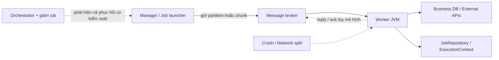
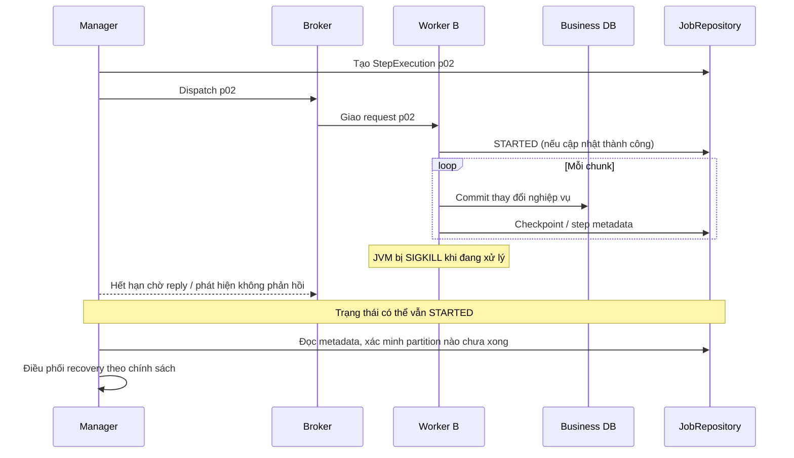
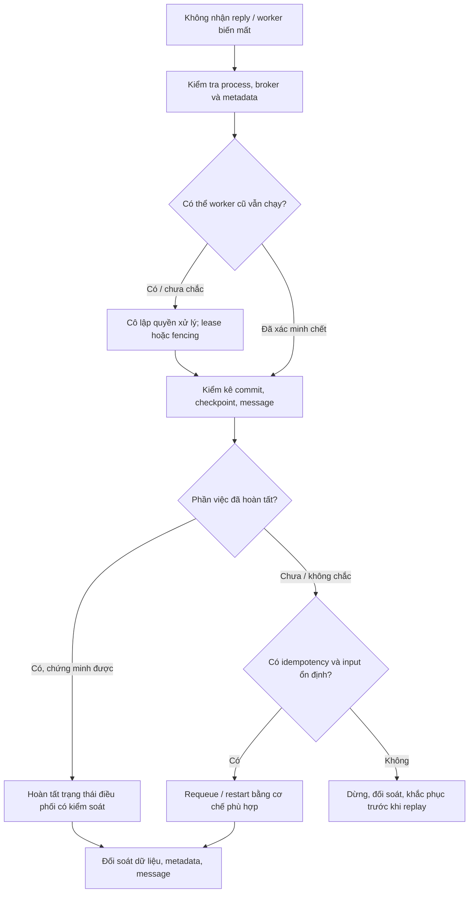

# Process crash của worker: phát hiện, phục hồi và bảo toàn dữ liệu trong Spring Batch

## 1. Mục tiêu và tình huống thực tế

Trong hệ thống **SPRING_BATCH_SCALING_OPERATIONS**, một job xử lý dữ liệu lớn có thể chạy nhiều worker song song: mỗi worker xử lý một partition, hoặc nhận các chunk dữ liệu từ manager qua hệ thống messaging. Song song hóa giúp tăng throughput nhưng kéo theo một câu hỏi vận hành quan trọng: **điều gì xảy ra nếu tiến trình worker chết giữa lúc xử lý?**

Giả sử job đối soát 8 triệu giao dịch gồm tám partition, mỗi partition xử lý một triệu giao dịch. Bốn worker JVM chạy trên các máy hoặc container khác nhau. Trong lúc worker B xử lý partition `p03`, container của nó bị `OOMKilled` hoặc máy chủ mất điện. Worker B biến mất mà không kịp gửi lỗi về manager và không chạy đoạn đóng tài nguyên thông thường.

Điều hệ thống cần bảo đảm không chỉ là khởi động worker khác. Nó còn phải trả lời:

- Các chunk nào của `p03` **đã commit**? Chunk nào chưa?
- Metadata trong `JobRepository` có biết worker đã chết không?
- Message điều phối đã được xác nhận (acknowledge) hay sẽ được broker giao lại?
- Worker mới có thể đọc lại phần dữ liệu còn thiếu mà **không làm trùng kết quả nghiệp vụ** không?
- Nếu worker cũ chỉ mất kết nối chứ chưa chết, phải ngăn hai worker đồng thời ghi cùng một partition ra sao?
- Khi nào dùng retry, khi nào restart cả `JobExecution`, và khi nào cần can thiệp vận hành?

Bài này giải thích vòng đời lỗi, các giới hạn failover thực tế của Spring Batch, và cách xây dựng quy trình phục hồi an toàn cho local partitioning, remote partitioning và remote chunking.

**Mục tiêu sau bài học:** phân biệt crash với lỗi Java được bắt, nhận diện các trạng thái metadata và điểm mất dữ liệu/trùng xử lý, xây dựng giao thức recovery có idempotency, rồi kiểm thử bằng fault injection.

## 2. Process crash khác gì lỗi xử lý thông thường?

**Process crash** là việc tiến trình Java hoặc container đang chạy worker bị dừng đột ngột và không hoàn thành luồng xử lý lỗi của framework. Những nguyên nhân thường gặp:

| Sự cố | Ví dụ | Điểm đáng chú ý |
|---|---|---|
| Tiến trình bị hệ điều hành dừng | `SIGKILL`, `kill -9`, `OOMKilled` | Không có cơ hội bảo đảm chạy `finally`, đóng reader hoặc cập nhật trạng thái |
| JVM crash | Lỗi native, crash của JVM, lỗi môi trường runtime | Có thể không xuất hiện exception do Batch xử lý |
| Máy/node mất kết nối hoặc mất điện | Host hỏng, mạng chia cắt | Manager không phân biệt ngay worker chết hay chỉ tạm thời mất liên lạc |
| Pod/container bị thay thế | Eviction, node failure, deployment | Orchestrator có thể tạo process mới nhưng không khôi phục tự động ngữ cảnh `StepExecution` |
| Worker mất liên lạc với broker/metadata DB | Broker timeout, DB connection bị cắt | Worker có thể vẫn chạy nhưng manager không thấy phản hồi; nguy cơ chạy trùng khi giao lại công việc |

Ngược lại, nếu `ItemProcessor` ném một exception và nó được Spring Batch xử lý, framework còn cơ hội rollback transaction, áp dụng retry/skip, cập nhật `BatchStatus` và ghi nguyên nhân thất bại. Khi **cả JVM chết**, các bước đó có thể không xảy ra.

Ví dụ:

```java
// Lỗi này diễn ra trong JVM còn sống: framework có thể nhận lỗi.
throw new IllegalStateException("Remote service unavailable");

// Còn JVM bị SIGKILL/OOMKilled thì có thể không chạy code xử lý lỗi,
// listener afterStep, finally, hoặc thao tác cập nhật JobRepository.
```

Vì thế, `retry(...)` và `skip(...)` trong cấu hình fault tolerance chỉ xử lý **lỗi đi qua cơ chế thực thi của Batch**. Chúng không thay thế được cơ chế phát hiện process crash và khôi phục phân tán.

## 3. Worker crash ảnh hưởng đến những lớp nào?

Một batch phân tán thường có ít nhất bốn miền trạng thái riêng:

1. **Trạng thái trong bộ nhớ worker:** cursor, buffer, object của `@StepScope`, thread, connection đang mở. Khi JVM chết, phần này mất.
2. **Trạng thái checkpoint trong `JobRepository`:** `JobExecution`, `StepExecution`, `ExecutionContext`, `readCount`, `writeCount`, trạng thái kết thúc và các thông tin restart được lưu bền vững qua lần commit phù hợp.
3. **Trạng thái nghiệp vụ:** các thay đổi đã commit vào database, file đã xuất, event đã gửi hoặc API ngoài đã gọi.
4. **Trạng thái vận chuyển message:** request/chunk đang ở queue, đã được broker xác nhận, đang xử lý, đang chờ reply hoặc sẽ được giao lại.

Các miền trạng thái này **không mặc nhiên commit nguyên tử cùng nhau**. Một worker có thể ghi thành công dữ liệu nghiệp vụ trước khi kịp xác nhận message; hoặc message đã được ack nhưng transaction nghiệp vụ chưa commit. Đây là nguồn gốc của hầu hết lỗi failover tinh vi.



Sơ đồ thể hiện kiến trúc **tổng quát**; trong local partitioning không nhất thiết có broker, còn remote chunking đặt reader và nhiều trách nhiệm checkpoint tại manager. Những khác biệt này quyết định chính xác ai có thể restart phần việc bị gián đoạn.

## 4. Phân biệt các mô hình mở rộng trước khi xử lý failover

| Mô hình | Worker thực sự là gì? | Nếu process worker chết | Điều kiện phục hồi chính |
|---|---|---|---|
| **Multi-threaded Step** | Nhiều thread xử lý chunk trong **cùng một StepExecution** | Nếu cả JVM chết, toàn bộ step trong process bị ngắt; không có sự cô lập lỗi theo thread | Restart job/step theo checkpoint, reader/writer và thứ tự dữ liệu phù hợp với concurrency |
| **Parallel Steps** | Nhiều Step chạy cùng job, có `StepExecution` riêng | JVM chứa các step chết thì các step ở process đó bị ảnh hưởng | Metadata của từng step, restart rules, quản lý trạng thái job |
| **Local partitioning** | Các partition có `StepExecution` riêng nhưng thường cùng JVM với manager | Nếu JVM chết, manager và các worker local đều ngừng | Khởi chạy lại ứng dụng/job, phân vùng ổn định, checkpoint và idempotency |
| **Remote partitioning** | Worker JVM chạy **trọn một worker Step**, gồm reader, processor, writer | Một worker process chết; các worker còn lại có thể tiếp tục | JobRepository, thông điệp điều phối đáng tin cậy, phát hiện partition chưa kết thúc và cơ chế phân công lại |
| **Remote chunking** | Manager đọc dữ liệu và gửi chunk; worker nhận chunk để xử lý/ghi | Chunk đang xử lý có thể mất phản hồi, được gửi lại hoặc bị bỏ sót tùy delivery/ack | Broker, correlation/reply, xử lý trùng, trạng thái chunk và checkpoint phía manager |

**Không nên đồng nhất việc orchestrator khởi động pod mới với việc Spring Batch tự restart partition cũ.** Một JVM mới chỉ có process và cấu hình ứng dụng; nó không tự biết phải nhận lại `StepExecution` nào hoặc chunk nào nếu phần điều phối và metadata không được thiết kế tương ứng.

Trong remote partitioning, cơ chế Spring Batch Integration, `PartitionHandler` và tầng transport có thể cung cấp phân phối request/reply, nhưng **mức tự động recovery của crash** phụ thuộc cách cấu hình handler, timeout, broker, chính sách redelivery, `JobRepository` và bộ điều phối ngoài ứng dụng. Không nên hứa rằng mọi worker crash đều được tự động giao lại.

## 5. Timeline: một worker chết giữa partition

Giả sử manager sinh bốn partition: `p00`, `p01`, `p02`, `p03`. Worker B nhận `p02` với khoảng ID từ 2.000.001 đến 3.000.000.



Thứ tự commit business DB và `JobRepository` trong thực tế phụ thuộc cách cấu hình transaction manager, datasource và middleware. Sơ đồ chỉ phản ánh **hai loại dữ liệu bền vững cần kiểm tra**, không khẳng định hai lệnh commit diễn ra tách rời hoặc theo một thứ tự cố định.

### Các điểm crash cần phân tích

| Thời điểm worker chết | Trạng thái có thể xảy ra | Hậu quả nếu giao lại ngay |
|---|---|---|
| Chưa nhận request | Request còn ở broker hoặc đã mất tùy cấu hình delivery | Nếu message bị mất, partition có thể không bao giờ chạy |
| Sau khi nhận nhưng trước khi bắt đầu xử lý | Partition có thể vẫn ở `STARTING`/`STARTED` | Giao lại an toàn hơn nếu chưa có side effect, nhưng phải xác minh |
| Đang xử lý trong chunk, trước commit | Transaction DB thường rollback khi connection bị đóng; call ngoài DB có thể đã xảy ra | Chạy lại chunk; side effect ngoài transaction có thể lặp |
| Sau commit dữ liệu, trước checkpoint/ack/reply | Business data đã thay đổi nhưng metadata/transport chưa phản ánh đầy đủ | Chạy lại có thể ghi trùng hoặc gửi event trùng |
| Sau checkpoint nhưng trước khi worker gửi reply | Có thể hoàn tất một phần hoặc cả partition mà manager chưa biết | Cần đọc trạng thái bền vững và đối chiếu; timeout không chứng minh dữ liệu chưa ghi |
| Sau khi worker báo hoàn thành nhưng trước khi manager ghi nhận | Reply hoặc kết quả tổng hợp có thể bị mất | Không khởi chạy lại mù quáng; xác minh `StepExecution` và đầu ra nghiệp vụ |

**Nguyên tắc:** timeout chỉ chứng minh *chưa nhận được kết quả đúng hạn*, không chứng minh *worker chưa hoàn thành*. Nếu không giải quyết được khoảng bất định này, cần giả định công việc **có thể đã xảy ra** và dùng cơ chế idempotent.

## 6. JobRepository biết gì khi một tiến trình chết?

Spring Batch lưu các bản ghi quản lý job và step vào `JobRepository`, thường ở các bảng metadata như:

- `BATCH_JOB_INSTANCE`: định danh logic của job với các identifying job parameters.
- `BATCH_JOB_EXECUTION`: từng lần thực thi job, cùng trạng thái và thời gian chạy.
- `BATCH_STEP_EXECUTION`: trạng thái, thống kê và metadata của từng lần thực thi step, kể cả các partition.
- `BATCH_STEP_EXECUTION_CONTEXT` và `BATCH_JOB_EXECUTION_CONTEXT`: ngữ cảnh bền vững phục vụ restart.

`BatchStatus` có thể mang những giá trị như `STARTING`, `STARTED`, `COMPLETED`, `FAILED`, `STOPPED` hoặc `UNKNOWN`. Nếu worker chết **ngoài luồng exception của framework**, `StepExecution` có thể vẫn còn `STARTED` dù process không tồn tại. Nếu manager cũng chết, `JobExecution` có thể bị kẹt ở `STARTED`.

Cần phân biệt:

- **Status trong DB**: sự kiện cuối cùng mà Spring Batch ghi lại thành công.
- **Tình trạng thực tế của process**: process còn sống, đang retry, đã chết hay mất kết nối.
- **Kết quả nghiệp vụ**: dữ liệu thực sự đã commit hoặc đã phát ra bên ngoài.

Ba trạng thái này có thể khác nhau sau crash. Một bản ghi `STARTED` lâu bất thường **không phải bằng chứng đầy đủ** để sửa metadata thành `FAILED` hoặc phát lại partition.

Khi chuẩn bị restart, dùng các API quan sát như `JobExplorer` để kiểm tra trạng thái job/step và `ExecutionContext`. Có thể dùng `JobOperator` để khởi động/dừng/restart theo khả năng phiên bản và trạng thái job, nhưng lệnh `stop` cần quá trình đang chạy phối hợp và **không thể buộc một JVM đã chết cập nhật trạng thái**. Ngoài ra, framework thường ngăn restart một `JobInstance` mà repository vẫn cho là có execution đang chạy.

Không sửa trực tiếp các bảng `BATCH_*`, giả mạo `COMPLETED` hoặc xóa metadata chỉ để «thông» một job bị kẹt. Đó là hành động có thể làm hỏng lịch sử restart và bỏ sót dữ liệu. Khi không có API recovery phù hợp, phải dùng quy trình vận hành được phê duyệt, khóa công việc trùng, sao lưu/kiểm chứng trạng thái rồi mới xử lý metadata theo cách tương thích phiên bản.

## 7. Failover an toàn gồm ba cơ chế khác nhau

Một thiết kế chịu lỗi cần đủ ba phần:

### 7.1. Phát hiện sự cố

Các tín hiệu phổ biến gồm:

- Kubernetes/container runtime báo process exit, `OOMKilled`, pod restart count tăng.
- Manager không nhận heartbeat hoặc reply trước deadline.
- Worker mất lease điều phối hoặc không còn cập nhật timestamp xử lý.
- `StepExecution` không tăng `readCount`/`writeCount`/`commitCount` trong thời gian kỳ vọng.
- Broker ghi nhận request bị redeliver, consumer disconnect, message tồn đọng hoặc chuyển DLQ.

**Lưu ý:** heartbeat/timeout chỉ là tín hiệu nghi ngờ. Network split hoặc GC pause dài có thể khiến worker bị coi là chết dù vẫn xử lý. Ngưỡng timeout phải dựa trên độ dài chunk, thời gian commit, thời gian giao tiếp và tail latency; nên kiểm tra thêm trạng thái process và fencing trước khi reassign.

### 7.2. Phục hồi tài nguyên tính toán

Orchestrator có thể khởi động worker mới, ví dụ deployment Kubernetes duy trì số pod mong muốn. Worker mới phải có cùng version cấu hình tương thích, truy cập broker, DB, secrets và tài nguyên cần thiết.

Tuy nhiên, một pod mới **chưa đủ** để xác định công việc còn dở. Cần một worker protocol rõ ràng: nhận partition được giao, đọc `ExecutionContext`/checkpoint cần thiết, và chỉ bắt đầu khi quyền sở hữu công việc hợp lệ.

### 7.3. Phục hồi công việc và kết quả

Phục hồi thực sự bao gồm xác minh trạng thái partition/chunk, bảo đảm worker cũ không còn quyền ghi, xác định phần đã commit, lên kế hoạch retry/restart, và so sánh kết quả cuối cùng với yêu cầu nghiệp vụ.

Có thể mô tả quy trình này như sau:



## 8. Riêng với remote partitioning: phục hồi từng partition

Trong remote partitioning, manager phân chia thành các `StepExecution` riêng; mỗi worker thực hiện hoàn chỉnh bước đọc, xử lý và ghi của partition. Một worker chết không nhất thiết làm các worker còn lại ngừng ngay, nhưng manager phải xác định trạng thái tổng thể.

Ví dụ manager chia dải ID thành các partition với tên ổn định:

| Partition | Dải ID | Kết quả giả định trước crash |
|---|---:|---|
| `p00` | 1–1.000.000 | `COMPLETED` |
| `p01` | 1.000.001–2.000.000 | `COMPLETED` |
| `p02` | 2.000.001–3.000.000 | Worker chết, metadata còn `STARTED` |
| `p03` | 3.000.001–4.000.000 | `COMPLETED` |

Sau khi xác minh tiến trình cũ không còn quyền thực thi, mục tiêu phục hồi thường là **chỉ làm phần chưa hoàn tất của `p02`**. Metadata các partition `COMPLETED` nên được giữ để tránh làm lại một cách không cần thiết.

Điều này đòi hỏi:

1. **Tên partition ổn định** giữa các lần khởi chạy/restart: `p02` cần biểu thị cùng một đơn vị công việc logic.
2. **Phạm vi đầu vào ổn định**: `minId`/`maxId`, snapshot dữ liệu, file name hoặc shard key không được âm thầm thay đổi khi restart.
3. **Checkpoint có nghĩa**: reader lưu trạng thái bằng `ItemStream`/`ExecutionContext` nếu có khả năng tiếp tục từ phần đã commit.
4. **Đường thực thi restart được kiểm soát**: sau crash, xử lý được tình huống `StepExecution` hoặc `JobExecution` cũ còn trạng thái `STARTED` mà không phá metadata.
5. **Ghi dữ liệu idempotent**: do vẫn tồn tại cửa sổ đã commit trước khi metadata được cập nhật, replay không được tạo kết quả nghiệp vụ trùng.

**Đặc biệt:** cơ chế requeue một message partition không mặc nhiên tương đương với `JobOperator.restart(...)`. Việc chạy lại một `StepExecution` cũ, tạo execution mới hay restart toàn `JobExecution` cần do Spring Batch và cơ chế điều phối tương thích quyết định. Không tự tạo thêm `StepExecution` cùng tên trong một job đang hoạt động khi chưa kiểm soát được quyền sở hữu và trạng thái.

### @StepScope và crash recovery

`@StepScope` giúp mỗi partition có reader/writer mang trạng thái riêng theo `StepExecution` và lấy đầu vào từ `stepExecutionContext`. Sau khi process chết, instance bean cũ mất đi; instance mới có thể được tạo từ metadata khi execution phù hợp chạy lại.

Tuy nhiên, **scope không bảo quản con trỏ trong RAM**. Chỉ những checkpoint đã ghi bền vững mới hữu ích cho restart. Vì vậy reader cần dùng thứ tự ổn định, checkpoint phù hợp và tránh thay đổi tập kết quả giữa chừng theo cách khiến con trỏ bỏ qua bản ghi.

Ví dụ sai: reader chạy `SELECT ... WHERE processed = false ORDER BY id`, trong khi writer thay đổi `processed` thành `true`. Nếu checkpoint lưu số bản ghi đã đọc, query lúc restart chỉ còn các bản ghi chưa xử lý nhưng con trỏ lại tiếp tục từ offset cũ; như vậy có thể bỏ sót dữ liệu. Thiết kế an toàn hơn thường dùng snapshot/dải ID ổn định và để writer xử lý trùng bằng idempotency.

## 9. Riêng với remote chunking: chú ý ack và việc giao lại message

Trong remote chunking, **manager sở hữu reader** và thường điều khiển quá trình đọc/checkpoint, còn worker nhận chunk để process/write. Vì vậy lỗi của worker không được xử lý giống hoàn toàn partition.

Một chuỗi hoạt động khái quát:

1. Manager đọc một chunk và gửi request có thể tương quan (correlate) tới broker.
2. Worker nhận request, thực hiện nghiệp vụ và gửi reply.
3. Manager tổng hợp kết quả; chính xác khi nào chunk được coi là hoàn tất phụ thuộc protocol và transaction.
4. Worker có thể chết tại bất kỳ bước nào.

Với broker hỗ trợ durable messages và redelivery, nếu worker chết **trước khi ack**, chunk có thể được giao lại. Nếu ack đã xảy ra **trước khi business commit**, crash có thể làm mất chunk nếu không còn cơ chế khác để gửi lại. Nếu business commit xảy ra **trước ack**, crash có thể khiến một chunk được xử lý hai lần.

| Cửa sổ lỗi | Rủi ro | Biện pháp thiết kế |
|---|---|---|
| Send từ manager thất bại | Chunk chưa đến broker hoặc đã đến nhưng sender chưa biết | Publish confirm / transaction phù hợp, correlation ID và retry không mất dữ liệu |
| Worker nhận chunk, chưa commit | Chunk đang làm dở hoặc chưa ghi | Broker bảo đảm redelivery phù hợp với policy ack |
| Worker commit rồi crash trước ack/reply | Chunk có thể chạy lại | Writer idempotent, unique constraint, xử lý reply trùng |
| Reply bị mất hoặc đến chậm | Manager không biết chắc worker đã hoàn tất | Timeout, correlation ID, đối soát kết quả, quy tắc replay an toàn |
| Manager chết | Reader/checkpoint và các chunk đang chờ reply bị gián đoạn | Restart manager từ trạng thái bền vững, xử lý in-flight chunk và phản hồi đến muộn |

**At-least-once delivery** có nghĩa message có thể đến hơn một lần; nó không đồng nghĩa với exactly-once business effect. `ack` ở broker cũng không tự tạo transaction phân tán với database hoặc API bên ngoài.

Khi dùng RabbitMQ, Kafka hay hệ thống tương tự, phải xem xét semantics cụ thể của connector, transaction/offset/ack, durability, ordering, retry và dead-letter mechanism. Không sao chép máy móc chính sách ack từ mô hình này sang mô hình khác.

## 10. Idempotency: lớp bảo vệ cuối cùng khi replay

Với hệ thống phân tán, thường khó bảo đảm một chunk hoặc partition **chỉ được thực thi đúng một lần** sau mọi tổ hợp crash, timeout và redelivery. Mục tiêu thực tiễn là cho phép **xử lý lại an toàn**, để hiệu ứng nghiệp vụ cuối cùng xuất hiện đúng một lần theo khóa logic.

### 10.1. Chọn khóa nghiệp vụ ổn định

Một khóa idempotency nên phản ánh **đơn vị kết quả nghiệp vụ**, ví dụ:

```text
business_day + order_id + operation_type
```

Không nên chỉ dùng `worker_id`, tên pod hoặc `StepExecution.id`: các giá trị đó có thể thay đổi khi restart, khiến cùng giao dịch được coi là công việc mới.

Nếu cùng một đơn hàng được phép xử lý lại hợp lệ cho ngày nghiệp vụ khác, khóa phải bao gồm ngày hoặc version phù hợp. Nếu cần xuất nhiều loại event cho cùng đơn hàng, khóa phải có `operation_type`/event type.

### 10.2. Ví dụ thiết kế DB cho writer chịu replay

Giả sử hệ thống tính kết quả xử lý đơn hàng theo ngày. Đặt unique key ở database để **ngăn chèn trùng khi hai worker cùng cố thực thi**:

```sql
-- Ví dụ cho PostgreSQL.
CREATE TABLE processed_order (
    business_day DATE NOT NULL,
    order_id BIGINT NOT NULL,
    outcome VARCHAR(32) NOT NULL,
    PRIMARY KEY (business_day, order_id)
);

CREATE TABLE outbox_event (
    event_key VARCHAR(150) PRIMARY KEY,
    payload TEXT NOT NULL,
    delivered BOOLEAN NOT NULL DEFAULT FALSE
);
```

Writer Spring Batch 5.x dùng `Chunk<? extends Order>`; khi worker chạy lại chunk, các bản ghi đã xử lý sẽ không bị chèn thêm:

```java
import java.sql.Date;
import java.time.LocalDate;

import org.springframework.batch.item.Chunk;
import org.springframework.batch.item.ItemWriter;
import org.springframework.jdbc.core.JdbcTemplate;

// Order ở đây là dữ liệu đã được reader/processor chuẩn hóa.
record Order(long id, LocalDate businessDay) {}

final class IdempotentOrderWriter implements ItemWriter<Order> {
    private final JdbcTemplate jdbc;

    IdempotentOrderWriter(JdbcTemplate jdbc) {
        this.jdbc = jdbc;
    }

    @Override
    public void write(Chunk<? extends Order> chunk) {
        for (Order order : chunk) {
            int inserted = jdbc.update("""
                INSERT INTO processed_order (business_day, order_id, outcome)
                VALUES (?, ?, 'DONE')
                ON CONFLICT (business_day, order_id) DO NOTHING
                """,
                Date.valueOf(order.businessDay()),
                order.id());

            if (inserted == 1) {
                String eventKey =
                        order.businessDay() + ":ORDER_DONE:" + order.id();
                jdbc.update("""
                    INSERT INTO outbox_event (event_key, payload, delivered)
                    VALUES (?, ?, FALSE)
                    ON CONFLICT (event_key) DO NOTHING
                    """,
                    eventKey, "order-id=" + order.id());
            }
        }
    }
}
```

Điều kiện để ví dụ có ý nghĩa:

- Worker Step phải chạy `ItemWriter.write` trong **transaction của chunk** với `PlatformTransactionManager` tương ứng database; cả hai bảng sử dụng **cùng transaction DB**. Nếu transaction rollback, cả bản ghi xử lý lẫn outbox phải rollback.
- PostgreSQL `ON CONFLICT DO NOTHING` chỉ là cơ chế loại trùng tại DB; khi nghiệp vụ cần **cập nhật kết quả** hoặc sửa dữ liệu đã xử lý thì phải định nghĩa thêm versioning và chính sách conflict.
- Event **chưa gửi trực tiếp** từ writer. Một outbox publisher riêng phát event sau commit và phải có idempotency/deduplication phía consumer, vì chính publisher cũng có thể crash sau khi gửi nhưng trước khi đánh dấu `delivered`.
- Production cần payload có cấu trúc, quan sát lỗi, batch write hiệu quả và cách xử lý các trường hợp unique key va chạm bất thường; code ở trên ưu tiên minh họa semantics.

Nếu writer gọi trực tiếp một API thanh toán hoặc gửi email trong chunk, transaction DB rollback **không đảo ngược** lời gọi đã thành công. Khi đó cần idempotency key được dịch vụ ngoài chấp nhận, outbox hoặc giao thức đối soát riêng.

### 10.3. Idempotency không thay cho kiểm soát đồng thời

Unique constraint chặn một lớp ghi trùng, nhưng không giải quyết mọi tác dụng phụ hoặc việc hai worker cùng tiêu tốn tài nguyên cho một partition. Nếu có khả năng **worker cũ vẫn đang chạy** khi partition được giao lại, nên dùng **lease/fencing**:

- Mỗi lần phân công hợp lệ nhận một epoch/fencing token tăng đơn điệu.
- Worker chỉ được ghi khi token của nó còn hiệu lực; tài nguyên đích hoặc transaction ghi phải kiểm tra token một cách nguyên tử.
- Khi failover sang worker mới, token cũ mất hiệu lực; worker cũ quay lại sau network split không thể tiếp tục commit.

Chỉ gắn cờ `active=true` trong memory manager hoặc phụ thuộc vào heartbeat không đủ để ngăn một worker bị cô lập về mạng tiếp tục ghi vào database.

## 11. Quy trình vận hành khi phát hiện worker process crash

Quy trình dưới đây là **runbook tham khảo**; cần điều chỉnh theo kiến trúc và phiên bản Spring Batch cụ thể.

### Bước 1: Ghi nhận đúng đơn vị lỗi

Xác định `jobName`, identifying job parameters, `JobInstance`, `JobExecution`, `StepExecution`/partition, worker identity, message ID, thời điểm crash và bản triển khai ứng dụng. Một worker process có thể đang chạy **nhiều partition**; không kết luận chỉ có một partition bị ảnh hưởng.

Với Kubernetes, quan sát reason của container, restart count, log trước khi chết, kết nối DB và broker. Nếu bị `OOMKilled`, kiểm tra memory limit và kích thước chunk/buffer; chỉ tăng số pod không chữa nguyên nhân memory.

### Bước 2: Ngăn double execution

Không dispatch cùng partition tới worker khác cho tới khi xác nhận worker cũ đã dừng **hoặc** có fencing đủ mạnh. Nếu manager/reconciler có nhiều replica, cần cơ chế leader election, lease hoặc locking để hai manager không cùng phục hồi một job.

### Bước 3: Kiểm tra trạng thái bền vững

Đọc `JobRepository` bằng API quan sát, đối chiếu `JobExecution`, `StepExecution`, `ExecutionContext` và thời điểm cập nhật cuối cùng. Kiểm tra broker về request đang in-flight, ack, redelivery, DLQ; sau đó kiểm tra business DB/outbox/file output.

Nếu metadata là `STARTED` nhưng worker không tồn tại, phân loại đó là **execution mồ côi (orphan)** cần xử lý có kiểm soát. Không tự động suy ra rằng mọi chunk của execution này phải chạy lại từ đầu.

### Bước 4: Chọn phạm vi phục hồi và trạng thái hợp lệ

Xác định liệu còn thể hiện được lỗi trong `JobExecution` hiện tại hay cần restart job bằng cơ chế framework. Nếu job còn bị đánh dấu `STARTED`, lời gọi restart có thể bị từ chối; phải giải quyết trạng thái cũ qua quy trình phục hồi tương thích Spring Batch trước. Không dùng các SQL `UPDATE BATCH_* SET STATUS='FAILED'` tùy tiện.

Trong remote partitioning, giữ lại các partition đã hoàn tất và ưu tiên phục hồi phần chưa hoàn tất. Trong remote chunking, đối chiếu in-flight chunk và request/reply; dùng deduplication để cho phép gửi lại một cách an toàn.

### Bước 5: Khởi chạy lại với ràng buộc đúng

Duy trì **cùng identifying job parameters** khi mục tiêu là restart cùng `JobInstance`, đồng thời phân biệt các non-identifying parameters được phép thay đổi. Việc thay identifying parameters có thể tạo `JobInstance` khác, chạy lại toàn bộ nghiệp vụ và bỏ qua trạng thái restart cũ.

Đảm bảo code version, partition mapping, dữ liệu snapshot và cấu hình reader tương thích với checkpoint cũ. Nếu cần thay sơ đồ dữ liệu hoặc phân vùng, hãy lập quy trình migration/reconciliation thay vì cho reader cũ tiếp tục tùy tiện.

### Bước 6: Đối soát sau phục hồi

Đánh giá theo **kết quả nghiệp vụ** và **metadata**: số lượng bản ghi kỳ vọng, số bản ghi unique đã ghi, số event trong outbox/chưa phát, trạng thái tất cả partition, số lần retry/redelivery, lỗi còn trong DLQ và độ trễ so với SLA. Ghi biên bản nguyên nhân và cách khắc phục để tránh cùng sự cố lặp lại.

## 12. Những quyết định thiết kế làm thay đổi mức độ chịu lỗi

| Quyết định | Thiết kế dễ gặp rủi ro | Thiết kế đáng ưu tiên |
|---|---|---|
| Lưu partition | Chia lại theo số hàng hiện tại mỗi lần retry | Khóa logic ổn định, snapshot/dải ID rõ ràng |
| Reader checkpoint | Chỉ giữ offset trong RAM | `ItemStream`/`ExecutionContext` bền vững với nguồn và thứ tự ổn định |
| Message | Queue không durable hoặc ack trước commit mà không có giao thức phục hồi | Message bền vững, ack phù hợp, replay an toàn và xử lý trùng |
| Writer | Insert không có business key, gọi external API trực tiếp | Unique constraint/upsert hợp lệ, outbox, idempotency key |
| Worker ownership | Nhận timeout là worker đã chết | Lease + fencing khi có nguy cơ xử lý đồng thời |
| Job metadata | Mỗi worker dùng repository tạm trong memory | `JobRepository` bền vững, HA và quản lý transaction đúng |
| Scale | Tăng vô hạn concurrency khi thấy backlog | Giới hạn theo DB connection pool, lock contention, broker và downstream |
| Triển khai | Redeploy phiên bản mới giữa lúc replay mà không xét schema | Versioning và compatibility cho request, checkpoint, payload |
| Giám sát | Chỉ theo dõi pod có Running hay không | Theo dõi status Batch, progress partition, ack, DLQ và kết quả nghiệp vụ |

### JobRepository và các thành phần hạ tầng cũng phải chịu lỗi

Failover của worker sẽ vô nghĩa nếu `JobRepository` dùng database không bền vững hoặc ứng dụng tự tạo metadata repository trong memory. Trong môi trường production, repository cần lưu trữ lâu dài, backup và recovery phù hợp, quản lý transaction/locking tin cậy và kế hoạch HA cho database.

Broker cũng cần retention và durability đáp ứng cửa sổ phục hồi. Nếu message bị xóa sau thời gian ngắn nhưng job bị lỗi lâu hơn, cần cơ chế tái tạo request đáng tin cậy từ metadata thay vì dựa vào việc message vẫn nằm ở queue.

Khi manager có nhiều replica, phải bảo đảm chỉ một thực thể điều phối **một lần phục hồi cụ thể**; autoscaling manager không nên tự tạo các bản sao cùng `JobExecution`.

## 13. Kiểm thử crash bằng fault injection

Đừng chỉ viết unit test ném exception trong `ItemProcessor`: test đó không mô phỏng việc process chết sau commit hoặc mất reply. Cần bài kiểm thử integration với DB và broker có trạng thái bền vững gần production.

Một kịch bản nên thực hiện trong môi trường staging:

1. Chuẩn bị tập dữ liệu đầu vào với số lượng xác định và định danh duy nhất, ví dụ 100.000 đơn hàng.
2. Chạy job có từ hai worker trở lên; mỗi partition mang tên và khoảng dữ liệu ổn định.
3. Cố ý dừng cưỡng bức **process worker** khi nó đang xử lý. Trên môi trường Linux thử nghiệm, `kill -9 <PID>` mô phỏng process bị dừng đột ngột; trên Kubernetes có thể mô phỏng container crash/`OOMKilled` bằng công cụ phù hợp. Không thực hiện fault injection trên production đang phục vụ nghiệp vụ thật.
4. Kiểm tra `JobRepository`, trạng thái broker, các dòng đã commit và event đã phát ngay sau crash. Ghi nhận rằng metadata có thể vẫn `STARTED`.
5. Cho hệ thống thực hiện đúng recovery/runbook: fencing hoặc xác minh worker cũ đã chết, xử lý trạng thái orphan, restart/reassign theo cơ chế có hỗ trợ.
6. Lặp thử với crash tại các cửa sổ **trước commit**, **sau commit nhưng trước ack/reply**, **manager crash**, và **mất kết nối nhưng worker vẫn sống**.
7. So sánh kết quả cuối với baseline chạy không lỗi; xác nhận không có bản ghi trùng, không thiếu bản ghi, không có side effect lặp ngoài mong đợi và có thể giải thích mọi retry/redelivery.

### Tiêu chí pass cụ thể

| Tiêu chí | Kết quả mong muốn |
|---|---|
| Tính đầy đủ | Mọi item thuộc input đã chốt đều có kết quả hợp lệ |
| Tính duy nhất | Một business key chỉ tạo một kết quả nghiệp vụ như quy định |
| Partition hoàn tất | `StepExecution` của mọi partition đạt trạng thái cuối phù hợp, job kết thúc theo kỳ vọng |
| Replay | Message hoặc chunk bị giao lại không phát sinh side effect trùng |
| Orphan | Không còn execution `STARTED` mồ côi mà không có quyết định xử lý |
| Ngăn split-brain | Worker cũ không thể ghi sau khi quyền sở hữu đã chuyển |
| Thời gian phục hồi | Thời gian từ phát hiện đến job hoàn tất nằm trong mục tiêu RTO |
| Dữ liệu chấp nhận mất | Không vượt mục tiêu RPO đã định; với nghiệp vụ yêu cầu không mất bản ghi, phải xác minh từng đầu vào |

RTO (Recovery Time Objective) là thời gian tối đa chấp nhận để phục hồi; RPO (Recovery Point Objective) là mức dữ liệu có thể mất. Với batch thanh toán/đối soát, RPO nghiệp vụ thường phải rất chặt; checkpoint không phải lý do để chấp nhận mất dữ liệu đã có trong input.

## 14. Quan sát, cảnh báo và tìm nút thắt sau crash

Theo dõi kết hợp ba nhóm chỉ số:

**Job/partition:** `BatchStatus`, `ExitStatus`, `readCount`, `writeCount`, `commitCount`, `rollbackCount`, thời gian bắt đầu/cập nhật cuối, retry, số partition đang chờ. Một partition không tăng tiến độ quá lâu cần được điều tra, nhưng phải xét chunk dài và hoạt động I/O hợp lệ.

**Worker/process:** pod readiness, restarts, OOM kills, heap/native memory, CPU, GC pause, số thread, connection pool chờ, latency DB và tần suất lỗi downstream. Nếu crash do OOM, giảm chunk size, memory buffer, concurrency hoặc thay đổi cách đọc/ghi có thể hợp lý hơn tăng heap đơn thuần.

**Messaging/output:** queue depth, tuổi message lớn nhất, số message unacked/in-flight, redelivery, DLQ, request timeout, thiếu reply, outbox backlog, tỷ lệ duplicate đã bị unique key chặn và sai khác đối soát.

Ví dụ một cảnh báo thực dụng: “Có partition ở `STARTED`, `lastUpdated` đã cũ hơn ngưỡng vận hành, không còn worker có quyền sở hữu, và tiến độ không tăng.” Các tiêu chí kết hợp này đáng tin cậy hơn việc chỉ nhìn `STARTED` hoặc chỉ thấy một pod đã restart.

Đối với workload lớn, log nên gắn được `jobExecutionId`, `stepExecutionId`, `partitionName`, `messageId`, `businessKey` và `workerId`. Đây là các khóa nối dấu vết giữa manager, worker, broker, repository và hệ thống nghiệp vụ.

## 15. Sai lầm thường gặp

**“Kubernetes đã restart pod, vậy partition chắc chắn chạy tiếp.”** Pod mới không tự biết checkpoint/ownership của partition cũ. Phải có điều phối job và recovery.

**“Bật retry là xử lý được SIGKILL.”** Retry của Spring Batch chỉ chạy khi runtime còn hoạt động và nhận được lỗi; worker chết không còn cơ hội retry tại chỗ.

**“Timeout là bằng chứng worker chưa commit.”** Timeout chỉ cho biết chưa nhận reply đúng hạn. Trước khi retry cần chuẩn bị cho khả năng worker đã commit.

**“Message broker bảo đảm exactly-once nên không cần idempotency.”** Cơ chế broker không bao trùm toàn bộ commit của business database và side effect ngoài hệ thống; phải xác định phạm vi transaction thực tế.

**“Đổi `STARTED` thành `FAILED` trực tiếp trong DB là xong.”** Metadata Spring Batch có quan hệ và checkpoint; sửa từng dòng thiếu kiểm soát có thể phá lịch sử restart và gây trùng/mất dữ liệu.

**“@StepScope giữ lại trạng thái reader sau crash.”** Scope chỉ xác định vòng đời bean; trạng thái phục hồi cần được checkpoint bền vững và có nguồn đọc ổn định.

**“Giữ các partition không trùng ID là đã đủ an toàn.”** Vẫn có thể xảy ra replay một partition, side effect ngoài transaction, hoặc worker cũ và mới cùng thực thi; cần unique key, idempotency/fencing và đối soát.

## 16. Checklist thiết kế failover trước khi đưa vào production

- [ ] Đã phân biệt rõ local partitioning, remote partitioning, remote chunking và vị trí sở hữu checkpoint?
- [ ] `JobRepository` và message broker có durability, transaction và khả năng recovery phù hợp?
- [ ] Mỗi partition/chunk có identity, correlation ID và phạm vi đầu vào ổn định?
- [ ] Đã định nghĩa cách phát hiện crash, timeout và cách xử lý trường hợp worker chỉ mất mạng?
- [ ] Có quy trình xử lý orphan `STARTED` an toàn, tránh sửa metadata tùy tiện?
- [ ] Có cơ chế ngăn hai worker cùng giữ quyền ghi một partition khi failover?
- [ ] Writer và mọi side effect đều có giải pháp idempotency phù hợp?
- [ ] Chế độ ack/retry/redelivery đã được kiểm chứng cùng transaction nghiệp vụ?
- [ ] Đã mô phỏng crash trước/sau commit, mất reply, manager crash và network split?
- [ ] Có dashboard, cảnh báo, runbook, mục tiêu RTO/RPO và bước đối soát hậu phục hồi?

## 17. Tóm lược nguyên tắc cốt lõi

Một worker process crash là **lỗi mất tiến trình**, không chỉ là một exception của chunk. Khi crash xảy ra, code trong JVM không thể bảo đảm ghi `FAILED`, gửi reply hay rollback các hiệu ứng đã xảy ra ở hệ thống ngoài transaction. Vì vậy **JobRepository, message broker và dữ liệu nghiệp vụ phải được đối chiếu với nhau**.

Giải pháp bền vững dựa trên bốn trụ cột: **phát hiện và xác minh sự cố**, **khôi phục quyền sở hữu công việc**, **restart/replay từ trạng thái bền vững**, và **idempotency để chịu được thực thi lặp**. Spring Batch cung cấp mô hình `JobExecution`/`StepExecution`, checkpoint và các API điều hành; kiến trúc phân tán phải bổ sung hạ tầng, protocol, fencing, quan sát và runbook tương ứng. Khi triển khai đúng, hệ thống có thể mở rộng sang nhiều worker mà vẫn phục hồi được khi một tiến trình chết giữa workload dữ liệu lớn.
