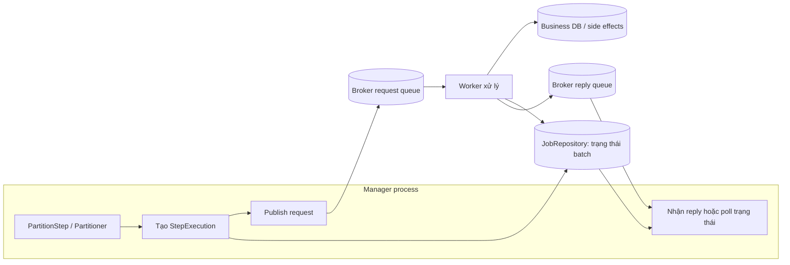
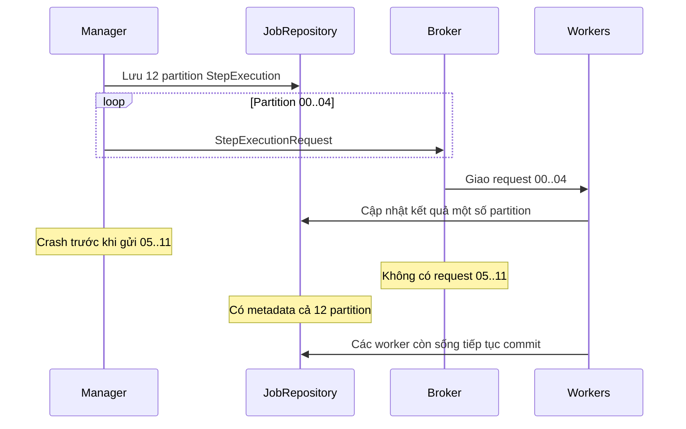
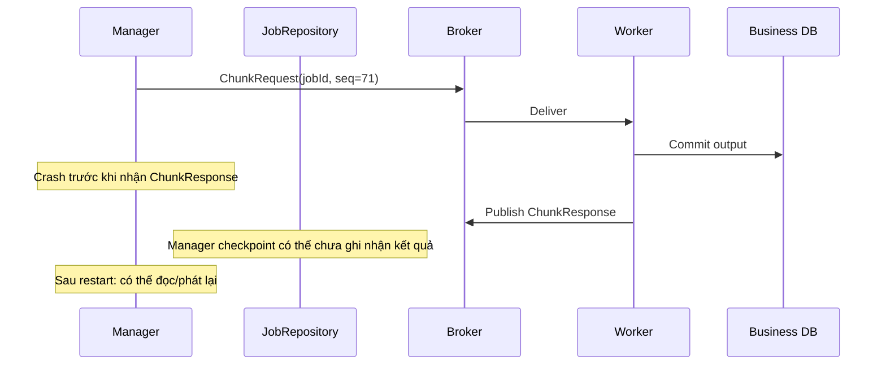
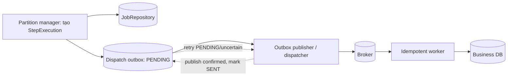
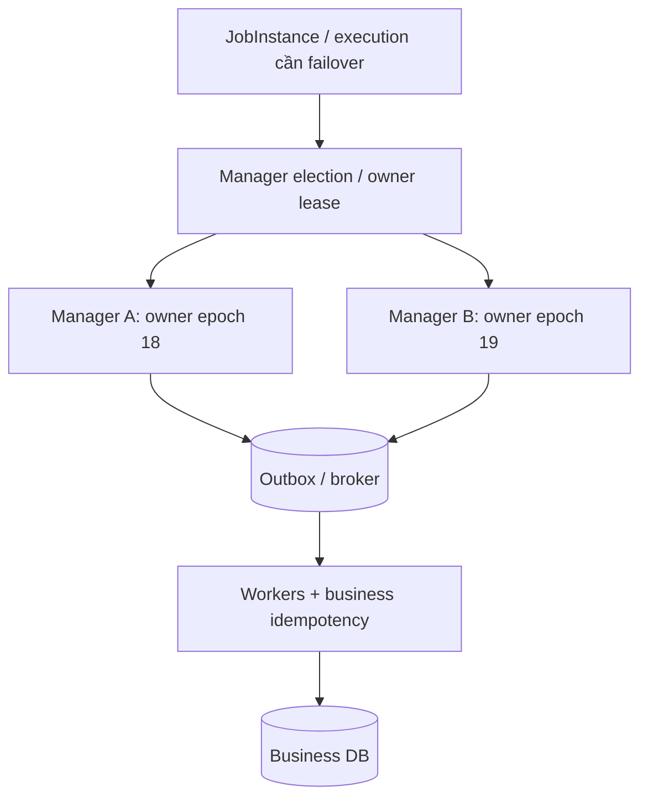

# Manager crash giữa lúc phân phối: failover an toàn trong Spring Batch

Trong xử lý batch phân tán, **manager là nơi quyết định phân công công việc**, nhưng việc phân công không phải một thao tác nguyên tử duy nhất. Manager có thể tạo 32 partition, lưu `StepExecution` cho từng partition vào `JobRepository`, gửi được 17 request vào broker rồi đột ngột mất điện. Mười lăm request còn lại có thể **chưa từng tới worker**, trong khi một số request đã gửi đã được worker commit thành công. Nếu chỉ bật lại manager và gửi lại toàn bộ 32 request, hệ thống có thể xử lý trùng; nếu coi mọi partition đã được giao, job có thể bỏ sót dữ liệu.

Bài thuộc chương **Failover**, module `SPRING_BATCH_SCALING_OPERATIONS`. Chủ đề trực tiếp là **“Manager crash giữa lúc phân phối”** trong remote partitioning, đồng thời so sánh với remote chunking. Người học cần hiểu ranh giới giữa `JobRepository`, message broker, transaction nghiệp vụ; phân tích từng cửa sổ lỗi, thiết kế recovery không làm mất hoặc nhân đôi tác dụng, bảo đảm thread safety/restart và đo hiệu quả failover theo tài nguyên thực tế. Nội dung dùng thuật ngữ và API của **Spring Batch Integration 5.2.x**; các cơ chế outbox, lease, leader election trong bài là **thiết kế bổ sung của ứng dụng**, không phải tính năng mặc định tự bật của Spring Batch.

## 1. “Manager crash giữa lúc phân phối” là tình huống nào?

**Manager** có thể chết ở bất kỳ điểm nào giữa việc tạo đơn vị công việc và nhận kết quả:

1. Đã xác định danh sách partition/chunk nhưng **chưa lưu metadata**.
2. Đã lưu metadata, **chưa publish** request đầu tiên.
3. Đã publish **một phần** request.
4. Đã gửi tất cả request nhưng **chưa nhận publisher confirm**.
5. Đã gửi đủ request, một số worker đang chạy hoặc đã commit.
6. Worker đã gửi reply, nhưng manager **chưa nhận hoặc chưa tổng hợp**.
7. Manager cập nhật trạng thái, nhưng **chưa trả kết quả ra scheduler/API**.

“Crash” có thể là JVM bị kill, pod bị OOM, host mất điện, kết nối broker đứt hoặc database không khả dụng. Đặc biệt, lỗi mạng tạo ra trạng thái **không chắc chắn**: khi `send()` timeout, request có thể đã vào broker hoặc chưa. Không thể dựa duy nhất vào một exception phía manager để kết luận công việc chắc chắn chưa được giao.

**Mục tiêu failover đúng** không phải “manager lên lại thật nhanh”, mà là:

> Sau khi phục hồi, tất cả đơn vị công việc hợp lệ được xử lý tới kết quả cuối được xác minh, và không có side effect nghiệp vụ bị mất hoặc áp dụng lặp ngoài chủ đích.

Đây là mục tiêu *effectively-once* ở tầng nghiệp vụ khi xử lý giao vận có thể theo mô hình **at-least-once**, không phải tuyên bố rằng broker + Spring Batch tự cung cấp exactly-once end-to-end.

## 2. Hai mô hình phân phối khác nhau

| Thuộc tính | Remote partitioning | Remote chunking |
| --- | --- | --- |
| Manager gửi | `StepExecutionRequest` cho từng partition | `ChunkRequest<T>` cho từng chunk |
| Mỗi request đại diện | Một `StepExecution` của worker | Một chunk được manager đọc và nhóm |
| Worker đọc dữ liệu nguồn? | Có, theo `ExecutionContext` của partition | Thường không; item được manager gửi |
| Metadata phục hồi | `JobRepository` giữ `StepExecution` và context của **từng partition** | Manager step và reader checkpoint; protocol request/reply chunk |
| Worker trả về | `StepExecution` qua reply channel hoặc manager poll repository | `ChunkResponse` để manager tổng hợp contribution |
| Crash giữa dispatch | Một số partition có metadata nhưng chưa nhận lệnh chạy | Một số chunk chưa gửi, đã gửi hoặc đã commit nhưng chưa được manager ghi nhận |
| Rủi ro đặc thù | Duplicate `StepExecutionRequest`, orphan partition, split-brain | Reply thất lạc, duplicate chunk, reader checkpoint lệch với remote writes |

Trong **remote partitioning**, `MessageChannelPartitionHandler` gửi `StepExecutionRequest` và hỗ trợ thu thập kết quả qua **reply aggregation** hoặc **polling `JobRepository`**. Trong **remote chunking**, `ChunkMessageChannelItemWriter` là writer ở manager gửi item theo chunk và chờ đóng góp từ worker. Hai giao thức không thể đổi cho nhau chỉ bằng tên queue.

## 3. Sơ đồ tổng thể: ba nơi lưu “sự thật”



Ba nơi này mô tả **ba sự thật riêng**, không phải một transaction phân tán mặc định:

- **`JobRepository`:** `JobInstance`, `JobExecution`, `StepExecution`, `ExecutionContext`, trạng thái và checkpoint. Một `StepExecution` tồn tại **không chứng minh** request đã vào broker.
- **Broker:** message đang chờ, đang được giao, đã ACK, bị redeliver, reply chờ xử lý hoặc DLQ. Một publish confirm **không chứng minh** worker đã commit business write.
- **Business store / hệ thống ngoài:** bản ghi đã commit, payment/email/event đã phát. `StepExecution=COMPLETED` không mặc nhiên chứng minh side effect bên ngoài đã áp dụng đúng một lần.

**Điểm mù cần xử lý:** không có transaction chung tự động giữa `JobRepository` và RabbitMQ/JMS; cũng không có giao dịch chung mặc định giữa ACK broker, transaction worker và API bên ngoài. Recovery phải thiết kế cho mọi trường hợp chỉ **một phần các nơi trên biết kết quả**.

## 4. Timeline: 12 partition, manager chỉ gửi được 5

Ví dụ manager xử lý 1,2 triệu invoice, chia thành 12 partition cố định theo ID:

```text
JobExecution ID: 4200
Worker step:     invoiceWorker
Partition keys:  partition00..partition11
Grid size:       12

T0 - JobRepository có 12 StepExecution + context
T1 - Publish request cho partition00..partition04
T2 - Worker xử lý partition00 và partition01
T3 - Manager crash trước khi publish partition05..partition11
T4 - Worker xử lý xong partition02..partition04
T5 - Operator phát hiện job/manager không còn sống
```



**Không thể chỉ nhìn bảng `BATCH_STEP_EXECUTION` để xác định request 05..11 đã đến broker chưa.** Tương tự, queue request rỗng không có nghĩa mọi partition đã xong: message có thể đã được worker nhận/ACK hoặc chưa bao giờ publish.

Khi manager mất, các worker đang chạy **có thể tiếp tục** nếu process, broker, DB và hạ tầng còn sống. Vì vậy, “manager down” và “tất cả worker dừng” là hai sự kiện khác nhau.

## 5. Ma trận cửa sổ lỗi và quyết định phục hồi

| Vị trí manager chết | Những điều có thể đúng | Không được giả định | Hướng điều tra |
| --- | --- | --- | --- |
| Trước khi tạo `JobExecution` | Chưa có metadata | Không có side effect từ đợt khởi chạy khác | Tìm theo identifying job parameters |
| Sau khi tạo execution, trước chia partition | Job có thể `STARTED` nhưng chưa có child execution | Tự động khởi động lại job ngay được | Kiểm trạng thái, worker còn chạy, điều kiện restart |
| Sau khi lưu toàn bộ partition, trước publish | StepExecution tồn tại nhưng queue chưa có request | `STARTED` nghĩa là worker đang xử lý | Dispatch audit / broker / logs |
| Publish một phần | Một số worker đã commit, số còn lại chưa nhận | Có thể gửi lại *tất cả* mà không gây trùng | Đối chiếu từng partition, idempotent writer |
| Send timeout không rõ confirm | Broker **có thể đã nhận** | “Send lỗi” = chắc chắn chưa publish | Publisher confirms/returns, outbox, consumer evidence |
| Publish đủ, chưa nhận reply | Worker có thể đang chạy hoặc hoàn tất | Không có reply = không có commit | Repository, reply queue, business reconciliation |
| Đã có reply, trước khi manager tổng hợp | Worker có kết quả, manager `FAILED/STARTED` | Cứ đếm số reply là đủ | Correlation, duplicate, stale reply, polling |
| Sau khi manager commit state, trước ACK scheduler | Batch có thể đã `COMPLETED` | Scheduler timeout = job cần chạy mới | Truy vấn `JobExecution` trước khi launch lại |

Phương án phục hồi **không bao giờ** nên là vòng lặp vô hạn “thấy timeout thì gửi lại tất cả request”. Cần kết hợp tính đúng trạng thái batch và idempotency nghiệp vụ khi message có thể được giao lại.

## 6. Ba cấp độ identity khi restart

Spring Batch dùng các khái niệm:

- **`JobInstance`:** tên job + *identifying* `JobParameters`; cùng một lần xử lý logic.
- **`JobExecution`:** một lần thử thực thi job. Restart đúng một `JobInstance` có thể tạo `JobExecution` mới.
- **`StepExecution`:** lần thực thi một step; trong remote partitioning gồm nhiều child step execution theo partition.

```text
JobInstance: invoiceJob(batchDate=2026-11-26, sourceSnapshot=S42)
  JobExecution #4200: STARTED/FAILED khi manager crash
    invoiceWorker:partition00   COMPLETED
    invoiceWorker:partition01   COMPLETED
    invoiceWorker:partition02   STARTED
    invoiceWorker:partition03   STARTED
    invoiceWorker:partition04   STARTED
    invoiceWorker:partition05..11  chưa được chạy

  JobExecution #4201: một lần restart hợp lệ về sau
    Cần đối chiếu partition đã hoàn thành và phần cần làm tiếp
```

**Chú ý:** bảng này là ví dụ trạng thái khả dĩ, không phải dump thực tế hay lời khẳng định Spring Batch tự tạo execution mới ngay khi container restart. Một số `STARTED` có thể bị “mồ côi” do crash; `JobOperator.restart(...)` có thể không chấp nhận một execution vẫn đang được ghi nhận là running. Phải có thủ tục **xác minh worker cũ đã dừng, điều phối trạng thái và restart hợp lệ**.

Nếu operator thay identifying parameter bằng timestamp mới, lần chạy tiếp theo có thể là **JobInstance khác**, dẫn tới xử lý lại toàn bộ snapshot như một job mới. Khi cần *resume*, giữ đúng identifying parameters của instance cũ.

## 7. Remote partitioning: bản chất phân phối StepExecutionRequest

Trong Spring Batch Integration 5.2.x, một request chứa các trường chính:

```java
import org.springframework.batch.integration.partition.StepExecutionRequest;

StepExecutionRequest request = new StepExecutionRequest(
        "invoiceWorker", // bean Step được worker định vị
        4200L,           // jobExecutionId
        4305L            // stepExecutionId cho một partition
);
```

`StepExecutionRequest` **không chứa toàn bộ danh sách item**. Worker dùng `StepExecutionRequestHandler`, `JobExplorer` và `StepLocator` để tìm `StepExecution` đã được manager tạo, gồm `ExecutionContext` với dải khóa chính/file/tenant của partition.

Ví dụ:

```text
StepExecution ID:   4305
StepExecution name: invoiceWorker:partition05
ExecutionContext:
  minId:            500000
  maxIdExclusive:   600000
  snapshotId:       S42
```

Điều này giải thích vì sao **việc khôi phục manager cần dựa vào metadata**, nhưng metadata một mình không biết transport request đã publish hay chưa. Muốn có trạng thái dispatch ở mức **“đã dự định gửi”, “đã broker confirm”, “đã worker nhận”**, cần logging, audit hoặc outbox **bổ sung** và các event đáng tin cậy từ từng tầng.

### 7.1. Những điều worker phải đảm bảo

1. Tìm đúng `StepExecution` bằng `jobExecutionId` và `stepExecutionId`.
2. Tìm đúng bean `Step` bằng `stepName`; worker cần truy cập được `JobRepository` chung.
3. Chỉ đọc phạm vi `ExecutionContext` dành cho partition.
4. Không xử lý side effect lần hai nếu request bị giao lại.
5. Nếu request đã hoàn tất, quản lý duplicate theo trạng thái thực và cơ chế reply/ack của ứng dụng.
6. Không tự insert/sửa `BATCH_STEP_EXECUTION` để “giải quyết” request ID bị mất.

Nếu worker đang chạy khi manager crash, **không được cho manager dự phòng chạy ngay cùng partition ở một execution mới** mà chưa giải quyết quyền sở hữu/worker cũ và dữ liệu đã commit.

## 8. Cấu hình manager: ưu tiên quan sát được trạng thái từ repository

Với remote partitioning, Spring Batch Integration hỗ trợ:

1. **Reply aggregation:** worker gửi `StepExecution` qua reply channel; manager tổng hợp response.
2. **Repository polling:** manager định kỳ tra trạng thái các `StepExecution` trên `JobRepository`; worker không nhất thiết phải publish reply riêng.

Repository polling có lợi khi reply thất lạc, nhưng **không tự bảo đảm những request chưa bao giờ publish sẽ được phát lại**. Manager vẫn cần gửi được request cho partition cần chạy và có chiến lược phục hồi khi crash giữa dispatch.

Ví dụ cấu hình manager theo **Spring Batch 5.2.x**, minh họa nhánh repository polling:

```java
import org.springframework.batch.core.Step;
import org.springframework.batch.core.explore.JobExplorer;
import org.springframework.batch.core.partition.support.Partitioner;
import org.springframework.batch.core.repository.JobRepository;
import org.springframework.batch.integration.partition.RemotePartitioningManagerStepBuilder;
import org.springframework.beans.factory.annotation.Qualifier;
import org.springframework.context.annotation.Bean;
import org.springframework.context.annotation.Configuration;
import org.springframework.messaging.MessageChannel;

@Configuration
class PartitionManagerConfiguration {

    @Bean
    Step invoicePartitionManager(
            JobRepository jobRepository,
            JobExplorer jobExplorer,
            @Qualifier("invoicePartitioner") Partitioner partitioner,
            @Qualifier("partitionRequests") MessageChannel requests) {
        return new RemotePartitioningManagerStepBuilder(
                    "invoicePartitionManager", jobRepository)
                .partitioner("invoiceWorker", partitioner)
                .gridSize(12)
                .outputChannel(requests)
                .jobExplorer(jobExplorer)
                .pollInterval(5_000)
                .timeout(900_000)
                .build();
    }
}
```

Ví dụ giả định đã có các bean `JobRepository`, `JobExplorer`, `Partitioner` và `MessageChannel` được nối broker. **Không** chứa cấu hình broker/queue, serializer, retry, outbox hay worker; chưa thể chạy như một ứng dụng độc lập. `gridSize(12)` là **gợi ý số partition** gửi cho `Partitioner`, không phải số worker process.

`pollInterval(5_000)` và `timeout(900_000)` là tham số minh họa (milli giây). Theo Javadoc 5.2, `timeout` ở đây áp dụng khi **repository polling**; không nhầm với broker publish timeout hoặc worker transaction timeout. Timeout repository không tự phát request còn thiếu.

**Không trộn hai chiến lược không chủ đích:** nếu chọn reply aggregation, phải khai báo `inputChannel` và reply routing tương thích. Nếu chọn polling, phải có repository chung và cập nhật trạng thái worker đúng; tránh thiết kế dựa trên reply queue vốn đã có nguy cơ mất/định tuyến sai sau manager restart.

## 9. Reply aggregation: manager chết thì ai giữ pending reply?

`MessageChannelPartitionHandler` trong Spring Batch 5.2 hỗ trợ nhận reply thông qua channel và aggregate các kết quả `StepExecution`. Một số state của việc nhận reply gắn với **instance của handler/process**, không tự bền vững sau JVM crash.

```mermaid
sequenceDiagram
    participant M as Manager A
    participant Q as Request queue
    participant W as Worker
    participant R as Reply queue
    participant N as Manager B (sau failover)
    M->>Q: StepExecutionRequest(4305)
    Q->>W: Request 4305
    Note over M: Crash; mất state trong RAM
    W->>R: StepExecution reply 4305
    N->>R: Bắt đầu consume sau khôi phục
    R-->>N: Reply cũ (nếu còn durable)
    Note over N: Phải phân loại theo execution/owner, không cộng bừa
```

**Hai vấn đề tách biệt**:

- **Reply routing:** reply phải đến đúng manager có quyền tổng hợp, đặc biệt khi nhiều `JobExecution` chạy song song. Không để hai manager độc lập cạnh tranh trên một reply queue rồi ACK message của nhau.
- **Reply state:** pending correlation hoặc aggregator trong RAM **không tự chuyển** sang process mới. Reply bền vững trong broker giúp giữ message, nhưng manager mới phải có logic phù hợp để nhận/chấp nhận đúng trạng thái.

Trong mô hình này, nếu manager đã chết và worker đã `COMPLETED`, **repository polling** có thể hỗ trợ quan sát kết quả đã commit sau khi phục hồi. Nhưng chuyển chế độ giữa hai lần chạy phải được thiết kế/kiểm chứng theo topology và version, không phải toggling cấu hình tùy tiện giữa một JobExecution còn sống.

## 10. Remote chunking: manager crash có rủi ro khác

Remote chunking dùng `RemoteChunkingManagerStepBuilder` và `ChunkMessageChannelItemWriter` gửi `ChunkRequest` tới worker. Khác remote partitioning, **reader/checkpoint ở manager** và worker không nhất thiết có một `StepExecution` riêng.



Một `ChunkResponse` có `jobId/sequence` giúp correlation, nhưng **không chứng minh exactly-once**. Nếu output #71 đã commit rồi manager restart và gửi lại cùng item bằng một request mới, worker phải có business idempotency key ổn định.

Cần kiểm tra:

- `ChunkMessageChannelItemWriter` có state và cơ chế đợi reply; khi manager JVM crash, **không coi pending request trong RAM là bền vững**.
- Reader ở manager đã checkpoint tới đâu; chunk đang in-flight có thể nằm trong trạng thái “đã gửi nhưng chưa xác nhận”.
- Broker request/reply queues, ACK boundary và cơ chế redelivery; publisher confirm không phải business commit.
- Schema/version của `ChunkRequest`, `ChunkResponse` và StepContribution; reply từ attempt cũ có thể không phù hợp với execution mới.
- Writer idempotent ở worker hoặc dedupe theo operation ID; không dùng broker message ID thay cho business key.

**Không đưa `StepExecutionRequest` của remote partitioning vào remote chunking worker**, và không dùng quy trình “resend mọi StepExecution thiếu trạng thái” cho chunk vì mỗi chunk không phải một child partition `StepExecution`.

## 11. Vì sao không có exactly-once chỉ bằng broker và JobRepository?

Nhìn vào chuỗi ba hành động:

```text
(A) Persist metadata Spring Batch
(B) Publish request tới broker
(C) Worker commit business side effect
```

Nếu A và B không cùng transaction, manager có thể crash **sau A nhưng trước B** (việc chưa từng gửi) hoặc **sau B nhưng trước khi biết B thành công** (việc có thể được gửi hai lần). Nếu B và C không cùng transaction, broker có thể giao lại sau C. Do đó:

| Cơ chế | Giúp được gì | Không tự giải quyết |
| --- | --- | --- |
| Durable request queue | Giữ message **đã được broker chấp nhận** | Bản ghi chỉ tồn tại trong `JobRepository` nhưng chưa publish |
| Publisher confirms | Cho producer biết broker đã xác nhận publish | Worker đã xử lý hoặc business DB đã commit |
| Transaction `JobRepository` | Ghi metadata job/step nhất quán | Atomic commit với broker khác |
| Reply aggregation | Biết kết quả worker trả | Pending replies bị mất khi manager process crash |
| Repository polling | Đọc child `StepExecution` đã lưu | Phát lại request chưa từng gửi |
| Idempotent writer | Chặn side effect trùng khi replay | Bảo đảm mọi request đều được dispatch |
| Outbox tùy chỉnh | Lưu ý định dispatch bền vững, retry publish | Exactly-once business effect nếu worker không idempotent |

**Suy ra hai mục tiêu độc lập:** *không mất việc* (at-least-once dispatch) và *không làm trùng kết quả* (idempotent business processing). Chỉ xử lý một mục tiêu sẽ dẫn đến thiếu dữ liệu hoặc duplicate.

## 12. Transactional outbox cho manager: khi cần bảo đảm không mất lệnh dispatch

Một kiến trúc có thể bổ sung **dispatch outbox** để ghi “cần gửi request này” vào database trước khi worker nhận. Publisher riêng quét outbox và gửi yêu cầu, có thể thử lại khi manager chết.



**Lưu ý cực kỳ quan trọng:** Spring Batch Integration **không mặc định** ghi outbox khi `RemotePartitioningManagerStepBuilder` tạo child `StepExecution`. Nếu cần **atomicity giữa metadata và outbox**, ứng dụng phải xây một lớp điều phối/`PartitionHandler` tùy chỉnh, hoặc dùng quy trình reconciliation có hợp đồng rõ. Không chỉ thêm một bảng outbox rồi mặc định tuyên bố các `StepExecution` và outbox rows đã được ghi trong cùng transaction.

Ví dụ schema **do ứng dụng tự thiết kế** (PostgreSQL):

```sql
CREATE TABLE partition_dispatch_outbox (
    dispatch_id          UUID PRIMARY KEY,
    job_execution_id     BIGINT NOT NULL,
    step_execution_id    BIGINT NOT NULL,
    worker_step_name     VARCHAR(150) NOT NULL,
    dispatch_state       VARCHAR(20) NOT NULL DEFAULT 'PENDING',
    publish_attempts     INTEGER NOT NULL DEFAULT 0,
    next_attempt_at      TIMESTAMPTZ NOT NULL DEFAULT CURRENT_TIMESTAMP,
    last_error_code      VARCHAR(100),
    created_at           TIMESTAMPTZ NOT NULL DEFAULT CURRENT_TIMESTAMP,
    sent_at              TIMESTAMPTZ,
    CONSTRAINT uq_partition_dispatch
      UNIQUE (job_execution_id, step_execution_id)
);

CREATE INDEX ix_dispatch_pending
    ON partition_dispatch_outbox (next_attempt_at, created_at)
    WHERE dispatch_state = 'PENDING';
```

**`dispatch_state='SENT'` chỉ có nghĩa publisher đã đạt tiêu chí “send confirmed” đã định nghĩa**, không có nghĩa `StepExecution` đã `COMPLETED`. Nên giữ outcome worker trong `JobRepository`, không tạo một trường `DONE` giả và coi đó là tương đương.

### 12.1. Quy trình ghi outbox chuẩn về ý nghĩa

1. Tạo partition identity ổn định và `StepExecution` hợp lệ.
2. Đảm bảo outbox row tương ứng tồn tại bền vững **theo cùng một hợp đồng giao dịch/đối soát**.
3. Publisher lấy các row `PENDING` theo cơ chế tránh tranh chấp giữa nhiều instance.
4. Publish `StepExecutionRequest` cùng headers/idempotency key ổn định.
5. Chỉ đánh dấu `SENT` sau tiêu chí xác nhận broker đã chấp nhận (và không unroutable nếu broker hỗ trợ returns).
6. Nếu publisher crash giữa bước 4 và 5, outbox có thể publish lại → **worker phải chịu được duplicate**.
7. Nếu worker/manager crash, đối chiếu outbox với `JobRepository`, broker và business state; quyết định lệnh nào còn cần phát theo trạng thái thực.

Mục tiêu của outbox không phải “chỉ một message duy nhất”, mà là **không quên request cần gửi**, trong khi replay được thiết kế an toàn.

## 13. Publisher failover và không gửi trùng vô hạn

Nếu có hai outbox publisher cùng quét bảng, phải có cơ chế claim/lease/locking để tránh cả hai phát cùng row liên tục. Ví dụ đọc batch bằng PostgreSQL `FOR UPDATE SKIP LOCKED`:

```sql
BEGIN;

SELECT dispatch_id,
       job_execution_id,
       step_execution_id,
       worker_step_name
FROM partition_dispatch_outbox
WHERE dispatch_state = 'PENDING'
  AND next_attempt_at <= CURRENT_TIMESTAMP
ORDER BY created_at, dispatch_id
LIMIT :batchSize
FOR UPDATE SKIP LOCKED;

-- Ứng dụng ghi nhận quyền xử lý theo transaction/lease được thiết kế.
-- Không giữ DB row lock suốt một lần publish network kéo dài.

COMMIT;
```

Chỉ `SELECT ... FOR UPDATE` rồi **commit trước publish** sẽ thả lock. Nếu cần publish bên ngoài transaction, phải có **claim token/lease persistent** hoặc cơ chế đảm bảo cùng row không bị publisher khác nhận ngay. Việc này là một phần của thiết kế dispatcher, không phải feature của câu SQL minh họa.

Một flow thường dùng:

```text
PENDING -> CLAIMED(owner, claimVersion, leaseUntil)
CLAIMED -> SENT              nếu broker confirm + route hợp lệ
CLAIMED -> PENDING           nếu lỗi tạm thời và còn retry
CLAIMED -> QUARANTINED       nếu payload/schema vô hiệu
CLAIMED -> CLAIMED (owner mới, claimVersion tăng) khi lease hết
```

**Fencing** theo `claimVersion` giúp worker/publisher cũ không đánh dấu `SENT` sau khi mất quyền sở hữu. Nhưng không thể thu hồi một publish mà publisher cũ đã gửi ra broker: hai message cùng operation key vẫn có thể tồn tại. Dedupe tại worker và business store là lớp bảo vệ cuối cùng.

### 13.1. Publisher confirm không phải consumer ACK

Trong RabbitMQ, publisher confirm xác nhận broker đã xử lý publish theo chế độ confirm; **consumer ACK** xác nhận một delivery ở phía worker. Cả hai đều không xác nhận side effect nghiệp vụ đã commit đúng một lần. Nếu publish bị unroutable, tùy topology cần xử lý return/mandatory và routing keys, không chỉ kiểm tra một callback confirm.

Khi dùng retry/backoff, tránh gửi lại với tần suất quá cao sau broker outage; dùng giới hạn thử, jitter và cảnh báo. Khi re-publish, duy trì **`jobExecutionId`, `stepExecutionId`, `workerStepName`** đúng với execution đã được ghi, không tạo ID mới bằng cách gọi constructor với giá trị ngẫu nhiên.

## 14. Split-brain: hai manager cùng nghĩ mình sở hữu job

Sau khi manager A ngắt mạng nhưng chưa chết, hệ thống orchestrator có thể khởi động manager B. Nếu A hồi mạng, **cả A và B có thể cùng điều phối** một `JobInstance` hoặc queue.



**Leader election hay lease không đủ một mình.** Nếu A đã publish request trước khi mất quyền, lệnh vẫn có thể tới worker. Nếu A còn giữ thread/network queue và publish sau khi B lên, cần fencing hoặc validate owner epoch trên thao tác có thể kiểm soát.

| Lớp | Biện pháp |
| --- | --- |
| Lên lịch job | Một owner/launcher cho từng `JobInstance`, tránh launch trùng |
| Manager dispatch | Lease/leader election, fencing token, publisher ownership |
| Broker | Route request một lần mỗi delivery, nhưng cho phép redelivery |
| Worker | Kiểm tra trạng thái execution, idempotency per operation |
| Database | Unique business keys, transaction và conditional updates |
| Reply handler | Phân biệt execution cũ/mới, tránh ACK reply của manager khác |

Không dùng `synchronized` hoặc lock JVM làm **điều kiện độc quyền liên máy**. Nếu thiết kế owner lease ở một DB, cần có quyết định rõ về **TTL, clock, fencing, transaction và recovery sau partition network**. Không tự cho phép một `JobExecution` `STARTED` được restart bằng cách sửa status thủ công để manager mới chạy ngay.

## 15. Worker idempotency: điều kiện để re-dispatch an toàn

Manager crash làm trạng thái “đã publish hay chưa” có thể không biết chắc. Vì vậy giải pháp thực tiễn thường là **cho phép publish lại có kiểm soát** và bảo vệ side effect ở worker.

Ví dụ cập nhật invoice theo business ID:

```sql
CREATE TABLE invoice_result (
    snapshot_id       VARCHAR(100) NOT NULL,
    invoice_id        BIGINT NOT NULL,
    normalized_amount NUMERIC(18,2) NOT NULL,
    processed_at      TIMESTAMPTZ NOT NULL DEFAULT CURRENT_TIMESTAMP,
    PRIMARY KEY (snapshot_id, invoice_id)
);
```

```sql
INSERT INTO invoice_result (
    snapshot_id, invoice_id, normalized_amount
) VALUES (
    :snapshotId, :invoiceId, :normalizedAmount
)
ON CONFLICT (snapshot_id, invoice_id)
DO UPDATE SET normalized_amount = EXCLUDED.normalized_amount;
```

Đây là **ví dụ PostgreSQL** với điều kiện kết quả tính toán **xác định trên snapshot**. Khi cùng invoice được xử lý lại, không tạo thêm row; nhưng nếu business operation là “cộng tiền” hoặc “thực hiện thanh toán” thì `UPSERT` đơn giản chưa đủ. Cần một operation key duy nhất + transaction deduplication, hoặc idempotency key được hệ thống đích công nhận.

**Không chọn khóa dedupe bằng broker `messageId`**: khi manager outbox publish lại, message ID có thể khác dù là cùng partition/chunk. Với partitioning, operation key có thể kết hợp `snapshotId + invoiceId + operationType`; với chunking cũng cần item/business key bền vững, không chỉ `sequence` của message.

## 16. Không được đổi partition identity khi failover

Giả sử lần đầu:

```text
partition00: [0, 100000)
partition01: [100000, 200000)
partition02: [200000, 300000)
...
partition11: [1100000, 1200000)
```

Manager B failover, tạo lại `partition00..partition23` với khoảng ID nhỏ hơn **trong cùng `JobInstance`**, không có cơ chế migration rõ. Hệ thống có thể mất khả năng đối chiếu child `StepExecution` đã hoàn thành và phạm vi việc chưa xong.

**Bắt buộc thống nhất:**

1. Identifying `JobParameters` để restart đúng `JobInstance`.
2. Snapshot/cutoff nguồn dữ liệu, kể cả nếu DB thay đổi trong lúc manager down.
3. Partition keys và phạm vi dữ liệu không overlap.
4. Tên worker step; `StepExecutionRequest.stepName` phải khớp `StepLocator`.
5. Tên/logic `ItemStream` và checkpoint, nếu reader lưu state.
6. Thứ tự truy vấn/primary key ổn định để paging reader không skip khi restart.

Nếu business quyết định đổi chiến lược chia dữ liệu, làm một đợt **repartition/reprocess có đối soát** hoặc JobInstance mới với idempotency được thiết kế, không gọi đó là failover tương đương bằng cách thay keys.

## 17. Điều kiện để restart JobInstance sau manager crash

Quy trình restart không bắt đầu từ nút “restart” mà từ **xác nhận trạng thái**:

1. **Fencing:** chắc chắn manager cũ không còn quyền điều phối, và xác định worker cũ còn sống hay không.
2. **Metadata:** đọc trạng thái `JobExecution`/`StepExecution`; phân loại `COMPLETED`, `FAILED`, `STOPPED`, `STARTED`, `UNKNOWN`.
3. **Broker:** lấy số request ready/unacked, reply backlog, DLQ, publisher confirms và queue bindings.
4. **Business:** đối soát output đã commit, operation keys, external side effects.
5. **Nguyên nhân lỗi:** sửa broker outage, thiếu connection, OOM, DB lock hoặc cấu hình lỗi.
6. **Điều kiện restart:** xác nhận execution có thể restart theo API/framework; không chạy cùng `JobInstance` khi một execution vẫn thực sự đang chạy.
7. **Phục hồi:** dùng `JobOperator.restart(failedExecutionId)` hoặc launch đúng identifying parameters theo cơ chế điều phối đã định nghĩa.
8. **Quan sát:** bảo đảm partition chưa hoàn tất được xử lý và partition hoàn tất không bị lặp side effect.

Ví dụ sử dụng `JobOperator` **sau khi điều kiện restart đã được operator xác minh**:

```java
import org.springframework.batch.core.launch.JobOperator;

public final class JobRecoveryService {
    private final JobOperator jobOperator;

    public JobRecoveryService(JobOperator jobOperator) {
        this.jobOperator = jobOperator;
    }

    public Long restartAfterReconciliation(long failedExecutionId)
            throws Exception {
        // Phía gọi phải bảo đảm manager cũ đã bị fencing,
        // worker cũ không tranh chấp, trạng thái cho phép restart.
        return jobOperator.restart(failedExecutionId);
    }
}
```

**Không tự sửa `BATCH_JOB_EXECUTION.STATUS` hoặc `BATCH_STEP_EXECUTION.STATUS` bằng SQL để “mở khóa” rồi chạy lại.** Metadata có quan hệ với context, execution IDs và checkpoint; sửa không đầy đủ có thể gây split-brain hoặc sai dữ liệu. Trạng thái `STARTED` bị bỏ dở cần runbook recovery riêng; Java method trên không tự giải quyết tình huống ấy.

## 18. Runbook cho sự cố manager chết lúc publish một phần

### Bước 1 — Cô lập và lấy bằng chứng

Ghi lại `jobInstanceId`, `jobExecutionId`, identifying parameters, `managerStepExecutionId`, thời điểm manager chết và ID process. Đảm bảo không có manager song song đang publish cùng logical job.

### Bước 2 — Đọc trạng thái metadata

```sql
SELECT JOB_EXECUTION_ID,
       JOB_INSTANCE_ID,
       STATUS,
       EXIT_CODE,
       START_TIME,
       END_TIME
FROM BATCH_JOB_EXECUTION
WHERE JOB_EXECUTION_ID = :jobExecutionId;
```

```sql
SELECT STEP_EXECUTION_ID,
       STEP_NAME,
       STATUS,
       EXIT_CODE,
       READ_COUNT,
       WRITE_COUNT,
       COMMIT_COUNT,
       ROLLBACK_COUNT,
       START_TIME,
       END_TIME
FROM BATCH_STEP_EXECUTION
WHERE JOB_EXECUTION_ID = :jobExecutionId
ORDER BY STEP_EXECUTION_ID;
```

Lưu ý: các truy vấn trên là **quan sát**, không phải câu lệnh sửa trạng thái. Với partitioning, tra `STEP_NAME` dạng `invoiceWorker:partition05` và context tương ứng. `StepExecution` chưa `COMPLETED` **không chứng minh** message chưa được gửi.

### Bước 3 — Đối chiếu vận chuyển

So request queue ready/unacked, consumer count, reply queue, DLQ, publisher return/confirm và dispatcher outbox (nếu có). Không dựa trên queue depth bằng 0 để kết luận thành công: worker có thể đã consume, message có thể chưa publish hoặc bị DLQ.

### Bước 4 — Đối chiếu nghiệp vụ

So tập ID đã commit với snapshot đầu vào. Với tính toán aggregate, kiểm thêm tổng tiền/checksum để phát hiện không chỉ thiếu/trùng row mà còn sai giá trị. Kiểm external API/outbox riêng.

### Bước 5 — Chọn đường phục hồi

| Phát hiện | Hướng xử lý |
| --- | --- |
| Manager mất, worker còn đang xử lý hợp lệ | Tránh failover chồng chéo; quan sát và xác định quyền sở hữu trước khi restart |
| Một số partition đã `COMPLETED`, số khác chưa chạy | Restart theo cơ chế Spring Batch sau khi trạng thái cho phép, giữ partition identity |
| Có outbox `PENDING` của execution còn hợp lệ | Dispatcher có claim/lease có thể publish theo contract đã thiết kế |
| Reply thất lạc nhưng worker đã `COMPLETED` | Xem xét repository polling/reconciliation, không tự re-run side effect |
| Request trạng thái “unknown publish” | Không đoán; chấp nhận retry at-least-once với writer idempotent và audit |
| Message thuộc execution cũ còn trong queue | Phân loại stale; đừng ACK/xóa bừa làm mất thông tin cần đối soát |
| `STARTED` mồ côi | Xác nhận không còn process đang chạy, xử lý recovery hợp lệ trước khi restart |

### Bước 6 — Xác minh và kết thúc incident

Chỉ đóng incident khi dữ liệu cuối không thiếu/trùng theo business key, `JobExecution` có kết quả hợp lệ và không còn request/reply chưa đối soát theo chính sách. Có thể giữ message audit có TTL/retention để điều tra, không nhất thiết ép mọi queue vật lý về 0.

## 19. Observability: tìm chính xác chặng dispatch bị mất

Mỗi request nên có **trace/correlation** xuyên manager, broker và worker:

```text
event=partition_prepared
jobExecutionId=4200
stepExecutionId=4305
stepName=invoiceWorker
partitionKey=partition05
snapshotId=S42

event=request_published
jobExecutionId=4200
stepExecutionId=4305
dispatchId=2fdc...    # ID ví dụ
publishConfirmed=true

event=worker_started
jobExecutionId=4200
stepExecutionId=4305
workerId=worker-03

event=worker_completed
jobExecutionId=4200
stepExecutionId=4305
status=COMPLETED
```

Các event trên là **logging convention của ứng dụng**, không phải log có sẵn với đúng các trường này trong Spring Batch. Hãy bảo vệ PII và không log raw request chứa dữ liệu nhạy cảm.

Nên theo dõi:

| Metric | Cảnh báo/điều tra |
| --- | --- |
| Partition đã tạo vs đã dispatch confirmed | Khoảng trống giữa metadata và broker |
| `StepExecution` chưa kết thúc, thời gian tuổi | Orphan/in-flight lâu cần đối chiếu |
| Request ready/unacked, redelivery, DLQ | Worker tải chậm, crash hoặc poison message |
| Reply chưa đối chiếu/stale/duplicate | Routing, manager crash hoặc restart |
| Outbox `PENDING/CLAIMED/SENT` và oldest age | Dispatcher dừng/lease kẹt |
| Manager process restarts, leader epoch changes | Split-brain/chuyển quyền sở hữu |
| Business applied/duplicate-suppressed, reconciliation drift | Kết quả nghiệp vụ thiếu hoặc trùng |
| DB connection wait, lock time, CPU/GC | Nút thắt tài nguyên gây crash liên tiếp |

**Tránh label cardinality cao:** không gắn từng `jobExecutionId`/`stepExecutionId` thành metric label cho hàng triệu partition. Dùng log/tracing cho ID chi tiết và metric tổng hợp theo job type, worker pool, result type.

### 19.1. Cảnh báo “manager đã crash nhưng worker còn chạy”

Tạo dashboard hiển thị đồng thời:

- Manager owner/lease/epoch hiện tại và liveness.
- Số worker consumer còn hoạt động và partition age.
- `JobExecution`, `StepExecution` chưa kết thúc.
- Queue ready/unacked và outbox backlog.
- Business commit throughput.

**Không dựa trên `STARTED` như heartbeat**; một execution có thể còn `STARTED` khi process chết đột ngột. Kết hợp thêm process heartbeat hoặc lease do ứng dụng thiết kế và DB activity.

## 20. Hiệu năng và giới hạn khi tăng độ bền failover

Durable queue, outbox, confirm và audit tăng độ tin cậy nhưng có chi phí:

| Thành phần | Lợi ích | Chi phí/nút thắt mới |
| --- | --- | --- |
| Outbox row mỗi partition | Bền vững ý định dispatch | DB write + index + cleanup |
| Publisher confirms | Biết trạng thái publish ở broker | In-flight confirms, latency, retry |
| Repository polling | Có thể không lệ thuộc reply | Truy vấn `JobRepository` thường xuyên |
| Reply queues durable | Có cơ hội nhận reply sau sự cố | Storage, ACK boundary, stale messages |
| Idempotency table/unique key | Side effect không lặp | Row locks, transaction contention |
| Leader lease/claim | Giảm split-brain dispatch | Fencing logic, lease expiry, clock/skew |

Ví dụ: 1,2 triệu row, 12 partition, 4 worker process × 2 consumer ⇒ đồng thời danh nghĩa tối đa khoảng **8 partition**; `gridSize=12` không tạo 12 worker. Nếu partition lớn, worker có thể xử lý hàng phút và mỗi request unacked lâu; nếu partition quá nhỏ (ví dụ 12.000 partition), metadata/queue/outbox overhead có thể lớn hơn ích lợi song song.

Điều chỉnh:

1. Phân tách **partition count** với **worker concurrency**; không thay đồng thời trong benchmark.
2. Đo p95/p99 dispatch latency, worker duration, time-to-detect-manager-failure và time-to-recover.
3. Giới hạn outbox publish rate và broker prefetch; tránh burst gửi lại hàng nghìn request sau outage.
4. Cân bằng tần suất repository polling với chi phí DB và SLA phát hiện lỗi.
5. Giảm hotspot business DB bằng partitioning theo business key và writer idempotent.

Chọn mục tiêu vận hành theo **throughput đã commit đúng**, RTO/RPO có ý nghĩa và dữ liệu không thiếu/trùng; không tối ưu chỉ theo số request gửi mỗi giây.

## 21. Failure injection: chứng minh failover thật sự đúng

Chỉ thử “tắt manager rồi bật lại” chưa đủ. Hãy dựng môi trường thử với **broker thật, metadata DB chung, worker chạy độc lập** và dữ liệu snapshot xác định. Ví dụ 120.000 invoice, 12 partition không chồng lấn, ít nhất hai worker:

1. **Crash trước metadata commit:** manager chết trước khi tạo child `StepExecution`; xác minh cơ chế restart không tạo child trùng.
2. **Crash sau lưu metadata, trước publish:** đảm bảo không có partition bị quên và không sửa `BATCH_*` thủ công.
3. **Crash sau 5/12 request:** ghi nhận chính xác partition đã xử lý, chưa xử lý và outcome sau recovery.
4. **Publish timeout không rõ kết quả:** broker nhận nhưng manager không có confirm; thử replay cùng request an toàn.
5. **Crash sau publish đủ, worker còn chạy:** đảm bảo manager mới không chạy cùng partition khi worker cũ chưa dừng.
6. **Worker commit trước reply:** manager crash rồi job restart; writer idempotent không làm side effect trùng.
7. **Hai manager split-brain:** giả lập lease của A hết trong khi A còn thread publish; kiểm fencing và worker dedupe.
8. **Reply đến muộn:** đảm bảo reply cũ không bị ghi vào `JobExecution` của attempt mới.
9. **Dispatcher crash sau publish trước mark SENT:** outbox replay, business không bị xử lý trùng.
10. **Poison message:** payload sai schema vào DLQ; không tạo retry storm làm tê liệt job.
11. **Broker restart:** kiểm độ bền queue, reconnect, publisher confirm, DLQ, response routing.
12. **Stress test:** thay concurrency 2/4/8/16, giữ dataset cố định, đo metadata DB/outbox contention và RTO.

### Bất biến cuối phải thỏa

```text
Input unique invoice IDs             = 120.000
Output unique invoice IDs            = 120.000
Missing business IDs                 = 0
Duplicate committed business effects = 0
Unexpected partition overlap         = 0
Unknown dispatches after closing     = 0 (theo policy reconciliation)
Final job status                     = COMPLETED sau recovery hợp lệ
```

Đây là **tiêu chí kiểm thử**, không phải số liệu đã chạy. Đối với các tính toán tiền, cần thêm tổng/checksum có kiểm soát snapshot. Nếu một side effect nằm ngoài DB transaction, phải kiểm tra hệ thống đích và operation idempotency, không chỉ dựa vào `WRITE_COUNT`.

## 22. Những sai lầm phổ biến và cách sửa

| Sai lầm | Vấn đề thực | Thay bằng |
| --- | --- | --- |
| “Manager chết thì chạy lại job với timestamp mới” | Tạo `JobInstance` mới, có thể chạy lại toàn bộ | Restart đúng instance sau reconciliation |
| “Có child StepExecution nên request đã gửi” | Metadata không chứa broker delivery receipt | Dispatch audit/outbox + broker evidence |
| “Queue rỗng tức đã xong” | Message có thể chưa gửi hoặc đang unacked | Repository + request audit + business data |
| “Publisher confirm là worker đã xử lý” | Confirm chỉ phản ánh broker publish | Kiểm `StepExecution`/business commit |
| “Resend toàn bộ thì chắc không mất việc” | Duplicate side effect | Phát lại có kiểm soát + idempotency |
| “Dùng repository polling thì không cần chống mất dispatch” | Polling chỉ đọc trạng thái worker | Recovery cho request chưa publish |
| “Reply queue durable nghĩa là pending state durable” | State trong manager RAM có thể mất | Correlation/reconciliation và ACK boundary |
| “Leader lease chắc chắn không có 2 manager” | Split-brain khi lease hết mà owner cũ còn chạy | Fencing + worker idempotency |
| “Sửa SQL `STATUS=FAILED` để restart nhanh” | Có thể chạy đồng thời với worker cũ, phá checkpoint | Runbook xác minh ownership + API hợp lệ |
| “Thay partition keys để chia đều sau crash” | Không đối chiếu metadata cũ | Giữ snapshot, keys, bounds khi restart |
| “Chỉ cần một `synchronized` ở manager” | Không chống cạnh tranh nhiều JVM | DB lease/unique key/fencing |
| “Chỉ nhìn `JobExecution=COMPLETED`” | Ngoại tác có thể trùng hoặc mất | Đối soát business keys/snapshot |

## 23. Câu hỏi tự kiểm tra

**Câu 1.** Manager tạo 12 `StepExecution` nhưng chỉ publish 5 request rồi chết. Có thể khẳng định 7 partition còn lại đã vào broker không?

**Đáp án:** Không. `JobRepository` ghi sự tồn tại/trạng thái execution, không xác nhận request đã được publish; cần outbox/broker evidence và recovery theo cơ chế restart.

**Câu 2.** Manager gọi publish, bị timeout rồi chết. Publish timeout có chứng minh broker chưa nhận message không?

**Đáp án:** Không. Broker có thể đã nhận nhưng confirm chưa về. Phải thiết kế retry at-least-once và worker idempotent.

**Câu 3.** Tại sao repository polling không tự khắc phục partition chưa từng được dispatch?

**Đáp án:** Polling chỉ quan sát trạng thái `StepExecution`; nó không tự tạo/gửi lại một request bị mất trước broker nếu không có logic dispatch/restart phục hồi phù hợp.

**Câu 4.** Nếu worker đã commit xong partition, manager crash trước reply, có nên lập tức chạy lại mọi side effect của partition đó?

**Đáp án:** Không. Kiểm `StepExecution`, trạng thái business và reply routing; nếu cần replay request, phải dùng idempotency/ownership để không ghi trùng.

**Câu 5.** Outbox row `SENT` đã chứng minh partition `COMPLETED`?

**Đáp án:** Không. `SENT` theo contract nghĩa broker xác nhận publish, không phải worker đã commit output.

**Câu 6.** Manager A và B cùng chạy do lease hết hạn nhưng A chưa chết. Dùng `synchronized` trong mỗi process có giải quyết split-brain không?

**Đáp án:** Không. `synchronized` không phối hợp nhiều JVM; cần ownership/fencing và idempotent worker.

**Câu 7.** Trong remote chunking, một worker có nhất thiết có `StepExecution` riêng cho mỗi `ChunkRequest` không?

**Đáp án:** Không. Manager giữ reader/step tiến độ và worker xử lý `ChunkRequest`; cơ chế metadata khác remote partitioning.

**Câu 8.** Khi manager crash, vì sao một `STARTED` trong bảng metadata không có nghĩa worker vẫn đang chạy?

**Đáp án:** Process có thể chết không graceful trước khi cập nhật trạng thái. Phải phối hợp metadata, liveness, broker delivery và DB activity.

## 24. Tài liệu tham khảo

- [Spring Batch 5.2 — Spring Batch Integration: Remote Partitioning](https://docs.spring.io/spring-batch/reference/5.2/spring-batch-integration/sub-elements.html): hai chiến lược reply aggregation/repository polling.
- [Spring Batch 5.2 — Scaling and Parallel Processing](https://docs.spring.io/spring-batch/reference/5.2/scalability.html): remote chunking, partitioning và recovery.
- [Spring Batch 5.2.2 API — MessageChannelPartitionHandler](https://docs.spring.io/spring-batch/docs/5.2.2/api/org/springframework/batch/integration/partition/MessageChannelPartitionHandler.html): gửi `StepExecutionRequest`, nhận reply hoặc polling repository, timeout.
- [Spring Batch 5.2.2 API — RemotePartitioningManagerStepBuilder](https://docs.spring.io/spring-batch/docs/5.2.2/api/org/springframework/batch/integration/partition/RemotePartitioningManagerStepBuilder.html): `partitioner`, `outputChannel`, `inputChannel`, `jobExplorer`, `pollInterval`, `timeout`.
- [Spring Batch 5.2.2 API — StepExecutionRequest](https://docs.spring.io/spring-batch/docs/5.2.2/api/org/springframework/batch/integration/partition/StepExecutionRequest.html): thông tin cần gửi để thực thi partition.
- [Spring Batch 5.2.2 API — ChunkMessageChannelItemWriter](https://docs.spring.io/spring-batch/docs/5.2.2/api/org/springframework/batch/integration/chunk/ChunkMessageChannelItemWriter.html): request/reply chunk, `maxWaitTimeouts` và `throttleLimit`.
- [Spring Batch 5.2 — Job Restartability](https://docs.spring.io/spring-batch/reference/5.2/job/configuring.html): `JobInstance` và nguyên tắc restart.
- [Spring Batch 5.2 API — JobOperator](https://docs.spring.io/spring-batch/docs/5.2.x/api/org/springframework/batch/core/launch/JobOperator.html): restart job execution theo metadata.
- [Spring AMQP — AmqpTemplate / Correlated Publisher Confirms and Returns](https://docs.spring.io/spring-amqp/reference/amqp/template.html): publisher confirms, publisher returns, `CorrelationData` và trường hợp message không thể định tuyến.

**Ghi nhớ:** Khi **manager crash giữa lúc phân phối**, có thể tồn tại **metadata đã lưu nhưng request chưa gửi**, request gửi rồi nhưng confirm chưa biết, worker đã commit nhưng reply chưa được manager chấp nhận. Không một nơi lưu trữ duy nhất cho biết toàn bộ câu chuyện. Muốn failover an toàn phải kết hợp **`JobRepository` + bằng chứng broker/dispatch + trạng thái business**, giữ **partition identity/snapshot**, tránh **split-brain**, cho phép **at-least-once dispatch với worker idempotent**, và chỉ restart job sau khi xác minh execution/ownership hợp lệ. Thành công nghĩa là **không thiếu việc và không trùng side effect nghiệp vụ**, không chỉ là manager chạy lại.
