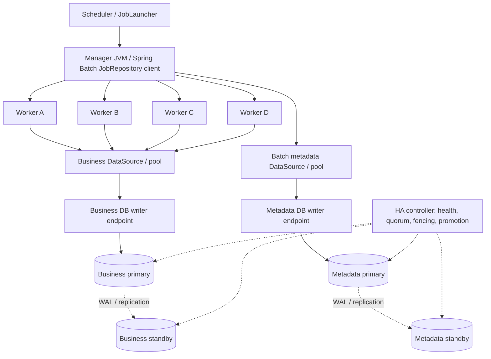

# Database failover trong Spring Batch: khôi phục kết nối mà vẫn đúng dữ liệu

## 1. Bài toán và mục tiêu

Một Spring Batch job đọc 5 triệu giao dịch, chia thành 16 partition chạy trên 4 worker. Giữa lúc job đang ghi dữ liệu, **database primary** mất điện và hệ thống HA chuyển vai trò sang một standby. Sau vài chục giây, ứng dụng có thể kết nối lại. Tuy nhiên, không ai chắc transaction cuối cùng của worker **đã commit trên primary cũ hay chưa**, và metadata `JobRepository` có còn phản ánh đúng trạng thái đã xử lý hay không.

Đó là vấn đề **database failover** trong hệ thống batch phân tán: không chỉ cần endpoint DB hoạt động trở lại, mà còn phải bảo toàn **tính đúng của kết quả, khả năng restart và sự nhất quán giữa các tài nguyên**.

Bài thuộc chương **Failover** của module `SPRING_BATCH_SCALING_OPERATIONS`. Module hướng tới mở rộng Spring Batch cho workload dữ liệu lớn bằng multi-threaded step, parallel steps, partitioning và các mô hình xử lý phân tán; đo nút thắt, bảo đảm thread safety, retry/restart và lựa chọn kiến trúc theo tài nguyên thực tế. Trong bối cảnh đó, failover là một bài toán kiến trúc và vận hành xuyên **database, JDBC pool, `JobRepository`, worker, middleware và scheduler**.

Sau bài, bạn có thể:

1. Phân biệt **database failover** với **failback**, **restart JobInstance**, **retry SQL** và **worker failover**.
2. Xác định các cửa sổ lỗi khi mất primary, nhất là tình huống **commit outcome unknown**.
3. Thiết kế metadata DB và business DB với RPO/RTO, replication, leader fencing và một endpoint chỉ nhận ghi vào primary hợp lệ.
4. Cấu hình kết nối PostgreSQL JDBC + HikariCP theo hướng tự phục hồi **kết nối mới**, không kỳ vọng transaction cũ tự tiếp tục.
5. Thiết kế Spring Batch restart, reader checkpoint, idempotent writer và reconciliation sau sự cố.
6. Xây runbook và các bài thử failover có thể đánh giá bằng số liệu thực tế.

> **Phạm vi phiên bản:** ví dụ áp dụng cho Spring Batch **5.2.x**, Spring Boot 3.x, Java 17+, PostgreSQL và pgJDBC. Nguyên tắc transaction/failover áp dụng cho nhiều RDBMS, nhưng câu lệnh SQL, cơ chế leader election, tên property JDBC và RPO/RTO phụ thuộc sản phẩm cụ thể. Các đoạn lệnh quản trị PostgreSQL trong bài chỉ nhằm minh họa/quan sát; việc **promote/fence** phải do cơ chế HA được ủy quyền thực hiện.

## 2. Năm khái niệm dễ nhầm

| Khái niệm | Điều xảy ra | Không tự bảo đảm |
| --- | --- | --- |
| **Database failover** | Primary cũ ngừng phục vụ, standby phù hợp được promote thành primary mới | Transaction JDBC đang chạy được di chuyển hoặc kết quả commit chắc chắn đã biết |
| **Database failback** | Đưa workload về node cũ/sau bảo trì, theo một quy trình HA | Node cũ có thể quay lại làm primary khi chưa đồng bộ |
| **JDBC reconnect** | Connection pool/driver tạo kết nối **mới** tới endpoint còn hoạt động | Transaction cũ tiếp tục, session state hoặc prepared cursor được phục hồi |
| **Spring Batch restart** | Một `JobExecution` mới tiếp tục cùng `JobInstance` từ trạng thái metadata hợp lệ | Không có side effect ngoài metadata bị lặp |
| **Business retry/reconciliation** | Kiểm tra kết quả rồi thử lại công việc chưa xác nhận | Database hoặc broker tự tạo exactly-once end-to-end |

Hai câu hỏi phải trả lời riêng sau failover:

- **Availability:** có thể tạo connection mới và ghi an toàn vào primary hợp lệ chưa?
- **Correctness:** dữ liệu nghiệp vụ và checkpoint có nhất quán, nhất là những transaction bị đứt kết nối đúng lúc `COMMIT`?

Không coi việc health check DB thành công là câu trả lời cho cả hai.

## 3. Kiến trúc Spring Batch gặp database failover



Đây là **sơ đồ logic**, không yêu cầu metadata và business DB phải là hai cluster riêng. Trong thực tế có ba phương án:

| Bố trí | Ưu điểm | Rủi ro/chú ý |
| --- | --- | --- |
| **Metadata và business tables trên cùng DB/cluster** | Cùng HA domain, có khả năng sử dụng một transaction cục bộ nếu cùng DataSource và thật sự tham gia cùng TX | Metadata và workload ghi tranh tài nguyên; vẫn cần kiểm chứng transaction boundary |
| **Hai DB/cluster tách biệt** | Tách tải, giới hạn sự cố/permissions, scale độc lập | Failover không đồng thời, RPO khác nhau; commit metadata và business data không tự atomic |
| **Metadata DB dùng chung, nhiều business DB/shard** | Phù hợp multi-tenant/partitioned workload | Worker phải biết shard owner, mỗi DB có trạng thái failover riêng; reconciliation nhiều nguồn |

Trong **remote partitioning**, worker có `StepExecution` và cần truy cập cùng `JobRepository` logic theo thiết kế. Trong **remote chunking**, manager thường giữ metadata Batch và trao `ChunkRequest`/`ChunkResponse` với worker qua broker; worker vẫn có business DB transaction riêng. Failover metadata DB và failover business DB có tác động khác nhau tới hai mô hình.

### 3.1. Ranh giới hệ thống quan trọng

```text
Manager:
    JobRepository TX     -> BATCH_JOB_EXECUTION / BATCH_STEP_EXECUTION
    ChunkRequest publish -> Broker request queue (nếu remote chunking)

Worker:
    Business DB TX       -> bảng đích / operation ledger
    Broker request ACK   -> xác nhận một delivery
    ChunkResponse publish-> Broker reply queue

Không có một local transaction mặc định bao trùm cả bốn bước.
```

Ngay cả khi cả hai kết nối đều có tên `dataSource`, transaction của worker process và manager process vẫn là những transaction độc lập. `@Transactional` ở manager không quay ngược lại được một `COMMIT` đã thành công ở worker.

## 4. Các dạng sự cố cần phân biệt

| Sự cố | Điều client có thể thấy | Kết quả phù hợp |
| --- | --- | --- |
| DB primary chết trước khi nhận transaction | Connection error ngay lúc begin/query | Transaction chưa bắt đầu; cần kết nối mới |
| Primary chết **đang thực thi** SQL | `SQLException`, timeout, kết nối bị reset | Transaction có thể rollback; xác minh theo ranh giới thực tế |
| Primary chết **sau khi xử lý COMMIT nhưng trước khi trả ACK** | Client thấy socket/timeout ở `commit()` | **Commit outcome unknown**; không mặc định rollback |
| Replica trễ rồi được promote | Primary mới thiếu một số WAL đã commit ở primary cũ | **Mất dữ liệu trong phạm vi RPO thực tế** nếu replication async |
| Hai node cùng cho phép ghi | Hai nhánh lịch sử dữ liệu khác nhau, split-brain | Cần fencing và chọn một primary hợp lệ; không tự merge ngầm |
| DB lên lại nhưng pool giữ socket cũ | Query đầu tiên lỗi, connection validation thất bại | Evict/recreate connection, retry ở ranh giới an toàn |
| Metadata DB lỗi, business DB còn tốt | Worker có thể đã ghi nhưng `JobRepository` không lưu checkpoint | Audit, idempotency và recovery execution |
| Business DB lỗi, metadata DB còn tốt | Step có thể fail/rollback nhưng status cập nhật được | Restart sau khi xác minh transaction và nguồn |

**Commit outcome unknown** là trường hợp không thể kết luận dựa vào exception. Một driver ném `SQLTransientConnectionException` hoặc `SQLRecoverableException` (tùy driver/tình huống) không cho biết `COMMIT` đã được primary cũ chấp nhận bền hay chưa. Chỉ **business operation ID + kiểm tra trạng thái commit** mới tạo cơ sở quyết định có thể replay hay cần điều tra.

## 5. RPO, RTO và replication: cần chọn trước khi scale

- **RPO (Recovery Point Objective):** tối đa bao nhiêu dữ liệu có thể mất sau failover, tính theo thời điểm checkpoint/commit đã xác nhận và cách replicate dữ liệu.
- **RTO (Recovery Time Objective):** thời gian mục tiêu để dịch vụ có thể tiếp tục an toàn, bao gồm phát hiện lỗi, promote, đổi route, reconnect và khôi phục job.
- **Replication lag:** lượng WAL/commit chưa được standby replay hoặc xác nhận ở mốc cần thiết.

Ví dụ một job ghi 2.000 bản ghi/giây vào business DB. Nếu RPO thực tế là 8 giây khi promote standby bất đồng bộ, **có thể mất xấp xỉ 16.000 bản ghi mới** theo tốc độ đó — chỉ là một phép ước tính nguy cơ, không phải kết quả chắc chắn. Trong thực tế transaction size, commit batch, WAL position và replication lag quyết định chính xác dữ liệu còn/mất.

### 5.1. PostgreSQL streaming replication bất đồng bộ

PostgreSQL streaming replication thường **asynchronous** nếu không cấu hình synchronous standby phù hợp. Primary có thể xác nhận `COMMIT` trước khi standby nhận/replay đủ WAL; khi failover bất ngờ, các transaction được client báo thành công có thể không xuất hiện trên primary mới.

Vì vậy không được khẳng định “primary mới hoạt động thì mọi `COMMIT` cũ chắc chắn còn”. Với metadata DB, mất một vài lần checkpoint có thể làm `JobRepository` lùi trạng thái; với business DB, có thể mất các thay đổi đã được downstream quan sát.

### 5.2. Synchronous replication

Chế độ synchronous có thể yêu cầu commit đợi một hay nhiều standby xác nhận WAL theo chính sách `synchronous_standby_names`/`synchronous_commit`. Mức `remote_write` và `remote_apply` có ý nghĩa bảo đảm khác nhau; không suy ra RPO=0 vô điều kiện chỉ vì bật một cờ “sync”.

Đánh đổi: tăng latency commit và phụ thuộc tình trạng standby. Nếu không có standby synchronous phù hợp, các transaction ghi có thể bị chặn theo cấu hình — đôi khi hệ thống ưu tiên **đúng và bền** hơn khả năng luôn nhận ghi.

### 5.3. Split-brain là lỗi dữ liệu, không chỉ lỗi uptime

Khi promote standby, phải **fence primary cũ** (thu hồi write access, cách ly mạng/storage hoặc biện pháp quản trị có hiệu lực), đảm bảo không có hai primary cùng nhận ghi. Nếu primary cũ quay lại tự phục vụ, hai lịch sử WAL có thể phân kỳ. Chỉ đổi DNS hoặc đợi timeout JDBC không đủ giải quyết split-brain.

Một hệ HA thường cần controller/consensus/quorum hoặc dịch vụ quản lý phù hợp để quyết định leader và thực hiện fencing. Spring Batch **không thực hiện leader election hay PostgreSQL promote** thay cho hạ tầng database.

## 6. Thiết kế endpoint DB an toàn cho manager và worker

Một mô hình HA tốt không ép mọi ứng dụng biết “node nào là primary” qua file cấu hình sửa tay. Có thể dùng:

- **Một write endpoint** do HA proxy/service quản lý, chỉ route tới primary hợp lệ sau fencing.
- **Multi-host pgJDBC URL** với `targetServerType=primary` để driver chọn máy hiện nhận ghi khi tạo kết nối mới.
- **Một cluster manager** (ví dụ giải pháp HA PostgreSQL phù hợp tổ chức) kiểm soát promote, leader lease, fencing và cập nhật endpoint.

Khi một ứng dụng yêu cầu ghi metadata hoặc business data, **không để nó kết nối tùy ý vào standby read-only**. Không chuyển `JobRepository` sang read-only replica chỉ vì replica còn hoạt động: repository cần `INSERT/UPDATE` cho `JobExecution`, `StepExecution`, `ExecutionContext` và sequence.

### 6.1. pgJDBC nhiều host

Ví dụ URL cho một cluster PostgreSQL hai node:

```text
jdbc:postgresql://pg-a.internal:5432,pg-b.internal:5432/batchdb?targetServerType=primary&connectTimeout=5&socketTimeout=60&hostRecheckSeconds=5
```

Ý nghĩa các tham số:

| Thành phần | Ý nghĩa / hạn chế |
| --- | --- |
| `pg-a,pg-b` | Driver thử các endpoint được liệt kê khi mở **kết nối mới** |
| `targetServerType=primary` | Chỉ chọn endpoint hiện cho phép ghi theo kiểm tra của driver; **không fallback** sang standby read-only |
| `connectTimeout=5` | Giới hạn thao tác thiết lập kết nối (giây, theo pgJDBC), không phải giới hạn thời gian phục hồi toàn job |
| `socketTimeout=60` | Timeout các thao tác socket (giây), có thể cắt truy vấn dài; phải điều chỉnh theo workload |
| `hostRecheckSeconds=5` | Thời gian driver cache trạng thái host trước khi kiểm tra lại; không có nghĩa failover hoàn tất trong 5 giây |

Trong pgJDBC, nếu không bật `loadBalanceHosts`, các host thường được xét theo thứ tự URL. Driver có cơ chế kiểm tra primary/secondary cho kết nối mới. **Connection đang hoạt động không được “dịch chuyển” sang primary mới** khi đứt; JDBC transaction/cursor/session của nó bị mất và phải mở connection mới.

Driver chọn host **không thay thế fencing**. Nếu primary cũ vẫn cho phép ghi trong một sự cố split-brain, client nhìn từ một mạng khác có thể vô tình kết nối vào primary sai. Chỉ mở lại Batch sau khi HA controller xác nhận **một write primary**.

### 6.2. Spring Boot 3.x + HikariCP: cấu hình tham khảo

```yaml
spring:
  datasource:
    url: jdbc:postgresql://pg-a.internal:5432,pg-b.internal:5432/batchdb?targetServerType=primary&connectTimeout=5&socketTimeout=60&hostRecheckSeconds=5
    username: ${DB_BATCH_USER}
    password: ${DB_BATCH_PASSWORD}
    hikari:
      pool-name: batch-metadata-pool
      maximum-pool-size: 12
      minimum-idle: 2
      connection-timeout: 10000
      validation-timeout: 3000
      max-lifetime: 1200000
      keepalive-time: 120000
      initialization-fail-timeout: 1
  batch:
    jdbc:
      initialize-schema: never
```

Đây là cấu hình **một DataSource** minh họa, phù hợp khi metadata sử dụng `spring.datasource`. Nếu ứng dụng có **hai datasource** (metadata và nghiệp vụ), phải tạo/config từng pool, chọn `@BatchDataSource` hoặc cấu hình `JobRepository` phù hợp, và gắn đúng transaction manager cho từng phần. Không copy block trên rồi tin rằng cả hai database đều đã được bảo vệ.

Giải thích những tham số HikariCP:

- `connection-timeout`: thời gian chờ lấy một connection từ pool, tính theo **milli-giây**. Nó không phải JDBC connect timeout.
- `validation-timeout`: thời gian chờ kiểm tra connection sống, phải nhỏ hơn connection timeout.
- `max-lifetime`: giới hạn vòng đời connection trong pool; connection **đang sử dụng** không bị giật khỏi transaction chỉ vì hết tuổi.
- `keepalive-time`: thử giữ các **connection idle** còn sống; không thay cho reconnect khi DB đã failover.
- `initialization-fail-timeout`: điều chỉnh hành vi pool khi khởi tạo. Giá trị này chỉ mang tính minh họa; nếu Batch **không thể hoạt động khi metadata DB vắng**, nhiều hệ thống chọn fail startup/readiness hơn là chạy “degraded” giả.
- `maximum-pool-size`: phải cân với giới hạn kết nối PostgreSQL của **mọi ứng dụng/worker**, không đặt càng lớn càng tốt.

**Các giá trị trên không phải “bộ số chuẩn HA”.** Ví dụ `socketTimeout=60` có thể cắt một câu SQL dài hơn 60 giây; workload chạy `COPY`/đọc cursor lâu cần hiệu chỉnh phù hợp. Tạo timeout theo ngân sách RTO/latency mà vẫn tránh cắt transaction hợp lệ.

Trong môi trường hỗn hợp, `spring.batch.jdbc.initialize-schema=never` giúp tránh việc nhiều node cùng chạy DDL khi startup. Schema metadata phải được deploy bằng migration đúng version; `DB availability` không có nghĩa schema đã tương thích.

### 6.3. Khi nào làm mới pool?

Sau khi HA controller đã promote và route tới primary hợp lệ:

1. Các connection cũ từng trỏ đến primary chết có thể trả lỗi ngay khi được dùng.
2. HikariCP thường kiểm tra và loại connection hỏng; tạo connection mới qua pgJDBC/endpoint.
3. Hệ thống có thể cần **soft eviction/refresh pool** nếu hạ tầng routing giữ connection lỗi hoặc đổi role giữa phiên (thực hiện theo cơ chế vận hành có kiểm soát).
4. Không xóa session/connection đang hoạt động một cách tùy tiện khi chưa xác nhận primary cũ đã bị fence; có thể làm tăng số transaction outcome unknown.

Sau khi kết nối lại, hãy kiểm tra **read-write thực tế** bằng truy vấn giám sát từ cùng đường kết nối và thử một giao dịch ghi kiểm soát phù hợp quyền; không chỉ kiểm tra TCP port đang mở.

### 6.4. Health check không phải kết quả nghiệp vụ

Các mức độ kiểm tra:

| Check | Nó chứng minh | Nó không chứng minh |
| --- | --- | --- |
| TCP connect tới DB endpoint | Có service trả lời trên cổng | Đây là primary đúng hoặc DB cho ghi |
| `SELECT 1` | Có thể thực hiện một truy vấn đọc | Metadata schema writable, transaction cũ đã biết kết quả |
| `SELECT pg_is_in_recovery()` | Node PostgreSQL đang trong recovery/standby hay primary tại thời điểm query | Không có split-brain ở node khác |
| Kiểm tra quyền ghi + schema + sequence | App có thể thực hiện đường ghi metadata mới | Business operations cũ không bị lặp/mất |
| Đối soát operation ledger + `JobRepository` | Có bằng chứng về các commit đã bền và checkpoint | Các hệ thống bên ngoài DB chưa chắc nhất quán |

Vì failover còn có giai đoạn role-change chưa ổn định, readiness của manager nên chỉ bật khi đã có **primary hợp lệ, metadata schema truy cập đúng và các phụ thuộc tối thiểu sẵn sàng**. Không cho scheduler phóng job mới chỉ vì một probe ngắn ngủi trả `SELECT 1` thành công.

## 7. `JobRepository` khi database primary mất kết nối

Spring Batch lưu `JobInstance`, `JobExecution`, `StepExecution` và `ExecutionContext` trong JDBC `JobRepository`. Đây là **metadata dùng để restart**, không phải cache có thể xóa khi DB lỗi.

Một số điểm commit cần chú ý:

1. Repository tạo `JobExecution` khi launch job.
2. Step được tạo và cập nhật `STATUS`/counters và context ở các mốc của vòng đời/chunk.
3. Repository sử dụng transaction và cơ chế optimistic locking thông qua `VERSION` để phát hiện cập nhật cạnh tranh.
4. Khi manager/worker process chết đột ngột, có thể còn `JobExecution` hoặc `StepExecution` ở trạng thái `STARTED` vì không ai kịp cập nhật trạng thái cuối.

Nếu metadata DB bị failover **asynchronous và mất WAL**, một checkpoint đã được báo thành công trước đó có thể không tồn tại ở primary mới. Khi job restart, reader có thể bắt đầu từ vị trí cũ; nếu writer không idempotent, side effect có thể xảy ra lần hai.

### 7.1. Các bảng cần xem

| Bảng | Lý do kiểm tra sau failover |
| --- | --- |
| `BATCH_JOB_INSTANCE` | Xác định job logic theo identifying `JobParameters` |
| `BATCH_JOB_EXECUTION` | Biết attempt trước có `FAILED`, `STARTED`, `STOPPED` hay `COMPLETED` |
| `BATCH_STEP_EXECUTION` | Số read/write/commit/rollback và trạng thái từng step/partition |
| `BATCH_JOB_EXECUTION_PARAMS` | Tránh restart sai JobInstance do đổi identifying params |
| `BATCH_JOB_EXECUTION_CONTEXT` | Kiểm tra state cấp job như manifest/watermark |
| `BATCH_STEP_EXECUTION_CONTEXT` | Kiểm tra reader checkpoint, partition bounds, state step |

**Không có `BATCH_CHUNK` mặc định** ghi nhận mọi chunk. Metadata không tự xác nhận một khoản thanh toán đã trừ tiền đúng một lần, và `READ_COUNT/WRITE_COUNT` có thể không bằng số thay đổi nghiệp vụ thực sự sau replay.

### 7.2. `STARTED` còn sót sau crash: đừng restart mù

Spring Batch **5.2** mô tả: khi process bị kill hoặc máy chết, repository có thể không biết job đã kết thúc và tiếp tục giữ `STATUS=STARTED`; trạng thái này không tự restart được như execution đã `FAILED`. Runbook khôi phục cần:

- Xác định process/controller cũ **chắc chắn không còn chạy**; fence scheduler/manager cũ nếu cần.
- Xác minh business DB đã commit đến đâu và request/reply nào còn in-flight.
- Kiểm tra `ExecutionContext` còn hợp lệ và nguồn đọc vẫn là snapshot/manifest ban đầu.
- Sau khi có quyền phê duyệt và bằng chứng, **chọn chính sách recovery cho execution cũ** theo công cụ/quy trình Spring Batch 5.2; tài liệu 5.2 nêu việc đánh dấu `FAILED` hoặc `ABANDONED` là quyết định vận hành/nghiệp vụ, không thể tự động tùy tiện.
- Chỉ restart **cùng `JobInstance`** khi dữ liệu restart được xác minh; nếu không, cần một quy trình rerun/compensate riêng thay vì tạo JobInstance mới để “vượt lỗi”.

**Không sửa bừa `STATUS`, `VERSION`, `WRITE_COUNT` hoặc serialized context bằng SQL để job chạy lại.** Nếu buộc có sửa metadata được hỗ trợ bởi runbook, phải kiểm tra đồng thời job/step state, archive bản gốc và đảm bảo không có writer sống; thao tác cần được kiểm soát bởi người chịu trách nhiệm vận hành.

### 7.3. `JobParameters` là một phần của quyết định restart

Ví dụ job `settleOrders` có identifying parameters:

```text
businessDate=2026-11-26
tenantId=7
snapshotId=manifest-v3
```

Restart **cùng** ba giá trị nhận dạng nếu chúng đã được chọn làm identifying `JobParameters`. Nếu scheduler tự sinh `runId=UUID` mới và đánh dấu nó identifying mỗi lần khởi động, Spring Batch có thể tạo `JobInstance` mới, **không đọc checkpoint cũ**. Một job mới có thể xử lý lại mọi record dù job cũ đã commit một phần.

Khi cần chạy lại một nghiệp vụ đã `COMPLETED`, phải xác định đó là rerun/version mới hay reconciliation/compensate; không dùng đổi parameter ngẫu nhiên làm cơ chế failover.

### 7.4. Hai launch song song sau failover

Nếu scheduler A và B đều thấy DB phục hồi rồi cùng launch `settleOrders` với cùng identifying parameters, có thể xuất hiện tranh chấp JobInstance/JobExecution. `JobRepository` dùng transaction và isolation cho các thao tác tạo metadata; song **hai scheduler vẫn cần tránh duplicate business effects**, nhất là khi một process cũ chưa bị dừng hoàn toàn.

Không chỉ dựa vào distributed mutex trong RAM mỗi JVM. Dùng hạ tầng scheduler/leader election có fencing hoặc quy trình launch có tính đơn nhất, cộng với idempotency ở tầng writer.

## 8. Cửa sổ khó nhất: `COMMIT` không rõ thành công hay thất bại

Giả sử worker gửi các câu SQL cập nhật rồi gọi `Connection.commit()`:

```text
Worker                          PostgreSQL primary
   |  BEGIN                          |
   |-------------------------------->|
   |  UPDATE/INSERT...               |
   |-------------------------------->|
   |  COMMIT                         |
   |-------------------------------->|
   |                          WAL flush / commit
   |                             X  primary / network lỗi
   |  Socket timeout / connection reset
   |<--------------------------------|
   |
   |  Worker không nhận ACK COMMIT
   |  => Chưa biết transaction đã commit hay rollback.
```

Lúc này có ít nhất ba khả năng:

1. Primary chết **trước khi** commit bền; không có business write.
2. Primary commit thành công, nhưng response mất; nếu WAL liên quan đã được standby nhận theo điều kiện HA, primary mới có thể có thay đổi đó.
3. Primary commit nhưng dữ liệu **chưa kịp replicate**; với async failover, primary mới có thể không chứa transaction, dù primary cũ đã từng xác nhận commit cho một client.

Không thể suy ra chắc chắn từ loại exception hoặc thời điểm log của worker. Một retry nguyên `UPDATE balance = balance + 100` có thể cộng hai lần; không retry lại có thể bỏ sót một khoản ghi.

### 8.1. Hợp đồng kết quả có ba trạng thái

Với mỗi business operation cần phân biệt:

| Trạng thái | Ý nghĩa | Hành động |
| --- | --- | --- |
| **CONFIRMED_COMMITTED** | Có bằng chứng bền vững rằng operation đã commit trên hệ dữ liệu hiện được công nhận | Không áp dụng lại side effect |
| **CONFIRMED_NOT_APPLIED** | Theo quy tắc nghiệp vụ và nguồn chân lý đã kiểm tra, operation chắc chắn chưa được áp dụng | Có thể thực hiện lần đầu/tiếp tục |
| **UNKNOWN** | Không thể xác minh vì failover, replication gap hoặc external side effect | Dừng replay mù; reconcile, quarantine hoặc yêu cầu quyết định nghiệp vụ |

**Một câu `SELECT COUNT(*)` không phải lúc nào cũng đủ**. Nếu transaction cũ ghi trên primary đã mất nhưng từng gọi API ngân hàng bên ngoài, việc ledger trên primary mới không có row **không chứng minh API chưa thực hiện**. Phải truy vấn hệ thống ngoài theo idempotency key hoặc có audit độc lập.

### 8.2. Idempotent writer và ledger trong cùng transaction

Với logic DB-only, thiết kế tốt là lưu **operation marker và side effect trong cùng database transaction**. Khi request được xử lý lại trên primary hiện hành, khóa unique khiến lần replay không làm thay đổi dữ liệu lần nữa nếu transaction cũ còn tồn tại.

Giả sử nghiệp vụ cộng/trừ một khoản `delta` vào số dư tài khoản, dùng PostgreSQL:

```sql
CREATE TABLE account_balance (
    tenant_id BIGINT NOT NULL,
    account_id BIGINT NOT NULL,
    balance NUMERIC(20,2) NOT NULL,
    PRIMARY KEY (tenant_id, account_id)
);

CREATE TABLE applied_delta (
    operation_id VARCHAR(100) PRIMARY KEY,
    tenant_id BIGINT NOT NULL,
    account_id BIGINT NOT NULL,
    delta NUMERIC(20,2) NOT NULL
);
```

`operation_id` là **logical business ID ổn định** do ứng dụng xác định (ví dụ ID sự kiện nguồn đã chốt), không phải `STEP_EXECUTION_ID` hoặc `JMSMessageID`. Một event cùng business meaning phải giữ cùng operation ID qua retry/restart/failover. Nếu operation ID bị dùng lại với amount/tài khoản khác, đó là **vi phạm hợp đồng**, không được âm thầm coi là duplicate hợp lệ.

### 8.3. Spring Batch worker writer dùng `TransactionTemplate`

Mẫu sau dùng Spring Batch 5.2, Spring JDBC, Java 17. `businessJdbcTemplate` và `businessTransactionManager` phải sử dụng **cùng DataSource PostgreSQL**. Processor ở ví dụ phải **không phát sinh side effect**; transaction bao trọn mọi thay đổi dữ liệu trong writer.

```java
import java.io.Serializable;
import java.math.BigDecimal;
import org.springframework.batch.item.ItemWriter;
import org.springframework.beans.factory.annotation.Qualifier;
import org.springframework.context.annotation.Bean;
import org.springframework.context.annotation.Configuration;
import org.springframework.jdbc.core.JdbcTemplate;
import org.springframework.transaction.PlatformTransactionManager;
import org.springframework.transaction.support.TransactionTemplate;

record AccountDelta(
        String operationId,
        long tenantId,
        long accountId,
        BigDecimal delta
) implements Serializable {}

@Configuration
public class SafeBusinessWriterConfig {

    record StoredOperation(
            long tenantId, long accountId, BigDecimal delta) {}

    @Bean
    public ItemWriter<AccountDelta> accountDeltaWriter(
            @Qualifier("businessJdbcTemplate") JdbcTemplate jdbc,
            @Qualifier("businessTransactionManager")
            PlatformTransactionManager businessTx) {

        TransactionTemplate tx = new TransactionTemplate(businessTx);
        return chunk -> tx.executeWithoutResult(status -> {
            for (AccountDelta item : chunk.getItems()) {
                if (item.operationId() == null ||
                    item.operationId().isBlank() ||
                    item.tenantId() <= 0 || item.accountId() <= 0 ||
                    item.delta() == null) {
                    throw new IllegalArgumentException("Invalid operation");
                }

                int claimed = jdbc.update("""
                    INSERT INTO applied_delta
                      (operation_id, tenant_id, account_id, delta)
                    VALUES (?, ?, ?, ?)
                    ON CONFLICT (operation_id) DO NOTHING
                    """, item.operationId(), item.tenantId(),
                    item.accountId(), item.delta());

                if (claimed == 1) {
                    int updated = jdbc.update("""
                        UPDATE account_balance
                        SET balance = balance + ?
                        WHERE tenant_id = ? AND account_id = ?
                        """, item.delta(), item.tenantId(),
                        item.accountId());
                    if (updated != 1) {
                        throw new IllegalStateException(
                            "Account not found or invalid owner");
                    }
                } else {
                    StoredOperation old = jdbc.queryForObject("""
                        SELECT tenant_id, account_id, delta
                        FROM applied_delta
                        WHERE operation_id = ?
                        """,
                        (rs, rowNum) -> new StoredOperation(
                            rs.getLong("tenant_id"),
                            rs.getLong("account_id"),
                            rs.getBigDecimal("delta")),
                        item.operationId());

                    if (old == null ||
                        old.tenantId() != item.tenantId() ||
                        old.accountId() != item.accountId() ||
                        old.delta().compareTo(item.delta()) != 0) {
                        throw new IllegalStateException(
                            "Same operation ID with different payload");
                    }
                    // Duplicate hợp lệ: không cộng/trừ số dư lần nữa.
                }
            }
        });
    }
}
```

**Vì sao mẫu này chịu được replay?**

- `applied_delta.operation_id` có unique constraint, nên nhiều worker không thể cùng commit hai marker cho một operation.
- Mỗi transaction mới cố insert marker trước. Nếu marker đã commit, code kiểm tra payload gốc và **không cập nhật account balance**.
- Nếu marker được insert nhưng cập nhật tài khoản thất bại, **cùng transaction rollback**, không để lại marker “đã làm” cho công việc chưa hoàn tất.
- Nếu mất kết nối **sau DB commit nhưng trước JDBC nhận ACK**, worker không biết outcome. Khi kết nối mới và replay, unique marker (nếu còn tồn tại trên primary hiện hành) bảo vệ khỏi cộng/trừ lần hai.
- Nếu async failover **làm mất cả marker lẫn thay đổi account** ở cùng database, replay có thể khôi phục operation trên primary mới; nhưng với **external side effect đã diễn ra**, mẫu này **không đủ** — phải reconcile nguồn ngoài.

Đây là mẫu giáo dục tập trung transaction, chưa tích hợp toàn bộ `Job`/`Step`. Các bean business datasource/transaction manager phải được định nghĩa chính xác trong ứng dụng. Nếu chạy dưới chunk-oriented `Step` vốn đã mở transaction **cùng resource**, `TransactionTemplate` mặc định `REQUIRED` thường tham gia transaction sẵn có thay vì tự mở một transaction tách biệt; phải hiểu propagation và không thêm `REQUIRES_NEW` vô ý.

Trong snippet, `AccountDelta` là record package-private để có thể minh họa cạnh class cấu hình. Khi manager và worker dùng DTO ở nhiều module/package, đặt record này vào **`AccountDelta.java` riêng với `public`** và giữ phiên bản payload/serializer tương thích.

### 8.4. Không retry lệnh `COMMIT` trên connection đã hỏng

Một connection đã đứt không còn là transaction context hợp lệ. Không gọi lại `commit()` trên socket đó rồi suy ra outcome. Cách xử lý:

1. Đánh dấu kết quả operation là **UNKNOWN** nếu lỗi xảy ra gần mốc commit.
2. Để connection hỏng được pool loại bỏ; kết nối mới chỉ tới primary được HA controller xác nhận.
3. Tra cứu operation marker và dữ liệu nghiệp vụ dưới một snapshot nhất quán trên primary mới.
4. Chỉ **retry toàn logical operation** theo writer idempotent khi chính sách đảm bảo an toàn.
5. Nếu có external side effects hoặc replication loss không thể đối soát, đưa vào queue kiểm tra thủ công/compensation thay vì phỏng đoán.

**Không dùng retry vô hạn cho tất cả `SQLException`.** Một số lỗi là syntax/constraint/data-quality lỗi cố định; một số là network/lock timeout tạm thời; trường hợp outcome unknown cần một **decision protocol** chứ không chỉ backoff.

## 9. Failover và tính đúng của reader/checkpoint

Ngoài writer, reader cũng bị ảnh hưởng:

- `JdbcCursorItemReader` giữ cursor/connection trong khi đọc. DB failover có thể cắt cursor, làm step fail; **không có cơ chế chuẩn để giữ cursor JDBC sống qua primary promotion**.
- `JdbcPagingItemReader` có thể mở lại query, nhưng nếu dataset thay đổi hoặc ordering không ổn định, checkpoint cũ có thể trỏ sai key/offset.
- Reader theo file có thể không phụ thuộc business DB, nhưng checkpoint nằm trong `JobRepository` vẫn có thể bị lùi hoặc mất vì metadata failover.

### 9.1. Đầu vào phải ổn định để restart

Anti-pattern:

```sql
SELECT id
FROM orders
WHERE processed = FALSE
ORDER BY id;
```

Nếu worker đã đánh dấu các row `processed=TRUE`, tập nguồn của reader sẽ thay đổi sau failover. Restore checkpoint `currentItemCount=1000` và bỏ qua 1000 dòng đầu của **tập kết quả mới** có thể bỏ sót hàng nghìn record.

Đổi sang một phạm vi được chốt giúp dễ lý luận hơn:

```sql
SELECT id
FROM orders
WHERE tenant_id = :tenantId
  AND snapshot_id = :snapshotId
  AND id >= :startInclusive
  AND id < :endExclusive
ORDER BY id;
```

Ở đây `snapshot_id` cần là một **snapshot/manifest thực sự được tạo và quản lý**, không chỉ một nhãn giả. Nếu dữ liệu trong snapshot vẫn sửa/xóa được thì query trên chưa bảo đảm tính bất biến. Với paging theo keyset, checkpoint theo khóa cuối cùng có thể phù hợp, nhưng vẫn cần xác định logic khi ID mới được chèn trong cửa sổ.

### 9.2. Mất metadata checkpoint nhưng business data không mất

Nếu JobRepository và business DB **hai cluster riêng**:

```text
T1 Business DB COMMIT item 1..1000.
T2 Metadata DB ghi checkpoint = 1000.
T3 Metadata primary chết; standby async chưa nhận checkpoint T2.
T4 Manager restart; checkpoint trên primary mới chỉ là 900.
T5 Worker có thể xử lý lại item 901..1000.
```

Đây là nguyên nhân cần **writer idempotent** ngay cả khi reader/step config restart đúng. Không thể kết luận metadata “hỏng” chỉ vì nó đứng sau business DB; RPO khác nhau có thể tạo chênh lệch. Trước restart, đối soát và chấp nhận replay có kiểm soát.

### 9.3. Mất business data nhưng metadata còn checkpoint mới

Chiều ngược lại nghiêm trọng hơn:

```text
T1 Business DB COMMIT item 1..1000 ở primary cũ.
T2 Metadata checkpoint = 1000 được lưu bền ở cluster khác.
T3 Business primary chết; standby async chỉ có data tới item 900.
T4 Manager restart từ checkpoint 1000.
T5 Item 901..1000 có thể bị bỏ sót hoàn toàn.
```

**Idempotency không tự sửa gap này**, vì item 901..1000 không còn được replay. Cần **reconciliation độc lập** giữa source manifest và dữ liệu/operation ledger trên primary mới, cùng cơ chế bù/lập job phục hồi các item thiếu. Nếu RPO nghiệp vụ không chấp nhận trường hợp này, kiến trúc phải tăng bảo đảm durability/đồng bộ commit hoặc dùng phương án phát hành dữ liệu theo phiên bản.

## 10. Ảnh hưởng tới từng mô hình scale Spring Batch

### 10.1. Multi-threaded step trên một JVM

Nhiều thread cùng dùng một pool và một `StepExecution` logic. Khi DB failover, các thread có thể nhận lỗi đồng thời; một số đã commit chunk trước đó, một số đang rollback, một số mất kết nối đúng lúc commit.

- Không để mỗi thread tự khởi chạy **một JobInstance mới** để tiếp tục, vì checkpoint/chunk ownership có thể bị phân mảnh.
- Reader/processor/writer phải thread-safe nếu dùng chung instance; stateful reader có thể mất tính đúng restart khi nhiều thread cập nhật thứ tự đọc.
- Pool cạn trong thời gian HA chuyển vai trò có thể làm nhiều thread đồng loạt timeout; retry cần backoff/jitter và hạn mức đồng thời để tránh **reconnect storm**.

### 10.2. Parallel steps

Các step chạy song song có transaction và trạng thái riêng. Nếu step A đã `COMPLETED` còn step B fail khi DB chuyển vai trò, retry toàn job không có nghĩa step A tự rollback. Spring Batch flow/restart có thể bỏ qua step hoàn tất theo metadata còn hiệu lực, nhưng những side effect đã commit cần đối soát nếu RPO của metadata/business DB khác nhau.

### 10.3. Local/remote partitioning

Manager phân chia `ExecutionContext` thành các partition ổn định (ID range, file, tenant). Worker step có transaction/chunk checkpoint riêng trong `JobRepository`.

Khi failover:

1. Worker đang ghi có thể mất connection và fail chunk.
2. `StepExecution` có thể vẫn `STARTED` nếu worker chết trước khi repository lưu trạng thái lỗi.
3. Worker/manager khác không được tự chạy lại **cùng partition** khi chưa xác định owner trước đã dừng/fenced.
4. Khi restart, giữ nguyên mapping `partitionName → scope` và snapshot nguồn. **Không tính lại `MIN/MAX` hoặc thay gridSize tùy ý** để bù máy bị lỗi.
5. Nếu worker commit business DB rồi mất checkpoint, replay có thể xảy ra; writer idempotent là lớp bảo vệ bắt buộc cho side effect nhạy cảm.

Với remote partitioning, metadata repository phải được tất cả thành phần **nhìn thấy nhất quán** theo mô hình framework. Mỗi worker tự dùng H2 in-memory riêng không phải là một JobRepository phân tán bền vững.

### 10.4. Remote chunking

Manager gửi `ChunkRequest<T>` qua request queue; worker ghi DB và gửi `ChunkResponse`. Có thêm các mốc **broker delivery ACK**, **DB commit**, **reply publish** và **manager reply ACK**. Database failover ở phía worker có thể gây:

```text
Broker -> Worker A: ChunkRequest(seq=17)
Worker A -> Business DB: COMMIT (kết quả chưa rõ vì failover)
Worker A -> Broker: chưa ACK / chưa gửi reply
Broker -> Worker B: redeliver seq=17
Worker B -> Business DB mới: kiểm tra idempotency rồi xử lý
Worker B -> Manager: ChunkResponse(seq=17)
```

Một request có thể được giao lại **dù worker A đã commit**. Nếu `ChunkResponse` bị mất hoặc reply đi vào `QueueChannel` RAM rồi manager chết, metadata `JobRepository` cũng có thể không biết outcome. Thiết kế cần durable reply/recovery, correlation đúng manager/run, idempotent writer và kiểm soát stale request/reply sau failover.

**Không để hai manager cạnh tranh nhận reply cùng một queue chung** nếu thiếu selector/router bảo đảm response thuộc đúng job. `JMSCorrelationID` hay header `correlationId` không tự chọn đúng consumer khi middleware chỉ dùng cơ chế competing consumers.

### 10.5. Remote chunking không tự chịu được RPO mismatch

Nếu request/reply queue được lưu bền trên broker riêng nhưng **business DB failover làm mất một số commit**, manager có thể đã nhận `ChunkResponse(success=true)` cho dữ liệu không còn trên primary mới. Trong trường hợp này, **replay chỉ các request chưa nhận response không đủ**. Reconciliation nguồn–đích sau failover là bước bắt buộc khi RPO của business DB cho phép mất dữ liệu.

## 11. Thiết kế restart theo ba trạng thái dữ liệu

Tại thời điểm recovery, hãy xét ba nguồn chân lý:

1. **Source manifest/snapshot:** những logical operations *phải* có.
2. **Business DB/operation ledger:** những logical operations hiện *đã commit* trên primary hợp lệ.
3. **JobRepository/broker:** framework và message infrastructure *tin rằng* những công việc nào đã hoàn thành hoặc còn pending.

Ví dụ bảng đối soát:

| Source manifest | Ledger trên primary mới | Batch metadata | Quyết định gợi ý |
| --- | --- | --- | --- |
| Có op-001 | Có op-001, payload khớp | `COMPLETED` | Không làm lại |
| Có op-002 | Có op-002, payload khớp | `FAILED`/checkpoint cũ | Cho phép replay **idempotent** để cập nhật metadata |
| Có op-003 | Không có op-003 | `FAILED`/chưa checkpoint | Có thể chạy lại nếu không có side effect ngoài DB chưa đối soát |
| Có op-004 | Không có op-004 | `COMPLETED`/checkpoint đã qua | **Phát hiện gap**; cần job repair/reconciliation, không chỉ restart từ checkpoint |
| Không có op-005 | Có op-005 | Bất kỳ | Có thể là operation ngoài scope hoặc manifest cũ; điều tra ownership |
| Có op-006 | Không chắc vì external API timeout | Bất kỳ | `UNKNOWN`; đối soát với external system bằng operation key |

**Đừng tự suy luận từ một trong ba nguồn độc lập.** Sau RPO mismatch, metadata có thể đứng trước hoặc sau business data. Thiết kế tốt lưu logical operation ID ổn định, cho phép rebuild/so sánh manifest với ledger và thực hiện repair có kiểm soát.

### 11.1. SQL đối soát minh họa (PostgreSQL)

Giả sử có `batch_manifest(batch_key, operation_id)` và `applied_delta(operation_id,...)`. Đây là **bảng nghiệp vụ riêng**, không phải schema chuẩn Spring Batch:

```sql
-- Những operation được yêu cầu nhưng không có marker trên
-- primary business DB hiện tại. Chưa đủ để kết luận bên ngoài
-- (ví dụ API ngân hàng) chưa nhận side effect.
SELECT m.operation_id
FROM batch_manifest m
LEFT JOIN applied_delta a
  ON a.operation_id = m.operation_id
WHERE m.batch_key = :batchKey
  AND a.operation_id IS NULL
ORDER BY m.operation_id;
```

Nếu manifest và ledger nằm trên **hai DB khác nhau**, truy vấn join trực tiếp không còn đúng hạ tầng; cần xuất snapshot/đối soát qua service hoặc một kho dữ liệu riêng với consistency rules được định nghĩa. Không hứa transaction cross-database chỉ bằng việc viết một câu JOIN.

### 11.2. Staging + publish khi không thể chấp nhận dữ liệu nửa vời

Một hướng thiết kế là worker ghi vào **staging dataset gắn `batchRunId`**, kiểm tra completeness/uniqueness sau khi mọi worker hoàn tất, rồi chuyển con trỏ “current published version” bằng **một thao tác công bố có transaction/atomicity phù hợp**.

Khi failover giữa job, dữ liệu staging có thể dở dang nhưng người tiêu dùng chưa thấy phiên bản mới. Restart/reconcile staging trước khi publish. Cách này không miễn trừ yêu cầu failover của DB hay idempotency, nhưng **giảm rủi ro công bố một tập kết quả thiếu**.

## 12. Runbook database failover dành cho đội vận hành Batch

Một runbook tốt cần phân biệt **phản ứng ngay khi sự cố diễn ra** với **khởi chạy lại job sau khi dữ liệu đã được xác minh**. Các bước dưới đây là khung tham khảo, điều chỉnh theo RPO/RTO và hệ HA của tổ chức.

### Pha A — Phát hiện và giới hạn tác động

1. Bật cảnh báo khi DB writer endpoint không nhận ghi, connection errors tăng, replication lag cao hoặc `JobRepository` transaction thất bại.
2. Tạm **đóng luồng launch job mới** (scheduler gate). Đừng để nhiều scheduler đồng thời start/restart một JobInstance khi HA còn chuyển vai trò.
3. Ghi lại mốc thời gian, các job/partition đang chạy, `jobExecutionId`, container/node đang hoạt động, các chunk/request pending.
4. Không tự kill toàn bộ cluster ngay nếu runbook chưa xác định ranh giới — kill không chọn lọc có thể tạo thêm nhiều `commit outcome UNKNOWN`.
5. Phân loại: metadata DB lỗi, business DB lỗi, cả hai hay chỉ một network partition phía ứng dụng.

### Pha B — DB HA controller phục hồi quyền ghi

1. DBA/HA controller xác nhận primary cũ không còn quyền nhận ghi (**fencing**).
2. Đánh giá replica candidate, WAL/replication position và mức mất dữ liệu tối đa có thể xảy ra.
3. Promote candidate theo quy trình được phê duyệt; **không tự chạy `pg_promote()` chỉ vì một app timeout**.
4. Chuyển write endpoint/route sang primary mới. Kiểm tra không còn split-brain.
5. Xác nhận schema metadata, sequence, migrations và quyền ứng dụng còn đủ.
6. Bảo đảm backup/WAL/archive và phương án tạo standby mới; failover một lần có thể để hệ chỉ còn **một primary không có dự phòng**.

### Pha C — Ổn định kết nối trước khi mở Batch

1. Kiểm tra JDBC tạo connection mới từ chính network/container của manager và worker.
2. Xác nhận node phục vụ hiện là primary; không cho repository write qua replica.
3. Chờ HikariCP evict các connection cũ hoặc thực hiện pool refresh có kiểm soát.
4. Kiểm tra error rate, pool waiting threads, DB locks, CPU, WAL và replication state.
5. Chỉ bật lại traffic vừa đủ để kiểm tra, không mở đồng thời toàn bộ worker nếu DB mới đang phục hồi cache/index hoặc thiếu standby.

### Pha D — Đối soát và quyết định restart

1. Lấy danh sách JobInstance/JobExecution/StepExecution bị ảnh hưởng và trạng thái metadata hiện có.
2. Xác minh **execution cũ thực sự dừng**; kiểm soát leader/scheduler/worker ownership trước khi restart.
3. Xem các `STARTED` còn treo và xác định quy trình xử lý metadata theo Spring Batch 5.2; không sửa `STATUS` ngẫu hứng.
4. So manifest nguồn với operation ledger và dữ liệu đích. Gắn nhãn committed/not-applied/unknown.
5. Phân loại request/reply cũ trong broker, redelivery và DLQ nếu dùng remote chunking.
6. Nếu checkpoint còn hợp lệ và writer idempotent, restart **đúng JobInstance**; nếu ledger thiếu operation đã vượt checkpoint, chạy repair/reconciliation riêng.
7. Không để các operation **UNKNOWN** được tự động replay gây trùng side effect ngoài DB.

### Pha E — Mở lại workload và hoàn tất sự cố

1. Khôi phục worker concurrency từ thấp lên cao; giám sát pool, lock wait, WAL và broker backlog.
2. Kiểm tra job hoàn tất theo metadata và **đối soát số logical operations duy nhất**.
3. Ghi nhận RTO thực tế, RPO quan sát được, số operation recovered/unknown, số lần worker retry.
4. Tạo lại standby, chạy backup kiểm tra và chốt postmortem: nguyên nhân gốc, thiếu sót fencing, timeout, runbook.

**Điểm quyết định:** trạng thái “DB healthy” kết thúc pha C, **không thay thế pha D**. Đưa job chạy lại khi chưa biết business commits có thể tạo lỗi khó phục hồi hơn sự cố mất kết nối ban đầu.

## 13. SQL giám sát PostgreSQL và Spring Batch sau failover

Các truy vấn dưới đây chỉ dùng để **quan sát**, không tự thực hiện failover. Với DB production, truy vấn phải chạy qua role có quyền phù hợp và ứng dụng giám sát cần biết đang kết nối vào primary hay standby nào.

### 13.1. Kiểm tra vai trò node

```sql
SELECT pg_is_in_recovery() AS is_standby,
       current_setting('transaction_read_only') AS tx_read_only,
       current_database() AS database_name,
       inet_server_addr() AS server_ip,
       inet_server_port() AS server_port;
```

`pg_is_in_recovery() = true` thường có nghĩa node đang đóng vai standby/recovery. `false` nghĩa là node **không trong recovery tại thời điểm query**, nhưng chưa đủ xác nhận đây là **primary hợp lệ duy nhất trên toàn cluster**: fencing/quorum thuộc hệ HA. Một node đọc `transaction_read_only=off` nhưng nằm trong network partition vẫn có thể là primary cũ không được phép nhận ghi.

### 13.2. Xem tình trạng các standby từ primary

```sql
SELECT application_name,
       client_addr,
       state,
       sync_state,
       sent_lsn,
       write_lsn,
       flush_lsn,
       replay_lsn,
       write_lag,
       flush_lag,
       replay_lag
FROM pg_stat_replication
ORDER BY application_name;
```

`pg_stat_replication` thường được đọc trên **primary** để xem các replication connections. Các cột `*_lag` có thể `NULL` và không phải mọi kết nối đều báo đầy đủ số đo theo thời gian; không diễn giải `NULL` là “lag bằng 0”. Khi node vừa được promote và chưa có standby mới, kết quả có thể **không có hàng**.

### 13.3. Xem WAL nhận/replay trên standby

```sql
SELECT pg_is_in_recovery() AS is_standby,
       pg_last_wal_receive_lsn() AS receive_lsn,
       pg_last_wal_replay_lsn() AS replay_lsn,
       pg_last_xact_replay_timestamp() AS last_replayed_commit_at;
```

`pg_last_xact_replay_timestamp()` có thể `NULL` hoặc trông “rất cũ” khi **không có transaction mới nào được replay trong một khoảng thời gian**, ngay cả khi standby đã bắt kịp. Dùng cùng WAL LSN, replication state, traffic thực tế và HA controller để xác định độ trễ; không alert chỉ theo một timestamp.

Không gọi `pg_promote()` hoặc sửa `synchronous_standby_names` bằng tay từ một dashboard Batch thông thường. Đó là thao tác có tác động tới toàn cluster, phải nằm trong quy trình DBA/HA được ủy quyền.

### 13.4. Xem JobExecution còn `STARTED`

```sql
SELECT ji.JOB_NAME,
       je.JOB_INSTANCE_ID,
       je.JOB_EXECUTION_ID,
       je.STATUS,
       je.START_TIME,
       je.LAST_UPDATED,
       je.END_TIME
FROM BATCH_JOB_EXECUTION je
JOIN BATCH_JOB_INSTANCE ji
  ON ji.JOB_INSTANCE_ID = je.JOB_INSTANCE_ID
WHERE je.STATUS IN ('STARTING', 'STARTED', 'STOPPING')
ORDER BY je.LAST_UPDATED, je.JOB_EXECUTION_ID;
```

Đây là **danh sách điều tra**, không phải danh sách mặc định được phép restart. Job vẫn có thể chạy nhưng `LAST_UPDATED` chưa thay đổi vì một tasklet dài. Phải kiểm tra process thực, node owner, scheduler và broker trước khi coi execution stale.

### 13.5. Kiểm tra các step/partition bị ảnh hưởng

```sql
SELECT STEP_EXECUTION_ID,
       STEP_NAME,
       STATUS,
       READ_COUNT,
       WRITE_COUNT,
       COMMIT_COUNT,
       ROLLBACK_COUNT,
       LAST_UPDATED,
       EXIT_CODE
FROM BATCH_STEP_EXECUTION
WHERE JOB_EXECUTION_ID = :jobExecutionId
ORDER BY STEP_NAME, STEP_EXECUTION_ID;
```

Với remote partitioning, `STEP_NAME` có thể gồm tên dạng `workerStep:partition0003`. Với remote chunking, manager có thể tổng hợp số liệu từ `ChunkResponse`; không mặc định một `StepExecution` mới cho mỗi chunk request.

### 13.6. Các chỉ số cần lên dashboard

| Nhóm | Metrics | Dấu hiệu đáng chú ý |
| --- | --- | --- |
| DB HA | Primary role, leader epoch, replication lag, standby count, WAL/disk | Không có standby, lag/RPO vượt ngưỡng, không nhất quán role |
| JDBC pool | Active/idle/pending connections, timeouts, validation failures | Reconnect storm, pool exhausted sau promote |
| Batch repository | Job/step `STARTED` lâu, update latency, optimistic lock failures | Metadata bị treo hoặc nhiều process cùng sở hữu execution |
| Business DB | Commit/rollback, deadlock, lock wait, connection wait | Scale worker vượt năng lực primary mới |
| Messaging | Request/reply ready/unacked, redelivery, DLQ, reply timeout | Remote chunking mất response hoặc worker retry liên tục |
| Correctness | Unique operation count, duplicate suppression, missing manifest keys, unknown outcomes | Có gap hoặc side effect lặp sau failover |
| Recovery | Time to detect, fence, promote, reconnect, reconcile, resume | Phân tách RTO kỹ thuật khỏi RTO an toàn của Batch |

Một DB chuyển vai trò thành công không có nghĩa mọi metric trở lại bình thường: primary mới có thể có **cache lạnh**, index maintenance chưa ổn định, thiếu standby và giới hạn connection khác trước.

## 14. Quy tắc retry cho lỗi kết nối và giao dịch

### 14.1. Phân loại lỗi trước khi retry

| Loại lỗi | Ví dụ | Chính sách |
| --- | --- | --- |
| **Trước transaction** | Không mở được connection mới | Có thể retry kết nối với backoff/jitter và giới hạn |
| **Rollback đã xác nhận** | Constraint/deadlock/serialization failure được DB xác nhận rollback | Retry **toàn transaction** khi lỗi tạm thời và policy cho phép |
| **Commit outcome UNKNOWN** | Mất socket khi `commit()` | Đối soát logical operation; không retry blind SQL |
| **Lỗi dữ liệu cố định** | Khóa sai, schema sai, payload không hợp lệ | Fail/skip theo policy, không retry vô hạn |
| **DB không có write primary hợp lệ** | Split-brain chưa được fence hoặc standby chưa promote | Dừng ghi; không tự fallback sang replica |
| **Metadata state không restart được** | `JobExecution` cũ vẫn `STARTED` | Recovery operator và kiểm tra state trước restart |

Không chỉ dựa vào SQLState class `08` (connection exception) để tự quyết định safe retry; connection error tại **commit boundary** vẫn có outcome không chắc chắn.

### 14.2. Backoff và hạn chế reconnect storm

Khi primary lỗi, 100 worker cùng mỗi worker có 20 thread có thể tạo hàng nghìn connection attempts trong vài giây. Điều đó gây quá tải primary vừa promote.

Một chính sách tham khảo:

- Backoff tăng dần với **jitter** và số lần thử hữu hạn.
- Circuit breaker/readiness gate ngăn bắt đầu chunk mới khi không có primary hợp lệ.
- Đưa in-flight operations vào trạng thái **needs reconciliation** nếu không biết commit outcome.
- Resume worker count dần, kiểm tra DB `max_connections` và pool pending.
- Tách **retry kết nối** khỏi **retry business operation**: có thể thử mở connection lại mà không nhất thiết phát lại khoản trừ tiền.

Nếu dùng Spring Retry hoặc retry của Spring Batch, hãy đặt chính sách ở đúng ranh giới. Một lời gọi `@Retryable` bao cả “ghi DB + gửi email” không an toàn nếu email đã gửi nhưng DB báo lỗi. Giữ external effects idempotent hoặc đưa vào outbox.

### 14.3. Vì sao restart bằng `JobOperator` không phải retry SQL

`JobOperator.restart(executionId)` (trên các trạng thái đủ điều kiện) yêu cầu Spring Batch tạo một lần thực thi mới cho **JobInstance hiện có** dựa trên metadata. Nó không replay một câu SQL thất bại trong cùng JDBC transaction cũ. Nếu metadata không phản ánh một commit cuối vì failover, job restart có thể xử lý lại item.

Muốn restart an toàn cần:

1. Execution cũ có trạng thái được framework chấp nhận hoặc đã được recovery theo runbook.
2. Reader checkpoint/input context còn đúng.
3. Writer idempotent, đặc biệt khi transaction outcome uncertain.
4. Broker pending/reply được đối soát nếu có remote chunking.
5. Các operation thiếu do RPO mismatch được repair; không coi restart một mình là hoàn tất.

## 15. Kiểm thử database failover có kiểm soát

Không chỉ thử **stop/start database**. Bài kiểm thử phải gây lỗi đúng **thời điểm transaction** và so sánh dữ liệu sau khi failover.

### 15.1. Thiết lập bài thử

Môi trường staging gồm:

- Hai PostgreSQL node có HA controller/replication giống production ở mức cần thiết.
- Một metadata JDBC `JobRepository`, một business DB và cấu hình network/connection pool gần thực tế.
- Một job xử lý **1.000 logical operations** từ manifest bất biến, chia thành 10 chunk hoặc các partition theo hợp đồng.
- Writer sử dụng `operationId` duy nhất và bảng ledger cùng transaction như mục 8.
- Log/tracing nối `JobInstanceId`, `JobExecutionId`, `chunkSequence` hoặc `partitionName` với `operationId` và mốc transaction.

Không làm failure injection trên business DB production. Kiểm tra backup/restore, dữ liệu giả lập và khả năng kiểm soát replication/promotion trước khi chạy thử.

### 15.2. Ma trận lỗi bắt buộc

| Ca thử | Tác động giả lập | Kết quả bắt buộc kiểm tra |
| --- | --- | --- |
| **A. Lỗi trước BEGIN** | Ngắt primary trước khi worker mở connection | Có retry kết nối có giới hạn; chưa tạo operation marker |
| **B. Lỗi giữa SQL trước COMMIT** | Dừng connection khi chunk ghi nửa số item | Transaction rollback hoặc được phân loại UNKNOWN theo bằng chứng; không xuất hiện partial committed chunk trái hợp đồng |
| **C. Lỗi sau COMMIT, trước response** | Chặn ACK commit hoặc cắt network đúng mốc | Replay không áp dụng operation lần hai |
| **D. Metadata DB failover** | Cho business DB còn sống, mất checkpoint cuối | Restart/idempotency không tạo duplicate, phát hiện metadata lag |
| **E. Business DB RPO lag** | Promote standby async trước khi nhận đủ WAL | So manifest/ledger, phát hiện operation thiếu dù Batch đã `COMPLETED` |
| **F. Hikari giữ connection cũ** | Đổi primary khi pool có idle/active sessions | Kết nối mới vào đúng primary, connection cũ bị loại; không giả định transaction cũ tiếp tục |
| **G. Manager crash cùng lúc** | Kill manager giữa chờ reply | Stale execution/reply được phát hiện, không nhận nhầm message |
| **H. Worker crash khi request unacked** | Dừng worker sau DB commit trước JMS ACK | Redelivery idempotent, correlation và reply đúng |
| **I. Hai scheduler cùng resume** | Cả hai launch cùng identifying parameters | Không có hai manager chạy cùng một logical job ngoài quy tắc và không nhân đôi business effect |
| **J. Standby không khả dụng** | Mất replica synchronous | Hệ thống giữ đúng durability policy thay vì âm thầm hạ RPO |
| **K. Replica chưa fence primary cũ** | Mô phỏng network partition ở cluster test | HA controller ngăn hai write leaders; không kiểm thử split-brain trên dữ liệu thật |
| **L. Rollout với primary mới lạnh cache** | Resume tăng worker 2→4→8 | Latency/DB pool không vượt ngưỡng, job throughput ổn định |

### 15.3. Phép kiểm sau mỗi lần thử

Xác minh tối thiểu:

1. **Count:** số logical operations committed bằng số item hợp lệ trong manifest, trừ skip đã được phê duyệt.
2. **Uniqueness:** không có hai side effects committed cho cùng `operationId`.
3. **Payload:** cùng `operationId` luôn có cùng tenant/account/amount hoặc mismatch bị cách ly.
4. **Coverage:** không mất operation mặc dù metadata nói step `COMPLETED`.
5. **Metadata:** JobInstance/JobExecution/StepExecution, context và trạng thái restart khớp kết quả quan sát.
6. **Broker:** không còn request/reply/DLQ không có người sở hữu hoặc chưa được đánh giá.
7. **RPO/RTO:** đo số operations thực tế mất/phải recover và thời gian từ phát hiện đến resume **an toàn**, không chỉ thời gian promote.

Một test pass chỉ vì `spring.datasource.hikari.connection-timeout` không ném lỗi nữa **không đủ**. Kết quả cần là **dữ liệu đúng sau failover**.

### 15.4. Ví dụ test idempotency độc lập với failover

Trước khi gây lỗi cluster, kiểm tra writer chống replay theo transaction:

```java
// Pseudocode test với PostgreSQL staging và Spring context đã
// cấu hình accountDeltaWriter + businessJdbcTemplate.
AccountDelta operation =
    new AccountDelta("payment-event-123", 7L, 9001L,
                     new BigDecimal("10.00"));

writer.write(Chunk.of(operation));
writer.write(Chunk.of(operation)); // Mô phỏng một lần replay.

// assert balance chỉ tăng 10.00, không phải 20.00
// assert COUNT(*) applied_delta WHERE operation_id = ... == 1
// assert cùng ID nhưng amount khác gây IllegalStateException
```

Ở test thật, dùng JUnit assertion, transaction/fixture rõ ràng và **hai connection/worker đồng thời** để kiểm tra unique constraint khi race. Đừng đặt toàn test trong một transaction sẽ rollback tự động, rồi suy rằng đã kiểm chứng được commit/reconnect của writer.

## 16. Hiệu năng và giới hạn connection trong thời gian failover

Giả sử 4 worker JVM, mỗi JVM Hikari pool tối đa 15 connections, manager pool 10, dashboard/other services tối đa 20:

\[
\text{Maximum planned connections}
=4 \times 15+10+20=90
\]

Nếu primary mới chỉ cho ứng dụng dùng 80 connections sau khi trừ phần dành cho superuser/HA/maintenance, **hệ thống sẽ đụng trần ngay khi resume**. Việc nhiều pool cùng khởi tạo connection tối đa có thể làm quá tải trước khi bất kỳ chunk nào hoàn tất.

### 16.1. Quy tắc sizing thực tế

- Không đặt `maximumPoolSize` theo số CPU duy nhất; cân với DB `max_connections`, connection reserved, concurrency và thời gian giữ transaction.
- Transaction quá dài giữ lock/connection khi DB đang chuyển vai trò, làm tăng rollback/retry cost.
- Chunk quá lớn tạo cửa sổ `COMMIT UNKNOWN` tốn đối soát hơn; chunk quá nhỏ tăng overhead metadata và commit/WAL.
- Nếu dùng synchronous replication, latency commit của chunk có thể tăng theo RTT/standby I/O. Đo cả throughput và **durability target**, không đổi sang async chỉ để đạt benchmark đẹp.
- Resume worker theo ramp-up và ghi nhận p95 DB commit latency, lock wait, pool acquire wait, replication lag, WAL disk.

### 16.2. RTO kỹ thuật khác RTO của Batch

```text
T_detect    : phát hiện primary lỗi
T_fence     : chặn write primary cũ
T_promote   : standby thành primary
T_route     : cập nhật endpoint/routing
T_reconnect : driver/pool thiết lập kết nối hợp lệ
T_reconcile : kiểm tra commit/metadata/broker
T_resume    : restart và đưa worker về năng lực cần thiết
```

Ước tính:

\[
RTO_{\mathrm{safeBatch}}
\approx T_{\mathrm{detect}}+T_{\mathrm{fence}}+
T_{\mathrm{promote}}+T_{\mathrm{route}}+
T_{\mathrm{reconnect}}+T_{\mathrm{reconcile}}+
T_{\mathrm{resume}}
\]

Các bước có thể chồng lấp, vì vậy đây là công thức **lập ngân sách**, không phải cam kết thời gian cộng chính xác. Cần đo **RTO đến lúc job có thể tiếp tục an toàn**, không chỉ thời điểm proxy báo DB primary mới healthy.

## 17. Những anti-pattern cần tránh

### 17.1. Tự động replay mọi SQL khi connection lỗi

`SocketTimeoutException`/`SQLException` trong lúc `COMMIT` không xác nhận rằng transaction đã rollback. Replay một lệnh cộng tiền có thể làm sai số dư. Thay thế bằng **logical operation ID + idempotent writer + reconciliation**.

### 17.2. Dùng `targetServerType=preferPrimary` cho writer rồi fallback vào standby

`preferPrimary` có thể cho phép driver kết nối tới secondary khi không còn primary phù hợp; nó hữu ích trong một số ứng dụng đọc, nhưng **không phù hợp với đường bắt buộc ghi metadata và business data**. Với writer, thường phải yêu cầu strict `targetServerType=primary` hoặc write endpoint chỉ route tới leader có quyền ghi.

### 17.3. Promote standby mà chưa fence primary cũ

Đây là rủi ro split-brain. Hai primary có thể chấp nhận các transaction khác nhau. Không có một câu SQL merge chung nào tự sửa được lịch sử business effects. Phải có quy trình HA được phê duyệt, fencing và xác thực leader.

### 17.4. Coi DB có kết nối là job có thể chạy lại

Pool mở connection và `SELECT 1` hoạt động không chứng minh checkpoint còn hợp lệ, replication không mất dữ liệu hoặc external API đã xử lý tới đâu. Dùng **readiness nhiều tầng** và runbook đối soát.

### 17.5. Tự thay `JobExecution.STATUS='FAILED'` để vượt lỗi

Một `STARTED` cũ có thể đại diện process còn chạy hoặc chưa hoàn tất cập nhật. Nếu tự sửa metadata giữa khi job cũ vẫn hoạt động, hai process có thể ghi trùng. Chỉ thực hiện recovery state sau khi đã **xác minh owner chết/fenced**, đối soát và theo quy trình Spring Batch 5.2.

### 17.6. Restart với identifying parameters mới để “tránh conflict”

Việc đổi `runId` identifying tạo JobInstance mới có thể khiến job xử lý lại từ đầu, bỏ qua checkpoint cũ. Giữ đúng JobInstance khi restart hợp lệ; muốn rerun là **một quyết định nghiệp vụ khác**, cần idempotency/cơ chế phiên bản riêng.

### 17.7. Tách business DB và metadata DB mà không có phép đối soát

Failover hai cluster độc lập có thể làm metadata đi trước hoặc đi sau business data. Nếu không có manifest/operation ledger, job có thể **bỏ sót** hoặc **lặp** hàng loạt record. Thêm nguồn dữ liệu kiểm chứng độc lập và kế hoạch repair thay vì chỉ tin `COMPLETED`.

### 17.8. Để nhiều worker/manager tự “chữa” job khi DB vừa lên lại

Tất cả node đồng thời connect, query, reset status và launch jobs có thể gây **connection storm**, duplicate manager và tranh chấp `JobRepository`. Dùng **gate** ở scheduler, một owner cho recovery và tăng tải có kiểm soát.

### 17.9. Bật retry vô hạn cho poison data

Constraint/serialization schema mismatch và lỗi dữ liệu cố định không được giải quyết bằng việc failover thêm lần nữa. Phân loại exception, giới hạn số retry, DLQ/quarantine rõ ràng và cảnh báo.

### 17.10. Dùng Hikari keepalive như bằng chứng kết nối không bao giờ chết

`keepaliveTime` chỉ giúp kiểm tra một số idle connections. Nó không khiến transaction đang chạy trở thành durable hoặc chuyển sang node mới. Nếu DB chết, ứng dụng phải chấp nhận transaction đang hoạt động sẽ lỗi và phục hồi ở **cấp business operation/job**.

### 17.11. Sửa `ExecutionContext` hoặc `WRITE_COUNT` thủ công theo dữ liệu đích

Counters và serialized checkpoint là state của Spring Batch. Sửa một field có thể tạo mâu thuẫn với ID/`VERSION`/reader state. Xác minh nghiệp vụ và dùng quy trình recovery/migration có quản lý, không “đồng bộ” bằng một `UPDATE BATCH_STEP_EXECUTION` tự phát.

### 17.12. Chọn RPO=0 trên slide nhưng vẫn dùng async replication không đối soát

Nếu primary có thể xác nhận commit trước khi standby nhận WAL, failover vẫn có khả năng mất commit. Phải thiết kế durability tương ứng với RPO đã cam kết và **diễn tập khả năng mất data**. Một backup có từ đêm trước không thay thế synchronous replication hoặc PITR/recovery policy.

## 18. Checklist database failover trước production

- [ ] Phân biệt rõ metadata DB, business DB, broker và external services; có kiến trúc HA từng thành phần.
- [ ] RPO/RTO được định nghĩa theo **nghiệp vụ batch**, không chỉ theo uptime endpoint PostgreSQL.
- [ ] Chính sách async/sync replication và mức `synchronous_commit` phù hợp durability target, đã thử trên staging.
- [ ] HA controller có leader election/fencing; **không cho hai write primary** cùng hoạt động.
- [ ] Write endpoint hoặc pgJDBC strict `targetServerType=primary`; không fallback read-only standby cho `JobRepository`.
- [ ] HikariCP/JDBC timeouts được hiệu chỉnh theo transaction/query latency; không kỳ vọng transaction sống qua failover.
- [ ] Tất cả manager/worker dùng đúng schema/version của `JobRepository`; database và sequence bền vững, có backup.
- [ ] Metadata `JobInstance`/`JobExecution`/`StepExecution` và `ExecutionContext` còn được đọc sau promote/restore.
- [ ] Scheduler có cơ chế gate/owner khi failover, tránh hai manager restart cùng một logical job.
- [ ] Có quy trình xử lý `STARTED` stale được phê duyệt; không tự sửa metadata khi chưa xác nhận process cũ dừng.
- [ ] Identifying `JobParameters` và snapshot/manifest nguồn ổn định qua restart.
- [ ] Worker writer dùng transaction rõ ràng, có unique logical operation key và kiểm tra payload duplicate.
- [ ] Không retry lệnh ghi **không idempotent** khi kết quả commit UNKNOWN.
- [ ] External side effects dùng idempotency key/outbox/reconciliation, không chỉ dựa vào ledger cùng DB.
- [ ] Có cách phát hiện cả **duplicate** lẫn **missing operation** khi metadata và business DB có RPO khác nhau.
- [ ] Với remote partitioning, worker giữ đúng partition scope và repository consistency; không mở rộng range khi restart.
- [ ] Với remote chunking, request/reply/broker ACK được phân biệt với DB commit; có durable reply và stale message policy.
- [ ] Không có pool/worker count vượt connection budget của primary mới; có ramp-up và jitter khi reconnect.
- [ ] Có dashboard primary role, replication lag, JDBC pool, JobRepository state, broker queue và business ledger.
- [ ] Đã thử lỗi trước/during/sau `COMMIT`, metadata-only failover, business-only failover và crash manager/worker.
- [ ] Đã thử lỗi schema/serializer, connection timeout, pool eviction và đồng thời hai scheduler launch.
- [ ] Có runbook A–E (phát hiện → fencing/promote → kết nối → đối soát → resume) được diễn tập định kỳ.
- [ ] Báo cáo postmortem phân biệt RTO của DB, RTO resume Batch, số operation recovered và số outcome UNKNOWN.

## 19. Kết luận

**Database failover** trong Spring Batch không kết thúc khi PostgreSQL có primary mới hoặc HikariCP tạo được connection. Với workload song song/phân tán, vấn đề chính là **transaction cuối cùng đã commit chưa, metadata còn đúng checkpoint không, và có những side effects nào được ghi ở hệ khác mà DB mới không biết?**

Hãy thiết kế theo bốn lớp:

1. **HA database đúng:** replication theo RPO, fencing, promotion và routing về một primary hợp lệ.
2. **Kết nối có giới hạn:** pgJDBC/HikariCP phục hồi **connection mới**, tránh reconnect storm, không giả định khôi phục transaction cũ.
3. **Spring Batch restart đúng:** `JobRepository` bền, `JobInstance`/input snapshot ổn định, xử lý stale execution và partition ownership có kiểm soát.
4. **Business correctness:** operation ID, writer idempotent, ledger/outbox và đối soát manifest–business DB–metadata để phát hiện cả duplicate lẫn gap.

Khi đã kiểm chứng các lớp đó bằng failure injection **trước, trong và sau `COMMIT`**, việc tăng số thread, worker hoặc partition mới thực sự cải thiện throughput mà không biến một sự cố database thành sai lệch dữ liệu kéo dài.

### Tài liệu tham khảo chính thức

- [Spring Batch 5.2 — Configuring a JobRepository](https://docs.spring.io/spring-batch/reference/5.2/job/configuring-repository.html) — repository transaction, isolation, metadata.
- [Spring Batch 5.2 — Advanced Metadata Usage](https://docs.spring.io/spring-batch/reference/5.2/job/advanced-meta-data.html) — `JobOperator`, restart, stale executions và trạng thái `ABANDONED`.
- [Spring Batch 5.2 — Configuring a Job: Restartability](https://docs.spring.io/spring-batch/reference/5.2/job/configuring.html) — restart trong cùng `JobInstance` và `preventRestart`.
- [Spring Batch 5.2 — The Domain Language of Batch](https://docs.spring.io/spring-batch/reference/5.2/domain.html) — `JobInstance`, `JobExecution`, `StepExecution`, `ExecutionContext`.
- [Spring Batch 5.2 — Scaling and Parallel Processing](https://docs.spring.io/spring-batch/reference/5.2/scalability.html) — remote chunking và partitioning.
- [PostgreSQL — Log-Shipping Standby Servers](https://www.postgresql.org/docs/current/warm-standby.html) — streaming/synchronous replication, WAL và độ bền.
- [PostgreSQL — Failover](https://www.postgresql.org/docs/current/warm-standby-failover.html) — promote/fencing và ngăn split-brain.
- [pgJDBC — Connection Fail-over and Connection Parameters](https://jdbc.postgresql.org/documentation/use/) — URL nhiều host, `targetServerType` và connection timeouts.
- [HikariCP — Configuration Options](https://github.com/brettwooldridge/HikariCP) — pool sizing, `connectionTimeout`, `validationTimeout`, `maxLifetime` và `keepaliveTime`.
- [Spring Framework — Programmatic Transaction Management](https://docs.spring.io/spring-framework/reference/data-access/transaction/programmatic.html) — `TransactionTemplate` và transaction scope.
- [PostgreSQL — INSERT / ON CONFLICT](https://www.postgresql.org/docs/current/sql-insert.html) — unique key và idempotent insert.
