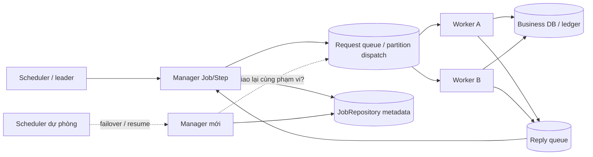
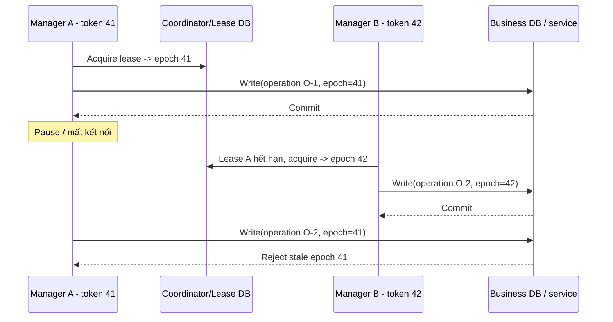
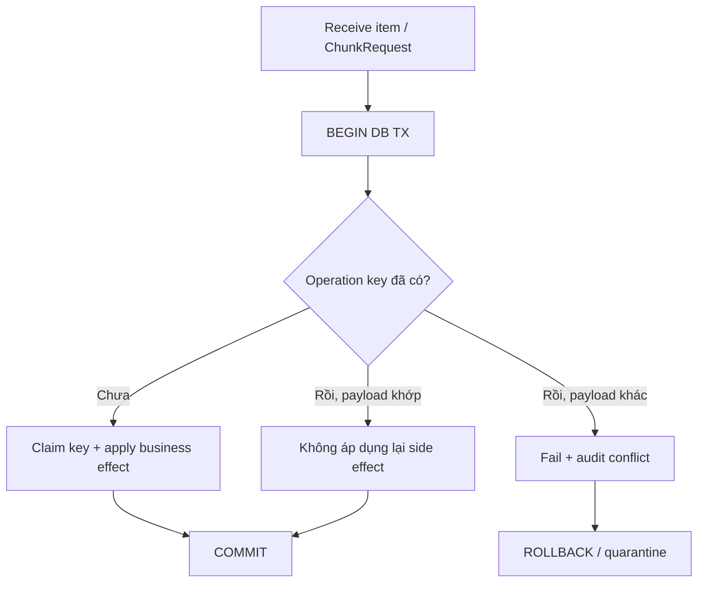
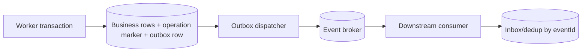

# Duplicate execution sau failover trong Spring Batch

## 1. Vấn đề: hệ thống hoạt động lại nhưng một công việc có thể chạy hai lần

Một job `settlePayments` đang xử lý 500.000 giao dịch trên nhiều worker. Khi manager mất kết nối, scheduler B cho rằng manager A đã chết và khởi chạy job mới. Trong lúc đó, A chỉ bị ngắt mạng tạm thời, tiếp tục ghi trên database cũ hoặc đang giữ một chunk đã đọc. Khi kết nối trở lại, **hai bên có thể cùng xử lý một phần công việc**.

Kịch bản khác không cần hai manager: một worker đã **commit** thay đổi dữ liệu nhưng crash trước khi gửi `ChunkResponse` hoặc xác nhận delivery với broker. Broker giao lại `ChunkRequest` cho worker khác; chunk được thực hiện lần hai. Ngay cả khi `JobRepository` không có hai job cùng chạy, hiệu ứng nghiệp vụ vẫn có thể bị lặp.

Đó là **duplicate execution sau failover**: một logical operation, chunk, partition hoặc job được **thử thực hiện nhiều lần** vì chuyển giao vai trò, timeout, mất ACK, checkpoint bị lùi hoặc restart không đúng hợp đồng.

Chủ đề thuộc chương **Failover** của module `SPRING_BATCH_SCALING_OPERATIONS`. Module hướng tới mở rộng Spring Batch cho workload dữ liệu lớn bằng multi-threaded step, parallel steps, partitioning và các mô hình xử lý phân tán; đo bottleneck, bảo đảm thread safety, retry/restart, vận hành job và chọn kiến trúc theo tài nguyên thực tế. Với workload scale-out, phải phân biệt **xử lý lặp hợp lệ để phục hồi** và **ghi lặp gây sai nghiệp vụ**.

Sau bài này, bạn có thể:

- Phân biệt duplicate `JobExecution`, `StepExecution`, chunk delivery và business side effect.
- Giải thích cách scheduler failover, worker failover, broker redelivery, DB failover và mất checkpoint gây thực thi lặp.
- Xác định lúc nào Spring Batch `JobRepository` ngăn launch trùng, lúc nào **không đủ** để bảo vệ nghiệp vụ.
- Thiết kế owner/lease/fencing token, input snapshot và operation key ổn định cho restart.
- Viết idempotent writer dùng PostgreSQL unique constraint và Spring transaction.
- Kiểm thử crash trước/sau commit, split-brain, concurrent managers và RPO mismatch; xây runbook đối soát an toàn.

> **Phạm vi ví dụ:** Spring Batch **5.2.x**, Spring Boot 3.x, Java 17+, PostgreSQL và Spring Integration/JMS khi có worker từ xa. Tên API, SQL và cơ chế ACK có thể thay đổi theo version/transport.

## 2. Phân loại duplicate trước khi tìm cách xử lý

Không phải hai lần gọi cùng một hàm đều là bug. Retry và restart là cơ chế cần thiết để batch có thể tiến triển khi lỗi. Điều quan trọng là **đơn vị nào được lặp và hiệu ứng nào phải duy nhất**.

| Cấp độ | Ví dụ lặp | Có thể chấp nhận? | Cơ chế bảo vệ |
| --- | --- | --- | --- |
| **Job launch** | Hai scheduler cùng launch `settlePayments` | Không nên có hai owner chạy đồng thời cùng phạm vi | `JobRepository` chung, identifying `JobParameters`, leader gate/fencing |
| **JobExecution** | Một `JobInstance` có execution `FAILED` rồi execution mới `COMPLETED` | **Bình thường** khi restart hợp lệ | Restart metadata, cùng identity và snapshot |
| **Step/partition** | Partition cũ còn chạy, manager mới giao lại cùng range | Nguy hiểm nếu hai worker ghi đồng thời | Ownership, step metadata, lease/fencing và writer idempotent |
| **Chunk attempt** | Chunk bị rollback và đọc lại | **Bình thường** nếu side effect chưa commit hoặc có idempotency | Transaction, checkpoint, retry policy |
| **Message delivery** | JMS redeliver cùng `ChunkRequest` | Là tính chất có thể xảy ra của at-least-once | ACK/transaction và dedup bền vững |
| **Business operation** | Trừ một tài khoản hai lần cho cùng thanh toán | Thường **không chấp nhận** | Stable operation ID, unique constraint/ledger, downstream idempotency |
| **Reply/contribution** | Một `ChunkResponse` bị giao lại | Cần kiểm soát tránh cộng thống kê hai lần | Correlation, response handling/reconciliation |

Ba mục tiêu thường bị nhầm:

1. **At-most-one active owner:** không có hai tiến trình cùng có quyền tạo/giao công việc mới cho một logical run.
2. **At-least-once processing attempt:** khi crash, một đơn vị công việc có thể được thử lại để không bị mất.
3. **Exactly-once business effect:** mỗi logical operation tạo **tối đa một hiệu ứng nghiệp vụ đã commit**, đồng thời mọi operation phải làm đều được hoàn tất hoặc báo rõ là thiếu.

Ngay cả khi đảm bảo mục tiêu 1, vẫn có duplicate chunk delivery do worker crash. Ngay cả khi business effect idempotent, job có thể mất việc nếu checkpoint đi trước dữ liệu. Vì vậy cần **ngăn overlap, chống lặp hiệu ứng và đối soát coverage** như ba lớp độc lập.

## 3. Bốn thời điểm dễ xuất hiện thực thi lặp



### 3.1. Scheduler/manager overlap

```text
T0  Scheduler A được bầu leader; Manager A bắt đầu JobInstance 501.
T1  Mạng A ↔ control plane bị ngắt, nhưng A vẫn ghi được vào DB.
T2  Scheduler B cho rằng A mất và được bầu leader mới.
T3  Nếu không có fencing, B có thể giao lại cùng partition.
T4  A và B cùng xử lý operation O-71.
```

**Hết heartbeat không chứng minh tiến trình cũ đã dừng.** Một lease hết hạn cho phép owner mới tiến lên chỉ khi hệ thống có cách **vô hiệu hóa quyền ghi của owner cũ**. Trên nền tảng phân tán, điều này thường được thực hiện bằng **fencing token tăng đơn điệu** và xác thực token ở tài nguyên được bảo vệ.

Với một **JDBC JobRepository chung, nguyên vẹn**, Spring Batch thường ngăn tạo hai execution đồng thời cho cùng `JobInstance` thông qua trạng thái, transaction và các ràng buộc trong repository. Tuy nhiên, điều này không biến Spring Batch thành một bộ fencing mọi **external side effect**, và không bảo vệ tình huống hai node đang nhìn hai repository phân kỳ hoặc hệ thống tự giao việc ngoài framework.

### 3.2. Worker commit rồi mất ACK/reply

```text
T0  Manager gửi ChunkRequest(sequence=12, items=[A,B]).
T1  Broker giao request cho Worker 1.
T2  Worker 1 COMMIT dữ liệu cho A và B.
T3  Worker 1 crash trước khi ACK request hoặc publish ChunkResponse.
T4  Broker redeliver cùng request cho Worker 2.
T5  Worker 2 thực thi A và B lần nữa nếu writer không idempotent.
```

JMS `JMSRedelivered` là một tín hiệu về delivery, **không phải bằng chứng commit business DB**. `JMSMessageID` cũng không phải định danh nghiệp vụ ổn định khi manager tạo lại request sau restart.

### 3.3. Checkpoint metadata bị lùi

```text
T0  Worker COMMIT 100 business operations.
T1  Manager/worker cập nhật StepExecution + ExecutionContext.
T2  Metadata DB failover sang standby async thiếu checkpoint T1.
T3  Restart từ checkpoint cũ, đọc lại 100 operations đã commit.
```

Nếu job input ổn định và writer idempotent, replay này có thể an toàn. Nếu writer là `UPDATE balance=balance+amount` không có khóa dedup, dữ liệu bị cộng hai lần.

### 3.4. Checkpoint đi trước dữ liệu sau DB failover

```text
T0  Business DB primary xác nhận commit 100 operations.
T1  Metadata DB khác ghi checkpoint = 100.
T2  Business DB failover async, standby thiếu 20 commits cuối.
T3  Restart thấy checkpoint = 100 và không đọc lại 20 operations bị mất.
```

Đây là **gap**, không phải duplicate, nhưng một giải pháp chống duplicate **không tự phát hiện hay sửa được gap**. Phải đối chiếu source manifest với ledger của primary mới và sửa những công việc thiếu.

## 4. `JobInstance` và `JobExecution`: duplicate hay restart hợp lệ?

Trong Spring Batch:

- `Job` là định nghĩa công việc.
- `JobInstance` được xác định bởi **job name + identifying `JobParameters`**.
- `JobExecution` là một lần thực thi (attempt) của `JobInstance`.
- `StepExecution` là lần thực thi một step/partition trong một `JobExecution`.

Ví dụ một ngày nghiệp vụ:

```text
Job: settlePayments
  identifying parameters:
    businessDate=2026-11-26
    tenantId=7
    manifestId=payments-v5

  JobInstance 501
    JobExecution 901  -> FAILED
    JobExecution 902  -> COMPLETED  (restart sau khôi phục)
```

**Hai `JobExecution` thuộc cùng `JobInstance` không tự là duplicate.** Đây là lịch sử restart bình thường nếu execution cũ đã kết thúc và execution mới chạy theo state hợp lệ.

Sai lầm thường gặp là scheduler thêm `runTimestamp=now()` hoặc random UUID vào **identifying parameters** mỗi khi failover. Lúc đó launcher tạo **JobInstance mới**, không dùng checkpoint của instance cũ; những bản ghi đã xử lý có thể bị xử lý lại từ đầu.

### 4.1. Gợi ý hợp đồng identifying parameters

| Parameter | Identifying? | Lý do |
| --- | --- | --- |
| `businessDate` | Có | Phân biệt ngày cần xử lý |
| `tenantId` | Có | Không xử lý lẫn các tenant |
| `manifestId`/`snapshotVersion` | Có khi quyết định tập input logic | Giữ nguồn dữ liệu ổn định cho restart |
| `traceId` | Không | Chỉ phục vụ quan sát |
| `requestedBy` | Thường không | Thay đổi người/scheduler không đổi logical job |
| `failoverAttempt` | Thường không | Attempt không nên đổi identity của JobInstance |

Không có quy tắc identifying tuyệt đối cho mọi nghiệp vụ, nhưng phải **định nghĩa và giữ ổn định** theo ý nghĩa công việc. Một business rerun sau khi đã `COMPLETED` là quyết định mới cần version/operation policy, **không phải cách né kiểm tra duplicate** bằng cách đổi tên parameter ngẫu nhiên.

### 4.2. Repository có thể chặn được gì?

Với nhiều scheduler cùng truy cập **cùng một JDBC JobRepository** và cùng identifying parameters, Spring Batch áp dụng các quy tắc khi launch:

- `JobExecutionAlreadyRunningException` khi có execution còn chạy theo metadata.
- `JobInstanceAlreadyCompleteException` khi instance đã hoàn tất và không được chạy lại.
- Kiểm tra restartability và trạng thái execution trước khi tạo attempt mới.
- Transaction/isolation ở thao tác `create*` và database constraints giúp hạn chế race của nhiều launcher.

Đừng xóa `BATCH_JOB_EXECUTION`, sửa `JOB_KEY` hay đánh dấu `STARTED → FAILED` một cách tùy tiện để “bỏ khóa”. Nếu process cũ vẫn ghi, thao tác đó có thể biến một sự cố failover thành hai owner hợp lệ giả.

### 4.3. Repository không đủ bảo vệ phần nào?

`JobRepository` **không tự** xác nhận một request JMS đã được commit ở worker DB, không ép hai process dùng chung một session JDBC và không biết toàn bộ side effect của REST/payment/email. Do đó, cần **idempotency theo logical operation** ngay cả khi launcher chỉ chạy một JobInstance tại mỗi thời điểm.

## 5. Một owner hoạt động: leader election, lease và fencing

Mục tiêu ở tầng điều phối là tránh **hai manager cùng phân phối** cùng logical run khi failover. Các cơ chế có mức độ bảo vệ khác nhau:

| Cơ chế | Giúp được gì? | Chưa đủ khi nào? |
| --- | --- | --- |
| Chỉ chạy một replica scheduler | Đơn giản hóa launch | Replica còn sống nhưng mất kết nối control plane; không HA |
| Kubernetes leader election/lease hoặc coordinator tương đương | Chọn leader theo heartbeat/lease | Leader cũ chưa chắc dừng business write khi lease hết hạn |
| Distributed lock có TTL | Giảm khả năng hai launcher cùng claim run | Old owner tiếp tục thực thi sau khi lock hết hạn |
| `JobRepository` chung và create isolation | Ngăn nhiều execution đồng thời của cùng JobInstance theo metadata | Không fence trực tiếp các side effect bên ngoài repository |
| **Monotonic fencing token** được resource kiểm tra | Từ chối writes của owner đã cũ | Phải có authority nhất quán và enforcement ở điểm ghi |
| **Unique operation ledger** | Chặn lặp side effect cho cùng logical operation | Không ngăn tất cả việc đọc/tính toán trùng; không tự phát hiện missing operations |

### 5.1. Vì sao TTL lock vẫn chưa đủ?

```text
T0  Owner A lấy lease, token=41, hết hạn tại 10:00:30.
T1  A bị pause GC hoặc network partition, không renew được lease.
T2  Đến 10:00:31, owner B nhận lease mới, token=42.
T3  A chạy trở lại; trong heap vẫn giữ dữ liệu đã đọc và credentials DB.
T4  Nếu DB không kiểm tra token, A vẫn có thể ghi như leader.
T5  B đồng thời ghi cùng logical operations.
```

**Lease expiry chỉ cho phép bầu owner mới; nó không tự thu hồi khả năng ghi của owner cũ.** Vì vậy cần fencing: mỗi lần chuyển owner thành công cấp một **epoch/token tăng đơn điệu**, và tài nguyên nhận ghi chỉ chấp nhận epoch còn hiệu lực.

### 5.2. Fencing token dùng thế nào?



Ở đây manager A/B chỉ là ví dụ owner điều phối. Với remote workers, có thể cần truyền **run epoch** vào request/partition context và kiểm tra epoch tại **mỗi transaction ghi**. Nếu một worker chỉ có token trên log mà DB không kiểm tra, đó **không phải fencing**.

Một thiết kế fencing đủ mạnh cần:

1. **Nguồn cấp epoch nhất quán**: tăng đơn điệu, không quay về giá trị cũ qua restart/restore/failover của authority.
2. **Cùng run key**: epoch được kiểm tra theo logical run/scope rõ ràng (ví dụ `tenantId + businessDate + manifestId`).
3. **Resource enforcement**: business DB/API từ chối stale epoch **trong cùng transaction/critical section** chứa side effect.
4. **Không thể replay token cũ để được chấp nhận** chỉ vì owner cũ reconnect.
5. **Owner cũ phải ngừng phát việc** khi không renew lease; chỉ tự kiểm tra lease ở manager chưa đủ, nhưng giúp giảm tải.

### 5.3. Một mẫu SQL claim ownership (PostgreSQL)

Ví dụ dùng **cùng một PostgreSQL database có transaction mạnh** làm authority. Bảng:

```sql
CREATE TABLE batch_run_owner (
    run_key VARCHAR(180) PRIMARY KEY,
    owner_id VARCHAR(100) NOT NULL,
    epoch BIGINT NOT NULL CHECK (epoch > 0),
    lease_expires_at TIMESTAMPTZ NOT NULL
);
```

Khi claim một run chưa có owner hoặc owner cũ thực sự hết hạn:

```sql
-- Minh họa atomic claim. Nếu run vẫn có lease hợp lệ
-- từ owner khác, RETURNING không trả hàng.
INSERT INTO batch_run_owner
       (run_key, owner_id, epoch, lease_expires_at)
VALUES (:runKey, :ownerId, 1,
        clock_timestamp() + INTERVAL '30 seconds')
ON CONFLICT (run_key) DO UPDATE
SET owner_id = EXCLUDED.owner_id,
    epoch = batch_run_owner.epoch + 1,
    lease_expires_at = clock_timestamp() + INTERVAL '30 seconds'
WHERE batch_run_owner.lease_expires_at < clock_timestamp()
RETURNING epoch;
```

Owner đang hợp lệ có thể **renew** bằng câu update có điều kiện:

```sql
UPDATE batch_run_owner
SET lease_expires_at = clock_timestamp() + INTERVAL '30 seconds'
WHERE run_key = :runKey
  AND owner_id = :ownerId
  AND epoch = :epoch
  AND lease_expires_at > clock_timestamp()
RETURNING epoch;
```

Nếu không có row trả về, tiến trình phải coi mình **không còn quyền owner** và ngừng nhận/giao công việc mới. Tránh reuse một `ownerId` duy nhất qua nhiều tiến trình: kết hợp instance UUID/container identity và epoch.

**Cảnh báo quan trọng:** hai câu SQL này mới quản lý *lease*, **chưa tự ngăn worker cũ ghi DB**. Bên ghi còn phải kiểm tra token và khóa/cách ly phù hợp trong transaction. Nếu business DB và lease DB là **hai cluster riêng**, một transaction cục bộ của business DB không thể khóa hàng lease ở coordinator một cách nguyên tử; cần cơ chế fencing được chính business resource/downstream áp dụng hoặc một thiết kế khác. Đồng thời, nếu database cấp epoch bị **asynchronous failover và mất row cập nhật epoch=42**, primary mới có thể thấy epoch=41 — phá tính đơn điệu. Khi đó phải chọn authority có độ bền/failover bảo đảm theo yêu cầu hoặc cách cấp epoch không thể quay lùi.

### 5.4. Mẫu kiểm tra epoch trong business transaction

Nếu bảng `batch_run_owner` và các bảng nghiệp vụ nằm **trên cùng PostgreSQL database và DataSource**, có thể kiểm tra epoch khi giữ row lock tới lúc commit:

```sql
BEGIN;

SELECT epoch
FROM batch_run_owner
WHERE run_key = :runKey
  AND owner_id = :ownerId
  AND epoch = :epoch
  AND lease_expires_at > clock_timestamp()
FOR UPDATE;

-- Nếu không có hàng: ROLLBACK, reject stale owner.
-- Nếu có: thực hiện writer idempotent (mục 7), kiểm tra
-- operation key rồi ghi nghiệp vụ trong CÙNG transaction.
-- Giữ row lock đến COMMIT; không chạy UPDATE vô điều kiện
-- khi operation marker đã tồn tại.

COMMIT;
```

Lý do cần row lock: nếu chỉ `SELECT epoch` rồi nhả transaction, owner mới có thể acquire ngay trước khi owner cũ ghi. `FOR UPDATE` (hoặc cơ chế khóa/constraint tương đương) giữ thứ tự giữa **commit của writer cũ** và **acquire epoch mới** trên cùng hàng. Đổi lại, transaction dài sẽ trì hoãn failover owner; cần giới hạn thời gian và kích thước chunk.

Mẫu này không bảo vệ email/HTTP ngoài DB transaction. Nếu side effect đi tới service riêng, **service đích** phải kiểm tra token và idempotency key ở điểm commit của nó. Việc truyền `epoch` qua HTTP header mà service không kiểm tra gì chỉ tạo thông tin quan sát, không tạo fencing.

### 5.5. Khi nào không cần tự viết lease table?

Không phải mọi batch phải xây một distributed coordinator tự chế. Nếu toàn bộ job chạy qua một scheduler có leader fencing, cùng một `JobRepository` bền vững và mọi worker idempotent, có thể đã đủ cho SLA. Dùng giải pháp orchestration/lease đã có và kiểm thử theo runbook, thay vì mở thêm một nguồn trạng thái dễ sai. **Fencing riêng** đặc biệt quan trọng khi owner cũ có thể tiếp tục gây side effect sau khi ownership đã chuyển.

## 6. Định danh business operation: khóa chống duplicate phải bền

Một lỗi phổ biến là gắn dedup vào **transport ID** hoặc **execution attempt ID**:

```text
JobInstance ID       : 501 (cùng instance qua restart)
JobExecution ID      : 901 -> 902 (thay đổi khi restart)
StepExecution ID     : 2001 -> 2048 (có thể thay đổi)
Chunk sequence       : 12 (phụ thuộc yêu cầu/bộ đếm)
JMSMessageID         : ID:A -> ID:B (có thể đổi khi gửi lại)
Business operation ID: payment:tenant-7:invoice-9001:charge-v1
```

Nếu writer dùng `JMSMessageID` làm idempotency key, request được tạo lại với message ID mới sẽ vượt qua dedup. Nếu dùng `JobExecution ID`, mỗi restart được coi như công việc hoàn toàn mới. **Khóa phải mô tả ý nghĩa nghiệp vụ bất biến**, ví dụ `(tenantId, invoiceId, operationType, businessVersion)` hoặc ID event nguồn.

### 6.1. Ba câu hỏi trước khi chọn operation key

1. **Lặp khi nào phải được bỏ qua?** Cùng request delivery, cùng JobInstance, hay cả khi chạy lại job vào ngày khác?
2. **Cùng key nhưng payload khác thì sao?** Coi là lỗi dữ liệu và quarantine, không âm thầm bỏ qua sai khác.
3. **Key tồn tại bao lâu?** TTL/retention của ledger phải dài hơn cửa sổ request stale, retry, rerun và yêu cầu audit. Xóa marker quá sớm có thể tái kích hoạt side effect.

Ví dụ: job thu phí hóa đơn có thể chạy lại để sửa reporting nhưng **không được thu tiền lần hai**. Khi đó khóa `(invoiceId, CHARGE)` có thể cần độc lập với `businessDate` hay `batchRunId`. Với tác vụ xây dựng báo cáo phiên bản hóa, operation key có thể được gắn `snapshotVersion` để cho phép ghi phiên bản mới hợp lệ.

### 6.2. Không nhầm logical exactly-once với physical exactly-once

Ở mô hình at-least-once, worker có thể nhận và kiểm tra cùng item nhiều lần. Mục tiêu thực tế là **một logical operation chỉ có tối đa một hiệu ứng được commit**, không phải bảo đảm JVM chỉ gọi `ItemWriter.write(...)` đúng một lần trong mọi sự cố.



**Unique constraint + một DB transaction** là lớp bảo vệ mạnh cho side effect nằm trong cùng database. Nhưng nếu operation còn gửi email/gọi API ngoài DB, phải có downstream idempotency hoặc outbox/inbox; local transaction không tự rollback thế giới bên ngoài.

## 7. Thực hành: writer idempotent khi job/worker được thực thi lại

Giả sử một batch áp dụng các khoản điều chỉnh `delta` vào số dư trong **PostgreSQL**. Tập input chứa operation ID ổn định theo một manifest đã chốt. Worker có thể nhận lại cùng item sau manager failover hoặc JMS redelivery, nhưng **số dư chỉ thay đổi một lần** cho mỗi operation.

### 7.1. Thiết kế schema nghiệp vụ

```sql
CREATE TABLE account_balance (
    tenant_id BIGINT NOT NULL,
    account_id BIGINT NOT NULL,
    balance NUMERIC(20, 2) NOT NULL,
    PRIMARY KEY (tenant_id, account_id)
);

CREATE TABLE processed_operation (
    operation_id VARCHAR(160) PRIMARY KEY,
    tenant_id BIGINT NOT NULL,
    account_id BIGINT NOT NULL,
    delta NUMERIC(20, 2) NOT NULL,
    completed_at TIMESTAMPTZ NOT NULL DEFAULT CURRENT_TIMESTAMP
);
```

Trong ví dụ, cả hai bảng nằm trên **cùng DataSource PostgreSQL**, được thao tác qua **cùng local DB transaction** của worker.

`operation_id` phải được tạo **từ nghiệp vụ** (ví dụ `invoice:9001:adjustment:rev-1`) và giữ nguyên qua mọi `JobExecution`, lần retry hoặc message redelivery liên quan đến cùng thao tác. Dù `processed_operation` không dùng từ “batch”, nó không phải một bảng mặc định của Spring Batch: đây là **application ledger** do chúng ta thiết kế.

### 7.2. DTO của logical operation

```java
// BusinessOperation.java (nằm trong module DTO dùng chung
// hoặc contract có version giữa manager và worker).
package example.batch;

import java.io.Serializable;
import java.math.BigDecimal;

public record BusinessOperation(
        String operationId,
        long tenantId,
        long accountId,
        BigDecimal delta
) implements Serializable {}
```

Không gửi entity JPA có lazy proxy, connection, object graph rất lớn hoặc secret trong chunk. Với remote chunking, cần serializer/codec và version hợp đồng thống nhất giữa manager/worker.

### 7.3. Writer: marker và business write cùng commit

```java
// IdempotentWorkerWriterConfig.java
package example.batch;

import java.math.BigDecimal;
import org.springframework.batch.item.ItemWriter;
import org.springframework.beans.factory.annotation.Qualifier;
import org.springframework.context.annotation.Bean;
import org.springframework.context.annotation.Configuration;
import org.springframework.jdbc.core.JdbcTemplate;
import org.springframework.transaction.PlatformTransactionManager;
import org.springframework.transaction.support.TransactionTemplate;

@Configuration
public class IdempotentWorkerWriterConfig {

    private record StoredOperation(
            long tenantId, long accountId, BigDecimal delta) {}

    @Bean
    public ItemWriter<BusinessOperation> idempotentWorkerWriter(
            @Qualifier("businessJdbcTemplate") JdbcTemplate jdbc,
            @Qualifier("businessTransactionManager")
                    PlatformTransactionManager businessTx) {

        TransactionTemplate transaction = new TransactionTemplate(businessTx);

        return chunk -> transaction.executeWithoutResult(txStatus -> {
            for (BusinessOperation operation : chunk.getItems()) {
                if (operation.operationId() == null
                        || operation.operationId().isBlank()
                        || operation.tenantId() <= 0
                        || operation.accountId() <= 0
                        || operation.delta() == null) {
                    throw new IllegalArgumentException(
                            "Invalid logical operation");
                }

                int inserted = jdbc.update("""
                        INSERT INTO processed_operation
                            (operation_id, tenant_id, account_id, delta)
                        VALUES (?, ?, ?, ?)
                        ON CONFLICT (operation_id) DO NOTHING
                        """,
                        operation.operationId(),
                        operation.tenantId(),
                        operation.accountId(),
                        operation.delta());

                if (inserted == 1) {
                    int updated = jdbc.update("""
                            UPDATE account_balance
                               SET balance = balance + ?
                             WHERE tenant_id = ? AND account_id = ?
                            """,
                            operation.delta(),
                            operation.tenantId(),
                            operation.accountId());
                    if (updated != 1) {
                        throw new IllegalStateException(
                                "Account missing or outside allowed scope");
                    }
                } else {
                    StoredOperation previous = jdbc.queryForObject("""
                            SELECT tenant_id, account_id, delta
                              FROM processed_operation
                             WHERE operation_id = ?
                            """,
                            (rs, rowNum) -> new StoredOperation(
                                    rs.getLong("tenant_id"),
                                    rs.getLong("account_id"),
                                    rs.getBigDecimal("delta")),
                            operation.operationId());

                    if (previous == null
                            || previous.tenantId() != operation.tenantId()
                            || previous.accountId() != operation.accountId()
                            || previous.delta().compareTo(operation.delta()) != 0) {
                        throw new IllegalStateException(
                                "Same operation ID with different payload");
                    }
                    // Bản sao hợp lệ: không cộng/trừ số dư lần nữa.
                }
            }
        });
    }
}
```

**Điểm quan trọng của thiết kế:**

- `INSERT ... ON CONFLICT DO NOTHING` và unique key ở `operation_id` cho phép nhiều worker cạnh tranh; tối đa một transaction commit được marker cho logical operation.
- Marker và lệnh `UPDATE account_balance` ở **cùng DB transaction**, nên nếu một item bất kỳ lỗi trước commit, **mọi thay đổi của chunk trong lần thử đó rollback**.
- Khi marker tồn tại, writer **đối chiếu payload** thay vì bỏ qua vô điều kiện. Cùng ID nhưng khác tài khoản hoặc amount là lỗi contract, phải fail/audit.
- Sau database failover, kết nối mới vào primary hợp lệ sẽ nhìn thấy marker nào **còn tồn tại ở primary mới**. Replay cùng operation ID không cộng lần hai nếu marker/side effect đã commit và còn nguyên.
- Với **asynchronous replication loss** và side effect ở **dịch vụ ngoài DB**, marker có thể mất trong khi side effect ngoài vẫn tồn tại: không thể giải quyết bằng local ledger này; cần downstream idempotency và reconciliation.

Nếu chunk chứa nhiều operation cùng tài khoản, mỗi operation ID có ý nghĩa độc lập. Một request có thể được gửi lại sau manager restart; **không được tạo operation ID ngẫu nhiên ở worker mỗi lần nhận request**.

**Giới hạn scope:** ví dụ tập trung dedup transaction. Trong hệ multi-tenant, cần xác thực `tenantId` thuộc phạm vi/manifest được giao, không chỉ kiểm tra giá trị dương. Không để worker tự query thêm operation ngoài chunk nhằm “bù” phần việc lúc failover.

### 7.4. Transaction đặt ở đâu trong Spring Batch?

Với **remote partitioning**, worker chạy một `Step` hoàn chỉnh. Spring Batch 5.2 khai báo transaction manager trong builder:

```java
// Ví dụ cấu hình worker step, các bean có @StepScope/
// reader lọc theo ExecutionContext được định nghĩa riêng.
@Bean
public Step partitionWorkerStep(
        JobRepository jobRepository,
        @Qualifier("businessTransactionManager")
        PlatformTransactionManager businessTx,
        @Qualifier("partitionReader") ItemReader<BusinessOperation> reader,
        @Qualifier("idempotentWorkerWriter")
        ItemWriter<BusinessOperation> writer) {

    return new StepBuilder("partitionWorkerStep", jobRepository)
            .<BusinessOperation, BusinessOperation>chunk(100, businessTx)
            .reader(reader)
            .writer(writer)
            .build();
}
```

Lúc này `StepBuilder.chunk(100, businessTx)` tạo transaction quanh chunk. `TransactionTemplate` trong writer mặc định `PROPAGATION_REQUIRED` sẽ **tham gia transaction hiện có** nếu dùng cùng transaction manager/resource; không đặt `REQUIRES_NEW` vô ý khi muốn all-or-nothing.

Với **remote chunking**, Spring Batch 5.2 `RemoteChunkingWorkerBuilder` dựng `IntegrationFlow`/handler nhưng **không tự cung cấp business transaction manager** cho writer. Mẫu writer ở mục 7.3 tạo một transaction cục bộ cho SQL của chunk; nếu processor có side effect trước writer thì phải thay đổi ranh giới để bao cả process/write hoặc chuyển side effect vào phần transactional service.

### 7.5. Tại sao không dùng mỗi `WRITE_COUNT` để chống duplicate?

Một request gồm 100 item, trong đó 60 operation đã commit trong attempt trước. Worker nhận lại 100 item và dedup 60 marker; `StepContribution`/`WRITE_COUNT` của Spring Batch không tự tương ứng với **số business operation mới được commit**.

Để quan sát phải phân biệt:

```text
Items received by worker  : 100
Unique business operations: 40 newly committed
Duplicates suppressed    : 60
Logical processing result : 100 items accounted for
```

Các số này là ví dụ. Đo **unique ledger entries**, số lần dedup, transaction commit/rollback và dữ liệu đích thực tế, không chỉ số lần gọi `ItemWriter` hoặc `WRITE_COUNT` của metadata.

## 8. Side effect ngoài database: outbox, inbox và idempotency downstream

Nếu worker phát email, gọi payment API hoặc publish message sau khi cập nhật DB, transaction cục bộ không thể rollback các hệ thống bên ngoài. Duplicate execution sau failover có thể diễn ra theo chuỗi:

```text
Worker A:
  DB COMMIT operation O-100.
  HTTP charge(O-100) -> provider đã xử lý.
  Worker crash trước khi nhận HTTP response.

Worker B (replay):
  Thấy trạng thái HTTP outcome UNKNOWN.
  Gọi charge(O-100) lần nữa nếu không có idempotency key.
  -> Có nguy cơ thu tiền hai lần.
```

Một số chiến lược:

| Trường hợp | Phương án bảo vệ |
| --- | --- |
| Side effect cùng một database | Marker + business write trong cùng transaction |
| DB + phát event | **Transactional outbox** ghi ý định gửi trong cùng DB transaction; publisher có thể phát lại |
| Broker → consumer → DB | **Transactional inbox/dedup** theo stable message/business operation ID |
| HTTP/payment API | Dùng **idempotency key do provider hỗ trợ**, kiểm tra transaction status khi timeout |
| Đích không hỗ trợ idempotency | Reconciliation, quarantine/điều tra và compensation; không tự retry không giới hạn |
| Toàn bộ kết quả job chỉ được công bố khi đầy đủ | Staging + validate + atomic/versioned publish phù hợp |

Ví dụ sơ đồ outbox:



Outbox **không hứa publish exactly-once**. Dispatcher có thể gửi event thành công rồi crash trước khi đánh dấu sent, nên consumer downstream cần dedup theo `eventId`. Khi external API báo timeout, **đừng tạo idempotency key mới khi retry**.

## 9. Restart an toàn sau failover: không “đổi runId cho dễ chạy”

Khi manager chết bất thường, repository có thể giữ `JobExecution.STATUS=STARTED` và `END_TIME=NULL`. Nếu một automation nhìn thấy timeout rồi gọi launch lại:

1. **Nếu dùng cùng identifying parameters:** `JobRepository` có thể từ chối vì execution cũ còn `STARTED`, và đó là phản ứng cần được điều tra.
2. **Nếu tự đổi identifying `runId`:** hệ thống có thể tạo **JobInstance mới**, bỏ qua checkpoint đã lưu và đọc lại nguồn từ đầu.
3. **Nếu sửa metadata cũ bằng SQL không kiểm soát:** execution cũ hoặc worker cũ có thể chưa chết; hai bên có thể tiếp tục ghi cùng data.

**Không có một lệnh “force restart” an toàn cho mọi trạng thái UNKNOWN/STARTED.** Cần một quy trình xác minh owner, business effects, metadata và message trước khi cho công việc chạy lại.

### 9.1. Điều kiện trước khi khởi động attempt mới

| Điều kiện | Bằng chứng cần thu thập |
| --- | --- |
| Owner cũ đã dừng hoặc bị fence | Orchestrator/scheduler/DB fencing; không chỉ heartbeat timeout |
| Một JobRepository hợp lệ đã sẵn sàng | DB write primary thống nhất, schema/sequence/repository role phù hợp |
| Biết `JobInstance` đúng | Job name + identifying parameters đã chốt |
| Execution cũ đủ điều kiện recovery | Trạng thái `FAILED`/`STOPPED` hoặc runbook xử lý `STARTED` stale |
| Input tương thích với checkpoint | Manifest/snapshot/ordering bất biến, step context còn đọc được |
| Writer chịu được replay | Operation ledger, transaction và downstream idempotency |
| Các message in-flight đã được đánh giá | Request, reply, DLQ, redelivery và stale run correlation |
| RPO không tạo missing operation không phát hiện | So sánh source manifest với business ledger trên primary mới |

Nếu một điều kiện chưa đạt, **không tự đặt một tham số mới và chạy lại toàn bộ job** chỉ để tránh exception.

### 9.2. `JobOperator.restart(...)` làm được gì?

Với Spring Batch 5.x, `JobOperator.restart(jobExecutionId)` có thể bắt đầu một **JobExecution mới cho JobInstance có thể restart** theo metadata. Đây là một operation ở **cấp Spring Batch job**, không phải retry lại một transaction JDBC cũ.

- Không có khả năng bắt đầu đúng một JDBC transaction đã bị ngắt sau failover.
- Không bảo đảm external side effects chưa xảy ra trong attempt trước.
- Không tự giải quyết reply message từ worker cũ đến muộn.
- Không thay thế kiểm tra trạng thái stale `STARTED` và điều kiện restartability.

Với một step đọc 1000 item, checkpoint phản ánh “đã đọc 900” nhưng business DB thực tế đã commit 1000, restart có thể đưa 100 item qua writer lần nữa. **Idempotency** biến việc replay thành một bước an toàn thay vì duplicate business effect.

### 9.3. Khi nào phải tạo một JobInstance mới?

Một **rerun nghiệp vụ có chủ đích** có thể cần JobInstance mới, ví dụ `manifestVersion=v2` chứa dữ liệu đã sửa và cần phát hành kết quả phiên bản khác. Khi đó:

- Phân biệt logical operation nào **được phép làm lại** và operation nào không.
- Không copy `StepExecutionContext` cũ sang instance mới bằng tay.
- Dùng business version/corrected operation ID nếu thực sự có thao tác nghiệp vụ mới.
- Có phép reconciliation giữa phiên bản cũ/mới, đặc biệt với thanh toán hay event đã publish.

Thay vì chọn “restart hay rerun” theo việc lệnh nào ít lỗi hơn, hãy chọn theo **semantics của nguồn dữ liệu và side effect**.

## 10. Remote partitioning: duplicate owner của cùng một phạm vi

Trong remote partitioning, manager tạo `StepExecution` và `ExecutionContext` cho các partition; worker đọc dữ liệu trong phạm vi như `[startInclusive,endExclusive)`.

Ví dụ:

```text
partition0001 -> tenant=7, ID [1,2501)
partition0002 -> tenant=7, ID [2501,5001)
partition0003 -> tenant=7, ID [5001,7501)
partition0004 -> tenant=7, ID [7501,10001)
```

Tình huống duplicate sau failover:

```text
T0  Worker A đang xử lý partition0002.
T1  Manager timeout, cho rằng A đã chết.
T2  Manager mới giao lại partition0002 cho Worker B.
T3  A vẫn chạy và commit bản ghi ID=3000.
T4  B cũng commit ID=3000 nếu không có fencing/dedup.
```

Một `StepExecution` có thể đại diện phạm vi được giao; **hai tiến trình cùng nhận công việc không biến `ExecutionContext` thành cơ chế khóa DB**. Tên `partition0002` trên log của cả hai chỉ nói chúng tin mình đang xử lý cùng partition.

### 10.1. Hợp đồng worker khi nhận partition

- Đọc `tenantId`, `startInclusive`, `endExclusive` và `snapshotId` từ `StepExecutionContext`; **fail-fast** khi thiếu hoặc sai.
- Reader và writer dùng **cùng predicate scope**. Đừng xử lý item ngoài partition để “bù việc” vì worker khác đã lỗi.
- Nếu có epoch/fencing, worker mang epoch được cấp cho **run/partition owner hiện hành**; backend phải từ chối stale epoch.
- Giữ ID operation ổn định qua retry/restart; bản ghi đã commit từ worker A không tạo side effect lần nữa khi worker B nhận lại.
- Không đổi mapping `partitionName → assigned scope` tùy ý khi grid size/worker count thay đổi trong một JobInstance.

### 10.2. Chia range không chồng lấn vẫn có thể có duplicate execution

Hai partition khác nhau có thể hoàn toàn disjoint, nhưng **chính một partition** bị giao cho hai worker sau timeout. Vì vậy:

\[
\forall i \ne j:\ P_i \cap P_j = \varnothing
\]

là điều kiện tốt cho kế hoạch dữ liệu, song **không đủ** bảo đảm chỉ một worker xử lý `P_i` tại cùng thời điểm. Cần quản lý ownership của *execution attempt* và idempotency của *item effect*.

### 10.3. Scale-out không tự tạo quyền “work stealing”

Một worker xử lý nhanh có thể hết partition và rảnh CPU; nó không được `SELECT * FROM orders WHERE processed=FALSE` rồi tự xử lý dữ liệu partition khác nếu không có cơ chế claim công việc **nguyên tử** và hợp đồng metadata mới.

Nếu cần phân phối động, chọn chiến lược được thiết kế riêng (như remote chunking hoặc task queue có claim/lease), không trộn hai nguồn phân công độc lập.

## 11. Remote chunking: duplicate delivery, duplicate reply

Spring Batch Integration dùng `ChunkRequest<T>` và `ChunkResponse`. Trong API **Spring Batch 5.2**, `ChunkRequest` có `sequence`, `items`, `jobId` (JobInstance ID) và `StepContribution`.

```mermaid
sequenceDiagram
    participant M as Manager
    participant Q as Broker request queue
    participant A as Worker A
    participant B as Worker B
    participant DB as Business DB
    participant R as Broker reply queue
    M->>Q: ChunkRequest(seq=17, jobId=501)
    Q->>A: Delivery attempt 1
    A->>DB: COMMIT operation markers + business rows
    Note over A: Crash trước ACK/reply
    Q->>B: Redelivery attempt 2
    B->>DB: Đọc ledger; không apply effect trùng
    B->>R: ChunkResponse(seq=17)
    R->>M: Reply được đối chiếu
```

**JMS request ACK**, **business DB commit**, **publish `ChunkResponse`**, **JMS reply ACK** và **JobRepository checkpoint** là những mốc khác nhau. Không có một transaction cục bộ bao trùm mặc định mọi mốc này.

### 11.1. Request duplicate không đồng nghĩa ChunkResponse duplicate

- Request có thể redeliver do worker crash/rollback; cùng payload `ChunkRequest` đi tới worker khác.
- Manager có thể tạo lại request cho cùng logical work sau restart với **JMSMessageID khác**.
- Worker có thể publish reply nhưng request ACK lỗi; broker tiếp tục redeliver request, dẫn tới **nhiều reply**.
- Reply có thể được broker redeliver đến manager khi inbound reply consumer rollback/không ACK.

Vì vậy cần phân biệt:

| Dấu hiệu | Điều cần điều tra |
| --- | --- |
| `JMSRedelivered=true` trên request | Request đã được giao lại; DB effect đã commit hay chưa vẫn chưa biết |
| `ChunkResponse.isRedelivered()` | Cờ trong payload reply, không mặc nhiên bằng request redelivery |
| Hai `ChunkResponse` cùng `jobId/sequence` | Có thể là duplicate reply; kiểm tra version của manager writer và correlation |
| Reply tới sai JobInstance | Có thể dùng chung reply queue không có routing phù hợp hoặc stale run |
| Manager timeout nhưng request queue rỗng | Message có thể unacked, worker đang ghi, reply sai routing hoặc reply đã ACK vào RAM rồi mất |

Không tự sửa `ChunkResponse.isSuccessful` để “đảm bảo job xong”. Response thành công phải phản ánh kết quả handler; manager phải nhận đúng reply theo hợp đồng. Việc ứng dụng thêm tầng replay/dedup cho reply phải tương thích với Spring Batch Integration của đúng version, **không bỏ qua `StepContribution` tùy tiện**.

### 11.2. Reply queue dùng chung giữa hai manager

Nếu manager A và B cùng subscribe một **JMS reply queue** như competing consumers, broker có thể giao response của job A cho consumer B. Việc payload có `jobId` không tự route đúng ở broker. B có thể ACK mất reply của A và làm A timeout.

Thiết kế cần **reply destination theo manager/run**, message selector hoặc router đủ thông tin và đã thử concurrency; thêm chính sách xử lý stale replies sau failover. Không coi một queue có tên chung `batch.replies` là đúng cho mọi topology.

### 11.3. Durable reply path và manager crash

Một inbound JMS adapter có thể ACK reply rồi đưa vào `QueueChannel` **RAM** của manager; manager crash trước khi poll sẽ mất response đã ACK. Điều này tạo **unknown outcome** ở tầng Batch dù business DB đã commit.

Khi cần phục hồi chắc chắn, đánh giá:

- `PollableChannel` có backing store bền vững hoặc một thiết kế nhận reply trực tiếp từ durable middleware, tương thích API.
- Ranh giới ACK/transaction của inbound reply listener, không ACK quá sớm.
- Correlation và các header cần thiết được giữ qua Spring Integration adapters.
- Reconciliation khi worker đã commit nhưng manager chưa có contribution.

Không chỉ tăng `maxWaitTimeouts` để chữa reply đã bị ACK và mất; timeout dài hơn không làm dữ liệu RAM hồi sinh.

## 12. Database failover làm thay đổi cả ledger và checkpoint

Giả sử metadata và business DB nằm ở **hai cluster độc lập**:

| Sau failover | Business operation ledger | JobRepository | Rủi ro |
| --- | --- | --- | --- |
| Metadata checkpoint **lùi**, business effect còn | Có marker | Context chưa phản ánh chunk mới nhất | Replay; writer idempotent có thể ngăn duplicate |
| Business DB WAL **lùi**, metadata checkpoint còn mới | Marker **mất** | Step được đánh dấu đã qua item | **Gap** không tự replay, cần repair |
| Cả hai còn nhưng JMS reply mất | Có marker | Manager chưa thấy success | Timeout/restart; phải reconcile |
| Primary cũ và mới cùng cho ghi | Ledger/metadata có thể phân kỳ | Hai lịch sử JobInstance/StepExecution | Split-brain, không thể tin một nguồn đơn lẻ |
| Operation ghi external API ngoài DB và ledger mất | External effect có thể đã xảy ra | Batch không biết | **UNKNOWN**; cần query downstream bằng stable key |

Đừng đánh đồng `JobRepository` với “sổ cái nghiệp vụ”. Nó quản lý job/step metadata; không có bảng mặc định ghi *mỗi business operation đã được commit*. Một `StepExecution.STATUS=COMPLETED` không chứng minh tài khoản không bị cộng hai lần và cũng không chứng minh không thiếu item sau RPO mismatch.

### 12.1. Quy tắc recovery khi commit outcome không rõ

Nếu worker mất kết nối đúng lúc `COMMIT`, ba trạng thái phải phân biệt:

1. **CONFIRMED_COMMITTED:** marker/side effect được kiểm chứng bền trên primary hiện hành và các hệ thống liên quan.
2. **CONFIRMED_NOT_APPLIED:** bằng chứng phù hợp cho thấy logical operation chưa có hiệu ứng; có thể chạy lần đầu.
3. **UNKNOWN:** thiếu hoặc mâu thuẫn bằng chứng vì async replication loss, external API timeout, split-brain hoặc audit thiếu.

Với `UNKNOWN`, không tự cho phép retry mọi side effect. Hãy **quarantine hoặc đối soát** với hệ thống ngoài rồi mới quyết định replay/compensate. Mất kết nối tại commit boundary **không chứng minh rollback**.

### 12.2. Fencing authority cũng phải chịu được failover

Một token epoch là vô nghĩa nếu nơi cấp token có thể quay lùi sau restore async hoặc hai primary có thể đồng thời phát token. Nếu sử dụng lease table làm authority, xác định durability/consensus/fencing cho **chính database đó**. Với nghiệp vụ nhạy cảm, đưa quyền ghi đến một authority có tính đơn nhất được chứng minh, thay vì tạo bảng khóa trong một DB thường rồi xem là có distributed fencing hoàn chỉnh.

## 13. SQL chẩn đoán duplicate và stale execution

Các truy vấn dưới đây là **read-only**, dùng schema mặc định `BATCH_` của Spring Batch 5.2 và cú pháp PostgreSQL. Nếu dùng table prefix/schema khác, điều chỉnh trước khi chạy.

### 13.1. Liệt kê các JobExecution của một JobInstance

```sql
SELECT ji.JOB_NAME,
       ji.JOB_INSTANCE_ID,
       je.JOB_EXECUTION_ID,
       je.STATUS,
       je.START_TIME,
       je.END_TIME,
       je.LAST_UPDATED,
       je.EXIT_CODE
FROM BATCH_JOB_INSTANCE ji
JOIN BATCH_JOB_EXECUTION je
  ON je.JOB_INSTANCE_ID = ji.JOB_INSTANCE_ID
WHERE ji.JOB_NAME = :jobName
ORDER BY ji.JOB_INSTANCE_ID,
         je.CREATE_TIME,
         je.JOB_EXECUTION_ID;
```

Thấy hai JobExecution cho một JobInstance **không đủ kết luận duplicate**: một execution `FAILED` rồi một execution `COMPLETED` là restart hợp lệ. Cần xem **có overlap về thời gian thực thi**, owner thực tế, trạng thái repository, run scope và các side effect hay không.

### 13.2. Tìm JobInstance có nhiều attempt đang được đánh dấu active

```sql
SELECT ji.JOB_NAME,
       je.JOB_INSTANCE_ID,
       COUNT(*) AS active_attempt_count,
       MIN(je.START_TIME) AS first_started_at,
       MAX(je.LAST_UPDATED) AS last_metadata_update
FROM BATCH_JOB_EXECUTION je
JOIN BATCH_JOB_INSTANCE ji
  ON ji.JOB_INSTANCE_ID = je.JOB_INSTANCE_ID
WHERE je.STATUS IN ('STARTING', 'STARTED', 'STOPPING')
GROUP BY ji.JOB_NAME, je.JOB_INSTANCE_ID
HAVING COUNT(*) > 1
ORDER BY active_attempt_count DESC, ji.JOB_NAME;
```

Với một `JobRepository` chung, đúng và không có sửa metadata ngoài framework, đây là dấu hiệu **bất thường cần điều tra**. Tuy nhiên, các trạng thái `STARTED` có thể là *stale* sau crash; truy vấn không chứng minh cả hai tiến trình thật sự còn chạy. Ngược lại, hai JobInstance có identifying parameters khác nhưng cùng logical data scope cũng có thể chạy trùng mà **truy vấn này không phát hiện**.

### 13.3. Danh sách execution có thể stale

```sql
SELECT ji.JOB_NAME,
       je.JOB_INSTANCE_ID,
       je.JOB_EXECUTION_ID,
       je.STATUS,
       je.START_TIME,
       je.LAST_UPDATED,
       CURRENT_TIMESTAMP - je.LAST_UPDATED AS metadata_age
FROM BATCH_JOB_EXECUTION je
JOIN BATCH_JOB_INSTANCE ji
  ON ji.JOB_INSTANCE_ID = je.JOB_INSTANCE_ID
WHERE je.STATUS IN ('STARTING', 'STARTED', 'STOPPING')
  AND je.LAST_UPDATED < CURRENT_TIMESTAMP - INTERVAL '30 minutes'
ORDER BY je.LAST_UPDATED;
```

Ngưỡng **30 phút chỉ là ví dụ**, không phải quy tắc tự fail job. Một tasklet dài hoặc step chưa đến mốc ghi metadata vẫn có thể đang chạy. Xác minh process/container, lease epoch, connection và broker trước khi đánh dấu execution cần phục hồi.

### 13.4. Xem các partition có dấu hiệu chạy lại

```sql
SELECT je.JOB_INSTANCE_ID,
       se.STEP_NAME,
       COUNT(*) AS step_execution_attempts,
       MIN(se.START_TIME) AS first_attempt,
       MAX(se.END_TIME) AS latest_end
FROM BATCH_STEP_EXECUTION se
JOIN BATCH_JOB_EXECUTION je
  ON je.JOB_EXECUTION_ID = se.JOB_EXECUTION_ID
WHERE je.JOB_INSTANCE_ID = :jobInstanceId
  AND se.STEP_NAME LIKE 'workerStep:%'
GROUP BY je.JOB_INSTANCE_ID, se.STEP_NAME
HAVING COUNT(*) > 1
ORDER BY se.STEP_NAME;
```

Kết quả có hai lần `workerStep:partition0002` có thể là **retry/restart hợp lệ**, không nhất thiết là duplicate bug. Để phân biệt, kết hợp timestamp, commit/rollback count, mã owner, audit operation và việc hai attempt có từng thực sự chạy đồng thời hay không.

### 13.5. Đối chiếu source manifest với ledger

Giả sử ứng dụng có bảng **không thuộc Spring Batch mặc định**:

```sql
CREATE TABLE expected_operation (
    manifest_id VARCHAR(100) NOT NULL,
    operation_id VARCHAR(160) NOT NULL,
    PRIMARY KEY (manifest_id, operation_id)
);
```

Query phát hiện **missing operation marker**:

```sql
SELECT e.operation_id
FROM expected_operation e
LEFT JOIN processed_operation p
  ON p.operation_id = e.operation_id
WHERE e.manifest_id = :manifestId
  AND p.operation_id IS NULL
ORDER BY e.operation_id;
```

Nếu `processed_operation` và `expected_operation` ở hai cluster khác nhau, không thể trực tiếp chạy JOIN này trừ khi đã đưa chúng về một môi trường đối soát thích hợp. Nếu side effect ngoài DB, **thiếu marker không chứng minh API ngoài chưa nhận lệnh**.

Query phát hiện business operations không thuộc manifest được giao:

```sql
SELECT p.operation_id
FROM processed_operation p
LEFT JOIN expected_operation e
  ON e.operation_id = p.operation_id
 AND e.manifest_id = :manifestId
WHERE e.operation_id IS NULL;
```

**Cẩn thận:** bảng `processed_operation` có thể chứa operation của **nhiều manifest**. Nếu chưa có trường `manifest_id` hoặc audit liên kết đầy đủ trong ledger, truy vấn thứ hai sẽ đưa ra cả dữ liệu hợp lệ của manifest khác. Chỉ dùng để đối soát khi đã có phạm vi ownership đúng; không xóa những row “thừa” bằng SQL này.

### 13.6. Duplicate attempts khác duplicate commits

Nếu có bảng audit ứng dụng ghi **mỗi attempt** (ví dụ `processing_attempts` gồm `operation_id`, `worker_id`, `started_at`, `outcome`):

```sql
SELECT operation_id,
       COUNT(*) AS attempt_count,
       COUNT(DISTINCT worker_id) AS distinct_workers
FROM processing_attempts
WHERE started_at >= :fromTime
GROUP BY operation_id
HAVING COUNT(*) > 1
ORDER BY attempt_count DESC;
```

Đây chỉ chứng minh **có nhiều lần thử**, không chứng minh side effect đã commit nhiều lần. Để xác định duplicate *business effect*, cần audit commit/transaction từ hệ thống đích hoặc ràng buộc unique cùng phép kiểm trạng thái. Nếu ledger chỉ có unique PK, query `COUNT(*) ... GROUP BY operation_id` đương nhiên trả tối đa một hàng; nó cho biết constraint đang tồn tại, **không chứng minh mọi external side effect đã đúng**.

## 14. Monitoring: phát hiện duplicate sớm mà không báo động giả

| Metric / tín hiệu | Mục đích | Cách tránh hiểu sai |
| --- | --- | --- |
| Multiple active JobExecution per JobInstance | Cảnh báo launch/owner overlap | `STARTED` có thể stale, không chứng minh process sống |
| Two scheduler leaders/epochs cùng phát request | Cảnh báo fencing/leader election lỗi | Cần log epoch + run key + source |
| Worker processing attempts/operation | Phát hiện retry/redelivery tăng đột biến | Attempt > 1 không đồng nghĩa double commit |
| `duplicateSuppressedCount` | Đo hiệu quả ledger và số replay | Giá trị cao có thể là dấu hiệu failover/recovery, không phải lỗi dữ liệu |
| `payloadMismatchCount` | Cùng key nhưng payload khác | Đây là lỗi contract nghiêm trọng, cần quarantine |
| `JMSRedelivered` và unacked request count | Thấy broker retry hoặc worker crash | Header không chứng minh DB chưa commit |
| Reply correlation mismatch / stale reply | Phát hiện nhận nhầm JobInstance/run | Không bỏ reply sai vào hư không sau ACK |
| Missing manifest operations | Phát hiện **gap** do RPO/checkpoint | Phải biết snapshot input và audit đầy đủ |
| Business DB commit/rollback/lock wait | Đánh giá contention giữa worker | Lock wait tăng có thể do duplicate owner hoặc scale quá mức |
| `OptimisticLockingFailureException` | Nghi ngờ hai writer cập nhật cùng StepExecution | Không “fix” bằng bỏ `VERSION` |

Một dashboard tốt phân biệt **transport deliveries**, **worker attempts**, **unique business commits** và **manager accounted results**. Các con số này có thể **không bằng nhau** dù hệ thống đang hoạt động đúng.

### 14.1. Log cấu trúc gợi ý

```text
jobName=settlePayments
jobInstanceId=501
jobExecutionId=902
manifestId=payments-v5
runKey=tenant-7:2026-11-26:payments-v5
leaderEpoch=42
partitionName=workerStep:partition0002
chunkSequence=17
operationId=payment:invoice-9001:charge-v1
workerId=worker-b
deliveryAttempt=2
dbOutcome=COMMITTED
duplicateSuppressed=true
replyPublished=true
```

Đây là **các field quan sát do ứng dụng tổng hợp**, không phải tất cả đều có sẵn trong `ChunkRequest` hay `JobRepository`. Không ghi token, secret, payload PII hoặc dữ liệu tài chính nhạy cảm. Giữ trace ID xuyên broker/API và đồng bộ thời gian giữa các node để so được timeline.

## 15. Runbook ngăn duplicate execution sau một sự cố failover

Khôi phục hệ thống theo thứ tự **không còn hai owner → biết công việc nào đã commit → quyết định phần nào cần replay → restart có kiểm soát**. Đừng bắt đầu bằng việc gọi lại toàn bộ job.

### Pha A — Ngăn phát sinh công việc trùng mới

1. Đóng gate scheduler/JobLauncher cho **logical run bị ảnh hưởng**, không cho một loạt node đồng thời phát lệnh restart.
2. Xác định owner hiện hành và các owner cũ đã mất lease. Thu hồi/fence quyền ghi của owner cũ trước khi cấp quyền giao việc mới.
3. Ghi lại `jobName`, identifying `JobParameters`, `JobInstance ID`, `JobExecution ID`, scheduler epoch, worker IDs và các partition/chunk đang in-flight.
4. Xác nhận DB chỉ có **một write primary hợp lệ**. Nếu chưa fencing được primary cũ, ngừng business writes có thể tạo duplicate; không tự promote thêm node.
5. Nếu broker còn request/reply, **không purge queue** để “dọn cho sạch”; message có thể là chứng cứ duy nhất về công việc chưa được manager nhận kết quả.

### Pha B — Thu thập bằng chứng trạng thái thực

1. Kiểm tra `BATCH_JOB_INSTANCE`/`BATCH_JOB_EXECUTION`/`BATCH_STEP_EXECUTION` và các `ExecutionContext`; **không sửa status**.
2. Kiểm tra liệu các manager/worker cũ còn sống hoặc còn giữ DB connection có quyền ghi; nếu có, dừng/fence an toàn.
3. Lấy manifest/snapshot nguồn và **logical operation IDs** của job.
4. Đối chiếu operation ledger/business DB trên primary mới: committed, not applied, unknown.
5. Kiểm tra broker ready/unacked/redelivery/DLQ, replies còn chờ và routing của từng run.
6. Kiểm tra RPO của cả metadata DB, business DB và broker; ghi nhận WAL/replication loss có thể có.
7. Với external API, gọi endpoint kiểm tra trạng thái theo stable idempotency key trước khi kết luận một operation chưa thực hiện.

### Pha C — Chọn loại hành động cho từng nhóm công việc

| Bằng chứng sau failover | Quyết định gợi ý | Không được làm |
| --- | --- | --- |
| Marker và business effect bền, metadata chưa ghi nhận | Cho replay idempotent để Batch hoàn tất/reconcile | Áp dụng lại side effect không có dedup |
| Manifest có operation, ledger chưa có, downstream chưa xử lý được xác nhận | Chạy operation thiếu theo hợp đồng | Xóa checkpoint bừa để chạy lại mọi thứ |
| Metadata báo `COMPLETED` nhưng business DB thiếu marker do RPO | Repair job từ manifest, sau đó đối soát | Coi `COMPLETED` là bằng chứng dữ liệu đủ |
| Operation external API báo UNKNOWN | Quarantine, query provider/audit rồi quyết định | Gửi lại charge với idempotency key mới |
| Worker cũ vẫn có quyền ghi | Fencing rồi mới chuyển owner | Hai worker cùng process scope bằng “may mắn” |
| Reply sai JobInstance hoặc stale | Route/cách ly theo hợp đồng, kiểm tra DB | ACK và bỏ qua vô điều kiện |
| Metadata `STARTED` stale | Theo quy trình recovery Spring Batch, có kiểm tra ownership | `UPDATE BATCH_JOB_EXECUTION SET STATUS='FAILED'` tùy tiện |

### Pha D — Resume theo một owner đã xác minh

1. Xác nhận owner/leader epoch hiện hành, không còn old owner được phép ghi.
2. Kiểm tra input snapshot và partition mapping không đổi so với lần chạy lỗi.
3. Nếu trạng thái/restartability cho phép, dùng cơ chế **restart cùng JobInstance**; nếu cần repair riêng, tạo run có semantics nghiệp vụ riêng.
4. Khởi động worker concurrency thấp trước, giám sát `duplicateSuppressedCount`, DB locks, connection pool, redelivery và throughput.
5. Chỉ tăng throughput khi unique business operations và reconciliation tiến triển đúng.
6. Không sử dụng retry vô hạn với commit outcome UNKNOWN hoặc payload mismatch.

### Pha E — Kết thúc và ngăn tái diễn

1. Kiểm tra manifest coverage: **không thiếu item** và không có side effect dư ngoài phạm vi được duyệt.
2. Đối chiếu `StepExecution`/`JobExecution` với ledger và trạng thái hệ thống bên ngoài.
3. Kiểm tra broker queue/reply không còn message vô chủ; xử lý DLQ có audit.
4. Ghi RTO an toàn (bao gồm thời gian **reconcile**) và số duplicate attempts đã bị chặn.
5. Tổ chức postmortem về owner/fencing, retention của ledger, reason code của failover và chất lượng monitoring.

**Nguyên tắc:** “resume” chỉ được coi là hoàn thành khi **business correctness** được kiểm tra, không chỉ khi JobExecution chuyển `COMPLETED` hoặc DB trả lời `SELECT 1`.

## 16. Kiểm thử thực nghiệm: phải kích hoạt đúng failure window

Một bài kiểm thử failover tốt cần hai quan sát độc lập:

- **Hạ tầng/metadata:** scheduler owner, `JobRepository`, JMS delivery, worker attempts và status.
- **Nghiệp vụ:** operation keys và side effects **đã commit thực sự**.

Với input mẫu 1000 logical operations trong manifest cố định, chunk size 100, hai manager dự phòng và ba worker, hãy chạy các ca sau trong **staging tách biệt**.

### 16.1. Ma trận failure injection

| Test | Tình huống mô phỏng | Điều bắt buộc chứng minh |
| --- | --- | --- |
| **1. Hai scheduler đồng thời launch** | A và B cùng launch cùng identifying parameters | Một JobInstance logic, không có hai active owners hợp lệ cùng write |
| **2. Leader mất mạng nhưng còn DB access** | A mất lease, vẫn giữ connection; B nhận epoch mới | A bị fencing khi viết với epoch cũ |
| **3. Pause GC dài hơn TTL** | A bị pause 60 giây trên lease 30 giây rồi thức dậy | A không thể tiếp tục commit sau owner mới |
| **4. Worker chết trước DB commit** | Kill sau item 70/100 trước commit | DB rollback toàn chunk hoặc theo hợp đồng; replay an toàn |
| **5. Worker chết sau DB commit trước ACK** | Commit xong rồi kill trước JMS ACK/reply | Broker có thể redeliver nhưng side effect không lặp |
| **6. Worker commit rồi reply mất** | Chặn reply queue hoặc manager consumer | Không lặp business effect; recovery của reply/accounting có kế hoạch |
| **7. Reply redelivery** | Rollback reply consumer sau khi nhận | Manager/reply layer xử lý trùng phù hợp, không cộng contribution sai |
| **8. Reply sai manager** | Hai JobInstance đồng thời dùng reply infrastructure | Correlation/router ngăn nhận/ACK reply của run khác |
| **9. Metadata checkpoint lùi** | Failover metadata DB khi business DB giữ commit | Replay không tạo duplicate; marker và counter được đối soát |
| **10. Business DB RPO lùi** | Promote standby async thiếu một số commit | Phát hiện **missing operations** dù metadata có `COMPLETED` |
| **11. Commit outcome unknown** | Cắt connection lúc `COMMIT` | Không retry mù; phân loại và reconcile theo operation ID |
| **12. Cùng operation ID, payload khác** | Gửi duplicate key với account/amount khác | Fail-fast; không coi payload sai là duplicate hợp lệ |
| **13. Hai worker tranh cùng operation ID** | Hai transaction khác nhau ghi đồng thời | Unique constraint chặn double effect; không retry storm |
| **14. Step scope thay đổi** | Đổi partition range/manifest giữa restart | Phát hiện mismatch, không mở rộng phạm vi đọc |
| **15. Failover fencing authority** | Restore coordinator từ snapshot/replica trễ | Token không quay lùi hoặc hệ thống từ chối chuyển owner |
| **16. External API timeout** | Provider đã charge nhưng worker không nhận response | Retry với cùng idempotency key hoặc reconcile; không double charge |
| **17. Old owner reconnect sau resume** | Cho A hồi mạng khi B đã xử lý một phần | A không được phát/gửi thêm side effect |
| **18. Poison request + redelivery** | Payload thiếu schema/không deserialize được | Retry có giới hạn, DLQ, không tạo response thành công giả |

Không kiểm thử split-brain thật trên production; hãy dùng môi trường HA thử nghiệm với fencing và dữ liệu có thể phục hồi.

### 16.2. Kiểm thử idempotent writer bằng JUnit

Ví dụ dưới đây là một **integration test fragment** với PostgreSQL, Spring context đã có `idempotentWorkerWriter` và `businessJdbcTemplate`, cùng một tài khoản đã được seed có balance `100.00`. Chạy test với cơ chế cleanup phù hợp để không phụ thuộc dữ liệu lần trước.

```java
import example.batch.BusinessOperation;
import java.math.BigDecimal;
import org.junit.jupiter.api.Test;
import org.springframework.batch.item.Chunk;
import org.springframework.batch.item.ItemWriter;
import org.springframework.beans.factory.annotation.Autowired;
import org.springframework.beans.factory.annotation.Qualifier;
import org.springframework.jdbc.core.JdbcTemplate;

import static org.junit.jupiter.api.Assertions.*;

class DuplicateExecutionIntegrationTest {
    @Autowired
    @Qualifier("idempotentWorkerWriter")
    ItemWriter<BusinessOperation> writer;

    @Autowired
    @Qualifier("businessJdbcTemplate")
    JdbcTemplate jdbc;

    @Test
    void duplicateDeliveryDoesNotApplyDeltaTwice() throws Exception {
        BusinessOperation op = new BusinessOperation(
                "test-invoice-9001-charge-v1",
                7L, 9001L, new BigDecimal("10.00"));

        writer.write(Chunk.of(op));
        writer.write(Chunk.of(op)); // mô phỏng retry/redelivery

        BigDecimal balance = jdbc.queryForObject("""
                SELECT balance FROM account_balance
                WHERE tenant_id = ? AND account_id = ?
                """, BigDecimal.class, 7L, 9001L);

        Integer markerCount = jdbc.queryForObject("""
                SELECT COUNT(*) FROM processed_operation
                WHERE operation_id = ?
                """, Integer.class, op.operationId());

        assertNotNull(balance);
        assertEquals(0, new BigDecimal("110.00").compareTo(balance));
        assertEquals(1, markerCount);
    }
}
```

**Không gắn transaction test bao ngoài rồi rollback tự động** nếu muốn xác minh writer có thể commit độc lập khi Spring Batch/JMS đã mất kết nối. Unit/integration test ở trên **chỉ kiểm tra replay tuần tự**, chưa chứng minh concurrency hay DB failover thực tế.

### 16.3. Kiểm thử cạnh tranh bằng hai transaction

Cho hai worker JVM (hoặc hai threads với riêng transaction context/connection) nhận cùng `operationId` cùng lúc. Dùng barrier để hai bên cố insert marker gần như đồng thời; sau đó assert:

- Tối đa một marker `processed_operation` được commit cho logical operation.
- Balance thay đổi đúng `delta` một lần.
- Worker thua cuộc nhận duplicate và đối chiếu payload, **không tạo exception vô hạn**.
- Khi transaction thắng cuộc rollback, worker còn lại có cơ hội claim hợp lệ.
- Sau retry, không có stale lock hoặc connection leak.

**Lưu ý:** JUnit test chỉ gọi `writer.write(...)` hai lần nối tiếp không kiểm tra race; unique constraint trên DB thật mới là cơ chế bảo vệ khi concurrency.

### 16.4. Phép kiểm tổng thể sau khi thử failover

Với manifest 1000 operations hợp lệ, các điều kiện tối thiểu:

1. **Coverage:** 1000 logical operation IDs có trạng thái đã hoàn tất, hoặc có danh sách skip/failure được phê duyệt và đối soát.
2. **Uniqueness:** không có operation nào tạo hai business effects đã commit.
3. **Scope:** không xử lý tenant/file/range ngoài manifest.
4. **Identity:** chỉ một active owner epoch nhận ghi cho run theo hợp đồng.
5. **Metadata:** lịch sử restart còn nguyên, execution cũ và mới có trạng thái giải thích được.
6. **Messaging:** request/reply còn tồn đều có owner và trạng thái xử lý rõ ràng.
7. **Recovery:** những operation `UNKNOWN` không bị tự động replay vô trách nhiệm.

**Chỉ nhìn `STATUS=COMPLETED` hoặc queue request rỗng không đủ kết luận test pass.**

## 17. Ảnh hưởng hiệu năng của duplicate execution

Ngay cả khi idempotency thành công, việc **xử lý lại** vẫn tốn CPU, network, DB connection và transaction. Nếu failover khiến 20% chunk được giao lại, throughput có ích có thể giảm đáng kể.

Đặt:

- `N_unique`: số logical operations **mới được hoàn tất**;
- `N_attempt`: tổng số attempts do worker thực hiện (bao gồm duplicate);
- `T`: thời gian xử lý (giây).

Một tỷ lệ quan sát đơn giản:

\[
\text{Replay amplification} =
\frac{N_{\mathrm{attempt}}}{N_{\mathrm{unique}}}
\]

Giả sử 10.000 logical operations nhưng worker phải xử lý 13.000 attempts sau failover:

\[
\text{Replay amplification} = \frac{13\,000}{10\,000} = 1.3
\]

Giá trị 1.3 nghĩa là **trung bình 1,3 lần thử cho một operation duy nhất**, không có nghĩa 30% dữ liệu bị commit trùng. Nếu `N_unique=0` trong khoảng đo, tỷ lệ này không xác định; dashboard cần hiển thị “không có unique completion” thay vì chia cho 0.

Throughput hữu ích:

\[
R_{\mathrm{useful}} = \frac{N_{\mathrm{unique}}}{T}
\]

Tăng số worker trong khi nhiều request stale vẫn được redeliver có thể làm **attempt rate tăng** nhưng `R_useful` không tăng tương ứng. Cần theo dõi **new commits/s**, không chỉ messages consumed/s.

### 17.1. Lease, fencing và contention

Kiểm tra epoch bằng `SELECT ... FOR UPDATE` trên **một row theo run** có thể vô tình khiến mọi worker ghi vào cùng run phải chờ khóa nối tiếp, làm mất hiệu năng partitioning. Đây là đánh đổi của mẫu đơn giản ở mục 5.4.

Các hướng thiết kế khi throughput lớn:

- Fencing ở **ranh giới claim một partition/worker task** thay vì lock chung cho mọi item, nhưng phải có cách resource chặn stale writes ở điểm commit.
- Dùng **per-partition ownership/fencing** để giảm contention, với mapping scope ổn định.
- Dùng một service write gateway có kiểm tra token và business operation ID theo atomic contract.
- Giữ transaction đủ ngắn, tránh giữ lock trên ownership row trong một chunk kéo dài hàng phút.
- Đo p95/p99 lock wait và số stale write bị từ chối trước khi chọn kiến trúc.

Không bỏ validation token chỉ để throughput đẹp nếu hệ thống thực sự cần ngăn old owner gây side effect.

### 17.2. Thiết kế retention cho operation ledger

Một ledger lưu hàng trăm triệu operation IDs cần partitioning/index/retention riêng. Nếu xóa marker sau 7 ngày nhưng broker cho phép retry hay archive reprocess sau 30 ngày, **một request cũ có thể đi qua dedup và tạo side effect lần hai**.

Lựa chọn retention dựa trên **cửa sổ replay tối đa và cam kết nghiệp vụ**:

- Thời gian tồn tại request/reply/DLQ và khả năng replay thủ công.
- Thời gian restart JobInstance và khôi phục DB backup.
- Yêu cầu audit, chargeback hoặc chỉnh sửa dữ liệu đã publish.
- Khả năng tạo một idempotency archive/tombstone khi muốn thu gọn ledger chi tiết.

Không xoá ledger chỉ vì `JobRepository` đã dọn JobExecution cũ; hai bộ dữ liệu có vai trò khác nhau.

## 18. Anti-patterns dẫn tới duplicate sau failover

| Anti-pattern | Vì sao sai | Thay thế |
| --- | --- | --- |
| **Heartbeat timeout = old owner đã chết** | Process vẫn có thể ghi khi mất control-plane connectivity | Fencing token được resource enforce |
| **TTL lock không có token** | Lease hết hạn nhưng old process vẫn giữ credentials | Monotonic epoch và stale write rejection |
| **Hai scheduler cùng gọi launch lại** | Race ở quyền khởi động, có thể nhân đôi workload | Leader gate + JobRepository shared + unique run identity |
| **Thêm identifying `runId=UUID` khi restart lỗi** | Tạo JobInstance khác và mất checkpoint | Restart đúng JobInstance hoặc rerun theo quy tắc |
| **`UPDATE ... SET STATUS='FAILED'` bằng tay** | Có thể ép restart khi old execution vẫn sống | Runbook xác minh owner và metadata recovery |
| **Dùng `JMSMessageID` làm key dedup** | Retry tạo message mới có ID khác | Stable logical operation ID |
| **Dùng `JobExecution ID` làm key duy nhất** | Restart đổi execution ID | Business key độc lập attempt |
| **Check duplicate trong RAM** | Crash làm mất state; worker khác không cùng thấy | Durable unique constraint/ledger |
| **`SELECT` trước rồi `INSERT` không constraint** | Hai transaction có thể cùng thấy chưa có key | Unique constraint và atomic claim |
| **Ghi marker trong transaction khác business write** | Crash tạo marker “đã làm” hoặc effect không marker | Marker + side effect trong cùng DB TX |
| **Swallow exception và trả success reply** | Broker có thể ACK request dù DB rollback; manager ghi nhận sai | Error propagation/failure response đúng hợp đồng |
| **Chỉ tăng retry count** | Mở rộng số lần thử mà không giải quyết outcome unknown | Idempotency/reconciliation và bounded retry |
| **Chỉ đếm queue depth** | Request unacked hoặc reply pending vẫn tồn tại | Ready + unacked + reply + ledger |
| **Coi `WRITE_COUNT` = business commit count** | Counts là metadata logic, có thể khác hiệu ứng DB | Ledger + business audit |
| **Tin `COMPLETED` bảo đảm không có gap** | Business DB có thể mất WAL sau metadata commit | Manifest-to-ledger reconciliation |
| **Dọn DLQ và stale replies ngay** | Mất bằng chứng và có thể mất việc thật | Quarantine + audit + owner/routing policy |
| **Bỏ qua cùng operation ID nhưng payload khác** | Có thể che lỗi mapping hoặc chỉnh sửa dữ liệu | Fail-fast/mismatch audit |
| **Fencing token lưu ở DB có thể quay lùi** | Failover async cấp lại epoch cũ | Authority bền/nhất quán và fencing của chính authority |
| **Tạo 2 primary trong network partition** | Split-brain, hai lịch sử commit | HA controller, quorum và fencing trước promote |
| **Tăng worker khi DB còn hồi phục** | Retry storm, pool exhaustion và lock contention | Ramp-up concurrency theo số liệu |

### 18.1. Câu hỏi chẩn đoán nhanh

Khi nghe “job chạy hai lần sau failover”, đừng kết luận ngay lỗi Spring Batch. Hãy hỏi theo thứ tự:

1. **Hai JobExecution cùng JobInstance hay hai JobInstance khác nhau?** Nếu khác, vì sao identifying parameters thay đổi?
2. **Hai manager/worker có chạy chồng thời gian thật không?** Hay execution đầu chỉ còn trạng thái `STARTED` stale?
3. **Duplicate là request delivery, gọi writer hay business commit?** Có bằng chứng nào từ ledger không?
4. **Old owner có bị fence không?** Token có được kiểm tra ở resource đang ghi không?
5. **Commit cuối đã rõ outcome chưa?** Nếu chưa, có external API nào đã được gọi không?
6. **Metadata và business DB có RPO khác nhau không?** Có missing operation dù job báo `COMPLETED` không?
7. **Các request/reply cũ có còn trong broker không?** Có dùng chung reply queue sai routing không?

Trả lời được bảy câu hỏi này sẽ giúp xác định **đúng tầng gây lặp**, tránh áp dụng một cách chữa sai vào toàn bộ hệ thống.

## 19. Checklist phòng ngừa duplicate execution khi scale-out

- [ ] Logical job/run được xác định bằng **identifying JobParameters ổn định**; failover attempt không tạo JobInstance ngẫu nhiên.
- [ ] Manager/worker dùng một `JobRepository` logic bền vững theo kiến trúc; không có hai metadata primary phân kỳ.
- [ ] Scheduler có gate/leader election; owner cũ được **fence** khi quyền xử lý chuyển giao.
- [ ] Có xác minh rằng lease TTL **không phải** cơ chế thu hồi side effect nếu resource không kiểm tra fencing token.
- [ ] Epoch/tokens tăng đơn điệu và không quay lùi sau restore/DB failover; có kiểm thử old-owner reconnect.
- [ ] Worker chỉ xử lý phạm vi `ExecutionContext` hoặc các item trong `ChunkRequest` được giao, không tự mở rộng scope.
- [ ] Input manifest/snapshot và partition mapping ổn định khi restart cùng JobInstance.
- [ ] Logical operation ID ổn định qua retry/restart/message redelivery và được chọn đúng semantics nghiệp vụ.
- [ ] Unique constraint chống duplicate nằm trong database thật, không chỉ RAM hoặc check-before-insert.
- [ ] Marker và thay đổi nghiệp vụ DB tham gia **cùng transaction**, không dùng `REQUIRES_NEW` ngoài ý muốn.
- [ ] Cùng key nhưng payload khác gây lỗi/audit, không âm thầm coi là đã xử lý đúng.
- [ ] Side effect bên ngoài DB có idempotency key/outbox/inbox/reconciliation phù hợp.
- [ ] Retry có giới hạn/backoff; commit outcome UNKNOWN không được blind retry.
- [ ] Remote chunking phân biệt request ACK, reply ACK, `ChunkResponse` và business commit.
- [ ] Reply routing xác định đúng manager/run và có chính sách stale messages/durable reply.
- [ ] `JobRepository` stale `STARTED` được xử lý theo runbook có xác minh tiến trình cũ dừng/fenced.
- [ ] Có phép đối soát phát hiện **missing operations** ngay cả khi metadata `COMPLETED`.
- [ ] Monitoring tách attempts, duplicate suppressed, new unique commits, active owners và broker redeliveries.
- [ ] Retention operation ledger dài hơn toàn bộ cửa sổ replay/restart/DLQ/audit liên quan.
- [ ] Đã thử hai schedulers đồng thời, worker crash sau DB commit, reply lost, metadata lag và business DB RPO lag.
- [ ] Đã thử failover authority/epoch, expired lease/GC pause, stale owner reconnect và split-brain prevention.
- [ ] Có runbook stop issuance → fence → inspect → reconcile → resume → verify, không tự chạy lại job khi DB vừa healthy.

## 20. Tổng kết

**Duplicate execution sau failover** có nhiều biểu hiện: hai scheduler cùng phát một run, một partition có hai worker, một `ChunkRequest` bị redeliver hoặc một batch đọc lại item vì checkpoint bị lùi. Không phải tất cả những lần thử lại đều sai; điều cần ngăn là **hai owner cùng gây hiệu ứng không được phép** và **một logical business operation bị commit nhiều lần**.

Một kiến trúc Spring Batch scale-out tin cậy cần kết hợp:

1. **Quyền điều phối:** `JobRepository` đúng, identifying parameters ổn định, leader election và fencing khi cần.
2. **Phạm vi công việc:** partition/chunk input cố định, không tự lấy thêm dữ liệu.
3. **Transaction + idempotency:** operation key bền, unique constraint và xử lý payload mismatch, downstream dedup.
4. **Recovery có bằng chứng:** kiểm tra trạng thái metadata, broker, ledger, kết quả external API và RPO mismatch trước restart.
5. **Kiểm thử lỗi thực tế:** làm rõ chuyện gì xảy ra trước/sau DB commit, JMS ACK, reply, checkpoint và khi owner cũ sống lại.

**Mục tiêu không phải “writer không bao giờ chạy lại”** — điều này khó bảo đảm trong hệ thống có crash/restart. Mục tiêu là mỗi công việc được xử lý **đủ**, tác động nghiệp vụ **đúng một lần theo khóa logic**, và mọi kết quả chưa rõ được phát hiện, đối soát trước khi phát lại.

### Tài liệu tham khảo chính thức

- [Spring Batch 5.2 — Configuring a JobRepository](https://docs.spring.io/spring-batch/reference/5.2/job/configuring-repository.html) — repository transaction, isolation, concurrency và table prefix.
- [Spring Batch 5.2 — Configuring a Job / Restartability](https://docs.spring.io/spring-batch/reference/5.2/job/configuring.html) — JobInstance, identifying parameters và restart.
- [Spring Batch 5.2 — Advanced Metadata Usage](https://docs.spring.io/spring-batch/reference/5.2/job/advanced-meta-data.html) — `JobOperator`, recovery và stale executions.
- [Spring Batch 5.2 — Meta-Data Schema](https://docs.spring.io/spring-batch/reference/5.2/schema-appendix.html) — JobExecution/StepExecution/ExecutionContext, `VERSION`.
- [Spring Batch 5.2 — Scaling and Parallel Processing](https://docs.spring.io/spring-batch/reference/5.2/scalability.html) — multi-threading, parallel steps và partitioning.
- [Spring Batch 5.2 — Externalizing Batch Process Execution](https://docs.spring.io/spring-batch/reference/5.2/spring-batch-integration/externalizing-execution.html) — remote chunking và remote partitioning.
- [Spring Integration — JMS Support](https://docs.spring.io/spring-integration/reference/jms.html) — request/reply adapters, ACK, transaction và error handling.
- [PostgreSQL — INSERT / ON CONFLICT](https://www.postgresql.org/docs/current/sql-insert.html) — unique constraint và atomic claim cho idempotency.
- [PostgreSQL — Explicit Locking](https://www.postgresql.org/docs/current/explicit-locking.html) — row locks và thứ tự ghi trong fencing.
- [PostgreSQL — Failover](https://www.postgresql.org/docs/current/warm-standby-failover.html) — promote/fencing và rủi ro split-brain.
- [Spring Framework — Programmatic Transaction Management](https://docs.spring.io/spring-framework/reference/data-access/transaction/programmatic.html) — `TransactionTemplate` và ranh giới local transaction.
