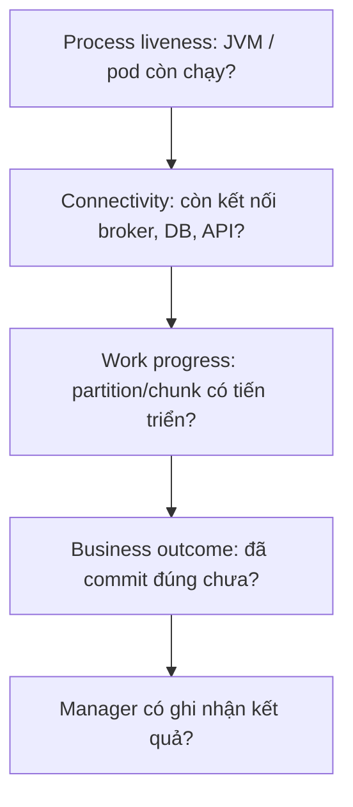
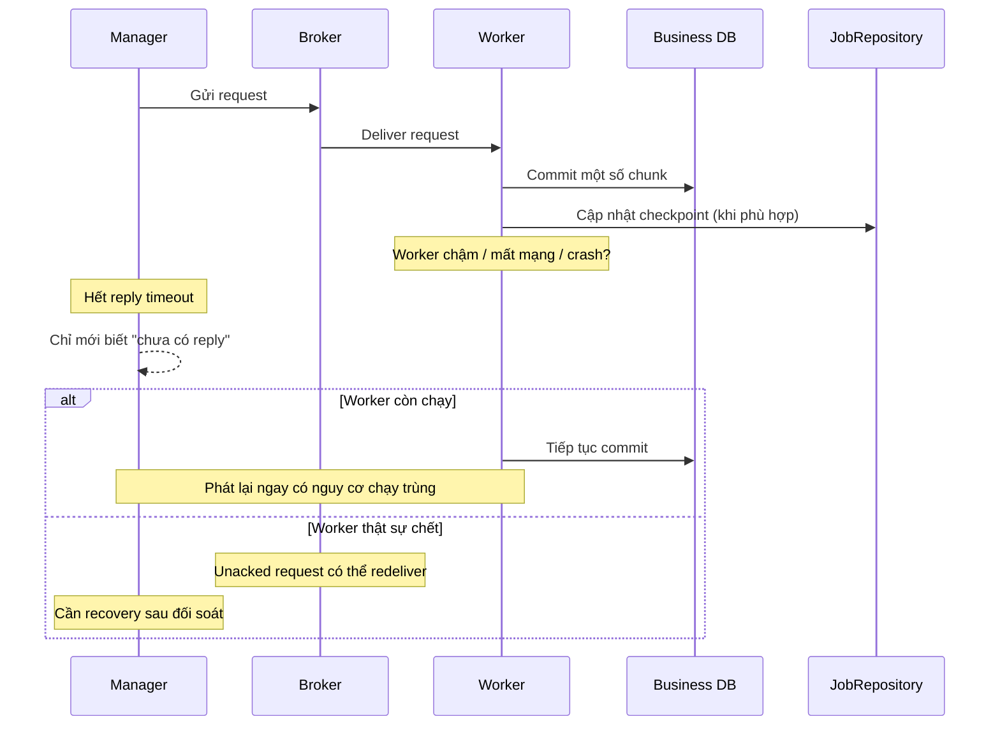
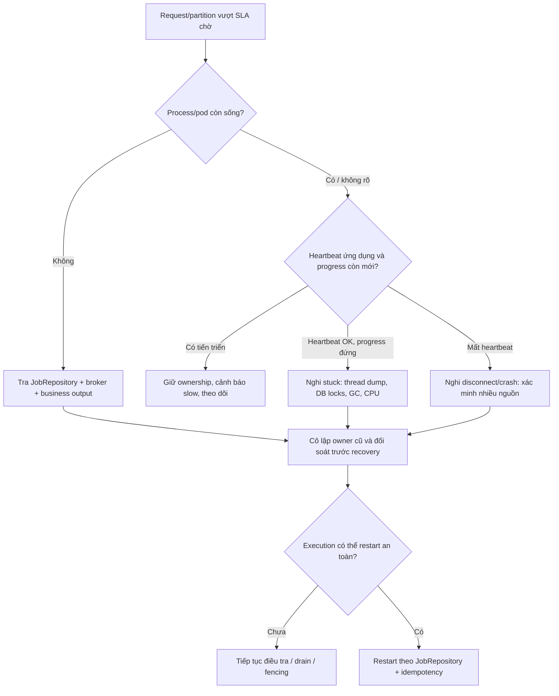
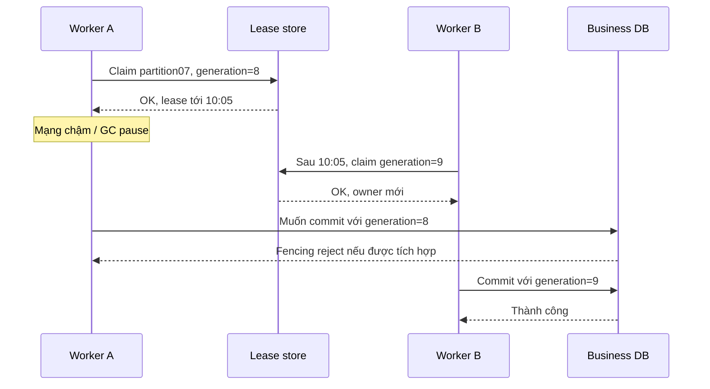
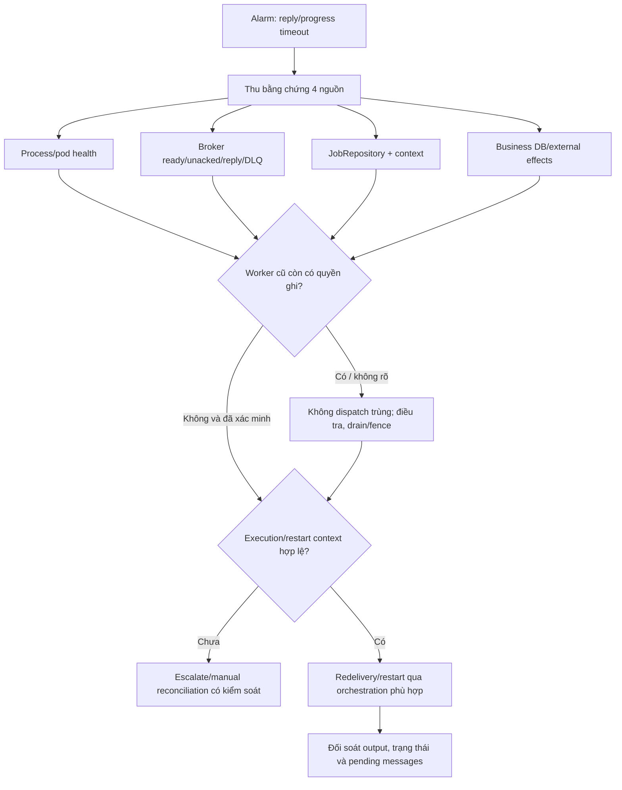

# Timeout và phát hiện worker chết trong Spring Batch phân tán

Khi một Spring Batch job xử lý hàng triệu bản ghi qua nhiều worker, manager có thể **không nhận được reply** trong nhiều phút dù request đã được giao. Điều đó có nghĩa worker đã chết, đang xử lý partition nặng, bị CPU throttling, kẹt database, mất mạng hay chỉ mất riêng đường reply? Nếu hệ thống coi mọi timeout là “worker chết” và lập tức giao lại cùng việc, **hai worker có thể cùng tác động lên một tập dữ liệu**. Nếu không đặt giới hạn chờ, manager lại có thể mắc kẹt mãi khi worker đã mất.

Bài thuộc chương **Failover** của module `SPRING_BATCH_SCALING_OPERATIONS`: mở rộng Spring Batch qua multi-threaded step, parallel steps, partitioning, remote partitioning và remote chunking, đồng thời đo nút thắt, giữ thread safety, retry/restart và vận hành dựa trên tài nguyên thực tế. Chủ đề **“Timeout và phát hiện worker chết”** yêu cầu thiết kế được quy trình **phát hiện — xác minh — cô lập — phục hồi — đối soát**, chứ không chỉ đặt một giá trị timeout.

Các ví dụ tập trung **Spring Batch Integration 5.2.x**, Java 17+, Spring Framework 6.x, RabbitMQ và PostgreSQL. Những cơ chế **heartbeat nghiệp vụ, lease, fencing, detector/dispatcher** trong bài là thành phần **ứng dụng tự thiết kế**, không phải một công tắc có sẵn của Spring Batch. Các giá trị thời gian và SQL được nêu nhằm giải thích, cần thử với độ trễ, phiên bản và hạ tầng thực tế.

## 1. “Worker chết” thực ra là những trạng thái khác nhau

| Hiện tượng quan sát | Process còn sống? | Công việc có thể đang tiến triển? | Kết luận đúng |
| --- | --- | --- | --- |
| JVM bị `SIGKILL`/`OOMKilled` | Không | Không trên JVM đó; commit trước crash vẫn tồn tại | Worker process đã chết; phải đối soát phần việc còn lại |
| JVM còn sống, thread bị deadlock | Có | Có thể không | Liveness process không đủ chứng minh work progress |
| GC stop-the-world kéo dài | Có | Đang tạm dừng | Heartbeat có thể trễ; tránh false positive |
| Broker connection mất | Có thể | Worker có thể vẫn đang commit DB | Manager mất liên lạc, **không chứng minh worker đã dừng** |
| Reply queue bị lỗi, request channel vẫn hoạt động | Có | Có thể đã hoàn thành | Mất reply không đồng nghĩa mất business write |
| Partition rất lớn hoặc chờ DB lock | Có | Có thể chậm/đứng | Phải phân biệt slow với stuck bằng progress |
| Không có worker consumer, request nằm trong queue | Có thể không có process nào | Chưa xử lý request mới | Kiểm broker ready/consumer, không cần suy từ job status |
| Worker đã `COMPLETED`, manager vẫn đợi | Có thể đã ngừng | Kết quả có thể đã lưu | Đối chiếu repository và reply routing |

**Nguyên tắc:** một dấu hiệu timeout cho biết **không nhận được điều mong đợi trong khoảng thời gian cho phép**, không tự chứng minh nguyên nhân hoặc tác dụng nghiệp vụ đã/ chưa commit.

## 2. Phân biệt năm lớp tín hiệu về worker



1. **Process liveness:** PID/pod/process/heartbeat OS còn tồn tại, health endpoint trả lời.
2. **Connectivity:** đường broker, database, HTTP, DNS và reply path có hoạt động.
3. **Work progress:** worker có cập nhật số item/chunk đã commit hoặc mốc tiến độ gần đây.
4. **Business outcome:** dữ liệu đã commit, external side effect đã xảy ra hay chưa.
5. **Acknowledgement:** `StepExecution`/`ChunkResponse`/manager nhận được trạng thái cuối.

Một worker có thể qua kiểm tra liveness nhưng **không tạo tiến độ**, hoặc đã commit xong mà **manager không thấy reply**. Vì thế nên tách riêng **cảnh báo nghi ngờ** với **quyết định thu hồi công việc**.

## 3. Remote partitioning và remote chunking khác nhau ở điểm nào?

| Đặc tính | Remote partitioning | Remote chunking |
| --- | --- | --- |
| Đơn vị dispatch | Một `StepExecutionRequest` cho partition | Một `ChunkRequest` chứa item của chunk |
| Ai đọc dữ liệu? | Worker `ItemReader` theo `ExecutionContext` | Manager đọc item, worker xử lý phần được gửi |
| State bền vững chính | Child `StepExecution`/`ExecutionContext` trên `JobRepository` | Manager `StepExecution`/reader checkpoint và giao thức chunk reply |
| Cách manager chờ | Reply aggregation hoặc polling `JobRepository` | `ChunkResponse` được manager xử lý |
| Worker chết giữa việc | Partition cần được khôi phục theo metadata | Request chunk có thể redeliver; manager có thể chờ reply |
| Điều cần đối chiếu | `stepExecutionId`, partition key, status, checkpoint | `jobId`, `sequence`, pending chunks, business idempotency |

Ở remote partitioning, worker xử lý **một step execution**; ở remote chunking, worker thường **không có một child `StepExecution` riêng cho mỗi chunk**. Không dùng “đã thấy 0 reply của chunk” để suy trực tiếp “có 0 step execution được commit” hoặc ngược lại.

## 4. Một sơ đồ các cửa sổ timeout



Quan trọng nhất là **thời gian nhận reply**, **thời gian commit** và **thời gian nhận ACK** có thể khác nhau. Giao dịch giữa broker và database thường **không atomic** nếu không có thiết kế giao dịch phân tán riêng.

## 5. Bảy loại timeout không được nhầm lẫn

| Timeout / detector | Bắt đầu tính từ | Nó nói được điều gì? | Nó không bảo đảm điều gì? |
| --- | --- | --- | --- |
| Broker publisher confirm timeout | Publish request | Broker chưa xác nhận kịp | Request chắc chắn không vào queue |
| Consumer delivery/ACK timeout | Broker giao message, chờ ACK | Delivery chưa được ACK trong thời gian cho phép | Business DB chưa commit |
| Broker heartbeat/TCP idle detection | Kết nối không trao đổi frame/traffic | Connection có thể không còn khỏe | Business thread có tiến triển |
| Repository polling timeout | Manager chờ child `StepExecution` đạt điều kiện kết thúc | Kết quả chưa đạt trong thời gian đợi | Worker đã chết và có thể giao lại an toàn |
| Reply receive timeout | Manager đợi reply message | Không có reply trong kỳ chờ | Worker chưa gửi/commit business output |
| HTTP/JDBC acquire/connect/read timeout | Chờ pool, kết nối, response | Một loại I/O không hoàn tất đúng hạn | Toàn step đã dừng |
| Business deadline/lease | Một operation được phép chạy trong khoảng/thời hạn logic | Việc đã quá SLA/lease nếu detector đúng | Worker cũ đã bị vô hiệu hóa ngoài hệ thống |

Đặt timeout quá ngắn sẽ gây **false failure**, timeout vô hạn làm tăng **MTTD (mean time to detect)** và kéo dài job. Cấu hình phải dựa trên **worst plausible latency + tải + hoạt động của runtime**, không dựa trên “mỗi HTTP call trung bình 100 ms”.

## 6. Spring Batch remote partitioning: repository polling timeout

Trong Spring Batch Integration 5.2, `MessageChannelPartitionHandler` có:

- `setPollInterval(long)`: khoảng cách giữa các lần manager hỏi `JobRepository`, đơn vị **milli giây**; mặc định khoảng **10 giây**.
- `setTimeout(long)`: thời gian chờ **khi dùng repository polling**, đơn vị **milli giây**; mặc định **-1 (không timeout ở cơ chế này)**.
- `setJobExplorer(...)`: hỗ trợ truy cập metadata của worker.

Các thông số này **không tự gửi tín hiệu kill** tới worker và **không làm trạng thái `STARTED` tự trở thành `FAILED`**. Khi timeout, cần đánh giá tình trạng manager step và worker theo cách framework/ứng dụng xử lý exception.

### 6.1. Ví dụ cấu hình manager step bằng builder Spring Batch 5.2

```java
import org.springframework.batch.core.Step;
import org.springframework.batch.core.explore.JobExplorer;
import org.springframework.batch.core.partition.support.Partitioner;
import org.springframework.batch.core.repository.JobRepository;
import org.springframework.batch.integration.partition.RemotePartitioningManagerStepBuilder;
import org.springframework.beans.factory.annotation.Qualifier;
import org.springframework.context.annotation.Bean;
import org.springframework.context.annotation.Configuration;
import org.springframework.messaging.MessageChannel;

@Configuration
class InvoicePartitionManagerConfig {

    @Bean
    Step invoicePartitionManager(
            JobRepository repository,
            JobExplorer explorer,
            @Qualifier("invoicePartitioner") Partitioner partitioner,
            @Qualifier("partitionRequests") MessageChannel requests) {
        return new RemotePartitioningManagerStepBuilder(
                "invoicePartitionManager", repository)
                .partitioner("invoiceWorker", partitioner)
                .gridSize(12)
                .outputChannel(requests)
                .jobExplorer(explorer)
                .pollInterval(5_000L)
                .timeout(900_000L)
                .build();
    }
}
```

Ví dụ **chọn repository polling** bằng cách **không khai báo input reply channel**; các bean `Partitioner`, broker-backed `partitionRequests`, worker step và infrastructure phải được cấu hình riêng. Giá trị 5 giây và 15 phút **chỉ minh họa**; thời gian partition thật có thể lớn hơn nhiều.

**Giới hạn kỹ thuật:** `gridSize(12)` gợi ý số partition cho partitioner, **không phải 12 process/threads**. Timeout trong builder là **thời gian chờ repository polling**, không phải socket, JDBC hay heartbeat timeout. Đừng dùng cùng tên `timeout` ở các tầng mà không ghi rõ mục đích.

### 6.2. Manager dùng reply aggregation

Khi cấu hình `inputChannel(...)` để nhận reply, việc chờ chịu ảnh hưởng của **MessagingTemplate/gateway receive timeout và aggregator**, không phải mặc nhiên `.timeout(...)` của repository polling. Javadoc lưu ý reply timeout phải đủ dài cho remote step hoàn thành. Một partition có thể chạy 40 phút; dùng receive timeout 30 giây sẽ gây alarm sai nếu không thiết kế protocol bất đồng bộ và theo dõi state.

Reply aggregator có thể giữ correlation/pending state trong process manager. Sau manager crash, **reply cũ có thể không còn đúng với state trong RAM của manager mới**. Cần durable reply transport, routing và reconciliation, hoặc dùng repository polling nếu phù hợp.

## 7. Spring Batch remote chunking: maxWaitTimeouts khác với deadline

Ở remote chunking Spring Batch 5.2, `RemoteChunkingManagerStepBuilder.maxWaitTimeouts(int)` cấu hình số lần đợi nhận kết quả **không null** khi manager kết thúc step còn pending requests. Giá trị này là **bội số trên receive timeout** được thiết lập riêng trên `MessagingTemplate/gateway` (mặc định số lần đợi trong writer là **40**).

Ví dụ minh họa:

```text
Gateway receive timeout:       5000 ms
maxWaitTimeouts:                  24
Kỳ chờ trống liên tiếp tối đa ≈ 24 × 5 s = 120 s
```

Đây là **trực giác sizing của cơ chế wait**, không phải cam kết overall wall-clock deadline cho toàn job. Những lần nhận được reply, độ trễ broker, khâu gửi, xử lý message, số pending requests và implementation có thể làm thời gian thực khác. Không đặt `maxWaitTimeouts=24` rồi tuyên bố worker sẽ tự bị hủy đúng sau 120 giây.

### 7.1. Ví dụ manager step sử dụng remote chunking

```java
import org.springframework.batch.core.Step;
import org.springframework.batch.core.repository.JobRepository;
import org.springframework.batch.integration.chunk.RemoteChunkingManagerStepBuilder;
import org.springframework.batch.item.ItemReader;
import org.springframework.beans.factory.annotation.Qualifier;
import org.springframework.context.annotation.Bean;
import org.springframework.messaging.MessageChannel;
import org.springframework.messaging.PollableChannel;
import org.springframework.transaction.PlatformTransactionManager;

@Bean
Step invoiceRemoteChunkManager(
        JobRepository repository,
        PlatformTransactionManager transactionManager,
        ItemReader<Invoice> invoiceReader,
        @Qualifier("chunkRequests") MessageChannel requests,
        @Qualifier("chunkReplies") PollableChannel replies) {

    return new RemoteChunkingManagerStepBuilder<Invoice, Invoice>(
            "invoiceRemoteChunkManager", repository)
            .chunk(100)
            .transactionManager(transactionManager)
            .reader(invoiceReader)
            .outputChannel(requests)
            .inputChannel(replies)
            .maxWaitTimeouts(24)
            .build();
}
```

`Invoice` là DTO minh họa, và method trên được đặt trong class `@Configuration`; project thật cần reader, channels, broker adapters, serializer và worker. **Lưu ý**: builder trên minh họa cấu hình số lần đợi nhưng chưa cấu hình gateway `receiveTimeout` minh họa 5 giây; phải cấu hình `MessagingTemplate` riêng nếu cần giới hạn cụ thể và kiểm tra behavior thực tế trong integration test.

`maxWaitTimeouts` không thay thế broker dead-letter, consumer ACK hay idempotent writer. Một chunk đã commit ở worker nhưng mất reply vẫn có thể được giao lại sau recovery.

## 8. Broker heartbeat không đo tiến độ xử lý item

Với RabbitMQ, protocol heartbeat giúp phát hiện **kết nối TCP không còn phản hồi** trong thời gian thỏa thuận. Heartbeat có thể được phát bởi I/O/connection thread trong lúc business thread của worker bị kẹt ở SQL hoặc xử lý hàng triệu records.

Do đó:

- **Heartbeat OK**: kết nối broker còn hoạt động; **không khẳng định** processor đang tiến triển.
- **Heartbeat timeout**: nghi ngờ connection đã mất; **không chứng minh** transaction DB của worker đã bị rollback.
- **Consumer ACK nhận được**: broker nhận tín hiệu xử lý delivery; **không có nghĩa** manager đã nhận `StepExecution`/`ChunkResponse`.
- **Message còn unacked**: chưa ACK delivery đó; có thể đang xử lý rất lâu hoặc consumer kẹt.

Theo RabbitMQ, nếu manual ACK và channel/connection đóng trước ACK, delivery chưa ACK sẽ được **requeue/redeliver**, sau khi broker phát hiện connection bị đóng. Độ trễ phát hiện không phải bằng 0; khi network partition, hai phía có thể nhận định khác nhau trong một khoảng thời gian.

**Đừng dùng heartbeat liên kết TCP như worker-progress heartbeat.** Nếu muốn phát hiện một business step không tiến triển, xây signal tiến độ riêng.

## 9. Consumer acknowledgement timeout: tránh giết nhầm partition dài

Một số broker/queue configuration có giới hạn delivery acknowledgement timeout. Nếu một request remote partitioning được xử lý hàng chục phút trước khi container listener ACK, deadline ACK của broker có thể đến trước khi step hoàn thành; broker có thể đóng consumer channel hoặc redeliver theo chính sách.

Thiết kế phải trả lời:

1. Một `StepExecutionRequest` có thể giữ consumer delivery **unacked trong bao lâu**?
2. Listener container đang dùng ACK mode nào (`AUTO`/`MANUAL`/`NONE` tùy adapter)?
3. Khi lỗi xử lý, request được **requeue, reject, hay DLQ**? Có retry budget không?
4. Khi worker gửi reply xong nhưng ACK chưa được broker xác nhận, request có được redeliver không?
5. Có idempotency và metadata guard nào khi cùng `StepExecutionRequest` được giao lại không?

**Không có một timeout broker “chuẩn” cho mọi partition.** Tính theo duration thực tế, broker version và chính sách ACK của client. ACK tự động ngay khi giao delivery có thể gây **mất request khi worker chết trước xử lý**; manual ACK sau commit giảm rủi ro mất delivery nhưng không loại bỏ duplicate.

## 10. Failure detector nên trả về “nghi ngờ”, không tự phát lệnh chạy lại

Trong hệ phân tán, giữa “worker chậm” và “worker đã chết” có thể không phân biệt tuyệt đối chỉ từ timeout. Một detector vững nên kết hợp **nhiều tín hiệu**:



**Cấm đồng nhất** một alarm “no progress for 60s” với câu lệnh “gửi lại mọi partition sau 60s”. Trước khi giao lại, phải giải quyết quyền sở hữu của worker cũ và kết quả đã commit.

## 11. Heartbeat ứng dụng: hai loại nhịp tim

Một thiết kế quan sát tốt dùng **hai timestamp**:

- `lastSeenAt`: thời điểm process/worker agent còn có thể gửi tín hiệu.
- `lastProgressAt`: thời điểm gần nhất có **bằng chứng tiến triển hợp lệ**, ví dụ chunk commit, checkpoint hoặc offset nghiệp vụ tăng.

Ví dụ:

```text
workerId=worker-04
instanceId=pod-04:boot-8f1
jobExecutionId=15020
stepExecutionId=15107
lastSeenAt=10:20:30
lastProgressAt=10:15:10
committedChunks=27
status=RUNNING
```

Trường hợp trên cho thấy **worker process vẫn báo sống**, nhưng **5 phút 20 giây chưa có progress**, không đủ kết luận đã chết. Có thể phần việc hiện tại là một transaction 8 phút; hoặc worker bị kẹt database.

**Tuyệt đối không giả lập progress bằng cách tăng counter mỗi lần heartbeat:** như vậy worker deadlock sẽ trông như vẫn xử lý. Ngược lại, một reader chỉ ghi checkpoint sau khi commit chunk không có progress giữa chu kỳ dài là bình thường; đặt ngưỡng phù hợp `chunk duration`.

### 11.1. Heartbeat không phải checkpoint Spring Batch

`StepExecution`/`ExecutionContext` được quản lý theo vòng đời batch, các transaction/checkpoint có semantics riêng. Việc tùy tiện cập nhật metadata như `BATCH_STEP_EXECUTION.STATUS`/`LAST_UPDATED` ngoài framework để “heartbeat” dễ phá cơ chế restart.

Nếu cần heartbeat riêng, lưu vào **bảng/metric độc lập** hoặc service monitoring:

```text
worker_health(worker_id, instance_id, last_seen_at, lifecycle_state)
partition_progress(job_execution_id, step_execution_id,
                   owner_id, last_committed_at, committed_chunks)
```

Đây là **schema ứng dụng**, không phải bảng mặc định của Spring Batch. Nếu heartbeat DB phụ thuộc cùng connection pool đã bão hòa vì processor, heartbeat trễ cũng có thể là **DB starvation**, không phải JVM chết. Monitoring cần biết giới hạn đó.

## 12. Lease, ownership và fencing: timeout phải đi kèm quyền ghi

Một **lease** ghi rằng worker A có quyền xử lý partition P **tới một thời điểm**; nó có thể hết hạn nếu A không gia hạn được. Nhưng **lease expiry không làm A chết**. Có thể A vừa hết thời gian do mất mạng, vẫn đang ghi DB; B nhận quyền mới rồi cũng ghi cùng partition. Đây là **split-brain**.



**Fencing token** (ví dụ số `generation` tăng đơn điệu) cho phép **tầng ghi dữ liệu** từ chối thao tác của owner cũ. Nếu chỉ kiểm token trong bảng lease **sau khi đã gọi API thanh toán**, kết quả ngoài DB của A có thể đã xảy ra; cần downstream idempotency/fencing hoặc mô hình giao dịch và bù trừ phù hợp.

### 12.1. Schema minh họa cho lease store

PostgreSQL, **bảng do ứng dụng tự tạo**, không thay thế `BATCH_STEP_EXECUTION`:

```sql
CREATE TABLE partition_lease (
    job_instance_key   VARCHAR(180) NOT NULL,
    partition_key      VARCHAR(100) NOT NULL,
    owner_id           VARCHAR(150),
    generation         BIGINT NOT NULL DEFAULT 0,
    lease_until        TIMESTAMPTZ,
    last_seen_at       TIMESTAMPTZ,
    last_progress_at   TIMESTAMPTZ,
    committed_chunks   BIGINT NOT NULL DEFAULT 0,
    PRIMARY KEY (job_instance_key, partition_key)
);
```

Ở đây `job_instance_key` phải được lấy từ **identity logic ổn định** (chẳng hạn `JobInstanceId` hoặc snapshot+partition scope đã được quản lý). Đừng dùng mỗi tên partition khi nhiều JobInstances chạy đồng thời, vì `partition00` có thể xuất hiện ở nhiều ngày xử lý.

### 12.2. Claim khi lease đã hết và tăng fencing token

Giả định row lease đã được tạo trước:

```sql
UPDATE partition_lease
   SET owner_id = :ownerId,
       generation = generation + 1,
       lease_until = clock_timestamp() + INTERVAL '2 minutes',
       last_seen_at = clock_timestamp()
 WHERE job_instance_key = :jobInstanceKey
   AND partition_key = :partitionKey
   AND (owner_id IS NULL OR lease_until < clock_timestamp())
RETURNING generation, lease_until;
```

Nếu cập nhật **1 row**, owner đã giành được lease mới theo điều kiện DB. Nếu **0 row**, có thể owner hiện tại còn lease hoặc key không tồn tại; không cố gửi request để chạy song song. Trong production, phải bao gồm race khi tạo row, unique constraint, transaction isolation và chính sách lease expiration.

**Giải thích thời gian:** `clock_timestamp()` ở PostgreSQL dùng đồng hồ DB server; hạn chế lệ thuộc clock lệch giữa Pods. Tuy nhiên, clock DB vẫn chịu điều chỉnh hệ thống và leap/timekeeping; thiết kế cần test NTP/clock anomalies. Không tạo/so sánh `lease_until` bằng đồng hồ của từng worker nếu chúng có skew lớn.

### 12.3. Gia hạn lease chỉ khi còn đúng owner + version

```sql
UPDATE partition_lease
   SET lease_until = clock_timestamp() + INTERVAL '2 minutes',
       last_seen_at = clock_timestamp()
 WHERE job_instance_key = :jobInstanceKey
   AND partition_key = :partitionKey
   AND owner_id = :ownerId
   AND generation = :generation
   AND lease_until > clock_timestamp()
RETURNING generation;
```

Worker phải xử lý tình huống **0 rows updated** như tín hiệu **mất quyền sở hữu**: ngừng nhận việc mới, cố gắng dừng xử lý tại ranh giới an toàn và **không tiếp tục ghi side effect** nếu không còn fencing hợp lệ.

Chỉ cập nhật `last_progress_at` và `committed_chunks` sau khi có **bằng chứng commit**; không tăng mỗi lần renew. Nếu business DB khác lease DB, việc báo progress có thể bị mất dù business commit đã xong; log/timer và reconciliation phải chịu được eventual consistency.

### 12.4. Lease là thiết kế bổ sung, không thay thế framework restart

Spring Batch restart partition cần `JobRepository`, `StepExecution` và checkpoint. **Không tạo hai `JobExecution` đồng thời cho cùng `JobInstance`** chỉ vì một lease do ứng dụng tạo đã hết. Fencing giúp giới hạn side effect nhưng không làm một step execution đang ghi `STARTED` trở nên restartable hợp lệ.

## 13. Mô hình trạng thái detector nên có nhiều mức

Một state machine vận hành có thể định nghĩa:

```text
HEALTHY
  -> SLOW              khi latency vượt budget nhưng còn progress
  -> SUSPECT           khi mất signal hoặc progress quá ngưỡng
  -> INVESTIGATING     khi liveness / broker / metadata mâu thuẫn
  -> ISOLATING         khi cần fencing/drain worker cũ
  -> CONFIRMED_LOST    khi đã xác minh không còn owner hợp lệ
  -> RECOVERING        khi orchestration cho restart/redelivery có kiểm soát
  -> RECONCILED        khi outcome được đối soát
```

Đây là **mô hình ứng dụng/runbook**, không phải `BatchStatus` của Spring Batch. Không tự thêm các giá trị `SUSPECT` hay `RECOVERING` vào cột `BATCH_STEP_EXECUTION.STATUS`. Giữ detector state ở monitoring/incident store riêng.

### Tại sao cần bước SUSPECT?

Với mạng bất đồng bộ, “không nhận tín hiệu” chỉ đủ để nghi ngờ. Ví dụ stop-the-world GC 50 giây có thể làm heartbeat miss liên tiếp nhưng sau đó worker tiếp tục commit bình thường. Nếu detector lập tức cấp partition cho B, hệ thống tạo conflict dù A vẫn đang chạy.

**Quy tắc thu hồi:** tách riêng (1) **đánh dấu suspect/alert** và (2) **fence owner cũ/cho phép owner mới**. Bước hai đòi các precondition mạnh hơn và dữ liệu idempotent.

## 14. Chọn heartbeat interval và deadline theo số liệu thực

Giả sử mục tiêu phát hiện JVM chết trong khoảng vài phút. Một thiết kế minh họa:

```text
Heartbeat interval       H = 15 s
Miss threshold           N = 4 lần
Heartbeat suspicion      khoảng N × H = 60 s
Lease TTL                L = 150 s
P99 commit chunk         P = 80 s
Observed GC pause P99.9  G = 12 s
Network/DB jitter budget J = 20 s
```

Các ngưỡng trong ví dụ **không bảo đảm** phát hiện đúng sau đúng 60 giây: scheduling drift, mất kết nối và monitoring sampling làm detection latency thay đổi. `L` phải đủ headroom cho các trễ renew hợp lý, nhưng cũng không được dài tới mức owner chết và công việc bị giữ quá lâu.

**Không có công thức duy nhất** như `L = P + G + J` vì heartbeat có thể chạy trên thread riêng hay chung với business transaction. Thay vào đó, đo các độ trễ thực:

- Heartbeat send/receive latency p95/p99/p99.9.
- GC stop-the-world, CPU throttling và container pause.
- DB pool acquire time, broker reconnect và network partitions.
- Chunk commit p95/p99, thời gian tối đa hợp lý của partition.
- Tần suất false positive và time-to-recover sau kill thực.

Đặt ngưỡng **cho từng loại workload**. Partition đọc file 2 TB có thể chạy hàng giờ nhưng vẫn commit chunk mỗi 20 giây; partition chạy một stored procedure 25 phút có thể không có progress chunk trong suốt 25 phút. Một progress timeout 60 giây **không thể áp cho cả hai**.

### 14.1. Timeout không phải SLA business deadline

Một job có SLA kết thúc trước 06:00 không đồng nghĩa mọi partition phải trả lời trong 60 giây. Cần tách:

```text
Network/transport deadline:  chờ một hoạt động I/O
Worker heartbeat deadline:   nghi ngờ process không phản hồi
Progress stall threshold:    nghi ngờ không còn tiến triển
Partition max duration:      ngân sách vận hành cho một partition
Job SLA/deadline:            cam kết với hệ thống nghiệp vụ
```

Khi vượt SLA, quyết định **stop/alert/escalate** có thể khác **kill/reassign**. Dừng job theo `JobOperator.stop(...)` là cooperative, không hứa dừng ngay giữa developer code hoặc remote API call.

## 15. False positive: worker còn sống nhưng bị coi là chết

Các nguồn phổ biến:

| Tình huống | Vì sao detector báo nhầm? | Biện pháp |
| --- | --- | --- |
| Stop-the-world GC | Timers và heartbeat thread tạm dừng | Đo GC pause tail, tăng grace phù hợp |
| Kubernetes CPU throttling | Không được cấp đủ CPU time | Đo `cpu.stat`, budget heartbeat/CPU |
| DB connection pool cạn | Heartbeat DB không lấy được connection | Tách health signal, giám sát pool pending |
| Broker mạng chập chờn | Reply/heartbeat không tới manager | Broker metrics và process health độc lập |
| Worker commit chunk lớn | `lastProgressAt` cũ dù business đang làm | Threshold theo p99 chunk duration, tránh retry sớm |
| Clock skew | So timestamp từ hai host không đồng bộ | Dùng DB server time/monotonic elapsed khi có thể |
| Manager overloaded | Manager không kịp poll reply | Theo dõi manager CPU/GC/queue trước khi đổ lỗi worker |
| Stale monitoring cache | Dashboard cập nhật chậm | So raw timestamps và độ trễ scraping |

Đối với manager có timeout vì quá tải riêng, việc tăng worker không giải quyết nguyên nhân. Nếu manager reply channel bị nghẽn, worker vẫn có thể hoàn thành nhưng manager báo thiếu reply.

## 16. Liveness, readiness và startup probes trên Kubernetes

Kubernetes phân biệt:

- **`startupProbe`:** ứng dụng đã khởi tạo đủ để bắt đầu kiểm tra liveness/readiness chưa.
- **`livenessProbe`:** process có nên **bị restart** khi không còn hoạt động khỏe mạnh theo tiêu chí ứng dụng.
- **`readinessProbe`:** process có sẵn sàng **nhận traffic qua Service** hay chưa.

Ví dụ **Pod container có HTTP health endpoints**:

```yaml
startupProbe:
  httpGet:
    path: /actuator/health/liveness
    port: 8080
  periodSeconds: 10
  failureThreshold: 24

livenessProbe:
  httpGet:
    path: /actuator/health/liveness
    port: 8080
  periodSeconds: 15
  timeoutSeconds: 2
  failureThreshold: 4

readinessProbe:
  httpGet:
    path: /actuator/health/readiness
    port: 8080
  periodSeconds: 10
  timeoutSeconds: 2
  failureThreshold: 3
```

Đây là **đoạn cấu hình** giả định Spring Boot Actuator đã bật probe endpoints và worker có HTTP server. Với worker chỉ chạy consumer không mở HTTP port, cần health check phù hợp process (hoặc thiết kế thêm HTTP management endpoint). Các giá trị chỉ để minh họa, phải benchmark khi container startup/GC chậm.

### 16.1. Readiness false có dừng broker consumer không?

**Không mặc nhiên.** Kubernetes readiness có thể ngừng định tuyến traffic **qua Service EndpointSlices**, nhưng RabbitMQ listener chủ động kết nối tới broker **không tự dừng consume** chỉ vì Pod bị đánh dấu `NotReady`. Nếu cần drain consumer, ứng dụng phải điều khiển `MessageListenerContainer`/consumer registration và ACK/ownership theo lifecycle riêng.

### 16.2. Tránh liveness probe phụ thuộc hệ thống ngoài

Nếu liveness endpoint gọi DB/broker rồi trả fail mỗi khi DB tạm mất mạng, Kubernetes có thể restart **mọi worker đồng loạt**, tạo reconnect storm và làm outage nặng hơn. Thông thường, liveness chỉ kiểm những điều cho biết process cần restart; dependency readiness hoặc health riêng sẽ phù hợp hơn. Probes không thay thế business progress monitoring.

Một `livenessProbe` trả 200 trong khi worker deadlock ở thread business vẫn là **false negative**; cần watchdog/progress detection riêng nếu muốn phát hiện stuck processing.

## 17. Graceful shutdown và rolling deployment

Để giảm duplicate khi scale down/redeploy worker:

1. Chuyển instance sang trạng thái **DRAINING**, không nhận request mới.
2. Ngừng/suspend listener theo API container, không chỉ đánh dấu Kubernetes readiness false.
3. Chờ các partition/chunk đang xử lý tới **điểm commit an toàn** trong ngân sách `terminationGracePeriodSeconds`.
4. Trả ACK/reply đúng khi đã đáp ứng điều kiện của broker và business.
5. Giải phóng resources (`ItemStream.close`, DB/HTTP pools), ghi trạng thái lifecycle.
6. Nếu vượt grace và bị kill, chấp nhận khả năng redelivery; **idempotency** phải chịu được.

**Không bảo đảm** `@PreDestroy`/`ItemStream.close` sẽ chạy khi kernel `SIGKILL` hoặc process bị OOM kill. Hơn nữa, một worker đang chạy step 40 phút không thể “gracefully drain” hoàn toàn nếu platform chỉ cho 30 giây; phải chọn chiến lược checkpoint/stop/resume tương ứng.

## 18. Quan sát metadata JobRepository mà không nhầm là heartbeat

Các bảng mặc định thường gồm `BATCH_JOB_EXECUTION`, `BATCH_STEP_EXECUTION` và `BATCH_STEP_EXECUTION_CONTEXT`. Để đọc trạng thái:

```sql
SELECT JOB_EXECUTION_ID, JOB_INSTANCE_ID,
       STATUS, EXIT_CODE, START_TIME, END_TIME
FROM BATCH_JOB_EXECUTION
WHERE JOB_EXECUTION_ID = :jobExecutionId;
```

```sql
SELECT STEP_EXECUTION_ID, JOB_EXECUTION_ID, STEP_NAME,
       STATUS, EXIT_CODE, READ_COUNT, WRITE_COUNT,
       COMMIT_COUNT, ROLLBACK_COUNT, START_TIME, END_TIME
FROM BATCH_STEP_EXECUTION
WHERE JOB_EXECUTION_ID = :jobExecutionId
ORDER BY STEP_EXECUTION_ID;
```

Các query là **read-only** và giả định schema tên bảng chuẩn. Khi remote partitioning, child steps có thể mang tên như `invoiceWorker:partition07`; `ExecutionContext` giữ dải input/snapshot và checkpoint.

**Quan sát quan trọng:** `BatchStatus.STARTED` có thể còn sau JVM chết mà không kịp cập nhật trạng thái. `WRITE_COUNT`/`COMMIT_COUNT` phản ánh metadata của lần execution, không thể thay thế việc đối soát external side effect. Trường timestamp metadata không phải heartbeat 1 giây/lần; nó được cập nhật theo lifecycle/commit nên một step còn hoạt động có thể không có `LAST_UPDATED` mới theo kỳ vọng.

### 18.1. Dùng JobExplorer cho recovery dashboard

Ví dụ Java đọc execution:

```java
import org.springframework.batch.core.JobExecution;
import org.springframework.batch.core.StepExecution;
import org.springframework.batch.core.explore.JobExplorer;

public final class BatchExecutionInspector {
    private final JobExplorer explorer;

    public BatchExecutionInspector(JobExplorer explorer) {
        this.explorer = explorer;
    }

    public void inspect(long jobExecutionId) {
        JobExecution job = explorer.getJobExecution(jobExecutionId);
        if (job == null) {
            throw new IllegalArgumentException("Unknown JobExecution");
        }
        System.out.printf("job=%d status=%s%n",
                job.getId(), job.getStatus());
        for (StepExecution step : job.getStepExecutions()) {
            System.out.printf("step=%s id=%d status=%s commits=%d%n",
                    step.getStepName(), step.getId(),
                    step.getStatus(), step.getCommitCount());
        }
    }
}
```

`JobExplorer` đọc metadata theo snapshot thời điểm query; không phải live control channel và không tự “ping” worker. Một manager không nhận được `ChunkResponse` cần kiểm cả broker/in-memory pending state, vì remote chunking không tạo child `StepExecution` cho từng request.

## 19. Khi worker chết thật, Spring Batch restart bằng cách nào?

Spring Batch phân biệt:

- **`JobInstance`:** tên job + identifying `JobParameters`.
- **`JobExecution`:** lần thử chạy một `JobInstance`; restart hợp lệ có thể tạo execution mới.
- **`StepExecution`:** lần thực thi step; trong remote partitioning có execution cho từng partition.

Nếu worker process crash bất ngờ, repository **không tự biết process đã chết**, nên metadata có thể còn `STARTED`. Tài liệu Spring Batch lưu ý tình huống này cần **quyết định vận hành/manual reconciliation** về việc execution nên coi là `FAILED` hay `ABANDONED`; chỉ đánh dấu `FAILED` khi thực sự được phép restart và restart data hợp lệ.

**Không tùy tiện chạy SQL `UPDATE BATCH_STEP_EXECUTION SET STATUS='FAILED'` hoặc tự cho manager mới chạy khi owner cũ còn sống.** Nếu quy trình khẩn cấp cần can thiệp metadata do execution mồ côi, phải có runbook được phê duyệt, xác nhận liveness/ownership, backup/audit, kiểm consistency giữa các bảng và follow-up; đây không phải phản ứng tự động cho mọi timeout.

Với execution đã ở trạng thái `FAILED` hoặc `STOPPED`, có thể dùng `JobOperator.restart(...)` khi job restartable và metadata hợp lệ:

```java
import org.springframework.batch.core.launch.JobOperator;

public final class ControlledRestartService {
    private final JobOperator operator;

    public ControlledRestartService(JobOperator operator) {
        this.operator = operator;
    }

    public Long restartAfterOperatorApproval(long failedExecutionId)
            throws Exception {
        // Caller đã xác minh worker/manager cũ dừng hoặc bị fencing,
        // input snapshot và restart context còn hợp lệ.
        return operator.restart(failedExecutionId);
    }
}
```

Method không tự điều tra liveness và không xử lý `STARTED` mồ côi. `JobOperator.stop(...)` là cơ chế yêu cầu dừng có tính **cooperative**, không tương đương force-kill từ bên ngoài. Restart Kubernetes Pod không tự thực hiện restart `JobInstance`.

## 20. Khi manager chết nhưng worker vẫn sống

Không nhận được phản hồi từ worker có thể do **manager chết** trước khi đọc reply hoặc mất connection reply channel:

```text
T0 manager publish request partition07
T1 worker nhận và bắt đầu
T2 manager JVM crash, mất pending reply state trong RAM
T3 worker tiếp tục commit chunk
T4 worker COMPLETED, reply được publish
T5 manager mới lên, không còn state chờ cũ
```

Tình huống này không nên được giải quyết bằng “manager mới gửi lại partition07 ngay”. Với remote partitioning, **repository polling** có thể dùng trạng thái `StepExecution` đã commit để hỗ trợ reconciliation, nhưng nó **không tự phát lại request chưa từng gửi** khi manager crash giữa dispatch. Với reply aggregation, phải giải quyết routing/ownership/pending correlation của lần execution cũ.

Nếu một `JobExecution` cũ vẫn có worker đang chạy, restart job ngay có thể tạo hai luồng ghi vào cùng input. Cần biết quyền sở hữu, chờ/drain hoặc fence worker cũ; chỉ sau đó mới chọn đường restart hợp lệ.

## 21. Định tuyến reply để tránh false timeout

Nếu nhiều manager instance cùng nghe **một queue reply** theo competing-consumer semantics, reply dành cho A có thể bị giao cho B. Khi B bỏ qua/ACK, A tiếp tục đợi và báo worker “mất tích” dù worker đã `COMPLETED`.

Thiết kế cần đảm bảo:

- Reply đến đúng manager/`JobExecution` hoặc một router/aggregator dùng chung có correlation chính xác.
- `jobExecutionId`/`stepExecutionId` (partitioning) hoặc `jobId`/`sequence` (chunking) được kiểm tra theo protocol.
- Reply stale, duplicate và out-of-order không làm manager tăng kết quả hai lần.
- Reply đã nhận vào `QueueChannel` **trong RAM** nhưng chưa được manager xử lý có đường recovery khi JVM chết; durability của broker queue **không tự bao phủ** ACK boundary vào memory channel.

**Lỗi reply routing là lỗi transport/correlation**, không phải worker chết. Đặt alert riêng cho `unmatched_reply`, `stale_reply`, `duplicate_reply` và `manager_pending_without_worker_activity`.

## 22. Phân biệt timeout do tài nguyên với failure thật

Một worker quá tải có thể trả reply chậm dù vẫn đang làm việc hợp lệ:

| Tài nguyên | Điều có thể xảy ra | Nguồn kiểm |
| --- | --- | --- |
| CPU quota container | Thread và GC bị throttled | `cpu.stat`, CPU usage, GC pauses |
| Heap/memory | GC kéo dài hoặc kernel OOM kill | Heap metrics, `memory.events`, pod restarts |
| JDBC pool | Reader/writer chờ connection, transaction lâu | Active/idle/pending, DB locks |
| HTTP pool/upstream | Processor chờ lease, response timeout | Leased/pending, HTTP p99, 429/503 |
| Broker prefetch | Consumer giữ nhiều request chưa ACK | Ready/unacked, consumer count |
| Database locks | Partition block mà liveness vẫn OK | Lock waits, SQL duration |
| File I/O/FD | Reader rất chậm hoặc `EMFILE` | I/O wait, `/proc/PID/fd`, disk space |

Nếu chỉ tăng timeout để che pool congestion, hệ thống sẽ **phát hiện worker chết chậm hơn** mà throughput không cải thiện. Cần đo **nút thắt thực** rồi điều chỉnh concurrency, pool, chunk size, timeout và job SLA cùng nhau.

## 23. Sizing timeout theo workload và số worker

Giả sử 24 partitions, 6 worker instances, mỗi worker xử lý tối đa 2 partition đồng thời. Concurrency danh nghĩa là:

```text
active partitions <= 6 × 2 = 12
partitions total  = 24
completion waves  ≈ ceil(24 / 12) = 2 (nếu mọi partition đều cân bằng)
```

Nếu mỗi partition **trung bình 8 phút** nhưng `p99=25 phút` vì skew/DB locks, repository polling timeout 10 phút sẽ báo failure **đối với một số partition hợp lệ**. Cần xét p99/p99.9, queue wait và tail latency. Timeout quá lớn (ví dụ 24 giờ) lại làm chậm phát hiện worker chết thật.

Một phân tách có ích:

1. **Soft SLA warning:** partition vượt p95 duration, chỉ cảnh báo.
2. **Progress suspicion:** không có chunk commit sau ngưỡng theo workload.
3. **Connectivity/liveness suspicion:** không heartbeat/process health trong nhiều kỳ.
4. **Hard operational deadline:** bắt đầu runbook cô lập và quyết định dừng/restart.

Đừng cấu hình **cùng một timeout** cho partition ETL 2 phút và partition ML 2 giờ. Nếu workload phân bố lệch, xem lại **partition sizing/skew**, không chỉ tăng ngưỡng chờ.

## 24. Quy trình failover an toàn: xác minh trước khi giao lại



**Không có một nút “failover safe” áp dụng cho mọi workload.** Nếu worker đã commit một số chunk vào DB nhưng chưa reply, replay có thể an toàn nhờ idempotent writer; nếu đã gọi payment API không có idempotency, cần điều tra kết quả hoặc bù trừ trước khi quyết định thử lại.

## 25. Idempotency: hậu phương của mọi timeout và redelivery

Giả sử request xử lý hóa đơn `invoiceId=9107`. Worker A ghi xong vào DB rồi crash trước khi gửi reply; broker đưa request đến worker B. Việc B xử lý lại là **kỳ vọng trong at-least-once delivery**, không phải một bug broker.

### 25.1. Ghi kết quả theo khóa nghiệp vụ duy nhất

Minh họa PostgreSQL:

```sql
CREATE TABLE normalized_invoice (
    snapshot_id       VARCHAR(100) NOT NULL,
    invoice_id        BIGINT NOT NULL,
    normalized_amount NUMERIC(18,2) NOT NULL,
    PRIMARY KEY (snapshot_id, invoice_id)
);

INSERT INTO normalized_invoice(snapshot_id, invoice_id, normalized_amount)
VALUES (:snapshotId, :invoiceId, :normalizedAmount)
ON CONFLICT (snapshot_id, invoice_id)
DO UPDATE
  SET normalized_amount = EXCLUDED.normalized_amount;
```

Ví dụ chỉ idempotent theo **kết quả xác định**: cùng snapshot và input luôn cho normalized amount như nhau. Nếu thao tác là cộng tiền hoặc kích hoạt payment, phải dùng idempotency key/conditional update hoặc downstream contract riêng, không coi một upsert bất kỳ là đủ.

### 25.2. Nếu request là POST tới hệ thống ngoài

```text
T1  POST /charge?operationKey=invoice9107:pay:v1
T2  Server charge thành công
T3  Mất reply / timeout
T4  Worker B retry cùng operationKey
```

Hệ thống đích phải **tôn trọng cùng operation key** và trả hoặc truy vấn được outcome đã xử lý. UUID ngẫu nhiên mới cho mỗi retry làm mất tác dụng dedupe. Khi API không có idempotency, cần outbox, reconciliation và business compensation; timeout không được biến thành “charge lại vô điều kiện”.

### 25.3. Tầng giao vận và tầng nghiệp vụ

```text
At-least-once dispatch + dedupe nghiệp vụ
    => có thể đạt effectively-once outcome phù hợp domain

ACK broker / JobRepository status
    != chứng minh exactly-once external side effect
```

Thiết kế response correlation và idempotency **độc lập**: một chunk reply trùng có thể là kết quả của request đã được xử lý đúng; không cộng business summary lần hai chỉ vì có hai message.

## 26. Runbook khi manager báo “worker timeout”

### Bước 1 — Khoanh vùng chính xác

Lấy `jobInstanceId`, `jobExecutionId`, `stepExecutionId` hoặc `chunk jobId/sequence`, worker/pod instance, queue, request send time, reply deadline, thời gian last heartbeat/progress và phiên bản deployment. Ghi rõ loại timeout: **repository polling, reply receive, broker heartbeat, consumer ACK, HTTP/JDBC hay business SLA**.

### Bước 2 — Xác định worker có còn sống

Kiểm pod status/last termination reason, process liveness, container restart count, heartbeat app, broker connection/consumer count và metrics CPU/GC. Với process sống nhưng tiến độ đứng, thu thread dump, DB locks và pool pending nếu có quyền.

### Bước 3 — Đối chiếu broker

Kiểm ready/unacked, redelivery, DLQ, consumer connectivity, publisher confirm và reply queue. **Queue trống không chứng minh request đã xử lý**: message có thể chưa từng publish hoặc đã được ACK mà business chưa xong.

### Bước 4 — Đối chiếu JobRepository

Đọc trạng thái và checkpoint của các `StepExecution` liên quan. Không dùng `STARTED` làm heartbeat; không tự đổi trạng thái để ép restart. Nếu remote chunking, tra manager step và pending chunk correlation, không tìm child partition StepExecution vốn không tồn tại theo mô hình ấy.

### Bước 5 — Đối chiếu dữ liệu nghiệp vụ

So business IDs/snapshot, số row và tổng/checksum, operation idempotency keys cùng side effects bên ngoài. Phân biệt chunk commit thành công với manager chưa nhận reply.

### Bước 6 — Cô lập và quyết định

Nếu worker cũ có thể còn chạy, **không dispatch trùng**. Thực hiện drain/fence/ownership xác minh. Nếu worker thật sự chết, xử lý redelivery hoặc restart framework hợp lệ với checkpoint và dedupe; giữ partition naming/ranges ổn định.

### Bước 7 — Theo dõi và đóng incident

Theo dõi job đến trạng thái cuối, đối soát **không thiếu/trùng**, kiểm stale replies, unacked messages và nguyên nhân timeout đã được khắc phục. Ghi lại MTTD, MTTR, false positive và tác động tới SLA.

## 27. Ma trận quyết định nhanh cho operator

| Kết quả kiểm tra | Hành động ưu tiên | Không nên làm |
| --- | --- | --- |
| No reply, worker còn commit đều | Cảnh báo slow, tiếp tục theo dõi | Restart cùng partition lập tức |
| No progress, process sống, DB lock đang đợi | Chẩn đoán SQL/DB, budget timeout | Gắn nhãn DEAD rồi requeue |
| Worker OOMKilled, request unacked | Đối soát, chờ broker redelivery/restart phù hợp | Cho rằng DB đã rollback mọi side effect |
| Worker `COMPLETED`, reply mất | Kiểm repository, reply queue/routing | Chạy lại side effect không dedupe |
| Manager chết, worker còn hoạt động | Fencing manager mới, xác định owner | Launch JobInstance mới cùng input không kiểm |
| Broker heartbeat mất, pod còn sống | Kiểm network/heartbeat/channel, DB activity | Kết luận worker JVM đã chết |
| Lease hết, worker cũ chưa xác nhận dừng | Fencing tại business store, điều tra | Chỉ dựa vào TTL để cho B ghi |
| Job execution `STARTED` mồ côi | Manual recovery có kiểm soát | Tự SQL sửa một field tùy ý |
| Queue DLQ có poison message | Phân tích lỗi schema, quarantine/replay có kiểm | Requeue vô hạn tạo retry storm |

## 28. Logging, tracing và các metric cần có

Để điều tra timeout, mỗi event nên có identity có thể nối xuyên manager/broker/worker:

```text
event=partition_dispatched
jobExecutionId=15020
stepExecutionId=15107
partitionKey=partition07
requestId=req-15107

event=worker_progress
workerId=worker-04
instanceId=pod-04:boot-8f1
jobExecutionId=15020
stepExecutionId=15107
committedChunks=27
ownerGeneration=8

event=reply_received
jobExecutionId=15020
stepExecutionId=15107
status=COMPLETED
correlationId=req-15107
```

Đây là **convention log do ứng dụng tự đặt**, không phải log Spring Batch xuất mặc định theo các trường trên. Không ghi token, PII hoặc raw request chứa dữ liệu nhạy cảm. Log IDs chi tiết; metric tags nên dùng **nhãn cardinality thấp** để không tạo hàng triệu time series.

| Metric | Mục đích |
| --- | --- |
| `worker_heartbeat_age_seconds` p95/max | Phát hiện mất tín hiệu sống |
| `partition_progress_age_seconds` p95/max | Nhận diện xử lý đứng bất thường |
| `worker_suspect_count` và false positive | Đánh giá chất lượng detector |
| `partition_duration_seconds` p50/p95/p99 | Chọn timeout theo workload |
| `manager_pending_replies`/oldest age | Tìm reply channel bottleneck |
| `broker_ready/unacked/redelivered/DLQ` | Tìm vấn đề message transport |
| `job_step_status_counts`, commit/rollback | Quan sát batch state |
| `lease_claim_conflicts`/lost generations | Theo dõi split-brain/fencing |
| `CPU throttling/GC/DB pool pending` | Giải thích false timeout do resource |
| `business_duplicate_suppressed` | Theo dõi idempotency thật |
| `MTTD/MTTR` và reconciliation drift | Đánh giá vận hành failover |

**Không dựa vào một chỉ số đơn độc** như `lastSeenAt` để tự xóa partition. Cần correlated timeline, clock synchronization, và biết scrape interval/lag của monitoring.

## 29. Failure injection: thử cả chậm lẫn chết thật

Một hệ thống không kiểm thử timeout dưới lỗi thực sẽ dễ **chạy tốt ở happy path nhưng xử lý trùng sau failover**. Hãy dùng broker/DB test, input snapshot cố định và nhiều worker; không giả lập mất mạng/kill trên production.

1. **Worker bị kill trước khi nhận request:** bảo đảm broker giữ/redeliver request theo ACK/durability policy.
2. **Worker crash giữa transaction:** DB rollback phần chưa commit; checkpoint và business output còn nhất quán.
3. **Crash sau commit, trước ACK/reply:** request được giao lại nhưng business operation không lặp.
4. **Worker GC pause dài:** manager phát cảnh báo slow/suspect, không giao việc trùng khi worker còn owner.
5. **CPU throttling:** giảm CPU limit worker test, đo heartbeat latency, chunk p99 và false positives.
6. **DB lock 5 phút:** liveness vẫn OK, progress đứng; detector phân loại stuck/slow thay vì dead.
7. **Cắt broker network của worker:** heartbeat mất nhưng worker process và transaction có thể còn chạy; fencing ngăn double write.
8. **Manager crash trước reply:** worker hoàn tất, manager hồi phục đúng theo repository/reply strategy.
9. **Reply queue delay hoặc drop trong test:** manager không nhận reply đúng hạn, không suy business write chưa commit.
10. **Reply trùng/stale/out-of-order:** không cộng completion count hai lần hoặc ghép nhầm JobExecution.
11. **Lease expiry khi worker cũ còn sống:** owner mới có generation lớn hơn; business store từ chối stale writer.
12. **Two managers split-brain:** không cho hai manager điều phối đồng thời cùng JobInstance.
13. **Consumer ACK timeout với partition dài:** kiểm broker/lifecycle behavior và khả năng redelivery an toàn.
14. **Poison message DLQ:** retry hữu hạn, không tạo vòng lặp requeue liên tục.
15. **Scale down worker giữa chunk:** thử drain, terminationGracePeriodSeconds và kill sau grace.
16. **Restart JobInstance lỗi:** giữ identifying params, partition key/snapshot và business idempotency.
17. **Tăng concurrency 2/4/8/16:** xem throughput, DB locks, broker backlog và timeout false positive.
18. **Long-run stress:** theo dõi MTTR/false positives trong nhiều giờ, phát hiện heartbeat bị starvation khi pool bão hòa.

### Bảng mẫu ghi kết quả

| Test | Worker alive? | Reply đến? | Business commit? | Có fencing? | Kết quả kỳ vọng |
| --- | --- | --- | --- | --- | --- |
| A: worker chậm | Có | Trễ | Có tiến triển | Không đổi owner | Không dispatch trùng |
| B: process kill | Không | Không | Một phần có thể đã commit | Owner được giải quyết | Restart/redelivery an toàn |
| C: mất reply | Có | Không | Có | Không đổi owner | Reconcile trước rerun |
| D: lease expiry | Có thể | Không rõ | Có thể | Bắt buộc | Không hai owner cùng commit |
| E: manager crash | Worker có thể sống | Không rõ | Có thể | Theo runbook | Không mất/nhân đôi kết quả |

**Không điền số liệu giả** vào bảng: đây là test plan. Nên ghi thêm timeseries, thread dumps và business reconciliation của mỗi case.

### Các bất biến dữ liệu cần giữ

```text
Input unique business IDs                 = 100.000
Output unique business IDs                = 100.000
Missing IDs                               = 0
Duplicate committed business operations   = 0
Unexpected partition overlap              = 0
Unreconciled stale request/replies        = 0 theo chính sách
Final JobExecution status                 = COMPLETED sau recovery hợp lệ
```

Một request có thể được broker **giao nhiều lần**; invariant là **business outcome không sai**. Đối với tiền và aggregate, kiểm thêm tổng/checksum theo snapshot và version, không chỉ số row.

## 30. Những sai lầm phổ biến

| Sai lầm | Vì sao nguy hiểm? | Cách làm đúng |
| --- | --- | --- |
| “Không có reply = worker đã chết” | Reply queue/correlation có thể hỏng | Đối chiếu process, broker, repository, business |
| “Broker heartbeat OK = job có tiến độ” | I/O thread còn sống nhưng processor kẹt | Heartbeat + progress độc lập |
| “`StepExecution.STARTED` chứng minh worker còn chạy” | Crash không cập nhật repository | Process evidence + metadata |
| “Timeout polling là lệnh kill step” | Timeout giới hạn đợi, không hủy remote worker | Stop/fence/restart qua orchestration |
| “`maxWaitTimeouts` là job deadline đúng từng giây” | Là số chu kỳ chờ reply, có nhiều delay khác | Đo end-to-end và threshold theo contract |
| “Lease hết = worker cũ không thể ghi” | Worker cũ có thể còn chạy | Fencing token + idempotency |
| “Readiness false sẽ dừng RabbitMQ consumer” | Service routing khác broker listener | Điều khiển listener/drain riêng |
| “Tăng timeout là chữa mọi lỗi” | Chỉ che DB/HTTP/CPU bottleneck | Đo nguyên nhân, sizing đúng |
| “Restart Pod là restart Spring Batch job” | Không tự tạo JobExecution hợp lệ | Kiểm JobRepository/JobOperator |
| “Sửa `BATCH_*` bằng một SQL là an toàn” | Dễ phá checkpoint và tạo split-brain | Manual reconciliation có kiểm soát |
| “Consumer ACK chứng minh DB commit” | Broker và DB khác transaction | Business idempotency + reconcile |
| “Mỗi retry sinh một UUID mới để dedupe” | Không còn là cùng operation | Key ổn định theo nghiệp vụ |
| “Chỉ dùng trung bình chunk duration để chọn timeout” | Tail/skew khiến false positive | Đo p95/p99, GC, network, queue |
| “Một reply trùng nghĩa là hai business commits” | Giao vận có thể redeliver | Correlation, idempotency và outcome |
| “Monitor mọi item ID bằng metric labels” | Cardinality nổ khi workload lớn | IDs trong logs/traces; metrics tổng hợp |

## 31. Câu hỏi tự kiểm tra

**Câu 1.** Manager repository polling hết timeout sau 15 phút. Có thể khẳng định partition worker chết không?

**Đáp án:** Không. Timeout chỉ cho biết worker chưa đạt trạng thái kết thúc theo kỳ vọng của polling. Có thể bị chậm, mất metadata update hoặc manager/DB quá tải.

**Câu 2.** Worker trả heartbeat RabbitMQ đều nhưng không có `COMMIT_COUNT` mới trong 10 phút. Có mâu thuẫn không?

**Đáp án:** Không. Broker connection có thể khỏe trong khi business thread đợi DB lock hoặc chạy chunk dài. Cần progress signal và workload-tail threshold.

**Câu 3.** `MessageChannelPartitionHandler.timeout(...)` dùng cho repository polling hay tất cả reply-channel waits?

**Đáp án:** Theo Spring Batch 5.2 Javadoc, đây là thời gian chờ **khi dùng repository polling**; reply channel dùng gateway/aggregator timeout riêng.

**Câu 4.** Remote chunking `receiveTimeout=5s`, `maxWaitTimeouts=24`. Có thể khẳng định job bị cancel đúng sau 120 giây không?

**Đáp án:** Không. Đây là ngân sách các lần chờ kết quả trong phần đợi pending replies, không phải wall-clock deadline end-to-end hoặc lệnh kill worker.

**Câu 5.** Worker A lease hết lúc 10:05, B claim lúc 10:06, nhưng A vẫn gọi API. Lease expiry tự ngăn duplicate chưa?

**Đáp án:** Chưa. Cần fencing được áp dụng ở tầng side effect hoặc idempotency key tại downstream, ngoài việc cập nhật ownership ở lease store.

**Câu 6.** Vì sao `readinessProbe` fail chưa chắc làm một RabbitMQ listener ngừng consume?

**Đáp án:** Readiness điều khiển routing qua Kubernetes Service; broker consumer là kết nối chủ động khác và cần cơ chế drain/stop listener riêng.

**Câu 7.** Sau `kill -9`, repository vẫn thấy job `STARTED`. Có nên gọi `JobOperator.restart` ngay?

**Đáp án:** Không. Phải xác minh process/worker cũ đã dừng, side effects/checkpoint và trạng thái repository; execution mồ côi có thể cần thủ tục reconciliation có kiểm soát trước khi framework cho restart.

**Câu 8.** Worker commit thành công rồi crash trước ACK. Broker redeliver. Có phải broker sai?

**Đáp án:** Không. Đây là cửa sổ lỗi bình thường của at-least-once delivery; worker phải chống side effect trùng.

**Câu 9.** Worker hoạt động chậm vì CPU throttling; nên tăng heartbeat threshold lên một giờ không?

**Đáp án:** Không nên làm ngay. Cần đo CPU quota, tail latency, GC, chunk duration, phân biệt soft warning với hard recovery; điều chỉnh tài nguyên hoặc concurrency để giảm nguyên nhân.

**Câu 10.** Khi nào có thể kết luận một lần failover thành công?

**Đáp án:** Khi trạng thái job/restart hợp lệ, không còn pending request/reply chưa đối soát theo policy, và business output **không thiếu, không trùng**, bao gồm side effects ngoài DB.

## 32. Tài liệu đối chiếu

- [Spring Batch 5.2 — Spring Batch Integration](https://docs.spring.io/spring-batch/reference/5.2/spring-batch-integration/sub-elements.html): remote partitioning, reply aggregation và repository polling.
- [Spring Batch 5.2 — MessageChannelPartitionHandler API](https://docs.spring.io/spring-batch/docs/5.2.0/api/org/springframework/batch/integration/partition/MessageChannelPartitionHandler.html): `setPollInterval`, `setTimeout`, `setMessagingOperations`.
- [Spring Batch 5.2 — RemotePartitioningManagerStepBuilder API](https://docs.spring.io/spring-batch/docs/5.2.x/api/org/springframework/batch/integration/partition/RemotePartitioningManagerStepBuilder.html): cấu hình partition manager.
- [Spring Batch 5.2 — RemoteChunkingManagerStepBuilder API](https://docs.spring.io/spring-batch/docs/5.2.x/api/org/springframework/batch/integration/chunk/RemoteChunkingManagerStepBuilder.html): `maxWaitTimeouts`, `inputChannel`, `throttleLimit`.
- [Spring Batch 5.2 — Advanced Metadata Usage](https://docs.spring.io/spring-batch/reference/5.2/job/advanced-meta-data.html): `JobExplorer`, `JobOperator`, `stop` và metadata mồ côi sau process crash.
- [Spring Batch 5.2 — JobOperator API](https://docs.spring.io/spring-batch/docs/5.2.x/api/org/springframework/batch/core/launch/JobOperator.html): quy tắc `restart`/`stop`.
- [RabbitMQ — Heartbeats and TCP Keepalives](https://www.rabbitmq.com/docs/heartbeats): phát hiện connection không còn hoạt động.
- [RabbitMQ — Consumer Acknowledgements and Publisher Confirms](https://www.rabbitmq.com/docs/confirms): redelivery khi mất channel, ACK/NACK và publisher confirms.
- [Kubernetes — Liveness, Readiness and Startup Probes](https://kubernetes.io/docs/concepts/workloads/pods/probes/): chức năng và rủi ro cấu hình probes.
- [Spring Batch 5.2 — Scaling and Parallel Processing](https://docs.spring.io/spring-batch/reference/5.2/scalability.html): partitioning, remote chunking và thread-safety khi scale.

**Ghi nhớ:** **Timeout là dấu hiệu cần kiểm tra, không phải bằng chứng worker chết.** Remote partitioning có `StepExecution`/repository polling hoặc reply aggregation; remote chunking có các `ChunkRequest/ChunkResponse` pending và logic chờ riêng. Một thiết kế failover an toàn phải phân biệt **process liveness — connectivity — business progress — ownership — committed outcome**, có timeout phù hợp với latency thật, tránh false positive qua heartbeat/monitoring, dùng **lease + fencing + idempotency** khi cần, và chỉ restart sau khi đối soát metadata, broker và side effects. Thành công không phải manager nhận được reply nhanh, mà là **không mất việc, không ghi trùng và trạng thái job có thể phục hồi đúng**.
