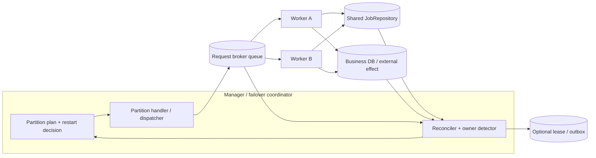
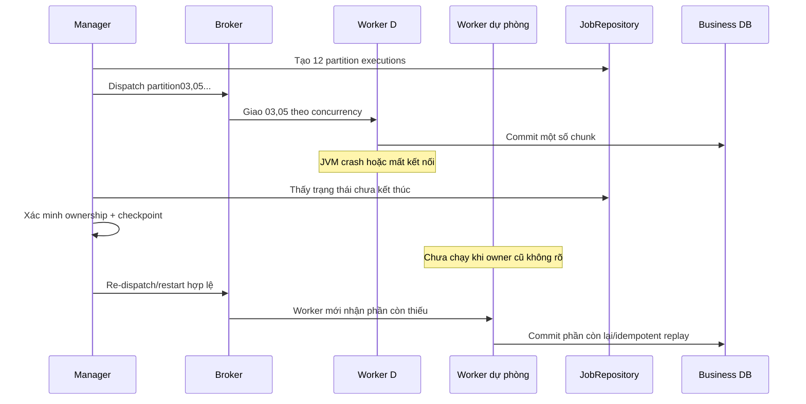
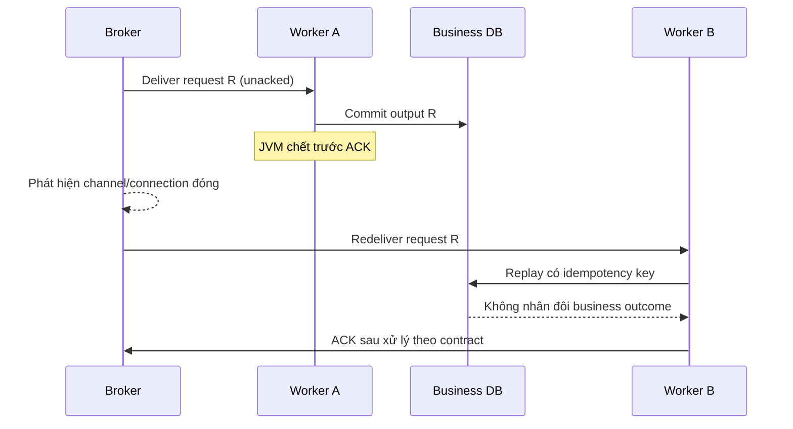
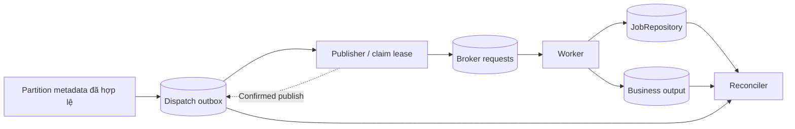
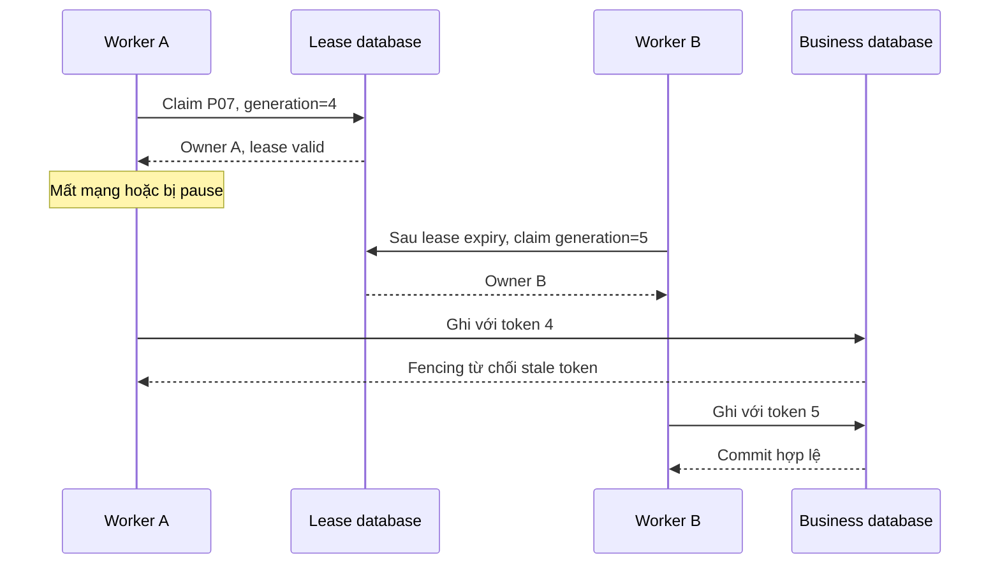
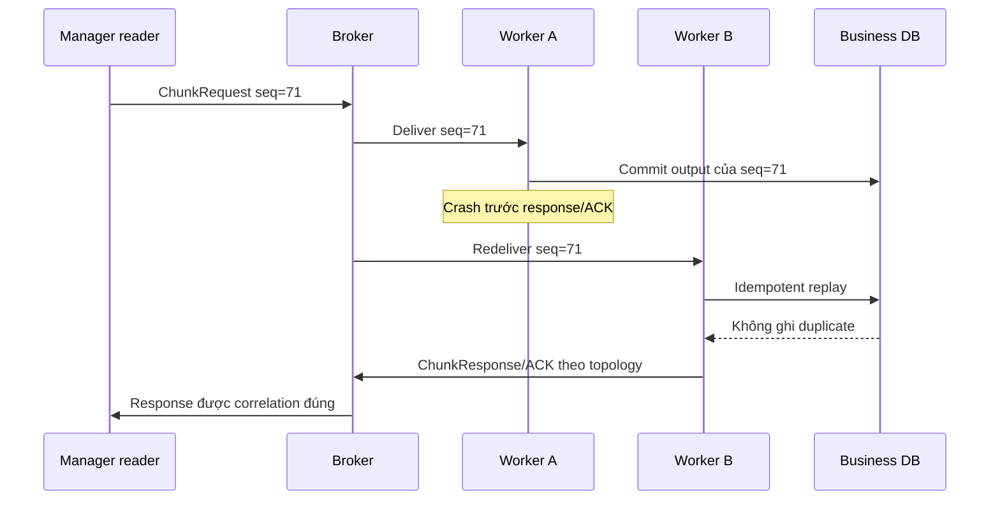
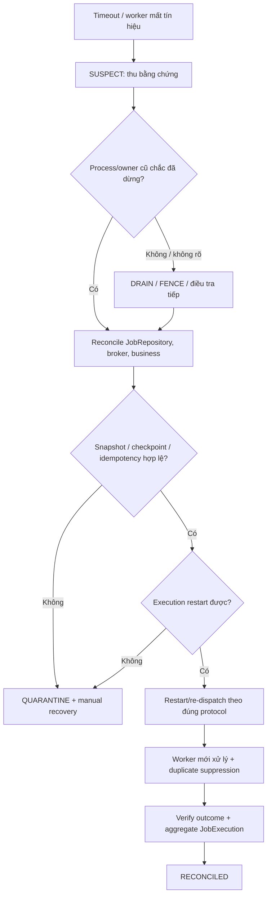

# Reassign công việc chưa hoàn tất trong Spring Batch phân tán

Một batch job xử lý 24 triệu bản ghi trên 12 worker có thể đang chạy thì hai worker bị `OOMKilled` hoặc mất kết nối broker. Câu hỏi không chỉ là **“đưa công việc của worker chết cho ai?”**, mà còn là: phần dữ liệu nào đã commit, phần nào chưa chạy, worker cũ có chắc đã ngừng ghi, và khi giao lại liệu một hóa đơn có bị cộng tiền hai lần? Nếu manager giao lại toàn bộ 12 partition, dữ liệu có thể bị xử lý trùng. Nếu chỉ dựa vào số message đang nằm trong queue, một số partition chưa từng được gửi có thể bị bỏ quên.

Bài **“Reassign công việc chưa hoàn tất”** thuộc chương **Failover**, module `SPRING_BATCH_SCALING_OPERATIONS`. Bài tập trung cách **chuyển quyền xử lý những đơn vị công việc còn thiếu** khi mở rộng Spring Batch qua multi-threaded step, parallel steps, local/remote partitioning và remote chunking. Mục tiêu là hiểu metadata của `JobRepository`, phân biệt retry với restart và redelivery, bảo đảm thread safety/idempotency, đo năng lực worker trước khi cấp lại việc và có runbook kiểm chứng kết quả.

Ví dụ dựa trên **Spring Batch 5.2.x**, Java 17+, PostgreSQL và broker kiểu RabbitMQ/JMS. Bảng outbox, lease, fencing và thuật toán điều phối trong bài là **thiết kế bổ sung do ứng dụng xây dựng**, không phải tính năng mặc định Spring Batch sẽ bật khi thêm dependency Integration. Các con số, schema và pseudo-code minh họa cần được kiểm chứng trong môi trường thực tế.

## 1. “Reassign” nghĩa là gì, và khác restart ra sao?

**Reassign** là việc chuyển **quyền sở hữu xử lý một đơn vị công việc chưa có kết quả cuối hợp lệ** từ worker/attempt cũ sang worker/attempt khác. Cách thực hiện phụ thuộc kiến trúc:

- Trong **remote partitioning**, đơn vị là partition `StepExecution`, có tên partition, phạm vi dữ liệu, checkpoint trong `ExecutionContext` và trạng thái ở `JobRepository`. Restart job theo Spring Batch có thể tạo **lần thực thi thích hợp cho các partition cần chạy lại**, không phải “mượn” bừa một `StepExecutionId` đang running.
- Trong **remote chunking**, đơn vị vận chuyển là `ChunkRequest`; manager đọc và đóng chunk, worker xử lý rồi trả `ChunkResponse`. Redelivery có thể phân phối **cùng chunk** cho consumer khác, nhưng không tạo child partition `StepExecution` tương ứng.
- Trong **local partitioning**, scheduler/`TaskExecutor` có thể xếp các partition vào thread khác; khi toàn bộ JVM chết, phải dựa vào restart metadata chứ không thể “chuyển” đối tượng thread đang chạy sang JVM mới.

Các khái niệm hay bị đánh đồng:

| Khái niệm | Tác dụng | Điểm cần giữ |
| --- | --- | --- |
| **Retry item/chunk** | Thử lại lỗi trong cùng ngữ cảnh step theo policy | Không nhân side effect |
| **Broker redelivery** | Giao lại một message chưa ACK/được NACK | Message có thể đã gây business commit |
| **Restart `JobInstance`** | Tạo `JobExecution` mới cho logical job khi trạng thái cho phép | Identifying parameters, context/checkpoint |
| **Reassign partition** | Worker khác đảm nhận phần partition cần chạy tiếp | Stable partition identity, owner/fencing |
| **Rebalance throughput** | Điều chỉnh phân phối do worker có tải không đều | Không thay partition bounds tùy tiện giữa restart |
| **Start job mới** | `JobInstance` khác, thường input/run khác | Không coi là resume trừ khi business có đối soát |

**Mục tiêu cuối** không phải exactly-once message delivery; nhiều transport theo mô hình at-least-once. Mục tiêu là **mọi dữ liệu hợp lệ có kết quả cuối, không mất việc và không áp dụng side effect nghiệp vụ lặp**.

## 2. Đơn vị công việc đang ở trạng thái nào?

Trước khi chuyển việc cho một worker mới, phải phân loại bằng **nhiều nguồn bằng chứng**:

| Trạng thái logic | Ví dụ bằng chứng | Có thể reassign ngay không? |
| --- | --- | --- |
| `NOT_CREATED` | Chưa có partition metadata | Không tự tạo khi chưa biết snapshot/partition plan |
| `PREPARED_NOT_SENT` | Có `StepExecution`/outbox, chưa publish confirmed | Cần dispatch/recovery của manager; không giả định đã vào broker |
| `QUEUED` | Broker còn message ready | Để consumer phù hợp nhận; tránh gửi bản duplicate không cần thiết |
| `IN_FLIGHT` | Delivery unacked, worker có heartbeat/lease | **Không** cho worker mới chạy song song nếu owner còn hợp lệ |
| `UNKNOWN` | Mất heartbeat/reply, broker confirm mơ hồ | Reconcile và fence trước quyết định |
| `COMMITTED_NO_ACK` | Business output đã commit, reply/ACK chưa đến | Có thể redelivery nhưng worker phải idempotent |
| `FAILED_RESTARTABLE` | Step/job thất bại hợp lệ, checkpoint còn đúng | Restart qua framework sau khi giải quyết owner |
| `COMPLETED` | Metadata kết thúc hợp lệ và business output khớp | Mặc định **không** chạy lại |
| `QUARANTINED` | Poison payload/hỏng checkpoint/chưa đối soát | Giữ để xử lý thủ công, không retry vô hạn |

Các nhãn trên là **trạng thái điều phối khái niệm**, không phải giá trị `BatchStatus` có sẵn. Không thêm `UNKNOWN` hoặc `QUEUED` vào `BATCH_STEP_EXECUTION.STATUS`; nếu cần lưu, tạo application dispatch/incident store riêng.

## 3. Bốn điều kiện bất biến trước mọi reassign

1. **Identity không đổi:** biết chính xác `JobInstance`, snapshot và partition/chunk business operation.
2. **Ownership được giải quyết:** worker cũ đã dừng, hoặc tầng ghi hỗ trợ **fencing** khiến worker cũ không còn gây side effect.
3. **Checkpoint còn hợp lệ:** phần đã commit được nhận diện, reader/writer restart đúng, không overlap hoặc skip dữ liệu.
4. **Replay an toàn:** duplicate message/attempt không thể nhân đôi kết quả nghiệp vụ; nếu hệ thống đích không hỗ trợ idempotency thì cần đối soát/compensation.

Nếu thiếu một điều kiện, trạng thái nên là **SUSPECT/INVESTIGATING**, không phải “cho worker khác chạy ngay”. Reassign an toàn là sự kết hợp giữa **tính đúng metadata, transport và kết quả business**, không phải chỉ một cờ health-check.

## 4. Sơ đồ các tầng phối hợp



**Ba sự thật khác nhau**:

- `JobRepository` ghi batch state (`JobInstance`, `JobExecution`, `StepExecution`, `ExecutionContext`), nhưng không chắc request đã vào broker.
- Broker biết delivery/ACK/redelivery/queue depth, nhưng không chắc transaction business đã commit.
- Business store hoặc external API biết tác dụng cuối, nhưng có thể không ghi ACK/reply tới manager.

Không có giao dịch phân tán tự động bao trùm cả ba. **Reconciler** đối chiếu cả ba thay vì chỉ đọc trạng thái của một nguồn.

## 5. Tình huống mẫu: 12 partition, một worker mất

Giả sử job tải invoice snapshot `S2026-11-26` có 12 partition không overlap, với worker concurrency tối đa 4:

```text
JobInstance:      invoiceImport(batchDate=2026-11-26, snapshot=S2026-11-26)
JobExecution:     2401
Manager step:     invoiceImport.manager
Worker step:      invoiceImport.worker
Partition names:  partition00..partition11

partition00  COMPLETED  (worker-A)
partition01  COMPLETED  (worker-B)
partition02  COMPLETED  (worker-C)
partition03  STARTED    (worker-D vừa mất)
partition04  STARTED    (worker-E còn chạy)
partition05  STARTED    (worker-D vừa mất)
partition06  FAILED     (worker-B ghi exception hợp lệ)
partition07  QUEUED     (trạng thái dispatch app; không phải BatchStatus)
partition08..11 chưa có worker thực thi
```

**Không thực hiện reassign theo lệnh “partition03 và 05 đang `STARTED` thì chuyển ngay cho worker-C”.** `STARTED` có thể còn do worker chết không graceful, nhưng cũng có thể worker-D vẫn sống mà manager mất kết nối. Cần xác minh process/lease, các chunk đã commit, state `JobRepository` và điều kiện restart.



Đây là timeline logic, không khẳng định Spring Batch sẽ tự hoàn thành tất cả bước “xác minh ownership” nếu chỉ cấu hình `@EnableBatchProcessing`.

## 6. Vì sao không thể lấy “queue depth” làm danh sách việc còn lại?

Một request không còn ở broker queue có thể:

1. Đã được worker nhận và đang `unacked`.
2. Đã được ACK dù side effect hoặc reply đang chờ ở tầng khác.
3. Đã bị worker xử lý xong, nhưng reply thất lạc.
4. Chưa bao giờ vào broker dù `StepExecution` đã tồn tại.
5. Đang ở DLQ hoặc retry queue.
6. Bị một manager khác consume nhầm reply/correlation.

Ngược lại, một message trong queue có thể thuộc `JobExecution` **cũ** đã bị dừng hoặc bị supersede. Vì vậy quy trình reassign cần **stable IDs và reconciliation**, không chỉ đếm số message ready.

## 7. JobInstance, JobExecution và StepExecution: identity phải đúng

Trong Spring Batch:

- **`JobInstance`** được nhận diện bởi tên job và các **identifying `JobParameters`**.
- **`JobExecution`** là một attempt của instance; restart đúng instance có thể tạo job execution mới.
- **`StepExecution`** là một attempt của step trong job execution, bao gồm execution context/checkpoint và `BatchStatus`.

```text
invoiceImport(batchDate=2026-11-26, snapshot=S42) = JobInstance X
  JobExecution 2401 = FAILED hoặc STOPPED sau recovery hợp lệ
    invoiceImport.worker:partition00 = COMPLETED
    invoiceImport.worker:partition03 = FAILED/không hoàn tất

  JobExecution 2402 = attempt restart của JobInstance X
    partition00 không cần chạy lại theo mặc định
    partition03 được khôi phục theo metadata/restart state
```

Không dùng `run.id=System.currentTimeMillis()` làm identifying parameter mới chỉ để “tiếp tục” job cũ: như vậy là **JobInstance mới**, có thể bắt đầu lại toàn bộ input. Nếu thực sự muốn run mới hoặc repartition từ đầu, đó là **quyết định business riêng**, phải có dedupe và audit.

## 8. Spring Batch 5.2 hỗ trợ restart partition đã thất bại như thế nào?

Spring Batch partitioning dùng:

- `PartitionStep`: manager step điều phối.
- `Partitioner`: sinh map `partitionName -> ExecutionContext` khi chia công việc.
- `StepExecutionSplitter`: tái dựng `StepExecution` của partitions cần thực thi.
- `PartitionHandler`: thực thi/dispatch các step executions tới worker.
- `StepExecutionAggregator`: tổng hợp trạng thái/kết quả.

Theo contract `StepExecutionSplitter.split(...)`, khi **restart** phải tái dựng state của lần execution lỗi và **chỉ trả về các executions cần restart**; `gridSize` khi restart là hint có thể được bỏ qua. Các partition đã `COMPLETED` thông thường **không thực thi lại**. Tuy nhiên `allowStartIfComplete(true)`, cách cấu hình splitter/partitioner hoặc việc đổi JobInstance có thể thay đổi kết quả, nên phải biết contract đang dùng.

### 8.1. Cấu hình local partitioning để hiểu SPI

```java
import org.springframework.batch.core.Step;
import org.springframework.batch.core.repository.JobRepository;
import org.springframework.batch.core.step.builder.StepBuilder;
import org.springframework.batch.core.partition.support.Partitioner;
import org.springframework.beans.factory.annotation.Qualifier;
import org.springframework.context.annotation.Bean;
import org.springframework.core.task.TaskExecutor;

@Bean
Step managerStep(
        JobRepository repository,
        @Qualifier("invoicePartitioner") Partitioner partitioner,
        @Qualifier("invoiceWorkerStep") Step workerStep,
        @Qualifier("partitionExecutor") TaskExecutor executor) {
    return new StepBuilder("invoice.manager", repository)
            .partitioner("invoice.worker", partitioner)
            .step(workerStep)
            .gridSize(12)
            .taskExecutor(executor)
            .build();
}
```

Đây là **local partitioning minh họa API** Spring Batch 5.x, không phải remote setup. Muốn remote partitioning dùng `RemotePartitioningManagerStepBuilder`, request/reply channels, broker adapters và worker step riêng. Code giả định đã có các bean tương ứng, tên step worker phải khớp cấu hình thực tế.

### 8.2. Khi restart, không tự đổi số/range partition

Ví dụ job ban đầu chia 12 partition theo dải PK. Nếu restart cùng JobInstance nhưng partitioner ngẫu nhiên sinh 24 dải khác nhau, tên partition và `ExecutionContext` không còn khớp checkpoint trước đó. **Giữ partition name, bounds và snapshot ổn định** cho toàn vòng đời logic; muốn reshard/reprocess thì lập một quy trình khác có đối soát.

## 9. Remote partitioning: StepExecutionRequest chứa gì?

Trong Spring Batch Integration 5.2, manager có thể gửi:

```java
import org.springframework.batch.integration.partition.StepExecutionRequest;

StepExecutionRequest request =
        new StepExecutionRequest(
                "invoice.worker",   // tên bean Step worker
                2401L,              // jobExecutionId của request này
                2418L               // stepExecutionId của một partition
        );
```

`StepExecutionRequest` không chứa toàn bộ records của partition; worker `StepExecutionRequestHandler` dùng `JobExplorer`/`StepLocator` để tìm `StepExecution` và `ExecutionContext` đã được manager chuẩn bị. Manager không nên tự sáng tác `stepExecutionId` khi broker timeout, bởi đó là identity do `JobRepository` quản lý.

**Một request cũ và một restart attempt khác nhau:** khi manager đã restart đúng `JobInstance`, `JobExecutionId` và các `StepExecutionId` hợp lệ có thể khác với attempt cũ. Một message cũ bị redeliver sau khi attempt mới bắt đầu **không được phép** khiến cùng business key được ghi hai lần. Phân loại message theo execution IDs, owner epoch và business operation key.

### 9.1. Worker không “tự nhận” một JobExecution mới từ request cũ

`StepExecutionRequestHandler.handle(...)` thực thi request theo identity đã có. Nó không phải API nhận lệnh “tạo JobExecution restart với partition mới”. Restart là quyết định của manager/job orchestration và `JobRepository`, phải bảo đảm execution hợp lệ trước khi dispatch.

Chỉ cần broker có **competing consumers** trên cùng request queue, việc worker-A chết có thể khiến broker giao một message unacked cho worker-B. Tuy nhiên đây là **redelivery transport**, chưa chứng minh metadata của execution đang phù hợp để chạy lại hay side effects đã an toàn.

## 10. Cấu hình remote partition manager và ý nghĩa của polling

Ví dụ Spring Batch 5.2.x, chọn **repository polling** thay vì reply aggregation:

```java
import org.springframework.batch.core.Step;
import org.springframework.batch.core.explore.JobExplorer;
import org.springframework.batch.core.partition.support.Partitioner;
import org.springframework.batch.core.repository.JobRepository;
import org.springframework.batch.integration.partition.RemotePartitioningManagerStepBuilder;
import org.springframework.beans.factory.annotation.Qualifier;
import org.springframework.context.annotation.Bean;
import org.springframework.messaging.MessageChannel;

@Bean
Step invoiceRemoteManager(
        JobRepository repository,
        JobExplorer explorer,
        @Qualifier("invoicePartitioner") Partitioner partitioner,
        @Qualifier("partitionRequests") MessageChannel requests) {

    return new RemotePartitioningManagerStepBuilder(
            "invoice.manager", repository)
            .partitioner("invoice.worker", partitioner)
            .gridSize(12)
            .outputChannel(requests)
            .jobExplorer(explorer)
            .pollInterval(5_000L)
            .timeout(1_800_000L)
            .build();
}
```

Đây là **method trong class `@Configuration`**, thiếu broker adapter, worker step, transaction/data source và job wiring nên **không phải chương trình độc lập**. `gridSize(12)` là hint số partitions, **không** khẳng định 12 worker instances. `pollInterval` và `timeout` tính bằng millisecond; `timeout` ở đây dùng khi polling `JobRepository` để chờ worker hoàn tất, **không tự xác nhận request đã gửi và không trực tiếp điều phối reassign**.

Nếu chọn **reply aggregation** bằng `inputChannel` thay vì polling, phải đảm bảo routing/correlation và pending aggregator state. Không nhận reply đúng hạn **không có nghĩa** worker chưa commit.

### 10.1. Repository polling giải quyết được gì?

- Quan sát child `StepExecution` đã ghi kết quả trong `JobRepository` dù reply có thể thất lạc.
- Tổng hợp kết quả dựa trên trạng thái thực của partitions khi manager còn sống, nếu worker cập nhật metadata đúng.
- Hỗ trợ restart từ metadata với splitter framework.

Nhưng polling **không tự đảm bảo phát request còn thiếu sau crash giữa dispatch**. Nếu manager lưu metadata xong rồi chết trước publish, repository có thể ghi partition nhưng broker không có request. Cần recovery theo JobInstance/manager step hoặc thiết kế dispatch audit/outbox/reconciliation bổ sung.

## 11. Restart JobInstance khi worker chết

Quy trình đúng **không** bắt đầu từ việc sửa bảng `BATCH_STEP_EXECUTION`. Nó bắt đầu từ việc xác minh:

1. Manager cũ và worker cũ không còn quyền chạy/ghi cùng partition (fencing hoặc xác nhận dừng).
2. `JobExecution` đang ở trạng thái framework **cho phép restart** (`FAILED`/`STOPPED`), không phải `STARTED` mồ côi không được xử lý.
3. `JobInstance` còn restartable; step/start-limit và `allowStartIfComplete` được hiểu rõ.
4. `ExecutionContext`/checkpoint còn hợp lệ; dataset snapshot/partition names không đổi.
5. Writer/outbox/API có idempotency để chịu replay sau commit-before-ACK.

Sau khi đã kiểm:

```java
import org.springframework.batch.core.BatchStatus;
import org.springframework.batch.core.JobExecution;
import org.springframework.batch.core.explore.JobExplorer;
import org.springframework.batch.core.launch.JobOperator;

public final class ControlledBatchRestart {

    private final JobExplorer explorer;
    private final JobOperator operator;

    public ControlledBatchRestart(
            JobExplorer explorer, JobOperator operator) {
        this.explorer = explorer;
        this.operator = operator;
    }

    public long restartAfterFencingAndReconciliation(
            long previousExecutionId) throws Exception {

        // Đây là kiểm tra phụ, không thay thế precondition về
        // process/owner và side effects ở tầng orchestrator.
        JobExecution previous =
                explorer.getJobExecution(previousExecutionId);
        if (previous == null) {
            throw new IllegalArgumentException("Unknown execution");
        }
        BatchStatus status = previous.getStatus();
        if (status != BatchStatus.FAILED
                && status != BatchStatus.STOPPED) {
            throw new IllegalStateException(
                    "Not restartable from status: " + status);
        }

        return operator.restart(previousExecutionId);
    }
}
```

Method chỉ là **minh họa read-only guard + API restart**, không thực hiện fencing hoặc kiểm business state. Framework còn có thể từ chối do job không restartable, metadata không nhất quán hoặc JobInstance đã completed.

### 11.1. JobExecution STARTED mồ côi sau kill -9

Spring Batch 5.2 mô tả trường hợp process chết đột ngột nhưng repository không được thông báo, vì vậy execution có thể còn `STARTED`. Việc xác định `FAILED` để restart hay `ABANDONED` để dừng hẳn là **quyết định nghiệp vụ/operational**, cần chứng minh không còn process hoạt động và dữ liệu restart hợp lệ. Không tự chạy `UPDATE BATCH_JOB_EXECUTION SET STATUS='FAILED'` trong job code như một recovery mặc định.

Nếu tổ chức có runbook sửa metadata sau crash, phải kiểm quyền, backup/audit, kết hợp trạng thái job/step/context và ngăn đồng thời; đây là **can thiệp ngoại lệ có kiểm soát**, không phải gợi ý cho tự động hóa theo một heartbeat timeout.

## 12. Reassign qua broker: ACK và redelivery không bằng re-run an toàn

Giả định broker giao request cho worker A, ACK thủ công sau khi logic hoàn thành:



Trong RabbitMQ, khi consumer/channel đóng mà message chưa ACK, broker có thể requeue để giao lại. **Thứ tự** DB commit, gửi reply và ACK tùy adapter/transaction policy, nên không giả định mọi Spring Integration listener thực hiện chính xác thứ tự trong sơ đồ nếu chưa kiểm cấu hình.

| Kiểu xác nhận | Hệ quả khi worker chết | Đánh đổi |
| --- | --- | --- |
| ACK **trước** business commit | Có thể mất công việc nếu crash sau ACK | Latency thấp nhưng dễ mất việc nếu không có store khác |
| ACK **sau** commit | Có thể redelivery request đã commit | At-least-once; yêu cầu idempotency |
| NACK/requeue mọi exception | Việc được giao lại | Có nguy cơ poison-message loop |
| Reject + DLQ sau retry budget | Không làm nghẽn hàng chờ chính mãi | Phải có quy trình quarantine/repair/replay |

**Publisher confirm** chỉ cho biết producer được broker xác nhận publish theo cấu hình; không chứng minh consumer đã xử lý hoặc business DB commit. **Consumer ACK** xác nhận delivery, không thay thế `JobRepository` checkpoint hay idempotency.

### 12.1. Reassign không cần manager “chọn tên worker” nếu dùng work queue

Trong mô hình competing consumers, worker rảnh thường lấy request tiếp theo từ queue. Broker có thể tự redeliver unacked request sau mất connection. Nhưng manager vẫn chịu trách nhiệm **không khởi chạy hai JobExecutions chồng chéo**, và worker cần bảo vệ against duplicate/stale requests.

Nếu topology dùng worker-specific queues hoặc RPC reply-to instance, việc chuyển job sang worker B có thể cần **reroute/re-dispatch** do ứng dụng. Không lấy hành vi tự động của shared work queue áp sang mọi hệ messaging.

## 13. Crash giữa lưu metadata và publish request

Thứ tự phổ biến:

```text
T0: manager tạo StepExecution + ExecutionContext cho partition07
T1: JobRepository commit metadata partition07
T2: manager gọi publish request partition07
T3: manager crash hoặc network timeout chưa biết broker confirm
```

Tại T3 có hai khả năng:

- **Request chưa vào broker:** sẽ mất việc nếu không có restart/re-dispatch.
- **Request đã vào broker:** publish lại có thể tạo **duplicate deliveries**.

Không có transaction chung mặc định giữa `JobRepository` và broker, nên **chỉ với status `STARTED`/`UNKNOWN` không thể suy chính xác** request đã publish chưa. Một giải pháp là dựa vào **restart `JobInstance`** khi điều kiện hợp lệ và business idempotency; khi yêu cầu recovery dispatch chặt chẽ hơn, thêm **outbox + reconciliation**.

### 13.1. Outbox là thành phần tùy chỉnh, không phải Spring Batch mặc định



**Ranh giới giao dịch rất quan trọng:** Spring Batch không tự ghi một outbox row cùng transaction khi `Partitioner` tạo `StepExecution`. Nếu muốn atomic metadata+outbox, ứng dụng phải triển khai cơ chế tùy chỉnh có transaction hợp lệ hoặc reconciliation cho khoảng trống. Đừng chỉ tạo bảng rồi tuyên bố không bao giờ mất request.

Ví dụ PostgreSQL:

```sql
CREATE TABLE partition_dispatch_outbox (
    dispatch_id         UUID PRIMARY KEY,
    job_execution_id    BIGINT NOT NULL,
    step_execution_id   BIGINT NOT NULL,
    worker_step_name    VARCHAR(150) NOT NULL,
    dispatch_state      VARCHAR(20) NOT NULL DEFAULT 'PENDING',
    publisher_generation BIGINT NOT NULL DEFAULT 0,
    next_attempt_at     TIMESTAMPTZ NOT NULL DEFAULT CURRENT_TIMESTAMP,
    publish_attempts    INTEGER NOT NULL DEFAULT 0,
    created_at          TIMESTAMPTZ NOT NULL DEFAULT CURRENT_TIMESTAMP,
    sent_at             TIMESTAMPTZ,
    UNIQUE (job_execution_id, step_execution_id)
);
```

`dispatch_state='SENT'` theo contract chỉ nói broker đã xác nhận publish, **không** nói worker hoàn thành. Khi crash sau broker confirm nhưng trước update `SENT`, publisher sẽ có thể phát lại cùng dispatch logical key. Worker bắt buộc phải xử lý duplicate an toàn.

### 13.2. Outbox lifecycle

```text
PENDING
  -> CLAIMED(ownerId, generation, leaseUntil)
  -> SENT (broker confirm, route hợp lệ)
  -> OBSERVED_COMPLETED (chỉ nếu reconciliation bổ sung)

CLAIMED -> PENDING khi retry có backoff / lease hết
CLAIMED -> QUARANTINED khi payload/schema không thể sửa tự động
```

Đây là **lifecycle ứng dụng**, không phải các giá trị Spring Batch `BatchStatus`. Nếu publisher lease hết, một publisher khác có thể thử lại; fencing ngăn publisher cũ ghi trạng thái outbox nhưng không thể thu hồi message đã gửi ra network. Broker có thể nhận duplicate và worker phải idempotent.

## 14. Worker timeout không có nghĩa worker chết

Một worker không trả reply có thể do:

1. JVM thực sự chết (`OOMKilled`, `SIGKILL`).
2. Worker còn sống nhưng bị GC pause hoặc CPU throttling.
3. Thread đang chờ lock/database connection/HTTP response.
4. Mất riêng broker/reply network trong khi transaction DB vẫn commit.
5. Manager không nhận đúng reply do routing/correlation lỗi.
6. Worker còn chạy nhưng process/health endpoint không trả lời do thread starvation.

Nếu manager chạy lại partition theo timeout 60 giây, còn worker cũ đang trong một transaction 90 giây, **hai worker có thể cùng cập nhật dữ liệu**. Một failover detector nên phát tín hiệu `SUSPECT` trước, chỉ phát lệnh reassign khi ownership được giải quyết.

| Tín hiệu | Cho biết | Không đủ để chứng minh |
| --- | --- | --- |
| Pod/JVM `Running` | Process chưa bị OS ghi nhận chết | Business thread có tiến triển |
| Broker heartbeat còn | Connection còn trao đổi tín hiệu | Worker đang commit hợp lệ |
| `StepExecution.STARTED` | Metadata chưa có kết thúc | Process vẫn chạy |
| `lastProgressAt` không đổi | Không có checkpoint/progress mới | Worker đã chết |
| Lease đã hết | Worker cũ mất quyền theo **ứng dụng** nếu có fencing | Worker cũ thực sự dừng gửi side effect |
| `ChunkResponse` không đến | Manager chưa ghi nhận reply | Writer chưa commit |

**Tách liveness với progress.** Worker có thể còn heartbeat nhưng không tiến triển do DB lock. Trái lại, một chunk chạy lâu nhưng hợp lệ có thể không có commit mới trong nhiều phút. Dùng threshold theo p99/p99.9 của workload thay vì một giá trị cố định cho mọi partition.

## 15. Lease và fencing để chuyển quyền không ghi chồng

**Lease** là quyền xử lý có thời hạn được lưu bền vững. **Fencing token** là version tăng đơn điệu khi owner mới được cấp quyền; tầng ghi nghiệp vụ phải kiểm token để chặn owner cũ. Chỉ thêm `leaseUntil` trong một bảng mà không kiểm khi ghi **không đủ**.



Các bảng lease là **phần mở rộng tùy chỉnh**. Spring Batch không tự sử dụng một `fencing_generation` do ứng dụng tạo khi chạy `StepExecutionRequestHandler`.

### 15.1. Schema cho một owner của logical partition

```sql
CREATE TABLE partition_ownership (
    job_instance_key VARCHAR(180) NOT NULL,
    partition_key    VARCHAR(100) NOT NULL,
    owner_id         VARCHAR(150),
    generation       BIGINT NOT NULL DEFAULT 0,
    lease_until      TIMESTAMPTZ,
    last_seen_at     TIMESTAMPTZ,
    last_progress_at TIMESTAMPTZ,
    PRIMARY KEY (job_instance_key, partition_key)
);
```

`job_instance_key` là identity ổn định theo business snapshot/`JobInstance`; không dùng mỗi `partition00` vì nó tái xuất hiện trên nhiều ngày/job. Khóa này phải phù hợp phạm vi mà ứng dụng muốn chặn ghi trùng, kể cả khi `JobExecutionId` thay đổi sau restart.

### 15.2. Claim/reassign khi lease hết hạn

Giả định row đã được khởi tạo:

```sql
UPDATE partition_ownership
   SET owner_id = :newOwnerId,
       generation = generation + 1,
       lease_until = clock_timestamp() + INTERVAL '120 seconds',
       last_seen_at = clock_timestamp()
 WHERE job_instance_key = :jobInstanceKey
   AND partition_key = :partitionKey
   AND (owner_id IS NULL OR lease_until < clock_timestamp())
RETURNING generation, lease_until;
```

Trả về **một hàng** nghĩa claim thành công; **không có hàng** nghĩa chưa claim được hoặc key không tồn tại. Không gửi request mới nếu không giành được quyền. Nếu nhiều coordinator muốn claim cùng lúc, conditional update/transaction + unique key giúp giảm race; vẫn phải xử lý trường hợp row chưa tạo và owner cũ còn in-flight.

Dùng thời gian DB `clock_timestamp()` giảm lệ thuộc chênh lệch giờ giữa Pods. Cần có chính sách lease renew, backoff, network partition và deadline phù hợp; timeout theo đồng hồ vẫn có thể chịu ảnh hưởng clock adjustment.

### 15.3. Gia hạn chỉ khi đúng owner và generation

```sql
UPDATE partition_ownership
   SET lease_until = clock_timestamp() + INTERVAL '120 seconds',
       last_seen_at = clock_timestamp()
 WHERE job_instance_key = :jobInstanceKey
   AND partition_key = :partitionKey
   AND owner_id = :ownerId
   AND generation = :generation
   AND lease_until > clock_timestamp()
RETURNING generation;
```

Nếu **0 rows updated**, worker phải coi quyền xử lý bị mất, ngừng nhận công việc mới và dừng trước side effect tiếp theo. Nhưng nếu worker đã gửi HTTP POST trước khi biết mất lease, một kiểm tra trong DB lease không đảo ngược POST; **external idempotency contract** vẫn cần thiết.

### 15.4. Fencing phải nằm trên đường commit

Với **lease table và business table ở cùng PostgreSQL database**, có thể thiết kế một transaction ngắn cho mỗi chunk/operation:

```sql
BEGIN;

-- Giữ lock owner row tới khi transaction commit/rollback.
SELECT generation, owner_id, lease_until
  FROM partition_ownership
 WHERE job_instance_key = :jobInstanceKey
   AND partition_key = :partitionKey
 FOR UPDATE;

-- Logic ứng dụng kiểm:
--  generation = :generation
--  owner_id = :ownerId
--  lease_until > clock_timestamp()
-- Nếu không thỏa, ROLLBACK và KHÔNG ghi.

INSERT INTO normalized_invoice(snapshot_id, invoice_id, normalized_amount)
VALUES (:snapshotId, :invoiceId, :normalizedAmount)
ON CONFLICT (snapshot_id, invoice_id)
DO UPDATE SET normalized_amount = EXCLUDED.normalized_amount;

COMMIT;
```

**Các câu kiểm owner giữa `SELECT` và `INSERT` là logic ứng dụng bắt buộc**, không phải SQL tự động bảo vệ chỉ nhờ `SELECT FOR UPDATE`. Cùng transaction lock owner row khiến một claim `UPDATE` mới phải chờ commit hiện tại, giúp sắp thứ tự đổi owner và ghi data khi cả hai dùng **cùng DB**. Không giữ DB lock suốt một remote step dài hoặc HTTP network call: như vậy làm lease claim chậm, gây lock contention và nghẽn cluster.

**Lưu ý quan trọng:** trong chunk-oriented Spring Batch thực tế, transaction đã được `StepBuilder.chunk(..., transactionManager)` quản lý; ví dụ SQL chỉ mô tả transaction boundaries. Không tạo `BEGIN/COMMIT` thủ công bên trong `ItemWriter` dùng chung transaction manager. Hãy triển khai guard và write trong **cùng transaction chunk** theo Spring transaction API.

Nếu lease store và business DB khác nhau, không có lock chung mặc định. Dùng idempotency key, downstream fencing/conditional writes hoặc reconciliation; không tuyên bố exactly-once khi chỉ sở hữu một lease row.

## 16. Reassign phải giữ partition bounds và snapshot

Ví dụ dữ liệu 1,2 triệu invoice, chia 12 range:

```text
partition00: [0,       100000)
partition01: [100000,  200000)
...
partition11: [1100000, 1200000)
```

Mỗi partition context phải gắn với **snapshot hoặc cutoff dữ liệu** đã xác định. Nếu database có row mới trong khi worker down, phép scan `WHERE status='NEW'` mà không khóa snapshot/định nghĩa process indicator có thể thêm/loại dữ liệu khác với lần đầu. Reassign phải tiếp tục cùng **logical dataset**, không âm thầm đổi nghĩa partition.

### 16.1. Partitioner định danh ổn định

Ví dụ Java `Partitioner` cho input snapshot ID và các dải số nguyên cố định:

```java
import java.util.LinkedHashMap;
import java.util.Map;

import org.springframework.batch.core.partition.support.Partitioner;
import org.springframework.batch.item.ExecutionContext;

public final class FixedRangePartitioner implements Partitioner {
    private final long minInclusive;
    private final long maxExclusive;
    private final String snapshotId;
    private final int partitionCount;

    public FixedRangePartitioner(long minInclusive,
                                 long maxExclusive,
                                 String snapshotId,
                                 int partitionCount) {
        if (maxExclusive <= minInclusive || partitionCount <= 0) {
            throw new IllegalArgumentException("Invalid partition plan");
        }
        this.minInclusive = minInclusive;
        this.maxExclusive = maxExclusive;
        this.snapshotId = snapshotId;
        this.partitionCount = partitionCount;
    }

    @Override
    public Map<String, ExecutionContext> partition(int gridSize) {
        // gridSize được coi là hint; restart cần giữ plan đã chốt.
        Map<String, ExecutionContext> result = new LinkedHashMap<>();
        long total = maxExclusive - minInclusive;
        for (int i = 0; i < partitionCount; i++) {
            long from = minInclusive + total * i / partitionCount;
            long to = minInclusive + total * (i + 1) / partitionCount;
            ExecutionContext context = new ExecutionContext();
            context.putLong("minIdInclusive", from);
            context.putLong("maxIdExclusive", to);
            context.putString("snapshotId", snapshotId);
            result.put(String.format("partition%02d", i), context);
        }
        return result;
    }
}
```

Ví dụ **giả định total × partitionCount không gây overflow**; với phạm vi ID rất lớn, cần phép tính tránh tràn, kiểm khoảng rỗng và range strategy khác. `FixedRangePartitioner` cần được tạo từ **plan đã lưu và snapshot ổn định**; nếu application đổi constructor input sau deploy, restart có thể không khớp metadata. Dải `[from,to)` dùng upper bound exclusive để tránh overlap.

Trong Spring Batch restart, `StepExecutionSplitter` có thể tái dựng partitions từ metadata thay vì gọi partitioner như lần chạy đầu; nhưng không được vì vậy mà cho phép logic mới thay đổi meaning của partition keys khi một JobInstance còn chưa kết thúc.

### 16.2. Reader checkpoint đúng phạm vi

Một reader per-partition cần `@StepScope` để lấy `minIdInclusive`, `maxIdExclusive`, `snapshotId` từ `stepExecutionContext`. Reader có state riêng cho mỗi `StepExecution` và `ItemStream.open/update/close` được framework quản lý.

Với JDBC paging, sort key cần **duy nhất và ổn định**; với cursor, transaction isolation/fetch size và restart behavior phải được test. Nếu query luôn áp dụng `WHERE processed=false` trong lúc writer đổi chính flag này, offset paging có thể **skip rows**; dùng keyset/paging strategy phù hợp hoặc process-indicator claim protocol có tính toán. Reassign không sửa được một reader vốn có checkpoint sai.

## 17. Tính idempotency theo **business operation**, không theo message ID

Khi một request có thể redeliver hoặc JobExecution restart, transport message ID và `StepExecutionId` có thể đổi. Khóa tránh ghi trùng nên gắn với **operation nghiệp vụ và snapshot**.

Ví dụ PostgreSQL, giả định mỗi invoice snapshot có một kết quả deterministic:

```sql
CREATE TABLE normalized_invoice (
    snapshot_id       VARCHAR(100) NOT NULL,
    invoice_id        BIGINT NOT NULL,
    normalized_amount NUMERIC(18,2) NOT NULL,
    written_at        TIMESTAMPTZ NOT NULL DEFAULT CURRENT_TIMESTAMP,
    PRIMARY KEY (snapshot_id, invoice_id)
);

INSERT INTO normalized_invoice(snapshot_id, invoice_id, normalized_amount)
VALUES (:snapshotId, :invoiceId, :normalizedAmount)
ON CONFLICT (snapshot_id, invoice_id)
DO UPDATE
  SET normalized_amount = EXCLUDED.normalized_amount;
```

Đây là **idempotent upsert** chỉ khi cùng snapshot luôn tính ra cùng giá trị và update không kích hoạt side effect phụ không idempotent. Nếu code làm `balance = balance + amount`, cần một **operation log/unique key** chặn cộng tiền lần hai.

### 17.1. Deduplication key cho ghi ngoài DB

```text
operationKey = invoiceId + ":" + operationType + ":" + businessVersion
Ví dụ: "invoice-9107:charge:v1"
```

Giữ **cùng key trên mọi retry, redelivery, restart**, kể cả JobExecution thay đổi. Hệ thống đích phải xác nhận contract: lưu kết quả theo key, retention đủ dài và phản hồi khi duplicate. `UUID.randomUUID()` mỗi attempt **không phải** idempotency key hữu ích cho cùng logical operation.

Nếu API không có idempotency, dùng outbox/reconciliation, điều tra kết quả đã áp dụng trước khi gửi lại hoặc có compensation được business chấp nhận. Không quảng cáo "exactly once" chỉ nhờ broker durable + StepExecution status.

## 18. Remote chunking: reassign qua message khác partition restart

Trong remote chunking:

1. Manager `ItemReader` đọc dữ liệu và gom chunk.
2. `ChunkMessageChannelItemWriter` đóng item vào `ChunkRequest`, gửi tới broker.
3. Worker `ChunkProcessor` xử lý và ghi output.
4. Worker trả `ChunkResponse` để manager tổng hợp contribution và điều kiện tiến tới chunk tiếp theo.



Trong mô hình này **không có child partition `StepExecution` riêng cho mỗi chunk** để manager restart một partition như remote partitioning. Reader/checkpoint và pending reply state nằm ở **manager step**, còn broker quyết định worker nào nhận delivery. Nếu manager crash khi nhiều chunks còn in-flight, reader có thể phát lại item/chunk khi restart. **Chỉ cấu hình durable queue không đủ** để khôi phục state/correlation trong RAM của manager; phải test protocol, ACK boundaries, worker idempotency và restart semantics.

### 18.1. Các loại “trùng” trong remote chunking

| Tình huống | Có thể xảy ra | Điều cần thiết |
| --- | --- | --- |
| Broker redeliver đúng message ID | Worker cũ commit trước ACK | Business idempotency |
| Manager restart tạo request message mới cho cùng item | Reader/checkpoint quay lại phần chưa xác nhận | Dedupe bằng business key, không message ID |
| Worker reply trùng | Broker redelivery hoặc resend reply | Correlation + de-duplicate contribution |
| Late reply từ attempt trước | Manager mới đang xử lý JobExecution mới | Validate execution/sequence, quarantine stale |
| Message payload đổi schema sau deploy | Worker mới không deserialize được | Versioning, DLQ và replay procedure |

Một `ChunkResponse` có thông tin correlation/sequence giúp match replies, nhưng không chứng minh exactly-once của external side effect. Đừng dùng `sequence` đơn lẻ làm khóa business dedupe cho nhiều JobInstances khác nhau.

### 18.2. maxWaitTimeouts và reassign

Trong Spring Batch Integration 5.2, `RemoteChunkingManagerStepBuilder.maxWaitTimeouts(int)` giới hạn số chu kỳ đợi kết quả non-null ở cuối step có pending requests, phối hợp với receive timeout được cấu hình riêng. Nó **không phải lệnh kill worker**, **không tự fencing** và **không tự đảm bảo gửi lại mọi chunk bị thiếu**. Khi wait timeout, bắt đầu quy trình reconciliation; không tự kết luận business DB chưa commit.

## 19. Reply muộn, duplicate reply và aggregator state

Khi reassign, reply từ worker cũ có thể đến **sau** reply worker mới, hoặc đến khi manager process đã restart:

```text
T0 Request R gửi tới worker A
T1 A thực thi và commit
T2 Manager timeout, nhưng chưa biết A đã commit
T3 Điều phối reassign sau fencing/reconciliation
T4 Worker B xử lý lại (idempotent)
T5 Reply B đến trước
T6 Reply A đến muộn
```

Điều phối cần xử lý theo **logical request identity + execution attempt + owner generation**:

- Không đếm reply trùng thành hai completion.
- Không merge reply của `JobExecution` cũ vào metadata attempt mới.
- Không ACK/xóa reply chưa hiểu nguồn khi chưa có chính sách quarantine.
- Nếu kết quả `StepExecution` đã `COMPLETED`, ưu tiên dữ liệu bền vững/đối soát thay vì “request nào trả lời trước thì thắng” khi có side effect bất thường.
- Nếu manager dùng in-memory `QueueChannel`/aggregator, pending replies có thể mất sau process crash; broker durable queue không tự bền vững hóa state đã ACK vào RAM.

**Cẩn thận:** routing reply theo hostname/pod ID cố định làm manager mới không thể đọc reply của lần trước khi Pod bị thay. Thiết kế correlation và durable reply transport phải gắn với **job/execution identity** hoặc một router có quyền sở hữu rõ ràng, không chỉ một ephemeral worker name.

## 20. Reassign ở mức “item” và “partition” không phải cùng một chiến lược

Trong một partition đã xử lý 75% số row, có hai lựa chọn:

1. **Restart cùng logical partition** từ checkpoint do `ItemStream`/`ExecutionContext` lưu. Đây là đường mặc định nên ưu tiên khi framework restartable và execution hợp lệ.
2. **Chia lại phần chưa xử lý thành nhiều partition nhỏ** (“work stealing”/dynamic task queue). Đây là **thuật toán phân phối tùy chỉnh**, cần xác định tập chưa xử lý độc lập, guard overlap và business idempotency.

Không biến cách thứ hai thành một option ẩn của `gridSize` khi restart. `StepExecutionSplitter` có contract phục hồi partitions theo state cũ; việc sinh tên mới và bounds mới trong cùng instance khi vẫn có checkpoint cũ rất dễ skip/duplicate.

### 20.1. Nếu muốn “chia lại phần còn thiếu”, dùng work-unit ledger

Một mô hình ứng dụng riêng có bảng business work units:

```sql
CREATE TABLE work_unit (
    work_unit_id      UUID PRIMARY KEY,
    snapshot_id       VARCHAR(100) NOT NULL,
    range_start       BIGINT NOT NULL,
    range_end_excl    BIGINT NOT NULL,
    status            VARCHAR(20) NOT NULL DEFAULT 'PENDING',
    owner_id          VARCHAR(150),
    generation        BIGINT NOT NULL DEFAULT 0,
    lease_until       TIMESTAMPTZ,
    created_at        TIMESTAMPTZ NOT NULL DEFAULT CURRENT_TIMESTAMP,
    CHECK (range_end_excl > range_start)
);
```

Đây **không phải `JobRepository` và không mặc định được Spring Batch cập nhật**. Phải tự thiết kế transaction, split/merge/overlap constraint, lineage và reconciliation với actual data. Ví dụ row range chồng lấn là một vấn đề khác với unique key work_unit_id; riêng primary key **không ngăn hai ranges overlap**. PostgreSQL exclusion constraints hoặc một manifest kiểm overlap có khóa giao dịch là lựa chọn thiết kế tùy use case.

Đối với các job có checkpoint ổn định, **giữ partition plan cũ thường ít rủi ro hơn** xây một scheduler dynamic phức tạp chỉ để tiết kiệm vài phút.

## 21. Work stealing và fairness khi nhiều worker có tốc độ khác nhau

Khi một worker chậm hơn, không nhất thiết phải **thu hồi job đang chạy**. Có thể:

- Chia partition ban đầu thành nhiều phần đủ nhỏ để worker rảnh nhận **partition mới** từ queue.
- Dùng competing consumers để broker phân công request chưa được nhận.
- Với local partitioning, dùng bounded `TaskExecutor` xử lý các step executions được submit, tránh hàng chờ vô hạn.
- Tách pool worker CPU-heavy, I/O-heavy hoặc tenant có quota riêng để tránh một nhóm việc lớn chiếm hết tài nguyên.
- Áp priority/fairness theo SLA nhưng không thay đổi order nghiệp vụ nếu thứ tự là ràng buộc bắt buộc.

**Không lấy một partition `IN_FLIGHT` của worker chậm để chạy song song trên worker nhanh**, trừ khi business cho phép speculative execution với fencing/idempotent writes đã được chứng minh. Với nhiều workload, cân bằng tải bằng **future tasks** an toàn hơn reassign một execution đang hoạt động.

## 22. Resource sizing khi reassign hàng loạt

Sau khi 4 worker bị kill trong cluster 12 worker, 8 worker còn sống sẽ nhận thêm backlog. Nếu mỗi worker đã bão hòa CPU/DB connections, việc redeliver tất cả request ngay có thể gây **recovery storm**:

```text
Worker count ban đầu        = 12
Mỗi worker active tasks     = 2
Concurrent tasks ban đầu    = 24
Sau mất 4 workers          = 8 workers
Available capacity         <= 16 tasks (nếu 2 tasks/worker)
Task đang cần khôi phục    = có thể nhiều hơn 8
```

Không nên tăng đồng thời `consumer concurrency`, `JDBC maxPoolSize`, `HTTP maxConnTotal` và `prefetch` chỉ để xóa backlog thật nhanh. Tổng load có thể chuyển sang database/API/broker và tạo thêm failure.

### 22.1. Giới hạn reassign theo năng lực thực tế

| Thước đo | Giới hạn cần đối chiếu |
| --- | --- |
| Active `StepExecution`/worker | Executor threads, CPU quota, memory/chunk buffers |
| HTTP in-flight | Per-route/total pool và upstream rate limit |
| JDBC connections | Hikari pool per worker × số workers, DB server max |
| Broker unacked/prefetch | Consumer capacity, memory, ACK deadline |
| File handles | FD limit theo JVM và node |
| Metadata polling | JobRepository DB queries, connection pool |
| Business idempotency table | Unique index contention và transaction latency |

**Ưu tiên measured committed throughput, không phải request/s.** Nếu thêm worker làm tăng `lock_wait` hoặc 429/503, thời gian hoàn tất phần còn lại có thể **dài hơn** dù số consumer cao hơn.

### 22.2. Backpressure cho dispatcher

Một thiết kế tốt giữ `maxInFlight`/worker hữu hạn, queue có giới hạn, retry/backoff có jitter và chỉ claim thêm khi còn capacity. Khi broker outage kết thúc, không replay toàn bộ backlog trong một burst. Với remote chunking, manager còn bị giới hạn bởi pending `ChunkRequest` và `throttleLimit`/receive timeout tùy version.

**Không dùng số pod `Ready` làm capacity tuyệt đối:** pod có thể đang giữ nhiều chunk, DB chờ, GC dài hoặc bị CPU throttling. Dùng heartbeat **và** active tasks/lag/pool utilization.

## 23. Các loại lỗi nên hoặc không nên reassign tự động

| Loại lỗi | Reassign tự động? | Điều kiện |
| --- | --- | --- |
| Worker process chết rõ ràng trước business commit | Thường có thể, **sau** metadata/owner check | Checkpoint và broker state hợp lệ |
| Worker chết sau commit trước reply | Có thể replay nhưng **phải idempotent** | Business outcome được bảo vệ và correlation chuẩn |
| Message chưa từng publish | Có thể dispatch lại qua restart/outbox | Identifying keys và request IDs đúng |
| Timeout, worker còn chạy | **Không ngay** | Cần drain/fence trước khi giao lại |
| Poison message schema sai | **Không lặp vô hạn** | Quarantine, sửa payload/version |
| DB constraint business violation | Không tự chạy worker khác để chữa | Fix dữ liệu hoặc skip policy rõ |
| API bên ngoài không hỗ trợ idempotency | Cần manual reconciliation | Không retry mù |
| Checkpoint/ExecutionContext hỏng | Không | Điều tra metadata trước |
| File nguồn/snapshot đã biến mất | Không | Khôi phục đúng input version hoặc quyết định reprocess |
| Worker pool bão hòa CPU/DB | Chuyển sang worker rảnh chỉ nếu có capacity | Không nhân thêm tasks khi downstream đã bão hòa |

**Error classification** giúp tránh biến mọi lỗi nghiệp vụ thành “worker unhealthy” rồi reassign tới tất cả workers, tạo retry storm và che root cause.

## 24. Deadline, lease và Retry-After không phải một con số

Đặt riêng:

```text
Transport receive timeout       = chờ reply/network một lần
Consumer ACK deadline           = broker chờ ACK của delivery
Heartbeat suspicion threshold   = nghi ngờ process mất tín hiệu
Lease expiry                    = điều kiện thu hồi ownership
Chunk/partition duration budget = kỳ vọng tốc độ tiến triển nghiệp vụ
Job SLA                         = hạn cuối workflow hoàn thành
Retry backoff                   = trì hoãn thử lại sau lỗi tạm thời
```

Ví dụ partition chạy 40 phút không thể dùng receive timeout 30 giây như bằng chứng nó chết. Một heartbeat 15 giây vẫn có thể tốt nếu worker xử lý chunk dài; lease TTL 120 giây phải đủ cho GC/DB jitter và renewal semantics thực tế.

**Timeout chỉ tạo nghi ngờ; reassign cần thêm fencing và chứng minh restart hợp lệ.** Nếu dùng thời gian trên nhiều Pods, phải xử lý clock skew; nên dùng clock nguồn chung (chẳng hạn DB) cho lease store và đừng lẫn wall-clock timestamps với monotonic elapsed durations.

## 25. Quy trình reassign từ alarm đến completion

Một **state machine điều phối tùy chỉnh**:



Không gán trực tiếp các trạng thái `SUSPECT`, `FENCE`, `QUARANTINE` vào `BatchStatus`. Chúng thuộc **orchestrator/incident store**. `JobRepository` giữ batch execution status theo framework; application state machine điều phối các preconditions bên ngoài.

### 25.1. Thu thập bằng chứng theo bốn nguồn

**Nguồn 1 — Runtime:** Pod/process health, restart reason (`OOMKilled`/`Evicted`), worker heartbeat và progress, JVM GC/throttling/DB locks.

**Nguồn 2 — Broker:** request ready/unacked, retries, DLQ, consumer bindings, publisher confirm, reply queue và correlation.

**Nguồn 3 — JobRepository:** `JobInstance`, `JobExecution`, `StepExecution`, `ExecutionContext`, commit/read/write/rollback counts.

**Nguồn 4 — Business store:** set business IDs đã commit, operation idempotency keys, external API response/events, checksum/tổng tiền.

Chỉ khi đối chiếu đủ dữ liệu mới chọn **đợi**, **reassign qua broker**, **restart `JobInstance`**, **quarantine** hoặc **manual compensation**.

### 25.2. Một bảng quyết định thực tế

| Process | Step metadata | Broker | Business | Hành động |
| --- | --- | --- | --- | --- |
| Sống và có progress | `STARTED` | Unacked hợp lệ | Commit tăng | **Giữ owner**, không reassign |
| Chết xác nhận | `STARTED` mồ côi | Unacked/redelivery | Commit một phần | Manual metadata recovery hợp lệ, re-run checkpoint/idempotent |
| Chết xác nhận | `FAILED` | Request đã ACK | Commit một phần | `JobOperator.restart` nếu preconditions hợp lệ |
| Sống nhưng mất reply | `COMPLETED` | Reply missing | Output khớp | Reconcile response, **không** chạy lại side effect |
| Không có request | Có execution chưa hoàn tất | Queue không có request | Chưa commit | Kiểm dispatch outbox/manager crash và restart/re-dispatch đúng identity |
| Sống hay chết chưa rõ | `STARTED` | Network partition | Không rõ | **FENCE/INVESTIGATE**, không reassign |
| Chết xác nhận | `FAILED` | DLQ poison | Không hoàn chỉnh | Quarantine, fix schema/data trước retry |

Một ứng dụng không có bảng lease/fencing vẫn có thể failover qua restart framework khi xác nhận worker cũ đã dừng và side effects idempotent. **Không bắt buộc xây bộ điều phối động phức tạp cho mọi batch job**.

## 26. SQL chỉ-đọc để lập danh sách partition cần xem xét

Đọc job:

```sql
SELECT JOB_EXECUTION_ID,
       JOB_INSTANCE_ID,
       STATUS,
       EXIT_CODE,
       START_TIME,
       END_TIME
FROM BATCH_JOB_EXECUTION
WHERE JOB_EXECUTION_ID = :jobExecutionId;
```

Đọc child `StepExecution`:

```sql
SELECT STEP_EXECUTION_ID,
       JOB_EXECUTION_ID,
       STEP_NAME,
       STATUS,
       EXIT_CODE,
       READ_COUNT,
       WRITE_COUNT,
       COMMIT_COUNT,
       ROLLBACK_COUNT,
       START_TIME,
       END_TIME
FROM BATCH_STEP_EXECUTION
WHERE JOB_EXECUTION_ID = :jobExecutionId
ORDER BY STEP_NAME;
```

Với tên step như `invoice.worker:partition03`, có thể dùng query để **đánh dấu các partition cần điều tra**, nhưng **không thể dùng riêng `WHERE STATUS <> 'COMPLETED'` làm danh sách phải gửi lại ngay**. Vì `STARTED` có thể đang chạy hoặc mồ côi; `UNKNOWN` cần diagnosis; execution của manager cũng xuất hiện trong bảng.

Nếu dùng `JobExplorer` thay vì SQL, có thể:

```java
import org.springframework.batch.core.JobExecution;
import org.springframework.batch.core.StepExecution;
import org.springframework.batch.core.explore.JobExplorer;

public final class PartitionStatusReporter {
    private final JobExplorer explorer;

    public PartitionStatusReporter(JobExplorer explorer) {
        this.explorer = explorer;
    }

    public void report(long jobExecutionId) {
        JobExecution job = explorer.getJobExecution(jobExecutionId);
        if (job == null) {
            throw new IllegalArgumentException("Unknown JobExecution");
        }

        for (StepExecution execution : job.getStepExecutions()) {
            System.out.printf(
                    "step=%s id=%d status=%s reads=%d writes=%d commits=%d%n",
                    execution.getStepName(),
                    execution.getId(),
                    execution.getStatus(),
                    execution.getReadCount(),
                    execution.getWriteCount(),
                    execution.getCommitCount());
        }
    }
}
```

`JobExplorer` đọc metadata, không trực tiếp ping worker hoặc tạo quyết định reassign. Chú ý: `StepExecution` có thể có `WRITE_COUNT` thấp hơn output nghiệp vụ nếu side effect ngoài transaction xảy ra trước crash; phải đối soát business store.

### 26.1. Query business outcome theo snapshot

```sql
SELECT snapshot_id,
       COUNT(*) AS committed_rows,
       SUM(normalized_amount) AS amount_checksum_candidate
FROM normalized_invoice
WHERE snapshot_id = :snapshotId
GROUP BY snapshot_id;
```

`SUM` chỉ là phép kiểm tra phụ, **không thay thế** kiểm set business keys, duplicate side effects, input counts hoặc bảng operation log. Hai lỗi thiếu và thừa có thể triệt tiêu nhau về tổng. Nếu tính toán số thập phân và FX, cần kiểm rounding và snapshot logic.

## 27. Pseudo-code cho coordinator: rõ ràng nơi nào cần người duyệt

Một detector tự động chỉ nên đưa ra **candidate reassign**. Mô hình:

```text
for candidate in partitions_without_verified_completion:
    identity = load_job_instance_snapshot_partition_identity(candidate)
    evidence = collect(
        runtime_liveness,
        job_repository,
        broker_delivery_state,
        business_outcome,
        optional_lease_state
    )

    if evidence.worker_is_alive_and_making_progress:
        mark_slow_or_healthy(candidate)
        continue

    if evidence.old_owner_can_still_write:
        request_drain_or_fence(candidate)
        do_not_dispatch_yet()
        continue

    if evidence.checkpoint_invalid or not evidence.side_effect_replay_safe:
        quarantine_for_manual_reconciliation(candidate)
        continue

    if evidence.job_execution_not_restartable:
        run_approved_orphan_execution_recovery_procedure()
        continue

    restart_job_instance_or_dispatch_via_supported_protocol()
    verify_no_missing_or_duplicate_business_outcome()
```

Đây là **pseudo-code thuật toán**, không phải API có sẵn. Các điều kiện `old_owner_can_still_write` và `side_effect_replay_safe` cần bằng chứng/tầng fencing; không thể suy chỉ từ `pod.status`. Trong nhiều ứng dụng, để Spring Batch `StepExecutionSplitter` quyết định partitions cần restart sẽ an toàn hơn tự duyệt list rồi tạo `StepExecutionRequest` bằng tay.

### 27.1. Tại sao không làm INSERT thủ công vào BATCH_STEP_EXECUTION?

Metadata batch có `VERSION`, trạng thái start/end, execution context serialization và liên kết job/step. Tự tạo một `StepExecution` bằng SQL để “đưa vào queue cho B” có thể phá optimistic locking/checkpoint và aggregation. Dùng framework APIs và lifecycle, trừ khi có migration/recovery procedure được thiết kế cẩn trọng bởi đội sở hữu repository.

## 28. Sự cố đặc biệt: manager crash trong lúc đang giao phần còn thiếu

Nếu manager tạo metadata cho 12 partitions nhưng mới publish 5 request rồi crash, có 7 request **chưa được broker chấp nhận** hoặc không có bằng chứng xác nhận. Worker của 5 request đầu vẫn có thể xử lý tiếp, do đó:

```text
1. Fence manager process cũ; xác nhận không có đồng thời launcher.
2. Phân loại từng partition qua JobRepository, broker, dispatch audit và business.
3. Không reassign các partition còn worker hợp lệ, kể cả reply chưa về.
4. Với request chưa publish, dùng restart/recovery dispatch theo protocol.
5. Với publish outcome unknown, retry có kiểm soát + worker idempotent.
6. Cuối cùng đối soát set output theo snapshot và job final status.
```

**Không thể dựa riêng vào broker ready=0** để kết luận đã dispatch đủ, cũng không dựa riêng vào `StepExecution=STARTED` để kết luận worker đang chạy. Nếu cần bảo đảm không quên intent dispatch, có thể thêm outbox như mục 13, nhưng phải thiết kế transaction/reconciliation giữa metadata và outbox.

## 29. Dashboard và cảnh báo cho reassign

| Metric/đầu mối | Câu hỏi được trả lời |
| --- | --- |
| Partitions prepared vs dispatch confirmed | Có công việc đã tạo nhưng chưa gửi? |
| Partitions COMPLETED/FAILED/STARTED và tuổi execution | Bao nhiêu việc đang chạy hoặc bất thường? |
| Worker heartbeat age vs progress age | Worker chết, chậm hay bị kẹt? |
| Broker ready/unacked/redelivered, DLQ, reply oldest age | Công việc đang ở đâu trong transport? |
| Active owner leases và generation changes | Có nhiều owner tranh cùng partition? |
| Reassign attempts và success/failure | Failover có tạo vòng lặp? |
| Duplicate suppressed business operations | Retry có phát sinh duplicate đã được chặn? |
| Reconciliation drift/unknown outcomes | Có output thiếu/chưa rõ trạng thái? |
| CPU quota throttling, heap/GC, JDBC/HTTP pending | Worker thật sự có tài nguyên để nhận thêm? |
| p95/p99 partition/chunk duration, MTTD/MTTR | Timeout và recovery SLA có thực tế? |

Ví dụ event log theo correlation:

```text
event=reassign_candidate
jobInstanceKey=invoiceImport:S42
oldJobExecutionId=2401
partitionKey=partition03
oldWorkerId=worker-D
reason=heartbeat_expired

event=owner_fenced
jobInstanceKey=invoiceImport:S42
partitionKey=partition03
oldGeneration=7
newGeneration=8

event=recovery_dispatched
jobExecutionId=2402
partitionKey=partition03
dispatchId=8c4b...    # illustrative
```

Các event/fields là **logging convention ứng dụng**, không mặc định từ Spring Batch. Đưa chi tiết execution ID vào **logs/traces**, tránh metric labels có cardinality cao mỗi item/partition.

### 29.1. Tránh alert “công việc bị reassign” mà bỏ qua kết quả

Một reassign event không chứng minh failover thành công. Theo dõi thêm:

- **RTO:** thời gian từ phát hiện lỗi đến khi phần việc tiếp tục tiến triển đúng.
- **Recovery completion:** tất cả partitions có outcome cuối.
- **Exactly-once business effect thực tế:** không thiếu/trùng theo business keys hoặc operation logs.
- **False-positive rate:** số lần thu hồi việc của worker thực ra còn chạy.
- **Stale response rate:** reply muộn/nhầm attempt có bị xử lý sai không.

Đừng đóng incident chỉ vì số message trong request queue đã về 0.

## 30. Runbook: worker chết giữa lúc xử lý partition

**Giả định tình huống:** job `invoiceImport` có 12 partitions; `worker-D` bị kill, nhưng `partition03` và `partition05` còn `STARTED` trong repository. Operator cần chuyển phần còn lại sang worker khác mà không nhân đôi output.

### Bước 1 — Đóng băng quyết định phát thêm

Tạm dừng **dispatch/reassign tùy chỉnh** cho cùng `JobInstance` trong khi điều tra. Không nhất thiết stop toàn bộ worker vẫn đang xử lý hợp lệ. Ghi lại:

- Identifying `JobParameters` và `JobInstanceId`.
- `JobExecutionId` hiện tại, tên manager step.
- `StepExecutionId`, partition name, bounds, snapshot ID.
- Worker/pod instance, lease generation, request/reply correlation.
- Thời điểm lỗi, broker redelivery và các commits đã thấy.

### Bước 2 — Xác định worker cũ còn quyền ghi không

Kiểm Pod/JVM trạng thái cuối, broker connection, worker heartbeat và DB sessions. Nếu worker còn sống hoặc network bị phân vùng, thực hiện **drain/cancel hợp lệ** và/hoặc fencing side effect trước khi giao cho B.

**Không dùng riêng timeout** làm xác nhận worker đã dừng. Nếu không thể fence external API và không biết kết quả operation, cần dừng ở bước manual reconciliation thay vì đẩy tiếp tiền/email/payment.

### Bước 3 — Đọc metadata và checkpoint

Sử dụng `JobExplorer` hoặc SQL **read-only** như mục 26. Lập bảng:

| Partition | Batch status | Last commit/checkpoint | Business result | Owner hiện tại |
| --- | --- | --- | --- | --- |
| 00 | COMPLETED | Hợp lệ | Khớp | Không cần reassign |
| 03 | STARTED mồ côi | Có một phần | Cần đối chiếu | Worker-D đã chết? |
| 05 | STARTED mồ côi | Có một phần | Cần đối chiếu | Worker-D đã chết? |
| 06 | FAILED | Có checkpoint | Khớp phần đã commit | Có thể restart |
| 07 | Chưa có outcome | Chưa xác nhận dispatch | Chưa ghi | Đợi dispatch repair |

Đây là **bảng ví dụ**, cần điền trạng thái và bằng chứng thật. Không tự coi mọi `STARTED` là failed.

### Bước 4 — Đối chiếu broker và dữ liệu business

Kiểm request ready/unacked, DLQ, reply pending/stale. Xác minh output theo `snapshotId + businessId`, không chỉ `WRITE_COUNT`. Với POST ngoài DB, kiểm operation log từ hệ thống đích.

### Bước 5 — Chọn cơ chế recovery hợp lệ

Nếu manager `JobExecution` đã `FAILED`/`STOPPED` và worker cũ bị cô lập, dùng restart Spring Batch để splitter chọn partitions cần chạy lại. Nếu execution bị bỏ dở `STARTED` sau kill, thực hiện **runbook xử lý metadata mồ côi được tổ chức cho phép** rồi mới restart. Nếu chỉ có broker delivery unacked và manager vẫn chạy hợp lệ, có thể để broker redeliver theo topology, nhưng worker vẫn phải verify execution/ownership và idempotency.

**Không kết hợp** một lúc “JobOperator.restart” **và** “republish mọi StepExecutionRequest cũ” nếu không có contract điều phối rõ. Hai cơ chế có thể khiến việc cũ và mới chồng lấn.

### Bước 6 — Reassign theo capacity

Cho worker mới nhận từ **bounded queue** hoặc dispatcher có claim, không ép tất cả nhiệm vụ vào một pod đang bão hòa. Đo concurrent partitions, JDBC/HTTP capacity và DB locks trong lúc recovery.

### Bước 7 — Đối soát kết quả

Đối chiếu set business keys, tổng/checksum, số skip/rollback có giải thích, `StepExecution` final statuses, stale request/reply, DLQ và audit of reassignment. Chỉ đóng incident khi **JobExecution ở trạng thái cuối hợp lệ và dữ liệu cuối đúng**.

## 31. Failure injection: phải thử cả worker chậm, chết và “đã commit nhưng mất reply”

Đặt môi trường thử riêng với:

- PostgreSQL dành cho `JobRepository` và business output; lưu snapshot input cố định.
- Broker thật (RabbitMQ/JMS) với queue/reply/DLQ và ACK policy giống production.
- Ít nhất 3 worker processes có thể kill/pause/network isolate độc lập.
- Concurrency và pool sizes giới hạn để benchmark tái lập.
- Correlation IDs xuyên broker, Spring Batch metadata và business DB.

### Danh sách 18 phép thử

1. **Worker chết trước khi nhận request:** message còn ở broker, worker khác nhận khi sẵn sàng; không mất partition.
2. **Worker chết trước commit đầu tiên:** transaction rollback, checkpoint chưa tiến; restart xử lý đủ input.
3. **Worker chết sau commit một số chunk:** restart bắt đầu từ checkpoint phù hợp, không thiếu dữ liệu.
4. **Commit thành công nhưng ACK/reply thất lạc:** redelivery xảy ra, writer idempotent không nhân đôi side effect.
5. **Manager chết sau tạo metadata nhưng trước publish:** khôi phục dispatch được mọi partition cần xử lý.
6. **Manager publish 5/12 request rồi chết:** 7 partition còn lại không bị bỏ quên; 5 request đầu không bị xử lý trùng nghiệp vụ.
7. **Publish timeout không biết broker confirm:** retry có kiểm soát, cùng operation IDs, business dedupe.
8. **Worker GC stop-the-world dài:** detector báo SUSPECT nhưng không reassign ngay khi owner còn sống.
9. **CPU throttling hoặc DB lock:** phân biệt slow/stuck với lost worker bằng progress/health.
10. **Mất riêng broker connection:** worker cũ có thể tiếp tục commit; fencing ngăn owner mới ghi chồng.
11. **Lease hết hạn khi worker cũ còn sống:** owner mới generation cao hơn, stale write bị business store từ chối.
12. **Hai manager cùng launch do network partition:** không có hai JobExecutions cùng ghi cùng input ngoài policy.
13. **Reply từ attempt cũ đến muộn:** reply không merge nhầm vào JobExecution mới.
14. **Hai reply cho cùng chunk:** không cộng contribution/commit count theo message count trùng.
15. **Poison message vào DLQ:** lỗi schema không tạo requeue loop vô hạn.
16. **Broker/DB outage lúc reassign:** dispatcher backoff, không gây retry storm và không mất outbox intent.
17. **Scale worker 2→4→8 cùng workload:** throughput có cải thiện nhưng DB/API không bão hòa vượt SLA.
18. **Restart job sau worker crash:** completed partitions không bị chạy lại ngoài cấu hình có chủ ý; failed/incomplete partitions khôi phục đúng.

### Bảng thí nghiệm

| Test case | Before status | Broker outcome | Reassign action | Business duplicate | Final status |
| --- | --- | --- | --- | --- | --- |
| A: worker kill trước commit | Đo thực | Đo thực | Đo thực | Đo thực | Đo thực |
| B: commit-before-ACK | Đo thực | Đo thực | Đo thực | Đo thực | Đo thực |
| C: manager crash giữa dispatch | Đo thực | Đo thực | Đo thực | Đo thực | Đo thực |
| D: stale owner sau lease expire | Đo thực | Đo thực | Đo thực | Đo thực | Đo thực |
| E: remote chunk reply lost | Đo thực | Đo thực | Đo thực | Đo thực | Đo thực |

Đây chỉ là **kế hoạch kiểm thử**, không phải dữ liệu đã chạy. Khi inject failure phải đặt lại cùng input snapshot và test idempotency xuyên nhiều lần restart, không chỉ một attempt may mắn.

## 32. Bất biến kiểm tra trước khi tuyên bố thành công

Giả sử input snapshot có **120.000 unique invoice IDs**:

```text
Input IDs hợp lệ                        = 120000
Output distinct business IDs           = 120000
Missing IDs                            = 0
Duplicate committed business effects   = 0
Unexpected partition range overlap     = 0
Unresolved stale request/reply         = 0 theo reconciliation policy
Final JobExecution                     = COMPLETED sau recovery hợp lệ
Unexpected concurrent owners           = 0
```

Các giá trị là **acceptance criteria**, không phải kết quả đã thực hiện. Nếu xử lý tiền hoặc aggregate, kiểm thêm tổng tiền/hash theo snapshot vì cùng số row có thể vẫn sai giá trị.

### 32.1. Kết quả chuẩn không có nghĩa message chỉ được gửi một lần

```text
One business operation
  -> multiple transport attempts (có thể)
  -> one verified business outcome (mục tiêu)
```

Đây là cách hiểu *effectively-once outcome* dưới at-least-once delivery, khi dedupe và business contract phù hợp. Không bảo đảm “exactly-once end-to-end” chỉ nhờ Spring Batch + RabbitMQ + database riêng.

## 33. Các lỗi thiết kế reassign thường gặp

| Sai lầm | Vấn đề | Thay bằng |
| --- | --- | --- |
| “Timeout là worker đã chết” | Worker cũ vẫn có thể commit | Nhiều tín hiệu + fencing trước reassign |
| “`STARTED` nghĩa là process vẫn chạy” | Metadata không phải heartbeat | Process/lease/DB evidence |
| “Queue ready=0 nghĩa là hết việc” | Có thể unacked, chưa publish hoặc đã ACK | JobRepository + broker + business reconciliation |
| “Mọi partition chưa `COMPLETED` đều phải publish lại ngay” | Có worker còn chạy | Phân loại `IN_FLIGHT/UNKNOWN/FAILED` trước |
| “Gửi lại `StepExecutionRequest` cũ sau mọi restart” | Identity có thể thuộc JobExecution đã hết hiệu lực | Framework restart & valid execution IDs |
| “Tạo JobInstance mới với timestamp để resume” | Bắt đầu run mới, reprocess input | Restart đúng identifying params |
| “Đổi gridSize để chia lại phần còn thiếu” | Checkpoint/range không còn khớp | Giữ partition identity hoặc thiết kế repartition riêng |
| “Broker ACK nghĩa là DB đã commit” | Hai transaction tách biệt | Dedupe + reconciliation |
| “Outbox SENT nghĩa là StepExecution COMPLETED” | Publish confirm khác business completion | Đọc repository và business output |
| “Lease hết thì worker cũ tự dừng” | Network/GC pause làm stale worker còn sống | Fencing tại data write path |
| “Chỉ SQL update STATUS cho nhanh” | Dễ phá metadata version/checkpoint | Runbook orphan-execution có kiểm soát |
| “Chỉ cần unique message ID” | Restart có thể tạo message ID mới | Stable business operation key |
| “Một map ConcurrentHashMap giữ in-flight là durable” | Mất state khi manager JVM chết | Broker/outbox + persistent reconciliation |
| “Thêm worker luôn nhanh hơn” | Pool DB/API/CPU/FD có giới hạn | Benchmark committed throughput |
| “Mọi lỗi đều NACK/requeue” | Poison message và retry storm | Retry budget, backoff, DLQ/quarantine |
| “Completed StepExecution chứng minh payment đúng một lần” | Side effect ngoài transaction có thể sai | Kiểm hệ thống đích/idempotency log |

## 34. Câu hỏi tự kiểm tra

**Câu 1.** Một partition `STARTED` trong JobRepository, nhưng manager không nhận reply 20 phút. Có thể reassign ngay không?

**Đáp án:** Không. Cần xác minh worker cũ đang sống/progress/owner, broker/reply và business output. Timeout không chứng minh nó đã dừng.

**Câu 2.** Khi restart partitioned `JobInstance`, `StepExecutionSplitter` thường chọn các partition nào?

**Đáp án:** Các partitions cần restart theo metadata, không phải toàn bộ partitions đã `COMPLETED`. `gridSize` là hint và có thể bị bỏ qua khi restart; `allowStartIfComplete` hay custom splitter có thể thay đổi behavior.

**Câu 3.** Vì sao không lấy `StepExecutionId` của request cũ để gửi lại sau `JobOperator.restart` một cách tùy tiện?

**Đáp án:** Request có thể thuộc JobExecution trước; framework tạo/tái dựng execution IDs phù hợp attempt mới. Cần dùng protocol chính thức và đối chiếu identity thay vì giữ ID cũ.

**Câu 4.** Worker A đã commit rồi chết trước consumer ACK. Khi broker giao message cho B, đó có phải broker sai?

**Đáp án:** Không. Đây là cửa sổ lỗi bình thường của at-least-once delivery; B phải dùng idempotent business key.

**Câu 5.** Queue không còn request, nhưng có partition metadata chưa hoàn tất. Có khẳng định mọi partition đã được gửi không?

**Đáp án:** Không. Request có thể chưa publish do manager crash, đã unacked, bị DLQ hoặc đã ACK; cần dispatch audit/outbox và repository.

**Câu 6.** Trong remote chunking, một chunk có child `StepExecution` riêng như remote partitioning không?

**Đáp án:** Không theo mô hình chuẩn. Manager giữ step/reader checkpoint và worker nhận `ChunkRequest`, trả `ChunkResponse`.

**Câu 7.** Lease của A hết và B được cấp lease mới, nhưng A vẫn gọi HTTP payment API. Lease đủ để ngăn charge trùng chưa?

**Đáp án:** Chưa. Fencing phải được kiểm tại điểm side effect, hoặc API đích phải hỗ trợ idempotency key ổn định.

**Câu 8.** `outbox.dispatch_state='SENT'` chứng minh worker xử lý xong không?

**Đáp án:** Không. Nó chỉ phản ánh publish theo contract của outbox/confirm, không phải `COMPLETED` hay business commit.

**Câu 9.** Vì sao không tự đổi `BATCH_JOB_EXECUTION.STATUS` từ `STARTED` sang `FAILED` sau một heartbeat timeout?

**Đáp án:** Worker/manager có thể còn chạy, metadata/checkpoint có thể không nhất quán; đây là recovery exception cần quyết định có kiểm soát.

**Câu 10.** Một worker mới xử lý nhiều partition nhưng DB pool và upstream API đã bão hòa. Cách cải thiện?

**Đáp án:** Bounded concurrency, backpressure, xử lý skew, cân đối resource pools, giảm retry storm. Tối ưu throughput đã commit đúng thay vì số tasks dispatch.

**Câu 11.** Khi nào việc chia lại partition thành nhiều phần sau failure là hợp lý?

**Đáp án:** Khi ứng dụng có **work-unit ledger/overlap guard/lineage/idempotency** để chứng minh phần việc còn lại, hoặc khi chạy một JobInstance mới có kiểm soát. Không tự đổi bounds trong restart cũ.

**Câu 12.** Kết luận reassign thành công dựa trên những bằng chứng nào?

**Đáp án:** JobExecution ở trạng thái cuối hợp lệ, tất cả business keys/snapshot đã được xử lý đúng, không thiếu/trùng side effects, owner conflicts/stale messages đã đối soát.

## 35. Tài liệu tham khảo

- [Spring Batch 5.2 — Scaling and Parallel Processing](https://docs.spring.io/spring-batch/reference/5.2/scalability.html): partitioning, SPI, restart chỉ những partitions cần chạy lại, remote chunking.
- [Spring Batch 5.2 — StepExecutionSplitter API](https://docs.spring.io/spring-batch/docs/5.2.2/api/org/springframework/batch/core/partition/StepExecutionSplitter.html): `split` khi restart và ý nghĩa `gridSize`.
- [Spring Batch 5.2 — SimpleStepExecutionSplitter API](https://docs.spring.io/spring-batch/docs/5.2.2/api/org/springframework/batch/core/partition/support/SimpleStepExecutionSplitter.html): logic splitter theo `Partitioner` và restart metadata.
- [Spring Batch 5.2 — Step Restart Configuration](https://docs.spring.io/spring-batch/reference/5.2/step/chunk-oriented-processing/restart.html): completed steps, `allowStartIfComplete`, start limit.
- [Spring Batch 5.2 — Advanced Metadata Usage](https://docs.spring.io/spring-batch/reference/5.2/job/advanced-meta-data.html): `JobExplorer`/`JobOperator` và execution mồ côi sau crash.
- [Spring Batch 5.2 — Spring Batch Integration](https://docs.spring.io/spring-batch/reference/5.2/spring-batch-integration/sub-elements.html): remote partitioning, reply aggregation và repository polling.
- [Spring Batch 5.2 — StepExecutionRequest](https://docs.spring.io/spring-batch/docs/5.2.2/api/org/springframework/batch/integration/partition/StepExecutionRequest.html): ba identity fields của một partition request.
- [Spring Batch 5.2 — StepExecutionRequestHandler](https://docs.spring.io/spring-batch/docs/5.2.2/api/org/springframework/batch/integration/partition/StepExecutionRequestHandler.html): worker tìm step và xử lý request theo metadata.
- [Spring Batch 5.2 — RemotePartitioningManagerStepBuilder](https://docs.spring.io/spring-batch/docs/5.2.2/api/org/springframework/batch/integration/partition/RemotePartitioningManagerStepBuilder.html): cấu hình manager handler và repository polling.
- [Spring Batch 5.2 — RemoteChunkingManagerStepBuilder](https://docs.spring.io/spring-batch/docs/5.2.0/api/org/springframework/batch/integration/chunk/RemoteChunkingManagerStepBuilder.html): `maxWaitTimeouts` và pending chunks.
- [RabbitMQ — Consumer Acknowledgements and Publisher Confirms](https://www.rabbitmq.com/docs/confirms): ACK, redelivery, publisher confirm và failure windows.
- [RabbitMQ — Consumer Prefetch](https://www.rabbitmq.com/docs/consumer-prefetch): giới hạn unacknowledged deliveries theo consumer.
- [Kubernetes — Liveness, Readiness and Startup Probes](https://kubernetes.io/docs/concepts/workloads/pods/probes/): health tín hiệu, không đồng nghĩa batch progress.

**Ghi nhớ:** **Reassign công việc chưa hoàn tất** không phải “phát lại mọi request chưa có reply”. Với remote partitioning, hãy để **JobRepository + StepExecutionSplitter + JobOperator** xử lý restart đúng `JobInstance` và các partitions cần chạy lại; với remote chunking, hiểu **broker redelivery + manager checkpoint + chunk reply correlation**. Trước khi chuyển quyền cần **xác minh worker cũ, fencing nếu có nguy cơ split-brain, giữ snapshot/partition identity, bảo đảm idempotency và điều tiết tải**. Failover chỉ hoàn tất khi **không mất business work, không nhân đôi side effects và trạng thái job đã được đối soát**.
