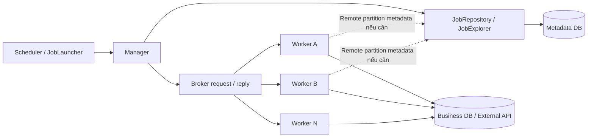
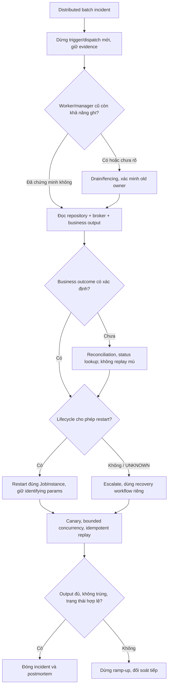
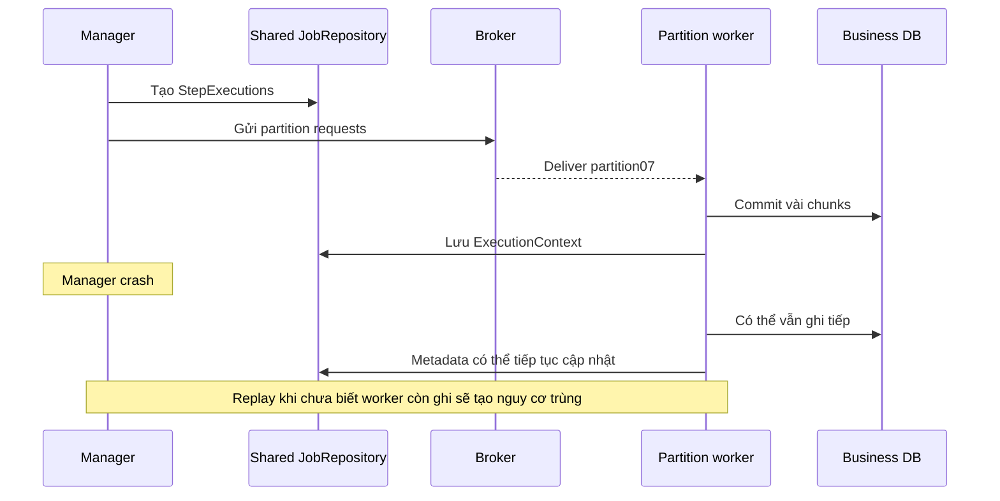
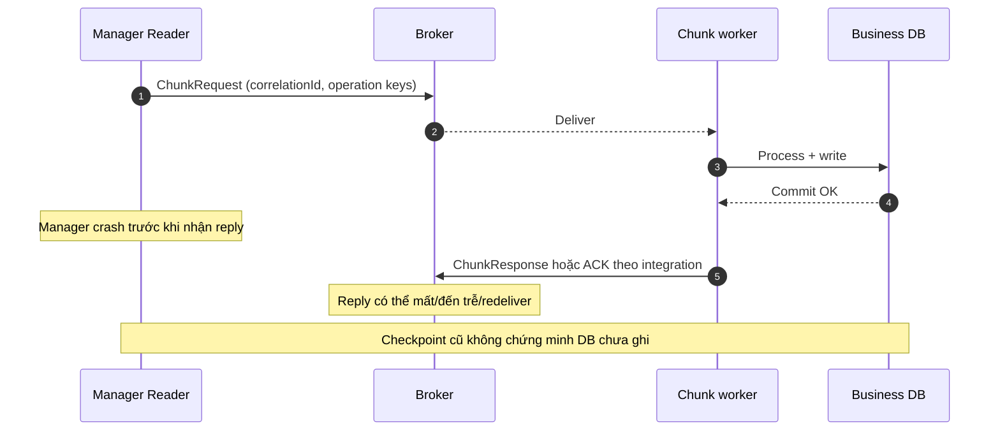

# Runbook khôi phục sự cố phân tán trong Spring Batch

Một Spring Batch job đang xử lý mười triệu giao dịch bằng 24 partition trên nhiều worker. Giữa batch window, manager bị restart, broker mất kết nối, một worker đã ghi thành công dữ liệu nhưng **reply chưa tới manager**, còn `JobRepository` vẫn báo vài `StepExecution` ở trạng thái `STARTED`. Tạo một JobInstance mới với `run.id` khác có thể khiến dữ liệu bị xử lý trùng; chờ vô hạn thì bỏ lỡ SLA.

**Runbook khôi phục sự cố phân tán** là chuỗi thao tác đã được định nghĩa trước để **phát hiện → cô lập → chặn xử lý trùng → thu bằng chứng → đối soát outcome → phục hồi → xác nhận đầu ra**. Nó không phải thao tác “bấm retry job” mỗi khi nhìn thấy timeout. Đặc biệt, **mất response hoặc mất ACK không chứng minh giao dịch nghiệp vụ chưa commit**.

Bài thuộc chương **Failover**, module **SPRING_BATCH_SCALING_OPERATIONS**: mở rộng Spring Batch qua multi-threaded step, parallel steps, partitioning, remote partitioning, remote chunking và các mô hình phân tán; giữ thread safety, retry/restart và vận hành đúng theo năng lực tài nguyên. Các ví dụ nhắm tới Spring Batch 5.x với JDBC `JobRepository`, PostgreSQL và broker có khả năng redelivery. Hành vi thực của transaction, ACK, retry và failover phải được xác nhận trên phiên bản và middleware triển khai.

> **Quy tắc số một:** Không tạo execution mới khi chưa chứng minh **worker/manager cũ không còn có thể tạo side effect** hoặc đã có **fencing và idempotency** để chặn tác động trùng.

## 1. Mục tiêu và phạm vi của runbook

Một incident recovery thành công phải đáp ứng:

1. **Safety:** Không để hai worker cùng sở hữu một partition/operation trái quy tắc.
2. **Data integrity:** Không bỏ sót item và không ghi trùng business operations phải duy nhất.
3. **Restartability:** `ExecutionContext` và metadata đủ đúng để chạy lại qua Spring Batch lifecycle.
4. **Liveness:** Có thể tiếp tục xử lý hoặc thất bại có kiểm soát, không kẹt mãi ở “đang chạy”.
5. **Auditability:** Có thể giải thích ai quyết định dừng/replay, dựa trên bằng chứng nào.

| Chỉ tiêu | Ý nghĩa vận hành | Không nên hiểu nhầm |
| --- | --- | --- |
| **RTO** | Mục tiêu thời gian khôi phục khả năng xử lý | Không nhất thiết trùng thời gian hoàn thành toàn bộ job |
| **RPO** | Phạm vi checkpoint/state cần phục hồi hoặc replay | Không phải cho phép mất transaction nghiệp vụ |
| **Batch SLA** | Deadline hoàn tất lượng dữ liệu yêu cầu | Có thể khác RTO |
| **Fencing** | Ngăn owner cũ ghi sau khi quyền sở hữu được chuyển | Không hoàn tác side effect đã commit |
| **Idempotency** | Replay không làm phát sinh business effect trùng | Không loại bỏ nhu cầu checkpoint hoặc reconciliation |

Trong batch, RPO thực tế có thể là **số item sẽ bị reprocess từ checkpoint cũ**; những item đó vẫn cần được writer xử lý an toàn nếu đã commit trước khi crash.

## 2. Hiểu topology trước khi khôi phục



**Remote partitioning:** Manager tạo nhiều partition và `StepExecution`, workers thực hiện partition step, trong mô hình phổ biến chúng truy cập **shared JobRepository**. Kiểm tra **partition ID/StepExecution ID** và trạng thái worker là trung tâm của runbook.

**Remote chunking:** Manager thường quản lý reader, logical StepExecution và checkpoint; worker nhận `ChunkRequest`, process/write rồi trả `ChunkResponse`. Không có quy tắc “mỗi chunk là một StepExecution riêng”. Kiểm tra **request/reply correlation, reader checkpoint, broker delivery và business operation key** mới xác định được khả năng replay.

**Local partitioning/parallel flows:** Có thể không có broker, nhưng vẫn có trạng thái stale khi JVM chết, datasource outage, pool cạn hoặc một flow hoàn thành còn flow khác dang dở.

## 3. Những sự cố phải được phân loại đúng

| Incident | Triệu chứng | Sai lầm recovery thường thấy |
| --- | --- | --- |
| Manager crash | JobExecution STARTED, replies không ai tổng hợp | Phát lại mọi partition dù worker còn chạy |
| Worker crash | StepExecution STARTED, chunk/partition ngừng tiến triển | Coi chưa commit side effect |
| Broker outage | Lag tăng, request/reply timeout, redelivery | Purge queue rồi gửi lại toàn bộ |
| JobRepository DB outage | Không lưu được checkpoint/trạng thái | Xóa metadata hoặc tạo JobInstance mới |
| Business DB deadlock/outage | Writer rollback, lock waits, Hikari pending | Tăng threads/pool/retryLimit vô hạn |
| External API outage | HTTP 429/503, response timeout, reset | Retry POST không có idempotency |
| Network partition | Manager coi worker mất nhưng worker còn ghi | Split-brain và double writer |
| Version/schema mismatch | Reader/worker không deserialize context/message | Replay với payload schema khác mà không migration |
| Poison input | Cùng item fail liên tiếp | Retry vô hạn khiến batch window trễ |
| Stale process/resource leak | Thread giữ DB/API connection quá lâu | Coi LAST_UPDATED cũ là worker chết |

**Chưa biết outcome nghĩa là chưa được tự động replay**, nhất là khi có chuyển tiền, ghi trạng thái tài chính hoặc publish sự kiện mà đối tác có thể đã ghi nhận.

## 4. Năm invariant cần duy trì xuyên mọi lần failover

- **Identity:** `JobInstance` được xác định bởi job name và **identifying JobParameters**, không phải bởi một execution ID hay ngày bắt đầu.
- **Ownership:** Tại mỗi thời điểm, chỉ owner có thẩm quyền được tác động lên cùng partition/operation khi logic không hỗ trợ concurrency.
- **Durability:** Một item hoàn tất khi business effect đã được commit theo quy tắc hệ đích, không chỉ khi message được gửi.
- **Checkpoint:** `ExecutionContext` lưu đủ dữ liệu khôi phục, gắn với source snapshot/range ổn định.
- **Reconciliation:** Có thể đối chiếu expected input keys, committed operation keys, skips và những giao dịch chưa biết kết quả.

Không tạo `run.id` identifying mới chỉ để vượt qua `JobExecutionAlreadyRunningException` hoặc `JobInstanceAlreadyCompleteException`. Điều đó tạo **JobInstance khác**, có thể thực thi trùng cùng business date dù metadata không có lỗi.

## 5. Các mức độ nghiêm trọng và quyền điều phối

| Mức tham khảo | Dấu hiệu | Hướng hành động |
| --- | --- | --- |
| **SEV-1** | Nguy cơ ghi trùng/thiếu dữ liệu quan trọng, split-brain, side effect không xác định | Ngăn admission, fencing, phối hợp DBA và nghiệp vụ |
| **SEV-2** | Nhiều worker fail hoặc job sắp trượt SLA, chưa thấy sai dữ liệu | Contain, đo SLA còn lại, recovery có kiểm soát |
| **SEV-3** | Một partition lỗi, idempotency và restart đã được kiểm chứng | Retry/restart có giới hạn, theo dõi |
| **SEV-4** | Cảnh báo ngắn không ảnh hưởng tính đúng và tiến độ | Thu baseline, điều tra theo lịch |

Với SEV-1, cần **incident commander**, người chịu trách nhiệm Spring Batch, vận hành broker, DBA/business data owner và đại diện nghiệp vụ nếu có rủi ro dữ liệu. Hành động thay đổi trạng thái ngoài API, xóa queue hoặc xử lý unknown outcome không được tự động thực hiện trong lúc chưa có đánh giá.

## 6. Pha 0: đóng băng tải mới, không giết mù worker

Ngay khi phát hiện:

1. Ghi job name, identifying parameters, JobExecution ID, step/partition IDs, source revision, thời điểm và SLA.
2. **Tạm ngăn scheduler/trigger tạo execution mới** cho business run đang gặp sự cố.
3. Giữ broker queue/DLQ, pending replies, consumer offsets và logs. Không purge hoặc ACK thủ công.
4. Ngăn deployment/auto-scale không kiểm soát làm tăng số worker đang tạo side effect.
5. **Drain** worker đang commit nếu có thể; nếu bắt buộc chuyển ownership phải có fencing/termination có xác nhận.
6. Không chỉnh schema/`BATCH_*`, không tăng `run.id`, không reset offsets hoặc checkpoint.
7. Lưu snapshot metrics và mở incident record có người ra quyết định.

`JobOperator.stop(executionId)` (nếu dùng) là **yêu cầu dừng hợp tác**; nó không cam kết hủy tức thì HTTP request hay một worker phân tán vẫn độc lập. Cần xác minh dừng thực và outcome side effect.

## 7. Pha 1: thu bằng chứng liên kết nhiều hệ

| Nguồn | Bằng chứng nên ghi |
| --- | --- |
| Scheduler | Trigger/event ID, business date, số lần kích hoạt, leader epoch |
| Manager | JobExecution ID, partition danh sách, request/reply IDs, process version |
| Worker | Worker instance, partition/ChunkRequest ID, operation key, attempts |
| Broker | Queue/topic, group, unacked/lag, delivery attempts, DLQ, retention |
| Metadata DB | Job/Step status, timestamps, counters, `VERSION`, checkpoint |
| Business DB | Operation IDs, unique constraints, bản ghi đã commit |
| External API | Idempotency key, request correlation, status query và remote outcome |
| Hạ tầng | Process/pod restart, OOM, network partition, DB leader change |
| Metrics | Pool pending/usage, deadlocks, HTTP 429/503, committed throughput |

Ví dụ correlation record:

```text
businessRun       = settlement/2026-11-26
jobExecutionId    = 2142
stepExecutionId   = 7708
partitionName     = settlementWorker:partition07
operationKey      = settlement/2026-11-26/account-009271
chunkCorrelation  = chunk-b17
workerInstance    = worker-a-2
deliveryAttempt   = 2
```

Đây là ID giả định. **Message ID không nhất thiết là idempotency key:** broker có thể tạo ID mới khi republish, còn cùng một business operation phải giữ khóa bất biến qua restart.

Không gắn business key hay execution ID số lượng lớn vào mọi metrics labels; dùng structured logs/traces có kiểm soát quyền và bảo vệ PII.

## 8. Pha 2: đọc JobRepository nhưng không sửa trực tiếp

Với JDBC Spring Batch 5.x và PostgreSQL, các truy vấn sau **chỉ đọc**, cần điều chỉnh schema/prefix theo deployment.

### Tìm JobExecution theo tên job

```sql
SELECT
    ji.JOB_NAME, ji.JOB_INSTANCE_ID, ji.JOB_KEY,
    je.JOB_EXECUTION_ID, je.STATUS, je.EXIT_CODE,
    je.CREATE_TIME, je.START_TIME, je.END_TIME,
    je.LAST_UPDATED, je.VERSION
FROM BATCH_JOB_EXECUTION AS je
JOIN BATCH_JOB_INSTANCE AS ji
  ON ji.JOB_INSTANCE_ID = je.JOB_INSTANCE_ID
WHERE ji.JOB_NAME = :jobName
ORDER BY je.JOB_EXECUTION_ID DESC
LIMIT 50;
```

Một JobInstance có nhiều JobExecution có thể là **restart hợp lệ**, không nhất thiết duplicate. Nhưng nhiều JobInstances dùng khác identifying parameters có thể xử lý cùng một business date nếu `run.id` được thêm tùy tiện.

### Liệt kê StepExecutions và counters

```sql
SELECT
    STEP_EXECUTION_ID, STEP_NAME, STATUS, EXIT_CODE,
    VERSION, START_TIME, END_TIME, LAST_UPDATED,
    READ_COUNT, WRITE_COUNT, FILTER_COUNT,
    READ_SKIP_COUNT, PROCESS_SKIP_COUNT,
    WRITE_SKIP_COUNT, COMMIT_COUNT, ROLLBACK_COUNT
FROM BATCH_STEP_EXECUTION
WHERE JOB_EXECUTION_ID = :jobExecutionId
ORDER BY STEP_EXECUTION_ID;
```

`STATUS='STARTED'` và `END_TIME IS NULL` **không chứng minh worker còn sống hay đã chết**. `LAST_UPDATED` không phải heartbeat chuyên dụng; có thể cũ vì chunk dài, API chậm hoặc JVM chết trước khi cập nhật.

### Tra các partition thuộc một execution

```sql
SELECT
    STEP_EXECUTION_ID, STEP_NAME, STATUS,
    READ_COUNT, WRITE_COUNT, COMMIT_COUNT,
    ROLLBACK_COUNT, START_TIME, LAST_UPDATED
FROM BATCH_STEP_EXECUTION
WHERE JOB_EXECUTION_ID = :jobExecutionId
  AND STEP_NAME LIKE :partitionPattern
ORDER BY STEP_NAME;
```

Các counters là thông tin Spring Batch lifecycle, **không đủ để chứng minh business operations đã commit duy nhất**, nhất là khi writer gọi API hoặc database khác transaction manager.

## 9. JobExplorer: mẫu code đọc execution an toàn

`JobExplorer` giúp ứng dụng truy vấn metadata mà không sửa status. Spring Batch 5.x:

```java
import org.springframework.batch.core.JobExecution;
import org.springframework.batch.core.StepExecution;
import org.springframework.batch.core.explore.JobExplorer;
import org.springframework.stereotype.Component;

@Component
public final class IncidentExecutionInspector {
    private final JobExplorer explorer;

    public IncidentExecutionInspector(JobExplorer explorer) {
        this.explorer = explorer;
    }

    public void inspect(long executionId) {
        JobExecution execution = explorer.getJobExecution(executionId);
        if (execution == null) {
            throw new IllegalArgumentException(
                    "Unknown JobExecution ID: " + executionId);
        }
        System.out.println("jobExecution=" + execution.getId()
                + " status=" + execution.getStatus()
                + " start=" + execution.getStartTime()
                + " end=" + execution.getEndTime());

        for (StepExecution step : execution.getStepExecutions()) {
            System.out.println("stepExecution=" + step.getId()
                    + " step=" + step.getStepName()
                    + " status=" + step.getStatus()
                    + " read=" + step.getReadCount()
                    + " write=" + step.getWriteCount()
                    + " rollback=" + step.getRollbackCount());
        }
    }
}
```

Ví dụ chỉ minh họa API. Trong production dùng structured logger, audit và authorization; không log toàn bộ `JobParameters` hoặc `ExecutionContext` có thể chứa token/PII.

Nếu metadata DB mất kết nối và JobExplorer query thất bại, **không suy rằng chưa có JobExecution**. Phải phục hồi kết nối và truy vấn lại.

## 10. Đánh giá worker và broker cùng với metadata

### Process/worker

- Worker/PID/pod còn sống, hay đã được restart thành instance khác?
- Có thread đang ghi DB, chờ HTTP, chờ semaphore, hoặc đang commit không?
- Có request/partition nào đang active trên **hai worker** không?
- Worker chạy image/schema/serialization version nào?
- Có stop/drain/fencing acknowledgment thật không?

### Broker

- Request còn queued, đã delivered, hay unacked?
- Queue age, retry/redelivery count, consumer lag, DLQ có tăng?
- Reply đã gửi nhưng manager chết trước khi nhận không?
- Có reply tới sau timeout rồi bị coi như unknown không?
- Message retention/TTL có bảo đảm còn bằng chứng phục hồi không?

### Metadata và business databases

- Primary hiện tại đã sẵn sàng ghi chưa?
- Hikari checkout timeout hoặc long transaction nào đang chặn?
- Business operation IDs nào thực sự đã commit?
- Có lock waits, deadlocks, isolation errors hoặc connection saturation không?
- Có checkpoint metadata cũ hơn business output sau database restore không?

Không phát lại broker messages khi business database vẫn outage; đó chỉ tạo thêm hàng chờ và retry storm.

## 11. Decision tree phục hồi



Một incident có unknown outcome hoặc active worker không thể fencing là **blocker khôi phục tự động**. Không “bỏ qua” blocker bằng SQL UPDATE `BATCH_STEP_EXECUTION.STATUS`.

## 12. Fencing để ngăn split-brain

**Split-brain** xảy ra khi owner cũ vẫn có thể ghi trong lúc owner mới đã được bổ nhiệm. Ví dụ network partition khiến manager mới thấy worker-A mất kết nối, nhưng worker-A vẫn thực hiện HTTP POST.

Dùng **fencing token** tăng đơn điệu:

```text
operation = settlement/2026-11-26/partition07
ownerEpoch 41 -> worker-A (cũ)
ownerEpoch 42 -> worker-B (mới)

Business writer phải từ chối write với ownerEpoch < 42
nếu fencing được kiểm tra tại chính tài nguyên ghi.
```

Một lease trong manager **không đủ** nếu writer không xác nhận epoch. Token cần được cấp và so sánh bằng cơ chế nhất quán phù hợp, lý tưởng **atomic tại đích/gateway**. Không dùng timestamp từ các máy không đồng bộ làm fencing token.

Nếu external API không hỗ trợ fencing, giảm khả năng double writer bằng stop/drain worker cũ, idempotency key và reconciliation. Fencing cũng không hoàn tác những side effects đã commit trước khi token mới có hiệu lực.

## 13. Remote partitioning: manager crash nhưng workers còn chạy



**Trình tự khôi phục:**

1. Ngừng dispatch/launch mới cùng business run.
2. Xác minh manager cũ đã chết hoặc bị fencing; không chỉ dựa trên việc mất heartbeat.
3. Liệt kê partition StepExecution IDs, status và last checkpoint.
4. Ghép từng partition với worker identity, message delivery và business operation keys.
5. Nếu worker còn xử lý an toàn, cân nhắc drain để hoàn tất; nếu phải chuyển quyền thì fencing trước.
6. Khôi phục JobRepository/broker và xác nhận partition ownership.
7. Chỉ restart theo lifecycle hợp lệ, replay các partition cần thiết với writer idempotent.
8. Đối chiếu output trên toàn range, không chỉ các partition có `COMPLETED`.

Trong remote partitioning phổ biến, worker và manager chia sẻ JobRepository; phải giữ cùng schema/prefix, metadata DB và transaction manager phù hợp. Hai repository độc lập trên hai worker không tạo ra metadata thống nhất.

## 14. Remote partitioning: crash tại những điểm commit khác nhau

| Crash window | Metadata có thể như thế nào? | Điều phải xác minh |
| --- | --- | --- |
| Trước đọc dữ liệu | Checkpoint chưa tiến | Có side effect từ listener/setup không? |
| Sau process trước writer | Chưa commit item | Processor đã gọi API side-effect hay chỉ enrich? |
| Trong business transaction | Có thể rollback hoặc outcome bất định khi mất network | DB đích có record đã commit chưa? |
| Sau business commit, trước metadata commit riêng | Context có thể cũ | Replay phải idempotent |
| Sau metadata update, trước reply | Step state có thể mới | Reply mất không chứng minh chưa xử lý |
| Sau worker kết thúc, manager chưa tổng hợp | Worker completed nhưng manager chờ | Tra StepExecution và reply routing |

Với metadata và business dùng **hai DataSource/transaction managers**, commit có thể lệch nhau. Với một DB transaction dùng chung resource đúng cách, một số metadata và business updates có thể atomic; **không giả định** có 2PC giữa DB, HTTP và broker.

Khi JVM bị kill, callback `finally`/listener update status có thể không chạy. Tồn tại StepExecution `STARTED` không cho phép kết luận worker còn sống hay sửa metadata trực tiếp.

## 15. Remote chunking: mất ChunkResponse sau business commit



**Runbook riêng:**

- Ghi manager read checkpoint, `ChunkRequest` correlation ID, message ID, worker ID và business operation keys.
- Đối soát những chunks không có reply với business DB/API.
- Giữ request/reply DLQ và pending deliveries; không purge khi chưa có quyết định.
- Nếu redelivery, writer cần idempotency **theo operation key**, không chỉ theo broker delivery tag.
- Phục hồi manager có cơ chế ngăn manager cũ tiếp tục dispatch.
- Theo dõi backlog, reply timeout và trạng thái cuối của logical StepExecution.

**Không mặc định một request chunk có một StepExecution riêng**. Số StepExecutions và vị trí checkpoint trong remote chunking khác remote partitioning. Thứ tự ACK/commit/reply tùy middleware; phải test đúng implementation.

## 16. Broker outage: đọc đúng trạng thái message

| Trạng thái | Có thể đã xảy ra | Recovery an toàn |
| --- | --- | --- |
| Queued chưa delivery | Worker chưa nhận | Chờ dependency khỏe rồi resume, không republish vô cớ |
| Delivered chưa ACK | Worker đang xử lý **hoặc** đã commit | Tra operation outcome/correlation |
| ACK nhưng reply chưa tới manager | Manager chưa checkpoint | Không suy worker chưa ghi |
| Redelivered | Có ít nhất hai delivery attempts | Idempotent consumer/writer |
| Vào DLQ | Có retry policy exhausted hoặc lỗi permanent | Phân loại trước replay |
| TTL hết hạn | Có thể mất request/reply evidence | Reconciliation từ ledger/snapshot |
| Out-of-order | Update trễ có thể ghi đè version mới | Version/sequence check hoặc operation commutativity |

RabbitMQ: chú ý unacked, prefetch, DLQ/redelivery và consumer connection. Kafka: chú ý consumer group lag, offset commit, rebalance và partition assignment; offset Kafka không tự commit atomically với external PostgreSQL/HTTP. JMS: kiểm tra session/ack/transaction mode.

**Không tăng consumers vô hạn khi DB/API đích đang 429 hoặc bão hòa**. Khôi phục downstream trước, đặt bounded concurrency, rồi drain broker dần.

## 17. JobRepository outage: metadata khác business outcome

Khi metadata DB mất kết nối, JobExplorer có thể không truy vấn được, launcher không tạo được JobExecution và worker không cập nhật được StepExecution/context. Trong khi đó business DB/API **vẫn có thể tiếp tục ghi** nếu transaction tách rời.

**Thứ tự khôi phục:**

1. Ngăn launch và dispatch mới; giữ worker state/broker evidence.
2. Khôi phục metadata DB primary, connection pool, schema/prefix và migration tương thích.
3. Xác minh transaction cuối cùng của repository đã commit/rollback đến đâu.
4. Xác định workers còn hoạt động hoặc side effects còn in-flight; fencing/drain nếu cần.
5. So last checkpoint của từng partition/chunk với committed operation keys ở đích.
6. Xác nhận JobInstance lifecycle và restartability trước khi dùng JobOperator.
7. Replay idempotent với concurrency/rate hữu hạn; kiểm tra mọi operation unknown.
8. Đối soát job output và metadata cuối cùng.

**Không restore metadata snapshot cũ rồi giả định business DB cũng quay về cùng thời điểm.** Nếu hai DB restore khác recovery point, business output có thể mới hơn repository; phải reconciliation, không được xóa business rows theo suy đoán.

## 18. Business DB, HTTP API và SFTP outage

Một downstream lỗi có thể tạo **retry storm** làm chính failover khó hơn:

- **Transient:** HTTP 429/502/503/504 theo contract, connection reset, JDBC deadlock/serialization conflict — có thể retry giới hạn sau rollback/backoff.
- **Permanent:** payload sai, auth không hợp lệ, schema mismatch — fail/quarantine, không thử mãi.
- **Unknown outcome:** request đã gửi nhưng response timeout, DB commit response mất — tra status/ledger trước khi replay.

Nếu PostgreSQL transaction đã abort sau SQLSTATE `40001` hoặc `40P01`, phải rollback **toàn transaction đó** rồi mở attempt mới. Không gửi thêm SQL trong transaction đang aborted.

Dùng exponential backoff có jitter, `Retry-After` nếu có, overall time budget và circuit breaker/admission control khi outage kéo dài. Đừng giữ DB transaction hoặc semaphore permit trong lúc ngủ backoff khi có thể nhả tài nguyên an toàn.

Với SFTP, phải kiểm tra file đã upload đầy đủ hay chỉ một phần, remote rename/atomic publish policy, checksum và idempotency của tên file. Không coi socket reset là chưa có file.

## 19. Ma trận failure windows: business commit, checkpoint và ACK

| Failure window | Business outcome | Repository | Broker | Nguyên tắc |
| --- | --- | --- | --- | --- |
| Trước side effect | Thường chưa ghi | Checkpoint cũ | Request có thể còn queue | Replay sau xác minh |
| Trong business transaction | Rollback hoặc unknown nếu kết nối đứt | Có thể cũ | Delivery in-flight | Tra DB outcome |
| **Sau business commit, trước metadata checkpoint riêng** | **Đã ghi** | **Chưa ghi** | Có thể chưa ACK | Idempotent replay/reconcile |
| Sau metadata update, trước reply | Có thể đã ghi | State mới | Reply thiếu | Không kết luận chưa commit |
| Sau ACK, trước manager nhận reply | Có thể đã ghi | Tùy implementation | ACK rồi, reply thiếu | Tra correlation và output |
| Manager/worker crash sau side effect | Có thể đã ghi | Có thể STARTED | Redelivery tiềm năng | Fencing + reconciliation |
| Metadata restore snapshot cũ | Business có thể mới hơn | State cũ | Offset độc lập | Reconcile ba kho trạng thái |

**Các mốc trên là mô hình khái niệm, không phải thứ tự bắt buộc của mọi Spring Integration/Kafka/JMS adapter.** Xác minh transaction boundaries, ACK timing, reply policy và failure behavior trên middleware thực tế.

**Quy tắc:** Không thể chứng minh một operation chưa xảy ra thì **không replay mù quáng**. Tra status bằng idempotency key hoặc dùng workflow đối soát có audit trước.

## 20. Trạng thái JobInstance/JobExecution quyết định quyền restart

Spring Batch phân biệt **JobInstance** (logical job theo tên và identifying parameters) với **JobExecution** (một lần chạy). Cùng JobInstance có thể có các lần chạy lại khi restart hợp lệ.

| Trạng thái JobExecution quan sát | Có thể cân nhắc | Chưa được làm |
| --- | --- | --- |
| `COMPLETED` | Đối soát business outcome và đóng incident | Restart tùy tiện cùng JobInstance |
| `FAILED` | Restart nếu job restartable và ownership an toàn | Tạo `run.id` mới để tránh lỗi lifecycle |
| `STOPPED` | Restart nếu stop đã hoàn tất thật ở mọi worker | Giả định remote worker đã ngừng chỉ vì manager STOPPED |
| `STARTED / STARTING` | Kiểm tra process/worker/transaction/broker đang active | Coi `LAST_UPDATED` cũ là lý do sửa status |
| `STOPPING` | Chờ/điều tra cooperative stop, fencing nếu cần | Chạy song song job mới trên cùng business operation |
| `UNKNOWN` | Escalate, xác minh outcome, dùng quy trình khôi phục riêng | Auto-restart như FAILED thông thường |
| Repository unreachable | Khôi phục DB/kết nối rồi truy vấn lại | Coi “không đọc được” là “chưa có execution” |

**Không sửa trực tiếp `BATCH_JOB_EXECUTION.STATUS` hay `BATCH_STEP_EXECUTION.VERSION`** để ép framework chấp nhận restart. Metadata versioning và lifecycle tồn tại nhằm tránh ghi đè/trạng thái sai khi thực thi cạnh tranh.

Một `JobExecutionAlreadyRunningException` có thể là **tín hiệu đúng** rằng repository đang bảo vệ business run; không được né bằng identifying parameters giả.

## 21. JobOperator.restart: chỉ sau khi qua các kiểm tra an toàn

Spring Batch 5.x cung cấp `JobOperator` cho các thao tác quản lý job như stop/restart. Ví dụ **mẫu gọi API**, không phải bộ recovery tự động hoàn chỉnh:

```java
import org.springframework.batch.core.launch.JobOperator;

public final class ControlledJobRecovery {
    private final JobOperator operator;

    public ControlledJobRecovery(JobOperator operator) {
        this.operator = operator;
    }

    public Long restartAfterApproval(long previousExecutionId)
            throws Exception {

        // Trong ứng dụng thật, BẮT BUỘC làm trước:
        // 1) Xác nhận old owner/worker đã dừng hoặc bị fencing.
        // 2) JobExplorer xác minh lifecycle/restartability.
        // 3) Đối soát business operations và broker in-flight.
        // 4) Có approval, audit log và rate/concurrency guardrails.

        return operator.restart(previousExecutionId);
    }
}
```

Restart có thể bị từ chối khi JobInstance đã complete, job không restartable, execution còn được coi running, không tìm thấy job configuration/registry phù hợp, hoặc metadata DB/parameters lỗi. **Đó không phải lời mời chỉnh SQL state**.

Sau khi nhận được execution ID mới, ghi liên hệ giữa **previousExecutionId → newExecutionId** trong audit record. Xác nhận cùng JobInstance đúng identity, StepExecution/restart checkpoint hợp lệ, không phải một run.id mới sinh ra ngoài mong muốn.

Nếu run ở trạng thái bất định do crash mà framework không cho restart, cần quy trình **operator recovery riêng, được phê duyệt và kiểm thử**. Không hứa JobOperator tự suy worker remote đã ngừng hoặc tự khôi phục external side effects.

## 22. Idempotency của writer: nền tảng replay an toàn

Một idempotency key phải mô tả **business operation**, giữ nguyên qua mọi attempt, worker crash và broker redelivery. Ví dụ:

```text
businessRun     = settlement/2026-11-26
operationKey    = settlement/2026-11-26/order-00001952
payloadVersion  = source-v3
```

Đừng dùng `JobExecutionId` hoặc broker delivery tag làm idempotency key chính nếu chúng đổi qua restart.

### Cách làm với một PostgreSQL transaction

Giả sử writer ghi output và guard vào **cùng PostgreSQL DB/transaction**. Bảng bảo vệ có primary key theo operation:

```sql
CREATE TABLE business_operation_guard (
    operation_key VARCHAR(180) PRIMARY KEY,
    payload_digest CHAR(64) NOT NULL,
    committed_at TIMESTAMPTZ NOT NULL DEFAULT NOW()
);
```

Trong transaction của `ItemWriter`, trước khi ghi business output:

```sql
INSERT INTO business_operation_guard (
    operation_key, payload_digest
) VALUES (
    :operationKey, :payloadDigest
)
ON CONFLICT (operation_key) DO NOTHING
RETURNING operation_key;
```

**Nếu câu INSERT trả một row:** Transaction đã giành quyền ghi operation mới; tiếp tục business write trong **chính transaction** rồi commit cả guard và output. Nếu transaction rollback, cả hai quay lui.

**Nếu không trả row:** Operation key đã tồn tại/đang bị tranh chấp; phải xác minh payload digest và business outcome. Không tự mặc định đây là duplicate hợp lệ nếu cùng key mà payload khác hoặc dữ liệu thực không nhất quán.

Nhờ unique constraint và transaction atomic trong **cùng database**, replay có thể không nhân đôi logical operation. Tuy nhiên:

- Phải kiểm tra transaction manager/writer thực sự dùng cùng DataSource, không có side effect được phát trước commit ở hệ ngoài.
- Guard table cần index, cleanup/retention theo business period và schema migration có kiểm soát.
- Nếu API ngoài DB nhận POST, local PostgreSQL transaction **không bao trùm kết quả HTTP**.
- Nếu một operation gồm nhiều business tables, tất cả phải được ghi cùng transaction hoặc có cơ chế saga/compensation phù hợp.
- Guard không thay thế kiểm tra **expected input set**; không duplicate vẫn có thể thiếu item.

### Khi hệ thống ngoài có API idempotency

Truyền cùng `Idempotency-Key` cho cùng operation qua mọi lần gửi, lưu payload/version fingerprint và dùng status lookup theo contract. Timeout sau gửi request cần xem là **outcome unknown**, không phải thất bại chắc chắn.

Không ghi guard “DONE” trong local DB **trước khi remote API thành công** nếu remote effect không cùng transaction: crash ở giữa có thể làm message bị bỏ mãi.

## 23. Transactional outbox, inbox và dedup broker

Ba kỹ thuật thường kết hợp:

**Outbox:** Business transaction ghi thay đổi chính và một record intent publish **trong cùng database**. Publisher gửi message sau commit; nếu chết sau send/trước update outbox, message có thể gửi lặp. Consumer vẫn cần dedup.

**Inbox:** Consumer giữ operation key và trạng thái đã xử lý. Khi có thể ghi inbox và business effect trong cùng transaction, redelivery có thể nhận biết operation đã hoàn tất. Kiểm tra payload digest để tránh bỏ qua một operation khác dùng nhầm key.

**Unknown-outcome reconciliation:** Khi external API không cho transactional commit chung, lưu trạng thái `PENDING/UNKNOWN/CONFIRMED` và có cơ chế truy vấn outcome/bù trừ. Chỉ chuyển UNKNOWN sang trạng thái xác định khi có bằng chứng hợp lệ.

| Pattern | Đảm bảo có thể đạt | Không đảm bảo |
| --- | --- | --- |
| Unique key + idempotent DB writer | Không tạo hai logical rows cùng operation | Không tự ngăn hai HTTP POST ngoài DB |
| Transactional outbox | Không mất ý định publish khi business DB commit | Chỉ gửi một message vật lý duy nhất |
| Inbox/dedup | Consumer không thực thi lại duplicate nghiệp vụ khi có transaction đúng | Mọi tác dụng phụ không nằm trong transaction |
| Fencing epoch | Old owner bị từ chối ghi **nếu đích kiểm tra** | Rollback side effect đã commit |
| Reconciliation | Xác minh outcome từ nguồn sự thật nghiệp vụ | Tự sửa dữ liệu khi nguồn xác minh không tồn tại |

**“Exactly-once” end-to-end** cần định nghĩa trên business effect cụ thể. Spring Batch restart và broker at-least-once delivery tự chúng không tạo exactly-once ngoài phạm vi transaction.

## 24. Checkpoint và source snapshot: đừng replay một nguồn đã thay đổi

Một reader restartable phải biết **đã đọc đến đâu trong cùng phiên bản nguồn dữ liệu**:

- File path, checksum/version và offset/record number ổn định.
- Unique ID/watermark hoặc keyset pagination với sort order rõ ràng.
- Snapshot version hoặc cutoff timestamp của database nguồn khi dữ liệu thay đổi liên tục.
- Partition range/tenant/file mapping được tạo ổn định qua restart.
- Schema/serializer của `ExecutionContext` tương thích giữa worker cũ và mới.

Dùng offset pagination trên bảng đang insert/delete liên tục có thể khiến page thứ 50 ở lần restart mang dữ liệu khác page thứ 50 của lần trước. Giải pháp phù hợp có thể là snapshot transaction, immutable export, keyset pagination hoặc watermark.

**Partition range:** Nếu partition07 ban đầu đọc `id=7.000.001..8.000.000`, không được tự tạo lại partition ranges chồng lấn sau crash rồi coi đó là restart thông thường. Dùng context/range đã persist hoặc kế hoạch migration có chứng minh không bỏ sót.

Nếu metadata và business DB commit riêng, checkpoint có thể tụt sau business effect đã thực hiện. Replay từ checkpoint **đòi writer idempotent**, không có phương pháp cursor nào tự loại bỏ hoàn toàn failure window này.

## 25. DLQ và poison message: ranh giới replay có phê duyệt

Một message ở DLQ có thể do lỗi tạm thời, lỗi schema hoặc business data sai. Phân loại trước khi đưa lại vào pipeline:

1. Giữ message gốc, headers, correlation ID, operation key, schema/version và exception đã masking.
2. Phân loại `transient infrastructure`, `permanent data error` hoặc `unknown outcome`.
3. Tra business output/idempotency ledger trước replay.
4. Nếu transient và idempotency đã kiểm chứng, replay theo từng nhóm nhỏ với rate cap/audit.
5. Nếu permanent, sửa dữ liệu hoặc đưa quarantine có owner nghiệp vụ; không retry vô hạn.
6. Nếu unknown, thực hiện reconciliation hoặc áp dụng quy trình xử lý thủ công.
7. Theo dõi DLQ drain, committed output, retry exhausted, duplicates và SLA.
8. Chỉ xóa/expire evidence theo retention policy sau khi đối soát hoàn tất.

**Không dùng `skipLimit` để âm thầm loại bỏ dữ liệu bắt buộc**. Một StepExecution COMPLETED có skips không tự chứng minh job đáp ứng business correctness.

## 26. Ramp-up sau outage: chống pool exhaustion và retry storm

Khi hệ thống vừa hồi phục, hàng trăm workers reconnect cùng lúc có thể làm Hikari/HTTP pools và DB/API quá tải lần nữa.

Một kế hoạch tăng tải minh họa:

| Giai đoạn | Active workers | Chỉ tăng khi |
| --- | ---: | --- |
| Canary | 1–2 | Test operation thành công, output đúng |
| Ramp 1 | 4 | Pool checkout timeout rất thấp, P95 ổn |
| Ramp 2 | 8 | Broker lag giảm, lock wait không tăng bất thường |
| Production cap | 12 | Đạt SLA, không vượt quota và còn headroom |

Tổng cấu hình connection của nhiều JVM phải tính:

\[
C_{\mathrm{cluster,max}}=
\sum_i \mathrm{replicas}_i\times C_{\mathrm{poolPerInstance},i}
\]

Ví dụ 12 worker × HTTP pool 16/route là **trần 192 connections**, không phải 16 cho cả job. Với HTTP/2 multiplexing, số TCP connections không trực tiếp là số in-flight calls: cần bulkhead/rate limiter riêng.

Các guardrails quan trọng:

- Bounded executor/queue và broker prefetch, không phát việc vô hạn.
- Exponential backoff **có jitter**, max attempts và total deadline.
- Rate limiter toàn API key/cluster khi upstream có quota chung.
- Circuit breaker hoặc fail-fast khi sự cố kéo dài.
- Không giữ DB connection/lock hoặc semaphore permit trong lúc ngủ backoff không cần thiết.
- Không mở đồng thời cả manager mới, worker mới và autoscaler lên max khi business DB chưa đủ capacity.

Recovery phải tối ưu **committed throughput**, không tối ưu “số request đang gửi” khi tất cả request có thể bị 429.

## 27. Failover độc lập của metadata DB và business DB

Một tình huống khó: metadata DB chuyển sang primary mới ở thời điểm A, business DB restore/failover ở thời điểm B khác A.

Hỏi theo thứ tự:

1. Metadata DB đã ghi bền vững đến StepExecution/ExecutionContext nào?
2. Business DB có những operation keys nào sau thời điểm B?
3. Broker offsets, request/reply và outbox/inbox records đang ở mốc nào?
4. Old workers có thể còn session ghi vào primary cũ không; network/DB fencing đã có chưa?
5. Có event publish nhưng chưa đánh dấu outbox delivered không?
6. Reader snapshot/range có còn tái hiện được input gốc không?
7. Có thể **reconcile delta operations** thay vì replay toàn dữ liệu không?
8. Công suất DB/proxy sau failover có giảm, cần hạ concurrency không?

Không một isolation level của `JobRepository` có thể bảo đảm snapshot của **hai DB khác nhau** atomic nếu không có hệ thống phối hợp riêng. Cần reconciliation theo business key và kế hoạch replay có chứng cứ.

## 28. RTO, RPO và SLA sau một outage

Giả sử job có **12.000.000 item trong cửa sổ 60 phút**, outage kéo dài 10 phút.

**Kịch bản A:** Chưa item nào hoàn tất. Thời gian xử lý còn 50 phút:

\[
R_{\mathrm{required}}=
\frac{12.000.000}{50\times60}
=4.000\text{ items/s}
\]

**Kịch bản B:** Đã có 4.000.000 item thực sự commit, còn 8.000.000 item trong 50 phút:

\[
R_{\mathrm{required,remaining}}=
\frac{8.000.000}{3.000}
\approx2.667\text{ items/s}
\]

Lưu ý: “4 triệu đã commit” phải được xác nhận bằng business outcome, **không lấy readCount hoặc số message ACK** làm số tuyệt đối khi có retry/rollback.

Một điều kiện capacity đơn giản:

\[
R_{\mathrm{safe}}\times T_{\mathrm{remaining}}
\ge N_{\mathrm{remaining}}
\]

Trong đó `R_safe` là tốc độ business operations đã commit và đạt chất lượng ở concurrency không vượt downstream quotas; `T_remaining` phải trừ thời gian khôi phục, canary, warmup và validation. Nếu không đủ, escalate thay đổi SLA, ưu tiên các tập dữ liệu quan trọng hoặc mở thêm batch window; đừng tăng retries vô hạn để “bù tiến độ”.

**RPO không đồng nghĩa được mất records.** Có thể replay từ checkpoint cũ mà vẫn không mất business data nếu writer idempotent và input snapshot ổn định.

## 29. Quan sát tối thiểu cho đội on-call

| Lớp | Chỉ số | Điều trả lời |
| --- | --- | --- |
| Job/step | Status, elapsed, read/write/commit/rollback counts | Step nào dừng tiến triển? |
| Manager | Active partitions, requests sent, replies received, timeout | Đang chờ partition/chunk nào? |
| Workers | Active threads, worker identity/version, in-flight operations | Có worker cũ còn ghi không? |
| Broker | Lag, queue age, unacked, redelivery, DLQ, reply correlation | Message nào có thể giao lại? |
| JobRepository | DB availability, create/update/context latency, pool pending | Checkpoint có lưu bền vững? |
| Business DB | Committed operation IDs, deadlocks, SQL P95, unique conflicts | Side effects nào đã xảy ra? |
| Remote API | Idempotency/status query, 429/503/timeout, latency | Outcome xác định hay unknown? |
| Scheduler | Duplicate trigger, business key, owner epoch | Có hai manager cùng khởi chạy? |
| End-to-end | Committed business items/s, missing/duplicate counts, SLA remaining | Recovery có thành công? |

Không dùng một `LAST_UPDATED` timestamp làm heartbeat duy nhất: chunk dài hoặc API chậm có thể chưa cập nhật metadata dù worker còn sống. Nếu muốn phát hiện stale execution tự động, cần process health, custom heartbeat, ownership/lease và reconciliation.

Metrics nên tag theo `job_type/step_type/pool/outcome` với cardinality thấp; Execution ID và operation key đặt trong structured logs/traces có giới hạn truy cập.

## 30. SQL read-only để triage database trong incident

Ví dụ PostgreSQL (quyền truy cập và schema thực tế tùy môi trường).

### Sessions chờ lock

```sql
SELECT
    a.pid, a.application_name, a.state,
    a.wait_event_type, a.wait_event,
    a.xact_start,
    NOW() - a.xact_start AS transaction_age,
    pg_blocking_pids(a.pid) AS blocking_pids
FROM pg_stat_activity AS a
WHERE a.datname = current_database()
  AND cardinality(pg_blocking_pids(a.pid)) > 0
ORDER BY a.xact_start NULLS LAST;
```

### Số sessions theo application

```sql
SELECT
    datname, application_name, state, COUNT(*) AS sessions
FROM pg_stat_activity
WHERE datname = current_database()
GROUP BY datname, application_name, state
ORDER BY sessions DESC;
```

### Đếm operation keys theo business run

```sql
-- business_operation_guard là bảng minh họa, không thuộc BATCH_*.
SELECT
    COUNT(*) AS committed_operations,
    COUNT(DISTINCT operation_key) AS unique_operations
FROM business_operation_guard
WHERE operation_key LIKE :runKeyPrefix;
```

Bảng guard ví dụ có primary key nên hai counts bằng nhau; **điều này không đủ chứng minh input đã được xử lý đầy đủ**. Phải đối chiếu expected business keys, payload digests, outputs và các operation chưa xác định. Tránh scan toàn bảng production thiếu index/filter phù hợp.

**Không terminate sessions hoặc sửa `BATCH_*` để “gỡ kẹt” khi chưa biết transaction đang giữ business effects gì.** Can thiệp DBA phải có đánh giá rollback và audit.

## 31. Fault-injection drills bắt buộc

| Kịch bản | Chèn lỗi ở đâu | Điều phải chứng minh |
| --- | --- | --- |
| Manager crash sau dispatch | Manager chết trong khi worker đang xử lý | Không tự phát duplicate; owner cũ bị drain/fence |
| Worker crash trước commit | Giữa business transaction | Rollback/restart đúng, không thiếu output |
| Worker crash sau business commit | Trước checkpoint/reply | Replay idempotent, không double effect |
| Duplicate broker delivery | Cùng business operation key 2 lần | Chỉ một logical business outcome |
| Lost ChunkResponse | Worker commit nhưng reply bị mất | Manager recovery không coi “chưa commit” |
| Broker outage | Middleware mất kết nối vài phút | Retention, DLQ và routing recovery đúng |
| JobRepository outage | Metadata DB chết lúc checkpoint | Không báo COMPLETED giả, reconciliation đúng |
| Business DB deadlock | Nhiều worker tranh cùng keys | Rollback/retry hữu hạn, output đúng |
| Network partition | Worker cũ còn sống nhưng manager mới lên | Fencing ngăn double writer |
| Split-brain manager | Hai managers cùng launch cùng identity | Không chạy trùng business run trái quy tắc |
| HTTP timeout after commit | API ghi rồi cắt response | Status/idempotency lookup ngăn POST trùng |
| Poison item | Payload/schema sai | Quarantine/DLQ, không retry vô hạn |
| HPA scale-out | 4 → 16 worker sau outage | Không vượt DB/HTTP quotas |
| Metadata DB snapshot restore | Restore state cũ trong lab | Reconciliation phát hiện output mới hơn |
| Version mismatch | Worker cũ/mới deserialize context khác | Fail có kiểm soát, không phá checkpoint |

Test phải xác minh **business output, JobRepository lifecycle và broker state**, không chỉ log “worker recovered”. Dùng latch/fault-injection hook trong môi trường cô lập để tạo crash **đúng trước/sau commit/ACK**; không cố tình làm outage trên production của đối tác.

## 32. Runbook 5 pha cho ca trực

### Pha A — Contain

- [ ] Dừng trigger/dispatch mới cho đúng business key.
- [ ] Ghi incident ID, JobExecution ID, StepExecution IDs, version và timestamp.
- [ ] Không sinh run.id mới, purge DLQ hoặc reset offsets/checkpoint.
- [ ] Giữ request/reply evidence và snapshot dashboard.
- [ ] Khi split-brain khả nghi: drain/fence old writer trước replay.
- [ ] Giảm active partitions nếu DB/API đang bão hòa.

### Pha B — Diagnose

- [ ] Dùng JobExplorer/SQL read-only lấy metadata states/counters.
- [ ] Xác minh process và worker identities, không chỉ LAST_UPDATED.
- [ ] Đọc queued/unacked/lag/redelivery/DLQ và reply route.
- [ ] Kiểm tra metadata DB connectivity, transaction, locks, pools.
- [ ] Đối soát operation keys với business output thực.
- [ ] Phân loại transient, permanent hoặc unknown outcome.

### Pha C — Decide

- [ ] Owner mới hợp lệ và old workers không còn quyền ghi.
- [ ] JobInstance identity/restartability đã được xác nhận.
- [ ] Biết partitions/chunks nào cần replay theo **checkpoint và output**.
- [ ] Chọn JobOperator restart hoặc quy trình operator hợp lệ, không UPDATE status.
- [ ] Định nghĩa canary, concurrency cap, retry deadline và rollback plan.
- [ ] Escalate nếu thiếu idempotency hoặc outcome chưa thể xác định.

### Pha D — Recover

- [ ] Khôi phục DB, broker, upstream theo dependency order.
- [ ] Mở canary workload, xác nhận đúng output.
- [ ] Restart cùng business identity khi framework cho phép.
- [ ] Ramp-up workers/rate từng bước, tránh retry storm.
- [ ] Theo dõi checkpoint, broker lag, DLQ, committed throughput và quota.
- [ ] Nếu có corruption/missing item, dừng ramp-up và trở lại reconcile.

### Pha E — Verify and close

- [ ] Expected business keys đầy đủ, không tạo side effect trùng.
- [ ] Mọi partition/chunk cần xử lý đã completed hoặc quarantine được chấp thuận.
- [ ] Không còn old worker hoặc in-flight reply outcome chưa rõ.
- [ ] Repository status phản ánh thực tế, không còn stale job bị bỏ qua.
- [ ] SLA/RTO/RPO được ghi nhận và escalated nếu vi phạm.
- [ ] Lưu timeline, hành động, version và postmortem.

## 33. Case study: worker chết sau commit rồi manager mất broker

Giả sử `nightlyLedgerJob` xử lý **8.000.000 records** qua 16 remote partitions. Mỗi item có operation key ổn định theo `businessDate + transactionId`. Repository và business DB dùng hai PostgreSQL databases; broker có at-least-once delivery.

| Thời điểm giả định | Sự kiện |
| --- | --- |
| 01:00 | Manager tạo JobExecution 5100 và gửi partition requests |
| 01:18 | Worker-07 commit khoảng 420.000 operation keys |
| 01:18:02 | Metadata DB timeout, checkpoint của worker-07 mới tới mốc 400.000 |
| 01:18:04 | Worker-07 crash trước khi gửi reply |
| 01:18:08 | Manager mất kết nối broker, JobExecution vẫn STARTED |
| 01:22 | Metadata/broker phục hồi; request partition07 có thể redeliver |
| 01:23 | Worker-09 chuẩn bị đọc lại một phần input |

**Bước 1 — Fencing/ownership:** Xác nhận worker-07 thực sự dừng hoặc không còn quyền ghi. Không cho worker-09 chạy song song trên partition07 nếu writer không hỗ trợ.

**Bước 2 — Đối chiếu metadata và output:** JobRepository ghi mốc checkpoint 400.000, business ledger chứa 420.000 operation keys đã commit. **Không suy rằng các keys liên tục** chỉ vì có mốc lớn nhất; kiểm tra tập expected IDs và từng key.

**Bước 3 — Quyết định replay:** Nếu DB guard/unique key và writer idempotent trong cùng transaction, có thể reprocess vùng checkpoint cũ mà không nhân đôi logical operation. Nếu writer dùng external API không có idempotency/status lookup, giữ trong diện unknown outcome và escalate.

**Bước 4 — Restart đúng:** Sử dụng JobInstance và restart policy hợp lệ; không tạo business run mới bằng `run.id`. Chạy canary, theo dõi rollback/duplicate conflicts và tăng concurrency có giới hạn.

**Bước 5 — Nghiệm thu:** Expected 8 triệu operations có outcome xác định, JobRepository lifecycle hợp lệ, DLQ không còn message cần xử lý, không còn old worker đang ghi, SLA impact đã được ghi nhận.

**Điểm học:** Metadata timeout sau business commit không thể sửa bằng tăng retryLimit. Cần hiểu transaction boundary và cơ chế idempotent replay.

## 34. Postmortem: cải thiện sau khi job đã phục hồi

Các câu hỏi bắt buộc:

1. Trigger gốc là manager/worker, broker, database, deployment hay upstream?
2. Vì sao một lỗi dẫn tới pool starvation/retry storm ở tầng khác?
3. Có old worker còn ghi sau failover không? Fencing và ownership có hoạt động?
4. ACK/reply/checkpoint nằm ở những ranh giới transaction nào?
5. Bao nhiêu operations cần reconciliation và vì sao?
6. Có side effect trùng, missing item, version mismatch hoặc output không đồng nhất không?
7. Vì sao LAST_UPDATED/monitoring không đủ để biết worker còn sống?
8. RTO, RPO, batch SLA và business data integrity có đạt không?
9. Bước nào trong runbook mất thời gian nhất hoặc thiếu quyền/truy cập?
10. Fault injection regression nào nên bổ sung vào pipeline?

Cải tiến dài hạn gồm stable operation keys, idempotent DB writer, transactional outbox/inbox, fencing ở write path, bounded pools/executors, DLQ retention, status lookup cho API, heartbeat riêng và bài test crash sau business commit/trước reply.

Không coi “job đã xanh trở lại” là kết luận đủ nếu chưa đối soát business output.

## 35. Checklist sẵn sàng failover trước production

- [ ] Có SOP riêng cho remote partitioning và remote chunking, biết vị trí metadata/checkpoint.
- [ ] JobRepository bền vững, schema/prefix thống nhất với topology.
- [ ] Identifying JobParameters ổn định; scheduler dedup và business run identity rõ ràng.
- [ ] Có owner/leader election; fencing thực sự được kiểm tra trên đường ghi khi cần.
- [ ] Worker cũ có thể drain/terminate có xác nhận, không dựa vào stale timestamp.
- [ ] Writer idempotent theo operation key và payload version/digest.
- [ ] Có outbox/inbox/dedup hoặc reconciliation cho message redelivery.
- [ ] Reader checkpoint/range/snapshot ổn định qua restart.
- [ ] Có cách xác định remote API outcome sau timeout.
- [ ] Biết ACK, commit, reply và JobRepository update thuộc transaction nào.
- [ ] Có queue retention/DLQ, correlation IDs và consumer group/partition ownership.
- [ ] Có JobExplorer/JobOperator recovery workflow, audit và approval.
- [ ] Không cập nhật trực tiếp STATUS/VERSION trong BATCH_* để lách lifecycle.
- [ ] Đo JobExecution/StepExecution, pool pending, broker lag và committed throughput.
- [ ] Có rate/concurrency caps toàn cluster, retry budget/backoff/jitter hữu hạn.
- [ ] Đã fault-inject manager crash, worker crash trước/sau commit và reply loss.
- [ ] Đã kiểm thử metadata DB outage, snapshot rollback, network partition và split-brain.
- [ ] Có RTO/RPO/batch SLA và capacity plan sau outage.
- [ ] Có thể lấy logs/metrics/SQL read-only theo business operation ID, có che PII.
- [ ] Có DLQ/quarantine và policy cho permanent/unknown outcomes.
- [ ] Đã định nghĩa tiêu chí data correctness: đủ keys, không trùng side effects.
- [ ] Có runbook on-call, escalation và diễn tập định kỳ.

## 36. Tài liệu tham khảo

- [Spring Batch Reference — Domain Language](https://docs.spring.io/spring-batch/reference/domain.html): JobInstance, JobExecution, StepExecution và identifying JobParameters.
- [Spring Batch Reference — Configuring a JobRepository](https://docs.spring.io/spring-batch/reference/job/configuring-repository.html): transaction, repository và lifecycle.
- [Spring Batch Reference — Meta-Data Schema](https://docs.spring.io/spring-batch/reference/schema-appendix.html): bảng `BATCH_*`, version và ExecutionContext.
- [Spring Batch Reference — Scaling and Parallel Processing](https://docs.spring.io/spring-batch/reference/scalability.html): remote chunking, remote partitioning và concurrency.
- [Spring Batch Reference — Transactions and Retry](https://docs.spring.io/spring-batch/reference/transaction-appendix.html): rollback, retry và transaction boundaries.
- [Spring Batch Reference — Monitoring and Metrics](https://docs.spring.io/spring-batch/reference/monitoring-and-metrics.html): job/step monitoring và observability.
- [Spring Batch 5.2 API — JobExplorer](https://docs.spring.io/spring-batch/docs/5.2.x/api/org/springframework/batch/core/explore/JobExplorer.html): read-only job execution metadata.
- [Spring Batch 5.2 API — JobOperator](https://docs.spring.io/spring-batch/docs/5.2.x/api/org/springframework/batch/core/launch/JobOperator.html): stop/restart theo execution ID.
- [Spring Integration Reference](https://docs.spring.io/spring-integration/reference/): message channels, routing và distributed integration.
- [Spring for Apache Kafka Reference](https://docs.spring.io/spring-kafka/reference/): consumer offset, redelivery, rebalance và error handling.
- [Spring AMQP Reference](https://docs.spring.io/spring-amqp/reference/): RabbitMQ prefetch, ACK, redelivery và DLQ.
- [PostgreSQL — Transaction Isolation](https://www.postgresql.org/docs/current/transaction-iso.html): serialization/transaction conflicts.
- [PostgreSQL — Monitoring Database Activity](https://www.postgresql.org/docs/current/monitoring-stats.html): sessions, lock waits và DB metrics.
- [HikariCP — Configuration](https://github.com/brettwooldridge/HikariCP#configuration-knobs-baby): connection pool timeout và capacity.
- [OpenTelemetry — Traces](https://opentelemetry.io/docs/concepts/signals/traces/): correlation và distributed tracing.

> **Ghi nhớ:** Khôi phục sự cố phân tán trong Spring Batch không phải “restart job càng nhanh càng tốt”. Hãy **ngăn admission, xác minh ownership/fencing, thu trạng thái JobRepository–broker–business DB, đối soát side effects rồi mới replay**. Remote partitioning và remote chunking có vị trí checkpoint/reply khác nhau; timeout, ACK thiếu hoặc reply mất **không chứng minh operation chưa commit**. Writer idempotent, stable checkpoint, retry có giới hạn, fault-injection tests và quy trình escalation là nền tảng để phục hồi không thiếu/trùng dữ liệu. Nghiệm thu dựa trên **business output đúng, lifecycle JobInstance/StepExecution hợp lệ và RTO/RPO/SLA có thể chứng minh**.
