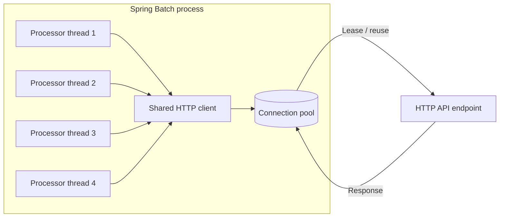
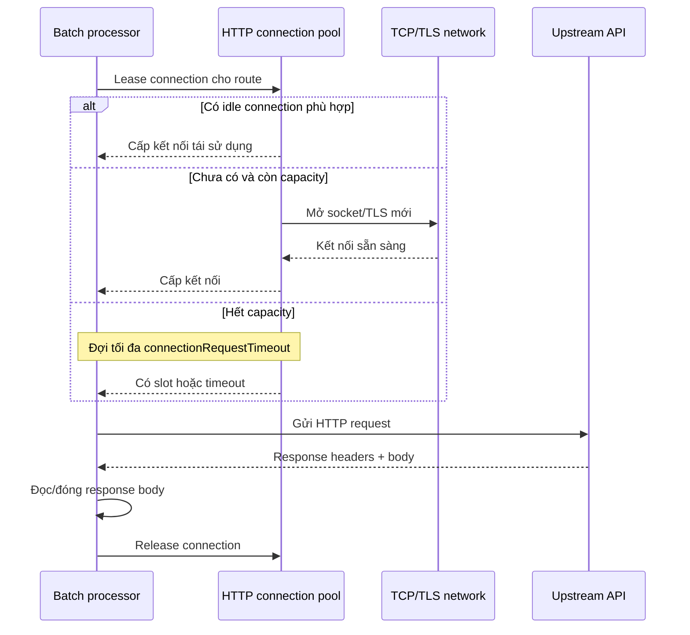
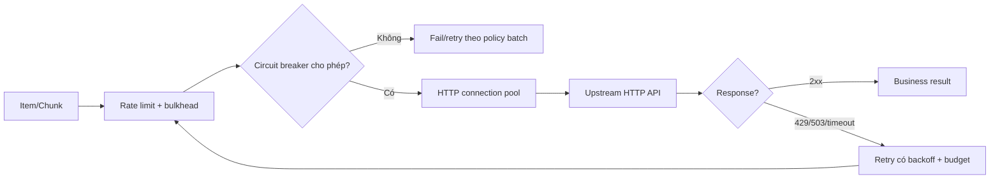

# HTTP client connection pool khi mở rộng Spring Batch

Một Spring Batch job làm giàu dữ liệu bằng HTTP có thể chạy rất tốt khi xử lý 1.000 bản ghi, nhưng bắt đầu timeout khi tăng lên hàng triệu bản ghi hoặc thêm nhiều worker. Lúc này, bottleneck có thể không nằm ở CPU của processor mà ở **số kết nối HTTP được phép dùng**, thời gian chờ lấy kết nối từ pool, giới hạn của dịch vụ đích hoặc việc tạo HTTP client mới cho từng item.

Bài học **HTTP client connection pool** thuộc chương **Resource pool** của module `SPRING_BATCH_SCALING_OPERATIONS`. Mục tiêu là mở rộng Spring Batch qua multi-threaded step, parallel steps, partitioning và các worker phân tán một cách **đo được và có giới hạn**: cấu hình pool kết nối đúng, chọn concurrency theo khả năng downstream, bảo đảm thread safety, kiểm soát retry/restart, phân tích lỗi và vận hành job dưới tải thực.

Ví dụ tập trung vào **Spring Batch 5.x**, **Spring Framework 6.x** (`RestClient`) và **Apache HttpClient 5.x classic/blocking**. Cần sử dụng các phiên bản tương thích và kiểm tra API theo dependency thực tế; cấu hình minh họa **không phải một SLA hay con số mặc định phù hợp cho mọi hệ thống**.

## 1. HTTP client connection pool là gì?

**Connection pool** là bộ quản lý tập các kết nối có thể tái sử dụng khi ứng dụng gọi tới server HTTP. Thay vì mở socket/TCP và đàm phán TLS cho mọi item, một HTTP client dùng chung có thể **mượn (lease)** một kết nối sẵn có, hoàn tất request, **trả (release)** kết nối về pool rồi tái sử dụng cho item sau.



Pool giúp:

- **Giảm overhead:** ít kết nối TCP/TLS mới hơn, latency thường thấp hơn.
- **Giới hạn tài nguyên:** ràng buộc số socket/kết nối đang dùng đến từng upstream.
- **Điều tiết tải:** request vượt khả năng pool có thể đợi hoặc timeout, thay vì tạo vô hạn kết nối.
- **Tái sử dụng client an toàn giữa các thread:** với implementation có contract thread-safe, một client dùng chung có thể phục vụ nhiều processor.
- **Giám sát bottleneck:** các metric leased/available/pending cho biết request đang ở đâu.

Pool **không** tự tăng khả năng chịu tải của HTTP server, không thay thế rate limiter, không bảo đảm idempotency cho request POST và không làm một `ItemReader` hay `ItemWriter` stateful trở thành thread-safe.

## 2. Một request đi qua những giai đoạn nào?



Trong Apache HttpClient 5 classic, pool thường quản lý kết nối theo **route**. Route liên quan scheme/host/port và có thể bao gồm proxy/tunnel; không đơn giản chỉ là tên service nghiệp vụ. Nếu tất cả request đều đi qua một API gateway ở cùng route, **per-route limit** có thể là giới hạn thực tế dù tổng pool còn chỗ.

**Điểm quan trọng:** nếu response body không được đọc hoặc đóng đúng cách ở code mức thấp, kết nối có thể tiếp tục bị giữ ở trạng thái **leased**, khiến request sau chờ vô hạn hoặc timeout. Dùng các API xử lý response và lifecycle an toàn; với streaming response phải bảo đảm đóng stream kể cả khi exception.

## 3. Không nhầm các loại pool trong một batch job

| Tài nguyên | Ví dụ | Giới hạn ở đâu? | Khi bão hòa |
| --- | --- | --- | --- |
| Thread pool | `TaskExecutor`, executor của listener | Thread chạy step/chunk | Task xếp hàng hoặc bị từ chối |
| HTTP connection pool | Apache HttpClient 5 | Socket/kết nối đến route | Request chờ lease, timeout |
| JDBC connection pool | HikariCP | Kết nối tới database | DB operation chờ connection |
| Broker consumer/prefetch | RabbitMQ/JMS listener | Request in-flight tại worker | Queue/unacked tăng |
| Remote API concurrency/rate | Quota upstream, gateway | Số request/giây hoặc inflight | HTTP 429, 503, timeout |
| File descriptors/ephemeral ports | OS/container | Handle/socket | Mở socket thất bại, reset |

Ví dụ một worker có 32 thread nhưng pool HTTP chỉ cho **4 kết nối/route**. Nếu mỗi item cần một request blocking, nhiều thread sẽ **đợi kết nối**, không phải cùng lúc tạo 32 HTTP request thành công. Nếu tăng pool lên 64 trong khi API chỉ cho 10 request concurrent, lỗi sẽ dịch từ “pool pending” sang “429/503 ở upstream”.

**Nguyên tắc thiết kế:** concurrency batch, pool HTTP, pool DB, consumer count và quota API phải được tính **cùng nhau**, không điều chỉnh từng tham số độc lập.

## 4. Các tham số quan trọng của Apache HttpClient pool

| Cấu hình | Ý nghĩa | Dễ hiểu nhầm |
| --- | --- | --- |
| `maxConnTotal` | Số kết nối tối đa pool giữ trên **tất cả route** | Không phải tối đa trên mỗi host |
| `maxConnPerRoute` | Số kết nối tối đa của **một route** | Có thể chặn mọi request nếu workload chỉ gọi một API |
| `connectionRequestTimeout` | Thời gian tối đa **chờ mượn** kết nối từ pool | Không phải TCP connect timeout |
| `connectTimeout` | Giới hạn cho quá trình thiết lập kết nối mới theo transport | Không bảo đảm toàn bộ request xong trong thời gian đó |
| `responseTimeout` | Giới hạn liên quan thời gian đợi response từ endpoint | Không nhất thiết là deadline end-to-end, có ngoại lệ với multiplexing |
| `socketTimeout` | Giới hạn I/O ở socket theo cấu hình transport | Không giống total elapsed time của job |
| Connection time-to-live | Tuổi tối đa của connection được phép tái sử dụng | Không phải TTL của message hay DNS |
| `validateAfterInactivity` | Xác minh kết nối đã idle trước khi reuse | Không thay thế retry cho socket reset |
| Idle eviction | Đóng kết nối không dùng trong một thời gian | Nếu quá ngắn, tăng connect/TLS overhead |

Các timeout có thể chồng lấn tùy tầng cấu hình. Ví dụ `responseTimeout` trong HttpClient 5 là timeout đợi response, **không phải cam kết mỗi HTTP call có tổng thời gian nhỏ hơn con số đó** khi có retry/redirect hoặc các bước transport khác. TLS handshake, DNS, proxy và chính sách retry cần được đánh giá theo client thực tế.

## 5. Bài toán sizing: concurrency không phải bằng pool size

Giả sử cụm Spring Batch:

```text
Worker process (P):                   8
Concurrent processor threads/worker: 12
HTTP request blocking/item:          1
Routes thực tế:                      1 API host
maxConnPerRoute/worker:              16
maxConnTotal/worker:                 32
```

Giới hạn HTTP concurrent tối đa **theo cấu hình danh nghĩa** nếu mỗi thread chỉ thực hiện một HTTP request tại một thời điểm:

```text
Per worker <= min(12 threads, 16 per-route, 32 total) = 12 request
Cluster    <= 8 workers x 12 = 96 concurrent requests
```

Đây **không phải số request/s** và không nói rằng API chịu được 96 request đồng thời. Với **thời gian trung bình của một request 250 ms**, ước lượng theo Little's law ở trạng thái ổn định:

```text
Throughput lý thuyết ~= inflight requests / avg response time
                    ~= 96 / 0.25 s
                    ~= 384 requests/second
```

Con số chỉ là **ước lượng minh họa**, chưa tính thời gian processor khác, network errors, queue wait, GC, downstream rate limit hoặc tail latency. Đừng lấy throughput lý thuyết làm SLA.

Nếu API chỉ chịu được 200 request/s, cần **rate limit hoặc quota phân bổ cho worker** chứ không chỉ giảm max connections. Một pool lớn có thể duy trì ít request hoặc rất nhiều request/s tùy latency. Một pool nhỏ vẫn có thể gây quá tải API khi response rất nhanh.

### 5.1. Công thức suy nghĩ tổng quát

Với mỗi worker `i`, một route đang xét:

```text
inflight_i <= min(active HTTP callers_i,
                  perRouteLimit_i,
                  totalPoolSlotsAvailable_i)

cluster_inflight = SUM(inflight_i)

required_inflight ≈ desired_RPS × mean_service_time_seconds
```

Nếu một item gọi HTTP **nhiều lần đồng thời** (async fan-out), hoặc client HTTP/2 multiplexing nhiều stream trên một connection, không thể suy trực tiếp “một connection = một request” như với đường classic blocking HTTP/1.1. Hãy đo actual inflight, stream limit và pool implementation.

## 6. Chọn thư viện HTTP đúng cho mô hình chạy

Spring Framework cung cấp nhiều cách gọi HTTP:

| Client | Đặc điểm | Khi phù hợp |
| --- | --- | --- |
| `RestClient` + Apache HttpClient 5 classic | Synchronous/blocking, API fluent, pooling cấu hình rõ | `ItemProcessor`/`ItemWriter` chạy blocking |
| `RestTemplate` + `HttpComponentsClientHttpRequestFactory` | Synchronous API cũ, vẫn gặp trong codebase | Hệ thống cũ; có thể chia sẻ cùng HTTP client được quản lý |
| Java `java.net.http.HttpClient` | Có keep-alive/HTTP2, cấu hình kết nối khác Apache | Muốn dùng JDK client; không copy tham số Apache pool |
| `WebClient` + Reactor Netty | Non-blocking/reactive; pool/event loop khác | Tải HTTP lớn, có thiết kế backpressure/async rõ |
| Apache HttpClient 5 async | Async connection manager riêng | Cần concurrency I/O nhiều mà không chặn hàng trăm thread |

Trong bài này chọn **`RestClient` + HttpClient 5 classic** để cấu hình minh bạch. `RestClient` từ Spring Framework 6.1 là client đồng bộ an toàn để dùng chung giữa nhiều thread sau khi build; ở Boot 3.x cần bảo đảm phiên bản Spring Framework tương thích. Không mặc định `RestClient` nào cũng dùng Apache: phải chỉ định `HttpComponentsClientHttpRequestFactory` nếu muốn kiểm soát pool cụ thể.

**Không trộn API Apache HttpClient 4.x và 5.x:** Spring Framework 6 dùng HttpComponents 5 trong request factory tương ứng; package như `org.apache.hc.client5...` khác với `org.apache.http...` của 4.x.

## 7. Cấu hình pool HTTP dùng chung trong Spring Boot / Spring Batch

Ví dụ dùng **Java 17+, Spring Framework 6.1+** và **Apache HttpClient 5.2+**. Các class trong cấu hình được tổ chức thành một HTTP client singleton, phục vụ tất cả processor thread trong **một JVM worker**.

```java
import org.apache.hc.client5.http.config.ConnectionConfig;
import org.apache.hc.client5.http.config.RequestConfig;
import org.apache.hc.client5.http.impl.classic.CloseableHttpClient;
import org.apache.hc.client5.http.impl.classic.HttpClients;
import org.apache.hc.client5.http.impl.io.PoolingHttpClientConnectionManager;
import org.apache.hc.client5.http.impl.io.PoolingHttpClientConnectionManagerBuilder;
import org.apache.hc.core5.util.TimeValue;
import org.apache.hc.core5.util.Timeout;

import org.springframework.context.annotation.Bean;
import org.springframework.context.annotation.Configuration;
import org.springframework.http.client.HttpComponentsClientHttpRequestFactory;
import org.springframework.web.client.RestClient;

@Configuration
public class BatchHttpClientConfiguration {

    @Bean(destroyMethod = "")
    PoolingHttpClientConnectionManager pricingConnectionManager() {
        ConnectionConfig connectionConfig = ConnectionConfig.custom()
                .setConnectTimeout(Timeout.ofSeconds(3))
                .setSocketTimeout(Timeout.ofSeconds(15))
                .setTimeToLive(TimeValue.ofMinutes(2))
                .setValidateAfterInactivity(TimeValue.ofSeconds(5))
                .build();

        return PoolingHttpClientConnectionManagerBuilder.create()
                .setMaxConnTotal(32)
                .setMaxConnPerRoute(16)
                .setDefaultConnectionConfig(connectionConfig)
                .build();
    }

    @Bean(destroyMethod = "close")
    CloseableHttpClient pricingHttpClient(
            PoolingHttpClientConnectionManager pricingConnectionManager) {
        RequestConfig requestConfig = RequestConfig.custom()
                .setConnectionRequestTimeout(Timeout.ofSeconds(2))
                .setResponseTimeout(Timeout.ofSeconds(10))
                .build();

        return HttpClients.custom()
                .setConnectionManager(pricingConnectionManager)
                .setDefaultRequestConfig(requestConfig)
                .evictExpiredConnections()
                .evictIdleConnections(TimeValue.ofSeconds(30))
                .disableAutomaticRetries()
                .build();
    }

    @Bean
    RestClient pricingRestClient(CloseableHttpClient pricingHttpClient) {
        return RestClient.builder()
                .baseUrl("https://pricing.internal.example")
                .requestFactory(
                        new HttpComponentsClientHttpRequestFactory(
                                pricingHttpClient))
                .build();
    }
}
```

**Đây là cấu hình tham khảo, không phải giá trị khuyến nghị phổ quát.** Các timeout 2/3/10 giây và giới hạn 32/16 phải được thay bằng dữ liệu đo tải, SLA upstream và cấu hình cụm. `pricing.internal.example` là **endpoint giả định**; chưa có hạ tầng TLS, auth, DNS hoặc firewall thực tế.

### 7.1. Tại sao pool bean có destroyMethod rỗng?

`CloseableHttpClient` được cấu hình với manager **không shared** (mặc định); khi đóng client, nó chịu trách nhiệm giải phóng connection manager và luồng eviction. Bean manager được khai báo `destroyMethod=""` để tránh Spring đóng manager riêng lần nữa theo inferred destroy method. **Không** dùng cùng manager ấy cho một HTTP client khác với ownership không rõ.

Nếu ứng dụng thật cần **một pool dùng cho nhiều HTTP client**, hãy chọn chiến lược ownership có `setConnectionManagerShared(true)` và một bean manager được đóng **một lần** ở shutdown; khi shared, các helper eviction của client không quản lý manager theo cùng cách, nên phải bố trí idle/expired eviction riêng. Không copy cấu hình shared mà giữ giả định đóng client là đóng toàn bộ pool.

### 7.2. Vì sao tắt automatic retry trong ví dụ?

`disableAutomaticRetries()` giúp đặt trách nhiệm retry về một tầng được kiểm soát (ví dụ Step fault tolerance, retry policy trong service). Nếu để **HttpClient retry + Spring Batch retry + broker redelivery** cùng hoạt động độc lập, một sự cố nhỏ có thể nhân số request lên nhiều lần.

Một GET idempotent có thể được retry hợp lý, nhưng **POST có side effect** phải có operation idempotency key nếu retry khi kết quả chưa rõ. Chọn retry trên cơ sở loại lỗi và hợp đồng upstream.

## 8. Một ItemProcessor tái sử dụng RestClient singleton

Giả sử job đọc invoice và gọi API lấy tỷ giá. DTO bất biến:

```java
import java.math.BigDecimal;

public record Invoice(
        long id,
        String currency,
        BigDecimal amount) {}

public record RateResponse(BigDecimal rate) {}

public record EnrichedInvoice(
        long id,
        BigDecimal normalizedAmount) {}
```

Processor:

```java
import org.springframework.batch.item.ItemProcessor;
import org.springframework.beans.factory.annotation.Qualifier;
import org.springframework.context.annotation.Bean;
import org.springframework.context.annotation.Configuration;
import org.springframework.web.client.RestClient;

@Configuration
class InvoiceEnrichmentConfiguration {

    @Bean
    ItemProcessor<Invoice, EnrichedInvoice> invoiceEnrichmentProcessor(
            @Qualifier("pricingRestClient") RestClient pricingRestClient) {

        return invoice -> {
            RateResponse response = pricingRestClient.get()
                    .uri("/v1/rates/{currency}", invoice.currency())
                    .retrieve()
                    .body(RateResponse.class);

            if (response == null || response.rate() == null) {
                throw new IllegalStateException("Tỷ giá không hợp lệ");
            }

            return new EnrichedInvoice(
                    invoice.id(),
                    invoice.amount().multiply(response.rate()));
        };
    }
}
```

Processor **không lưu mutable request state trên instance**, nên có thể được dùng bởi nhiều thread nếu các dependency khác thread-safe. `RestClient` và HTTP client/pool được chia sẻ; không gọi `new HttpClient()` trong mỗi lần `process`.

**Tính đúng khi retry/restart:** nếu tỷ giá thay đổi giữa hai lần gọi, cùng invoice có thể tạo kết quả khác nhau dù HTTP call là GET. Với job tài chính, nên định nghĩa **snapshot/version của tỷ giá** theo `JobParameters` hoặc input snapshot, để replay cùng nghiệp vụ cho kết quả xác định. Đặt thời gian cache/expiry phù hợp với tính đúng, không tối ưu latency bằng dữ liệu lỗi thời không được chấp nhận.

## 9. Kết nối pool với Step và transaction boundary

Một chunk-oriented step minh họa:

```java
import org.springframework.batch.core.Step;
import org.springframework.batch.core.repository.JobRepository;
import org.springframework.batch.core.step.builder.StepBuilder;
import org.springframework.batch.item.ItemProcessor;
import org.springframework.batch.item.ItemReader;
import org.springframework.batch.item.ItemWriter;
import org.springframework.context.annotation.Bean;
import org.springframework.transaction.PlatformTransactionManager;

@Bean
Step enrichInvoicesStep(
        JobRepository repository,
        PlatformTransactionManager transactionManager,
        ItemReader<Invoice> reader,
        ItemProcessor<Invoice, EnrichedInvoice> invoiceEnrichmentProcessor,
        ItemWriter<EnrichedInvoice> writer) {
    return new StepBuilder("enrichInvoicesStep", repository)
            .<Invoice, EnrichedInvoice>chunk(100, transactionManager)
            .reader(reader)
            .processor(invoiceEnrichmentProcessor)
            .writer(writer)
            .build();
}
```

Đây là method nằm trong class `@Configuration`; cần định nghĩa reader/writer, model, datasource, `Job` và hạ tầng riêng để chạy. **Không thêm `TaskExecutor` một cách tùy tiện** chỉ để có nhiều HTTP call song song: phải kiểm tra reader, writer, transaction state và implementation step có an toàn cho concurrency hay không.

Một giới hạn quan trọng: với chunk-oriented step, **gọi HTTP có thể nằm trong thời gian chunk transaction**. Nếu mỗi request mất 5 giây, các transaction/lock/connection database có thể bị giữ lâu hơn tùy cấu hình. Hãy đo transaction duration và thử tách enrichment/staging khỏi bước ghi transaction nếu cần; không mặc định HTTP chậm là lỗi của pool.

Nếu processor gọi API **chỉ đọc**, retry có thể an toàn hơn. Nếu writer gọi API **cập nhật** tài nguyên phía ngoài, Spring Batch rollback transaction database **không rollback** request HTTP đã thành công; lúc đó phải dùng idempotency key/outbox và thiết kế compensation.

## 10. Độ lớn pool theo mô hình mở rộng của Spring Batch

### 10.1. Single-threaded step

Một thread chạy processor và mỗi item chỉ gọi một HTTP request blocking. Dù pool cấu hình `maxConnPerRoute=100`, thường chỉ có **một** request đang active từ step ấy. Pool lớn không tạo parallelism; điểm nghẽn có thể là latency API và thời gian tuần tự.

### 10.2. Multi-threaded step

Nếu `TaskExecutor` có 16 worker thread và mỗi thread có một request blocking:

```text
active HTTP callers <= 16
pool per-route        = 8
requests đang chờ    có thể lên tới 8 hoặc hơn
```

Khi pool pending cao, tăng thread từ 16 lên 32 **không làm HTTP throughput tăng** trừ khi tăng capacity phù hợp và upstream cho phép. Đồng thời cần đặc biệt kiểm tra `ItemReader`/`ItemWriter` không chia state chưa được đồng bộ.

### 10.3. Parallel steps

Hai flow chạy đồng thời cùng gọi một API qua **client singleton dùng chung** thì dùng chung pool trong JVM. Nếu mỗi flow có bộ client/manager riêng, chúng tạo **hai pool độc lập** và tổng socket có thể tăng gấp đôi. Sizing phải tính **mọi step cùng chạy**, không chỉ một step riêng.

### 10.4. Local partitioning

Nhiều `StepExecution` trong cùng JVM dùng cùng bean client singleton khi được inject đúng. Tổng HTTP callers đến từ nhiều partition concurrent. Reader `@StepScope` có thể tách state theo partition, **không yêu cầu mỗi partition phải tự tạo HTTP connection pool**.

### 10.5. Remote partitioning và remote chunking

Mỗi process worker thường có pool HTTP **riêng trong process**. Nếu 10 worker × mỗi pool 20 kết nối/route, cluster có thể mở đến khoảng 200 kết nối cho route ấy (chưa tính manager và ứng dụng khác). Worker restart cũng tạo pool mới; những kết nối của process chết sẽ được OS/server thu hồi theo lifecycle TCP, không được chuyển sang worker mới.

Remote chunking cần tính **nhiều worker cùng xử lý chunk**; remote partitioning cần tính **số `StepExecution` active**. Nếu chính manager cũng gọi API, manager phải có budget riêng. `gridSize` hoặc số message **không bằng** số HTTP connection thực tế.

## 11. Pool size và quota HTTP của downstream

Hai loại giới hạn phổ biến:

- **Concurrency limit:** upstream cho tối đa `K` requests đang xử lý.
- **Rate limit:** upstream cho tối đa `Q` requests/giây hoặc theo token bucket.

Giới hạn pool giúp kiểm soát concurrency tương đối tốt ở mức **một JVM và một route**, nhưng không thực thi được quota **toàn cluster**. Ví dụ 8 worker cùng dùng `maxConnPerRoute=16` tạo tới 128 kết nối khả dụng; upstream chỉ cho 40 request đồng thời. Khi tất cả cùng chạy, request có thể bị 429/503 dù không có pool pending.

Giải pháp:

1. Đo limit/quota thực tế theo API và tenant.
2. Phân bổ budget theo số worker/pod đang active; cân nhắc **distributed rate limiter** nếu worker có thể scale động.
3. Giới hạn in-flight bằng semaphore/bulkhead ở tầng HTTP service và pool.
4. Dùng backoff có jitter, tôn trọng `Retry-After` khi upstream cung cấp.
5. Không coi 429 là tín hiệu “hãy tăng pool size”; thường cần **giảm tốc độ gửi**.

**Rate limiter và pool là hai tầng khác nhau:** pool quản lý socket, rate limiter quản lý request throughput; có thể cần cả hai.

## 12. Dùng semaphore để hạn chế in-flight request ở worker

Nếu muốn giới hạn ngay ở tầng nghiệp vụ (ví dụ chỉ cho 8 HTTP requests đang hoạt động trên một process), có thể dùng một `Semaphore` singleton quanh call. Ví dụ:

```java
import java.util.concurrent.Semaphore;
import java.util.concurrent.TimeUnit;

import org.springframework.beans.factory.annotation.Qualifier;
import org.springframework.stereotype.Component;
import org.springframework.web.client.RestClient;

@Component
public final class PricingGateway {
    private final Semaphore inFlight = new Semaphore(8, true);
    private final RestClient client;

    public PricingGateway(
            @Qualifier("pricingRestClient") RestClient pricingRestClient) {
        this.client = pricingRestClient;
    }

    public RateResponse getRate(String currency) throws InterruptedException {
        boolean acquired = false;
        try {
            acquired = inFlight.tryAcquire(2, TimeUnit.SECONDS);
            if (!acquired) {
                throw new IllegalStateException(
                        "Pricing bulkhead full: retry theo chính sách");
            }
            return client.get()
                    .uri("/v1/rates/{currency}", currency)
                    .retrieve()
                    .body(RateResponse.class);
        } catch (InterruptedException interrupted) {
            Thread.currentThread().interrupt();
            throw interrupted;
        } finally {
            if (acquired) {
                inFlight.release();
            }
        }
    }
}
```

**Phạm vi của semaphore:** chỉ process/JVM, không phải limit toàn cluster. Bản thân `Semaphore` an toàn để chia sẻ giữa thread, nhưng phải dùng một bean gateway **singleton**, không tạo một semaphore mới trong mỗi `process()` hoặc `@StepScope` nếu muốn giới hạn toàn worker.

Khi bão hòa, chọn throw, backoff hoặc ghi lỗi có kiểm soát. Đừng chặn thread vô hạn trong `acquire()` vì có thể giữ chunk transaction/DB connection quá lâu. Công cụ bulkhead/rate limiter chuyên dụng có thể phù hợp hơn, nhưng cần hiểu rõ budget thay vì chồng nhiều limit không quan sát được.

## 13. Timeout: phân biệt lỗi đợi pool và lỗi mạng

Ví dụ cấu hình ở mục 7:

```text
connectionRequestTimeout = 2 s
connectTimeout           = 3 s
responseTimeout          = 10 s
socketTimeout            = 15 s
```

Các tình huống khác nhau:

| Kịch bản | Triệu chứng khả dĩ | Đầu mối kiểm tra |
| --- | --- | --- |
| 20 thread cần một route với pool max 4 | Lease timeout/pending cao | `connectionRequestTimeout`, pool stats |
| Host không bắt tay TCP được | Connect timeout/refused | DNS, network, route, firewall |
| Server nhận kết nối nhưng không trả response đúng hạn | Response timeout | API latency, server thread pool |
| Connection idle bị LB đóng | Connection reset / stale connection | Idle eviction, validate after inactivity, server keep-alive |
| TLS handshake lỗi/chậm | SSL/TLS exception/timeout | Certificate, truststore, TLS config |
| API trả HTTP 429 | `TooManyRequests` / error response | Quota, retries, per-cluster rate |
| Toàn bộ job timeout khi HTTP call chưa lâu | Job/step timeout hoặc manager reply timeout | Batch lifecycle, không chỉ HTTP timeout |

Không lấy tổng đơn giản `2+3+10=15 giây` làm **deadline bảo đảm** cho mỗi HTTP call. DNS, redirects, response body, retry, handshake và implementation có thể làm tổng wall-clock khác. Nếu yêu cầu deadline cứng, phải thiết kế **overall call budget/cancellation** phù hợp cho client đang dùng và test thực tế.

### 13.1. Các timeout không nên đặt bằng 0 một cách vô thức

Ở nhiều HTTP library, giá trị zero có thể có nghĩa **vô hạn**, không phải “fail ngay”. Chỉ dùng giá trị vô hạn nếu có lý do cụ thể và lớp deadline khác đảm bảo job không bị giữ mãi. Đối với job có SLA, mọi đường chờ tài nguyên nên có **điểm dừng và khả năng quan sát**.

## 14. Retry và pool: vì sao dễ có retry storm?

Giả sử một request bị chậm. Hệ thống có thể retry ở:

1. Apache HttpClient tự retry lỗi I/O.
2. Spring Batch step `faultTolerant().retry(...)`.
3. Retry tại Spring service/gateway.
4. Broker redelivery trong remote chunking/partitioning.
5. Operator restart `JobInstance`.

Nếu mỗi tầng thử 3 lần độc lập, số HTTP attempts có thể tăng **theo phép nhân**, chứ không chỉ tăng 3 lần. Trong outage, retry làm pool/DB/broker nghẽn hơn và kéo dài thời gian phục hồi.

**Thiết kế tối thiểu:**

- Chọn **một tầng chịu trách nhiệm retry HTTP chủ đạo**; các tầng khác phải biết khi nào được phép lặp.
- Giới hạn số lần thử, có exponential backoff + jitter và overall time budget.
- Không retry mù quáng HTTP 400/401/403 do lỗi payload/auth.
- Xem 429 và 503 là ứng viên retry có điều kiện, kiểm `Retry-After` và quota.
- Timeout sau POST có thể là **kết quả không rõ**: upstream đã commit nhưng response thất lạc. Retry phải có idempotency key nghiệp vụ.
- Khi retry, phản hồi/stream của attempt trước phải được đóng hoặc hủy đúng cách để **trả connection** cho pool.

**Không dùng retry để che lỗi pool leak:** nếu `leased=max` mãi mà downstream không có request active tương ứng, thêm retry sẽ chỉ làm `pending` tăng.

## 15. HTTP call có side effect: idempotency quan trọng hơn pool

Gọi GET lấy tỷ giá thường không tạo side effect, nhưng POST gửi thanh toán hoặc gửi email có thể **thực thi thành công dù client timeout**. Ví dụ:

```text
T1 Worker gửi POST /payments với operationKey=invoice:101:pay
T2 Server ghi nhận payment thành công
T3 Mất response trên mạng
T4 HTTP client timeout
T5 Spring Batch retry/restart item 101
```

Nếu T5 gửi lại request không có idempotency contract, có thể **thu tiền hai lần**. Pool chỉ chịu trách nhiệm vận chuyển kết nối, không biết business operation đã hoàn thành hay chưa.

Với API có hỗ trợ:

- Tạo **idempotency key bền vững** theo nghiệp vụ (invoice + operation type/version).
- Truyền key cho mọi retry/restart của cùng logical operation.
- Upstream phải lưu/kiểm cùng key theo hợp đồng và thời gian retention đủ lớn.
- Nếu API không hỗ trợ idempotency, cân nhắc outbox, reconciliation và thiết kế compensation; không tuyên bố exactly-once.

**Không dùng `UUID.randomUUID()` mỗi HTTP attempt làm idempotency key**, vì mọi retry trở thành operation mới.

## 16. Connection leak và lifecycle client

Trong ứng dụng Spring Batch chạy nhiều giờ, pool leak có thể làm job chậm dần:

```text
pool max:       16
leased:         16
available:       0
pending:        22
upstream active:  2
```

Nếu 16 leased liên tục nhưng server chỉ thấy 2 request thực, nghi ngờ **response body chưa đóng, thread bị treo, request stream chưa tiêu thụ hoặc client code giữ connection quá lâu**.

Điều cần làm:

1. Tái sử dụng một `CloseableHttpClient` singleton khi có nhu cầu pool chung.
2. Đóng client **một lần ở shutdown ứng dụng**, không đóng sau mỗi item/chunk.
3. Với low-level HTTP response streaming, dùng cơ chế auto-close hoặc try-with-resources.
4. Với `RestClient.retrieve().body(...)`, response được xử lý theo abstraction của request factory; nếu dùng `exchange(...)` tùy biến, kiểm hợp đồng giải phóng resource và không giữ stream ra ngoài callback.
5. Không mở HTTP client mới trong `ItemProcessor.process()`, `ItemWriter.write()`, listener hoặc `@BeforeStep` cho mỗi execution nếu không có lý do rõ.
6. Kiểm soát background eviction threads; không tạo một eviction thread cho mỗi request/step.

### 16.1. Step restart có nên reset pool không?

**Không mặc định.** Restart `JobInstance` trong cùng process có thể tiếp tục dùng pool hiện có; restart JVM tạo pool mới. Nếu pool gặp lỗi kết nối stale, cần giải quyết tại lifecycle/network/client layer, không “cứ retry job là new client” để che nguyên nhân. Nếu xác định client/pool hỏng, có thể quản lý **recreate theo lifecycle** có kiểm soát, tránh race khi nhiều StepExecution còn sử dụng client cũ.

## 17. Idle timeout, TTL, DNS và load balancer

Một pool giữ socket lâu có thể gặp:

- **Server hoặc LB đóng idle connection** trước client; request sau reuse socket đã half-closed.
- **Backend đổi IP** sau deploy hoặc autoscaling, nhưng connection cũ vẫn trỏ tới endpoint đã mở.
- **DNS TTL thay đổi** nhưng pool tiếp tục giữ socket cũ, vì DNS chỉ được sử dụng khi tạo kết nối mới.
- **Proxy/TLS configuration** đổi khiến kết nối cũ không còn hợp lệ về chính sách.

Hướng xử lý:

1. Cấu hình connection TTL hữu hạn để connection không tồn tại mãi.
2. Evict idle/expired connections ở chu kỳ phù hợp.
3. Dùng `validateAfterInactivity` khi client hỗ trợ để giảm reuse stale.
4. Cân nhắc client idle timeout ngắn hơn phía proxy/LB, nhưng **đừng quá ngắn** khiến TLS handshake trở thành bottleneck.
5. Quan sát connection reset rate, số new connects/s, TLS failures và DNS/network behavior.
6. Test rolling deploy upstream và network partition trước khi áp dụng chính sách retry.

**Caveat:** TTL của connection manager **khác** DNS cache TTL, HTTP cache TTL, `Retry-After` hoặc queue TTL. Chúng giải quyết những vòng đời khác nhau.

## 18. Pool metrics: leased, available, pending và max

Apache HttpClient 5 cung cấp `PoolingHttpClientConnectionManager.getTotalStats()`. Ví dụ Java:

```java
import org.apache.hc.core5.pool.PoolStats;
import org.apache.hc.client5.http.impl.io.PoolingHttpClientConnectionManager;

void logPool(PoolingHttpClientConnectionManager manager) {
    PoolStats stats = manager.getTotalStats();
    System.out.printf(
            "HTTP pool leased=%d available=%d pending=%d max=%d%n",
            stats.getLeased(),
            stats.getAvailable(),
            stats.getPending(),
            stats.getMax());
}
```

Đo thêm `manager.getStats(HttpRoute)` khi cần nhìn **một route cụ thể**, vì total stats có thể che nghẽn riêng route A trong khi route B còn idle. Không log stats cho từng URL động nếu route cardinality quá lớn.

| Metric | Cách diễn giải |
| --- | --- |
| `leased` gần `max` liên tục | Pool đang dùng hết connection; cần xem request active và pending |
| `available` cao, leased thấp | Pool không phải điểm nghẽn hiện tại |
| `pending > 0` kéo dài | Caller phải đợi lease; có thể quá nhiều thread/route nhỏ |
| Lease wait p95/p99 cao | Đợi pool nhiều, kể cả response service còn nhanh |
| Connect/new TLS handshakes/s cao | Tái sử dụng kém, TTL quá ngắn, mở client quá nhiều |
| API p95/p99 latency cao | Có thể upstream chậm; phân biệt với pool wait |
| 429/503 tăng khi thêm worker | Downstream quá tải hoặc quota |
| 5xx/timeout tăng sau retry | Retry storm / saturation / failure propagation |

**Cẩn thận về semantics:** `getPending()` cho biết các yêu cầu chờ connection ở mức pool, không phải số message RabbitMQ pending hay số item còn trong JobRepository.

## 19. Đưa pool metrics vào Micrometer

Nếu ứng dụng đã dùng Spring Boot Actuator/Micrometer, có thể tạo `MeterBinder` ghi gauge từ manager. Ví dụ:

```java
import io.micrometer.core.instrument.Gauge;
import io.micrometer.core.instrument.binder.MeterBinder;
import org.apache.hc.client5.http.impl.io.PoolingHttpClientConnectionManager;
import org.springframework.context.annotation.Bean;

@Bean
MeterBinder pricingPoolMeters(
        PoolingHttpClientConnectionManager pricingConnectionManager) {
    return registry -> {
        Gauge.builder("batch.http.pool.leased", pricingConnectionManager,
                manager -> manager.getTotalStats().getLeased())
                .register(registry);

        Gauge.builder("batch.http.pool.available", pricingConnectionManager,
                manager -> manager.getTotalStats().getAvailable())
                .register(registry);

        Gauge.builder("batch.http.pool.pending", pricingConnectionManager,
                manager -> manager.getTotalStats().getPending())
                .register(registry);

        Gauge.builder("batch.http.pool.max", pricingConnectionManager,
                manager -> manager.getTotalStats().getMax())
                .register(registry);
    };
}
```

Snippet là method đặt trong class `@Configuration`; cần thư viện Micrometer và metrics backend. Khi chạy nhiều worker, thêm **tag cardinality thấp** như `client=pricing`, `job_type=enrichment` hoặc `worker_pool=invoice`, không gắn từng `itemId`/`jobExecutionId` làm metric tag.

Đây là **pool metrics tùy biến**, không mặc định Spring Batch sẽ tạo tự động các tên trên. Kết hợp thêm timer ở tầng business để tách **lease wait**, HTTP response latency và toàn bộ item processing time.

## 20. Xác định bottleneck bằng tín hiệu quan sát

| Triệu chứng | Giả thuyết đầu tiên | Kiểm tra trước khi sửa |
| --- | --- | --- |
| `pool.pending` cao, leased=max, API response ổn | Pool per-route quá nhỏ so với caller | CPU/DB pool, route limits, throughput |
| `pool.pending` cao cùng API p99 rất lớn | API chậm làm giữ connection | Upstream traces, 429/503, server concurrency |
| Pool còn rảnh, job chậm | Reader/DB/CPU hoặc ít processor threads | Read/process/write duration, TaskExecutor |
| Tăng pool làm API 429 tăng | Overload downstream | Quota/rate limiter, backoff |
| TIME_WAIT/sockets tăng khi job bắt đầu | Tạo client mới hoặc connection reuse kém | Client bean scopes, idle TTL, connection closes |
| Leased không giảm dù item đã xong | Response leak hoặc thread treo | Thread dump, response close, network call stacks |
| Lỗi tăng sau rolling deployment API | Stale sockets/DNS/LB | TTL, validation, retry có giới hạn |
| HTTP timeout nhưng business DB bị khóa | Giữ DB transaction trong lúc HTTP chậm | Chunk boundary/transaction isolation |
| Throughput giảm khi tăng remote worker | Quota HTTP/DB chung đã bão hòa | Tổng pool của **cả cụm**, không chỉ mỗi worker |

### Phép đo hiệu quả

Trong cùng một phép thử tải, giữ **dataset và snapshot** giống nhau. Tăng một tham số tại một thời điểm:

1. 4 processor threads, pool per-route 4.
2. 8 threads, pool per-route vẫn 4.
3. 8 threads, pool per-route 8.
4. 12 threads, pool per-route 12.
5. Giữ threads/pool, thêm worker process.

Ghi **items/s, requests/s, pool pending, HTTP p95/p99, 429, CPU, DB pool wait, memory và số side effect hợp lệ**. Nếu ở bước 3 HTTP throughput tăng nhưng DB write không đổi, có thể bottleneck đã chuyển sang writer/DB.

## 21. Circuit breaker, bulkhead và rate limiting

Pool là **giới hạn ở tầng kết nối**, nhưng job production thường cần thêm:

- **Bulkhead:** giới hạn số request nghiệp vụ đồng thời, đặc biệt khi một worker có nhiều loại API.
- **Rate limiter:** giữ tổng request/s dưới quota, có thể cần chia ngân sách qua nhiều process.
- **Circuit breaker:** khi upstream lỗi diện rộng, từ chối tạm thời thay vì giữ connection/thread.
- **Timeout và retry budget:** ngăn một chunk bị kéo dài không giới hạn.
- **Backpressure:** không lấy thêm quá nhiều item/chunk/message khi downstream đang nghẽn.



Không cần bật mọi cơ chế cùng một lúc. Nếu không đo được **limit nào đang từ chối request**, nhiều tầng bulkhead có thể khiến lỗi khó giải thích. Quy định một layer chịu trách nhiệm retry, trả mã lỗi nhất quán cho Spring Batch và có runbook phân biệt “API từ chối tải” với “client cạn kết nối”.

## 22. Kiểm soát API lỗi trong retry/restart

Khi HTTP gọi trong `ItemProcessor`, lỗi có thể làm chunk rollback. Sau retry hoặc restart, một item có thể gọi lại API, và một số item được gọi **nhiều lần** ngay cả khi output nghiệp vụ cuối cùng chỉ được ghi một lần.

Đối với API chỉ đọc, xem xét:

1. Nếu giá trị cần ổn định, truy vấn theo **business snapshot/version**, không luôn lấy “giá hiện tại”.
2. Cache có TTL và key thích hợp, tránh cache response không hợp lệ.
3. Không để cache đơn process trở thành nguồn duy nhất khi job restart ở process mới.
4. Đo response/timeouts per status và tỉ lệ retry.
5. Kiểm soát tổng thời gian retry để không vượt job SLA.

Với API ghi, yêu cầu idempotency hoặc outbox/reconciliation như mục 15. Connection pool có thể giảm network latency, **không có nghĩa tính đúng side effect được đảm bảo**.

## 23. An toàn dữ liệu và bảo mật khi dùng shared HTTP client

Chia sẻ HTTP client giữa thread là đúng khi implementation thread-safe, nhưng **không chia sẻ mutable per-request state**:

- Không đặt bearer token, tenant ID hoặc request body của item A vào field mutable global rồi dùng chung cho item B.
- Đặt headers theo từng request; nếu cần token refresh, dùng provider có synchronization phù hợp.
- TLS truststore/client certificates phải được cấu hình đúng; không tắt kiểm tra chứng chỉ để “chữa lỗi pool”.
- Nếu API trả PII, không log raw response, bearer token hoặc query string chứa dữ liệu nhạy cảm.
- Giới hạn response size/streaming để không nạp một payload khổng lồ cho mỗi item.
- Tách client/pool cho upstream có **quota, SLA, auth hoặc failure domain** khác nhau khi điều đó giúp cô lập; đánh đổi với socket và connection overhead.
- Dùng timeout, redirect policy và proxy settings có kiểm soát; tránh SSRF khi URL host lấy từ input chưa xác thực.

**Gợi ý thiết kế:** base URL của client nên được cấu hình từ nguồn tin cậy; item chỉ chọn path/query hợp lệ, không cho dữ liệu CSV trực tiếp quyết định toàn bộ host để gửi request.

## 24. Các lỗi cấu hình phổ biến

| Lỗi | Hậu quả | Cách sửa |
| --- | --- | --- |
| Tạo `HttpClient` trong `process()` | Không tái sử dụng socket, TLS overhead và FD tăng | Dùng bean singleton |
| `maxConnPerRoute` vẫn nhỏ | Một API route bị nghẽn dù total pool lớn | Điều chỉnh per-route theo concurrency và quota |
| Tăng `maxConnTotal` nhưng không tăng per-route | Route hot vẫn pending | Kiểm `HttpRoute`/pool stats |
| Chỉ tăng thread pool | Thread đợi lease, memory/transaction hold tăng | Đo leased/pending và điều chỉnh phối hợp |
| Tăng pool quá lớn | 429/503, API overload | Quota/rate limit/bulkhead |
| Không có timeout lease | Thread chờ pool quá lâu | `connectionRequestTimeout` hữu hạn |
| Dùng response timeout như total deadline | Retry/redirect làm call vượt SLA | Deadline budget riêng |
| Không đóng response stream | Leased tăng và không trả slot | Close/consume response đúng |
| Đóng client sau mỗi chunk | Pool bị xóa, mất reuse | Close lúc application shutdown |
| Nhiều worker dùng pool size như thể là global | Số socket thực nhân theo pod/JVM | Tính cluster budget |
| Dùng `@StepScope` cho HTTP client không cần thiết | Mỗi partition một pool, tăng sockets | Client singleton; reader có thể step-scoped |
| Retry HTTP + Batch + broker không giới hạn | Retry storm | Một tầng retry chủ đạo, backoff/jitter |
| POST retry với key mới mỗi lần | Side effect trùng | Idempotency key nghiệp vụ bền |
| Không quan sát per-route | Bỏ sót một route đang chờ | Theo dõi total và route hot |
| Pool idle TTL quá ngắn | TLS/connection churn | So keep-alive với LB/server |
| Dùng `synchronized` để hạn chế cluster HTTP | Không kiểm soát nhiều JVM | Distributed quota/budget hoặc rate limiter |

## 25. Bài lab: đo đúng hiệu quả connection pool

### Dữ liệu và môi trường

Chuẩn bị môi trường thử biệt lập:

- 10.000 invoice có ID duy nhất và currency đã biết.
- Một HTTP mock server hoặc upstream test endpoint cho phép cấu hình **delay, 429, 503, connection reset và close idle**.
- Spring Batch job có một processor GET như mục 8 và writer lưu kết quả theo invoice ID.
- Pool HTTP chia sẻ qua bean singleton; bật metrics `leased/available/pending`.
- Một worker hoặc nhiều worker process, thay concurrency theo từng kịch bản.

### Các trường hợp thử

1. **Reuse baseline:** chạy cùng input nhiều request; xác minh số TCP/TLS handshakes ít hơn số HTTP calls và connection được tái sử dụng khi server cho phép.
2. **Pool nhỏ:** đặt 8 caller threads, per-route 2, inject latency 500 ms; phải thấy `pending` hoặc lease wait tăng thay vì pool tự mở 8 connection.
3. **Pool phù hợp:** tăng per-route lên 8, giữ latency/quota; đo throughput tăng tới mức upstream cho phép.
4. **API quota:** upstream chỉ cho 4 concurrent request; thử pool 8 và 16, quan sát 429/503; thêm bulkhead hoặc rate limit.
5. **Lease timeout:** giữ hai kết nối đang xử lý request chậm quá lâu; yêu cầu thứ ba hết `connectionRequestTimeout` và báo lỗi có kiểm soát.
6. **Server idle close:** mock LB đóng idle socket; đợi quá thời gian idle, gửi request mới; đo reset/reconnect và validate/evict.
7. **Response leak:** ở môi trường test, cố ý không đóng response mức thấp; theo dõi `leased=max` và phục hồi sau sửa code.
8. **Timeout retry:** upstream trả 503 rồi thành công; xác minh số attempt đúng budget, không bị nhân bởi nhiều retry layer.
9. **HTTP mutating request:** giả lập server xử lý POST xong nhưng response mất; retry cùng operation key không tạo side effect lần hai.
10. **Remote worker scaling:** tăng số worker process 1→2→4, giữ pool/worker; đo tổng requests/s và quota downstream.
11. **Worker crash/restart:** kill worker khi request đang in-flight; kiểm không leak pool trong process mới và checkpoint/idempotency dữ liệu.
12. **Long run/stress:** chạy nhiều giờ với payload và số item thực tế; quan sát FD/memory/leased/available không tăng vô hạn.

### Bảng lưu kết quả thí nghiệm

| Case | Workers | Threads/worker | Per-route limit | HTTP p95 | Pool pending p95 | 429/503 | Committed items/s |
| --- | ---: | ---: | ---: | --- | --- | --- | --- |
| A: baseline | 1 | 2 | 2 | Đo thực | Đo thực | Đo thực | Đo thực |
| B: pool bottleneck | 1 | 8 | 2 | Đo thực | Đo thực | Đo thực | Đo thực |
| C: pool matched | 1 | 8 | 8 | Đo thực | Đo thực | Đo thực | Đo thực |
| D: scale out | 4 | 8 | 8 | Đo thực | Đo thực | Đo thực | Đo thực |

Đây là **mẫu bảng**, không phải benchmark đã thực hiện. Cần giữ input, API latency giả lập, resource quota và các giới hạn khác ổn định để kết luận công bằng.

### Bất biến tính đúng

```text
Input unique invoice IDs             = 10.000
Output unique invoice IDs            = 10.000
Missing business IDs                 = 0
Duplicate committed business effects = 0
Final job status                     = COMPLETED (khi không lỗi có chủ đích)
```

Tối ưu pool chỉ được xem là thành công khi **throughput tăng mà không phá các bất biến nghiệp vụ**. Nếu API enrichment trả kết quả thay đổi theo thời gian, cần snapshot đầu vào để đối soát được.

## 26. Runbook khi job bị nghẽn HTTP

**Bước 1 — Xác định phạm vi.** Tìm `JobExecution`, step, worker pool, endpoint, thời điểm throughput giảm. Kiểm cùng lúc CPU, DB pool, broker queue và HTTP error rate.

**Bước 2 — Đọc pool stats.** Nếu `pending > 0` và `leased=max` liên tục, xác định route hot; xem response latency, active request và dấu hiệu leak.

**Bước 3 — Phân loại lỗi.** Lease timeout khác connect timeout, HTTP 429 khác 503, DNS/TLS lỗi khác application 5xx. Mỗi loại cần biện pháp khác.

**Bước 4 — Tránh retry storm.** Giảm concurrency/rate nếu upstream bão hòa; hạn chế redelivery/retry đồng thời. Không tăng pool hàng loạt khi chưa biết quota.

**Bước 5 — Sửa nguyên nhân.** Ví dụ tăng per-route khi pool là điểm nghẽn thật; sửa response leak; điều chỉnh TTL khi stale; tăng quota upstream nếu phù hợp; tối ưu query/job nếu DB mới là bottleneck.

**Bước 6 — Khôi phục batch.** Xác nhận execution còn chạy hay đã fail; nếu cần restart, giữ identifying job parameters/checkpoint và idempotency với HTTP có side effect. Không tự sửa `BATCH_*` metadata để ép job chạy lại.

**Bước 7 — Đối soát và ghi nhận.** So business IDs, retries, metrics trước/sau, RTO và giới hạn tài nguyên đã thay; đưa thử nghiệm failure injection tương ứng vào regression suite.

## 27. Câu hỏi tự kiểm tra

**Câu 1.** 16 processor threads đồng thời gọi một HTTP route, nhưng `maxConnPerRoute=4`. Có 16 HTTP connections đang hoạt động không?

**Đáp án:** Với Apache HttpClient classic HTTP/1.1 và một request sử dụng một connection, thường tối đa 4 connection cho route đó. Những caller còn lại phải chờ/timeout ở pool; các giới hạn khác vẫn có thể làm con số thực thấp hơn.

**Câu 2.** `maxConnTotal=100` nhưng `maxConnPerRoute=5`, batch chỉ gọi một API host. Tăng total lên 200 có giải quyết pending không?

**Đáp án:** Không nếu bottleneck là per-route limit. Cần đo stats route và giới hạn upstream trước khi điều chỉnh.

**Câu 3.** Vì sao không nên tạo một `RestClient` và một connection manager mới trong mỗi `ItemProcessor.process()`?

**Đáp án:** Không tái sử dụng TCP/TLS, tạo thêm socket/FD, tăng latency, gây resource churn và không có giới hạn pool chung hiệu quả.

**Câu 4.** `connectionRequestTimeout` và `connectTimeout` khác nhau thế nào?

**Đáp án:** Cái đầu giới hạn thời gian chờ **mượn connection từ pool**; cái sau giới hạn việc **thiết lập kết nối mới** theo transport configuration.

**Câu 5.** Có 8 worker process, mỗi process `maxConnPerRoute=20`. Có thể coi quota kết nối toàn cluster chỉ là 20?

**Đáp án:** Không. Mỗi JVM có pool riêng nên cluster có thể tạo đến khoảng 160 connection cho route đó, chưa tính ứng dụng khác, nếu thread/concurrency đủ để dùng.

**Câu 6.** API trả HTTP 429 sau khi tăng pool. Có nên tiếp tục tăng pool?

**Đáp án:** Thường không. 429 biểu thị rate/quota limit của upstream; cần giảm inflight/rate, tuân thủ `Retry-After` và dùng backoff.

**Câu 7.** Pool leased=max liên tục, upstream chỉ thấy ít active requests. Một nguyên nhân đáng nghi là gì?

**Đáp án:** Response stream chưa được đóng, HTTP call bị treo hoặc lỗi lifecycle giữ connection không trả pool. Kiểm thread dump/response close.

**Câu 8.** Sau POST thanh toán, worker timeout dù server đã commit. Retry với UUID ngẫu nhiên mới có bảo đảm không thanh toán hai lần không?

**Đáp án:** Không. Cần idempotency key **ổn định theo logical operation** và upstream phải áp dụng dedupe contract.

**Câu 9.** `@StepScope` cần dùng cho HTTP client pool để mỗi partition có connection riêng đúng không?

**Đáp án:** Không mặc định. Pool chung singleton thường phù hợp và giảm socket overhead; `@StepScope` dùng cho thành phần có state theo `StepExecution` như reader. Chỉ tách pool khi cần phân tách quota/auth/failure domain có chủ đích.

**Câu 10.** Pool lớn có luôn làm throughput batch tăng không?

**Đáp án:** Không. Khi bottleneck nằm ở remote API, DB, CPU, rate limit hoặc thread count, tăng pool chỉ làm tốn connection hoặc tăng lỗi. Đo trước/sau cùng workload.

## 28. Tài liệu đối chiếu

- [Spring Batch — Scaling and Parallel Processing](https://docs.spring.io/spring-batch/reference/scalability.html): multi-threaded step, partitioning, remote processing và yêu cầu thread safety.
- [Spring Batch — Chunk-oriented Processing](https://docs.spring.io/spring-batch/reference/step/chunk-oriented-processing.html): transaction/chunk lifecycle khi processor gọi HTTP.
- [Spring Framework — REST Clients](https://docs.spring.io/spring-framework/reference/integration/rest-clients.html): `RestClient`, request factory, `WebClient` và đặc tính thread safety.
- [Spring Framework 6.2 — HttpComponentsClientHttpRequestFactory API](https://docs.spring.io/spring-framework/docs/6.2.x/javadoc-api/org/springframework/http/client/HttpComponentsClientHttpRequestFactory.html): tích hợp Apache HttpComponents 5 với `RestClient`/`RestTemplate`.
- [Apache HttpComponents 5 — Connection Management](https://hc.apache.org/httpcomponents-client-5.6.x/connection-management.html): phân biệt classic/async pool, per-route/total, lifecycle.
- [Apache HttpClient 5 — PoolingHttpClientConnectionManagerBuilder API](https://hc.apache.org/components/httpcomponents-client-5.4.x/5.4.4/httpclient5/apidocs/org/apache/hc/client5/http/impl/io/PoolingHttpClientConnectionManagerBuilder.html): `setMaxConnTotal`, `setMaxConnPerRoute` và cấu hình manager.
- [Apache HttpClient 5 — ConnectionConfig.Builder API](https://hc.apache.org/httpcomponents-client-5.6.x/5.6/httpclient5/apidocs/org/apache/hc/client5/http/config/ConnectionConfig.Builder.html): connect, socket, TTL và validate-after-inactivity.
- [Apache HttpClient 5 — RequestConfig.Builder API](https://hc.apache.org/httpcomponents-client-5.6.x/5.6/httpclient5/apidocs/org/apache/hc/client5/http/config/RequestConfig.Builder.html): lease timeout và response timeout.

**Ghi nhớ:** **HTTP client connection pool** là giới hạn ở tầng **kết nối trong một client/process**, không phải giới hạn job, số thread hay quota HTTP toàn cluster. Để mở rộng Spring Batch an toàn, cần **reuse HTTP client singleton, đặt per-route/total capacity và timeout hữu hạn, đo leased/available/pending, tính tổng concurrency của mọi worker, kiểm soát retry/rate/bulkhead, giải phóng response đúng cách và giữ idempotency cho HTTP side effect**. Tối ưu thành công khi job nhanh hơn mà dữ liệu cuối **không thiếu, không trùng**.
