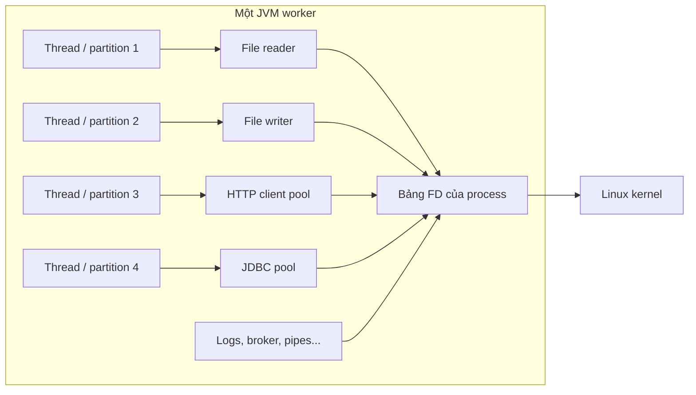

# File descriptor limit: giới hạn tài nguyên ẩn khi scale Spring Batch

Một Spring Batch job chạy ổn ở một thread, nhưng sau khi tăng lên 32 partition đồng thời thì bắt đầu báo lỗi `Too many open files`, không thể mở input CSV, không lấy được connection HTTP hoặc thậm chí không ghi được log. Nhiều người lập tức tăng heap hoặc tăng thread pool, nhưng nguyên nhân có thể là **file descriptor (FD)** — tài nguyên do hệ điều hành cấp cho **file, socket, pipe và các handle I/O** đang mở trong process.

Bài học **File descriptor limit** thuộc chương **Resource pool**, module `SPRING_BATCH_SCALING_OPERATIONS`. Mục tiêu là hiểu vì sao multi-threaded steps, parallel steps, local/remote partitioning và worker phân tán có thể làm cạn FD; cách đo đúng giới hạn và mức sử dụng; cách chọn ngân sách kết nối/file khi mở rộng; và cách khôi phục an toàn khi lỗi I/O xuất hiện giữa job có retry/restart. Ví dụ tập trung **Linux + Java 17+ + Spring Batch 5.x**; lệnh vận hành dành cho Linux, không áp nguyên văn sang Windows/macOS.

## 1. File descriptor là gì?

Trên hệ điều hành kiểu Unix, một **file descriptor** là số nguyên trong process trỏ đến một tài nguyên đang mở. Ba số `0`, `1`, `2` thường đại diện cho stdin, stdout và stderr; các FD tiếp theo có thể là:

- File dữ liệu đang được `FlatFileItemReader` đọc hoặc `FlatFileItemWriter` ghi.
- Socket TCP tới database, HTTP API, RabbitMQ/JMS broker, Redis hoặc hệ thống phân tán.
- File log, file tạm và file được thư viện nén/giải nén mở.
- Pipe giữa process, eventfd, inotify, epoll và các descriptor nội bộ khác.
- Unix domain socket dùng để trao đổi giữa các process trên cùng host.

**FD không phải Java object, thread hay byte của heap.** Một Java object giữ tham chiếu tới stream/socket có thể dẫn đến FD đang mở, nhưng không thể suy số FD từ số object. Nhiều Java thread chia sẻ **cùng bảng file descriptor của JVM process**. Đối với TCP connection thường có một socket FD ở phía client, nhưng không được tính mọi hệ thống I/O luôn theo đúng tỷ lệ một-một nếu client hỗ trợ multiplexing hoặc dùng descriptor nội bộ.



Các thread không có ngân sách FD độc lập: nếu thread 1 đang mở quá nhiều file, thread 4 có thể không tạo được kết nối tới database dù code của thread 4 hoàn toàn đúng.

## 2. RLIMIT_NOFILE: soft limit, hard limit và EMFILE

Trên Linux, `RLIMIT_NOFILE` là giới hạn tài nguyên **của mỗi process**:

| Khái niệm | Ý nghĩa | Ví dụ |
| --- | --- | --- |
| **Soft limit** | Mức kernel thực thi khi process mở/nhân bản FD | `1024` |
| **Hard limit** | Trần mà process không có quyền đặc biệt có thể nâng soft lên | `8192` |
| `EMFILE` | Process không cấp được FD mới vì đã chạm giới hạn của chính mình | `Too many open files` |
| `ENFILE` | Hệ thống cạn bảng file đang mở ở mức system-wide | `Too many open files in system` |
| `/proc/sys/fs/nr_open` | Trần kernel cho việc thiết lập `RLIMIT_NOFILE` trên Linux | Giá trị tùy host |
| `/proc/sys/fs/file-max` | Giới hạn system-wide về file handles | Giá trị tùy host |

Diễn giải chính xác theo `getrlimit(2)`: `RLIMIT_NOFILE` là giá trị **lớn hơn một đơn vị so với số FD tối đa** được phép cấp. Nếu soft limit là `1024`, không thể cấp FD mới có số `1024` trở lên; trên thực tế đây là giới hạn gần đúng về số FD mở đồng thời, dù còn phụ thuộc các lỗ trống/FD đã đóng.

**Không nhầm với `RLIMIT_NPROC`, `ulimit -u` hoặc memory limit.** Tăng `-Xmx` không giải quyết `EMFILE`. Tăng FD limit có thể giúp khi sizing thấp, nhưng nếu **leak** không được sửa thì process sẽ tiếp tục tiêu thụ cho tới ngưỡng mới.

### 2.1. Lệnh xem giới hạn của shell hiện tại

```bash
ulimit -Sn    # soft limit cho file descriptors
ulimit -Hn    # hard limit
```

Các lệnh này hiển thị giới hạn **của shell hiện tại**, không nhất thiết là giới hạn của Java service đang chạy. Container, `systemd` unit hoặc supervisor có thể khởi động JVM với cấu hình khác. Khi điều tra production, **đọc giới hạn của chính JVM process**.

### 2.2. Lệnh xem giới hạn thực của JVM

```bash
PID=12345  # Thay bằng PID JVM cần kiểm tra trên host/container
cat /proc/"$PID"/limits | grep "Max open files"
prlimit --pid "$PID" --nofile
```

`prlimit` là tiện ích Linux có thể không được cài trong image nhỏ; `/proc/<pid>/limits` thường dễ dùng hơn khi procfs có sẵn và có quyền đọc. Giới hạn trong container cần được quan sát **từ đúng namespace/process**.

## 3. “Open files” bao gồm cả socket và pipe

Tên lỗi `Too many open files` dễ làm người ta chỉ nhìn CSV, nhưng với Spring Batch làm việc qua HTTP, JDBC và broker, phần lớn FD có thể là **socket**.

```text
Spring Batch JVM
├──  64   JDBC connections -> database
├── 128   HTTP client sockets -> API
├──   8   broker connections và sockets phụ
├──  48   file readers/writers của partitions
├──  20   log/file/temp
├──  30   pipes/eventfd/epoll/khác (minh họa)
└──   ?   thư viện/agent/monitoring đang dùng
```

Các con số này chỉ để hiểu **nhóm tài nguyên**, không phải số đo thực. Pool JDBC/HTTP có thể giữ idle connections lâu, nên FD vẫn được dùng dù số request active thấp. Ngược lại, `maxPoolSize=128` không có nghĩa đã có 128 socket đang mở ở mọi thời điểm; cách tạo kết nối phụ thuộc implementation, minIdle và tải.

Đặc biệt, connection pool được nhân theo **số JVM**:

```text
4 worker JVM x HTTP max 80 connections/JVM
= tối đa 320 HTTP connections danh nghĩa toàn cụm
```

Đó không phải 320 FD **trong một process**, nhưng có thể thành áp lực tổng trên node/host và upstream. Vì vậy phải kiểm cả **per-process limit** lẫn ngân sách toàn node.

## 4. Dấu hiệu FD exhaustion trong log

Tùy loại I/O, cùng `EMFILE` có thể xuất hiện dưới các lớp exception khác nhau:

```text
java.io.FileNotFoundException: /data/invoices/part-17.csv
    (Too many open files)

java.net.SocketException: Too many open files

java.nio.file.FileSystemException: /tmp/batch-output
    Too many open files

org.springframework.batch.item.ItemStreamException:
    Failed to initialize the reader
```

Đây là **mẫu triệu chứng**, không phải stack trace khẳng định cho mọi version/JDK. Có thể thấy lỗi ở `ItemStream.open(...)`, writer tạo file output, JDBC/HTTP client mở socket, broker reconnect hoặc logger quay vòng. **Lỗi thường mang tính dây chuyền:** process chạm soft limit có thể **không ghi log được**, khiến operator thấy lỗi từ JDBC/HTTP thay vì nguyên nhân ban đầu. Nên thu metrics FD **trước** khi chạm trần.

## 5. Vì sao scale Spring Batch làm tăng FD?

| Kiểu xử lý | Nguồn FD tăng khi scale | Điều cần kiểm |
| --- | --- | --- |
| Single-threaded step | Một reader/writer, JDBC và HTTP pool, logs | Leak tích lũy qua item/chunk |
| Multi-threaded step | Nhiều HTTP/JDBC call cùng lúc, nhiều socket | Reader/writer thread safety; pool size |
| Parallel steps | Nhiều step cùng mở input/output và HTTP pool | Các pool có dùng chung không? |
| Local partitioning | `StepExecution` đồng thời, reader/writer theo partition | Mỗi partition mở bao nhiêu file? |
| Remote partitioning | Mỗi worker JVM có FD budget riêng | Partition active/JVM và FD host cộng dồn |
| Remote chunking | Worker xử lý nhiều chunk/message, broker sockets, HTTP/JDBC | Consumer concurrency và pool per worker |
| File-per-item writer | Có thể tạo file/stream cho mỗi item nếu không đóng đúng | Bounded open handles và lifecycle |

Số partition logic **không tự động bằng số FD**. Nếu có 100 partition nhưng chỉ 8 chạy đồng thời trên một worker, mức FD đồng thời phụ thuộc khoảng 8 reader/writer được mở, cùng pools và overhead, không phải luôn 100 readers. Nếu manager tạo **100 process** riêng thì chi phí FD lại phân bố qua nhiều JVM/node.

### 5.1. File count không phải open-file count

Một job xử lý 1 triệu file **không cần mở đồng thời 1 triệu FD** nếu làm tuần tự/bounded. Câu hỏi đúng là **peak number of simultaneously open resources**, không phải số file trong dataset. `MultiResourceItemReader` thông thường chuyển qua các resource theo vòng đời reader; không mặc định mở tất cả input file cùng lúc.

### 5.2. Resource pools có thể là giới hạn kép

Giả sử `TaskExecutor` có 32 thread, HikariCP max 32 và HTTP pool per-route max 16. Một item gọi database lẫn HTTP; 16 thread có thể đợi HTTP trong khi một số connection JDBC vẫn bị giữ do transaction. Khi hệ thống cạn FD, cả hai pool phát sinh lỗi. Phải đo **thời gian giữ transaction + connection**, không chỉ đếm max của từng pool.

## 6. Tính ngân sách FD theo process

Một ngân sách gần đúng cho **một worker JVM**:

```text
FD_budget ≈ baseline_runtime
          + peak_open_input_files
          + peak_open_output_files
          + HTTP_connection_peak
          + JDBC_connection_peak
          + broker_sockets
          + other_network_sockets
          + logs_temp_pipes_watchers
          + safety_headroom
```

Đây là **cách lập kế hoạch**, không phải công thức chuẩn của Linux; một số nhóm có thể chồng lấn nếu đo bằng profiler. Khi chuyển từ dự báo sang quan sát, hãy đếm FD thực ở `/proc/<pid>/fd` để tránh tính lặp.

### 6.1. Ví dụ với soft limit 1024

| Nhóm | Mức FD dự kiến (minh họa) |
| --- | ---: |
| JVM/libraries/logs/agent/FD nền | 250 |
| HTTP pool tới API | 300 |
| JDBC pool | 64 |
| Broker và sockets phụ | 12 |
| 32 partition × 3 FD/partition | 96 |
| Dự phòng (~20% của 1024) | 205 |
| **Tổng** | **927** |

Giới hạn `1024` còn khoảng `97` FD trên mô hình này. Nhưng nếu một thư viện mở thêm 200 file tạm khi nén dữ liệu thì nó sẽ vượt trần. Một thiết kế production có thể cần **soft limit cao hơn và/hoặc concurrency thấp hơn**, tùy memory, file tables, upstream quota và quan sát.

**Không xem 1024/8192/65535 là số “chuẩn cho mọi hệ thống”.** Chọn trên cơ sở load test, peak headroom và giới hạn host. Nếu peak đã chiếm 90–95% soft limit, nên cảnh báo sớm vì lỗi có thể đến rất nhanh trong giai đoạn retry/reconnect.

### 6.2. Quy đổi từ partition concurrency

Nếu mỗi partition giữ `F` FD dành riêng trong lúc chạy và một JVM có `C` partition active:

```text
partition_FD_peak ≈ C × F
available_for_partitions
    ≈ soft_limit - fixed_and_pool_FDs - safety_headroom

C_upper_bound ≈ floor(available_for_partitions / F)
```

Nếu `F=3` và còn 300 FD thực sự khả dụng, trần riêng theo FD khoảng 100 partition; **CPU, DB, HTTP quota, memory hoặc broker thường có thể là giới hạn thấp hơn**. Không dùng số này làm concurrency thực tế khi chưa đo các nút thắt khác.

## 7. Quan sát số FD hiện tại qua /proc

Trên Linux, `/proc/<pid>/fd` có các symlink tới descriptor của process:

```bash
PID=12345

# Số mục trong bảng FD của đúng JVM
find /proc/"$PID"/fd -mindepth 1 -maxdepth 1 -printf '.' 2>/dev/null | wc -c

# Nhìn nhóm resource: socket, pipe, file, anon_inode
ls -l /proc/"$PID"/fd | head -40

# Soft/hard limits của JVM (không phải của terminal)
grep "Max open files" /proc/"$PID"/limits
```

**Điều kiện:** có procfs, quyền đọc `/proc/<pid>/fd` và PID chính xác. Trong container không có `find -printf` hoặc shell utilities thì dùng cách khác (JMX metric ở mục 11 hoặc kiểm tra từ host). Lệnh `ls` in ra symlink và có thể thất bại với một số descriptor vừa đóng; kết quả là **snapshot** trong process nhiều thread.

Đếm bằng `lsof -p "$PID"` cũng hữu ích:

```bash
PID=12345
lsof -nP -p "$PID" | head -50
lsof -nP -a -p "$PID" -iTCP | head -50
```

**Không coi số dòng `lsof` là số FD chính xác:** output còn các entry như working directory, memory-mapped files và metadata khác. Khi cần con số FD mở thật, ưu tiên đếm entries ở `/proc/<pid>/fd` hoặc `UnixOperatingSystemMXBean`.

### 7.1. Điều tra nhóm descriptor nào tăng

```bash
PID=12345

# Chụp trạng thái trong lúc nghi có leak
ls -l /proc/"$PID"/fd > /tmp/batch-fd-snapshot.txt

# Xem các socket TCP liên quan đến process (cần ss)
ss -tanp | grep "pid=$PID," | head -50

# Xem các file đang mở của process
lsof -nP -p "$PID" | grep -E 'REG|IPv4|IPv6|unix|FIFO' | head -80
```

`/tmp/batch-fd-snapshot.txt` chỉ là đường dẫn ví dụ **trên host được phép ghi**. Đừng lưu vào filesystem production không được bảo vệ nếu danh sách FD làm lộ tên file nhạy cảm; output `lsof` cũng có thể chứa path dữ liệu người dùng. Nếu **chính JVM** đã chạm EMFILE, lệnh giám sát ở process **khác** vẫn cần FD và có thể thất bại khi toàn host cạn tài nguyên.

## 8. Đừng đọc nhầm số giới hạn ở shell, systemd và container

`ulimit -n` phản ánh **shell đang chạy lệnh**. Một service chạy qua `systemd` nhận limit khi service process được tạo, không tự thay đổi khi operator mở terminal mới.

| Nơi chạy batch | Cần kiểm tra | Lưu ý |
| --- | --- | --- |
| Terminal tương tác | `ulimit -Sn` / `-Hn` | Chỉ áp dụng shell và process con |
| `systemd` service | `systemctl show ... -p LimitNOFILE` + `/proc/PID/limits` | Đổi unit cần restart process để nhận giới hạn mới |
| Docker container | `/proc/1/limits` hoặc PID JVM; tham số runtime `--ulimit` nếu được hỗ trợ | Host và image entrypoint có thể khác |
| Kubernetes Pod | `/proc/<pid>/limits` trong container; cấu hình container runtime/node | Không giả định có trường `ulimits` chuẩn trong mọi PodSpec |
| VM truyền thống | `/etc/security/limits.conf` khi PAM áp dụng, shell/service launcher | PAM config không nhất thiết áp dụng lên systemd system service |

**Quan sát process thật là nguồn xác nhận cuối**. Trong container, PID 1 đôi khi là wrapper/init chứ không phải JVM. Hãy lấy **PID JVM**, vì limit được thừa kế từ launcher nhưng có thể thay đổi theo runtime.

## 9. Đặt LimitNOFILE với systemd đúng phạm vi

Ví dụ cấu hình unit override khi có quyền vận hành:

```ini
[Service]
LimitNOFILE=8192:16384
```

Trong `systemd`, cách viết trên minh họa **soft:hard limit**, và service mới cần được khởi động lại theo quy trình deploy/stop an toàn để nhận limit. Đừng chỉnh unit trực tiếp rồi mặc định một JVM đang chạy sẽ lập tức đổi giới hạn.

**Cảnh báo tương thích:** tài liệu systemd lưu ý phần mềm cũ dùng `select(2)` với `FD_SETSIZE=1024` có thể không xử lý descriptor có số lớn hơn 1023. Java NIO, poll/epoll hiện đại thường không phải loại code này, nhưng hãy kiểm tra thư viện native/JNI/legacy trước khi tăng soft limit quá cao. Không chọn limit theo phong trào rồi bỏ qua kiểm thử.

Các thay đổi hệ thống có thể cần quyền quản trị. Trong bài lab, chỉ thao tác trên service và host được phép, ghi lại cấu hình trước/sau và dùng deployment runbook riêng; không thay đổi mặc định toàn máy chỉ để chữa một job.

## 10. File descriptor limit trong Docker và Kubernetes

Một container không tạo “pool FD dùng chung cho mọi Pod”: thông thường mỗi process có bảng FD và `RLIMIT_NOFILE` của riêng nó, nhưng tất cả process trên node còn chia sẻ tài nguyên kernel/system-wide.

Ví dụ Docker (môi trường thử):

```bash
docker run --rm --ulimit nofile=8192:8192 \
  my-batch-image:lab
```

Lệnh chỉ là ví dụ của Docker CLI. Trong Kubernetes, các khả năng cấu hình ulimit phụ thuộc CRI/runtime và chính sách node/platform; **không có một thuộc tính `spec.containers[].ulimits` chuẩn phổ quát** để áp thẳng vào mọi manifest. Đặt giới hạn theo cơ chế vận hành được cluster hỗ trợ, rồi kiểm chứng `/proc/<jvm-pid>/limits` **từ chính container**.

**Không đồng nhất per-process với per-node:** nếu 30 worker JVM cùng node, mỗi JVM có limit 8192, điều đó **không đảm bảo** node chịu được 245.760 FD đang mở; kernel, memory, sockets, cgroup và service quotas đều có thể giới hạn thấp hơn.

Nếu scheduler tiếp tục khởi động thêm Pods mà upstream DB/API không tăng tương ứng, tăng FD limit chỉ khiến hệ thống mở được nhiều connection hơn và có thể **chuyển điểm nghẽn sang downstream**.

## 11. Lấy FD metrics bằng Java Management API

Trên nhiều JVM Unix-like, `com.sun.management.UnixOperatingSystemMXBean` có:

- `getOpenFileDescriptorCount()`: số FD đang mở của JVM process.
- `getMaxFileDescriptorCount()`: giá trị giới hạn FD mà MXBean công bố.

Ví dụ Java 17:

```java
import java.lang.management.ManagementFactory;
import com.sun.management.UnixOperatingSystemMXBean;

public final class FdDiagnostics {
    public static void printCurrentFdUsage() {
        var operatingSystem = ManagementFactory.getOperatingSystemMXBean();

        if (operatingSystem instanceof UnixOperatingSystemMXBean unixBean) {
            long open = unixBean.getOpenFileDescriptorCount();
            long max = unixBean.getMaxFileDescriptorCount();
            System.out.printf("open_fd=%d max_fd=%d%n", open, max);
        } else {
            System.out.println("FD metrics unavailable on this JVM/OS");
        }
    }
}
```

Đây là API mở rộng **của HotSpot/JDK có module `jdk.management`**; không phải mọi JVM hoặc hệ điều hành đều có implementation tương ứng. Dùng `instanceof` và fallback. Hai con số là mức quan sát ở **process**, không phải tính riêng từng job/step và không cho biết loại socket/file nào đang sử dụng.

### 11.1. Micrometer gauges cho Spring Boot Actuator

```java
import java.lang.management.ManagementFactory;

import com.sun.management.UnixOperatingSystemMXBean;
import io.micrometer.core.instrument.Gauge;
import io.micrometer.core.instrument.binder.MeterBinder;
import org.springframework.context.annotation.Bean;
import org.springframework.context.annotation.Configuration;

@Configuration
public class FileDescriptorMetricsConfiguration {

    @Bean
    MeterBinder processFileDescriptorMetrics() {
        return registry -> {
            var osBean = ManagementFactory.getOperatingSystemMXBean();
            if (!(osBean instanceof UnixOperatingSystemMXBean unix)) {
                return;
            }

            Gauge.builder("batch.process.fd.open", unix,
                            bean -> bean.getOpenFileDescriptorCount())
                    .register(registry);

            Gauge.builder("batch.process.fd.limit", unix,
                            bean -> bean.getMaxFileDescriptorCount())
                    .register(registry);
        };
    }
}
```

Các tên meter là **tên tùy biến của ứng dụng**, không phải metric mặc định của Spring Batch. Spring Boot Actuator/JVM instrumentation có thể đã cung cấp metric tương đương tùy phiên bản; kiểm tránh **double registration** khi bổ sung tên riêng.

Với Prometheus, tạo alert theo tỷ lệ **`open_fd / limit_fd`**, kết hợp thời gian duy trì và tốc độ tăng. Không tạo label `stepExecutionId`/`jobExecutionId` cho hàng triệu partition; lưu identity đó trong logs/traces thay vì metric cardinality cao.

## 12. FD leak là gì, và cách phân biệt với tải hợp lệ

Một **resource leak** xảy ra khi chương trình giữ descriptor không còn cần thiết, khiến mức FD không giảm sau khi công việc kết thúc. Nhưng một mức FD cao trong job đang tải lớn **chưa chắc là leak**: HTTP/JDBC pool giữ idle connections để tái sử dụng và reader mở file trong suốt một `StepExecution` là hành vi hợp lệ.

| Tín hiệu | Leak đáng nghi | Pool/tải hợp lệ |
| --- | --- | --- |
| FD open sau mỗi 10.000 item | Tăng đều, không trở lại baseline | Đạt plateau ổn định |
| Sau step `COMPLETED`, không còn traffic | FD vẫn tăng hoặc giữ stream cũ vô lý | FD giảm hoặc còn số idle pool đã cấu hình |
| `lsof` thấy nhiều file riêng từng item | Có thể không đóng stream | Chỉ còn file của partition đang chạy |
| HTTP pool leased=max mãi, active request ít | Response stream leak / call treo | Leased giảm sau response |
| Khi restart process, FD về thấp rồi tăng dần theo thời gian | Nghi leak theo workload | Pool warmup rồi ổn định |

**Kiểm tra bằng đường cong, không chỉ một snapshot.** Thu metric trước/chạy/sau job, dưới cùng concurrency, rồi phân nhóm open resources. Nếu số FD tỷ lệ với số item **đã xử lý**, thay vì số item đang xử lý đồng thời, đó là dấu hiệu leak quan trọng.

## 13. Java: đóng tài nguyên bằng try-with-resources

Hai lỗi thường gặp:

```java
// KHÔNG NÊN: stream chưa đóng đúng vòng đời
Stream<String> rows = Files.lines(path);
long count = rows.filter(s -> !s.isBlank()).count();
// Thiếu rows.close() khi xảy ra exception hoặc khi hoàn tất
```

Và phiên bản đúng:

```java
import java.io.IOException;
import java.nio.file.Files;
import java.nio.file.Path;
import java.util.stream.Stream;

public final class FileScan {

    public long countNonBlank(Path path) throws IOException {
        try (Stream<String> rows = Files.lines(path)) {
            return rows.filter(s -> !s.isBlank()).count();
        }
    }

    public long countFiles(Path directory) throws IOException {
        try (Stream<Path> paths = Files.walk(directory)) {
            return paths.filter(Files::isRegularFile).count();
        }
    }
}
```

`Files.lines(...)` và `Files.walk(...)` trả về stream gắn với nguồn I/O; `try-with-resources` đảm bảo đóng ngay cả khi xử lý ném exception. Điều tương tự áp dụng cho `BufferedReader`, `InputStream`, `OutputStream`, `DirectoryStream`, `ZipFile` hoặc `Socket` do code **tự sở hữu**.

**Không đóng bừa tài nguyên không thuộc sở hữu của mình:** nếu đang sử dụng `DataSource`/`HttpClient` singleton do Spring quản lý, đừng gọi `close()` trong mỗi item hoặc chunk. Phải phân biệt **resource của một operation** và **connection manager dùng chung trong process**.

## 14. Spring Batch ItemStream quản lý mở/đóng tài nguyên

Các reader/writer gắn file thường triển khai `ItemStream` với các lifecycle methods:

```java
void open(ExecutionContext executionContext);
void update(ExecutionContext executionContext);
void close();
```

Trong chunk-oriented step, framework gọi `open` để chuẩn bị reader/writer, `update` để lưu state/checkpoint trước commit theo contract, và `close` khi kết thúc vòng đời stream. `close` được thiết kế để giải phóng file/socket/resource đang giữ.

**Không dùng `close` như bằng chứng restart an toàn sau `kill -9` hoặc OOM:** khi process chết đột ngột, callback close có thể không chạy. Kernel thường thu hồi FD của process khi process kết thúc, nhưng **transaction/checkpoint/external side effect** vẫn cần cơ chế recovery riêng.

### 14.1. Cảnh báo với delegate ItemStream

Nếu custom `CompositeItemWriter` hoặc một reader/writer khác bao `ItemStream`, hãy bảo đảm delegate cần lifecycle được **Spring Batch đăng ký quản lý đúng**. Nếu delegate bị ẩn bên trong component không được đăng ký stream, `open/close` có thể không được gọi như mong đợi.

Không tự triển khai một wrapper `ItemReader` rồi bỏ qua `ItemStream.close` của delegate có tài nguyên file. Đây vừa là vấn đề FD leak, vừa là lỗi checkpoint/restart.

## 15. File reader riêng theo partition với @StepScope

Trong local hoặc remote partitioning, mỗi `StepExecution` có thể cần đọc **một file khác nhau**. Dùng `@StepScope` để tránh một reader stateful bị chia sẻ giữa các partition.

```java
import org.springframework.batch.core.configuration.annotation.StepScope;
import org.springframework.batch.item.file.FlatFileItemReader;
import org.springframework.batch.item.file.builder.FlatFileItemReaderBuilder;
import org.springframework.beans.factory.annotation.Value;
import org.springframework.context.annotation.Bean;
import org.springframework.context.annotation.Configuration;
import org.springframework.core.io.FileSystemResource;

@Configuration
public class PartitionFileReaderConfiguration {

    @Bean
    @StepScope
    FlatFileItemReader<String> partitionFileReader(
            @Value("#{stepExecutionContext['inputFile']}") String inputFile) {
        if (inputFile == null || inputFile.isBlank()) {
            throw new IllegalArgumentException("Thiếu inputFile của partition");
        }

        return new FlatFileItemReaderBuilder<String>()
                .name("partitionFileReader")
                .resource(new FileSystemResource(inputFile))
                .lineMapper((line, lineNumber) -> line)
                .strict(true)
                .saveState(true)
                .build();
    }
}
```

Ví dụ giả định manager/partitioner đã đặt khóa `inputFile` vào `ExecutionContext` và mỗi worker có quyền truy cập file. Không dùng path từ nguồn không tin cậy nếu chưa kiểm tra canonical path/allowed directory. Bean này được tạo theo **mỗi `StepExecution`**; framework quản lý lifecycle để mở/đóng reader vào đúng thời điểm.

**Số FD file reader đồng thời** thường tỷ lệ với số step executions đang thực thi có reader đang mở, **không** bằng tổng số partition trong toàn job. Nhưng nếu tăng partition active quá cao và mỗi partition còn mở output/temporary files, tổng vẫn có thể chạm giới hạn.

### 15.1. Vì sao @StepScope không giải quyết mọi vấn đề?

`@StepScope` bảo đảm phạm vi state theo step execution, **không tự cấp thêm FD** và không làm reader đó thread-safe nếu **nhiều thread cùng chạy trong một `StepExecution`**. Multi-threaded step cần kiểm tra reader/writer stateful riêng; tránh chia sẻ chung cursor/file position chưa được bảo vệ.

## 16. File writer và quy tắc “không mở một file cho mỗi item rồi giữ mãi”

Một anti-pattern:

```java
// KHÔNG NÊN: giữ output stream trong map toàn cục, không có giới hạn
Map<Long, BufferedWriter> writersByCustomer = new ConcurrentHashMap<>();
// Mỗi customer mới có thể làm mở thêm một file và không đóng
```

Nếu có 200.000 khách hàng, map có thể giữ hàng nghìn `BufferedWriter` mở cùng lúc, dù job chỉ có vài thread. `ConcurrentHashMap` chỉ giúp một phần thread safety của map, **không giải quyết FD cap, atomic file writes hoặc close lifecycle**.

Các phương án:

- Ghi ra **một số lượng file giới hạn** theo partition/shard.
- Dùng writer `ItemStream` có lifecycle và resource naming rõ ràng.
- Nếu bắt buộc file-per-key, dùng **bounded cache** có eviction đóng stream an toàn và thiết kế format/append/restart.
- Ghi staging DB rồi xuất file theo từng nhóm, mỗi lần mở một file.
- Nếu nhiều process ghi cùng đường dẫn, dùng output paths duy nhất theo `jobInstance/partitionKey` hoặc cơ chế đồng bộ/atomic publish được thiết kế.

**Không mở/đóng file mỗi item như một giải pháp mặc định:** cách đó tránh giữ quá nhiều FD nhưng có thể làm throughput thấp, tăng lỗi append/truncate và phá format output. Thiết kế writer theo chunk/partition và thử nghiệm hiệu năng cùng tính đúng khi restart.

## 17. JDBC connection pool cũng sử dụng FD

HikariCP, Tomcat JDBC Pool hoặc các driver JDBC mở socket đến DB server. Một `maximumPoolSize=50` có thể chiếm khoảng 50 socket FD ở JVM nếu tất cả connection đã được mở và giữ. Nhưng số thực còn phụ thuộc driver, kết nối local/TLS và additional internal resources.

```text
12 JVM worker
Hikari maxPoolSize per JVM = 40
=> tối đa khoảng 480 JDBC connections theo cấu hình cluster
```

Điều này tạo **hai giới hạn đồng thời**:

1. **Client per-process FD limit** và pool capacity.
2. **Server max connections**, CPU/locks/I/O và giới hạn DB.

Tăng `LimitNOFILE` ở worker không làm database tự chịu được thêm 480 connections. Nếu DB pool wait cao hoặc connection acquisition timeout, phải đo cùng `open_fd`, `active/idle/pending JDBC` và DB server sessions để xác định bottleneck.

## 18. HTTP connection pool và FD

HTTP client có pool giữ idle sockets lâu để tái sử dụng. Với Apache HttpClient 5, các tham số `maxConnTotal` và `maxConnPerRoute` giới hạn kết nối. Tăng `maxConnTotal` chỉ có ý nghĩa nếu số routes, concurrency và quota upstream tương ứng.

```text
16 processor threads/JVM
maxConnPerRoute=8
maxConnTotal=32
```

Nếu 16 thread cùng gọi một route HTTP/1.1 blocking, tối đa khoảng 8 connection cho route đó; các thread còn lại **đợi lease**. Tăng per-route lên 16 có thể giảm chờ pool nhưng tiêu thêm socket FD và gây quá tải API.

Khi `open_fd` tăng cùng `HTTP leased`, hãy xem có nhiều request concurrent hợp lệ hay một **response leak**. Nếu `leased=max` nhưng upstream chỉ thấy ít request active, nghi stream chưa đóng hoặc request treo.

**Đóng đúng tầng sở hữu:** response body/stream mức thấp cần được consume/close; shared `CloseableHttpClient`/manager nên đóng **khi application shutdown**. Không tạo một HTTP client mới cho mỗi `ItemProcessor.process()`.

## 19. Broker sockets và remote workers

RabbitMQ/JMS connections, channels, consumer sockets và nội bộ networking đều góp vào ngân sách FD. Số broker **channel** không nhất thiết tương ứng một socket FD (ví dụ nhiều AMQP channels có thể multiplex trên một connection), nên **không nhân thẳng số channels thành số FD**.

Ở remote chunking:

- Manager có network connections để gửi `ChunkRequest` và nhận `ChunkResponse`.
- Worker có connections/consumers để nhận message và trả reply.
- Tăng worker instances làm tăng socket count **toàn cụm**.
- Retry storm/reconnect liên tục có thể tạo spike FD khi hệ thống gặp lỗi.

Ở remote partitioning:

- Manager gửi `StepExecutionRequest`; worker tự đọc nguồn.
- Worker có thể giữ DB/HTTP/file connections trong thời gian `StepExecution` dài.
- Broker request có thể unacked lâu nếu execution kéo dài; thời gian giữ broker socket phụ thuộc client/pool lifecycle.

**FD exhaustion của một worker có thể gây broker redelivery** nếu process chết hoặc consumer mất connection. Vì vậy phải nối điều tra FD với `JobRepository`, business idempotency và queue status, không chỉ sửa limit rồi restart worker vô điều kiện.

## 20. Thread count, FD count và “quá nhiều file” không phải cùng đơn vị

Một JVM có 200 threads **không nhất thiết có 200 socket FD**; 200 threads có thể cùng làm CPU hoặc đọc từ một nguồn. Ngược lại, một thread có thể mở hàng chục nghìn file descriptors nếu code giữ handle trong map/list.

```text
threads = số luồng thực thi
FDs     = số handle I/O do process đang giữ
items   = số đơn vị dữ liệu logic
files   = số file tồn tại trên filesystem
```

**Tương quan chứ không đồng nhất.** Khi tăng `TaskExecutor` concurrency, số FD thường tăng vì nhiều request/reader/writer được mở đồng thời; nhưng cần đo số FD thực và phân nhóm theo file/socket.

Đừng dùng `ulimit -u` (số process/threads theo phạm vi hệ điều hành) để giải thích một lỗi `EMFILE`; cũng không dùng `ulimit -n` để giải thích mọi lỗi `OutOfMemoryError: unable to create native thread`.

## 21. File descriptor exhaustion vs ephemeral port exhaustion

Hai tình huống có triệu chứng mạng giống nhau nhưng khác nguyên nhân:

| Dấu hiệu | FD exhaustion | Ephemeral port/socket exhaustion |
| --- | --- | --- |
| Lỗi Linux có thể gặp | `EMFILE`, `ENFILE` | `EADDRNOTAVAIL`, `EADDRINUSE` tùy call |
| Cơ chế | Vượt trần FD của process hoặc bảng file hệ thống | Thiếu cổng/source tuple khả dụng cho kết nối mới |
| Quan sát | `/proc/PID/fd`, `RLIMIT_NOFILE`, `file-nr` | `ss`, TIME_WAIT, `ip_local_port_range` |
| Cách xử lý | Đóng resource/leak, giới hạn concurrency, sizing FD | Connection reuse, giảm connection churn, network/NAT tuning hợp lệ |
| Tăng `ulimit -n` có giúp chắc chắn? | Có thể nếu limit quá thấp | Không giải quyết trực tiếp |

Ví dụ nếu code tạo HTTP client mới cho mỗi item, nó vừa làm tăng FD chớp nhoáng vừa tạo nhiều socket `TIME_WAIT` sau khi đóng. Tăng FD limit có thể làm tình trạng cạn ephemeral ports xuất hiện rõ hơn; **tái sử dụng connection và giảm churn** thường là giải pháp nền tảng.

## 22. Theo dõi giới hạn system-wide

Trên Linux có các chỉ số:

```bash
cat /proc/sys/fs/file-nr
cat /proc/sys/fs/file-max
cat /proc/sys/fs/nr_open
```

`/proc/sys/fs/file-nr` thường cung cấp số file handles đã cấp phát, trường “unused” (trên kernel hiện đại thường là `0`) và số tối đa, **không phải số FD của một JVM cụ thể**. `file-max` liên quan hệ thống, `nr_open` giới hạn giá trị cấu hình `RLIMIT_NOFILE` có thể đặt.

**Phân biệt:**

- `EMFILE`: kiểm `open_fd` và `RLIMIT_NOFILE` của **process** đầu tiên.
- `ENFILE`: kiểm **host-wide handles** và workload của các process khác.
- `EADDRNOTAVAIL`: kiểm socket/port/NAT trước khi tăng `file-max`.

Nếu chạy container, node dùng chung file table/memory với Pod khác; root cause có thể ở một process ngoài worker. Điều tra host cần quyền vận hành; không thay đổi `sysctl` khi chưa xác định bottleneck.

## 23. Alerting và dashboard nên có gì?

| Nhóm | Metric/quan sát | Cảnh báo gợi ý |
| --- | --- | --- |
| FD process | `open_fd`, `max_fd`, ratio | Ratio cao kéo dài, tăng liên tục không plateau |
| Pool JDBC | active, idle, pending, max | pending tăng cùng FD cao |
| HTTP pool | leased, available, pending, max; per-route | Leased bão hòa, response leak |
| File writer | Số file/stream active; FD theo resource type | Mở theo số item thay vì concurrency |
| Broker | connections, consumer count, queue ready/unacked | Reconnect storm hoặc redelivery |
| OS/container | host file handles, systemd limit, container restarts | Node bão hòa; process liên tục restart |
| Batch correctness | `JobExecution` status, fail/retry/rollback | Đối chiếu input/output và side effects |

Ví dụ quy tắc theo dõi **không cố định số ngưỡng**:

```text
FD utilization = open_file_descriptors / max_file_descriptors

Warn:  utilization duy trì > 70% dưới workload bình thường
Alert: utilization duy trì > 85% hoặc tăng dốc tới trần
Critical: EMFILE/ENFILE trong logs, bất kể utilization đang đo
```

Ngưỡng `70/85%` chỉ là **điểm bắt đầu cho bài lab**, không phải giới hạn Linux khuyến cáo cho mọi production. Phải dựa vào peak, tốc độ tăng, lượng headroom và khả năng đo lường. Nếu OS/JVM báo `max_fd` không hợp lệ, bỏ tỷ lệ thay vì chia cho 0.

Đặt log/traces theo `jobExecutionId`, `stepExecutionId`, `workerInstance`, nhưng **tránh dùng từng execution ID làm metric label** vì cardinality bùng nổ trên workload lớn.

## 24. Phát hiện leak theo thời gian

Trong một test dài, lấy số FD trước/chạy/sau:

```bash
PID=12345

# Thực hiện thủ công trong ba mốc hoặc thu bởi monitor riêng
date -Is
find /proc/"$PID"/fd -mindepth 1 -maxdepth 1 -printf '.' 2>/dev/null | wc -c
```

Giả sử kết quả:

```text
T0 trước job:         220 FD
T1 sau 10.000 items:  390 FD
T2 sau 20.000 items:  560 FD
T3 sau 30.000 items:  730 FD
T4 step COMPLETED:    725 FD
```

Nếu cùng một JVM không có workload mới và pool không chủ ý tăng, đây là **dấu hiệu leak cần điều tra**, không phải kết luận tuyệt đối. Hãy so số lượng open file path và sockets, kiểm `lsof`, thread dump và lifecycle của custom reader/writer/HTTP response.

Đối chứng:

```text
T0 trước job:        220 FD
T1 sau warmup:       360 FD
T2 sau 20.000 items: 365 FD
T3 sau 30.000 items: 359 FD
T4 hoàn tất:         245 FD
```

Đây có thể là pool/reader lifecycle bình thường. Phải có **cùng concurrency, input và môi trường** để so sánh; nếu đổi số worker hoặc tăng JDBC/HTTP max trong lúc test thì đường cong thay đổi là dự kiến.

## 25. Lỗi FD trong chunk transaction và restart

Ví dụ `FlatFileItemWriter` hoặc JDBC pool ném exception vì `EMFILE` ở cuối một chunk:

1. Transaction chunk có thể rollback nếu output nằm trong transaction tương ứng.
2. File output hoặc side effect ngoài DB **không tự rollback** chỉ nhờ Spring Batch rollback database.
3. Reader checkpoint có thể mới được cập nhật một phần, tùy transaction/resource và thời điểm lỗi.
4. `StepExecution` có thể chuyển `FAILED`, nhưng nếu JVM chết đột ngột metadata còn `STARTED`.
5. Restart đúng `JobInstance` phải dùng metadata/checkpoint, xác minh worker cũ đã dừng và đảm bảo writer idempotent.

**Không tự xóa output file hoặc sửa `BATCH_STEP_EXECUTION` thủ công** chỉ để job chạy tiếp. Với file writer, thiết kế quy tắc output nhất quán: file tạm theo partition/execution, publish atomic khi hoàn thành hoặc idempotent merge theo khóa nghiệp vụ. Với HTTP POST/payment/email, idempotency key ở downstream vẫn bắt buộc.

### 25.1. Lỗi phục hồi dây chuyền

Nếu FD đã đầy, manager/worker có thể không gửi được reply; broker redeliver request sau khi reconnect, nhưng business write trước đó đã commit. Việc tăng limit và bật lại worker có thể khiến **cùng item được xử lý lần nữa**. Recovery cần đánh giá cả **tài nguyên** và **idempotency**.

## 26. Runbook khi xuất hiện Too many open files

### Bước 1 — Xác nhận phạm vi

Ghi `jobExecutionId`, step, process PID, worker/pod, thời điểm lỗi, OS/container và concurrency. Phân biệt chỉ một JVM lỗi hay nhiều process trên node.

### Bước 2 — Đo trước khi restart

Đọc `/proc/<pid>/limits`, số mục `/proc/<pid>/fd`, `lsof` hoặc JVM metrics. Thu thập file/socket groups, HTTP/JDBC pool stats và thread dump nếu môi trường cho phép. Nếu process đã chết, lấy metrics lịch sử và logs, không đoán.

### Bước 3 — Chẩn đoán

| Quan sát | Cách nghĩ |
| --- | --- |
| `open_fd` sát soft limit, tăng theo số item | Resource leak hoặc file-per-item không đóng |
| `open_fd` tăng theo worker/partition active rồi ổn định | Ngân sách FD hoặc concurrency chưa phù hợp |
| HTTP leased=max, pending cao | HTTP pool saturated hoặc response leak |
| JDBC active/max và DB wait cao | DB pool/downstream bottleneck, FD là một trong nhiều giới hạn |
| `EMFILE` dù `file-max` còn dư | Per-process `RLIMIT_NOFILE` |
| `ENFILE` và host file-nr cao | Host/system-wide pressure |
| `EADDRNOTAVAIL`/TIME_WAIT cao | Kiểm ephemeral ports/reconnection churn |

### Bước 4 — Giảm áp lực có kiểm soát

Giảm active partitions, worker concurrency, fan-out API hoặc số file mở đồng thời. Có thể tạm tăng soft/hard limit cho **process mới** khi đã xác minh host có headroom, nhưng đừng dùng như cách thay thế việc sửa leak.

### Bước 5 — Khắc phục root cause

Đóng `Files.lines/Files.walk` streams bằng try-with-resources, bảo đảm `ItemStream.close` cho custom delegates, tái sử dụng HTTP/JDBC clients, chặn cache file handles không giới hạn, điều chỉnh pool/concurrency theo SLA.

### Bước 6 — Khôi phục job an toàn

Xác nhận worker cũ đã dừng hoặc không còn quyền ghi; kiểm `JobRepository`/`ExecutionContext`, request/reply pending và output nghiệp vụ. Khi execution ở trạng thái được phép restart, chạy lại **cùng `JobInstance`** bằng workflow được hỗ trợ. Không tạo `JobInstance` mới với timestamp bất kỳ để “resume”.

### Bước 7 — Đối soát

So business IDs, output files/chunks, checksum/aggregate và side effects bên ngoài; xác nhận không thiếu hoặc trùng. Theo dõi `open_fd` qua nhiều chu kỳ job sau sửa lỗi để đảm bảo không tái phát.

## 27. Failure injection và load test

Một lab nên chạy trên Linux/container với `RLIMIT_NOFILE` được cấu hình **có kiểm soát**, không làm trên host production. Dùng input cố định, nhiều partition, HTTP mock, DB test và khả năng lấy `/proc/PID/fd`.

1. **Baseline:** chạy một worker, 1 partition, log `open_fd` trước/trong/sau.
2. **Tăng local partitioning:** 1→2→4→8→16 partition active; đo FD và throughput để xác định số FD/partition thực.
3. **Tăng HTTP pool:** giữ số partition, tăng HTTP maxConnTotal/perRoute; quan sát sockets và thời gian chờ.
4. **Tăng JDBC pool:** quan sát FD JVM và DB server connections, không chỉ pool max setting.
5. **File-per-item leak:** trong lab tạo stream mà quên close, thấy FD tăng theo item; sửa và chạy lại để thấy plateau.
6. **Reader ItemStream lifecycle:** cố tình ném exception giữa bước; xác minh `close` được gọi trong đường thất bại bình thường.
7. **Kill worker:** gửi kill đột ngột để xác minh OS thu hồi descriptors nhưng checkpoint/idempotency vẫn cần recovery.
8. **Soft limit nhỏ:** đặt ví dụ `256` **cho test process** và đẩy concurrency dần tới lỗi, không thay đổi cấu hình host.
9. **HTTP response leak:** tạo response stream không đóng trong mock test, quan sát leased/pending và FD.
10. **Broker reconnect storm:** restart broker test, theo dõi socket/FD spike và retry/backoff.
11. **Split workload across Pods:** cùng concurrency/Pod, tăng Pod count; đo host-wide handles và upstream quota.
12. **Restart sau EMFILE:** sửa tài nguyên, restart cùng JobInstance, đối chiếu input/output business keys không thiếu/trùng.
13. **Đo dài hạn:** chạy 2–4 giờ với nhiều job, xem FD plateau hay tăng theo thời gian.

### Bảng kết quả thí nghiệm

| Case | Workers | Active partitions/worker | Open FD peak | FD limit | Throughput | Output missing/duplicate |
| --- | ---: | ---: | --- | --- | --- | --- |
| A | 1 | 1 | Đo thực | Đo thực | Đo thực | Đo thực |
| B | 1 | 8 | Đo thực | Đo thực | Đo thực | Đo thực |
| C | 4 | 8 | Đo từng JVM và node | Đo từng JVM | Đo thực | Đo thực |
| D: leak simulation | 1 | 8 | Đo thực | Giới hạn test | Đo thực | Đo thực |

Bảng là **mẫu đo** chứ không phải kết quả đã chạy. Khi test rủi ro `EMFILE`, phải có môi trường cách ly và quyền điều chỉnh limit rõ ràng.

### Bất biến dữ liệu

```text
Input unique business IDs               = 10.000
Output unique business IDs              = 10.000
Missing IDs                             = 0
Duplicate committed business operations = 0
Unexpected partition overlap            = 0
No unclosed resources after job close    = theo baseline/pool policy
```

**Mục tiêu cuối:** vừa không cạn FD, vừa **giữ tính đúng khi retry/restart**. Một thay đổi sizing được coi là thành công khi throughput, FD headroom và output correctness đều đáp ứng yêu cầu.

## 28. Những sai lầm thường gặp

| Sai lầm | Tại sao sai | Cách làm đúng |
| --- | --- | --- |
| “Too many open files = chỉ lỗi CSV” | Socket/pipe/log cũng dùng FD | Phân nhóm FD của JVM |
| “Tăng heap sẽ hết EMFILE” | Heap và RLIMIT_NOFILE khác tài nguyên | Đo/điều chỉnh FD hoặc sửa leak |
| “ulimit -n trong terminal của tôi là limit Java service” | Limit được process thừa kế từ launcher | Xem `/proc/PID/limits` |
| “Mỗi thread có 1024 FD riêng” | RLIMIT_NOFILE là theo process | Tính chung mọi thread |
| “Tăng system file-max là hết EMFILE” | EMFILE thường do giới hạn mỗi process | Kiểm soft/hard của JVM trước |
| “Tăng LimitNOFILE sửa mọi lỗi” | Leak, port exhaustion, upstream limit vẫn còn | Sửa lifecycle và sizing |
| “Số lsof lines = số FD mở” | `lsof` có cả entries khác FD | `/proc/PID/fd` hoặc JVM metrics |
| “100 partition = 100 FD” | Mỗi partition có thể mở nhiều/ít resource, concurrency khác | Tính peak active × FD/partition |
| “Một DataSource bean nghĩa là 1 socket” | Pool có nhiều JDBC connections | Đo actual active/idle/socket |
| “Một AMQP channel = một socket” | Channels có thể chia sẻ connection | Đo sockets thực |
| “Close HTTP client sau từng item” | Phá pool reuse và gây socket churn | Client singleton, close ở shutdown |
| “Dùng @StepScope thì không thể leak” | Scope không đảm bảo custom resource tự close | ItemStream lifecycle/try-with-resources |
| “EMFILE thì gửi lại tất cả request” | Có thể đã commit business side effect | Idempotency + checkpoint/reconciliation |
| “Kubernetes có ulimits field chuẩn như Docker” | Không đúng với PodSpec phổ quát | Theo runtime/node policy, xác minh process |
| “Chỉ tăng worker, node chịu được hết” | Host-wide handles và DB/API quota còn giới hạn | Tính budget cluster và node |

## 29. Bài tập tự kiểm tra

**Câu 1.** Một Spring Batch worker có 24 thread và soft limit `1024`. Có phải mỗi thread dùng được 1024 file descriptors riêng?

**Đáp án:** Không. Các thread chia sẻ bảng FD và `RLIMIT_NOFILE` của **một JVM process**.

**Câu 2.** Dùng `ulimit -n` trong terminal thấy 8192, nhưng Java service vẫn báo `Too many open files`. Vì sao?

**Đáp án:** Terminal và service có thể có soft/hard limits khác nhau. Cần đọc `/proc/<jvm-pid>/limits` và số FD thực của JVM.

**Câu 3.** `open_fd` tăng từ 200 lên 500 khi job chạy rồi ổn định ở 500, sau job còn 250. Đây có chắc là leak không?

**Đáp án:** Không. Có thể do pool/reader warmup và lifecycle hợp lệ. Cần đối chiếu với concurrency, pool size và xu hướng qua nhiều lần chạy.

**Câu 4.** `lsof -p PID | wc -l` có phải phép đếm chính xác số FD của JVM?

**Đáp án:** Không; `lsof` có các dòng không tương ứng 1:1 với FD (cwd, memory map,...). Dùng `/proc/PID/fd` hoặc MXBean.

**Câu 5.** Có 8 worker JVM, mỗi worker HTTP pool max 40. Giới hạn HTTP socket toàn cụm có phải 40 không?

**Đáp án:** Không. Nếu mỗi process mở đủ pool, có thể tới khoảng 320 socket, chưa tính tài nguyên khác và các giới hạn thực tế.

**Câu 6.** Khi một `StepExecution` bị kill, `ItemStream.close()` có chắc chạy không?

**Đáp án:** Không. Crash đột ngột có thể bỏ qua callback; kernel thu hồi FD khi process kết thúc nhưng job vẫn cần checkpoint/restart/idempotency.

**Câu 7.** Vì sao một reader có `@StepScope` vẫn có thể gây lỗi file descriptor limit?

**Đáp án:** Nhiều partition active cùng lúc nghĩa là nhiều reader/file handles đang mở. Scope ngăn chia sẻ state giữa execution, không cấp thêm FD.

**Câu 8.** `EMFILE` và `ENFILE` có giống nhau không?

**Đáp án:** Không. `EMFILE` liên quan giới hạn file descriptors cấp process; `ENFILE` liên quan bảng file handles toàn hệ thống.

**Câu 9.** Tăng `LimitNOFILE` từ 1024 lên 8192, nhưng số FD tăng đều theo item và không giảm sau job. Đã sửa lỗi chưa?

**Đáp án:** Chưa; rất có thể vẫn còn resource leak. Nâng trần chỉ trì hoãn lỗi. Phải xác định resource chưa đóng và sửa lifecycle.

**Câu 10.** Vì sao cần kiểm business output sau lỗi `Too many open files` chứ không chỉ restart worker?

**Đáp án:** Một số chunk/HTTP side effect có thể đã commit trước khi manager nhận kết quả, dẫn tới replay sau restart. Cần đối soát và idempotency để không thiếu/trùng.

## 30. Tài liệu tham khảo

- [Linux `getrlimit(2)` — `RLIMIT_NOFILE`, soft/hard và `EMFILE`](https://man7.org/linux/man-pages/man2/getrlimit.2.html): đặc tả giới hạn tài nguyên cấp process.
- [Linux `proc(5)`](https://man7.org/linux/man-pages/man5/proc.5.html): `/proc/<pid>/fd`, `/proc/<pid>/limits` và quan sát trạng thái process.
- [Linux `proc_sys_fs(5)`](https://man7.org/linux/man-pages/man5/proc_sys_fs.5.html): `file-nr`, `file-max`, `nr_open`.
- [systemd.exec — `LimitNOFILE=`](https://www.freedesktop.org/software/systemd/man/260/systemd.exec.html): limit per service và cảnh báo `select(2)`.
- [Spring Batch 5.2 — ItemStream](https://docs.spring.io/spring-batch/reference/5.2/readers-and-writers/item-stream.html): lifecycle `open`, `update`, `close` và restart.
- [Spring Batch 5.2 — Scaling and Parallel Processing](https://docs.spring.io/spring-batch/reference/5.2/scalability.html): multi-threaded step, partitioning và quản lý concurrency.
- [Spring Batch 5.2 — FlatFileItemReaderBuilder API](https://docs.spring.io/spring-batch/docs/5.2.x/api/org/springframework/batch/item/file/builder/FlatFileItemReaderBuilder.html): thiết lập `resource`, `lineMapper`, `saveState`.
- [JDK — UnixOperatingSystemMXBean](https://docs.oracle.com/en/java/javase/17/docs/api/jdk.management/com/sun/management/UnixOperatingSystemMXBean.html): metric FD đang mở và giới hạn FD của JVM.
- [Java SE 17 — Files](https://docs.oracle.com/en/java/javase/17/docs/api/java.base/java/nio/file/Files.html): `lines`, `walk` và yêu cầu đóng stream.

**Ghi nhớ:** **File descriptor limit** là ngân sách **I/O ở mức process**, dùng chung bởi file readers/writers, HTTP/JDBC/broker sockets, logs và các handle khác. Mở rộng Spring Batch an toàn cần **đo FD thực của từng JVM, tính peak theo active partitions và pool sizes, quản lý `ItemStream`/try-with-resources, đặt giới hạn từ đúng launcher/container, cảnh báo trước `EMFILE`, và bảo vệ restart bằng checkpoint + idempotency**. Tăng limit chỉ là một biện pháp sizing; không thay thế việc sửa leak hoặc giảm bottleneck thực tế.
