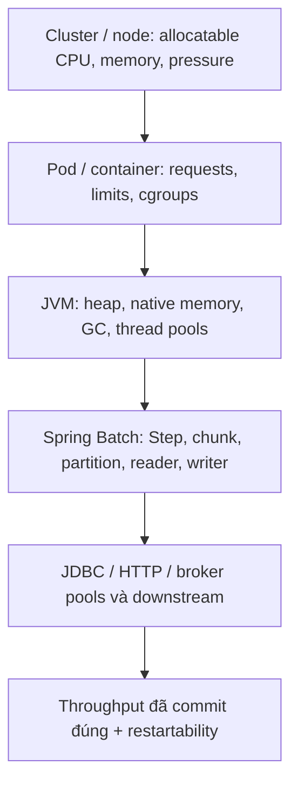
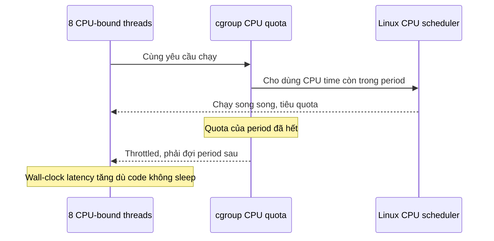
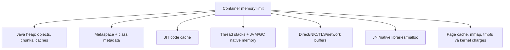
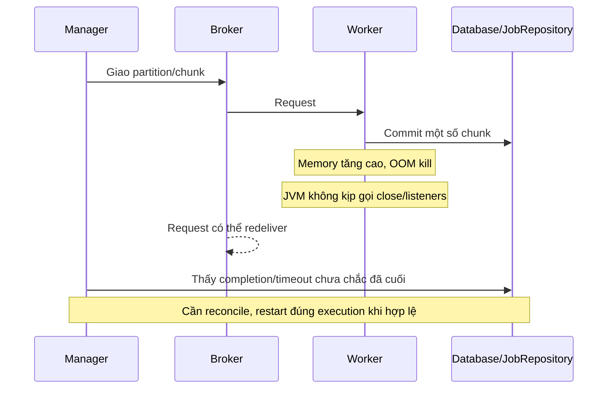

# CPU và memory limit khi mở rộng Spring Batch

Một batch job xử lý 5 triệu bản ghi có thể chạy nhanh trên máy phát triển, nhưng khi triển khai lên Kubernetes lại chậm bất thường, dù dashboard còn CPU trống. Có job tăng số partition lên gấp bốn nhưng throughput không đổi; có worker liên tục khởi động lại với `OOMKilled` dù JVM chỉ sử dụng 60% heap đã cấu hình. Đây là những triệu chứng của **giới hạn CPU, bộ nhớ và cơ chế quản lý tài nguyên theo process/container** — không phải lúc nào cũng là lỗi thuật toán hoặc lỗi Spring Batch.

Bài học **CPU và memory limit** thuộc chương **Resource pool** của module `SPRING_BATCH_SCALING_OPERATIONS`. Mục tiêu là mở rộng Spring Batch trên workload dữ liệu lớn bằng multi-threaded step, parallel steps, partitioning và worker phân tán **theo tài nguyên thực tế**: hiểu `requests/limits`, CPU throttling, cgroup, heap và native memory của JVM; ước lượng số thread/partition/chunk; thiết kế backpressure; đo đúng nút thắt; và bảo đảm restart, retry, idempotency khi worker mất tài nguyên.

Ví dụ tập trung **Linux, Kubernetes, Java 17+, Spring Batch 5.x và Spring Framework 6.x**. Các con số CPU/memory là **giá trị để thực hành**, không phải khuyến nghị mặc định cho mọi ứng dụng. Một số hành vi container-aware của JVM phụ thuộc bản JDK, kernel, container runtime và cgroup v1/v2; hãy xác minh bằng số liệu của **process thực**.

## 1. Ba tầng giới hạn cần nhìn đồng thời

Khi manager phân phối nhiều partition, số tài nguyên khả dụng phụ thuộc **ít nhất ba tầng**:



- **Node/cluster:** giới hạn tài nguyên vật lý/ảo, process khác tranh CPU, memory pressure và chính sách scheduler/eviction.
- **Container/cgroup:** mức CPU time được dùng và mức bộ nhớ mà kernel tính cho nhóm process.
- **JVM:** Java heap, thread stacks, metaspace, JIT code cache, direct buffers, native allocations và garbage collector.
- **Spring Batch:** số task/partition đang hoạt động, chunk size, batch item buffering, request/reply và retry queue.
- **Dịch vụ ngoài:** JDBC connection pool, HTTP quota, broker prefetch và database locks có thể giới hạn throughput sớm hơn CPU.

**Không đồng nhất:** số CPU trên node ≠ CPU quota của container; `-Xmx` ≠ toàn bộ RAM JVM dùng; số partition ≠ số partition active; và `JobExecution=COMPLETED` ≠ nghiệp vụ đã ghi đúng một lần nếu có side effect ngoài transaction.

## 2. Kubernetes CPU request, CPU limit, memory request và memory limit

Một Pod có thể khai báo `resources.requests` và `resources.limits` cho từng container.

| Cấu hình | Vai trò chính | Nếu ứng dụng dùng vượt mức |
| --- | --- | --- |
| `requests.cpu` | Scheduler dùng để quyết định placement; khi có tranh chấp CPU thường ảnh hưởng trọng số CPU | Có thể dùng hơn request nếu chính sách/limit cho phép |
| `limits.cpu` | Giới hạn CPU time qua kernel cgroup quota | **Throttling**: process bị trì hoãn CPU, thông thường **không bị kill** chỉ vì chạm CPU limit |
| `requests.memory` | Scheduler tính nhu cầu memory; liên quan QoS/eviction, tùy runtime có thể ảnh hưởng memory protection | Không phải hard cap; có thể dùng hơn request |
| `limits.memory` | Trần bộ nhớ kernel áp cho cgroup | Khi memory pressure và không reclaim đủ, có thể bị **OOM kill** |

Kubernetes dùng **CPU unit**: `1000m = 1 CPU`, `500m = 0.5 CPU`. Giới hạn 2 CPU không nhất thiết là hai core vật lý cố định; nó thường là **ngân sách CPU time** trên khoảng thời gian quota. `memory` dùng đơn vị bytes như `Mi` và `Gi`: `1Gi = 1024Mi`.

**Cảnh báo đơn vị:** `400m` CPU là 0,4 CPU; `400M` memory là hệ thập phân, khác `400Mi`. Sai một ký tự có thể làm giới hạn khác đáng kể. Không dùng `m` cho memory với ý nghĩa “megabyte”.

### 2.1. Ví dụ hiểu đúng một cấu hình

```yaml
resources:
  requests:
    cpu: "500m"
    memory: "1Gi"
  limits:
    cpu: "2"
    memory: "4Gi"
```

Trong cấu hình này, scheduler tính request **0,5 CPU và 1Gi memory** khi tìm node. Container có thể sử dụng tối đa **2 CPU time** theo cơ chế quota và memory đến giới hạn **4Gi** theo cgroup. Không nên diễn giải rằng ứng dụng **luôn được cấp cố định 2 CPU** hoặc luôn có 4Gi vật lý hoàn toàn riêng biệt.

Nếu khai báo limit mà không khai báo request, Kubernetes có thể sao chép limit thành request khi không có admission-time default khác. `LimitRange` hoặc policy của cluster cũng có thể thay đổi resource values; kiểm manifest **sau admission**.

## 3. CPU throttling: container chưa hết việc nhưng hết CPU time

Ví dụ worker có limit **2 CPU** nhưng dùng executor 8 thread cho xử lý JSON nặng. Trong một quota period giả định 100 ms, cgroup có thể có tổng **200 ms CPU time** để phân phối giữa các CPU đang chạy. Nếu nhiều thread chạy đồng thời trên nhiều core, quota có thể được tiêu hết trước khi kết thúc period; các thread bị **throttle** cho đến khi quota mới được cấp.



Những triệu chứng hay gặp:

- CPU usage gần limit nhưng throughput không còn tăng.
- `cpu.stat` tăng `nr_throttled` hoặc `throttled_usec`.
- Chunk duration, HTTP p95 và database transaction duration tăng theo wall time.
- GC/JIT cũng bị cạnh tranh CPU với worker threads.
- Tăng executor threads không cải thiện kết quả, đôi khi làm scheduling/GC overhead tăng.

**Không suy ra chỉ cần thấy `nr_throttled > 0` là job đã sai hoặc mọi latency đều do throttling.** Kiểm **mức tăng theo thời gian**, CPU utilization, queue wait, GC pause và throughput. Một period bị throttle rất ngắn có thể ít ảnh hưởng; throttling kéo dài ở critical path mới đáng chú ý.

## 4. Memory limit: vượt ngưỡng không phải “chạy chậm tương tự CPU”

Memory limit có cơ chế khác CPU:

1. JVM cấp phát heap/native memory, buffer, threads, socket và page cache.
2. Kernel/cgroup ghi nhận memory theo chính sách accounting.
3. Khi tới ngưỡng, kernel có thể reclaim cache và gây memory pressure.
4. Nếu không reclaim đủ, **OOM killer** có thể chấm dứt process trong cgroup; pod/container được báo `OOMKilled` trong Kubernetes.

Thường sẽ thấy dấu hiệu container restart, mất kết nối tới broker và `StepExecution` còn `STARTED` nếu JVM bị kill đột ngột trước khi cập nhật metadata.

**Cần phân biệt ba tình huống:**

| Tình huống | Dấu hiệu | Cách hiểu |
| --- | --- | --- |
| `java.lang.OutOfMemoryError: Java heap space` | JVM ném exception, có thể log/heap dump | Heap không chứa thêm object; có thể xảy ra **trước** cgroup OOM |
| `OutOfMemoryError: Direct buffer memory` | Lỗi cấp phát direct buffer | Giới hạn/áp lực direct memory; không nhất thiết heap đầy |
| Kernel/container `OOMKilled` | Pod last state reason, `memory.events: oom_kill` | Kernel kill process do memory pressure; JVM có thể **không ghi được exception/heap dump** |

Exit code **137** thường tương ứng SIGKILL, nhưng không đủ để tự kết luận là OOM: người vận hành hoặc orchestrator cũng có thể gửi SIGKILL. Kiểm **`reason: OOMKilled`**, cgroup counters, events và node state trước khi xác nhận root cause.

## 5. Đọc CPU/memory limits thực tế từ cgroup v2

Với Linux **cgroup v2**, nhiều container thấy controller files dưới `/sys/fs/cgroup`. Trên môi trường cho phép:

```bash
cat /proc/self/cgroup
cat /sys/fs/cgroup/cgroup.controllers

# CPU quota / period và thống kê tiêu thụ, throttling
cat /sys/fs/cgroup/cpu.max
cat /sys/fs/cgroup/cpu.stat

# Memory limit, current charge và sự kiện OOM
cat /sys/fs/cgroup/memory.max
cat /sys/fs/cgroup/memory.current
cat /sys/fs/cgroup/memory.events
cat /sys/fs/cgroup/memory.stat
```

Đây là ví dụ cho trường hợp **cgroup của process được mount tương ứng tại `/sys/fs/cgroup`**. Trong một số môi trường systemd/container, process thuộc cgroup con hoặc mount có namespace riêng. Cần xác định **đúng cgroup path từ `/proc/self/cgroup` và `/proc/self/mountinfo`**, cũng như giới hạn của các cgroup cha; không đọc nhầm cgroup root rồi tưởng process không bị giới hạn.

### 5.1. Diễn giải cpu.max

Ví dụ:

```text
cpu.max = 200000 100000
CPU quota ≈ 200000 / 100000 = 2 CPU
```

Hai số biểu thị `quota period` và `period`, tính theo microseconds. Nếu hiện `max 100000`, cgroup ấy **không khai báo CPU quota tại mức đó**; vẫn có thể bị giới hạn bởi cgroup cha, cpuset hoặc scheduler contention.

`cpu.stat` thường chứa:

```text
usage_usec      35000000
user_usec       30000000
system_usec      5000000
nr_periods          6000
nr_throttled         850
throttled_usec    9200000
```

Các số trên chỉ minh họa. `nr_periods` là tổng số period được theo dõi, `nr_throttled` là số period có throttling, `throttled_usec` là thời gian throttled được hạch toán. **So delta trên cùng một cgroup và cùng khoảng đo**, không coi counters tích lũy là tỷ lệ hiện tại.

### 5.2. Diễn giải memory.max, memory.current, memory.events

```text
memory.max     4294967296
memory.current 2910851072
memory.events:
  low 0
  high 12
  max 1
  oom 1
  oom_kill 0
```

`4294967296 bytes = 4Gi`. `memory.max=max` thường nghĩa là không đặt hard cap **tại cgroup đó**. `memory.current` là accounting của cgroup, không đồng nhất với Java heap used hoặc RSS của riêng JVM. `memory.events` cho biết các loại pressure/giới hạn; `oom` không phải lúc nào cũng dẫn tới `oom_kill` ngay.

Ở cgroup v2, `memory.stat` có các nhóm như `anon`, `file`, `kernel`, giúp phân biệt anonymous memory với file cache/tmpfs và kernel accounting. Những trang dùng bởi `emptyDir` có `medium: Memory` cũng có thể tiêu tốn memory budget. Đừng chỉ nhìn heap graph.

## 6. Nếu hệ thống dùng cgroup v1

Một số Linux/container vẫn sử dụng cgroup v1. Đường dẫn phổ biến:

```bash
cat /sys/fs/cgroup/cpu/cpu.cfs_quota_us
cat /sys/fs/cgroup/cpu/cpu.cfs_period_us
cat /sys/fs/cgroup/cpu/cpu.stat

cat /sys/fs/cgroup/memory/memory.limit_in_bytes
cat /sys/fs/cgroup/memory/memory.usage_in_bytes
cat /sys/fs/cgroup/memory/memory.failcnt
```

Đây là **layout minh họa**, không chắc tồn tại ở mọi distribution/mount. Quota âm (`-1`) trong `cpu.cfs_quota_us` thường thể hiện không có quota ở cấp đó. Cgroup v1 CPU `throttled_time` thường có đơn vị **nanoseconds**, khác `throttled_usec` trong v2. Một memory limit giá trị cực lớn ở v1 có thể biểu thị unbounded theo kernel/ABI, không có nghĩa JVM có thể dùng hết con số ấy.

**Không trộn metrics v1 và v2** trong cùng biểu thức hoặc so thời gian throttling mà không đổi đơn vị.

## 7. Bộ nhớ JVM: Xmx chỉ là một phần của process

Ngân sách memory trong container phải chứa cả Java heap lẫn native/off-heap:



Không đơn giản lấy `memory limit - Xmx` là “memory rảnh” có thể dùng tùy ý. Các vùng khác phát triển theo số thread, connection, payload, classloading và cách GC hoạt động. File cache có thể được reclaim một phần nhưng không nên cộng toàn bộ vào headroom chắc chắn; memory overhead còn phụ thuộc runtime/kernel và số process cùng cgroup.

| Thành phần | Có bị `-Xmx` kiểm soát trực tiếp? | Dấu hiệu tăng |
| --- | --- | --- |
| Java heap | **Có** (trần heap) | Batch chunks lớn, item graph, cache |
| Metaspace | Không; có flag riêng | Nhiều class/classloader |
| Code cache | Không; có flag riêng | JIT compiled code |
| Thread stacks | Không | Nhiều executor/consumer/GC threads |
| Direct `ByteBuffer` | Không thuộc heap; có cơ chế giới hạn riêng | Network buffers, streaming |
| JNI/native malloc | Không | Compression, TLS, image/parser/native libs |
| cgroup page cache/tmpfs | Không | File scan, memory-backed temp, mmap |

Một JVM có `-Xmx2g` **vẫn có thể** làm container `3Gi` bị OOM nếu native+file memory vượt headroom. Ngược lại, heap used cao chưa đủ kết luận memory leak; GC có thể giữ heap reserved/committed cho nhu cầu dự kiến.

## 8. Ví dụ tính ngân sách RAM cho một worker JVM

Giả sử worker được cấp **memory limit 4Gi = 4096Mi**:

| Khoản dự trù (minh họa) | MiB |
| --- | ---: |
| Java heap target/max | 2253 |
| Thread stacks và JVM/GC/JIT/native | 450 |
| Direct buffers, network, TLS, compression | 350 |
| File cache/tmpfs/kernel accounting và biến động | 400 |
| **Headroom dự kiến** | **643** |
| **Tổng** | **4096** |

Với `-XX:MaxRAMPercentage=55.0` và JVM thật sự dùng limit 4Gi làm cơ sở, max heap lý thuyết khoảng **2253MiB**. Các khoản còn lại là **ngân sách minh họa**, không phải JVM tự phân chia chính xác theo bảng. Phải đo actual RSS/cgroup memory và high-water mark dưới benchmark.

```text
container_limit
  >= heap_committed_or_resident
   + native_memory
   + direct_and_network_buffers
   + thread_stacks_resident
   + other_charged_memory
   + safety_headroom
```

**Một lỗi nguy hiểm:** đặt `-Xmx4g` cho container `memory.limit=4Gi`. Khi heap gần max, chỉ cần thêm metaspace, thread stacks, buffers hoặc cache cũng có thể chạm hard cap. Nhưng cũng không nên cố định `55%` cho mọi job: workload ít native overhead có thể dùng heap lớn hơn, workload nhiều I/O/direct buffers cần headroom rộng hơn.

### 8.1. Memory budget theo số chunk/thread

Giả sử mỗi item sau deserialize giữ khoảng **300KiB** trên heap, một worker có **4 chunk concurrent × 250 item/chunk**:

```text
Minimum item payload ≈ 4 × 250 × 300KiB
                     ≈ 293MiB
```

Con số chưa tính object headers, copy đầu vào/đầu ra, queue, SQL batch, retry context, message serialization hoặc cache. Nếu xử lý giữ cả `Input` và `Output` đồng thời, peak có thể cao hơn nhiều. **Đừng tính RAM chỉ từ kích thước file CSV nén hoặc JSON trên wire**: kích thước object graph trong JVM thường khác.

## 9. JVM container awareness và các flag quan trọng

Các bản HotSpot/OpenJDK hiện đại (bao gồm JDK 17 trong cấu hình hỗ trợ) có `UseContainerSupport` được bật mặc định, để JVM phát hiện một phần giới hạn cgroup cho heap/CPU ergonomics. Nhưng kết quả còn phụ thuộc **JDK build/update, cgroup version và runtime**.

Một số lựa chọn:

| JVM flag | Tác dụng | Lưu ý |
| --- | --- | --- |
| `-XX:+UseContainerSupport` | Cho phép JVM nhận diện container | Thường mặc định bật trên HotSpot JDK 17 |
| `-XX:MaxRAMPercentage=55` | Tính trần heap theo % memory JVM nhận diện | Không giới hạn toàn bộ native memory |
| `-Xmx2250m` | Trần Java heap tuyệt đối | Nếu cùng đặt `-Xmx`, nó có ưu tiên hơn percentage cho max heap |
| `-XX:InitialRAMPercentage=...` | Điều chỉnh kích thước heap ban đầu theo % | Không cần bằng maximum |
| `-XX:ActiveProcessorCount=2` | Override CPU count dùng cho nhiều quyết định JVM | Không thay kernel CPU quota hay pin hai core |
| `-Xss512k` | Điều chỉnh stack size cho từng Java thread | Quá nhỏ có thể `StackOverflowError`; phải test |
| `-XX:MaxDirectMemorySize=...` | Giới hạn một số cấp phát direct buffer trong JVM | Không bao trùm mọi native/JNI allocations |
| `-XX:NativeMemoryTracking=summary` | Bật Native Memory Tracking | Có overhead; cần bật lúc khởi động |

Để xem JVM phát hiện container thế nào, ví dụ trong môi trường test:

```bash
java -XshowSettings:system -version
java -Xlog:os+container=debug -version
```

Độ chi tiết output phụ thuộc JDK. Dùng `Runtime.getRuntime().availableProcessors()` để quan sát CPU count JVM báo, nhưng **không mặc định** con số này đúng bằng `requests.cpu`, `limits.cpu` hay số core của node trên mọi phiên bản. `ActiveProcessorCount` có thể làm JVM báo con số theo override; nó **không tạo thêm CPU time** nếu quota thấp.

### 9.1. Không set flag theo “công thức thần kỳ”

Ví dụ `MaxRAMPercentage=90` có thể phù hợp một ứng dụng chỉ dùng heap ít native overhead, nhưng với remote chunking có broker buffers, HTTP connections và compression, headroom 10% có thể không đủ. Tương tự, `ActiveProcessorCount=32` với limit 2 CPU không giúp xử lý CPU-bound nhanh hơn; có thể khiến GC/executor chọn nhiều thread hơn cần thiết.

**Luôn kiểm chứng heap max thực** qua `jcmd`/JMX và **container memory.current** ở runtime. Nếu dùng JDK 17 cũ không nhận diện đúng cgroup v2, hãy cân nhắc nâng JDK update trước khi cố sửa bằng hàng loạt override.

## 10. Kubernetes Deployment minh họa cho remote worker

Ví dụ worker Spring Batch nhận `StepExecutionRequest` hoặc `ChunkRequest` từ broker, chạy dưới `Deployment` với 4 replica:

```yaml
apiVersion: apps/v1
kind: Deployment
metadata:
  name: invoice-batch-worker
spec:
  replicas: 4
  selector:
    matchLabels:
      app: invoice-batch-worker
  template:
    metadata:
      labels:
        app: invoice-batch-worker
    spec:
      containers:
        - name: worker
          image: example.invalid/invoice-batch-worker:5x
          resources:
            requests:
              cpu: "500m"
              memory: "1Gi"
            limits:
              cpu: "2"
              memory: "4Gi"
          env:
            - name: JAVA_TOOL_OPTIONS
              value: "-XX:MaxRAMPercentage=55.0"
```

Image là **placeholder**, chưa có cấu hình broker, secrets, health checks, termination grace period hoặc storage; **không phải manifest production hoàn chỉnh**. Khi triển khai thật phải quan sát resource values được admission/`LimitRange` áp dụng.

Trong ví dụ này:

- **4 worker JVM**, mỗi worker có giới hạn danh nghĩa **2 CPU, 4Gi**.
- Tổng limit danh nghĩa của worker pool là **8 CPU và 16Gi** nếu cả bốn replica hoạt động, nhưng node scheduling/quotas/overhead và contention vẫn ảnh hưởng throughput.
- `requests.cpu=500m`, `requests.memory=1Gi` nhỏ hơn limits nên Pod thường thuộc QoS **Burstable** nếu không có cấu hình khác; không nên coi request 1Gi là bảo đảm mọi thời điểm luôn có 4Gi miễn phí.
- Mỗi replica có **heap/pools/threads riêng**. Nếu 4 worker mỗi nơi có HTTP pool 20 connection, cluster có thể tạo tới khoảng 80 HTTP connections; memory và FD được tính ở từng JVM/node.

Không chạy **manager job launch trùng** trong mỗi replica của một Deployment worker; manager và worker có vai trò khác nhau trong remote partitioning/chunking. Các replica nên nhận việc qua broker/partition handler và có idempotency theo business key.

## 11. Số thread không phải số CPU core

Xét hai loại workload:

| Loại xử lý | Hành vi khi tăng thread trên cùng CPU limit | Cần đo |
| --- | --- | --- |
| **CPU-bound**: parse JSON lớn, hash, mã hóa, tính toán | Tăng thread quá số CPU time khả dụng thường không tăng throughput; có thể tăng context switch, GC pressure | CPU usage, throttling, items/s, GC CPU |
| **I/O-bound**: chờ HTTP, JDBC, broker | Nhiều thread có thể hữu ích vì một số đang block | HTTP/JDBC pool, upstream quota, pending queues, memory/FD |
| **Mixed**: đọc DB → HTTP → transform → ghi DB | Điểm nghẽn có thể chuyển từ CPU sang pool/API | Đo từng pha, không suy bằng một thông số |

**Ví dụ CPU-bound:** nếu mỗi item tốn khoảng **20ms CPU time** và container có quota 2 CPU, throughput trần lý thuyết trước overhead là:

```text
2 CPU-seconds mỗi giây / 0.020 CPU-seconds mỗi item
= khoảng 100 items/second
```

Thêm 32 worker threads không biến trần CPU time thành 1600 items/s. Với I/O-bound, throughput có thể tiếp tục tăng khi threads > CPU count, nhưng chỉ nếu HTTP/DB/broker và memory/FD cho phép.

## 12. Bounded TaskExecutor cho multi-threaded step

Một `ThreadPoolTaskExecutor` được quản lý bởi Spring với queue hữu hạn:

```java
import org.springframework.context.annotation.Bean;
import org.springframework.context.annotation.Configuration;
import org.springframework.scheduling.concurrent.ThreadPoolTaskExecutor;

@Configuration
public class BatchExecutorConfiguration {

    @Bean("batchTaskExecutor")
    ThreadPoolTaskExecutor batchTaskExecutor() {
        ThreadPoolTaskExecutor executor = new ThreadPoolTaskExecutor();
        executor.setCorePoolSize(2);
        executor.setMaxPoolSize(4);
        executor.setQueueCapacity(16);
        executor.setThreadNamePrefix("invoice-step-");
        executor.setWaitForTasksToCompleteOnShutdown(true);
        executor.setAwaitTerminationSeconds(30);
        return executor;
    }
}
```

Với queue capacity 16, executor thường mở tới **corePoolSize** trước; khi queue đầy mới mở thêm threads tới **maxPoolSize**. Đừng nghĩ `maxPoolSize=4` có nghĩa lúc nào cũng chạy bốn thread. Task bị từ chối khi toàn bộ capacity hết; cần quan sát `active/queued/rejected` và chọn chính sách backpressure rõ ràng.

Minh họa wiring step theo Spring Batch 5.x:

```java
import org.springframework.batch.core.Step;
import org.springframework.batch.core.repository.JobRepository;
import org.springframework.batch.core.step.builder.StepBuilder;
import org.springframework.batch.item.ItemProcessor;
import org.springframework.batch.item.ItemReader;
import org.springframework.batch.item.ItemWriter;
import org.springframework.scheduling.concurrent.ThreadPoolTaskExecutor;
import org.springframework.transaction.PlatformTransactionManager;

@Bean
Step invoiceStep(
        JobRepository jobRepository,
        PlatformTransactionManager transactionManager,
        ItemReader<Invoice> reader,
        ItemProcessor<Invoice, InvoiceResult> processor,
        ItemWriter<InvoiceResult> writer,
        ThreadPoolTaskExecutor batchTaskExecutor) {

    return new StepBuilder("invoiceStep", jobRepository)
            .<Invoice, InvoiceResult>chunk(100, transactionManager)
            .reader(reader)
            .processor(processor)
            .writer(writer)
            .taskExecutor(batchTaskExecutor)
            .build();
}
```

Đây là method đặt trong `@Configuration`, giả định có DTO `Invoice`/`InvoiceResult`, các bean reader/processor/writer và batch infrastructure. **Không mặc nhiên sử dụng một stateful reader/writer trên nhiều thread.** Trước khi bật executor, kiểm hợp đồng thread safety, listener, transaction state và restart; nhiều workload phù hợp với **partitioning theo phạm vi ID/file có reader `@StepScope` riêng** hơn.

Trong Spring Batch 5.x, `throttleLimit` của tasklet step đã được **deprecated**; giới hạn concurrency còn chịu ảnh hưởng của repeat operations/step infrastructure. Nếu cần tinh chỉnh beyond defaults, đối chiếu API đúng version và custom `RepeatOperations` thay vì chỉ tăng `maxPoolSize` rồi kết luận mọi thread đều được sử dụng.

## 13. Partitioning: giới hạn số StepExecution active

Một job có `gridSize=64` không có nghĩa 64 partition đồng thời chạy trên một worker. Actual concurrency bị giới hạn bởi `PartitionHandler`, `TaskExecutor`, số consumer/worker process và quota tài nguyên:

```text
Remote partitioning:
  Manager tạo 64 partitions
  4 worker processes
  Mỗi worker 2 concurrent partition executions
  => tối đa danh nghĩa khoảng 8 active partitions

Local partitioning:
  Manager tạo 64 partitions
  Một TaskExecutor có 6 active threads
  => tối đa danh nghĩa khoảng 6 active partitions
```

**Cân đối memory theo active concurrency**, không chỉ theo tổng partition count. Nếu mỗi active partition giữ 250MiB (reader buffers, processor caches, item graph, output), 8 concurrent partitions có thể chiếm thêm khoảng **2Gi** ngoài overhead/pools chung; với worker limit 4Gi, đó có thể là mức quá cao.

Giữ partition identity ổn định để restart đúng `JobInstance`. Khi job thất bại do OOM, không tùy tiện đổi partition keys/ranges để “chữa” nếu metadata đã checkpoint theo các keys cũ. Có thể hạ **concurrency** mà vẫn giữ **partition naming và snapshot**; thử nghiệm cách framework khôi phục trước khi rollout.

## 14. Chunk size, prefetch và queue là memory multipliers

Tăng `chunk(100)` lên `chunk(5000)` có thể giảm transaction overhead nhưng tăng số item giữ trên heap trong cùng transaction. Remote chunking còn phải serialize/copy các item vào `ChunkRequest`; broker listener prefetch và queue trong RAM có thể nhân peak memory.

Ví dụ:

```text
8 in-flight chunks × 200 items/chunk × 50KiB decoded/item
= 80,000 KiB ≈ 78MiB payload tối thiểu
```

Con số đó **chưa tính** message headers, object copies, processor output, deserializer intermediate buffers, DLQ/reply queue hoặc temporary `byte[]`. Nếu client giữ nhiều bản copy cho cùng chunk, peak memory có thể cao hơn nhiều.

| Tham số tăng | Lợi ích có thể có | Rủi ro memory |
| --- | --- | --- |
| Chunk size | Ít commit/roundtrip hơn | Batch item graph, DB batch và rollback lớn |
| Executor threads | Thêm CPU/I/O concurrency | Thread stacks, chunks đồng thời, context switch |
| Queue capacity | Hấp thu burst | Hàng chờ giữ payload và bị GC quét |
| Broker prefetch | Giảm roundtrip delivery | Nhiều unacked messages/decoded chunks trên worker |
| `gridSize` | Phân chia workload chi tiết | Metadata/manager buffers; active partitions tùy handler |
| HTTP/JDBC pool | Giảm thời gian đợi kết nối | Sockets, native buffers và DB/server load |

**Nguyên tắc:** dùng queue **bounded** và backpressure rõ ràng. Nếu manager đọc item nhanh hơn worker xử lý, queue vô hạn chuyển điểm nghẽn từ broker sang heap; GC tăng và có thể OOM trước khi upstream phát hiện lỗi. Với `QueueChannel` trong RAM, đảm bảo capacity và delivery/ACK boundaries phù hợp với restart.

## 15. Phân biệt bốn loại “job chậm vì tài nguyên”

| Quan sát | Nguyên nhân khả dĩ | Bằng chứng cần thu |
| --- | --- | --- |
| CPU gần quota, `nr_throttled` và `throttled_usec` tăng nhanh | Cgroup CPU throttling | Cgroup delta, CPU usage, items/s, chunk p95 |
| Heap used tăng tới max, GC liên tục, cuối cùng `Java heap space` | Heap thiếu hoặc object retention/leak | GC logs, heap dump/test, allocation profile |
| Heap ổn nhưng `memory.current` sát limit, container `OOMKilled` | Native/direct/file cache/tmpfs/kernal charge hoặc memory bị giữ ngoài heap | Memory.stat, NMT, thread count, buffers, events |
| CPU thấp, memory còn headroom, throughput vẫn thấp | JDBC/HTTP/broker pool, database locks, I/O hoặc thiếu runnable tasks | Pool pending, SQL waits, broker queue, executor stats |

**Không chẩn đoán bằng một biểu đồ duy nhất.** CPU throttling có thể làm GC lâu hơn; memory pressure có thể gây reclaim, làm latency tăng; HTTP timeout có thể khiến worker retry, giữ chunk lâu và tăng heap. Cần vẽ **timeline nguyên nhân–hệ quả** thay vì kết luận chỉ từ giá trị CPU cao.

### 15.1. CPU throttling khác với GC pause

Một GC pause là khoảng thời gian JVM tạm dừng một số luồng ứng dụng để thu gom bộ nhớ, còn CPU throttling do kernel cgroup điều tiết CPU time. Chúng có thể xảy ra đồng thời:

```text
T0  CPU quota bị tiêu hết
T1  GC threads phải chờ CPU
T2  Wall-clock GC pause dài hơn kỳ vọng
T3  Worker xử lý chunk lâu hơn
T4  Manager hoặc HTTP client chạm timeout
```

Nếu chỉ đọc GC pause mà tăng heap vô điều kiện, có thể không xử lý nguyên nhân CPU quota. Ngược lại, nếu GC thực sự chiếm phần lớn CPU, tăng CPU limit có thể chỉ làm job đốt CPU nhanh hơn mà vẫn thiếu memory cho live objects. Phải đo **GC frequency, pause, allocation rate, CPU throttling và committed throughput**.

## 16. JVM GC diagnostics và Native Memory Tracking

Trong một môi trường test có quyền kiểm soát JVM, có thể bật GC logging:

```bash
java \
  -XX:MaxRAMPercentage=55.0 \
  -Xlog:gc*:file=/var/log/batch/gc.log:time,uptime,level,tags:filecount=5,filesize=20M \
  -jar invoice-worker.jar
```

Đường dẫn log phải tồn tại, ghi được và có chính sách rotation. Đừng bật logging ở mức quá chi tiết trên production mà không tính storage, I/O và ảnh hưởng performance. `GC logs` cho thấy việc sử dụng heap và pause, **không thể tự suy ra toàn bộ native memory**.

Một số lệnh `jcmd` (cần quyền attach và JDK/tools phù hợp):

```bash
PID=12345

jcmd "$PID" VM.flags
jcmd "$PID" VM.info
jcmd "$PID" GC.heap_info
jcmd "$PID" Thread.print

# Chỉ hữu ích nếu JVM đã bật NMT khi khởi động:
jcmd "$PID" VM.native_memory summary
```

**Native Memory Tracking (NMT)** cần được bật từ lúc JVM khởi động, ví dụ `-XX:NativeMemoryTracking=summary`. Nó cung cấp breakdown một phần native allocations được JVM theo dõi (threads, class, code, GC...), nhưng **không đảm bảo bao phủ toàn bộ native libraries, page cache và cgroup memory**. NMT có overhead, nên đo trong môi trường phù hợp.

Không gọi `jcmd` vào JVM không thuộc quyền quản trị, không attach bừa khi host rất thiếu memory/CPU và không ghi heap dump lớn vào filesystem gần đầy. Nếu container đã `OOMKilled`, JVM không còn để attach; phải dựa trên **metrics lịch sử, cgroup events và logs từ lần chạy trước**.

## 17. Chẩn đoán trên Kubernetes: process nào bị giới hạn?

Trong namespace mà operator có quyền truy cập, các lệnh dưới đây giúp thu thập bằng chứng:

```bash
# Metrics hiện tại (yêu cầu metrics-server hoặc pipeline phù hợp)
kubectl top pod invoice-batch-worker-xyz --containers -n batch

# Events, requests/limits, last terminated reason, restart count
kubectl describe pod invoice-batch-worker-xyz -n batch

# Log lần container trước nếu còn
kubectl logs invoice-batch-worker-xyz -n batch --previous

# Xem trạng thái container đã kết thúc
kubectl get pod invoice-batch-worker-xyz -n batch \
  -o jsonpath='{.status.containerStatuses[*].lastState.terminated.reason}'
```

`invoice-batch-worker-xyz` và `batch` là tên **giả định**. Các lệnh trên chỉ thu thập thông tin; không chạy tự động trên cluster và không đòi quyền admin nếu RBAC cho phép đọc. `kubectl top` là snapshot không phải biểu đồ peak/historical; metrics-server có thể chưa triển khai hoặc không cung cấp mọi metric.

Khi `describe` cho biết `OOMKilled`:

1. Đối chiếu **timestamp** với memory usage và `memory.events`.
2. Kiểm `heap.max`, Java GC, direct buffers, thread count và input size/chunk size.
3. Tìm spike do prefetch/retry, JSON payload, cache hoặc nén dữ liệu.
4. Kiểm container có **sidecar** hoặc resource limit ở cấp Pod khác; không mặc định mọi process trong Pod dùng cùng cgroup/limit.
5. Kiểm node pressure/eviction events để phân biệt **OOM trong container** với **Pod eviction do node memory pressure**.

Nếu chỉ có exit 137 mà không có `reason`, trạng thái vẫn là **chưa đủ bằng chứng**. Không ép kết luận OOM để rồi tăng memory limit sai chỗ.

## 18. Spring Boot Actuator, Micrometer và cgroup metrics

Một dashboard cho worker nên có:

| Tầng | Chỉ số | Ý nghĩa |
| --- | --- | --- |
| JVM heap | `jvm.memory.used`, `jvm.memory.max` phân theo area | Heap pressure và nonheap, phụ thuộc metric tags |
| JVM threads | `jvm.threads.live`, `jvm.threads.peak` | Kiểm số thread đang tăng bất thường |
| JVM GC | pause count/time, allocation rate (nếu có) | GC cost dưới cùng workload |
| JVM direct buffers | `jvm.buffer.memory.used` (nếu binder có) | Một phần NIO direct/mapped buffers |
| Process CPU | `process.cpu.usage`, CPU time | CPU demand; không phải CPU throttling |
| Cgroup CPU | `cpu.stat`, usage/throttling | Xác minh cgroup bị kernel quota |
| Cgroup memory | `memory.current`, `memory.max`, `memory.events`, `memory.stat` | Đối chiếu toàn bộ memory charge |
| Spring Batch | read/write/skip/rollback, chunk durations, StepExecution | Tiến độ thật và side effects |
| Downstream | JDBC/HTTP pool active/pending, broker backlog | Bottleneck không nằm ở CPU/memory |

Tên metric phụ thuộc phiên bản Spring Boot/Micrometer/exporter; **không mặc định** mọi metric có sẵn hoặc cùng semantic. `jvm.memory.used` đo vùng bộ nhớ JVM, **không tương đương memory.current** của cgroup. `container_memory_working_set_bytes` từ một số Kubernetes/cAdvisor exporters cũng **không giống hệt** `memory.current` vì chính sách loại trừ cache.

Với exporter có các counters thông dụng, một tỷ lệ throttled periods có thể tính theo ý tưởng:

```promql
rate(container_cpu_cfs_throttled_periods_total[5m])
/
rate(container_cpu_cfs_periods_total[5m])
```

Đây là **ví dụ metric query**, không đảm bảo có tên này trong mọi môi trường cgroup v2/monitoring stack. Cần lọc đúng container/pod, bảo đảm denominator > 0 và kiểm nhãn không cộng nhầm container cũ sau restart. Tỷ lệ này phản ánh **tỷ lệ period bị throttle**, không phải “tỷ lệ CPU time bị mất” và không tự chứng minh bottleneck chính của job.

### 18.1. Theo dõi cả tỷ lệ và tốc độ tăng

```text
memory_utilization = memory_current_bytes / memory_limit_bytes
heap_utilization   = heap_used_bytes / heap_max_bytes

CPU demand        ~= delta CPU usage time / delta wall time
Throttling signal  = delta nr_throttled, delta throttled_usec
```

Các phép tính là **khung phân tích**, chưa xử lý reset counter khi container restart hoặc nhiều CPU/cgroup cha. Không tạo metric label theo từng item/`stepExecutionId` vì số lượng partition lớn có thể làm cardinality nổ; lưu ID chi tiết vào logs/traces.

## 19. Chẩn đoán JVM bằng Java Management API

Với JDK 17, có thể ghi log định kỳ về heap, nonheap, số thread và CPU count JVM đang báo:

```java
import java.lang.management.ManagementFactory;
import java.lang.management.MemoryMXBean;
import java.lang.management.ThreadMXBean;

public final class BatchResourceSnapshot {
    private BatchResourceSnapshot() {}

    public static void log() {
        MemoryMXBean memory = ManagementFactory.getMemoryMXBean();
        ThreadMXBean threads = ManagementFactory.getThreadMXBean();

        long heapUsed = memory.getHeapMemoryUsage().getUsed();
        long heapMax = memory.getHeapMemoryUsage().getMax();
        long nonHeapUsed = memory.getNonHeapMemoryUsage().getUsed();
        int availableProcessors = Runtime.getRuntime().availableProcessors();

        System.out.printf(
                "processors=%d liveThreads=%d heapUsed=%d heapMax=%d nonHeapUsed=%d%n",
                availableProcessors,
                threads.getThreadCount(),
                heapUsed,
                heapMax,
                nonHeapUsed);
    }
}
```

Trong ứng dụng thực, đưa log vào metrics/timer được lấy mẫu thay vì in console mỗi item. Số `availableProcessors` có thể ảnh hưởng đến executor/GC defaults; **đừng dùng nó làm nguồn duy nhất để quyết định CPU quota thật**.

Nếu muốn đo process CPU time, HotSpot thường cung cấp `com.sun.management.OperatingSystemMXBean.getProcessCpuTime()`, nhưng availability khác nhau theo JVM/OS. Heap + nonheap MXBean **vẫn thiếu** nhiều khoản native memory và page cache; đối chiếu với cgroup metrics.

## 20. CPU/memory limit và Spring Batch restartability

Một manager/worker bị kill vì OOM hoặc bị throttle quá nặng có thể gây:



Trong **remote partitioning**, mỗi worker `StepExecution` có metadata/`ExecutionContext` theo partition; khi process chết đột ngột, một số execution có thể còn `STARTED`. Trong **remote chunking**, manager đọc item và chờ `ChunkResponse`; worker có thể đã commit business write trước khi mất response, khiến request được redeliver.

Hệ quả quan trọng:

- **Container restart không bằng `JobInstance` restart.** Kubernetes tạo process mới nhưng không tự chuyển mọi `StepExecution` lỗi sang `FAILED` theo cách an toàn.
- `@PreDestroy`, `ItemStream.close()` hoặc shutdown hook **không bảo đảm được gọi** khi kernel SIGKILL/OOM kill.
- Broker ACK và business DB commit **không thuộc cùng transaction mặc định**.
- Khi worker gửi API/payment/email, side effect ngoài DB có thể đã thành công trước crash.
- `ExitOnOutOfMemoryError` chỉ tác động khi JVM phát hiện và ném Java OOME phù hợp; **không thay thế xử lý cgroup OOM kill**.

Vì vậy, mọi quy trình tăng memory limit rồi restart phải kiểm **JobRepository/ExecutionContext, request/reply queue, worker ownership và idempotency nghiệp vụ**.

## 21. Kịch bản crash sau commit nhưng trước reply

Giả sử worker xử lý partition `invoiceWorker:partition03`:

```text
T1: Worker đọc IDs [300000, 400000)
T2: Transaction chunk số 40 commit business DB
T3: Memory đột biến do serialize reply/payload
T4: Kernel OOM kill worker trước ACK hoặc gửi StepExecution reply
T5: Broker giao lại cùng request hoặc manager restart job
```

Nếu writer chỉ làm `UPDATE balance SET total=total+:amount` mà không có deduplication, các bản ghi đã commit ở T2 có thể bị cộng lại. Thiết kế đúng phải có **business operation key/conditional update/upsert idempotent** hoặc checkpoint/transaction bảo đảm phù hợp.

**Không vì lỗi OOM mà xóa `BATCH_STEP_EXECUTION` hoặc đổi `STATUS='FAILED'` thủ công.** Một số worker cũ có thể vẫn chạy trong trường hợp timeout/split-brain. Phải xác định process cũ đã chết hoặc mất ownership, sau đó dùng `JobOperator.restart(...)` hoặc orchestration tương thích với trạng thái metadata, không tự tạo identifying `JobParameters` mới rồi coi đó là resume.

### 21.1. Khi CPU throttling làm timeout giả

CPU quota thấp có thể khiến chunk/step execution kéo dài, dẫn tới `responseTimeout` HTTP, listener heartbeat failure hoặc manager repository/reply timeout. Lỗi timeout **không chứng minh worker đã chết**. Trước khi gửi lại request, xác nhận process liveness, activity, `StepExecution` và business output; redelivery khi worker cũ còn hoạt động có nguy cơ xử lý trùng.

Đặt timeout dựa trên **p95/p99 thực tế dưới CPU limit dự kiến**, không dựa trên máy phát triển không bị throttle.

## 22. Manager và worker nên có ngân sách riêng

Trong remote partitioning:

- **Manager:** tạo partition/`StepExecution`, gửi request, nhận reply hoặc poll `JobRepository`, giữ state tổng hợp.
- **Worker:** đọc source, processor, writer, buffers và transaction; thường tiêu CPU/memory lớn hơn nếu workload nặng ở xử lý item.

Trong remote chunking:

- **Manager:** sở hữu reader, chia chunk, serialize request và có thể giữ pending `ChunkRequest/ChunkResponse`; memory áp lực có thể đáng kể.
- **Worker:** deserialize, processor/writer, kết nối DB/API và reply; CPU/memory tùy business logic.

Không mặc định “manager nhẹ, worker nặng” cho mọi mô hình. Nếu manager remote chunking đọc hàng triệu item rồi giữ queue không giới hạn, **manager có thể OOM trước worker**. Với reply aggregation, tập responses và pending correlation cũng cần giới hạn/timeout phù hợp.

Sử dụng **requests/limits, thread/pool sizing và alerting riêng** cho manager và worker theo đo tải. Không cho nhiều JobInstances chạy đồng thời trong một manager process nếu aggregate memory của chúng vượt budget.

## 23. Requests/limits và Horizontal Pod Autoscaler

HPA dựa trên CPU utilization thường so mức CPU đang dùng với **CPU request**, không phải CPU limit. Ví dụ worker request `500m`, dùng `400m` có thể được xem là khoảng **80% utilization của request**, dù container limit là 2 CPU.

Điều này ảnh hưởng thiết kế:

- Đặt request quá thấp có thể khiến HPA scale up sớm hơn dự kiến.
- Thêm Pod làm **tổng CPU/memory requests và số connection DB/HTTP/broker** tăng, không bảo đảm upstream chịu được.
- Batch worker có backlog biến động; queue depth/lag hoặc số partition pending có thể phản ánh nhu cầu tốt hơn CPU utilization trong một số topology.
- Pod đang OOM/restart liên tục không trở thành khỏe mạnh chỉ nhờ tăng replica.
- CPU usage gần limit có thể phản ánh throttling; cần xem thêm throttling metrics trước khi kết luận scale-up hiệu quả.

HPA, event-driven scaling và worker pool elasticity là **lựa chọn vận hành bổ sung**, không có nghĩa Spring Batch tự động bảo vệ partition ownership, idempotency hay JobInstance concurrency khi Pod count thay đổi.

## 24. Resource requests thấp có thể khiến job bị eviction

Memory request chủ yếu giúp scheduler lập lịch và ảnh hưởng một số chính sách QoS/eviction. Nếu request thấp hơn đáng kể so với mức dùng thực, Pod có thể chạy ổn khi node rảnh nhưng bị **evict** khi node gặp memory pressure. Eviction khác với một process vượt `memory.max` và bị cgroup OOM kill; cần đọc reason/events.

| Sự kiện | Triệu chứng | Hướng xử lý |
| --- | --- | --- |
| Không đủ request capacity trên node | Pod `Pending` / `Unschedulable` | Kiểm node allocatable, resource requests, quotas |
| CPU limit thấp | Worker chạy chậm, throttling | Đo CPU.stat, throughput, concurrency |
| Container chạm memory limit | `OOMKilled`, restart count tăng | Phân tích cgroup memory, heap/native/queues |
| Node memory pressure | Pod `Evicted` hoặc node events | Kiểm requests/QoS/priority, node pressure |
| Memory leak JVM/reader | Memory tăng theo số item, không plateau | Heap/native profile, close lifecycle |
| Downstream quá tải | CPU thấp, 429/DB timeouts | Giảm concurrency, quota và retry |

Không tăng requests/limits theo cảm tính. **Requests quá lớn** có thể làm Pods không được schedule dù workload thực cần ít hơn; **requests quá nhỏ** khiến scheduler overcommit, performance khó đoán và tăng eviction risk.

## 25. Bốn nguyên tắc giảm memory peak

### 25.1. Streaming thay vì materialize toàn bộ dataset

Không `readAll()` hàng triệu item vào `List` trước khi chạy batch nếu có reader streaming/chunking phù hợp. `ItemReader` nên cung cấp item dần dần; processor trả output theo từng item; writer xử lý các chunk có kích thước được đo.

### 25.2. Tránh lưu state theo item không giới hạn

Các map kiểu `Map<Id, Payload> processedSoFar` có thể tăng cùng dataset thay vì active concurrency. Nếu chỉ cần dedupe, dùng **unique constraints/business keys** hoặc store bền vững có TTL/partition, không giữ mọi ID trong heap tới khi job xong.

### 25.3. Giới hạn parallelism và buffers đồng thời

Đo số concurrent chunk × size item object, số in-flight HTTP/JDBC requests, broker prefetch và các queue. Giảm `chunk size` hoặc `prefetch` có thể cải thiện ổn định dù số transaction tăng. Giữ timeout, retry và backpressure thống nhất để không tích tụ hàng đợi sau một sự cố ngắn.

### 25.4. Tách nghiệp vụ có memory footprint khác nhau

Nếu parse PDF/ZIP hoặc machine-learning enrichment tạo native buffers lớn, cân nhắc **worker pool chuyên biệt** với memory limit và concurrency riêng thay vì trộn với bước batch nhẹ trên cùng process. Điều này giúp cô lập blast radius khi một loại item lớn bất thường.

**Tối ưu không chỉ để tránh OOM:** memory ổn định giảm GC, giúp duration/timeout dự đoán tốt hơn và giảm khả năng retry bão.

## 26. Công thức sizing CPU và memory cho cụm worker

Giả sử một worker cấu hình:

```text
CPU request/worker     = 500m = 0.5 CPU
CPU limit/worker       = 2 CPU
Memory request/worker  = 1Gi
Memory limit/worker    = 4Gi
Worker replica count   = 4
```

Tổng danh nghĩa:

```text
Cluster worker CPU requests    = 4 × 0.5 = 2 CPU
Cluster worker CPU limits      = 4 × 2   = 8 CPU
Cluster worker memory requests = 4 × 1Gi = 4Gi
Cluster worker memory limits   = 4 × 4Gi = 16Gi
```

Nhưng đây chỉ là **tổng khai báo**. Node allocatable, memory reserved cho hệ thống, placement, replica readiness, network, DB/server quotas và process khác ảnh hưởng khả năng chạy thực tế. Ngoài ra, một cgroup cha hoặc namespace limit có thể thêm giới hạn không thể hiện ở công thức đơn giản.

### 26.1. Từ benchmark tính CPU demand/item

Nếu ở workload xác định, một item tốn trung bình `0.015 CPU-second` để parse/transform:

```text
Target throughput       = 200 items/second
CPU demand lý thuyết    = 200 × 0.015 = 3 CPU
```

Nếu 4 worker mỗi worker limit 1 CPU, tổng limit 4 CPU có thể đủ *về CPU time*, **chưa tính GC, serialization, read/write, retries và headroom**. Cần benchmark dưới throttling thực tế. Nếu mỗi item tốn CPU time tăng theo kích thước payload, dùng phân phối p95/p99, không chỉ trung bình.

### 26.2. Memory sizing theo peak thay vì average

Ưu tiên đo **peak cgroup memory** trong job thực tế, gồm giai đoạn:

1. Cold start và classloading/JIT.
2. Burst đọc input/deserialize.
3. Chunk và writer buffers lớn nhất.
4. Retry/backoff tạo pending work.
5. Worker reconnect sau broker outage.
6. GC đang chạy trong CPU quota.
7. Shutdown/restart và drain pending tasks.

Chọn headroom theo biến động đo được và failure mode. Đừng lấy mỗi `avg(memory.current)` để đặt hard limit, vì một spike ngắn cũng có thể dẫn tới OOM kill.

## 27. Runbook: job chậm, CPU throttled hoặc OOMKilled

### Bước 1 — Khoanh vùng

Ghi `jobInstance`/`jobExecutionId`, step, manager/worker role, Pod/container, thời điểm bất thường, phiên bản JDK và cấu hình requests/limits. Đảm bảo biết **process cũ còn sống** hay đã restart.

### Bước 2 — Thu bằng chứng theo timeline

So `cpu.stat`, `memory.current/events/stat`, CPU/heap/GC metrics, thread count, executor active/queue, JDBC/HTTP pending, broker lag và `StepExecution` counters. Với OOM kill, lấy events và metrics của **container trước khi restart**, không chỉ trạng thái container mới.

### Bước 3 — Phân loại

| Dấu hiệu chính | Hướng quyết định |
| --- | --- |
| `nr_throttled` tăng mạnh + CPU usage sát quota | Xem CPU limit, giảm CPU-bound threads hoặc tăng quota có căn cứ |
| CPU còn thấp nhưng HTTP/JDBC pending cao | Tối ưu downstream/connection pools, không vội tăng CPU |
| Heap liên tục full và GC không lấy lại đủ | Profile retention, giảm chunk/cache, tăng heap nếu budget cho phép |
| Heap ổn, `memory.current` rất cao | Tìm native/direct/thread stacks/tmpfs/file cache, không chỉ tăng `Xmx` |
| Pod `OOMKilled` ngay sau broker reconnect | Đo prefetch/message buffers/retry storm, memory peak |
| Node `Evicted` | Xem requests, QoS, node pressure, không nhầm cgroup OOM |

### Bước 4 — Giảm áp lực không phá correctness

Giảm worker concurrency, bounded queue/prefetch, chunk size hoặc fan-out; điều chỉnh JVM heap/native headroom và resource limits bằng đo tải. Nếu tăng số worker, tính lại DB connections, HTTP quota và per-node memory. Giữ partition ranges/keys và business snapshot ổn định khi restart.

### Bước 5 — Khôi phục Spring Batch

Xác minh manager/worker cũ không còn xử lý cùng partition, đối chiếu `JobRepository`/`ExecutionContext`, request/reply pending và side effects đã commit. Khi `JobExecution` hợp lệ để restart, dùng cơ chế `JobOperator`/orchestrator đã kiểm soát; không tự sửa bảng `BATCH_*`, không tạo JobInstance mới ngoài chủ đích.

### Bước 6 — Kiểm chứng

Job phải có trạng thái cuối hợp lệ **và** input/output business keys không thiếu/trùng. So throughput, p95 chunk duration, CPU throttling và peak memory trước/sau. Nếu tăng limit nhưng leak vẫn khiến memory tăng theo thời gian, incident chưa được giải quyết.

## 28. Failure injection và load test có kiểm soát

Một lab an toàn có thể dùng **môi trường thử biệt lập**, dữ liệu cố định và khả năng mô phỏng HTTP/DB/broker latency. Không chủ ý làm OOM ở môi trường production.

1. **CPU-bound baseline:** đo 1 worker, CPU limit 1, threads 1/2/4/8; xác minh throughput/CPU throttling và context-switch trend.
2. **I/O-bound workload:** gọi mock HTTP delay 300ms, đo threads 2/4/8 cùng HTTP pool/rate quota.
3. **CPU quota thay đổi:** giữ workload, thử CPU limit 500m/1/2 CPU ở process thử nghiệm; so `cpu.stat` và chunk p95.
4. **Memory heap pressure:** tăng kích thước input item và chunk size có giới hạn; đo heap used, GC và peak `memory.current`.
5. **Native memory case:** dùng mock network/direct buffers, kiểm vì sao heap used thấp mà cgroup memory cao.
6. **Prefetch/queue burst:** gửi nhiều chunk sau broker outage, chứng minh bounded queue tránh tăng memory không giới hạn.
7. **Kill worker sau business commit trước ACK:** kiểm idempotency và redelivery đúng.
8. **Manager timeout khi CPU throttled:** giữ worker còn sống nhưng chậm; xác minh không phát lại partition trùng vô điều kiện.
9. **Pod OOM test:** chỉ trong sandbox với hard cap thấp, quan sát `OOMKilled`, memory events và cách controller restart.
10. **Pod eviction simulation:** trong môi trường test có kiểm soát, nghiên cứu node pressure/QoS; không gây áp lực lên node chia sẻ người dùng khác.
11. **Remote partitioning 4→8 workers:** đo throughput, tổng DB connections, HTTP quota và CPU/memory peak từng JVM.
12. **Remote chunking payload lớn:** so chunk size 100/500/1000, prefetch 1/4/8 và heap/response latency.
13. **Long run:** chạy nhiều JobInstances liên tiếp, kiểm heap/nonheap có plateau hay leak theo số job.
14. **Recovery drill:** restart cùng `JobInstance` sau failure hợp lệ, đối chiếu chính xác business output và `StepExecution`.

### Bảng mẫu ghi kết quả

| Case | Workers | CPU limit/worker | Memory limit/worker | Active partitions | Items/s đã commit | CPU throttle | Peak memory | Missing/duplicate |
| --- | ---: | --- | --- | ---: | --- | --- | --- | --- |
| A | 1 | 1 | 2Gi | 1 | Đo thực | Đo thực | Đo thực | Đo thực |
| B | 1 | 1 | 2Gi | 4 | Đo thực | Đo thực | Đo thực | Đo thực |
| C | 4 | 2 | 4Gi | 8 | Đo thực | Đo thực | Đo thực | Đo thực |
| D | 8 | 2 | 4Gi | 16 | Đo thực | Đo thực | Đo thực | Đo thực |

Đây là **kế hoạch thí nghiệm, không phải kết quả đã chạy**. Giữ input, snapshot, downstream latency và database resources nhất quán khi so sánh.

### Bất biến kiểm tra sau lỗi

```text
Input unique business IDs                = 100.000
Output unique business IDs               = 100.000
Missing IDs                              = 0
Duplicate committed business operations  = 0
Unexpected partition overlap             = 0
Final JobExecution status                = COMPLETED sau recovery hợp lệ
Unreconciled requests/replies             = 0 theo chính sách vận hành
```

**Kết quả đúng quan trọng hơn số thread.** Nếu throughput cao hơn nhưng side effect lặp hoặc checkpoint không restart được, cấu hình tài nguyên đó chưa đáp ứng yêu cầu batch production.

## 29. Những sai lầm phổ biến

| Sai lầm | Vì sao sai? | Cách tiếp cận |
| --- | --- | --- |
| “CPU request = CPU hard cap” | Request chủ yếu phục vụ scheduling/weight | Đọc limit/quota và CPU throttling thực |
| “Chạm CPU limit thì Pod bị kill” | CPU quota thường gây throttling | Đo `cpu.stat` và latency |
| “Memory limit giống CPU limit, chỉ bị chậm” | Memory pressure có thể OOM kill | Đo events/peak, phân biệt reclaim/OOM |
| “`-Xmx` là toàn bộ RAM JVM dùng” | Native/direct/stacks/cache ngoài heap | Lập budget container đầy đủ |
| “Heap used 60% nên chắc không thể OOMKilled” | Cgroup memory còn native/file charges | Đọc `memory.current/stat` và NMT |
| “Exit 137 chắc chắn là OOMKilled” | SIGKILL có nhiều nguồn | Kiểm terminated reason/events |
| “Tăng thread gấp bốn sẽ nhanh gấp bốn” | CPU quota/DB/API/locks giới hạn | Benchmark CPU vs I/O workload |
| “`gridSize=64` nghĩa 64 partition active” | Phụ thuộc handler/executor/worker | Đo actual concurrency |
| “Tăng heap lên đúng memory limit” | Native/GC/JIT không có headroom | Đặt heap max dưới limit theo workload |
| “CPU quota 2 thì cứ set ActiveProcessorCount=16” | Không tạo thêm CPU time | Chỉ override theo thử nghiệm |
| “Chỉ nhìn `kubectl top` là biết peak memory” | Snapshot bỏ lỡ spike/OOM trước restart | Lưu time-series và cgroup events |
| “HPA CPU dựa vào CPU limit” | Thường dùng utilization so với CPU request | Kiểm HPA target semantics |
| “Restart Pod là Spring Batch restart” | Không tự tạo JobExecution mới hợp lệ | Đối chiếu JobRepository và orchestrator |
| “OOM thì gửi lại mọi message” | Có thể đã commit business side effect | Idempotency + checkpoint/reconciliation |
| “Tắt checkpoint giảm memory là luôn tốt” | Có thể mất restart position | Thiết kế item stream và idempotency |
| “Queue vô hạn giúp tránh mất task” | Chuyển backlog thành heap OOM | Bounded queue + durable broker/backpressure |
| “Tăng replicas không có chi phí phụ” | Nhân pool, DB connections, CPU/memory/node cost | Sizing toàn cluster |

## 30. Câu hỏi tự kiểm tra

**Câu 1.** Kubernetes container có `requests.cpu=500m` và `limits.cpu=2`. Worker đang dùng 1 CPU có vượt request không? Có bắt buộc bị throttle ở 500m không?

**Đáp án:** Có vượt request, nhưng request không phải hard cap. Container có thể sử dụng CPU time tới giới hạn 2 CPU theo quota và tình trạng tranh chấp thực tế.

**Câu 2.** Khi chạm CPU limit, kernel thường làm gì? Có giống memory limit không?

**Đáp án:** CPU thường bị **throttling**; memory có thể dẫn đến **OOM kill** nếu không reclaim đủ. Đây là hai cơ chế khác nhau.

**Câu 3.** Container limit 4Gi, JVM `-Xmx4g` có phải cấu hình an toàn không?

**Đáp án:** Không mặc định. Heap là một phần RAM; còn metaspace, stacks, direct/native buffers, GC/JIT và page cache. Cần headroom và benchmark thực.

**Câu 4.** `memory.max=max` tại một cgroup nghĩa là JVM không bị giới hạn memory ở toàn bộ hệ thống?

**Đáp án:** Không. Cgroup cha, node memory, container runtime và OOM/eviction policies vẫn có thể giới hạn.

**Câu 5.** `cpu.max = 150000 100000` biểu thị bao nhiêu CPU quota xấp xỉ?

**Đáp án:** `1.5 CPU`, do `150000/100000`, nếu không có giới hạn bổ sung khác.

**Câu 6.** Heap used giảm sau GC nhưng `memory.current` vẫn rất cao. Nên kiểm gì?

**Đáp án:** Direct/native allocations, thread stacks, class metadata, mmap/page cache/tmpfs, cgroup `memory.stat` và NMT; không chỉ tăng `Xmx`.

**Câu 7.** Vì sao 8 worker × 4Gi không bảo đảm node luôn chịu được 32Gi workload?

**Đáp án:** Node allocatable/overhead, memory accounting, scheduling, cgroup cha và process khác còn dùng RAM. Đó chỉ là tổng limits khai báo, không phải bộ nhớ vật lý đã dành riêng tuyệt đối.

**Câu 8.** Worker OOMKilled sau khi commit chunk nhưng trước reply. Có chắc restart worker sẽ không ghi trùng không?

**Đáp án:** Không. Broker có thể giao lại request. Phải kiểm `JobRepository`/`ExecutionContext` và business idempotency, đặc biệt với API bên ngoài.

**Câu 9.** Tăng chunk size từ 100 lên 5000 có thể giảm số transaction; tại sao vẫn có thể làm job chậm hoặc OOM?

**Đáp án:** Tăng item graph và buffers cùng lúc, rollback cost và GC pressure; có thể giữ transaction/DB lock dài. Cần đo memory peak và throughput đã commit.

**Câu 10.** `kubectl top` cho thấy RAM hiện tại 2Gi, Pod vừa OOMKilled ở limit 4Gi. Có mâu thuẫn không?

**Đáp án:** Không. `kubectl top` là snapshot của container **hiện tại**, có thể đã restart; spike/usage của process trước không còn. Dùng metrics lịch sử và OOM events.

**Câu 11.** HPA sử dụng CPU utilization 80%. Nếu request 500m, mức sử dụng 400m tương ứng bao nhiêu % request?

**Đáp án:** Khoảng `80%` request, bất kể CPU limit của container là 1 hay 2 CPU.

**Câu 12.** Khi CPU usage thấp mà batch chậm, có nên lập tức tăng CPU limit không?

**Đáp án:** Không. Kiểm reader/DB lock, HTTP/JDBC pool pending, broker backlog, thread count và I/O wait; có thể CPU không phải bottleneck.

## 31. Tài liệu tham khảo

- [Kubernetes — Resource Management for Pods and Containers](https://kubernetes.io/docs/concepts/configuration/manage-resources-containers/): requests/limits, CPU throttling, memory OOM, scheduling và units.
- [Kubernetes — Pod Quality of Service](https://kubernetes.io/docs/concepts/workloads/pods/pod-qos/): Guaranteed/Burstable/BestEffort và hành vi eviction.
- [Kubernetes — Horizontal Pod Autoscaling](https://kubernetes.io/docs/tasks/run-application/horizontal-pod-autoscale/): CPU utilization trên request, thuật toán scale.
- [Linux Kernel — Control Group v2](https://docs.kernel.org/admin-guide/cgroup-v2.html): `cpu.max`, `cpu.stat`, `memory.max`, `memory.current` và `memory.events`.
- [Oracle Java 17 — The java Command](https://docs.oracle.com/en/java/javase/17/docs/specs/man/java.html): `UseContainerSupport`, `MaxRAMPercentage`, `ActiveProcessorCount` và GC/JVM flags.
- [Java 17 — ManagementFactory](https://docs.oracle.com/en/java/javase/17/docs/api/java.management/java/lang/management/ManagementFactory.html): quan sát heap/nonheap/thread management.
- [Spring Batch 5.2 — Scaling and Parallel Processing](https://docs.spring.io/spring-batch/reference/5.2/scalability.html): multi-threaded steps, partitioning và distributed processing.
- [Spring Batch 5.2 — Chunk-oriented Processing](https://docs.spring.io/spring-batch/reference/5.2/step/chunk-oriented-processing.html): transaction/chunk và checkpoint.
- [Spring Framework — ThreadPoolTaskExecutor API](https://docs.spring.io/spring-framework/docs/6.2.x/javadoc-api/org/springframework/scheduling/concurrent/ThreadPoolTaskExecutor.html): core/max/queue capacity và executor lifecycle.
- [Spring Batch 5.2 API — JobOperator](https://docs.spring.io/spring-batch/docs/5.2.x/api/org/springframework/batch/core/launch/JobOperator.html): restart/stop quản lý job execution.

**Ghi nhớ:** **CPU và memory limit** là giới hạn tại **container/process**, không chỉ là kích thước thread pool hoặc Java heap. CPU limit thường dẫn đến **throttling**, memory limit có thể gây **OOM kill**, và `requests` phục vụ scheduling/điều phối thay vì thay thế limits. Để mở rộng Spring Batch an toàn, phải **đo cgroup + JVM + Batch + downstream cùng lúc, tính memory theo heap và native, giới hạn active partition/chunk/queue, tránh retry storm, và đối soát checkpoint/idempotency sau mọi crash**. Sizing chỉ thành công khi **throughput đã commit đúng tăng**, không phải chỉ khi số thread hoặc CPU/memory limit lớn hơn.
