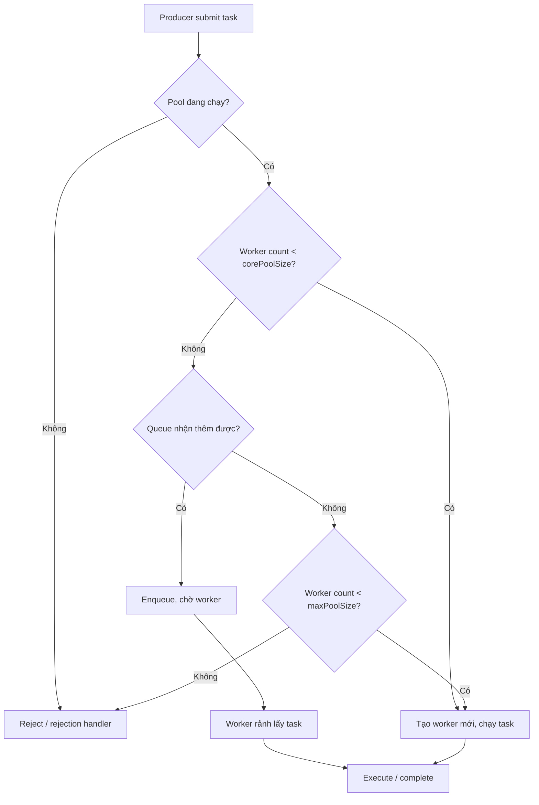
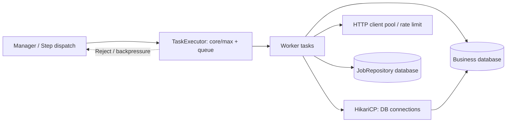

# Queue capacity của executor trong Spring Batch Scaling

## 1. Vì sao một hàng đợi executor có thể làm batch chậm hoặc quá tải?

Một job Spring Batch xử lý hàng triệu bản ghi và đã được thiết kế để chạy song song. Nhóm vận hành tăng `maxPoolSize` từ 8 lên 32 nhưng throughput gần như không đổi, trong khi thời gian chờ của chunk tăng dần. Một giả thuyết rất phổ biến: **executor đang có hàng đợi quá lớn**, khiến task mới được xếp hàng chứ không kích hoạt thêm thread.

Điều ngược lại cũng nguy hiểm. Nếu hàng đợi quá nhỏ trong khi tốc độ tạo task cao hơn tốc độ xử lý, executor bắt đầu **reject task**. Với batch, một lần reject có thể làm partition manager hoặc step thất bại, làm kéo dài khôi phục, và nếu chương trình tự gửi lại không kiểm soát thì có thể gây trùng nghiệp vụ.

**Queue capacity của executor** là số task **được phép nằm chờ trong hàng đợi nội bộ** của một thread pool, **không tính các task đang thực thi**. Đây là một giới hạn tài nguyên và một quyết định **backpressure**: khi downstream chưa theo kịp, hệ thống sẽ chấp nhận đợi thêm bao nhiêu công việc trước khi gây áp lực trở lại lên phía gửi?

Bài thuộc chương **Resource pool** của module `SPRING_BATCH_SCALING_OPERATIONS`. Mục tiêu module là mở rộng Spring Batch cho workload dữ liệu lớn qua multi-threaded step, parallel steps, partitioning và các mô hình xử lý phân tán phù hợp; đo bottleneck, giữ thread safety, retry/restart, vận hành job và chọn kiến trúc theo tài nguyên thực tế. Queue capacity tác động trực tiếp tới cả **throughput, latency, memory, connection pool, fairness và hành vi khi lỗi** của các mô hình ấy.

Sau bài này, bạn có thể:

1. Phân biệt `corePoolSize`, `maxPoolSize`, `queueCapacity`, `activeCount`, `queueSize` và rejection.
2. Giải thích chính xác cách `ThreadPoolTaskExecutor` chọn `LinkedBlockingQueue` hay `SynchronousQueue`.
3. Dự đoán khi nào pool tạo thêm thread, khi nào xếp task, khi nào từ chối công việc.
4. Cấu hình executor dành riêng cho Spring Batch 5.2 và phối hợp với `gridSize`, JDBC connection pool và khả năng downstream.
5. Ước lượng queue capacity để hấp thụ burst nhưng không che bottleneck dài hạn.
6. Kiểm thử quá tải, restart, mất worker và theo dõi những metric cần thiết trước khi tăng concurrency.

> **Phạm vi phiên bản:** ví dụ chính dùng **Spring Framework 6.x**, **Spring Batch 5.2.x**, **Spring Boot 3.x** và Java 17+. `ThreadPoolTaskExecutor` là executor thread pool cổ điển. `SimpleAsyncTaskExecutor`/virtual threads và những executor tùy biến khác có semantics khác; không mặc định áp dụng quy tắc queue dưới đây cho mọi implementation của `TaskExecutor`.

## 2. Mô hình: task chạy, task chờ, task bị từ chối

Xét một executor nhận liên tiếp các `Runnable`. Tại một thời điểm:

\[
N_{\mathrm{submitted}} =
N_{\mathrm{completed}} +
N_{\mathrm{running}} +
N_{\mathrm{queued}} +
N_{\mathrm{rejected}} +
N_{\mathrm{other}}
\]

Đây là **mô hình kiểm đếm**; `N_other` đại diện các task bị hủy, đang chuyển trạng thái hoặc chưa được theo dõi chính xác do race. Các metric runtime không nhất thiết cho một snapshot nguyên tử duy nhất của công thức.

Đối với `ThreadPoolTaskExecutor` dùng `ThreadPoolExecutor`:

- **Running tasks:** đang chiếm worker thread, giới hạn thực tế bởi `maxPoolSize`.
- **Queued tasks:** đã được chấp nhận nhưng chưa có thread bắt đầu chạy; bị giới hạn bởi `queueCapacity` nếu là queue hữu hạn.
- **Rejected submissions:** tại thời điểm gửi, pool và queue không thể nhận thêm task, hoặc executor đang shutdown. Cách phản ứng do `RejectedExecutionHandler` quyết định.

### 2.1. Dòng chảy của một task



Lưu đồ mô tả **quy tắc thông thường của `ThreadPoolExecutor.execute`**, lược bỏ một số tình huống race, shutdown và worker replacement:

1. Nếu số worker hiện có dưới `corePoolSize`, executor ưu tiên tạo worker mới.
2. Khi đã đạt core, nó **ưu tiên đưa task vào queue**.
3. **Chỉ khi không thể enqueue**, nó mới thử tạo thêm worker tới `maxPoolSize`.
4. Khi queue không nhận nữa và pool đã đạt max, task bị reject theo policy.

Đây là điểm mấu chốt: `queueCapacity` **thay đổi cả độ trễ lẫn thời điểm pool mở rộng số thread**. Nó không chỉ là dung lượng RAM dành cho các task.

### 2.2. Phân biệt queue task với chunk dữ liệu

Trong Spring Batch, một task của executor có thể là:

| Mô hình | Một executor task thường đại diện | Không nên nhầm với |
| --- | --- | --- |
| Multi-threaded step | Một lần thực thi tasklet/chunk iteration tùy cấu trúc step | Một item riêng lẻ |
| Parallel flows/steps | Một flow hoặc nhánh thực thi được giao cho task executor | Toàn bộ số row của flow |
| Local partitioning | Một yêu cầu chạy worker step cho một partition | Một chunk trong worker step |
| Remote partitioning | Có thể là tác vụ manager dispatch hoặc worker-pool nội bộ | Broker request queue/remote broker capacity |
| Remote chunking | Worker có thể dùng listener executor riêng, nhưng manager gửi `ChunkRequest` qua middleware | `queueCapacity` của JMS/AMQP broker |

Ví dụ một **local partition** có thể đọc 100.000 row và tạo hàng nghìn DB transactions. Một hàng đợi chứa 20 partition tasks **không có nghĩa** chỉ chứa 20 record hay 20 chunk.

## 3. `queueCapacity` của `ThreadPoolTaskExecutor` thật sự làm gì?

Theo API Spring Framework 6.x:

```java
ThreadPoolTaskExecutor executor = new ThreadPoolTaskExecutor();
executor.setCorePoolSize(4);
executor.setMaxPoolSize(8);
executor.setQueueCapacity(12);
executor.setKeepAliveSeconds(60);
executor.initialize();
```

`queueCapacity` mặc định của `ThreadPoolTaskExecutor` là **`Integer.MAX_VALUE`** nếu không cấu hình. Một giá trị **dương** sẽ chọn `LinkedBlockingQueue` có capacity đã khai báo; **0 hoặc số âm** dẫn đến `SynchronousQueue` (nên dùng **0** khi muốn cơ chế này để thể hiện ý định rõ).

| `queueCapacity` | Kiểu hàng đợi | Hành vi đáng chú ý | Phù hợp khi |
| --- | --- | --- | --- |
| `Integer.MAX_VALUE` (mặc định trực tiếp của class) | `LinkedBlockingQueue` gần như không giới hạn thực dụng | Sau khi đủ core threads, task tiếp tục chờ rất lâu; max threads hầu như không được tận dụng nếu queue chưa đầy | Chỉ khi producer được giới hạn chặt ở tầng khác và đã kiểm tra bộ nhớ/latency |
| Một số dương nhỏ, ví dụ `12` | `LinkedBlockingQueue` hữu hạn | Cho phép burst ngắn, nhưng queue phải đầy mới mở rộng từ core lên max | Batch có giới hạn backlog và có chính sách overload rõ |
| `0` | `SynchronousQueue`, **không lưu task chờ** | Task phải được handoff cho worker rảnh hoặc tạo thread tới max; nếu không thì reject | Muốn không tích backlog trong executor; upstream có admission/backpressure |

**Không đánh đồng `SynchronousQueue` với “executor synchronous”.** Với `queueCapacity=0`, task vẫn thường chạy **trên worker thread riêng**; queue không lưu chờ. Đó là direct handoff, không phải `SyncTaskExecutor` chạy cùng thread người gửi.

### 3.1. Ví dụ theo từng nhịp gửi task

Giả sử 24 tasks được submit gần như cùng lúc, mỗi task mất nhiều giây nên chưa task nào xong khi producer gửi liên tiếp. Pool dùng:

```text
corePoolSize = 4
maxPoolSize  = 8
queueCapacity = 12
rejectionPolicy = AbortPolicy (mặc định)
```

Trong mô hình lý tưởng không có task hoàn thành giữa các lần submit:

| Nhóm task | Kết quả |
| --- | --- |
| Task 1–4 | Tạo/chạy trên bốn core workers |
| Task 5–16 | Xếp vào queue, queue đạt 12 |
| Task 17–20 | Queue đầy → tăng worker từ 4 lên 8 |
| Task 21–24 | Queue vẫn đầy, workers đạt max → **reject** |

Với `queueCapacity=0` và cùng core/max, có thể chạy tới 8 tasks; task tiếp theo bị reject nếu không có worker nhận ngay. Với `queueCapacity=Integer.MAX_VALUE`, pool thường chỉ có 4 threads chạy và 20 tasks xếp hàng; `maxPoolSize=8` **không được sử dụng** vì queue chưa đầy.

**Lưu ý:** đây là mô phỏng theo thứ tự khái niệm. Trong thực tế worker có thể hoàn thành/lấy task giữa các lần submit, nên ngưỡng reject đo được phụ thuộc timing, tỷ lệ đến và thời gian xử lý.

### 3.2. Queue là backlog, không phải năng lực xử lý

Một hàng đợi dài giúp producer submit nhanh hơn **trong chốc lát**, nhưng không làm downstream xử lý item nhanh hơn. Nếu DB chỉ xử lý được 100 transactions/giây và producer tạo 250 transactions/giây liên tục, backlog tăng khoảng 150 tasks/giây cho đến khi queue đầy, tràn memory hoặc job không đáp ứng deadline.

Queue capacity giải quyết **độ dao động/burst**, không giải quyết **quá tải bền vững**. Điều trị dài hạn là giảm tốc độ producer, tăng năng lực thật của downstream nếu có thể, giảm work/item, thay đổi partitioning hoặc thiết kế admission có kiểm soát.

### 3.3. Queue là memory trong JVM

`LinkedBlockingQueue` giữ reference tới `Runnable`. Task có thể capture `StepExecution`, context, danh sách item, DTO, request metadata hoặc các object lớn. Vì vậy:

\[
M_{\mathrm{queued}} \approx N_{\mathrm{queued}} \times
M_{\mathrm{retained\ per\ task}}
\]

Nếu 20.000 tasks đang chờ, mỗi task giữ khoảng 120 KiB object sống, memory retained có thể xấp xỉ **2,3 GiB**, chưa kể queue nodes, overhead, worker stacks, thư viện và heap fragmentation. Đây là **ước lượng ngân sách**, không thay thế heap profiling.

Queue mặc định rất lớn không phải một biện pháp bảo vệ bộ nhớ. Nó còn có thể kéo dài thời gian GC và giữ những reference đã không còn phù hợp sau khi job bị cancel.

## 4. Các tham số liên quan: đừng chỉnh queue capacity một mình

| Tham số | Ý nghĩa | Ảnh hưởng tới queue |
| --- | --- | --- |
| `corePoolSize` | Số worker thread nền mà pool cố duy trì (trừ khi cho core timeout) | Dưới core, ưu tiên tạo thread thay vì enqueue |
| `maxPoolSize` | Trần số thread trong pool | Chỉ phát huy sau khi không enqueue được, với hàng đợi hữu hạn |
| `queueCapacity` | Số `Runnable` có thể chờ trong queue | Ảnh hưởng thời gian chờ, memory và mốc mở rộng thread |
| `keepAliveSeconds` | Thời gian idle của thread ngoài core trước khi có thể được thu hồi | Không đẩy task ra khỏi queue; tác động quy mô pool sau burst |
| `allowCoreThreadTimeOut` | Có cho core threads idle tự hết thời hạn không | Có thể làm pool co nhỏ, ảnh hưởng latency khởi động lại |
| `RejectedExecutionHandler` | Hành vi khi không thể nhận task | Quyết định fail fast, chạy trên caller hay làm mất công việc |
| `threadNamePrefix` | Nhận diện thread trong log/trace | Giúp phân biệt task của Batch với web/API executor |
| Shutdown policy | Ngừng nhận task và xử lý phần đang chạy/chờ | Có thể để lại những phần việc cần restart khi tiến trình dừng |

### 4.1. `maxPoolSize` không phải mục tiêu thread tự động

Đặt `corePoolSize=4`, `maxPoolSize=32`, `queueCapacity=100000` có thể dẫn đến chỉ **4 worker** chạy khi hệ thống backlog vài nghìn task. ThreadPoolExecutor thường ưu tiên queue, nên một giá trị `maxPoolSize` lớn **không tự tăng throughput**.

Nếu muốn nhiều task chạy song song thường trực, hãy chọn `corePoolSize` gần mức concurrency bình thường đã benchmark, rồi đặt `maxPoolSize` là trần ngắn hạn cho burst và queue capacity theo latency/memory budget. Nhưng **tăng core không giải quyết** bottleneck của DB, API hoặc disk.

### 4.2. `queueCapacity=0` không phải đáp án mặc định

`SynchronousQueue` không tích backlog, nhưng khi không có worker rảnh thì executor tăng thread tới `maxPoolSize` ngay. Nếu `maxPoolSize` không giới hạn, burst từ hàng nghìn partition/requests có thể tạo rất nhiều thread cùng lúc, dẫn tới:

- Chi phí stack/context switching, CPU và heap tăng mạnh.
- Tranh chấp connection pool, lock DB và downstream rate limit.
- `OutOfMemoryError` hoặc không tạo thêm được native thread.
- Deadline/retry storm và hiệu năng kém hơn tuần tự.

Nếu đặt `queueCapacity=0`, **luôn chọn max thread hợp lý**, admission/backpressure rõ và có đo load thực. Khi đã đạt max, hệ thống sẽ reject sớm thay vì che lỗi trong hàng đợi.

### 4.3. Queue hữu hạn lớn hơn 0 có thể ngăn pool tăng nhanh

Với core 4, max 12, queue 100, executor thường nhận 4 tasks chạy rồi **100 tasks chờ** trước khi tạo thread thứ năm nếu producer gửi liên tục. Một queue nhỏ (ví dụ 8 hoặc 16) có thể giúp worker pool mở rộng sớm, nhưng sẽ tăng khả năng reject khi upstream có burst.

Không có công thức “queue size = 2 × maxPoolSize” áp dụng mọi hệ thống. Mức phù hợp phụ thuộc thời gian task, burst profile, giới hạn downstream, mức chờ chấp nhận được, và số job cùng dùng pool.

### 4.4. Chính sách reject và tính đúng dữ liệu

`ThreadPoolTaskExecutor` mặc định sử dụng hành vi **abort/reject** theo cấu hình executor cơ sở. Spring có thể bọc lỗi rejection thành `TaskRejectedException`; với executor Java thuần có thể thấy `RejectedExecutionException`.

| Chính sách | Hành vi | Đánh giá cho Batch |
| --- | --- | --- |
| **AbortPolicy** | Ném exception khi queue + pool đã đầy | **Mặc định hợp lý:** fail fast để điều phối biết không nhận được việc |
| **CallerRunsPolicy** | Chạy task ngay trên **thread gọi `execute()`** nếu pool chưa shutdown | Có thể tạo backpressure, nhưng thay đổi execution context/latency; phải kiểm tra kỹ với manager, scheduler, transaction và listener |
| **DiscardPolicy** | Bỏ task âm thầm | **Không phù hợp** nếu công việc Batch cần xử lý đủ |
| **DiscardOldestPolicy** | Bỏ task cũ trong queue và thử lại task mới | **Nguy hiểm:** bỏ partition/chunk đang đợi, phá coverage |
| Custom handler | Ghi metric, block có timeout, reject hoặc retry có kiểm soát | Phải giữ contract của executor/framework và không gây deadlock |

**Rejection không đồng nghĩa “task đã thất bại trong worker”.** Nhiều khi task **chưa từng bắt đầu**. Với Spring Batch, phải để framework biết việc submit thất bại để trạng thái step/job phù hợp; không nuốt exception rồi đánh dấu công việc hoàn tất.

`CallerRunsPolicy` chỉ nên dùng khi bạn hiểu thread gửi task là ai. Nếu producer chính là manager step hoặc listener JMS, việc chạy công việc dài ngay trên thread đó có thể chặn dispatch, kéo dài ACK hoặc thay đổi các ThreadLocal/transaction assumptions. Nó không phải giải pháp mặc định để thay backpressure do framework điều phối.

### 4.5. Bounded queue không tự tạo backpressure upstream bền vững

Queue hữu hạn làm overload **hiện ra** qua rejection hoặc chính sách caller-runs. Nhưng muốn backpressure hoàn chỉnh, tầng tạo task cần có hợp đồng:

- **Chờ có giới hạn** hoặc tạm dừng tạo thêm partition/request khi đạt ngưỡng.
- **Truyền lỗi** về `JobExecution`/scheduler để retry/restart an toàn.
- **Không bỏ task im lặng**, không tạo một retry queue vô hạn bên ngoài executor.
- Gắn admission với `JobRepository`/message broker khi cần khôi phục.

Nếu muốn chặn producer bằng semaphore trước khi submit, số permit phải giới hạn **cả task đang chạy và đang chờ**, release đúng một lần ở completion/cancel/rejection, và không giữ lock/transaction quan trọng trong lúc chờ. Một semaphore tự viết sai có thể gây deadlock dù queue có capacity hữu hạn.

## 5. Spring Batch 5.2 dùng `TaskExecutor` ở đâu?

### 5.1. Multi-threaded step

Trong multi-threaded step, `StepBuilder.taskExecutor(...)` cho phép chunk/tasklet iteration được thực hiện với nhiều thread. Cần nhớ:

- `ItemReader` có state thường **không tự thread-safe**. `JdbcCursorItemReader`, `FlatFileItemReader` và checkpoint cần xem xét cách truy cập đồng thời.
- `ItemProcessor`/`ItemWriter` không được chia sẻ mutable state không đồng bộ giữa các chunk.
- `JobRepository`, DB pool và writer transaction có thể là bottleneck dù executor có nhiều threads.
- Trong Spring Batch **5.2**, `throttleLimit(int)` ở builder multithreaded step **đã deprecated từ 5.0**; tài liệu hướng tới custom `RepeatOperations` với executor có hàng đợi hữu hạn khi cần thay thế cơ chế throttling cũ.

**Chỉ đặt `queueCapacity` không đảm bảo số chunk in-flight bằng `maxPoolSize`.** Multi-threaded step còn có cơ chế điều phối repeat/throttle; các giới hạn hiệu lực phải được đo ở phiên bản/config thực tế, không suy ra từ executor bean.

Ví dụ cấu hình lược giản:

```java
@Bean
public Step concurrentImportStep(
        JobRepository jobRepository,
        PlatformTransactionManager transactionManager,
        @Qualifier("importReader") ItemReader<InputRow> reader,
        @Qualifier("importWriter") ItemWriter<InputRow> writer,
        @Qualifier("batchChunkExecutor") TaskExecutor executor) {

    return new StepBuilder("concurrentImportStep", jobRepository)
            .<InputRow, InputRow>chunk(100, transactionManager)
            .reader(reader)
            .writer(writer)
            .taskExecutor(executor)
            .build();
}
```

Đây là **một ví dụ về wiring**, giả định đã có các bean `InputRow`, reader/writer thread-safe và executor riêng. Không dùng nó để kết luận rằng `@StepScope` tự làm một reader dùng chung trở nên an toàn trước multi-threaded access; `@StepScope` tạo instance theo **StepExecution**, không phải theo từng thread trong cùng StepExecution.

### 5.2. Parallel steps/flows

Ở parallel flows, executor có thể nhận mỗi **flow** là một task. Một flow có thể chứa nhiều steps, mỗi step có transaction và thời gian khác nhau. Queue capacity ở đây giới hạn **số flow chờ**, không trực tiếp giới hạn số chunk hoặc kết nối DB mà flow có thể dùng.

Nếu một flow dài 30 phút chiếm một worker trong khi những flow ngắn đang xếp hàng, bạn có thể gặp **head-of-line blocking**: task ưu tiên ở sau phải chờ các task dài trước đó trong FIFO queue.

### 5.3. Local partitioning

`TaskExecutorPartitionHandler` thực thi worker steps trong cùng JVM bằng executor. Một partition thường tương ứng với **một `StepExecution` worker**, có `ExecutionContext` mô tả vùng dữ liệu.

`gridSize` là một đầu vào cho cơ chế phân chia/giao việc, thường gợi ý số partition; **nó không bằng `queueCapacity`**. Nếu partitioner thực tế trả 32 partition nhưng executor chỉ nhận được 16 task ở trạng thái peak, những lần submit tiếp theo có thể reject.

Hệ thống còn có transaction/reader/writer bên trong **mỗi partition**, nên số partition chạy song song ảnh hưởng trực tiếp connection pool và downstream. Đặt gridSize 32 không tự làm executor chạy đủ 32 threads; trong cấu hình core 4, max 8, queue 12, phần lớn partition có thể chờ.

### 5.4. Remote partitioning và remote chunking

Với remote partitioning, manager gửi `StepExecution`/request qua middleware; worker process có thread pools/container riêng. Với remote chunking, manager gửi `ChunkRequest` tới broker và worker consumer nhận chunk. Cần tách các lớp capacity:

| Lớp | Buffer/concurrency | Ai kiểm soát? |
| --- | --- | --- |
| Executor trong manager JVM | Runnable queue, core/max threads | `ThreadPoolTaskExecutor` của manager |
| Broker JMS/AMQP | Persistent request/reply backlog, prefetch/credit/unacked | Broker + listener/consumer config |
| Executor của worker JVM | Tasks chờ trong process worker | Worker executor/container |
| Business DB | Connections, lock wait, transaction throughput | Connection pool/DB |
| `JobRepository` | Metadata transactions/locks/connections | Batch infrastructure DB |

**`queueCapacity` của một `ThreadPoolTaskExecutor` không phải độ sâu queue của JMS**. Tăng nó không làm broker chứa thêm message một cách an toàn và không giải quyết reply mất/correlation sai. Ngược lại, prefetch broker cao có thể khiến worker giữ nhiều request nhưng chưa xử lý, dù executor queue nhìn còn ít task.

### 5.5. `throttleLimit` và `gridSize` không cùng ý nghĩa

| Thuộc tính | Bối cảnh | Vai trò |
| --- | --- | --- |
| `taskExecutor.corePoolSize` | Thread pool | Thread chạy nền trước khi enqueue |
| `taskExecutor.maxPoolSize` | Thread pool | Trần threads của pool |
| `taskExecutor.queueCapacity` | Thread pool | Tasks **chờ trong JVM** |
| `throttleLimit` (deprecated ở multi-threaded step 5.2) | Repeat/chunk step | Giới hạn điều phối chunk đồng thời theo cơ chế legacy |
| `gridSize` | Partitioning manager/handler | Kích thước phân chia/giao partition |
| Broker consumer concurrency | JMS/AMQP worker | Số delivery có thể xử lý đồng thời ở listener |
| DB connection pool `maximumPoolSize` | JDBC | Trần connections, **không phải** số threads |

Khi debug performance, phải đo **giới hạn nào đang đạt trần trước**, không tăng tất cả thuộc tính rồi chờ throughput tăng.

## 6. Thực hành: cấu hình executor cho local partitioning

Giả sử một batch xử lý 160.000 đơn hàng, chia thành 16 partition để khai thác tối đa 8 worker threads trong cùng JVM. Ta muốn:

- Không tạo quá 8 threads cho nhóm partition tasks.
- Không giữ quá 8 tasks chờ executor.
- Khi backlog đạt trần, **fail fast** thay vì bỏ việc hoặc mở thêm threads vô hạn.
- Tách pool Batch khỏi executor phục vụ web requests hoặc `@Async`.
- Dễ quan sát active threads, queue depth và rejected submissions.

### 6.1. Bean `ThreadPoolTaskExecutor` riêng

```java
package example.batch.scaling;

import java.util.concurrent.ThreadPoolExecutor;
import org.springframework.context.annotation.Bean;
import org.springframework.context.annotation.Configuration;
import org.springframework.scheduling.concurrent.ThreadPoolTaskExecutor;

@Configuration
public class PartitionExecutorConfig {

    @Bean(name = "partitionExecutor")
    public ThreadPoolTaskExecutor partitionExecutor() {
        ThreadPoolTaskExecutor pool = new ThreadPoolTaskExecutor();
        pool.setThreadNamePrefix("batch-partition-");
        pool.setCorePoolSize(4);
        pool.setMaxPoolSize(8);
        pool.setQueueCapacity(8);
        pool.setKeepAliveSeconds(60);
        pool.setRejectedExecutionHandler(
                new ThreadPoolExecutor.AbortPolicy());
        pool.setWaitForTasksToCompleteOnShutdown(true);
        pool.setAwaitTerminationSeconds(90);
        // Khi trả về @Bean, Spring gọi lifecycle initialization.
        // Với instance tạo thủ công ngoài Spring: gọi initialize().
        return pool;
    }
}
```

**Lưu ý:** `setWaitForTasksToCompleteOnShutdown(true)` và `setAwaitTerminationSeconds(90)` giúp **shutdown có kiểm soát hơn**, không bảo đảm một partition 30 phút chắc chắn xong trong 90 giây. Nếu process bị kill hoặc mất máy, các task chưa hoàn thành trong JVM vẫn mất; `JobRepository`/checkpoint và writer idempotent mới là nền tảng recovery.

Với core 4, max 8, queue 8 và một producer gửi task nhanh trong lúc worker chưa xong, executor có thể **nhận tối đa 16 tasks đồng thời ở trạng thái accepted** (8 đang chạy, 8 chờ). Đây là **giới hạn của riêng executor**, không phải bảo đảm job có đúng 16 partitions hoặc broker/DB chịu được 16 logical operations.

Vì queue được ưu tiên trước khi tăng thread quá core, một đợt submit 16 tasks có thể đi theo thứ tự 4 đang chạy → 8 đang queue → 4 threads mới chạy. Nếu yêu cầu 8 threads hoạt động từ đầu, cân nhắc `corePoolSize=8` với cùng `maxPoolSize=8`, nhưng đánh giá tác động lên DB pool và CPU.

### 6.2. Ghép executor vào `PartitionStep`

Giả sử có `Partitioner` và worker step tên `partitionWorkerStep`, đều được cấu hình trong cùng ứng dụng:

```java
package example.batch.scaling;

import org.springframework.batch.core.Step;
import org.springframework.batch.core.partition.support.Partitioner;
import org.springframework.batch.core.repository.JobRepository;
import org.springframework.batch.core.step.builder.StepBuilder;
import org.springframework.beans.factory.annotation.Qualifier;
import org.springframework.context.annotation.Bean;
import org.springframework.context.annotation.Configuration;
import org.springframework.core.task.TaskExecutor;

@Configuration
public class PartitionManagerConfig {

    @Bean
    public Step partitionManagerStep(
            JobRepository jobRepository,
            Partitioner orderRangePartitioner,
            @Qualifier("partitionWorkerStep") Step workerStep,
            @Qualifier("partitionExecutor") TaskExecutor executor) {

        return new StepBuilder("partitionManagerStep", jobRepository)
                .partitioner("partitionWorkerStep", orderRangePartitioner)
                .step(workerStep)
                .gridSize(16)
                .taskExecutor(executor)
                .build();
    }
}
```

`gridSize(16)` là đầu vào điều phối phân vùng; nếu `Partitioner` thực tế trả đúng 16 entries, 16 worker step tasks có thể được submit. **Đừng mặc định `gridSize=16` ép tất cả implementation của `Partitioner` phải tạo chính xác 16 partition**: map trả về có thể khác do miền dữ liệu rỗng, chiến lược cân bằng hoặc logic nghiệp vụ.

Nếu ứng dụng dùng `TaskExecutorPartitionHandler` trực tiếp, chỉ định cùng một executor, worker step và gridSize ở handler; **không đồng thời cấu hình hai partition handlers khác nhau** cho cùng manager step. Ví dụ tương đương:

```java
@Bean
public TaskExecutorPartitionHandler partitionHandler(
        @Qualifier("partitionExecutor") TaskExecutor executor,
        @Qualifier("partitionWorkerStep") Step workerStep) {
    TaskExecutorPartitionHandler handler =
            new TaskExecutorPartitionHandler();
    handler.setTaskExecutor(executor);
    handler.setStep(workerStep);
    handler.setGridSize(16);
    return handler;
}
```

Import của handler là `org.springframework.batch.core.partition.support.TaskExecutorPartitionHandler`. Nếu dùng bean handler này, manager step cấu hình `.partitioner(...).partitionHandler(partitionHandler).build()` thay cho `.step(...).gridSize(...).taskExecutor(...)`.

### 6.3. Ví dụ `Partitioner` tạo kế hoạch bất biến

Để bài thực hành tự chứa, dưới đây là một partitioner chia miền ID `[1,160001)` thành số khoảng liền kề:

```java
package example.batch.scaling;

import java.util.LinkedHashMap;
import java.util.Map;
import org.springframework.batch.core.partition.support.Partitioner;
import org.springframework.batch.item.ExecutionContext;
import org.springframework.context.annotation.Bean;
import org.springframework.context.annotation.Configuration;

@Configuration
public class OrderPartitionPlanConfig {

    @Bean
    public Partitioner orderRangePartitioner() {
        return gridSize -> {
            if (gridSize <= 0) {
                throw new IllegalArgumentException("gridSize must be > 0");
            }

            long start = 1L;
            long endExclusive = 160_001L;
            long total = endExclusive - start;
            int count = (int) Math.min(total, gridSize);
            long base = total / count;
            long remainder = total % count;

            Map<String, ExecutionContext> parts = new LinkedHashMap<>();
            long cursor = start;
            for (int i = 0; i < count; i++) {
                long size = base + (i < remainder ? 1 : 0);
                long next = cursor + size;
                ExecutionContext context = new ExecutionContext();
                context.putLong("startInclusive", cursor);
                context.putLong("endExclusive", next);
                context.putString("snapshotId", "orders-demo-v1");
                parts.put(String.format("partition%04d", i), context);
                cursor = next;
            }
            if (cursor != endExclusive) {
                throw new IllegalStateException("Partition coverage mismatch");
            }
            return parts;
        };
    }
}
```

Đây là **kế hoạch dữ liệu giả lập để học về queue capacity**. Trong production, cận ID và `snapshotId` phải lấy từ một **manifest/snapshot thực** đã chốt cho JobInstance, không hard-code để tạo cảm giác đã xử lý ổn định. Worker reader/writer cần dùng `startInclusive/endExclusive` của chính partition; không tự quét thêm dữ liệu khi queue rảnh.

Với `gridSize=16`, partitioner trả 16 scopes; mỗi scope dài 10.000 ID. **Số ID không bằng số bản ghi** nếu database có ID thưa hoặc nhiều tenant. Một task partition có thể mất lâu hơn task khác do skew; điều này làm queue latency biến động mạnh.

### 6.4. Chọn queue size và grid size có chủ đích

| Thông số | Giá trị thử nghiệm | Câu hỏi cần trả lời |
| --- | ---: | --- |
| Partitions phát ra | 16 | Có đủ việc để khai thác tối đa 8 worker không? |
| Core threads | 4 | Có muốn chạy ít thread trong tải bình thường không? |
| Max threads | 8 | DB/CPU có chịu nổi 8 partition đồng thời không? |
| Queue capacity | 8 | Có chấp nhận tối đa 8 partition đợi trong JVM không? |
| Connection pool DB của worker | 10–12 (ví dụ) | Mỗi partition đồng thời cần bao nhiêu connection? |
| JobRepository pool | Theo metadata write latency | Có thể cập nhật nhiều StepExecution đồng thời không? |
| Rejection handler | Abort/fail fast | Ai nhận lỗi submit và chọn retry/restart? |

Nếu cùng executor còn phục vụ job khác, **16 tasks của một job có thể không được chấp nhận hết**. Giới hạn này thuộc pool dùng chung, không có reserved capacity riêng cho mỗi job. Bởi vậy các batch lớn cần pool riêng theo nhóm workload hoặc admission controller công bằng.

**Không tăng `gridSize` chỉ để “cho queue đầy”** mà không xét số partition thực, DB transaction và tải metadata. Nếu muốn 100 partitions nhưng chỉ 8 đồng thời, có thể cần một tầng điều phối/bounded submission có thể tạm dừng khi pool đầy thay vì gửi tất cả 100 cùng lúc rồi bị reject.

### 6.5. Spring Boot property không tự cấu hình mọi executor

Nếu để **Spring Boot tự cấu hình task execution pool**, có thể dùng property (trên Boot 3.x khi auto-configured `ThreadPoolTaskExecutor` là implementation hiệu lực):

```yaml
spring:
  task:
    execution:
      pool:
        core-size: 4
        max-size: 8
        queue-capacity: 8
        keep-alive: 60s
```

Nhưng **`spring.task.execution.pool.queue-capacity` không tự chỉnh bean `partitionExecutor` tự định nghĩa ở mục 6.1**. Khi bạn tạo custom `TaskExecutor` và truyền trực tiếp vào `StepBuilder`, hãy cấu hình chính bean đó qua code hoặc một `@ConfigurationProperties` riêng.

Đừng nhầm **mặc định của class `ThreadPoolTaskExecutor`** (core 1, queue gần như vô hạn) với **mặc định pool do Spring Boot auto-configuration tạo** (có thể khác, ví dụ core 8 trong Boot 3.4). Và khi bật **virtual threads** bằng Spring Boot/Java 21+, Boot có thể chọn `SimpleAsyncTaskExecutor`; các property pool/queue truyền thống có thể **không có tác dụng**.

## 7. Sizing queue capacity bằng throughput, burst và latency

Không có magic number. Hãy đo:

- `λ(t)` (*arrival rate*): task được submit mỗi giây.
- `μ(t)` (*service rate*): số task hoàn thành mỗi giây ở cấu hình thread/downstream đã chọn.
- `L_q`: số task chờ trung bình.
- `W_q`: thời gian một task chờ trước khi bắt đầu.
- `S_p`: độ lớn/memory retained của task.
- `T_{\mathrm{deadline}}`: giới hạn chấp nhận được từ lúc tạo task tới lúc hoàn tất.

### 7.1. Hàng đợi tăng khi tốc độ đến vượt tốc độ xử lý

Ước lượng backlog trong khoảng burst:

\[
\Delta Q \approx
\max\left(0,\ \int_{t_0}^{t_1}
[\lambda(t)-\mu(t)]\,dt\right)
\]

Nếu producer submit **18 task/giây** nhưng toàn pool + DB chỉ hoàn tất **12 task/giây**, trong **10 giây** backlog có thể tăng khoảng:

\[
(18-12)\times 10 = 60\ \text{tasks}
\]

Một queue capacity 32 trong cấu hình ổn định này **sẽ đầy trước khi burst kết thúc** nếu không có thay đổi tốc độ hoặc thêm concurrency. Đó không nhất thiết là lỗi: nó có thể được thiết kế để **báo quá tải sớm** thay vì tích hàng trăm task không có SLA.

Trong thực tế `μ` có thể tăng khi executor mở thêm threads tới max, rồi giảm khi DB lock/connection contention tăng. Công thức chỉ là **mô hình sizing ban đầu**; hãy đo `queueSize` và completion rate thực tế trong load test.

### 7.2. Little's Law chỉ áp dụng khi hệ ổn định

Theo Little's Law:

\[
L_q \approx \lambda_{\mathrm{throughput}}\times W_q
\]

Trong hệ ổn định, nếu throughput khoảng **10 task/giây** và hàng đợi trung bình có **30 tasks**, thời gian chờ queue trung bình khoảng:

\[
W_q \approx 30/10 = 3\ \text{giây}
\]

Nếu SLA chờ là dưới 1 giây, queue dài như vậy **không thể được cứu chỉ bằng capacity lớn**. Cần giảm tốc độ producer, tăng năng lực service thật hoặc thiết kế ưu tiên/partitioning khác.

**Không áp dụng Little's Law như một lời hứa trong lúc overload không ổn định**, vì queue tăng mãi thì không có trạng thái cân bằng để lấy trung bình.

### 7.3. Tính ngân sách memory

Giả sử một task chờ giữ khoảng 300 KiB dữ liệu/references, queue capacity 500:

\[
M_q \approx 500 \times 300\ \mathrm{KiB}
\approx 146.5\ \mathrm{MiB}
\]

Cần dự phòng thêm:

- Queue nodes/`Runnable` wrappers, trace context, StepExecution objects.
- Heap cho reader/processor/writer, transaction buffers, cache, framework.
- Thread stacks và native memory, GC overhead, off-heap hoặc direct buffers.
- Những dữ liệu item mà task có thể tham chiếu tới; *reference* nhỏ nhưng **object graph retained** lớn.

Hãy đo heap retained size trong load test nếu task capture nhiều item. Đừng chọn capacity chỉ vì `500 × kích thước pointer` là nhỏ.

### 7.4. Queue lớn tác động tới deadline và fairness

Một task gửi khi queue đang có 100 tasks có thể phải chờ rất lâu, dù chưa hề bắt đầu. Các failure mode:

- **Head-of-line blocking:** partition dài giữ thread, partition ngắn đứng sau.
- **Stale work:** khi task được lấy khỏi queue, JobInstance/manifest có thể đã bị stop hoặc đổi epoch.
- **Deadline expiration:** công việc hết SLA ngay trong lúc chờ, không phải trong lúc process.
- **Tenant unfairness:** job/tenant lớn chiếm queue, job nhỏ bị chặn.

Các giải pháp có thể là dedicated pools theo workload/SLA, weighted/fair admission ở tầng cao hơn, chia partition hợp lý, timeout/cancellation check khi task bắt đầu và không nhận việc khi JobExecution đã bị stop. **Queue FIFO không tự bảo đảm fairness giữa job/tenant**.

## 8. Phối hợp executor với database pool và các giới hạn hạ tầng

Một Batch job thường sử dụng **nhiều resource pools** cùng lúc:



Nếu executor cho 32 worker tasks đồng thời nhưng HikariCP chỉ có 8 connections, tối đa khoảng 8 task **thực sự thao tác DB đồng thời** khi mỗi task cần một connection liên tục. Các worker còn lại có thể chiếm thread để chờ connection, làm `activeCount` cao và queue dần đầy. Tăng queue không giúp database xử lý nhanh hơn.

### 8.1. Đếm tổng concurrency trên nhiều JVM

Giả sử có 5 worker JVM, mỗi JVM cấu hình `maxPoolSize=8`:

\[
\text{Worker threads tối đa}
= 5 \times 8 = 40
\]

Nếu mỗi task có thể chiếm một business DB connection, concurrency cao nhất có thể gần **40 connections** chỉ từ nhóm này, chưa tính manager, JobRepository, dashboard và các ứng dụng khác. Một DB có `max_connections=50` không có nghĩa được sử dụng cả 50 connections cho Batch; phải trừ tài nguyên dành cho quản trị/replication/ứng dụng khác.

Nếu mỗi task có thể giữ **hai connections đồng thời** (ví dụ business DB và repository DB trong một đoạn code), ngân sách của **từng pool** phải tính theo dependency thực tế. Không dùng công thức “threads luôn bằng DB connections” một cách cứng nhắc: một task có thể không cần DB, cần nhiều connections hoặc release connection giữa chừng.

### 8.2. `queueCapacity` thấp hơn nhiều không gây giảm DB contention

Thí dụ 40 threads đều đang chờ lấy connection từ pool 8: dù `queueCapacity=0`, bạn vẫn đang có 40 **active but blocked threads**. Queue chỉ điều tiết số task chờ trước khi được thread nhận, **không trực tiếp giới hạn số thread đang giữ/chờ một tài nguyên khác**.

Để bảo vệ DB, cần đồng thời:

- Chọn `corePoolSize/maxPoolSize` phù hợp với **sức chịu của DB**.
- Cấu hình HikariCP `maximumPoolSize`, `connectionTimeout` và DB `max_connections` nhất quán.
- Tối ưu transaction duration, index, khóa và batch update.
- Hạn chế request tới external API/queue theo quota/rate limit riêng.
- Giữ metadata repository không bị nghẽn bởi quá nhiều `StepExecution` updates.

### 8.3. Quá nhiều partition nhỏ làm metadata thành bottleneck

Một partition step cần tạo và cập nhật `StepExecution`/`ExecutionContext`. Nếu tạo hàng chục nghìn partition cực nhỏ, chi phí metadata, transaction và scheduling có thể lớn hơn phần xử lý nghiệp vụ. Queue capacity chỉ chuyển phần chi phí đó sang thời điểm chờ, không làm nó biến mất.

Chọn partition granularity sao cho **mỗi task đủ việc để bù overhead**, nhưng không quá lớn khiến recovery chỉ còn vài partition rất nặng. Đo số partition/s, DB metadata lock wait, p95 task duration và skew để chọn grid/partitioner.

### 8.4. Không cho nhiều workload tranh một executor không kiểm soát

Nếu `@Async`, job nhỏ, job lớn và partition workers dùng chung executor, một job có thể chiếm hết queue capacity khiến job khác bị reject. Khi nhu cầu latency/fairness khác nhau, tạo **dedicated named executor** và gắn đúng bằng `@Qualifier`.

Đừng tự tạo hàng chục pools với tổng max threads vượt CPU/DB giới hạn. Dedicated pools là để **phân bổ ngân sách rõ**, không để nhân vô hạn tài nguyên.

## 9. Quan sát queue capacity trong production

### 9.1. Những chỉ số phải theo dõi

`ThreadPoolTaskExecutor` cung cấp các phương thức:

```java
int core = pool.getCorePoolSize();
int max = pool.getMaxPoolSize();
int current = pool.getPoolSize();
int active = pool.getActiveCount();
int queueSize = pool.getQueueSize();
int capacity = pool.getQueueCapacity();
```

Các metric quan trọng hơn **chỉ số `queueSize` đơn lẻ**:

| Metric | Mục đích | Dấu hiệu |
| --- | --- | --- |
| `queueSize` | Số tasks đang chờ | Tăng liên tục → producer nhanh hơn service |
| `queueSize/queueCapacity` | Mức sử dụng queue nếu capacity hữu hạn dương | Gần 100% lâu → cần backpressure hoặc tăng năng lực thật |
| `activeCount/poolSize` | Mức độ sử dụng worker hiện có | Active gần max nhưng throughput thấp → có thể bị block ở DB/API |
| `poolSize` so với `corePoolSize/maxPoolSize` | Thấy pool có mở rộng khi queue đầy không | Max lớn nhưng pool chỉ bằng core → queue quá dài hoặc không đủ backlog |
| **Task queue wait p95/p99** | Thời gian từ submit đến bắt đầu | SLA bị tiêu hao trước khi xử lý |
| **Task execution duration p95/p99** | Thời gian task chạy | Partition skew, DB slow hoặc retries |
| **Rejected submissions/s** | Overload thật hoặc executor shutdown | Phải có signal tới scheduler/step |
| **Completed tasks/s** | Năng lực service của pool | Không đồng nghĩa unique item/s |
| JDBC pool active/pending/timeout | Downstream đang nghẽn | Threads chờ DB dù executor có đủ capacity |
| JobRepository transaction latency | Metadata có là bottleneck không | Nhiều partition, checkpoint dày |
| Business unique commits/s | Throughput nghiệp vụ thực | Attempts cao nhưng unique commits thấp do replay |

`getQueueSize()` và `getActiveCount()` là **snapshot tức thời**, có race; không dùng để tính chính xác số item đã commit. Với `queueCapacity=0`, queue size thường 0 vì không lưu chờ, nhưng executor vẫn có thể **đang bão hòa/reject**; hãy quan sát active/max và rejection.

### 9.2. Ví dụ Micrometer Gauge

Spring Boot có thể cung cấp Micrometer/Actuator metrics cho executor theo tên bean và cách bind. Khi muốn đảm bảo có các gauge đặt tên rõ, có thể khai báo:

```java
import io.micrometer.core.instrument.Gauge;
import io.micrometer.core.instrument.MeterRegistry;
import org.springframework.beans.factory.annotation.Qualifier;
import org.springframework.context.annotation.Bean;
import org.springframework.context.annotation.Configuration;
import org.springframework.scheduling.concurrent.ThreadPoolTaskExecutor;

@Configuration
public class BatchExecutorMetricsConfig {

    @Bean
    public Object registerPartitionExecutorMetrics(
            MeterRegistry registry,
            @Qualifier("partitionExecutor") ThreadPoolTaskExecutor pool) {

        Gauge.builder("batch.partition.executor.queue.size",
                        pool, ThreadPoolTaskExecutor::getQueueSize)
                .register(registry);

        Gauge.builder("batch.partition.executor.active",
                        pool, ThreadPoolTaskExecutor::getActiveCount)
                .register(registry);

        Gauge.builder("batch.partition.executor.pool.size",
                        pool, ThreadPoolTaskExecutor::getPoolSize)
                .register(registry);

        return new Object(); // Bean chỉ để chạy registration một lần.
    }
}
```

Đây là cách **bổ sung gauge minh họa** khi đã có dependency Micrometer; không bắt buộc nếu ứng dụng dùng binder/Actuator đã tự thu thập những chỉ số cần thiết. Tránh đăng ký trùng meter name/tags nhiều lần khi context refresh. Rejected tasks cần **counter riêng hoặc meter binder có hỗ trợ**, vì `getQueueSize()` không cho biết số lần reject.

### 9.3. Ví dụ đếm rejection mà không nuốt lỗi

Thay policy ở bean executor bằng một handler vẫn **ném exception**:

```java
import java.util.concurrent.RejectedExecutionException;
import io.micrometer.core.instrument.Counter;

Counter rejects = Counter.builder("batch.partition.executor.rejected")
        .description("Tasks rejected by the partition executor")
        .register(meterRegistry);

pool.setRejectedExecutionHandler((task, executor) -> {
    rejects.increment();
    throw new RejectedExecutionException(
            "Partition executor capacity exhausted");
});
```

Đây là **đoạn thay thế trong cấu hình bean**, giả định `pool` và `meterRegistry` đã được inject; không phải một file Java độc lập. Khi ở tầng Spring `TaskExecutor`, exception có thể xuất hiện dưới dạng `TaskRejectedException`. Hãy để exception truyền đến nơi tạo task/Step, không log rồi coi task đã được chấp nhận.

### 9.4. Cảnh báo nên gắn với thời gian, không chỉ một đỉnh tức thời

Một queue đầy trong 100 ms khi job bắt đầu **có thể là burst hợp lệ**; queue ở mức 90–100% trong 10 phút cùng với p99 latency tăng và active/max đạt trần là dấu hiệu cần can thiệp. Mẫu cảnh báo:

- Queue utilization cao liên tục qua nhiều khoảng đo.
- `rejected tasks/s > 0` bất thường với workload đã được kiểm soát.
- Task wait p95/p99 vượt budget.
- Job throughput/unique commits/s giảm trong khi pool active cao.
- DB connection pending/timeout hoặc lock wait tăng cùng lúc.

Không auto-scale worker chỉ dựa vào queueSize. Nếu DB là bottleneck, auto-scale có thể làm sự cố nặng hơn.

## 10. Kiểm thử hành vi khi pool đầy

Một test unit đơn giản có thể **giữ các worker tasks bằng `CountDownLatch`**, sau đó submit thêm để quan sát queue và rejection. Không cần tạo database hay chạy job thật để kiểm tra quy tắc ThreadPoolExecutor.

### 10.1. JUnit test: queue hữu hạn + AbortPolicy

```java
import java.util.concurrent.CountDownLatch;
import java.util.concurrent.ThreadPoolExecutor;
import org.junit.jupiter.api.Test;
import org.springframework.core.task.TaskRejectedException;
import org.springframework.scheduling.concurrent.ThreadPoolTaskExecutor;

import static org.junit.jupiter.api.Assertions.*;

class PartitionExecutorCapacityTest {

    @Test
    void rejectsFifthTaskWhenThreeRunningAndOneQueued() {
        ThreadPoolTaskExecutor pool = new ThreadPoolTaskExecutor();
        pool.setCorePoolSize(2);
        pool.setMaxPoolSize(3);
        pool.setQueueCapacity(1);
        pool.setRejectedExecutionHandler(
                new ThreadPoolExecutor.AbortPolicy());
        pool.initialize();

        CountDownLatch release = new CountDownLatch(1);
        Runnable blockingTask = () -> {
            try {
                release.await();
            } catch (InterruptedException ex) {
                Thread.currentThread().interrupt();
            }
        };

        try {
            pool.execute(blockingTask); // running #1
            pool.execute(blockingTask); // running #2
            pool.execute(blockingTask); // queued #1
            pool.execute(blockingTask); // running #3 (pool grows)

            assertEquals(1, pool.getQueueSize());
            assertThrows(TaskRejectedException.class,
                    () -> pool.execute(blockingTask));
        } finally {
            release.countDown();
            pool.shutdown();
        }
    }
}
```

Trong test này, `release.await()` giữ các worker không hoàn tất, cho phép kiểm tra thứ tự 2 running → 1 queued → 3 running → rejected. Đây là **đặc tính của pool**, không chứng minh một Spring Batch `PartitionStep` sẽ luôn submit đúng bốn tasks trước khi worker nào hoàn tất.

### 10.2. Những test bổ sung

| Ca thử | Điều kiện | Kỳ vọng |
| --- | --- | --- |
| `queueCapacity=0` | Core 2, max 3, giữ ba tasks đang chạy | Task thứ tư bị reject; queueSize bằng 0 |
| Queue gần như vô hạn | Core 2, max 10, submit 100 tasks chậm | Pool thường giữ 2 threads chạy, các task còn lại chờ |
| Burst ngắn | Queue đủ giữ burst, downstream phục hồi nhanh | Queue tăng rồi về 0; p95 queue wait trong budget |
| Sustained overload | Arrival rate cao hơn service rate nhiều phút | Queue đầy, rejection/backpressure có thể quan sát; không OOM |
| Shared pool | Hai job gửi nhiều tasks cùng lúc | Có chính sách fairness/admission; không mất việc im lặng |
| DB pool nhỏ hơn worker threads | Nhiều task chờ JDBC connections | Pool active cao, JDBC pending tăng; tăng queue không giúp |
| Submit sau shutdown | Executor đã shutdown | Task bị từ chối thay vì nhận rồi mất |
| Worker crash/restart | Kill JVM khi queue còn tasks | Metadata/dispatcher khôi phục công việc, writer idempotent |
| Partition skew | Một partition rất dài và nhiều partition ngắn | Đo wait p99, không chỉ average throughput |

### 10.3. Test tích hợp Spring Batch phải có phép đối soát

Với một job local partitioning 16 partitions, chạy thử các bộ cấu hình:

| Kịch bản | Core | Max | Queue | Giả thuyết cần đo |
| --- | ---: | ---: | ---: | --- |
| A — Queue lớn | 4 | 8 | 1.000 | Pool khó tăng quá core; latency queue cao |
| B — Queue vừa | 4 | 8 | 8 | Worker có thể tăng lên 8 khi queue đầy; nhận tối đa khoảng 16 tasks tức thời |
| C — Direct handoff | 4 | 8 | 0 | Tăng threads nhanh, reject khi hết capacity |
| D — Core cao | 8 | 8 | 8 | 8 worker sẵn cho tasks, backlog tối đa 8 |

Ở mỗi kịch bản, đo `poolSize`, `activeCount`, `queueSize`, rejection, thời gian job hoàn tất, DB pool pending, unique records written và metadata state. Mỗi lần chạy cần dùng **cùng tập input/snapshot**, cùng DB workload profile và điều kiện benchmark gần nhau; nếu không, phép so không có giá trị.

**Một job thất bại vì rejection là test có ý nghĩa**, không phải lý do xóa status metadata rồi chạy lại bừa. Xác định task nào đã nhận, task nào không được nhận, transaction nào đã commit, sau đó sử dụng cơ chế restart đúng với writer idempotent.

## 11. Shutdown, cancel và restart: queue nội bộ không có độ bền

Một `ThreadPoolTaskExecutor` giữ các task chờ **trong RAM của JVM**. Nó không tương đương broker queue bền vững, JobRepository checkpoint hoặc task ledger.

```text
Manager/partition executor:

  RUNNING: partition0001, partition0002, ...
  WAITING: partition0009, partition0010, ...

JVM crash:
  RUNNING và WAITING trong pool đều mất khỏi RAM.
  Chỉ metadata đã persist, input manifest, DB commits và
  message broker bền (nếu có) còn để xác định recovery.
```

### 11.1. “Accepted” không phải “completed”

Một `execute(runnable)` trả về thành công chỉ nghĩa task **đã được nhận để chạy** theo contract hiện tại của executor. Nó có thể vẫn chờ, bị hủy khi shutdown, chết giữa transaction hoặc hoàn thành nhưng metadata chưa kịp cập nhật.

Với partitioning, trạng thái `StepExecution` và `ExecutionContext` được quản lý bởi Spring Batch. Với remote chunking, request/reply có semantics riêng ở broker. Không lưu `Runnable` vào một biến `acceptedCount` rồi coi đó là `WRITE_COUNT`.

### 11.2. Graceful shutdown chỉ giảm cửa sổ lỗi

Khi ứng dụng nhận tín hiệu shutdown, có thể:

1. **Ngừng tạo task mới** và từ chối lần submit mới.
2. Cho tasks đang chạy/chờ có một khoảng thời gian hoàn tất, nếu policy hỗ trợ.
3. Chờ các JDBC transactions đóng, message ACK/replies được xử lý theo ranh giới của từng component.
4. Persist `StepExecution`/context nếu bước xử lý đi tới mốc checkpoint an toàn.
5. Nếu hết deadline hoặc process bị kill, dùng **restart/reconciliation**, không giả định tất cả task đã xong.

`setWaitForTasksToCompleteOnShutdown(true)` không làm JVM queue thành một nơi lưu bền. `setAwaitTerminationSeconds(...)` đặt ngân sách chờ; khi orchestrator kill process sớm hơn ngân sách đó, tasks có thể bị cắt giữa chừng.

### 11.3. Không tăng queue size để “chống mất task”

Một hàng đợi 10.000 tasks có thể giữ công việc lâu hơn và **tăng lượng công việc chưa bắt đầu bị mất khi JVM crash**. Nếu yêu cầu task sống sót qua crash, cần dùng:

- JobRepository + partition plan/`StepExecution` và cách restart phù hợp;
- Persistent broker queue khi sử dụng remote messaging;
- Business operation ledger/manifest để đối soát;
- Idempotent writer để an toàn nếu task đã commit rồi được thực thi lại.

Queue capacity có mục đích **điều tiết bộ nhớ và áp lực thực thi**, không phải thay durability.

### 11.4. Stop job khi còn queue

Khi `JobOperator.stop(...)` hoặc một tín hiệu dừng được đưa ra, không phải mọi `Runnable` đang nằm trong executor queue tự biết phải dừng ngay. Một task chờ có thể được worker lấy sau thời điểm yêu cầu stop, tùy framework/lifecycle.

Đối với tác vụ nhạy cảm, kiểm tra `StepExecution`/execution state, deadline hoặc run epoch ở ranh giới bắt đầu xử lý và trước side effect. Tuy nhiên việc kiểm tra “job còn chạy” một lần **không thay fencing** nếu owner cũ vẫn có thể ghi sau chuyển vai trò.

## 12. Bảng chẩn đoán khi throughput hoặc latency bất thường

| Triệu chứng | Giả thuyết có thể | Kiểm tra và xử lý |
| --- | --- | --- |
| `maxPoolSize=32` nhưng `poolSize=4`, queue rất dài | Queue lớn khiến pool không tăng quá core | Kiểm tra queue capacity; tăng core hoặc chọn queue hữu hạn hợp lý sau benchmark |
| Queue thường ở 0 nhưng rejected tăng | `queueCapacity=0` hoặc shutdown; max threads đang đầy | Kiểm tra `activeCount/max`, policy, tốc độ submit |
| Queue luôn đầy, active threads rất thấp | Task bị kẹt submit/context hoặc executor shutdown, thiếu worker | Thread dump, status, rejection/error handler, deadlock |
| Pool active=8/8 nhưng DB throughput thấp | Tasks đang chờ connection/lock/API | Hikari pending, DB lock wait, transaction duration |
| Queue tăng liên tục sau khi tăng worker count | Downstream bị quá tải hơn trước | Giảm concurrency, đo throughput hữu ích/lock contention |
| Partition manager fail khi submit nhiều partition | Queue + max không đủ burst hoặc pool dùng chung | Bounded dispatch/admission, dedicated pool, fail fast và restart |
| `TaskRejectedException` chỉ xuất hiện cuối job | Queue đầy khi worker dài/không trả tài nguyên | Đo task duration/skew, leak/deadlock, saturation |
| Không thấy rejection nhưng JVM OOM | Queue vô hạn hoặc task giữ object graph lớn | Bounded capacity + heap profiling + admission |
| Restart có duplicate writes | Chunk/partition commit trước crash nhưng metadata lag | Idempotency và đối soát thay vì tăng queue |
| Job `COMPLETED` nhưng thiếu dữ liệu | Drop/DiscardPolicy, ack sớm, reader scope sai hoặc bug | Cấm silent discard; kiểm tra manifest/ledger và failure propagation |
| Một tenant nhỏ bị chờ lâu | Shared FIFO queue bị workload lớn chiếm | Dedicated pools/fair admission, quota theo tenant |
| Shutdown kéo dài nhưng vẫn mất công việc | Tasks chờ quá lâu, deadline kill hoặc repository không kịp cập nhật | Tối ưu stop/drain, checkpoint và recovery |
| CPU tăng nhưng throughput không tăng | Quá nhiều threads, context switch hoặc DB bottleneck | Hạ core/max, đo flame graph, pool/DB metrics |
| Spring Boot property đổi nhưng batch pool không đổi | Step dùng custom bean, không phải auto-configured executor | Đối chiếu bean `@Qualifier` thực sự được inject |

### 12.1. Quy trình điều tra theo thứ tự

1. Xác định **executor bean nào thật sự được Step/Handler dùng**: tên bean, qualifier, loại implementation, version Spring.
2. Đọc `corePoolSize/maxPoolSize/queueCapacity` và `RejectedExecutionHandler` của đúng bean đó.
3. Thu thập active/pool/queue/rejected + task wait/execute latency tại cùng thời gian.
4. Đối chiếu với `gridSize` hoặc repeat throttling của Spring Batch, số worker processes, consumer concurrency.
5. Đo downstream: JDBC pool, DB locks, JobRepository, API rate limit, disk/network.
6. Phân biệt **acceptance/rejection**, **attempts**, **business commits** và trạng thái restart.
7. Chạy benchmark A/B với input cố định trước khi thay concurrency/capacity.

Không “chữa” queue đầy bằng cách nâng từ 1.000 lên 1.000.000 tasks nếu throughput downstream không đổi. Cách đó chỉ trì hoãn thời điểm phát hiện quá tải và tăng heap footprint.

## 13. Những anti-pattern cần tránh

### 13.1. Dùng unbounded queue với `maxPoolSize` rất lớn

`core=4, max=100, queue=Integer.MAX_VALUE` **không thường xuyên chạy 100 threads**; phần lớn backlog bị giữ trong queue sau core. Nếu job đang chậm, tăng max tiếp không có tác dụng khi queue chưa đầy.

### 13.2. Dùng `queueCapacity=0` và max threads không giới hạn

`SynchronousQueue` khiến pool mở rộng nhanh, nhưng burst có thể tạo quá nhiều threads, làm nghẽn DB hoặc hết native memory. Chọn trần max rõ ràng và admission ở upstream.

### 13.3. Bỏ `TaskRejectedException` để “job không fail”

Ném rồi nuốt exception tại manager có thể khiến partition **chưa từng được chạy** nhưng job vẫn tiếp tục. Dùng `AbortPolicy`, fail minh bạch và hỗ trợ restart, hoặc một admission controller có chứng minh không bỏ mất việc.

### 13.4. Dùng `DiscardPolicy` cho công việc cần đủ dữ liệu

Một partition có thể bị bỏ mà không có lỗi ở producer. `JobRepository`/ledger khó chứng minh coverage nếu framework nghĩ đã submit mọi thứ. Không sử dụng chính sách **silent discard** cho công việc batch yêu cầu completeness.

### 13.5. Nhầm `gridSize` với `maxPoolSize`

`gridSize=64` là mức phân chia/giao việc, không đảm bảo có 64 thread. Nếu worker pool tối đa 8, nhiều partition sẽ chờ; nếu queue nhỏ, submit nhiều partition có thể bị reject. Hãy phân biệt **partition count, parallelism và backlog**.

### 13.6. Chỉ đo hàng đợi mà bỏ qua connection pool

Queue ngắn có thể vẫn đi kèm 40 threads đang **block trên JDBC** và zero throughput. Monitor cả connection pending, lock wait và unique commits/s.

### 13.7. Tạo một pool chung cho mọi loại việc

HTTP request/`@Async`/parallel flows và các job batch dài có thời gian chạy rất khác. Một queue chung dễ gây unfairness và chặn tasks quan trọng. Tách pool hợp lý nhưng phải có **ngân sách tài nguyên tổng**.

### 13.8. Thay đổi queue capacity runtime như đổi `maxPoolSize`

Trong `ThreadPoolTaskExecutor`, core/max/keep-alive có những cơ chế điều chỉnh runtime. `queueCapacity` được dùng để **tạo loại/cấu trúc queue khi executor khởi tạo**; chỉ gọi `setQueueCapacity(...)` sau đó không tự resize `LinkedBlockingQueue` đang chạy. Thay đổi capacity/queue type cần một **lifecycle/reconfiguration plan** phù hợp; không tự thay queue khi còn tasks.

### 13.9. Xem tasks đang queue là đã checkpoint bền

Khi JVM chết, tasks nằm trong memory queue mất. Việc từng `execute()` trả thành công không thay thế `StepExecution`, `ExecutionContext`, broker persistence hay operation ledger.

### 13.10. Tăng concurrency khi có deadlock/skew

Nếu nhiều worker cùng update một hot key, thêm threads làm lock contention tăng. Nếu một partition cực lớn, tăng queue không sửa được skew. Phải điều chỉnh partition key, data layout, indexing, transaction size và downstream capacity.

## 14. Checklist vận hành queue capacity của executor

- [ ] Xác định đúng implementation đang dùng: `ThreadPoolTaskExecutor`, custom executor, `SimpleAsyncTaskExecutor` hoặc virtual threads.
- [ ] Có **executor dành riêng** cho workload Batch khi cần isolation/fairness, không chỉ phụ thuộc global pool.
- [ ] `corePoolSize` dựa trên concurrency bình thường đã benchmark; không giữ core quá thấp vì queue quá lớn.
- [ ] `maxPoolSize` là trần thực tế theo CPU/DB/API, không để không giới hạn với `queueCapacity=0`.
- [ ] `queueCapacity` hữu hạn được chọn theo burst, queue wait SLA và memory budget.
- [ ] Hiểu thứ tự **core → queue → max → rejection** trong `ThreadPoolExecutor`.
- [ ] Rejection handler không bỏ tasks im lặng; mọi reject có metric/log/error flow rõ ràng.
- [ ] Nếu dùng `CallerRunsPolicy`, đã thử execution context, latency và deadlock trên caller thread.
- [ ] Phân biệt `gridSize`, legacy `throttleLimit` và executor queue size; không coi chúng là cùng một limit.
- [ ] Reader/processor/writer của multi-threaded step được đánh giá thread safety và restart correctness.
- [ ] Worker partition không tự mở rộng `ExecutionContext`/phạm vi khi rảnh.
- [ ] Số threads tổng trên mọi JVM khớp với ngân sách HikariCP/DB/downstream.
- [ ] Có metric `poolSize`, `activeCount`, `queueSize`, queue latency, rejection và unique business throughput.
- [ ] Thử burst ngắn, sustained overload, DB chậm, partition skew và nhiều job cùng submit.
- [ ] Có chính sách stop/graceful shutdown; không coi queue RAM là nơi lưu task bền.
- [ ] `JobRepository`/broker/idempotent writer bảo vệ replay/restart sau crash.
- [ ] Đã đo p95/p99 task wait và execution duration khi thay queue size, không chỉ average throughput.
- [ ] Runbook khi saturation xác định nguyên nhân trước khi tăng concurrency hoặc queue capacity.

## 15. Tổng kết

**`queueCapacity` của executor không phải “số việc xử lý song song”**. Nó là số task có thể **đợi** bên trong một thread pool. Với `ThreadPoolTaskExecutor`, nếu đã đạt `corePoolSize`, executor thường ưu tiên xếp hàng; **chỉ khi queue không nhận thêm** mới tăng worker tới `maxPoolSize`. Một queue quá lớn có thể làm max pool vô dụng và tích backlog trong heap; một queue quá nhỏ có thể dẫn đến rejection nếu không có admission/backpressure.

Khi dùng Spring Batch 5.2, hãy phân biệt queue của **task executor** với `gridSize` của partitioning, legacy throttling của multi-threaded step, JMS/AMQP broker queue và JDBC connection pool. Chọn capacity bằng số liệu **task arrival/service rate, memory, queue latency và downstream limits**; giám sát rejection và xác minh task được restart an toàn. **Tăng throughput bền vững không đến từ tích thêm công việc chờ**, mà đến từ hệ điều phối có giới hạn và một downstream thực sự đủ năng lực.

### Tài liệu tham khảo chính thức

- [Spring Framework 6.2 — ThreadPoolTaskExecutor API](https://docs.spring.io/spring-framework/docs/6.2.14/javadoc-api/org/springframework/scheduling/concurrent/ThreadPoolTaskExecutor.html) — `setQueueCapacity`, queue type, core/max, pool/queue metrics.
- [Java SE — ThreadPoolExecutor API](https://docs.oracle.com/en/java/javase/21/docs/api/java.base/java/util/concurrent/ThreadPoolExecutor.html) — thứ tự core → queue → max → rejection và các policy.
- [Spring Batch 5.2 — Scaling and Parallel Processing](https://docs.spring.io/spring-batch/reference/5.2/scalability.html) — multi-threaded step, parallel steps, local/remote partitioning.
- [Spring Batch 5.2 — AbstractTaskletStepBuilder API](https://www.springframework.org/spring-batch/docs/5.2.3/api/org/springframework/batch/core/step/builder/AbstractTaskletStepBuilder.html) — `taskExecutor`, `stepOperations` và deprecation `throttleLimit`.
- [Spring Batch 5.2 — TaskExecutorPartitionHandler API](https://docs.spring.io/spring-batch/docs/5.2.0/api/org/springframework/batch/core/partition/support/TaskExecutorPartitionHandler.html).
- [Spring Boot 3.4 — Task Execution and Scheduling](https://docs.spring.io/spring-boot/3.4/reference/features/task-execution-and-scheduling.html) — auto-configured executor, `spring.task.execution.pool.queue-capacity` và virtual threads.
- [Spring Framework — Task Execution and Scheduling](https://docs.spring.io/spring-framework/reference/integration/scheduling.html) — task execution và scheduling abstraction.
