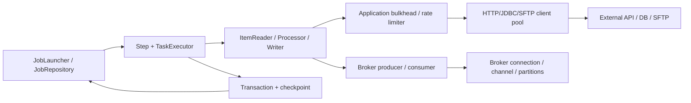
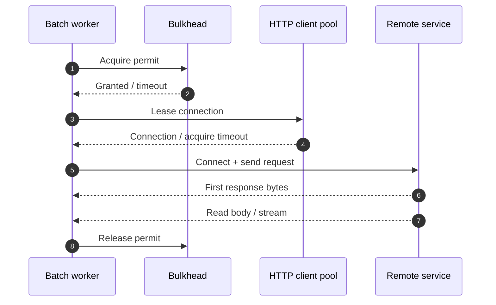
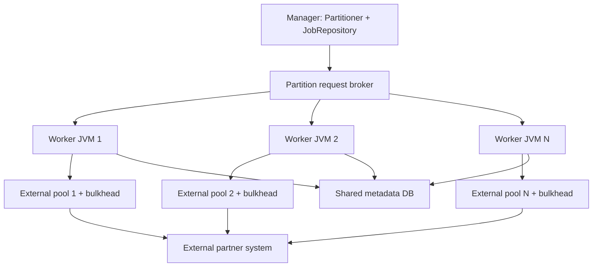

# Giới hạn connection đến hệ thống ngoài khi scale Spring Batch

Một Spring Batch job ban đầu dùng bốn thread và gọi API đối tác rất ổn định. Sau khi tăng lên 32 thread, job bắt đầu gặp `connection acquisition timeout`, HTTP `429`, `503`, lỗi `too many connections` ở database và những lần retry kéo dài. CPU của ứng dụng vẫn còn dư, nhưng thông lượng **item đã commit** lại giảm. Nguyên nhân thường không nằm ở số CPU: **tài nguyên của hệ thống ngoài có giới hạn**, còn concurrency của batch đang vượt ngân sách kết nối, request hoặc transaction mà hệ thống đó có thể phục vụ.

**Giới hạn connection đến hệ thống ngoài** là thiết kế số kết nối có thể mở, số lời gọi được phép đồng thời, hàng đợi chờ và lưu lượng tối đa theo endpoint/tenant trên **toàn bộ các JVM worker**. Trong Spring Batch, bài toán này xuất hiện khi `ItemReader`, `ItemProcessor`, `ItemWriter` gọi REST/gRPC, JDBC, SFTP, message broker hoặc dịch vụ lưu trữ.

Bài thuộc chương **Resource pool** của module **SPRING_BATCH_SCALING_OPERATIONS**, với bối cảnh mở rộng multi-threaded step, parallel steps, partitioning và các mô hình phân tán. Trọng tâm là đưa ra ngân sách tài nguyên đo được để vừa tăng tốc batch, vừa giữ **thread safety, retry/restart, idempotency và giới hạn SLA**. Các cấu hình dưới đây minh họa cho Java 17, Spring Batch 5.x và Spring Framework 6.x; cần xác nhận phiên bản dependency và đặc điểm hạ tầng thực tế trước khi áp dụng.

## 1. Bốn giới hạn phải phân biệt ngay từ đầu

Không nên gọi mọi rào cản là “connection limit”. Có ít nhất bốn khái niệm khác nhau:

| Giới hạn | Đơn vị | Ví dụ | Điều nó *không* đảm bảo |
| --- | --- | --- | --- |
| **Số connection** | TCP/JDBC/HTTP connection đang quản lý hoặc có thể mở | Tối đa 16 HTTP/1.1 connections tới một host | Không mặc nhiên giới hạn request/giây |
| **In-flight concurrency** | Lời gọi đang thực thi đồng thời | Tối đa 12 request API chưa hoàn tất | Không mặc nhiên khống chế tốc độ khi request rất nhanh |
| **Rate limit** | Lời gọi hoặc đơn vị công việc trên giây/phút | 200 requests/giây cho một API key | Không giới hạn connection giữ lâu nếu request chậm |
| **Queue/backlog** | Số tác vụ đang chờ tài nguyên | Tối đa 100 item đợi bulkhead | Không tạo thêm công suất upstream; chỉ hấp thụ burst hữu hạn |

Với một HTTP/1.1 client **đồng bộ**, mỗi connection thường phục vụ tối đa một request đang hoạt động tại một thời điểm; lúc ấy pool size gần với trần in-flight của client. Với HTTP/2 multiplexing, **một connection có thể chở nhiều request đồng thời**, nên giới hạn connection và giới hạn request phải được kiểm soát riêng. gRPC cũng có khái niệm stream multiplexing và flow control, không thể lấy TCP connection count làm toàn bộ ngân sách.

**Công thức thực hành:** Tách rõ:

- `C_conn` — số kết nối tối đa có thể mở.
- `C_inflight` — số operation đang thực hiện đồng thời.
- `Q_rate` — quota request/giây hoặc đơn vị/giây.
- `Q_wait` — số tác vụ được đợi có giới hạn.
- `T_deadline` — thời gian tối đa một attempt/operation được phép chiếm.

Một hệ thống ổn định cần cấu hình **đồng thời các giới hạn liên quan**, chứ không chỉ tăng `maximumPoolSize`.

## 2. Vì sao tăng thread không đồng nghĩa tăng thông lượng?

Giả sử 20 worker thread, mỗi item phải chờ 300 ms cho một API call. Nếu một thread chỉ thực hiện một lời gọi tại một thời điểm, thông lượng lý tưởng do latency giới hạn:

\[
R_{\mathrm{ideal}}\approx\frac{C_{\mathrm{inflight}}}{L}
\]

Trong đó `L` là latency trung bình tính bằng giây, chưa tính xử lý/queue/rollback.

Với `C_inflight = 20` và `L = 0,3` giây:

\[
R_{\mathrm{ideal}}\approx\frac{20}{0,3}\approx66,7\text{ requests/giây}
\]

Nếu API chỉ cho 50 requests/giây, tăng từ 20 lên 60 thread có thể làm nhiều request bị throttling hơn, phải retry nhiều hơn và thậm chí giảm thông lượng hữu ích. Nếu API chịu tối đa 8 request đồng thời, pool 20 connections cũng không giúp.

Một trần đơn giản cho hệ thống đồng bộ là:

\[
R_{\mathrm{useful}}\lesssim
\min\left(
\frac{C_{\mathrm{inflight}}}{L},
Q_{\mathrm{rate}},
R_{\mathrm{upstream\ capacity}}
\right)
\]

Công thức chỉ là **ước lượng công suất**, không phải cam kết SLA; P95/P99, transaction, batch windows và retry có thể làm kết quả thực thấp hơn.

## 3. Bản đồ tài nguyên từ một chunk tới hệ thống ngoài



Những điểm có thể tạo hàng chờ:

1. Task được chờ trong `TaskExecutor` khi worker pool bận.
2. Task đã chiếm worker thread nhưng đang đợi semaphore/bulkhead.
3. Client đang chờ HTTP connection hoặc JDBC connection.
4. Request đã đến hệ thống ngoài nhưng chờ thread pool/connection/lock của upstream.
5. Response đã về nhưng worker chờ ghi DB hoặc checkpoint.
6. Retry tạo lại nhiều attempt khi upstream vừa thất bại.

**Đừng đặt hàng đợi vô hạn ở nhiều tầng.** Nếu Executor queue, semaphore waiters, HTTP pending-acquire và broker đều cho phép backlog không giới hạn, hệ thống có thể hết heap hoặc trượt batch window trước khi thấy timeout.

## 4. Phân loại theo hệ thống ngoài

| Hệ thống | Tài nguyên phải giới hạn | Lỗi thường gặp |
| --- | --- | --- |
| REST HTTP/1.1 | Total/per-route connections, pending acquire, in-flight, requests/s | Pool exhausted, 429/503, connection reset |
| HTTP/2/gRPC | Connections, streams/in-flight RPCs, deadlines, per-service quota | Concurrent stream limit, flow control, deadline exceeded |
| RDBMS qua JDBC | Connections, active transactions, lock waits, query concurrency | Pool checkout timeout, too many clients, deadlock |
| SFTP/SSH | Sessions, channels, file handles, remote server max sessions | Session/channel closed, too many sessions |
| Kafka | Producer lifecycle, in-flight sends, buffer memory, partitions; consumer threads | Buffer exhaustion, timeout, lag; consumer not thread-safe |
| RabbitMQ/JMS | Connections, channels/sessions, consumer concurrency, prefetch, acknowledgments | Channel closed, unacked backlog, redelivery |
| Object storage/cloud API | HTTP connections/in-flight, quota, multipart concurrency | Throttling, socket/port exhaustion, retries |
| SaaS theo tenant | Quota theo API key/tenant, requests/s, concurrency toàn tenant | 429, quota exceeded, tài khoản bị throttle |

Một kết nối vật lý không tương đương một “slot công việc” ở mọi loại client. Chẳng hạn `KafkaProducer` thường hỗ trợ gọi từ nhiều thread và quản lý IO/buffering nội bộ, trong khi `KafkaConsumer` không thread-safe để chia sẻ tùy tiện; `JMS Session` cũng không nên dùng chung không kiểm soát giữa nhiều thread. Cần theo contract của từng driver/broker.

## 5. Ngân sách kết nối phải tính trên toàn cluster

Giả sử API cho tối đa **120 HTTP/1.1 connections** từ hệ thống của bạn. Có 6 pod, mỗi pod cấu hình HTTP client `maxConnPerRoute=20`:

\[
C_{\mathrm{total,configured}}\le6\times20=120
\]

Nếu HPA scale thành 10 pod mà giữ cấu hình, tổng trần thành **200**, vượt ngân sách. Chưa tính pod canary khi rolling deployment, scheduler riêng hoặc job khác cùng dùng API.

| Nhóm ứng dụng | Số JVM | Per-route max/JVM | Trần lý thuyết |
| --- | ---: | ---: | ---: |
| Batch manager gọi API | 2 | 10 | 20 |
| Partition workers | 8 | 12 | 96 |
| Canary/rolling pods | 2 | 12 | 24 |
| **Tổng** | **12** | | **140** |

Nếu upstream cho 120 connection, cấu hình trên đã có khả năng vượt trần. **Trần không phải số connections luôn đang mở**: pool có thể tạo connection theo nhu cầu và đóng idle connections. Tuy vậy, phải lập ngân sách theo tình huống tải cực đại chứ không chỉ snapshot trung bình.

Công thức cần kiểm tra:

\[
C_{\mathrm{configured,cluster}}=
\sum_{i=1}^{n}\left(
\mathrm{replicas}_{i}\times
C_{\mathrm{perInstance},i}
\right)
\]

Với giới hạn **đồng thời toàn API key** chứ không phải riêng mỗi client, per-pod semaphore/pool **không thể tạo hard cap toàn cụm** nếu autoscale thay đổi. Khi ấy phải dùng distributed rate limiter/bulkhead, service gateway có quota chung, hoặc giới hạn replica và concurrency theo policy vận hành.

## 6. Số connection, số thread và partition không nhất thiết bằng nhau

Một ví dụ local partitioning:

- `gridSize=40`, partitioner tạo 40 partition.
- `ThreadPoolTaskExecutor` cho tối đa 8 partition chạy đồng thời.
- Mỗi partition xử lý chunk tuần tự và gọi một API đồng bộ.
- HTTP pool cho tối đa 6 connection đến endpoint này.

Số request đồng thời khả dĩ sẽ bị ràng buộc bởi **6 HTTP connections** (trong trường hợp một request hoạt động/connection), không phải 40 partition hay 8 thread. Hai thread có thể phải **đợi acquire** trong khi đang giữ slot executor.

Trong remote partitioning, `gridSize` tạo các phần việc; tổng worker concurrency lại phụ thuộc worker instances và executor của từng worker. HTTP pool 6/worker trên 20 workers có thể tạo trần 120 request đồng thời, chứ không phải 6 của toàn job.

Trong remote chunking, manager đọc và chuyển `ChunkRequest`; worker xử lý chunk. Concurrency chịu cả **in-flight chunks, worker consumers và HTTP pool**, không thể chỉ đặt `gridSize` như local partitioning để áp một giới hạn toàn cụm.

## 7. Dùng connection pool HTTP thay vì tạo client mỗi item

Anti-pattern:

```java
// PHẢN VÍ DỤ: tạo HTTP client/network resources liên tục theo từng item.
@Override
public Output process(Input item) {
    RestClient client = RestClient.create(
            "https://partner.example.invalid");
    return callPartner(client, item);
}
```

Đoạn này không nên là chiến lược quản lý HTTP pool cho workload lớn. Tùy request factory/client mặc định, bạn có thể không nhận được pooling/connection limit có chủ đích và khó theo dõi tài nguyên, timeout hoặc reuse.

**Thiết kế phù hợp hơn:** Tạo **một client đã cấu hình pool** trong Spring context, inject vào processor/writer; đặt giới hạn tổng/per-route, connection request timeout, connect timeout và response timeout. Một client thread-safe có thể được dùng bởi nhiều worker threads theo contract của implementation.

**Không bắt buộc một client cho toàn application:** Có thể cần **pool riêng theo upstream quan trọng** để một service chậm không chiếm hết connection của service khác. Tuy nhiên quá nhiều pool riêng cũng làm tổng sockets, FD và TLS sessions tăng; đo trước khi tách.

## 8. Ví dụ Spring Framework 6.x + Apache HttpClient 5: pool HTTP/1.1 có giới hạn

Ví dụ dưới đây minh họa client đồng bộ cho `RestClient` với Apache HttpClient 5. Cần dependency `httpclient5` tương thích Spring Framework 6.x. Đây là *outbound client*, không liên quan tới JDBC `JobRepository`.

```java
import org.apache.hc.client5.http.config.ConnectionConfig;
import org.apache.hc.client5.http.config.RequestConfig;
import org.apache.hc.client5.http.impl.classic.CloseableHttpClient;
import org.apache.hc.client5.http.impl.classic.HttpClients;
import org.apache.hc.client5.http.impl.io.PoolingHttpClientConnectionManager;
import org.apache.hc.client5.http.impl.io.PoolingHttpClientConnectionManagerBuilder;
import org.apache.hc.core5.util.TimeValue;
import org.apache.hc.core5.util.Timeout;
import org.springframework.beans.factory.annotation.Qualifier;
import org.springframework.context.annotation.Bean;
import org.springframework.context.annotation.Configuration;
import org.springframework.http.client.HttpComponentsClientHttpRequestFactory;
import org.springframework.web.client.RestClient;

@Configuration
public class PartnerHttpPoolConfiguration {

    // HttpClient sở hữu và đóng manager; không đóng manager hai lần.
    @Bean(name = "partnerConnectionManager", destroyMethod = "")
    public PoolingHttpClientConnectionManager partnerConnectionManager() {
        ConnectionConfig connectionConfig = ConnectionConfig.custom()
                .setConnectTimeout(Timeout.ofSeconds(2))
                .build();

        return PoolingHttpClientConnectionManagerBuilder.create()
                .setMaxConnTotal(32)
                .setMaxConnPerRoute(16)
                .setDefaultConnectionConfig(connectionConfig)
                .build();
    }

    @Bean(name = "partnerHttpClient", destroyMethod = "close")
    public CloseableHttpClient partnerHttpClient(
            @Qualifier("partnerConnectionManager")
            PoolingHttpClientConnectionManager manager) {

        RequestConfig requestConfig = RequestConfig.custom()
                .setConnectionRequestTimeout(Timeout.ofMilliseconds(500))
                .setResponseTimeout(Timeout.ofSeconds(3))
                .build();

        return HttpClients.custom()
                .setConnectionManager(manager)
                // HttpClient đóng manager khi bean client bị hủy.
                .setDefaultRequestConfig(requestConfig)
                .disableAutomaticRetries()
                .evictExpiredConnections()
                .evictIdleConnections(TimeValue.ofSeconds(30))
                .build();
    }

    @Bean
    public RestClient partnerRestClient(
            @Qualifier("partnerHttpClient")
            CloseableHttpClient client) {

        return RestClient.builder()
                .baseUrl("https://partner.example.invalid")
                .requestFactory(
                    new HttpComponentsClientHttpRequestFactory(client))
                .build();
    }
}
```

**Những giới hạn thực sự được đặt:**

- `setMaxConnTotal(32)`: tối đa 32 connections trong manager cho **tất cả routes** mà manager quản lý.
- `setMaxConnPerRoute(16)`: tối đa 16 connections cho **một route** (đường đến endpoint theo semantics của HttpClient, có thể liên quan proxy/target host).
- `setConnectionRequestTimeout(500 ms)`: thời gian chờ mượn connection từ manager; hết hạn thì fail thay vì chờ vô hạn.
- `setConnectTimeout(2s)`: giới hạn giai đoạn thiết lập kết nối, theo transport implementation.
- `setResponseTimeout(3s)`: giới hạn response/read inactivity theo cơ chế client; **không phải total end-to-end deadline tuyệt đối** cho mọi request.
- `disableAutomaticRetries()`: giảm tình trạng HTTP client tự thử lại ẩn ở tầng dưới nếu Spring Batch cũng retry.
- `evictIdleConnections(...)`/`evictExpiredConnections()` hỗ trợ loại connection không nên giữ mãi; cần giám sát churn/TLS overhead khi hạ idle TTL.

**Điểm vận hành:** Manager là bean riêng để quan sát metrics, nhưng **HttpClient sở hữu và đóng manager** khi bean client bị hủy; `destroyMethod = ""` ở manager ngăn Spring tự suy diễn thêm một lần đóng độc lập. Không bật `setConnectionManagerShared(true)` ở mẫu này: với connection manager dùng chung, các lựa chọn tự động `evictExpiredConnections()` và `evictIdleConnections(...)` của HttpClientBuilder có thể không có hiệu lực. Nếu hệ thống thực sự cần manager dùng chung giữa nhiều HttpClient, phải thiết kế riêng tác vụ eviction và lifecycle của manager theo API phiên bản đang dùng.

Các ví dụ dùng địa chỉ `.invalid` có chủ ý; phải thay bằng URL, DNS, TLS và policy egress thực trong môi trường triển khai.

## 9. Đặt thêm in-flight bulkhead: connection pool chưa đủ

Ngay cả khi HTTP pool đặt max 16, một task có thể chiếm thread và chờ connection. Với upstream nhạy cảm, nên đặt **bulkhead semaphore** ở tầng trước HTTP để chỉ cho phép số operation hợp lý đi vào client.

Ví dụ một service cho tối đa 12 request đồng thời **trong mỗi JVM**:

```java
import java.util.concurrent.Semaphore;
import java.util.concurrent.TimeUnit;

import org.springframework.context.annotation.Bean;

@Bean
public Semaphore partnerBulkhead() {
    return new Semaphore(12, true);
}
```

Sử dụng ở gateway:

```java
import java.util.concurrent.Semaphore;
import java.util.concurrent.TimeUnit;
import org.springframework.web.client.RestClient;

record PartnerProfile(String tier) {}

class PartnerCapacityException extends RuntimeException {
    PartnerCapacityException(String message) {
        super(message);
    }
}

public final class PartnerGateway {
    private final RestClient client;
    private final Semaphore gate;

    public PartnerGateway(RestClient client, Semaphore gate) {
        this.client = client;
        this.gate = gate;
    }

    public PartnerProfile loadProfile(String customerId) {
        boolean acquired;
        try {
            acquired = gate.tryAcquire(300, TimeUnit.MILLISECONDS);
        } catch (InterruptedException ex) {
            Thread.currentThread().interrupt();
            throw new PartnerCapacityException("Worker interrupted");
        }

        if (!acquired) {
            throw new PartnerCapacityException(
                "Partner in-flight budget exhausted");
        }

        try {
            PartnerProfile profile = client.get()
                    .uri("/v1/customers/{id}/profile", customerId)
                    .retrieve()
                    .body(PartnerProfile.class);

            if (profile == null) {
                throw new IllegalStateException("Empty partner response");
            }
            return profile;
        } finally {
            gate.release();
        }
    }
}
```

**Tính chất của ví dụ:**

- Semaphore được inject như **singleton trong Spring context**, không tạo mới cho từng item.
- Mọi đường gọi cùng upstream phải đi qua gateway này thì giới hạn mới có ý nghĩa; code khác bypass gateway vẫn có thể tạo request.
- Permit được giữ từ trước request đến lúc body được đọc xong; `finally` bảo đảm release cả khi exception.
- `tryAcquire(300 ms)` tránh giữ thread chờ vô hạn. Khi không có permit, application cần policy fail nhanh/backoff/delay/requeue phù hợp, không vội retry ngay 100 lần.
- Semaphore đặt trước HTTP pool giúp hạn chế số task cùng tranh connection.
- Giới hạn **12/JVM không phải 12/toàn cluster**. Với 10 worker JVM, trần hoạt động có thể lên đến 120.
- Semaphore chỉ giới hạn concurrency của code path này, **không giới hạn requests/s** nếu một request hoàn tất rất nhanh.

**Lưu ý transaction:** Nếu processor được gọi *bên trong chunk transaction*, thời gian chờ semaphore và HTTP response có thể kéo dài transaction/giữ tài nguyên đã checkout từ DB. Với API chậm, cân nhắc tách giai đoạn enrichment và write, dùng staging hoặc transaction boundary thích hợp; không mặc định giữ lock DB trong lúc chờ tài nguyên ngoài.

## 10. Rate limit toàn cụm khác bulkhead tại JVM

Giả sử API của đối tác giới hạn **500 requests/s cho một API key**, còn 10 worker JVM có 12 in-flight calls mỗi JVM. Nếu thời gian phục vụ là 50 ms, trong mô hình lý tưởng:

\[
R\approx\frac{10\times12}{0,05}
=2.400\text{ requests/s}
\]

Như vậy **bulkhead không tự bảo vệ quota 500 rps**. Cần một token bucket/leaky bucket hoặc distributed rate limiter áp dụng trên **tổng các worker dùng API key**.

Một bảng quyết định:

| Ràng buộc upstream | Giải pháp chủ đạo |
| --- | --- |
| Tối đa 100 TCP connections | Limit per-route/pool + budget cluster |
| Tối đa 20 concurrent operations | Bulkhead/in-flight gate; distributed nếu quota toàn cụm |
| Tối đa 500 requests/s toàn account | Distributed rate limiter/token bucket |
| Burst 1.000 nhưng trung bình 200 rps | Rate limiter có burst capacity theo contract |
| Một tenant dùng hết quota tenant khác | Rate limit/bulkhead theo tenant, kèm mức tổng |
| Upstream lỗi kéo dài | Circuit breaker, fail-fast, retry có backoff |
| Hàng đợi lớn vượt batch window | Backpressure, bounded queue và deadline |

Giải pháp phân tán có thể đặt ở API gateway, dedicated rate-limit service hoặc kho shared-state với thao tác atomic. Phải xử lý **lease timeout, node crash, đồng hồ, availability và fail-open/fail-closed**; một counter Redis không atomic không phải rate limiter an toàn.

Không nên đặt rate limiter phân tán chỉ khi thực sự cần: nếu tổng concurrency được điều phối bởi một manager duy nhất và quota đơn giản, giới hạn tại manager có thể đủ. Nhưng với remote workers độc lập, autoscale và nhiều job cùng key, cần guardrail cấp cụm.

## 11. Bounded TaskExecutor: giới hạn việc đang thực thi và đang chờ

Tạo HTTP pool có giới hạn nhưng task executor cho phép hàng nghìn thread hoặc queue vô hạn sẽ làm hệ thống bị nghẽn ở chỗ khác.

Ví dụ executor bounded cho partition workers:

```java
import org.springframework.context.annotation.Bean;
import org.springframework.core.task.TaskExecutor;
import org.springframework.scheduling.concurrent.ThreadPoolTaskExecutor;

@Bean(name = "partitionExecutor")
public TaskExecutor partitionExecutor() {
    ThreadPoolTaskExecutor executor = new ThreadPoolTaskExecutor();
    executor.setCorePoolSize(6);
    executor.setMaxPoolSize(12);
    executor.setQueueCapacity(24);
    executor.setThreadNamePrefix("partner-partition-");
    executor.initialize();
    return executor;
}
```

Cần hiểu:

- Tối đa **12 threads** đang xử lý khi executor thực sự mở rộng tới max.
- Queue có sức chứa **24 tasks** chờ; cách executor ưu tiên queue trước mở thêm threads phụ thuộc ThreadPoolExecutor semantics.
- Khi cả queue và active threads đều đầy, task có thể bị **reject** theo policy của executor. Phải xử lý failure/backpressure, không ném mất partition và coi là thành công.
- Nếu mỗi active worker có thể thực hiện một HTTP call đồng bộ, 12 thread phù hợp với semaphore 12; nhưng không chứng minh downstream chấp nhận 12 in-flight.
- Một pool **cố định** và queue nhỏ có thể dễ dự đoán hơn pool tăng co cho batch deadline nghiêm ngặt; cần benchmark.

Với Spring Batch local partitioning, có thể dùng executor qua `.taskExecutor(partitionExecutor)` của partition manager step. `gridSize` gợi ý số partition được tạo, **không thay thế** giới hạn thread active của executor. Khi dùng multi-threaded chunk step, cũng cần xác minh giới hạn concurrency và thread safety của reader/writer.

## 12. Timeouts phải tách theo từng giai đoạn

Một HTTP call có thể chậm ở nhiều nơi:



| Timeout | Bảo vệ | Không thay thế |
| --- | --- | --- |
| Semaphore acquire timeout | Chờ in-flight permit quá lâu | HTTP connection wait |
| Pool connection-request timeout | Chờ lấy HTTP/JDBC connection | TCP connect timeout |
| TCP connect timeout | Không thiết lập được kết nối trong thời gian quy định | Response/read timeout |
| Response/read timeout | Response/đọc không tiến triển đúng deadline của client | Total request deadline tuyệt đối |
| Total operation deadline | Tổng budget của một attempt hoặc item | Việc xử lý side effect không xác định sau timeout |
| Chunk/job deadline | Giới hạn batch window toàn bước/job | Idempotency/restart policy |

Nếu connection lease timeout là 500 ms, connect timeout 2 giây, response timeout 3 giây, **không nên cộng cứng thành “mỗi request tối đa 5,5 giây”** vì client, DNS, TLS, redirect, streaming và thời gian response có thể có semantics khác. Dùng total deadline/cancellation khi nghiệp vụ yêu cầu một trần end-to-end thật sự.

Một lời gọi timeout **không chứng minh upstream chưa xử lý request**. Với POST có side effect, phải dùng operation ID/idempotency/reconciliation trước replay.

## 13. Connection reuse, idle TTL, maxLifetime và TLS

Pool không chỉ giới hạn số connection; nó còn giúp **tái sử dụng** connection để giảm TCP handshake, TLS và chi phí xác thực.

Điều cần cân bằng:

- **Idle timeout/eviction:** Loại connection ít dùng lâu ngày; đặt quá thấp sẽ tăng reconnect/TLS churn.
- **Maximum lifetime:** Tránh giữ connection quá già khi LB/proxy/DB chủ động cắt; không cho phép một connection chết nằm trong pool mãi.
- **Keepalive:** Tùy giao thức/client, giúp phát hiện connection không còn hợp lệ; không thay thế timeout của request.
- **DNS/cache/load balancing:** Pool có thể giữ connection tới backend cũ sau thay đổi DNS/failover; cần TTL và policy phù hợp.
- **File descriptors và ephemeral ports:** Tạo/đóng connection liên tục có thể làm tăng `TIME_WAIT` và tiêu thụ NAT/SNAT ports.
- **TLS handshake và chứng chỉ:** Connection mới có chi phí CPU/latency; không tắt xác minh TLS để “tăng tốc”.

Với JDBC HikariCP, `maxLifetime`, `idleTimeout`, `minimumIdle` và `keepaliveTime` có semantics riêng. Với Apache HttpClient, lifetime/idle eviction thuộc connection manager/client. **Không copy nguyên giá trị TTL giữa các công nghệ** mà chưa biết server/LB timeout.

Nếu log cho thấy tăng `connection reset by peer` sau khoảng idle dài, hãy kiểm tra cấu hình keepalive/idle eviction của proxy và client trước khi tăng retryLimit.

## 14. JDBC DataSource cho hệ thống ngoài: phân biệt với JobRepository

Nhiều batch job đọc dữ liệu từ **database đối tác** và ghi vào **database nghiệp vụ**. Đồng thời JobRepository dùng database metadata. Nên phân biệt rõ **ba nguồn connection**:

```text
Batch JobRepository -> metadata DataSource / metadata pool
ItemReader          -> source DataSource   / source pool
ItemWriter          -> target DataSource   / target pool
```

Nếu tất cả là cùng một DataSource/pool, chunk writer và metadata có thể cạnh tranh connection. Nếu tách, cần tính tổng trần connection trên từng DB server và transaction boundaries.

Ví dụ cấu hình HikariCP cho **source database bên ngoài**:

```java
import com.zaxxer.hikari.HikariConfig;
import com.zaxxer.hikari.HikariDataSource;
import javax.sql.DataSource;

public DataSource buildSourceDataSource(
        String jdbcUrl, String user, String password) {

    HikariConfig config = new HikariConfig();
    config.setJdbcUrl(jdbcUrl);
    config.setUsername(user);
    config.setPassword(password);
    config.setPoolName("batch-external-source");
    config.setMaximumPoolSize(8);
    config.setConnectionTimeout(1_000);
    config.setValidationTimeout(500);
    config.setMaxLifetime(1_500_000);
    return new HikariDataSource(config);
}
```

Đây là factory minh họa; khi dùng Spring nên đăng ký DataSource làm bean và **đóng pool lúc shutdown**; không gọi factory mỗi lần đọc item. Secret/JDBC URL phải lấy từ quản lý cấu hình an toàn.

**Chú ý:** Với source JDBC streaming/cursor, một reader có thể giữ connection trong suốt transaction hoặc thời gian đọc dài. Pool 8 không bảo đảm tám reader song song nếu database có giới hạn cursor/query/lock riêng. Cấu hình `fetchSize`, transaction isolation, page query và snapshot consistency có thể quan trọng hơn việc tăng connections.

**Không dùng pool metadata để “giải quyết” mọi lỗi source DB:** Quan sát đúng pool name và SQL trên đúng máy chủ. Nếu source DB báo `too many clients`, tăng pool phía ứng dụng thường là lựa chọn ngược.

## 15. Giới hạn riêng theo dịch vụ và tenant: chống noisy neighbor

Giả sử cùng một batch gọi hai upstream:

- `Risk API`: mỗi item tốn 150 ms, quota 100 requests/s.
- `Profile API`: mỗi item tốn 20 ms, quota 500 requests/s.

Nếu cả hai dùng chung pool HTTP tổng 40 connections và một upstream gặp outage, các requests chậm có thể chiếm phần lớn pool, gây trễ upstream còn khỏe. Có thể dùng:

1. Pool/bulkhead riêng cho service quan trọng, **hoặc**
2. Một pool chung với semaphore riêng theo service và tổng budget, **hoặc**
3. Gateway quản lý quota cho nhiều client/pod.

Không nhất thiết tách physical pool cho từng tenant: hàng nghìn tenant × pool riêng có thể gây bùng nổ sockets/memory. Có thể dùng **per-tenant concurrency/rate limiter ở tầng logic** trên một pool vật lý chung, kèm global cap.

| Mức giới hạn | Giúp ngăn |
| --- | --- |
| Toàn application | Tổng sockets/FD/threads vượt máy chủ |
| Theo upstream | API yếu chiếm mọi tài nguyên |
| Theo tenant/API key | Một tenant chiếm hết quota tenant khác |
| Theo operation type | Report lâu chặn transaction nhỏ |
| Theo job/partition | Một batch lớn làm starvation job ưu tiên |
| Toàn cluster | HPA/remote workers nhân tổng concurrency vượt quota |

**Cảnh báo fairness:** Semaphore fair có thể giảm starvation nhưng cũng giảm throughput trong một số workload. Nếu cần ưu tiên các job quan trọng, hãy thiết kế queue/priority/weight có kiểm chứng, không chỉ đổi `fair=true` là xong.

## 16. Retry, 429 và backoff ảnh hưởng connection như thế nào?

Retry có thể biến sự cố thoáng qua thành **retry storm**. Giả sử 200 workers đồng thời gửi request, upstream trả `503`. Nếu client/step retry ngay ba lần, service nhận thêm hàng trăm attempts đúng lúc đang quá tải.

Đặt retry theo ba nguyên tắc:

1. **Phân loại lỗi:** `502/503/504`, connection reset hoặc `429` có thể retry theo contract; `400/422` sai payload thường không.
2. **Có budget hữu hạn:** Số attempts, backoff và tổng thời gian phải phù hợp batch window.
3. **Tôn trọng downstream:** Exponential backoff + jitter; `Retry-After` cần được đọc nếu upstream cung cấp; quota phải tính cả request retry.

Với xác suất lỗi độc lập mỗi attempt là `p`, tối đa `A` attempts:

\[
E[\mathrm{attempts}]=
\sum_{k=0}^{A-1}p^k
=\frac{1-p^A}{1-p}\quad(p\ne1)
\]

Nếu `p=0,1`, `A=3` thì `E=1,11`: tăng khoảng 11% số requests trung bình. Nhưng khi outage, lỗi có tương quan và attempts có thể gần ba lần/item dù gần như không có thành công.

**Quan trọng:** Không giữ một semaphore permit hoặc HTTP connection **trong lúc backoff ngủ** nếu operation đã kết thúc attempt và tài nguyên có thể nhả an toàn. Một wrapper retry sai chỗ có thể giữ permit qua toàn bộ thời gian sleep, làm throughput sụt giảm. Trong ví dụ gateway ở mục 9, permit được release khi method kết thúc mỗi attempt; retry ở tầng step sẽ phải acquire lại. Cần xác nhận điều này khi thêm `RetryTemplate`/Resilience4j/circuit breaker.

## 17. Spring Batch fault-tolerant retry và giới hạn resource pool

Ví dụ step gọi Partner API từ processor:

```java
import org.springframework.batch.core.Step;
import org.springframework.batch.core.repository.JobRepository;
import org.springframework.batch.core.step.builder.StepBuilder;
import org.springframework.batch.item.ItemProcessor;
import org.springframework.batch.item.ItemReader;
import org.springframework.batch.item.ItemWriter;
import org.springframework.context.annotation.Bean;
import org.springframework.retry.backoff.ExponentialBackOffPolicy;
import org.springframework.transaction.PlatformTransactionManager;

@Bean
public Step enrichPartnerStep(
        JobRepository repository,
        PlatformTransactionManager businessTransactionManager,
        ItemReader<InputItem> reader,
        ItemProcessor<InputItem, OutputItem> processor,
        ItemWriter<OutputItem> writer) {

    ExponentialBackOffPolicy backOff = new ExponentialBackOffPolicy();
    backOff.setInitialInterval(250);
    backOff.setMultiplier(2.0);
    backOff.setMaxInterval(2_000);

    return new StepBuilder("enrichPartnerStep", repository)
            .<InputItem, OutputItem>chunk(100, businessTransactionManager)
            .reader(reader)
            .processor(processor)
            .writer(writer)
            .faultTolerant()
            .retry(TemporaryPartnerException.class)
            .retryLimit(3)
            .backOffPolicy(backOff)
            .build();
}
```

`InputItem`, `OutputItem` và `TemporaryPartnerException` là các kiểu nghiệp vụ do ứng dụng định nghĩa; đoạn này chỉ minh họa hạ tầng retry. `retryLimit(3)` thường là tối đa **3 attempts tính cả lần đầu** theo retry semantics của framework. Nếu bulkhead báo hết slot, nên có exception và chính sách riêng; không tự động retry cả `RuntimeException`.

Với `chunk(100)`, một item chờ API 3 giây × 3 attempts có thể kéo dài chunk rất lâu nếu nhiều item gặp lỗi. **Chunk size, thread concurrency, pool size, timeout và retry** phải được benchmark như một hệ thống, không tuning độc lập.

Với POST gây side effect, idempotency key phải ổn định theo operation ID qua retry/restart. Spring Batch rollback local DB **không hoàn tác** side effect của remote service.

## 18. Reader, Processor và Writer cần policy khác nhau

Không phải mọi external call đều có thể áp cùng giới hạn:

| Vị trí | Ví dụ | Điểm cần bảo vệ |
| --- | --- | --- |
| `ItemReader` | Đọc từ API paginated hoặc JDBC cursor | Cursor/session lifetime, checkpoint và pagination consistency |
| `ItemProcessor` | Enrich qua REST/gRPC | Concurrent calls, timeouts, backoff, pure processing hoặc idempotency |
| `ItemWriter` | POST kết quả, bulk insert vào external DB | Partial commit, retry duplicate, transaction boundaries |
| `StepExecutionListener` | Gọi hệ thống giám sát/notification | Không để listener chặn commit/job lifecycle quá lâu |
| Worker remote chunking | Process/write chunk message | In-flight chunk + broker redelivery + external pool |
| Worker remote partitioning | Step tự read/process/write | Pool mỗi JVM + tổng HPA/partition concurrency |

**Reader:** Nếu API paginated có quota thấp, tăng số partition có thể làm nhiều worker quét các trang độc lập và vượt quota. Cần phân chia dải key/snapshot và giữ page cursor restartable, thay vì retry vô hạn với offset thay đổi.

**Processor:** Nếu chỉ đọc profile, API có thể cache theo business version; nhưng cache phải có TTL/version semantics đúng để không làm kết quả mỗi lần restart khác nhau ngoài kiểm soát.

**Writer:** Nếu ghi một chunk 100 item đến một bulk endpoint rồi timeout sau khi server đã ghi 70, việc retry toàn chunk có thể tạo trùng 70. Cần idempotency theo item/operation ID, API atomic batch hoặc reconciliation.

## 19. Remote partitioning: số connection tăng theo số JVM

Trong remote partitioning, mỗi worker có `StepExecution` của partition và thường truy cập chung JobRepository, đồng thời gọi source/target bên ngoài.



Điều quan trọng:

- Mỗi JVM có pool riêng. `maxConnPerRoute=12` ở 20 JVM ⇒ trần **240** connections theo cấu hình cho một route.
- HPA/rolling deployment làm số JVM thay đổi; lập ngân sách theo **đỉnh replica**, không trung bình.
- Worker có thể có metadata pool **và** external pool; phải cộng tài nguyên đúng máy chủ/route.
- Partition không chồng nhau ở source vẫn có thể cùng ghi/call một upstream và chia chung quota.
- Nếu upstream chỉ cho 100 requests/s toàn account, hạn mức phải được điều phối toàn cluster.
- Khi worker chết/restart, connection cũ có thể cần thời gian giải phóng phía server/LB; đừng giả định slot tài nguyên được trả lại ngay.

**Đừng tăng `gridSize` để chữa pool exhaustion.** Chia thêm partition không tạo thêm upstream capacity; nó có thể tăng số task chờ và số metadata executions mà manager phải theo dõi.

## 20. Remote chunking: giới hạn cả broker và external API

Trong remote chunking, manager đọc item rồi gửi chunk cho worker qua middleware. Worker gọi API hoặc ghi DB, sau đó gửi `ChunkResponse`. Ngoài HTTP pool, còn có:

- Broker consumer concurrency.
- Prefetch / số message chưa ACK.
- In-flight `ChunkRequest` mà manager cho phép.
- Worker threads và pending outbound calls.
- Timeout của reply/correlation.
- Redelivery/DLQ khi worker hoặc message processing thất bại.

**Không mở rộng broker consumer từ 5 lên 100 mà không kiểm tra HTTP/JDBC pool.** Nếu mỗi consumer nhận một chunk rồi chờ external connection, broker có thể tích lũy nhiều unacked messages và worker chiếm heap/threads.

Mất reply sau khi worker đã commit có thể khiến chunk được xử lý lại tùy middleware/recovery. Một HTTP pool đúng size **không tạo exactly-once semantics**; vẫn phải có idempotent writer và correlation/duplicate-detection.

Khi manager reader là nút thắt, tăng worker HTTP connections không tăng thông lượng. Cần đo **read rate, in-flight chunks, worker processing latency, broker age và committed output** cùng lúc.

## 21. Backpressure: phải có điểm từ chối hoặc trì hoãn rõ ràng

Một hệ thống có giới hạn connection nhưng **không có chính sách quá tải** thường dẫn đến hàng chờ ngầm.

```text
Input queue (bounded)
  -> TaskExecutor (bounded)
     -> Bulkhead (bounded wait)
        -> HTTP pool (bounded acquire)
           -> Remote service (quota/rate)
```

Ở mỗi tầng phải xác định:

1. Có cho phép đợi không? Tối đa bao lâu hoặc bao nhiêu task?
2. Khi đầy thì fail-fast, block có deadline, trả về queue hay dừng job?
3. Ai quản lý retry? Step, client, broker hay scheduler?
4. Điều gì xảy ra khi worker bị kill sau side effect?
5. Backlog tối đa có còn nằm trong SLA/batch window không?

**Không coi `TaskRejectedException` là item được skip thành công.** Nếu executor không nhận thêm partition/chunk task, cần xử lý lỗi và khôi phục theo lifecycle Spring Batch. Với các item bắt buộc, fail có kiểm soát thường tốt hơn silently drop.

Khi API outage kéo dài, một lựa chọn tốt hơn “tăng connection limit rồi retry vô hạn” là **dừng phát thêm việc**, ghi nhận tiến độ bền vững và chạy lại sau khi upstream phục hồi. Cách này giảm retry storm và bảo vệ JobRepository.

## 22. Thread safety và ownership của connection/session

Đối với step chạy song song, cần hiểu object nào được phép chia sẻ:

| Thành phần | Có thể chia sẻ giữa threads? | Cảnh báo |
| --- | --- | --- |
| Cấu hình `RestClient` bất biến + Apache HttpClient pooled | Thường có, theo contract implementation | Không giữ response stream/session mutable chung |
| `Semaphore` singleton | Có | Per-JVM, mọi code path phải dùng chung gate |
| `HikariDataSource` | Có, pool thread-safe | Không chia sẻ raw JDBC `Connection` giữa threads tùy tiện |
| JDBC `Connection`/`ResultSet` | Không nên | Mỗi transaction/thread cần ownership rõ |
| `ItemReader` stateful cursor | Không mặc định | Dùng StepScope/partition-specific reader, checkpoint đúng |
| Kafka producer | Thường thread-safe theo client API | Không tạo producer per item; buffer/in-flight giới hạn |
| Kafka consumer | **Không thread-safe** | Mỗi consumer thread sở hữu consumer theo contract |
| JMS `Session` | Không chia sẻ tùy tiện | Thread ownership/transaction/session policy |
| SSH/SFTP channel/session | Theo thư viện | Không mặc định một channel có thể đọc/ghi từ nhiều thread |

Spring `@StepScope` có thể tạo reader/bean riêng theo `StepExecution` cho partitioning, nhưng **không biến mọi stateful object thành thread-safe** nếu cùng step dùng multi-threaded chunks. Không lưu raw JDBC connection hoặc HTTP response vào `ExecutionContext`; chỉ lưu checkpoint/value serializable cần cho restart.

## 23. Metrics cần theo dõi theo từng external service

Một dashboard không nên chỉ vẽ “số HTTP connections đang mở”. Cần đo đường từ **item đến kết quả nghiệp vụ**:

| Metric | Diễn giải | Hành động |
| --- | --- | --- |
| `active/idle/leased/pending/max` của external HTTP pool | Pool sử dụng và chờ cấp connection | Phân biệt pool saturation với network/upstream latency |
| HTTP pool acquire P95/P99 | Thời gian chờ mượn connection | Giảm concurrency hoặc đánh giá pool size |
| In-flight gate permits/waiters | Bulkhead đang kẹt ở đâu | Kiểm soát queue và fairness |
| Outbound requests/s, 429/503/timeout | Quota/outage | Rate limit, backoff, circuit breaker |
| Upstream latency P50/P95/P99 | Remote service nhanh/chậm | Timeout và capacity plan |
| Retries attempted/exhausted | Retry có hiệu quả không | Tránh retry storm |
| DB Hikari active/pending/acquire | JDBC pool source/target/metadata | Phân biệt từng database/pool |
| Broker unacked/redelivered/DLQ | Remote chunking/partitioning pressure | Chỉnh concurrency/prefetch/recovery |
| Completed items/s, StepExecution rollbackCount | Throughput hữu ích và chi phí lỗi | Quyết định còn đạt SLA không |
| Unique business operations committed | Dữ liệu đầu ra đúng, không trùng | Xác minh idempotency/restart |

Với Apache HttpClient 5, `PoolingHttpClientConnectionManager.getTotalStats()` cung cấp `leased/available/pending/max` ở phạm vi manager. Có thể expose qua Micrometer gauges trong ứng dụng.

Ví dụ registration đơn giản, giả sử đã có bean `PoolingHttpClientConnectionManager` từ mục 8:

```java
import io.micrometer.core.instrument.Gauge;
import io.micrometer.core.instrument.binder.MeterBinder;
import org.apache.hc.client5.http.impl.io.PoolingHttpClientConnectionManager;
import org.springframework.beans.factory.annotation.Qualifier;
import org.springframework.context.annotation.Bean;

@Bean
public MeterBinder partnerPoolMetrics(
        @Qualifier("partnerConnectionManager")
        PoolingHttpClientConnectionManager pool) {

    return registry -> {
        Gauge.builder("external.http.pool.leased",
                        pool, p -> p.getTotalStats().getLeased())
                .tag("target", "partner-api")
                .register(registry);

        Gauge.builder("external.http.pool.pending",
                        pool, p -> p.getTotalStats().getPending())
                .tag("target", "partner-api")
                .register(registry);
    };
}
```

**Lưu ý mã ví dụ:** `MeterBinder` được Spring Boot tự liên kết vào registry khi metrics auto-configuration đang hoạt động; với Micrometer cấu hình thủ công cần gọi `bindTo(registry)` hoặc cơ chế tương đương. Tránh đăng ký gauges lặp, giữ nhãn tập giá trị nhỏ. `leased` không tự cho biết request đã thành công; `pending` cao có thể do downstream chậm hoặc pool quá nhỏ.

Ngoài ra, có thể đo HikariCP qua Micrometer nếu có integration; các tên như `hikaricp.connections.active`, `hikaricp.connections.pending`, `hikaricp.connections.acquire` thường hữu ích. Tên thực khi xuất Prometheus có thể khác, cần đối chiếu exporter đang dùng.

## 24. Chẩn đoán pool shortage hay upstream outage?

| Triệu chứng | Nguyên nhân cần kiểm tra đầu tiên |
| --- | --- |
| HTTP `connection-request timeout`, pending tăng, upstream latency bình thường | Pool per-route nhỏ hơn concurrency thực |
| HTTP pending tăng, upstream P99 tăng cao | Connection bị giữ vì downstream chậm; tăng pool có thể tệ hơn |
| 429 tăng dù pool chưa đầy | Quota rate limit toàn key/tenant bị vượt |
| 503 tăng, retries/s tăng mạnh | Service outage/retry storm; backoff/circuit breaker |
| Hikari pending cao và DB lock waits cao | DB transaction giữ connection/lock lâu; không chỉ pool size |
| TCP resets/TIME_WAIT/NAT ports cao | Connection churn, idle TTL/LB mismatch hoặc network limits |
| Job throughput thấp, HTTP leased gần 0 | Reader/manager/broker/DB là nút thắt, không phải external pool |
| Worker CPU thấp nhưng threads rất nhiều | Blocking I/O, queue waits; tăng threads có thể chỉ tăng backlog |
| Remote chunk reply trễ sau worker commit | Broker/manager correlation, không nhất thiết HTTP connection |
| Duplicate records sau restart | Idempotency/checkpoint issue, không sửa được bằng pool |

**Thứ tự điều tra:** Quan sát `acquire wait → in-flight/leased → upstream latency/status → DB/broker/resource budgets → committed throughput`. Nếu tăng pool làm upstream latency tăng và request success rate giảm, hãy rollback cấu hình và giảm concurrency.

## 25. Kiểm thử giới hạn connection và failure windows

Một test happy path với một request không chứng minh pool hoạt động dưới tải. Cần ít nhất các nhóm test sau:

| Kịch bản | Cách tạo tải | Kết quả mong đợi |
| --- | --- | --- |
| Pool per-route cap | Gửi 50 request song song vào stub chờ latch với max=16 | Không vượt giới hạn **active leased connections** của route trong client HTTP/1.1 |
| Pending acquire timeout | Giữ toàn bộ pool lâu hơn 500 ms, gửi request mới | Request đợi bị fail hữu hạn, không treo vô tận |
| Bulkhead cap | 50 threads gọi qua semaphore 12 | Số operations đồng thời qua gateway không vượt 12/JVM |
| Rate limit toàn cụm | Nhiều worker/pod chung API key | Tổng requests/s không vượt quota theo cửa sổ kiểm thử |
| 429 + Retry-After | Stub phát 429 rồi hồi phục | Retry có policy đúng, không spam/thử ngay |
| 503 kéo dài | Stub fail trong vài phút | Attempts hữu hạn, backoff/jitter, không hết heap/threads |
| API chậm tăng P99 | Response trì hoãn, giữ connection | Pending/latency tăng đo được, backpressure hoạt động |
| Connection reset sau server commit | Server ghi rồi mất response | Idempotency key ngăn side effect lặp |
| Worker crash | Kill worker sau remote commit nhưng trước checkpoint/reply | Restart/redelivery không nhân đôi output |
| Remote partition autoscale | Tăng số pod từ 4 lên 20 | Tổng connections/quota vẫn dưới budget |
| Network/proxy idle timeout | Để pool idle qua timeout hạ tầng | Client phục hồi đúng, không giữ broken connections mãi |
| DB source/target pool | Nhiều readers/writers cùng query | Hikari pending/timeout rõ, metadata vẫn đúng |

Với HTTP pool test, dùng WireMock/MockWebServer hoặc stub tùy chọn; đo đồng thời **đếm request in-flight tại server**, `leased/pending` phía client và lỗi từ framework. Lưu ý khi kiểm tra HTTP/2 multiplex, số request có thể vượt số connection; phải test theo giao thức/driver thật.

**Đừng dùng `Thread.sleep` ngẫu nhiên làm đồng hồ duy nhất:** Latch/barrier và timeout chặt giúp tạo contention tái lập hơn. Tests gây failure phải chạy trong môi trường cô lập, không tạo 429/deadlock giả trên dịch vụ production của đối tác.

## 26. Capacity case study: 2,4 triệu item trong 30 phút

Một job nightly enrich **2.400.000 item** qua Partner API. SLA là **30 phút**; API contract có:

- Rate limit **1.600 requests/giây** cho API key.
- Concurrent in-flight limit **300 operations** trên toàn account.
- Latency P50 80 ms, P95 220 ms khi khỏe.
- Hệ thống chạy **12 worker JVM**; một worker xử lý item tuần tự trên tối đa 20 threads.
- HTTP client mỗi worker có `maxConnPerRoute=20`, semaphore limit 16.
- Retry policy tối đa 3 attempts; tỷ lệ attempt lỗi transient trung bình giả định 5%, độc lập.

### Câu hỏi 1: Throughput nghiệp vụ tối thiểu?

\[
R_{\mathrm{business}}=
\frac{2.400.000}{30\times60}
\approx1.333,3\text{ item/giây}
\]

SLA chỉ có thể đạt nếu toàn hệ thống duy trì trên 1.333 item/s, có headroom cho startup, retry và straggler.

### Câu hỏi 2: API cần bao nhiêu attempts/giây?

Với xác suất attempt lỗi `p=0,05` và tối đa `A=3`:

\[
E[\mathrm{attempts}]=1+0,05+0,05^2
=1,0525
\]

Nhu cầu API requests/s kỳ vọng:

\[
R_{\mathrm{API}}\approx1.333,3\times1,0525
\approx1.403,3\text{ requests/giây}
\]

Dưới quota 1.600 requests/s trong điều kiện lý tưởng, nhưng không có nhiều headroom. Outage và HTTP 429 làm tải attempts không còn độc lập.

### Câu hỏi 3: Tổng số connection/in-flight theo cấu hình?

Per worker: 20 HTTP connections tối đa cho một route, nhưng semaphore chỉ cho tối đa 16 operations đi vào gateway.

\[
C_{\mathrm{conn,max}}=12\times20=240
\]

\[
C_{\mathrm{inflight,max}}\le12\times16=192
\]

Giới hạn 192 operations nhỏ hơn quota 300 concurrent operations của upstream; tuy vậy đây chỉ là **giới hạn lý thuyết nếu mọi call qua cùng gateway**.

### Câu hỏi 4: Cần latency trung bình tối đa bao nhiêu để đạt SLA?

Với 192 in-flight operations và muốn đạt khoảng 1.403 attempts/s, mô hình tuần tự-mỗi-slot:

\[
L_{\mathrm{target}}\lesssim
\frac{192}{1.403}\approx0,137\text{ s}
\]

Tức latency trung bình **xấp xỉ 137 ms hoặc thấp hơn** (chưa tính overhead). P95 220 ms không nói đủ về mean, nên phải đo thực; tăng worker mà không tăng quota có thể tạo 429 và còn tệ hơn.

### Câu hỏi 5: Nếu autoscale lên 20 JVM thì sao?

Nếu giữ semaphore 16, tổng in-flight max thành 320, **vượt concurrent limit 300**. HTTP per-route trần thành 400 connections, còn rate limit 1.600 rps không đổi. Cần giới hạn tổng JVM, hạ per-worker concurrency hoặc distributed limiter; không chỉ tăng replicas theo CPU.

### Câu hỏi 6: Nếu API bị 503 trong 10 phút?

Không có cấu hình pool nào bảo đảm SLA khi downstream ngừng phục vụ quá lâu. Cần fail-fast/circuit breaker/backoff có giới hạn, checkpoint an toàn và recovery window; đối soát item đã commit và không ghi trùng qua restart. SLA phải được thương lượng dựa trên dependency availability thực tế.

## 27. Runbook khi hệ thống ngoài bị quá tải vì connection

1. **Xác định upstream cụ thể.** REST host/route, DB source/target, SFTP server hay broker? Có dùng chung API key/tenant không?
2. **Đo theo đúng scope.** Pool trên một JVM hay toàn cluster? Bao nhiêu replicas/rolling pods? Có gateway/quota chung không?
3. **Kiểm tra bốn ngân sách.** Connections, in-flight operations, requests/s và pending queue/deadlines.
4. **Đọc symptoms thật.** HTTP 429/503, connection-request timeout, Hikari pending, JDBC lock wait, broker unacked, API P95/P99.
5. **Tránh tăng đồng thời threads và connection max.** Nếu upstream bão hòa, giảm concurrency/rate; không tạo thêm retry storm.
6. **Tìm nơi giữ tài nguyên lâu.** Long HTTP response, JDBC transaction, stream chưa đóng, SFTP channel, unacked message, connection leak.
7. **Giảm áp lực tạm thời.** Limit active partitions/consumers, rate limit toàn cụm, bounded queue, circuit breaker/backoff.
8. **Xác minh side effects.** Timeout sau commit không chứng minh request chưa xử lý; dùng operation ID/idempotency/reconciliation.
9. **Điều chỉnh có kiểm chứng.** Pool size, bulkhead, retry policy, HTTP idle TTL, HPA max hoặc source query design; thay một biến mỗi lượt.
10. **Khôi phục theo lifecycle Spring Batch.** Restart đúng JobInstance, không xóa JobRepository metadata để “reset”; kiểm tra worker cũ/in-flight messages.
11. **Đối soát và báo cáo.** Committed business keys, item thiếu/trùng, SLA, remote requests/s, pool pending và tỷ lệ retry exhausted.
12. **Chốt guardrails.** Lưu quota upstream, budget cluster, alert và một kịch bản load test định kỳ khi thay worker count.

Nếu downstream không có cách kiểm tra kết quả request đã commit, ưu tiên quy trình reconciliation thủ công/kinh doanh hơn là replay mù quáng một thao tác có thể gây tác dụng phụ.

## 28. Những anti-pattern thường khiến hệ thống mất ổn định

1. **Đặt pool 100 connections cho mỗi worker** mà quên 30 workers = 3.000 trần connections.
2. **Tăng thread count khi thấy 429**, trong khi quota là requests/s chứ không phải CPU.
3. **Nhầm HTTP pool size với in-flight trên HTTP/2**, bỏ qua stream concurrency.
4. **Dùng executor queue vô hạn**, che lỗi cho đến khi heap/latency bùng nổ.
5. **Retry ngay lập tức khi không có permit**, tạo vòng lặp dùng CPU và tăng queue.
6. **Giữ semaphore permit qua toàn bộ backoff**, giảm số slot hữu ích trong lúc chờ.
7. **Tạo HTTP/JDBC client cho từng item**, gây connection churn và khó đóng tài nguyên.
8. **Không đóng response stream/SSH channel/ResultSet**, làm leak hoặc giữ connection lâu.
9. **Chỉ giới hạn connection trên manager**, để remote workers tự nhân pool theo replica.
10. **Bật retry ở cả client, step, broker** mà không biết tổng attempts.
11. **Không giới hạn deadline**, một request treo chiếm thread/connection vô hạn.
12. **Nhầm `connectionTimeout` với total request timeout**, bỏ qua slow response.
13. **Giữ DB transaction khi đợi external bulkhead/API**, gây lock wait rồi pool exhaustion dây chuyền.
14. **Dùng chung stateful reader/KafkaConsumer/JMS Session qua threads**, vi phạm thread safety.
15. **Tách pool theo từng tenant không giới hạn**, mở hàng nghìn sockets vô ích.
16. **Cho rằng Hikari active sát max ⇒ tăng max**, dù database đã bão hòa.
17. **Không kiểm tra HPA rollout**, canary pods khiến vượt quota tạm thời.
18. **Coi timeout đồng nghĩa server chưa commit**, dẫn đến gửi trùng POST.
19. **Bỏ item khi executor reject**, làm StepExecution COMPLETED nhưng dữ liệu thiếu.
20. **Chỉ đo total job time mà không đo external attempts/leased/pending**, không phân biệt bottleneck.
21. **Tăng gridSize để giải quyết manager/reader bottleneck**, không tăng nguồn cung item hay upstream capacity.
22. **Chỉ tải test happy path**, không test outage, lease timeout, lost reply và restart.

## 29. Checklist triển khai giới hạn connection production

- [ ] Liệt kê mọi external system mà reader, processor, writer, listener và worker gọi tới.
- [ ] Có quota cụ thể cho connections, in-flight requests, rate và concurrent sessions của từng upstream.
- [ ] Biết ngữ nghĩa connection limit của HTTP/1.1, HTTP/2, JDBC, SFTP và broker client đang dùng.
- [ ] Đã xác định HTTP/JDBC client nào là singleton, có pool dùng lại và lifecycle đóng tài nguyên.
- [ ] Có per-route/total connection caps, pool acquisition timeout, connect/response timeout.
- [ ] Nếu cần, có bulkhead concurrency và bounded wait trước khi vào client pool.
- [ ] Có rate limiter toàn cụm khi quota theo API key/account không chia theo worker.
- [ ] Tính ngân sách cho tất cả worker JVM, manager, replica tối đa, canary/rollout.
- [ ] Không có unbounded executor/HTTP pending queue/broker backlog.
- [ ] Hikari metadata, source và target pool được phân biệt, transaction manager wiring đúng.
- [ ] Không giữ connection/DB lock qua remote I/O lâu nếu kiến trúc cho phép tránh.
- [ ] Retry chỉ cho lỗi transient, có backoff/jitter và tổng budget attempts/time.
- [ ] Không bật nhiều tầng retry ẩn làm khuếch đại số attempts.
- [ ] Remote write/POST có operation ID/idempotency hoặc reconciliation khi timeout/restart.
- [ ] Reader/processor/writer dùng state/thread ownership phù hợp concurrency.
- [ ] Có metrics leased/available/pending/max, request rate, 429/503/timeout, latency P95/P99.
- [ ] Có dashboard committed throughput, JobRepository checkpoint và broker redelivery.
- [ ] Đã test pool exhaustion, rate limit, API outage, worker crash/lost reply và restart.
- [ ] Đã kiểm tra SLA bằng dataset/tải đại diện, không chỉ throughput lý tưởng.
- [ ] Có runbook giảm worker/rate, đối soát business data và khôi phục job.
- [ ] Không đổi thủ công trạng thái `BATCH_*` để che lỗi tài nguyên.

## 30. Tài liệu tham khảo

- [Spring Batch Reference — Scaling and Parallel Processing](https://docs.spring.io/spring-batch/reference/scalability.html): multi-threaded steps, local/remote partitioning và remote chunking.
- [Spring Batch Reference — Configuring a Step](https://docs.spring.io/spring-batch/reference/step/chunk-oriented-processing.html): chunk size, transaction và fault tolerance.
- [Spring Batch Reference — Configuring Retry](https://docs.spring.io/spring-batch/reference/step/chunk-oriented-processing/configuring-retry.html): retry limit và phân loại lỗi.
- [Spring Batch Reference — JobRepository](https://docs.spring.io/spring-batch/reference/job/configuring-repository.html): metadata repository, transaction và restart.
- [Spring Framework Reference — REST Clients](https://docs.spring.io/spring-framework/reference/integration/rest-clients.html): `RestClient`, HTTP request factories và client configuration.
- [Apache HttpClient 5 — PoolingHttpClientConnectionManager](https://hc.apache.org/httpcomponents-client-5.4.x/current/httpclient5/apidocs/org/apache/hc/client5/http/impl/io/PoolingHttpClientConnectionManager.html): HTTP route connection pooling.
- [Apache HttpClient 5 — RequestConfig](https://hc.apache.org/httpcomponents-client-5.4.x/current/httpclient5/apidocs/org/apache/hc/client5/http/config/RequestConfig.html): connect/acquire/response timeout.
- [HikariCP — Configuration](https://github.com/brettwooldridge/HikariCP#configuration-knobs-baby): JDBC pool limits, timeout/lifetime và metrics.
- [HikariCP — About Pool Sizing](https://github.com/brettwooldridge/HikariCP/wiki/About-Pool-Sizing): tác hại của pools quá lớn.
- [Spring Framework — ThreadPoolTaskExecutor](https://docs.spring.io/spring-framework/reference/integration/scheduling.html): executor, queue và rejection policy.
- [Micrometer — Gauges](https://docs.micrometer.io/micrometer/reference/concepts/gauges.html): expose pool stats với tag cardinality thấp.
- [Spring Kafka Reference](https://docs.spring.io/spring-kafka/reference/): producer/consumer concurrency và lifecycle.
- [Spring AMQP Reference](https://docs.spring.io/spring-amqp/reference/): RabbitMQ connection/channel/concurrency.
- [Reactor Netty — Connection Pool](https://projectreactor.io/docs/netty/release/reference/http-client.html#_connection_pool): lưu ý khi chuyển sang client reactive và HTTP/2.
- [HTTP Semantics RFC 9110](https://www.rfc-editor.org/rfc/rfc9110.html): HTTP status, Retry-After và idempotent methods.

> **Ghi nhớ:** **Giới hạn connection đến hệ thống ngoài không phải đặt một con số lớn cho HTTP/JDBC pool.** Cần đồng thời quản lý connection, in-flight operations, requests/s, bounded queue và deadline; tính **tổng ngân sách trên mọi manager/worker JVM**, cả khi autoscale. Retry/backoff chỉ hữu ích nếu không biến outage thành retry storm. Hãy dùng pool tái sử dụng, bulkhead/rate limit đúng scope, đo leased/pending/latency và **committed business throughput**; giữ idempotency và checkpoint an toàn khi connection timeout hoặc worker restart. Chỉ khi dữ liệu đúng và job hoàn tất đúng SLA, việc scale mới thực sự thành công.
