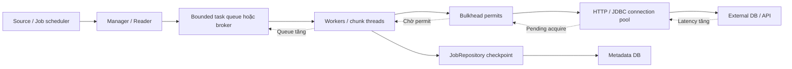
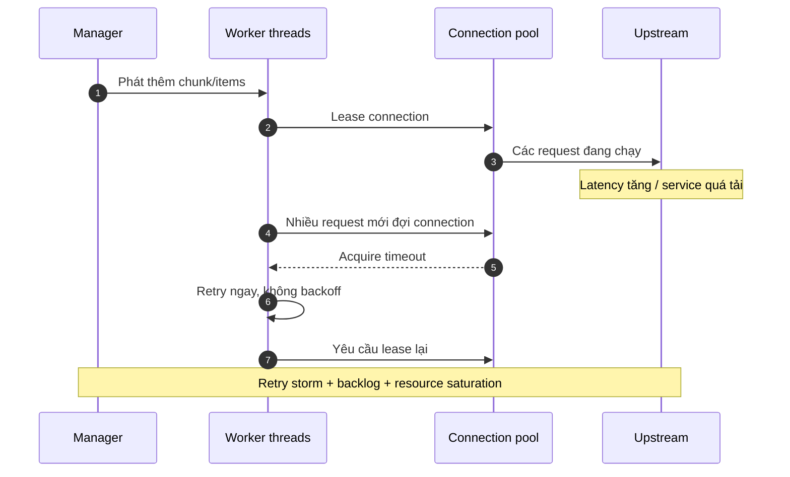
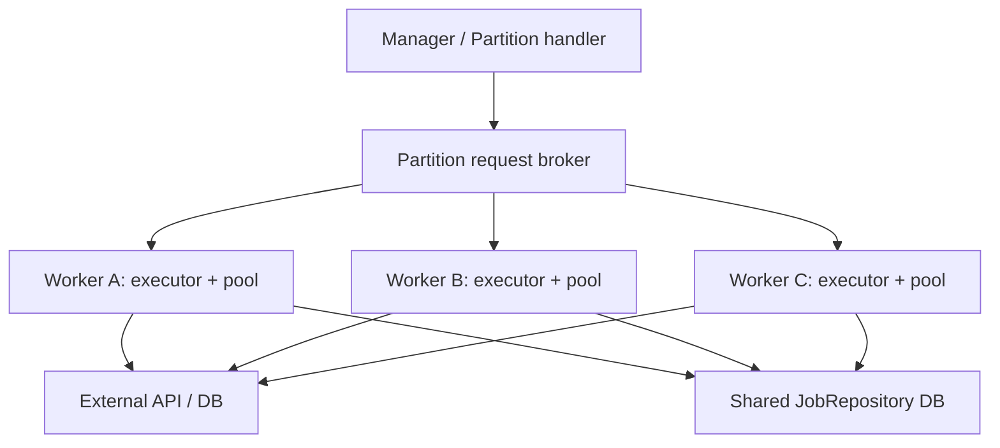
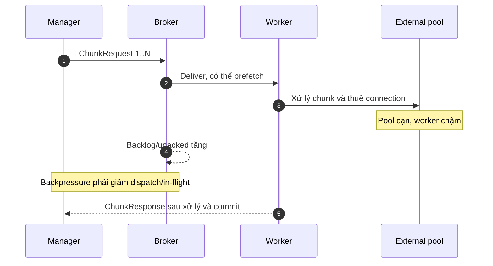
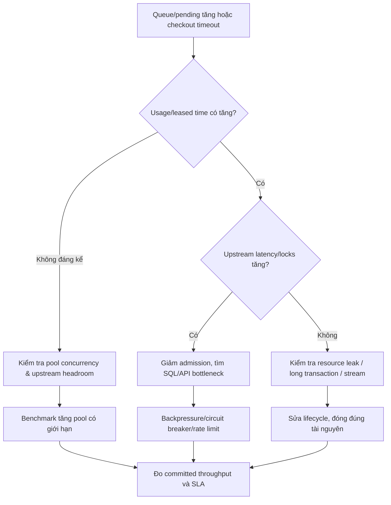

# Pool exhaustion và backpressure trong Spring Batch: kiểm soát quá tải trước khi hệ thống sụp đổ

Khi tăng Spring Batch từ một thread lên hàng chục thread, partition hoặc worker từ xa, chúng ta thường kỳ vọng job hoàn tất nhanh hơn. Nhưng nếu **database connection pool, HTTP connection pool, executor queue hoặc broker capacity** đã chạm giới hạn, kết quả có thể ngược lại: hàng trăm thread chờ tài nguyên, connection checkout timeout, API trả `429`, retry tăng đột biến, job không ghi được checkpoint và cuối cùng thất bại. Trạng thái này được gọi là **pool exhaustion** — cạn tài nguyên sẵn có trong một pool.

**Backpressure** là cách **điều tiết dòng công việc ở phía trước nút nghẽn**, để hệ thống chỉ nhận lượng việc có thể xử lý trong ngân sách concurrency, queue và deadline. Nó không chỉ đơn giản là tăng pool size hay gọi `Thread.sleep()` sau khi đã nhận hàng triệu task.

Bài thuộc chương **Resource pool** của module **SPRING_BATCH_SCALING_OPERATIONS**, hướng đến mở rộng Spring Batch qua multi-threaded step, parallel steps, partitioning và remote chunking/remote partitioning. Ta sẽ nhận diện exhaustion theo từng loại pool, thiết kế admission control, retry/backoff, giới hạn toàn cluster, bảo vệ transaction và restart; sau đó đo lường, load-test và xây dựng runbook.

**Mục tiêu:** Khi một batch chậm hoặc fail do thiếu tài nguyên, bạn xác định đúng tầng đang nghẽn; đặt giới hạn hữu hạn ở tầng nhận việc; không làm mất item, không ghi trùng side effect, và ra quyết định scale dựa trên **committed throughput cùng SLA**.

## 1. Pool exhaustion là gì?

Một *pool* tái sử dụng hoặc phân bổ giới hạn các tài nguyên đắt đỏ như worker threads, JDBC connections, HTTP connections, SSH sessions hoặc broker consumers. **Exhaustion** xảy ra khi tài nguyên đang sử dụng chạm trần, trong khi có thêm yêu cầu muốn mượn chúng.

Ví dụ HikariCP cho metadata database:

1. Pool có `maximumPoolSize=8`.
2. Tám transaction đang dùng cả tám connection.
3. Transaction thứ chín xin connection, phải đợi trong pool.
4. Nếu connection không được trả trước `connectionTimeout`, yêu cầu thứ chín thất bại.
5. Nếu phía trên retry ngay, nhiều yêu cầu mới xuất hiện đúng lúc pool vẫn cạn.

Pool exhaustion thường biểu hiện qua **thời gian chờ tăng trước khi thấy lỗi**. Không phải cứ `active == max` là đang có sự cố: một pool có thể dùng hết tài nguyên trong một burst ngắn nhưng không có hàng chờ kéo dài, timeout hay suy giảm SLA.

| Pool | “Hết” nghĩa là | Tín hiệu |
| --- | --- | --- |
| JDBC HikariCP | Không còn connection có thể checkout | `active=max`, `pending>0`, acquire timeout |
| HTTP/1.1 pool | Không còn connection cho target route | `leased=max`, pending acquire, lease timeout |
| Executor/thread pool | Active threads + queue đều đầy | Task rejection, queue age tăng |
| Broker consumer capacity | Consumer/worker không xử lý kịp lượng message nhận | Unacked, lag, oldest-message age |
| SFTP/SSH pool | Hết session/channel hợp lệ | Acquire/session timeout, server quota |
| Semaphore/bulkhead | Không còn permit cho operation | Waiters, rejected/timeout |

**Cần phân biệt:** HTTP/2 có thể multiplex nhiều request trên một connection; số TCP connection không trực tiếp bằng số in-flight request. Kafka producer và JMS session lại có contract riêng; không áp nguyên công thức một-request-một-connection cho mọi protocol.

## 2. Backpressure khác throttling, rate limiting và circuit breaker

Những cơ chế sau thường phối hợp nhưng không thay thế lẫn nhau:

| Cơ chế | Điều nó kiểm soát | Ví dụ |
| --- | --- | --- |
| **Backpressure** | Tốc độ nhận/phát công việc theo năng lực bên tiêu thụ | Tạm dừng dispatch partition/chunk khi worker quá tải |
| **Bulkhead** | Số hoạt động **đồng thời** được phép | Tối đa 12 request HTTP đang thực hiện |
| **Rate limiter** | Số operation trong một khoảng thời gian | Tối đa 200 requests/giây toàn API key |
| **Bounded queue** | Số công việc được đợi | Tối đa 32 task đợi executor |
| **Timeout/deadline** | Thời gian được phép chiếm/chờ tài nguyên | Đợi pool 500 ms rồi fail |
| **Circuit breaker** | Không tiếp tục gọi khi upstream đang lỗi có hệ thống | Open circuit sau tỷ lệ lỗi vượt ngưỡng |
| **Retry + backoff** | Thử lại lỗi thoáng qua có giới hạn và giãn cách | Tối đa 3 attempts, backoff có jitter |
| **Load shedding** | Chủ động từ chối việc khi quá tải | Trả tín hiệu bận để scheduler giữ hàng đợi |

Điểm cốt lõi: **backpressure phải truyền tín hiệu ngược đến nơi sản sinh/dispatch việc**. Nếu một worker có semaphore 8 nhưng manager vẫn gửi vô hạn chunk vào broker, bạn chỉ chuyển backlog sang broker, chưa bảo đảm toàn tuyến được điều tiết.

Với batch bắt buộc xử lý đủ mọi item, *load shedding* không được hiểu là **bỏ item**. Nó nên là tạm dừng dispatch, requeue an toàn, fail có kiểm soát hoặc giữ checkpoint để xử lý sau, tùy thiết kế.

## 3. Sơ đồ một chuỗi nghẽn dây chuyền



Giả sử external API chậm từ 100 ms lên 2 giây:

- HTTP connections bị giữ lâu hơn, số `leased` tăng.
- Thread chờ connection hoặc bulkhead thay vì xử lý item tiếp.
- Executor queue/phía broker nhận thêm công việc đang đợi.
- Transaction hoặc checkpoint bị trì hoãn nếu thiết kế giữ tài nguyên DB qua lời gọi HTTP.
- Timeout phát sinh và retry nhân lượng attempt đúng lúc downstream yếu.
- Cuối cùng JobRepository có thể xuất hiện lỗi thứ cấp vì DB/pool cũng bị tranh tài nguyên.

**Nguyên nhân gốc có thể nằm ở API**, dù log cuối cùng nhìn thấy là “Hikari pool exhausted”. Trước khi tăng pool, phải tìm **tài nguyên đầu tiên bị bão hòa**.

## 4. Các chỉ số cần đo để xác định pool nào cạn

Một snapshot `CPU=30%` không loại trừ exhaustion: workload I/O-bound có thể dùng ít CPU nhưng hàng trăm thread đang blocking.

| Thành phần | Metrics ưu tiên | Dấu hiệu phân loại |
| --- | --- | --- |
| HikariCP | `active/idle/pending/max`, `acquire P95`, timeout, `usage P95` | Chờ checkout hay giữ connection quá lâu? |
| Apache HttpClient | leased/available/pending/max theo route và total | Một endpoint nóng hay toàn pool bị đầy? |
| TaskExecutor | active thread count, pool size, queue size, task rejection | Tốc độ nhận task lớn hơn tốc độ hoàn tất? |
| API downstream | requests/s, in-flight, P95/P99, 429/503, Retry-After | Throttle, outage hay latency tăng? |
| Broker | consumer concurrency, lag, unacked/prefetch, DLQ, redelivery | Message có bị nhận trước khi có slot xử lý? |
| JobRepository | metadata update latency, rollback, retry/restart errors | Checkpoint có bị trì hoãn/thất bại? |
| Business output | committed items/s, duplicate/missing operations | Tăng concurrency có thực sự tăng kết quả? |

Cần tag metric theo **pool name, upstream category, job/step type** với tập giá trị giới hạn. Không gắn mọi item ID/StepExecution ID vào histogram label; dùng structured logs/traces để tra một execution cụ thể.

## 5. Queueing theory: vì sao độ trễ tăng vọt gần điểm bão hòa?

Theo Little's Law ở trạng thái ổn định:

\[
L=\lambda W
\]

Trong đó `L` là số đơn vị công việc trung bình trong hệ thống, `λ` là thông lượng hoàn tất trung bình (đơn vị/giây), `W` là thời gian một đơn vị công việc ở trong hệ thống (giây).

Nếu một upstream phục vụ trung bình 0,2 giây/request và có 20 request đồng thời:

\[
R_{\mathrm{ideal}}\approx\frac{20}{0,2}=100\text{ requests/giây}
\]

Khi upstream chậm thành 0,5 giây mà concurrency vẫn 20:

\[
R_{\mathrm{ideal}}\approx\frac{20}{0,5}=40\text{ requests/giây}
\]

Nếu manager vẫn sản sinh 100 requests/giây, **60 requests/giây không thể được xử lý** theo công suất mới. Sau 60 giây, backlog có thể tăng xấp xỉ:

\[
B_{60}\approx(100-40)\times60=3.600\text{ requests}
\]

Đây là mô hình **đơn giản** giả định tốc độ trung bình ổn định và không có rejection/retry. Trong thực tế, rate, latency, server queue và retries thay đổi; tốc độ backlog tăng có thể cao hơn.

### Utilization và tail latency

Với mô hình phục vụ đơn giản, utilization `ρ` càng gần 1 thì thời gian chờ hàng đợi càng nhạy với biến động. Không có ngưỡng thần kỳ “80% luôn là lỗi”, nhưng **không để hệ thống chạy sát 100% lâu dài mà không có headroom cho burst, retry và failure**.

**Hệ quả thực tế:** Pool `maximumPoolSize=40` không làm API có thể xử lý 40 calls đồng thời nếu upstream chỉ hỗ trợ 12. Pool lớn có thể **dịch queue** từ JVM sang API, khiến P99 tăng và làm hệ thống quá tải rộng hơn.

## 6. Ngân sách tài nguyên phải tính trên mọi JVM

Một pool hoặc semaphore trong Spring bean chỉ áp dụng cho **một process/JVM**. Khi remote partitioning triển khai nhiều pod:

\[
C_{\mathrm{cluster,max}}=
\sum_{i=1}^{n}
(\mathrm{replicas}_i\times C_{\mathrm{perInstance},i})
\]

Ví dụ:

| Nhóm | Replicas | HTTP in-flight/JVM | Trần |
| --- | ---: | ---: | ---: |
| Manager có gọi partner API | 2 | 6 | 12 |
| Partition worker | 8 | 12 | 96 |
| Canary worker khi rollout | 2 | 12 | 24 |
| **Tổng** | | | **132** |

Nếu API contract chỉ cho **100 concurrent requests trên toàn account**, cấu hình trên có thể vượt giới hạn. **Không có cách nào để per-JVM semaphore tự bảo đảm hard cap toàn cluster** khi số replicas thay đổi; cần phân bổ quota cố định theo replica max hoặc dùng admission control phân tán.

Một ngân sách production phải tính thêm:

- HPA max replicas và rolling deployment (canary/blue-green).
- Các job khác dùng cùng API key.
- Scheduler, dashboard hoặc service ứng dụng dùng chung database.
- Metadata DB và business DB có cùng physical DB server hay không.
- Dự phòng cho DBA/admin, failover, health checks và background jobs.
- Connections tồn tại một thời gian phía LB/server sau khi pod chết.

Giới hạn tổng số **connection** và tổng số **in-flight operations** phải được lập riêng. Nếu HTTP/2 multiplexing, một connection có thể chứa nhiều streams.

## 7. Chọn nơi đặt backpressure: càng gần nguồn phát sinh tải càng tốt

Backpressure hiệu quả cần hạn chế **việc mới được nhận vào hệ thống**, không chỉ để downstream tự báo lỗi.

| Điểm kiểm soát | Ví dụ trong batch | Điều cần cân nhắc |
| --- | --- | --- |
| Scheduler/job admission | Chỉ chạy 2 JobExecutions tải nặng cùng lúc | Ưu tiên/SLA giữa các job |
| Manager/partition dispatch | Giới hạn số active partitions, không phát vô hạn | Không nhầm gridSize với thread count |
| Reader | Đọc theo chunk/page khi consumer có khả năng xử lý | Reader phải restartable, checkpoint đúng |
| Executor | Pool threads + queue hữu hạn, rejection rõ | Không đánh rơi partition/chunk |
| Worker gateway | Semaphore + rate limiter + timeout | Không giữ DB lock lúc chờ slot nếu tránh được |
| HTTP/JDBC pool | Max connections + acquisition timeout | Giới hạn tài nguyên, nhưng chưa phải end-to-end backpressure |
| Broker | Prefetch/in-flight/consumer concurrency, acknowledgement | Redelivery và durability |

**Không có một “backpressure API” chung cho mọi StepBuilder** bảo đảm điều tiết tất cả những lớp này. Với local step, dùng executor bounded và giới hạn concurrency; với remote chunking, thiết kế giao thức message/in-flight limit; với data pipeline reactive, chỉ dùng yêu cầu/demand propagation khi tất cả thành phần thực sự hỗ trợ.

Một Semaphore trước HTTP client **bảo vệ downstream**, nhưng nếu manager đã đọc hàng triệu item vào một queue vô hạn thì **chưa giải quyết backlog**.

## 8. Ví dụ bounded ThreadPoolTaskExecutor cho local partitioning

Trong Spring Batch 5.x, một cách giới hạn phần việc đồng thời là dùng `ThreadPoolTaskExecutor` có **core/max threads và queueCapacity hữu hạn**.

```java
import java.util.concurrent.ThreadPoolExecutor;
import org.springframework.context.annotation.Bean;
import org.springframework.scheduling.concurrent.ThreadPoolTaskExecutor;

@Bean(name = "boundedPartitionExecutor")
public ThreadPoolTaskExecutor boundedPartitionExecutor() {
    ThreadPoolTaskExecutor executor = new ThreadPoolTaskExecutor();
    executor.setCorePoolSize(4);
    executor.setMaxPoolSize(8);
    executor.setQueueCapacity(16);
    executor.setThreadNamePrefix("partition-worker-");
    executor.setRejectedExecutionHandler(
            new ThreadPoolExecutor.AbortPolicy());
    executor.setWaitForTasksToCompleteOnShutdown(true);
    executor.setAwaitTerminationSeconds(30);
    executor.initialize();
    return executor;
}
```

**Semantics quan trọng:**

- `corePoolSize=4`: số worker core.
- `maxPoolSize=8`: trần thread khi executor mở rộng.
- `queueCapacity=16`: queue chờ hữu hạn. Với `ThreadPoolExecutor` thường **xếp hàng sau khi core đầy trước khi mở rộng lên max**, nên không suy rằng executor sẽ dùng 8 thread ngay khi có 8 tasks.
- Khi active và queue đều cạn, `AbortPolicy` gây rejection, không âm thầm chặn vô hạn hoặc chạy việc ở thread caller.
- `waitForTasksToCompleteOnShutdown(true)` phục vụ graceful shutdown; timeout chờ không phải “giết an toàn” mọi task đang thực thi.
- Rejection có thể khiến partition manager/step fail. **Phải để lỗi đi qua lifecycle Spring Batch**, không bắt rồi bỏ qua task.

**Không dùng `CallerRunsPolicy` máy móc** cho batch: một partition/chunk task có thể chạy ngay trên thread manager/dispatcher, thay đổi transaction, timing, throughput và khả năng quản lý status. Policy ấy có thể tạo backpressure trong một số executor, nhưng phải kiểm thử kỹ trước khi dùng với Spring Batch.

## 9. Gắn executor bounded vào partition manager

Ví dụ Spring Batch 5.x:

```java
import org.springframework.batch.core.Step;
import org.springframework.batch.core.repository.JobRepository;
import org.springframework.batch.core.step.builder.StepBuilder;
import org.springframework.batch.core.partition.support.Partitioner;
import org.springframework.beans.factory.annotation.Qualifier;
import org.springframework.context.annotation.Bean;

@Bean
public Step partitionManagerStep(
        JobRepository jobRepository,
        Partitioner partitioner,
        @Qualifier("orderWorkerStep") Step workerStep,
        @Qualifier("boundedPartitionExecutor")
        ThreadPoolTaskExecutor executor) {

    return new StepBuilder("partitionManagerStep", jobRepository)
            .partitioner("orderWorkerStep", partitioner)
            .step(workerStep)
            .gridSize(12)
            .taskExecutor(executor)
            .build();
}
```

Đây là ví dụ hạ tầng; `orderWorkerStep`, `Partitioner`, Job, reader/writer/transaction manager phải được ứng dụng cung cấp. Nếu partitioner tạo nhiều partition hơn năng lực executor, các phần việc có thể vào queue. **Đừng tạo số partition khổng lồ rồi kỳ vọng queue 16 tự chứa hết**; TaskExecutorPartitionHandler và cách dispatch cần được kiểm thử về rejection/recovery.

**Thử nghiệm cần có:** partitioner trả 100 partitions, executor max 8 queue 16, sau đó kiểm tra job **fail/recover đúng** nếu admission vượt trần; không cho step `COMPLETED` khi một partition chưa chạy.

### Multi-threaded chunk step có cùng bài toán

Trong Spring Batch 5.x, `throttleLimit` cũ bị deprecate; không dựa vào nó như cơ chế tuning tương lai. Có thể dùng `taskExecutor(...)` và thiết kế executor/repeat operations phù hợp phiên bản. Nhưng cần biết **đa luồng trong cùng StepExecution** có các yêu cầu thread safety đối với reader/writer và metadata; queue bounded không chữa được race trên shared state.

## 10. Bảo vệ HTTP bằng bulkhead trước connection pool

Một cách không cho 50 worker threads đồng thời tranh 8 HTTP connections là đặt semaphore gate trước khi lease connection.

```java
import java.util.concurrent.Semaphore;
import java.util.concurrent.TimeUnit;
import org.springframework.web.client.RestClient;

record PartnerProfile(String tier) {}

class ResourceBusyException extends RuntimeException {
    ResourceBusyException(String message) { super(message); }
    ResourceBusyException(String message, Throwable cause) {
        super(message, cause);
    }
}

public final class PartnerProfileGateway {
    private final RestClient restClient;
    private final Semaphore permits = new Semaphore(8, true);

    public PartnerProfileGateway(RestClient restClient) {
        this.restClient = restClient;
    }

    public PartnerProfile getProfile(String customerId) {
        boolean acquired = false;
        try {
            acquired = permits.tryAcquire(
                    200, TimeUnit.MILLISECONDS);
            if (!acquired) {
                throw new ResourceBusyException(
                        "No partner request capacity");
            }

            PartnerProfile response = restClient.get()
                    .uri("/profiles/{id}", customerId)
                    .retrieve()
                    .body(PartnerProfile.class);

            if (response == null) {
                throw new IllegalStateException(
                        "Empty partner response");
            }
            return response;

        } catch (InterruptedException ex) {
            Thread.currentThread().interrupt();
            throw new ResourceBusyException(
                    "Interrupted while waiting for permit", ex);
        } finally {
            if (acquired) {
                permits.release();
            }
        }
    }
}
```

Cách dùng đúng:

1. Đăng ký gateway làm **singleton bean**. Tạo gateway mới mỗi item thì mỗi instance có 8 permit và mất ý nghĩa giới hạn chung trong JVM.
2. HTTP client nằm bên dưới phải có **pool/timeout hữu hạn** và đúng contract thread safety.
3. Mọi đường gọi cùng upstream qua gateway này; code đi vòng ngoài gate làm vượt ngân sách.
4. Mỗi attempt acquire permit rồi release trong `finally`, cả khi HTTP lỗi hoặc timeout.
5. Khi không có permit, **không retry lập tức trong vòng lặp bận**; cần backoff/stop dispatch theo SLA.
6. `Semaphore(8)` giới hạn operations của gateway này trên một JVM, **không giới hạn requests/s** và không phải hard cap toàn cluster.

Nếu processor gọi gateway bên trong chunk transaction, thời gian chờ permit có thể kéo dài transaction. Hãy cân nhắc **admission trước khi mở transaction hoặc tách bước enrichment** nếu nghiệp vụ cho phép; không cắt transaction bừa bãi vì có thể phá consistency.

## 11. HTTP pool, bulkhead và rate limiter phải phối hợp

Một hệ thống có thể đặt:

```text
TaskExecutor: max 12 worker threads, queue 16
  -> Partner bulkhead: tối đa 8 in-flight/JVM
     -> HTTP/1.1 per-route pool: tối đa 8 connections/JVM
        -> Distributed rate limiter: tối đa 500 req/s/API key
           -> Partner API
```

Các giới hạn giải quyết các hiện tượng **khác nhau**:

- Pool 8 bảo vệ số connection tới route.
- Bulkhead 8 bảo vệ số operation trong gateway, có thể bao gồm thời gian xử lý body.
- Distributed rate limiter 500 req/s bảo vệ quota **toàn API key**, độc lập số JVM.
- Executor queue 16 bảo vệ memory và số công việc đang chờ trước gateway.
- Deadline bảo vệ thời gian một operation có thể chiếm resources.

Nếu HTTP/2 cho phép multiplex nhiều requests/connection, pool 8 có thể không hạn chế in-flight về 8; bulkhead cần được xem là biện pháp concurrency chính.

**Không đặt pool max lớn hơn nhiều so với concurrency hữu ích chỉ vì “dự phòng”.** Số connection tổng trên nhiều pod có thể ăn hết quota server/LB/NAT. Nhưng cũng không cứng nhắc đặt tất cả giới hạn cùng một con số nếu API call dùng nhiều connection hoặc client có retry/redirect riêng.

## 12. Khi JDBC pool cạn: phân biệt source, target và metadata

Một job có thể có ba nhóm DataSource:

| DataSource | Chủ thể dùng | Nguy cơ khi cạn |
| --- | --- | --- |
| **Metadata** | `JobRepository`, JobExplorer, StepExecution/ExecutionContext | Không checkpoint, không cập nhật trạng thái hoặc không restart |
| **Source** | `ItemReader`, cursor/page queries | Không đọc thêm item, worker chờ |
| **Target** | `ItemWriter`, business DB transaction | Chunk không commit, deadlock/rollback tăng |

Nếu ba nhóm trỏ cùng physical database, nhiều pools vẫn chia sẻ **CPU, locks và giới hạn session**. Nếu dùng một pool chung, writer có thể chiếm slot làm JobRepository không cập nhật được metadata. Tách pool đôi khi có ích, nhưng **hai transaction managers/DataSources độc lập không tự có ACID toàn cục**: business commit có thể thành công trong khi metadata checkpoint lỗi.

### Cấu hình HikariCP minh họa

```yaml
spring:
  datasource:
    hikari:
      pool-name: batch-database-pool
      maximum-pool-size: 12
      connection-timeout: 1500
      validation-timeout: 500
      max-lifetime: 1500000
```

Các property trên minh họa **một DataSource Hikari mặc định** của Spring Boot. Khi có nhiều DataSource, phải cấu hình từng bean/prefix riêng và kiểm tra wiring vào JobRepository/step. Không suy rằng YAML này tự tạo một pool metadata độc lập.

- `maximum-pool-size=12`: trần JDBC connections **mỗi JVM** của pool ấy.
- `connection-timeout=1500`: tối đa **1,5 giây chờ checkout**, không phải thời gian SQL chạy.
- `validation-timeout=500`: deadline kiểm tra connection hợp lệ.
- `max-lifetime=1500000`: giới hạn tuổi connection khoảng 25 phút; điều chỉnh theo DB/proxy/network thực.

Nếu database đã có `idle in transaction` lâu hoặc lock wait cao, tăng pool size có thể khiến nhiều transaction tranh khóa hơn. Tìm nguồn **giữ connection lâu** trước khi mở rộng.

## 13. Vì sao retry có thể biến pool exhaustion thành sự cố lớn?

Tình huống xấu đi theo chuỗi:



Nếu 100 item cùng gặp timeout và mỗi item cho phép 3 attempts, một lần failure window có thể sinh gần **300 attempts**. Với client retry 2 lần cho mỗi attempt Spring Batch, số request thực tế có thể còn cao hơn. Thêm broker redelivery lại tạo tầng lặp khác.

**Chính sách an toàn hơn:**

- Chỉ retry lỗi transient xác định rõ; không retry mọi `RuntimeException`.
- Có `retryLimit` hữu hạn, **backoff + jitter** và tổng time budget.
- Tôn trọng `429 Retry-After` hoặc quota mà upstream công bố.
- Phân biệt *local capacity rejection* và *remote transient error*. Khi local pool đầy lâu, ưu tiên giảm admission thay vì liên tục chạy lại item ở cùng mức tải.
- Nếu service outage diện rộng, circuit breaker/fail-fast để tránh kéo dài hàng đợi.
- Không giữ semaphore permit/connection qua backoff nếu một attempt đã kết thúc và có thể release.
- Đối soát kết quả khi remote write timeout sau server-side commit.

**Retry không phải giải pháp cho một service đang thiếu capacity thường trực.** Nó là công cụ phục hồi khi lỗi có khả năng thoáng qua.

## 14. Retry limit của Spring Batch không giới hạn toàn cluster

Cấu hình một chunk step (Spring Batch 5.x):

```java
import org.springframework.batch.core.Step;
import org.springframework.batch.core.repository.JobRepository;
import org.springframework.batch.core.step.builder.StepBuilder;
import org.springframework.batch.item.ItemProcessor;
import org.springframework.batch.item.ItemReader;
import org.springframework.batch.item.ItemWriter;
import org.springframework.context.annotation.Bean;
import org.springframework.retry.backoff.ExponentialBackOffPolicy;
import org.springframework.transaction.PlatformTransactionManager;

@Bean
public Step enrichStep(
        JobRepository repository,
        PlatformTransactionManager transactionManager,
        ItemReader<SourceRecord> reader,
        ItemProcessor<SourceRecord, EnrichedRecord> processor,
        ItemWriter<EnrichedRecord> writer) {

    ExponentialBackOffPolicy backoff = new ExponentialBackOffPolicy();
    backoff.setInitialInterval(250);
    backoff.setMultiplier(2.0);
    backoff.setMaxInterval(2_000);

    return new StepBuilder("enrichStep", repository)
            .<SourceRecord, EnrichedRecord>chunk(100, transactionManager)
            .reader(reader)
            .processor(processor)
            .writer(writer)
            .faultTolerant()
            .retry(TemporaryPartnerException.class)
            .retryLimit(3)
            .backOffPolicy(backoff)
            .build();
}
```

`SourceRecord`, `EnrichedRecord`, `TemporaryPartnerException` và các beans reader/processor/writer là kiểu và thành phần do ứng dụng định nghĩa. Đoạn mã là **mẫu cấu hình**, không phải một job hoàn chỉnh.

Lưu ý:

- `retryLimit(3)` thường nghĩa là **tối đa ba attempts tính cả lần đầu** trong retry context, không phải ba lần retry cộng thêm.
- Nó **không** hạn chế request/giây, concurrent HTTP calls, số JVM hoặc số broker redeliveries.
- Nếu writer gặp lỗi giữa một chunk, transaction rollback có thể dẫn tới nhiều item được viết lại; không hứa mỗi SQL/API call chỉ xuất hiện ba lần suốt job lifetime.
- Sau JVM crash/restart, không mặc định retry counter cũ được persist thành **global budget** cho một business operation.
- Nếu hết capacity kéo dài, tăng `retryLimit` có thể làm job trễ SLA, đồng thời tạo thêm remote load.

Cần đo **attempts thực tại client/API**, không dùng `StepExecution.readCount` thay thế số requests.

## 15. Backpressure khi dùng multi-threaded step

Multi-threaded step có nhiều chunk xử lý đồng thời trong **cùng một StepExecution**. Nếu reader/processor/writer hoặc listener giữ shared mutable state, chỉ giới hạn thread count chưa đủ bảo đảm đúng.

Các rủi ro:

- Reader không thread-safe → item bị đọc trùng/bỏ sót.
- Writer dùng chung buffer mutable → dữ liệu lẫn giữa các chunk.
- Pool JDBC chia sẻ bị hết slot → thread chờ, transaction dài và rollback tăng.
- Một API timeout có thể giữ worker slot nhiều giây; queue tiếp tục tích tụ.
- Checkpoint/ExecutionContext có thể phức tạp hơn do thứ tự hoàn thành chunk không đồng nhất.

**Khuyến nghị:**

1. Dùng reader thread-safe hoặc **partition theo key/range** để mỗi StepExecution có reader riêng nếu workload phù hợp.
2. Hạn chế active chunk threads theo capacity của nguồn/đích, không chỉ CPU.
3. Bounded executor + rate/bulkhead limit; test hành vi khi tasks bị reject.
4. Không thay đổi checkpoint/update JobRepository thủ công để “tăng throughput”.
5. Quan sát committed items/s và duplicates/missing keys sau lỗi/restart.

Trong Spring Batch 5.x, `throttleLimit` của multi-threaded step đã bị deprecate; sử dụng cơ chế giới hạn concurrency phù hợp version và đánh giá `RepeatOperations` nếu cần thay chiến lược điều phối. **Đừng giả định một API deprecated là guardrail duy nhất đáng tin cậy**.

## 16. Parallel steps: một flow có thể làm flow khác đói tài nguyên

Hai flow được thiết kế độc lập về nghiệp vụ nhưng vẫn dùng chung DB hoặc API:

```text
flow A: read customers -> call Partner API -> write customers
flow B: read payments  -> call Partner API -> write payments

Cùng Partner API key, cùng HTTP pool và cùng quota.
```

Nếu flow A tạo nhiều request hơn, nó có thể chiếm toàn bộ HTTP pool, khiến flow B chậm dù mỗi flow tự có executor.

Cách thiết kế:

- Có **global concurrency cap** và hạn mức cho từng flow để tránh starvation.
- Nếu SLA khác nhau, dùng queue có chính sách ưu tiên/fairness hoặc nguồn lực dành riêng có đo lường.
- Không tách hai pool mỗi flow mà quên tổng pool connections vào cùng upstream.
- Không chạy parallel step trên cùng bảng nghiệp vụ với thứ tự lock đối nghịch nếu có thể thiết kế lại.
- Tính tổng concurrency của **mọi parallel flow**, không chỉ một step.

Ví dụ: API cho 40 concurrent requests; flow A tối đa 30, flow B tối đa 30, thì **phải có cap tổng ≤40** hoặc lịch vận hành tránh hai flow đồng thời. Hai semaphore 30 độc lập không đủ.

## 17. Local partitioning và gridSize: đừng nhầm số partition với throughput

Với partitioning:

- `Partitioner.partition(gridSize)` có thể tạo số phần việc theo logic của partitioner; `gridSize` là input/gợi ý, không nhất thiết bằng số partition được tạo.
- `ThreadPoolTaskExecutor` xác định số partition thực sự có thể chạy **đồng thời** trong một JVM.
- Mỗi partition có thể có reader/processor/writer và trạng thái riêng.
- Một số partition có thể chờ trong executor queue; nếu queue đầy, submission có thể bị reject.

Ví dụ `gridSize=40`, executor core=4/max=8/queue=16:

- Không có nghĩa 40 partition đang chạy cùng lúc.
- Không có nghĩa 40 partition đều được nhận an toàn vào queue.
- Không có nghĩa việc chia 40 partition làm source/target tăng capacity.

Một partitioner chia quá nhiều phần rất nhỏ có thể tạo **overhead JobRepository/StepExecution** đáng kể, trong khi partition quá lớn gây straggler. Chọn số partition từ benchmark theo dữ liệu và worker slots; giữ input ranges ổn định qua restart.

## 18. Remote partitioning: backpressure toàn cụm

Trong remote partitioning, manager gửi yêu cầu cho worker chạy partition step. Mỗi worker JVM có pool/executor riêng:



Phải kiểm soát cùng lúc:

1. **Active partitions toàn cụm** và số worker replicas.
2. Broker queue/prefetch/concurrent consumers.
3. Connection pool metadata và business/external trên mỗi worker.
4. Upstream quota/account-level concurrency.
5. Retry/restart và worker crash khi một `StepExecution` vẫn mang trạng thái `STARTED`.

Không có nghĩa cứ thêm pod là thêm công suất upstream. Nếu source DB chỉ cho 50 sessions, 20 workers × 8 connections có trần 160, cao hơn ngân sách thực.

Backpressure ở đây có thể là giảm active workers, giới hạn dispatch, cấu hình broker consumer concurrency/prefetch, hoặc một admission service phân tán. Cần phối hợp manager/worker để không xử lý **cùng partition** ở hai worker sau timeout mà không có ownership/recovery hợp lệ.

## 19. Remote chunking: broker prefetch và in-flight chunks

Remote chunking khác remote partitioning: manager đọc item, gom chunk, gửi `ChunkRequest`; worker process/write rồi trả `ChunkResponse`. Nếu worker chậm, broker/manager có thể tích tụ chunk đang chờ.

Các thông số quan trọng:

- Số worker instances và consumer threads.
- Prefetch (hoặc tương đương) và số message unacked.
- In-flight request/reply correlation và timeout.
- External JDBC/HTTP pool của worker.
- Giới hạn queue trong middleware.
- Chính sách ACK/reject/redelivery/DLQ.

**Prefetch=100** không có nghĩa worker có thể xử lý 100 chunks đồng thời. Nó có thể khiến worker nhận trước nhiều message, nằm chờ connection trong JVM hoặc ở trạng thái unacked, làm khó phân phối công bằng.



Tùy middleware, ACK và reply có thể xảy ra ở những thời điểm khác; **không suy rằng nhận ChunkResponse chứng minh transaction broker/DB/metadata là một transaction toàn cục**. Khi response mất sau worker commit, redelivery có thể làm lại chunk; writer phải idempotent.

Nếu không thể kiểm soát manager dispatch tự nhiên qua backlog, phải thiết kế cơ chế window/credit/flow-control phù hợp tích hợp thực, không chỉ mong broker queue đủ lớn.

## 20. Backpressure và transaction: tránh giữ khóa trong lúc chờ pool

Một thiết kế dễ gây sự cố dây chuyền:

```java
// PHẢN VÍ DỤ KHÁI NIỆM:
// Nếu connection/lock đã được lấy trong transaction,
// chờ external API sẽ kéo dài transaction.
@Transactional
public void settleAndNotify(long accountId) {
    accountDao.lockAndUpdate(accountId);
    externalGateway.notifyPartner(accountId); // Có thể chờ permit/HTTP.
    auditDao.append(accountId);
}
```

Nếu câu `lockAndUpdate` đã lấy DB connection/row lock, sau đó `notifyPartner` bị chặn 10 giây, transaction giữ khóa lâu hơn cần thiết. Hệ quả: những batch khác đợi khóa, Hikari active tăng, DB transaction time tăng, retry/timeout xuất hiện.

Một số hướng xử lý, tùy invariant nghiệp vụ:

1. **Admission trước transaction:** Kiểm tra capacity trước khi bắt đầu phần cần giữ lock nếu không gây race nguy hiểm.
2. **Tách bước enrich trước bước write:** Gọi API đọc profile ở một step riêng, ghi dữ liệu đã enrich ở step sau.
3. **Transactional outbox:** Ghi intent/event trong cùng business transaction, publish sau commit qua worker riêng có rate limit.
4. **Bulk endpoint:** Giảm số remote calls/item, không giữ khóa khi chờ từng item.
5. **Idempotency + reconciliation:** Nếu phải gọi side effect ngoài transaction, bảo đảm retry/restart không nhân đôi.

Không tự ý tách một transaction quan trọng thành hai commit khi điều đó phá invariant như chuyển tiền hai tài khoản; cần thiết kế nhất quán và test failure windows.

## 21. Khi JobRepository pool bị cạn, điều gì nguy hiểm?

JobRepository lưu trạng thái `JobExecution`/`StepExecution` và `ExecutionContext` phục vụ restart. Khi metadata connection pool bị cạn:

- Job không tạo được execution mới hoặc không khởi động được step.
- Step không cập nhật được counters, status hoặc checkpoint.
- Manager không tổng hợp xong partition/reply dù worker đã xử lý dữ liệu.
- Một transaction business có thể đã commit ở DB khác, nhưng metadata commit thất bại.
- Restart có thể đọc checkpoint cũ và **xử lý lại item đã ghi**.

**Không được** bắt lỗi repository rồi ghi log warning và tiếp tục đánh dấu job thành công theo cách riêng. Với metadata/database khác business DB, cần writer idempotent hoặc operation ledger để xử lý replay.

**Không sửa thủ công** `BATCH_STEP_EXECUTION.STATUS`/`VERSION` nhằm “giải phóng” resource: làm vậy phá lifecycle và optimistic locking. Điều tra pool/DB, xác định worker còn chạy hay không, rồi dùng quy trình restart/recovery chính thức của ứng dụng.

## 22. Metrics: nhận biết quá tải ở từng lớp

Ví dụ dashboard cho Spring Batch + HikariCP + HTTP client:

| Lớp | Metric/quan sát | Kết luận cần kiểm tra |
| --- | --- | --- |
| Job/step | Duration, `readCount`, `writeCount`, `commitCount`, `rollbackCount` | Throughput business có tăng hay giảm? |
| Worker executor | `activeThreads`, queue size/age, rejected tasks | Task backlog có tích tụ? |
| Bulkhead | Available permits, waiters, time waiting, rejected | Đã hết in-flight capacity chưa? |
| JDBC Hikari | `hikaricp.connections.active/idle/pending/max` | Pool có chờ checkout không? |
| Hikari timers | `hikaricp.connections.acquire/usage/timeout` | Chờ lấy vs giữ connection lâu? |
| HTTP pool | leased/available/pending/max theo route | Connection starvation hay upstream slow? |
| HTTP service | requests/s, P95/P99, 429/503, timeout | Quota hoặc outage? |
| Broker | unacked, lag, oldest age, DLQ, redelivered | Dispatch nhanh hơn xử lý? |
| Metadata DB | SQL update duration, lock waits, connections | Checkpoint bị DB chặn? |
| Business DB | Lock waits, deadlocks, transaction P95 | Writer bị contention? |
| Correctness | Unique operations committed, duplicates/missing | Retry/restart có an toàn? |

Với Hikari metrics phải xem **đúng pool**: pool metadata, source và target có thể khác nhau. Với remote workers, dashboard nên xem both per-instance **và tổng cluster**, vì trần mỗi pool không có ý nghĩa đầy đủ khi autoscale.

### Đăng ký metric executor có cardinality thấp

```java
import io.micrometer.core.instrument.Gauge;
import io.micrometer.core.instrument.binder.MeterBinder;
import org.springframework.beans.factory.annotation.Qualifier;
import org.springframework.context.annotation.Bean;
import org.springframework.scheduling.concurrent.ThreadPoolTaskExecutor;

@Bean
public MeterBinder boundedExecutorMetrics(
        @Qualifier("boundedPartitionExecutor")
        ThreadPoolTaskExecutor executor) {

    return registry -> {
        Gauge.builder("batch.executor.active", executor,
                        ThreadPoolTaskExecutor::getActiveCount)
                .tag("pool", "partition-worker")
                .register(registry);

        Gauge.builder("batch.executor.queue.size", executor,
                        ex -> ex.getThreadPoolExecutor()
                                .getQueue().size())
                .tag("pool", "partition-worker")
                .register(registry);
    };
}
```

Ví dụ sử dụng Micrometer và assumes executor đã được initialize khi gauge đọc; Spring Boot auto-bind `MeterBinder` nếu metrics infrastructure được kích hoạt, còn khi tự cấu hình MeterRegistry cần bind thủ công. Không đưa item ID hoặc JobExecution ID vào tag, và đừng đăng ký cùng meter trùng lặp khi tạo bean.

## 23. Chẩn đoán: pool nhỏ, connection leak hay downstream quá tải?

Cả ba tình huống đều có thể làm `pending` tăng nhưng cách sửa khác nhau.

| Tín hiệu | Pool quá nhỏ so với công suất DB/upstream | Connection leak/giữ quá lâu | Downstream chậm/bão hòa |
| --- | --- | --- | --- |
| Active/leased sát max | Có | Có | Có |
| Pending tăng | Có | Có | Có |
| Connection usage P95 tăng | Không bắt buộc | Thường tăng dài bất thường | Thường tăng theo API/SQL latency |
| SQL/API P95 cao | Không bắt buộc | Có thể thấp | Thường cao |
| DB CPU/locks cao | Có thể thấp | Có thể | Thường nếu DB là downstream |
| Tăng pool có lợi? | Có thể khi upstream còn capacity | Che giấu tạm thời | Có thể làm tình trạng tệ hơn |
| Cách xác minh | Load test size 4/8/12, đo throughput | Thread dump, open resources, long transactions | API metrics, DB locks, 429/503, P99 |

**Đường chẩn đoán:**



Nếu một connection không được trả vì quên đóng stream, việc tăng pool chỉ **kéo dài thời gian trước khi lỗi**. Nếu service trả 429 do rate quota, việc tăng pool càng không giải quyết nguyên nhân.

## 24. Pool exhaustion không được biến thành data loss

Khi một executor reject task, một HTTP acquire timeout hoặc một JDBC checkout thất bại, phải định nghĩa rõ **item sẽ đi đâu**.

| Tình huống | Sai lầm nguy hiểm | Hành vi nên thiết kế |
| --- | --- | --- |
| `TaskRejectedException` khi dispatch partition | Catch và coi partition hoàn tất | Propagate failure/retry dispatch có kiểm soát, giữ ownership |
| Semaphore timeout khi processor gọi API | Trả `null` để tránh fail | Phân loại capacity error; fail/retry có backoff, không filter item |
| HTTP connection timeout | Retry POST ngay và không idempotency | Operation key, xác minh trạng thái upstream khi kết quả chưa rõ |
| JDBC pool exhausted | Bỏ item lỗi, tăng `readCount` | Rollback chunk, retry/restart theo policy |
| Broker prefetch quá nhiều | ACK trước khi xử lý để rỗng queue | ACK theo delivery/processing contract; giữ durability và DLQ |
| Metadata DB unavailable | Chỉnh job status thành COMPLETED thủ công | Đối soát business data, phục hồi repository, restart hợp lệ |

**Spring Batch processor trả `null` nghĩa là *filter* item**, không có nghĩa “lỗi tạm thời, thử lại sau”. Với dữ liệu bắt buộc, cần ném exception có phân loại phù hợp hoặc thiết kế một queue/quarantine có durability rõ ràng.

Khi retry một chunk, side effect ngoài transaction có thể đã xảy ra ở lần trước. Điều này đòi **idempotency**, nhất là với remote write hoặc message redelivery.

## 25. Test backpressure phải kiểm tra cả giới hạn lẫn tính đúng dữ liệu

Các bài test nên có tải tranh chấp **tái lập được**, không chỉ một request happy path.

| Kịch bản | Dựng tình huống | Điều cần assert |
| --- | --- | --- |
| JDBC pool exhaustion | Pool 2 connections, giữ cả hai, third thread checkout | Chờ đúng deadline, timeout hữu hạn; không treo |
| HTTP pool exhaustion | Per-route 4, gửi 20 requests chờ latch | Không vượt leased connections cho HTTP/1.1 client |
| Bounded executor | Active 2, queue 2, thêm tasks | Rejection rõ; không mất việc silently |
| Semaphore bulkhead | 20 threads gọi gateway 4 permits | In-flight tối đa 4/JVM; permits trả lại khi exception |
| Rate limiter | 5 worker JVM chia cùng API key | Tổng requests/s nằm trong quota |
| Upstream latency spike | Stub tăng response từ 100 ms lên 2 s | Queue không tăng vô hạn; throughput/latency đo được |
| 429 + Retry-After | Stub phát 429 tạm thời | Backoff không làm retry storm |
| Outage kéo dài | Stub 503 trong vài phút | Max attempts/deadline hữu hạn, circuit breaker/fail phù hợp |
| Writer commit rồi mất reply | Worker trả kết quả muộn/crash sau commit | Redelivery không nhân đôi operation |
| Metadata checkout failure | Pool repository bị chặn lúc checkpoint | Job không báo completed giả; restart/reconciliation đúng |
| HPA scale-out | 4 → 12 worker pods | Cluster-wide quota không bị vượt |
| Long transaction | API chậm sau khi DB lock đã được giữ | Nhận diện giữ connection/lock lâu, điều chỉnh boundary |

### Ví dụ test logic semaphore

Dùng một fake HTTP gateway có `CountDownLatch` giữ response, chạy nhiều threads qua **cùng singleton gateway**. Một `AtomicInteger` đếm active calls và một bộ ghi max concurrent, rồi assert max ≤ permit count. Test phải dùng timeout để không deadlock vô hạn.

Sau khi giải phóng latch, assert **available permits về mức ban đầu**, kể cả khi một fake call ném exception. Điều này phát hiện lỗi quên release trong `finally`.

### Test Spring Batch tích hợp

Không chỉ assert `StepExecution.getWriteCount()`. Cần đối soát business table/API bằng **operation ID duy nhất**, tạo failure giữa remote commit và checkpoint/response, rồi restart cùng JobInstance. Kiểm tra input không thiếu, side effects không nhân đôi và không có partition bị đánh dấu COMPLETED khi chưa xử lý.

Không chạy các test tạo exhaustion/deadlock có chủ đích trên hệ thống production của đối tác.

## 26. Capacity case study: tăng worker làm giảm throughput

Một job enrich **1.200.000 item** trong **20 phút**. Mỗi item gọi một API, với giả định:

- Partner API cho tối đa **900 requests/giây** và **150 requests đồng thời** trên toàn account.
- Latency trung bình khi khỏe là **160 ms** mỗi attempt.
- Có 10 worker JVM, mỗi JVM bulkhead 12 permits và HTTP pool 16 connections/route.
- Thống kê giả định có 5% attempts lỗi transient, độc lập giữa các attempts; mỗi item tối đa 3 attempts.
- Cả job không có retry ẩn ở HTTP client và broker trong mô hình lý tưởng.

### 26.1. Throughput business tối thiểu?

\[
R_{\mathrm{needed}}=
\frac{1.200.000}{20\times60}
=1.000\text{ item/giây}
\]

### 26.2. Expected requests per item với retry?

\[
E[\mathrm{attempts}]=1+0,05+0,05^2=1,0525
\]

Do đó, để xử lý 1.000 item/s, API cần trung bình:

\[
R_{\mathrm{API,needed}}=1.000\times1,0525
=1.052,5\text{ requests/giây}
\]

**Vượt quota 900 requests/s**, dù có vô hạn worker. SLA hiện tại không khả thi theo giả định này nếu mỗi item cần một request và không giảm lỗi/calls.

### 26.3. In-flight capacity của worker là bao nhiêu?

\[
C_{\mathrm{configured}}=10\times12=120
\]

HTTP per-route tổng trần 10 × 16 = 160 connections, nhưng bulkhead chỉ cho tối đa 120 operations đang xử lý.

Với latency mean 160 ms:

\[
R_{\mathrm{inflight}}\approx\frac{120}{0,16}
=750\text{ requests/giây}
\]

Trong mô hình lý tưởng, throughput business hiệu dụng bị giới hạn khoảng:

\[
R_{\mathrm{business}}\lesssim
\frac{750}{1,0525}\approx712,6\text{ item/giây}
\]

Thời gian payload lý tưởng:

\[
T_{\mathrm{payload}}\gtrsim
\frac{1.200.000}{712,6}\approx1.684\text{ s}
\approx28,1\text{ phút}
\]

Chưa kể startup, stragglers, checkpoint, DB và retry backoff. Vì vậy **20 phút không khả thi** với cấu hình và latency đã giả định.

### 26.4. Tăng từ 10 lên 20 worker có giải quyết?

Trần local bulkhead sẽ thành 240 operations; vượt concurrent cap 150 của API. Dù điều phối toàn cụm giữ ở 150:

\[
R_{\mathrm{inflight}}\lesssim
\frac{150}{0,16}=937,5\text{ requests/s}
\]

Vẫn bị quota 900 requests/s, tương đương business throughput xấp xỉ 855,1 item/s, chưa đáp ứng 1.000 item/s. Tăng worker làm rủi ro 429 tăng nếu thiếu distributed limiter.

### 26.5. Hướng thay đổi nào thực sự có ích?

- Giảm requests/item bằng caching theo version, batch endpoint hoặc data-local enrichment.
- Thỏa thuận tăng quota/throughput với đối tác.
- Rút ngắn latency nếu upstream/contract cho phép và đúng chất lượng dịch vụ.
- Chuyển một phần workload sang window dài hơn hoặc chia theo SLA ưu tiên.
- Dùng concurrency/rate limiter toàn cụm để bảo vệ service và giảm retries vô ích.

Không “chữa” phép tính bằng cách tăng `retryLimit`: nó tăng số requests khi API vẫn là bottleneck.

### 26.6. Nếu outage kéo dài 5 phút?

Công suất hiệu dụng bằng gần 0 trong 5 phút; backlog cần được giữ **bền vững và có giới hạn**. Dừng/giảm dispatch, circuit break, checkpoint đúng và recovery sau sự cố. Kết luận SLA cần tính dependency availability, không chỉ pool tuning.

## 27. Runbook khi phát hiện pool exhaustion

1. **Xác định pool bị cạn:** JDBC metadata/source/target, HTTP route, executor hay broker? Ghi tên pool, JVM và timestamp.
2. **Đọc tín hiệu:** active/leased, pending, acquire latency, usage time, timeout/rejection; xem tình trạng worker và queue age.
3. **Kiểm tra upstream:** API P95/P99, 429/503, DB locks, session count, max connections, broker lag, quota.
4. **Tính tổng toàn cluster:** số replica thực/HPA max, canary rollout, số pool mỗi JVM, toàn bộ job dùng chung service.
5. **Ổn định tải:** giảm active partitions/chunk consumers/rate; không tăng đồng thời threads, pool và retryLimit.
6. **Kiểm tra long holders/leak:** DB `idle in transaction`, stream chưa đóng, HTTP response body, JDBC ResultSet/Connection, sessions.
7. **Xem retry storm:** client retries, Spring Batch retry, broker redelivery, backoff có jitter, quota tính cả retries.
8. **Đánh giá backpressure thật:** Queue có hữu hạn không? Khi đầy, việc mới có bị reject/delay **mà không mất item**?
9. **Kiểm tra transaction:** Có giữ DB connection/lock trong lúc chờ bulkhead/API không? Checkpoint metadata có fail sau business commit không?
10. **Chọn biện pháp:** Giảm concurrency, tối ưu query/API, tách pool nếu cần, điều chỉnh lifetime/timeouts, tăng capacity upstream khi có bằng chứng.
11. **Kiểm chứng bằng tải đại diện:** Committed throughput, P95/P99, retries, queue age, error rate và job SLA trước/sau.
12. **Recovery:** Kiểm tra worker cũ/in-flight messages, JobRepository status/ExecutionContext, output theo operation ID; restart đúng JobInstance.
13. **Cập nhật guardrails:** Ngân sách kết nối/quota, autoscale max, cảnh báo và test regression.

**Không kill worker, xóa broker queue hoặc cập nhật BATCH_* bằng tay chỉ để metric pool trở về 0** khi chưa có kế hoạch recovery. Những thao tác đó có thể tạo mất dữ liệu, xử lý trùng hoặc trạng thái không thể restart.

## 28. Sai lầm phổ biến khi tối ưu pool và backpressure

1. **Tăng maximumPoolSize khi upstream đã quá tải**, chỉ chuyển hàng chờ sang database/API.
2. **Đặt 50 connections mỗi pod, quên 30 pods tương đương trần 1.500 connections**.
3. **Chỉ tăng CPU/threads theo tỷ lệ thuận** mà không đo committed throughput.
4. **Dùng queue vô hạn** trong executor hoặc gateway, khiến RAM và tail latency tăng vô hạn.
5. **Dùng CallerRunsPolicy trong Spring Batch mà không kiểm thử lifecycle**, làm manager/dispatcher phải chạy task.
6. **Bắt TaskRejectedException rồi bỏ qua**, đánh dấu partition thành công giả.
7. **Retry ngay khi pool hết permit** mà không backoff/admission giảm tải.
8. **Giữ connection/semaphore qua thời gian backoff**, làm giảm concurrency hữu ích.
9. **Dùng HTTP pool size làm hard cap in-flight HTTP/2**, quên multiplexing.
10. **Chỉ đặt semaphore trong một JVM** rồi nghĩ đã giới hạn quota API key của cả cluster.
11. **Chỉ đặt rate limiter** nhưng không giới hạn in-flight request chậm.
12. **Nhầm connectionTimeout với total request deadline**, để slow response giữ slot quá lâu.
13. **Tạo RestClient/DataSource mới mỗi item**, sinh connection churn và không có pool chung hữu hiệu.
14. **Không đóng stream/JDBC resources/SFTP channel**, gây leak.
15. **Giữ DB transaction và locks trong lúc chờ HTTP API**, tạo đợt pool starvation thứ cấp.
16. **Dùng StepExecution.LAST_UPDATED làm đồng hồ đo queue lag**, không đo actual checkout/processing.
17. **Chỉ quan sát Hikari active mà bỏ pending/usage/acquire**, không tìm được gốc nghẽn.
18. **Dùng prefetch cực lớn trong remote chunking**, tăng unacked backlog nhưng không tăng worker capacity.
19. **Cho nhiều worker cập nhật một StepExecution sau timeout** khi chưa xác định ownership.
20. **Bật retries ở client, step và broker không giới hạn tổng**, làm số attempts nhân lên.
21. **Coi timeout là remote write chưa xảy ra**, replay POST gây side effect trùng.
22. **Trả null từ processor để tránh capacity failure**, âm thầm filter mất item.
23. **Tách metadata/business pools nhưng quên consistency tradeoff**, checkpoint fail sau business commit.
24. **Chỉ benchmark happy path**, bỏ qua 429, outage, HPA scale, worker crash và restart.
25. **Coi một hàng đợi broker rất lớn là backpressure**, trong khi producer vẫn phát không giới hạn.

## 29. Checklist production readiness

- [ ] Đã inventory mọi pool: metadata JDBC, source/target JDBC, HTTP/gRPC, executor, broker, SFTP.
- [ ] Biết quota của mỗi upstream: total connections, in-flight operations, request rate và transaction limits.
- [ ] Đã phân biệt HTTP/1.1 connection với HTTP/2 multiplexed request concurrency.
- [ ] Đã tính tổng ngân sách trên tất cả JVM/replicas, kể cả HPA max và rolling update.
- [ ] Có bounded TaskExecutor/queue và hiểu chính sách task rejection.
- [ ] Có bulkhead/in-flight cap trước upstream quan trọng, không tạo gateway per item.
- [ ] Có rate limiter cấp cụm nếu quota chung cho nhiều worker/job/tenant.
- [ ] Có finite acquisition timeout và request/deadline policy phù hợp SLA.
- [ ] Không có unbounded waiting queue ở broker/executor/client.
- [ ] Backpressure phát tín hiệu ngược cho manager/reader/dispatcher, không chỉ dồn backlog xuống dưới.
- [ ] Phân biệt local capacity rejection với remote 429/503 và retryable exceptions khác.
- [ ] Có retry attempts/time budget hữu hạn, backoff/jitter và không nhân retries ẩn.
- [ ] Không giữ semaphore/connection trong lúc chờ backoff không cần thiết.
- [ ] Không giữ DB transaction qua remote I/O chậm nếu có thể thiết kế tách an toàn.
- [ ] Writer có idempotency key hoặc reconciliation khi commit rồi mất response/checkpoint.
- [ ] Reader/processor/writer thread-safe hoặc step-scoped/partitioned theo đúng yêu cầu.
- [ ] Có metrics active/pending/acquire/usage/timeout, executor queue/rejections và broker lag.
- [ ] Có P95/P99 API, 429/503, throughput committed và business duplicate/missing counts.
- [ ] Đã load-test pool exhaustion, queue saturation, upstream outage và HPA scale-out.
- [ ] Đã test remote redelivery, crash sau commit, metadata outage và restart đúng JobInstance.
- [ ] Có runbook giảm tải, khôi phục pool/broker, xác minh worker ownership và đối soát dữ liệu.
- [ ] Không chỉnh trực tiếp BATCH_* hoặc filter mất item để “job xanh”.

## 30. Tài liệu tham khảo

- [Spring Batch Reference — Scaling and Parallel Processing](https://docs.spring.io/spring-batch/reference/scalability.html): multi-threaded steps, parallel steps, local/remote partitioning.
- [Spring Batch Reference — Chunk-Oriented Processing](https://docs.spring.io/spring-batch/reference/step/chunk-oriented-processing.html): chunk lifecycle, commit interval và transaction.
- [Spring Batch Reference — Configuring Retry](https://docs.spring.io/spring-batch/reference/step/chunk-oriented-processing/configuring-retry.html): retryable exceptions, retry limit và policy.
- [Spring Batch Reference — Configuring a JobRepository](https://docs.spring.io/spring-batch/reference/job/configuring-repository.html): metadata transaction và restart state.
- [Spring Batch Reference — Transactions and Retry](https://docs.spring.io/spring-batch/reference/transaction-appendix.html): rollback, stateful retry, resource participation.
- [Spring Framework — Task Execution and Scheduling](https://docs.spring.io/spring-framework/reference/integration/scheduling.html): `ThreadPoolTaskExecutor`, queue, concurrency.
- [HikariCP — Configuration](https://github.com/brettwooldridge/HikariCP#configuration-knobs-baby): connection timeout, maximumPoolSize, lifecycle, metrics.
- [HikariCP — About Pool Sizing](https://github.com/brettwooldridge/HikariCP/wiki/About-Pool-Sizing): tại sao quá nhiều DB connections làm hệ thống chậm.
- [Apache HttpClient 5 — PoolingHttpClientConnectionManager](https://hc.apache.org/httpcomponents-client-5.4.x/current/httpclient5/apidocs/org/apache/hc/client5/http/impl/io/PoolingHttpClientConnectionManager.html): leased/pending/route pooling.
- [Micrometer — Gauges](https://docs.micrometer.io/micrometer/reference/concepts/gauges.html): đo executor và resource gauge có cardinality thấp.
- [PostgreSQL — Monitoring Database Activity](https://www.postgresql.org/docs/current/monitoring-stats.html): session/locks và transaction pressure.
- [Spring Kafka Reference](https://docs.spring.io/spring-kafka/reference/): consumer concurrency, partition assignments và error handling.
- [Spring AMQP Reference](https://docs.spring.io/spring-amqp/reference/): prefetch, RabbitMQ consumer/channel management.
- [HTTP Semantics RFC 9110](https://www.rfc-editor.org/rfc/rfc9110.html): HTTP status, retry và idempotency.

> **Ghi nhớ:** **Pool exhaustion** là tín hiệu một tài nguyên hữu hạn đang bị sử dụng nhanh hoặc lâu hơn khả năng phục vụ; **backpressure** là cách ngăn lượng công việc mới vượt năng lực từ trước khi hàng chờ bùng nổ. Hãy dùng bounded executor/queue, bulkhead, pool limits, rate limiter và deadline **đúng scope toàn cluster**, đồng thời đo nơi tài nguyên bị giữ lâu. Không biến lỗi quá tải thành retry storm hoặc silently drop item. Trong Spring Batch, thành công chỉ có ý nghĩa khi **JobRepository/checkpoint nhất quán, retry/restart không ghi trùng và throughput nghiệp vụ đã commit vẫn đáp ứng SLA**.
