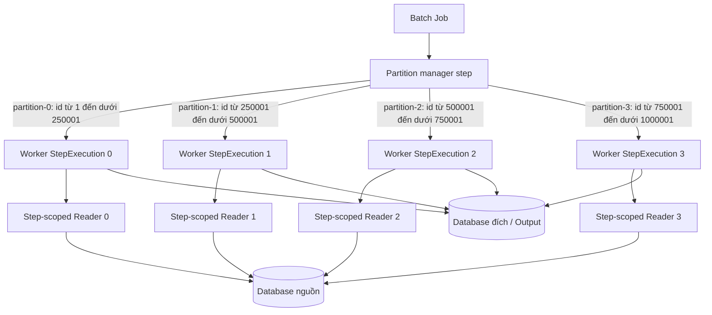

# Parallel read từ database trong Spring Batch

## 1. Bài toán và mục tiêu

Khi một batch job phải đọc hàng triệu dòng từ database, phần đọc dữ liệu có thể trở thành nút thắt ngay cả khi `ItemProcessor` và `ItemWriter` đã được tối ưu. Ví dụ, hệ thống cần đối soát 12 triệu giao dịch trong cửa sổ bảo trì 90 phút; một reader đơn đọc tuần tự mất hơn ba giờ vì truy vấn, truyền dữ liệu và thời gian chờ I/O. Ta muốn cho nhiều reader độc lập đọc **những tập bản ghi không trùng nhau**, để tận dụng nhiều kết nối và worker.

Trong module `SPRING_BATCH_SCALING_OPERATIONS`, mở rộng Spring Batch cho workload lớn không chỉ là bật nhiều luồng. Cần xác định database thực sự có khả năng phục vụ nhiều truy vấn đồng thời hay không; bảo đảm reader an toàn với thread, dữ liệu được chia không trùng/không sót, restart có thể tiếp tục, và mức concurrency không làm nghẽn database.

**Parallel read từ database** là cách chia tập dữ liệu đầu vào thành nhiều phần độc lập, mỗi phần được đọc bởi một `ItemReader` riêng trong một `StepExecution`/tiến trình phù hợp. Các phần thường được xác định bằng ID range, khóa nghiệp vụ, thời gian, phân vùng bảng hoặc danh sách ID cố định.

Kết quả mong đợi sau bài học:

- Phân biệt đọc song song qua **partitioning** với dùng một reader chung trong multi-threaded step.
- Thiết kế ranh giới phân vùng và truy vấn SQL không trùng lặp; chọn paging, cursor hoặc keyset phù hợp.
- Cấu hình partitioned step có `@StepScope` reader; hiểu giới hạn của `gridSize`, thread pool và connection pool.
- Xử lý dữ liệu biến động, checkpoint/restart và viết kết quả an toàn khi nhiều partition cùng chạy.
- Đo throughput và truy tìm nút thắt database trước khi tăng concurrency.

## 2. Hiểu đúng: chia dữ liệu trước, chạy song song sau

Không thể đạt parallel read an toàn bằng cách chỉ để nhiều thread cùng gọi `read()` trên một instance `JdbcCursorItemReader` hoặc `JdbcPagingItemReader`. Nhiều reader có trạng thái nội bộ như vị trí dòng, trang hiện tại và `ExecutionContext`. Chia sẻ chúng giữa các thread dễ gây race condition, mất/lặp item và checkpoint sai; việc bọc khóa đồng bộ quanh một reader lại thường tuần tự hóa phần đọc.

Thay vào đó, **partitioning** tạo các `StepExecution` con, mỗi cái có `ExecutionContext` và reader riêng, đồng thời được giới hạn bởi một điều kiện WHERE cụ thể.



Trong ví dụ, các khoảng là **nửa mở** `[fromId, toId)`: bao gồm `fromId`, loại trừ `toId`. Bốn truy vấn có thể chạy đồng thời, mỗi truy vấn chỉ đọc hàng có ID trong khoảng được giao. Khoảng `[1, 1_000_001)` bao phủ các ID từ 1 đến 1.000.000; ID vắng mặt hoặc bị xóa không gây trùng, nhưng số dòng thực trong mỗi khoảng có thể khác nhau.

Phân biệt các thành phần:

| Thành phần | Vai trò | Chú ý |
| --- | --- | --- |
| `Partitioner` | Tạo các tên partition và `ExecutionContext` chứa điều kiện lọc, ví dụ `minId/maxId`. | Phải tạo phân vùng ổn định cho một lần chạy/restart. |
| Manager step | Điều phối các partition và tổng hợp kết quả `StepExecution`. | Nó không nhất thiết đọc từng dòng dữ liệu nghiệp vụ. |
| Worker step | Thực thi đọc, xử lý, ghi trên tập dữ liệu được giao. | Mỗi partition có `StepExecution` và checkpoint riêng. |
| `@StepScope ItemReader` | Lấy biến từ `stepExecutionContext` để tạo reader cho partition hiện tại. | Tránh chia sẻ trạng thái reader giữa các partition. |
| `TaskExecutor` / partition handler | Cho phép các worker step chạy đồng thời trong cùng JVM. | Giới hạn concurrency thực tế; `gridSize` không đồng nghĩa số thread. |
| `JobRepository` | Lưu trạng thái manager/worker step và `ExecutionContext`. | Hỗ trợ retry/restart các partition, không thay thế idempotency nghiệp vụ. |

## 3. Chọn cách phân chia dữ liệu

### 3.1. Chia theo khoảng khóa tăng dần (ID range)

Khi bảng có khóa số ổn định, index phù hợp và độ phân bố tương đối đều, đây thường là cách dễ vận hành nhất:

```sql
-- Partition 0
SELECT id, account_id, amount
FROM transactions
WHERE id >= :minId
  AND id < :maxId
ORDER BY id ASC;
```

Điều kiện `id >= :minId AND id < :maxId` là quy tắc bất biến, không thay bằng `BETWEEN` trên cả hai đầu nếu các khoảng chạm nhau. Với `BETWEEN 1 AND 250001` và `BETWEEN 250001 AND 500001`, ID 250001 bị lấy hai lần.

Ưu điểm: điều kiện dễ kiểm tra, tận dụng range scan trên index, biết chính xác khoảng ID của mỗi partition. Nhược điểm: các khoảng có độ rộng ID bằng nhau có thể chứa số hàng khác nhau do xóa dữ liệu, ID nhảy số hoặc tập dữ liệu tập trung vào một giai đoạn. Khi lệch tải lớn, lấy ranh giới theo **số lượng hàng ước tính** từ thống kê/histogram hoặc từ danh sách mốc khóa đã chốt có thể cân bằng hơn.

### 3.2. Chia theo thời gian hoặc khóa nghiệp vụ

Thích hợp với dữ liệu đã partition vật lý theo ngày/tháng hoặc tuyến khách hàng:

```sql
SELECT id, occurred_at, amount
FROM transactions
WHERE occurred_at >= :windowStart
  AND occurred_at < :windowEnd
ORDER BY occurred_at, id;
```

Nếu nhiều hàng có cùng `occurred_at`, chỉ sắp xếp theo thời gian chưa đủ ổn định: thêm `id` để tạo **thứ tự tổng xác định**. Với partition theo thời gian, các cửa sổ cũng nên dùng khoảng nửa mở.

Có thể phân chia theo `tenant_id`, `customer_id` hoặc shard key nếu workload có cô lập theo khách hàng. Khi một vài tenant rất lớn, cần chia nhỏ riêng các tenant đó để tránh một partition chạy lâu gấp nhiều lần phần còn lại.

### 3.3. Chia bằng hash/modulo

Ví dụ `MOD(customer_id, 4) = 0, 1, 2, 3` có thể giúp cân bằng hơn khi ID phân bố không đều. Nhưng áp dụng hàm lên cột trong `WHERE` có thể ngăn việc dùng index thông thường, làm database quét nhiều dòng cho mỗi worker. Chỉ dùng nếu có generated/expression index, physical partition hỗ trợ hoặc đã đo bằng `EXPLAIN`. Đồng thời phải chú ý cách database xử lý giá trị âm, NULL và cú pháp modulo.

### 3.4. Cố định danh sách ID đầu vào (manifest)

Nếu dữ liệu có thể thay đổi trong lúc job chạy và yêu cầu xử lý **chính xác tập dữ liệu tại một thời điểm**, có thể materialize danh sách ID cần xử lý vào bảng staging:

```sql
-- Tạo snapshot logic của danh sách công việc trước khi chạy các partition.
INSERT INTO batch_input_manifest (run_id, transaction_id)
SELECT :runId, t.id
FROM transactions t
WHERE t.created_at < :cutoff;

-- Một partition chỉ đọc công việc thuộc run và dải ID được giao.
SELECT t.id, t.account_id, t.amount
FROM batch_input_manifest m
JOIN transactions t ON t.id = m.transaction_id
WHERE m.run_id = :runId
  AND m.transaction_id >= :minId
  AND m.transaction_id < :maxId
ORDER BY m.transaction_id;
```

Bảng staging cần ràng buộc unique, ví dụ `(run_id, transaction_id)`, và index phục vụ `(run_id, transaction_id)`. Cách này cố định **tập ID**, nhưng giá trị các cột đọc từ bảng gốc vẫn có thể đổi. Muốn snapshot nội dung thực sự, phải lưu cả dữ liệu cần thiết vào staging, dùng cơ chế snapshot/temporal của database hoặc một chiến lược nhất quán khác đã được kiểm chứng.

## 4. Paging, cursor và keyset trong mỗi partition

Partitioning quyết định **mỗi reader đọc dòng nào**; paging/cursor quyết định **mỗi reader lấy dòng bằng cách nào**.

| Cơ chế | Cách làm | Phù hợp | Rủi ro và lưu ý |
| --- | --- | --- | --- |
| `JdbcPagingItemReader` | Lấy dữ liệu theo từng trang bằng SQL do paging query provider tạo. | Bảng lớn, cần checkpoint và điều chỉnh page size. | Sort key phải ổn định/duy nhất; filter thay đổi có thể làm tập kết quả biến động. |
| `JdbcCursorItemReader` | Mở JDBC cursor và lấy các bản ghi tuần tự, thường với `fetchSize`. | Truy vấn streaming có thể duy trì cursor/connection dài. | Mỗi partition giữ tài nguyên DB lâu; phải xác minh driver hỗ trợ streaming và cơ chế restart. |
| Keyset pagination tự viết | Truy vấn `WHERE id > :lastSeenId ORDER BY id LIMIT :size`. | Muốn điều khiển điểm tiếp tục và độ ổn định theo khóa. | Phải lưu `lastSeenId` vào `ExecutionContext` và xử lý transaction/restart đúng. |
| OFFSET pagination tự viết | `ORDER BY id LIMIT :size OFFSET :offset`. | Tập nhỏ, gần như bất biến. | OFFSET sâu thường chậm; insert/delete giữa các trang dễ làm dịch vị trí, gây lặp/bỏ sót. |

Một lưu ý: `JdbcPagingItemReader` của Spring Batch không nên bị đánh đồng với vòng lặp tự viết `OFFSET`. Query provider của nó dùng sort key và các truy vấn trang dành riêng cho từng database để xác định điểm đọc tiếp theo. Dù vậy, **sort key phải tạo thứ tự độc nhất, không đổi trong quá trình đọc**; đó là tiền đề cho hành vi paging và restart ổn định.

Đối với `JdbcCursorItemReader`, việc tạo **một cursor riêng cho mỗi partition** cũng cho phép đọc song song. Tuy nhiên, tăng số cursor đồng thời có thể kéo theo nhiều connection, snapshot/transaction lâu và memory trên server; hãy thử tải thực tế.

## 5. Ví dụ triển khai Spring Batch: partitioned reader theo dải ID

Ví dụ sau dựa trên API builder quen thuộc của **Spring Batch 5.x** (cần đối chiếu chữ ký khi chuyển sang phiên bản khác). Giả sử bảng `transactions(id BIGINT PRIMARY KEY, amount DECIMAL)`, yêu cầu xử lý các ID từ 1 đến 1.000.000, có `JobRepository`, `PlatformTransactionManager` và `DataSource`. Các đoạn minh họa phần partition/read; `ItemWriter` và cấu hình Job chính được lược bớt để tập trung vào mục tiêu bài học.

### 5.1. Partitioner tạo các khoảng rời nhau

```java
import java.util.HashMap;
import java.util.Map;
import org.springframework.batch.core.partition.support.Partitioner;
import org.springframework.batch.item.ExecutionContext;

public final class IdRangePartitioner implements Partitioner {
    private final long fromId;
    private final long toIdExclusive;

    public IdRangePartitioner(long fromId, long toIdExclusive) {
        if (fromId >= toIdExclusive) {
            throw new IllegalArgumentException("ID range must be non-empty");
        }
        this.fromId = fromId;
        this.toIdExclusive = toIdExclusive;
    }

    @Override
    public Map<String, ExecutionContext> partition(int gridSize) {
        if (gridSize <= 0) {
            throw new IllegalArgumentException("gridSize must be positive");
        }

        long count = toIdExclusive - fromId;
        int partitionCount = (int) Math.min((long) gridSize, count);
        long baseWidth = count / partitionCount;
        long remainder = count % partitionCount;
        long lower = fromId;

        Map<String, ExecutionContext> result = new HashMap<>();
        for (int i = 0; i < partitionCount; i++) {
            long width = baseWidth + (i < remainder ? 1L : 0L);
            long upper = lower + width;
            ExecutionContext context = new ExecutionContext();
            context.putLong("minId", lower);
            context.putLong("maxId", upper); // exclusive
            result.put("partition-" + i, context);
            lower = upper;
        }
        return result;
    }
}
```

Với `new IdRangePartitioner(1L, 1_000_001L)` và `gridSize = 4`, ta có:

| Partition | minId | maxId (exclusive) | ID có thể đọc |
| --- | ---: | ---: | --- |
| partition-0 | 1 | 250001 | 1…250000 |
| partition-1 | 250001 | 500001 | 250001…500000 |
| partition-2 | 500001 | 750001 | 500001…750000 |
| partition-3 | 750001 | 1000001 | 750001…1000000 |

Thuật toán chia **không lặp và không bỏ khoảng ID**, nhưng nó không bảo đảm số lượng bản ghi ở các khoảng bằng nhau. Nếu khoảng ID phải lấy từ `MIN(id)`/`MAX(id)` trong database, cần xác định và **cố định biên trên tại đầu lần chạy**; không liên tục tính lại `MAX(id)` mỗi khi khởi động lại job. Trong thực tế có thể đưa `runId`/`cutoff`/biên ID vào `JobParameters` hoặc lưu tại metadata/bảng manifest để tái sử dụng.

### 5.2. Reader riêng cho từng StepExecution

```java
import java.math.BigDecimal;
import java.util.Map;
import javax.sql.DataSource;
import org.springframework.batch.core.configuration.annotation.StepScope;
import org.springframework.batch.item.database.JdbcPagingItemReader;
import org.springframework.batch.item.database.Order;
import org.springframework.batch.item.database.builder.JdbcPagingItemReaderBuilder;
import org.springframework.beans.factory.annotation.Value;
import org.springframework.context.annotation.Bean;
import org.springframework.context.annotation.Configuration;

record TransactionRow(long id, BigDecimal amount) {}

@Configuration
class TransactionReaderConfig {

    @Bean
    @StepScope
    JdbcPagingItemReader<TransactionRow> transactionReader(
            DataSource dataSource,
            @Value("#{stepExecutionContext['minId']}") Long minId,
            @Value("#{stepExecutionContext['maxId']}") Long maxId) {

        return new JdbcPagingItemReaderBuilder<TransactionRow>()
                .name("transactionReader")
                .dataSource(dataSource)
                .selectClause("SELECT id, amount")
                .fromClause("FROM transactions")
                .whereClause("WHERE id >= :minId AND id < :maxId")
                .sortKeys(Map.of("id", Order.ASCENDING))
                .parameterValues(Map.of("minId", minId, "maxId", maxId))
                .pageSize(500)
                .saveState(true)
                .rowMapper((rs, rowNum) -> new TransactionRow(
                        rs.getLong("id"),
                        rs.getBigDecimal("amount")))
                .build();
    }
}
```

Đây là cấu hình trọng tâm:

- `@StepScope` tạo reader gắn với `StepExecution`; các expression lấy `minId`/`maxId` từ `ExecutionContext` của partition hiện tại.
- `whereClause` lọc **chỉ** phạm vi được giao; `sortKeys` dùng `id` là khóa duy nhất, ổn định.
- `pageSize(500)` là kích thước trang SQL cho reader, độc lập với `chunk(100)` trong worker step. Chẳng hạn một trang 500 item có thể được xử lý theo năm transaction chunk 100 item.
- `saveState(true)` lưu checkpoint của reader trong `ExecutionContext` khi Spring Batch commit chunk. Reader cần `name` và không được dùng chung như một instance có trạng thái giữa các StepExecution.

Với các phương án lọc dữ liệu phức tạp hơn, đưa thêm `runId`/`cutoff` vào tham số SQL, giữ điều kiện và sort key ổn định trong suốt vòng đời job.

### 5.3. Worker step và partition manager

```java
import org.springframework.batch.core.Step;
import org.springframework.batch.core.job.builder.JobBuilder;
import org.springframework.batch.core.repository.JobRepository;
import org.springframework.batch.core.step.builder.StepBuilder;
import org.springframework.batch.item.ItemWriter;
import org.springframework.batch.item.database.JdbcPagingItemReader;
import org.springframework.context.annotation.Bean;
import org.springframework.core.task.TaskExecutor;
import org.springframework.scheduling.concurrent.ThreadPoolTaskExecutor;
import org.springframework.transaction.PlatformTransactionManager;

@Bean
Step transactionWorkerStep(
        JobRepository jobRepository,
        PlatformTransactionManager transactionManager,
        JdbcPagingItemReader<TransactionRow> transactionReader,
        ItemWriter<TransactionRow> transactionWriter) {

    return new StepBuilder("transactionWorkerStep", jobRepository)
            .<TransactionRow, TransactionRow>chunk(100, transactionManager)
            .reader(transactionReader)
            .writer(transactionWriter)
            .build();
}

@Bean
TaskExecutor partitionTaskExecutor() {
    ThreadPoolTaskExecutor executor = new ThreadPoolTaskExecutor();
    executor.setCorePoolSize(4);
    executor.setMaxPoolSize(4);
    executor.setQueueCapacity(8);
    executor.setThreadNamePrefix("db-partition-");
    executor.initialize();
    return executor;
}

@Bean
Step transactionPartitionManager(
        JobRepository jobRepository,
        Step transactionWorkerStep,
        TaskExecutor partitionTaskExecutor) {

    return new StepBuilder("transactionPartitionManager", jobRepository)
            .partitioner("transactionWorkerStep",
                    new IdRangePartitioner(1L, 1_000_001L))
            .step(transactionWorkerStep)
            .gridSize(4)
            .taskExecutor(partitionTaskExecutor)
            .build();
}
```

Đoạn cấu hình được đặt trong một lớp `@Configuration` hợp lệ và cần bổ sung import/bean writer cùng Job để thành ứng dụng hoàn chỉnh. Với Spring Batch 5.x, API `StepBuilder`/`PartitionStepBuilder` như trên mô tả **local partitioning**: nhiều worker step chạy trong cùng ứng dụng nhưng mỗi worker có `StepExecution` riêng. Nếu muốn đọc song song trên nhiều JVM, chuyển sang **remote partitioning** với cơ chế phân phối partition qua messaging; khi đó bản thân worker đọc dữ liệu từ database được giao.

**Cần phân biệt ba giới hạn:** `gridSize = 4` yêu cầu tối đa bốn phân vùng được tạo trong ví dụ; thread pool cho phép tối đa bốn task đang chạy; database/HikariCP phải có đủ connection và năng lực xử lý truy vấn. Tăng `gridSize` lên 16 khi pool chỉ có bốn worker thread không tự biến 16 truy vấn thành đồng thời. Trong ví dụ thực, ID range không nên hard-code; khởi tạo từ tham số/cutoff được chốt theo mỗi job.

## 6. Tính nhất quán dữ liệu khi nhiều reader cùng chạy

### 6.1. Tập dữ liệu có thể đổi trong lúc job đang quét

Giả sử manager chốt `id < 1_000_001`. Các partition là rời nhau, nhưng không có nghĩa chúng nhìn thấy **cùng một ảnh chụp database**:

- Transaction mới insert với ID lớn hơn biên trên sẽ không nằm trong job này; điều đó phù hợp khi biên được chốt.
- Bản ghi bị cập nhật/xóa trước lúc một partition đọc có thể thay đổi kết quả. Một ID bị xóa vẫn không tạo trùng, nhưng có thể tạo thiếu so với yêu cầu "tất cả dòng tồn tại ở thời điểm bắt đầu".
- Nếu điều kiện `WHERE status = 'NEW'` trong khi worker chuyển `status` thành `PROCESSED`, tập bản ghi đủ điều kiện thay đổi giữa các trang. Khi đó một reader sử dụng phân trang theo vị trí có thể bỏ sót hoặc lặp; dù dùng sort key, việc sửa điều kiện lọc vẫn cần được phân tích và kiểm thử.
- Mức cô lập `READ COMMITTED` phổ biến cho phép mỗi truy vấn thấy dữ liệu đã commit ở thời điểm khác nhau. Ngay cả `REPEATABLE READ` trên từng transaction chunk cũng không tự tạo snapshot chung cho **toàn bộ job phân tán qua nhiều connection/transaction**.

Các chiến lược, từ đơn giản đến nghiêm ngặt:

1. **Input bất biến trong lúc chạy:** đọc theo ID/cutoff và không sửa các cột dùng lọc/sắp xếp. Phù hợp với bảng append-only.
2. **Chốt high-water mark:** ghi nhận `maxId` hoặc `cutoff` ở đầu job, chỉ lấy dữ liệu nằm trong giới hạn đã chốt. Cách này **không** tự đóng băng giá trị bản ghi hay ngăn insert được backfill với ID thấp hơn.
3. **Snapshot danh sách ID hoặc staging:** materialize tập khóa/cột đầu vào cho `runId` trước khi chạy partition. Chi phí thêm dung lượng/ghi staging đổi lại khả năng giải thích và khôi phục tốt hơn.
4. **Tính năng snapshot của database:** dùng temporal table, exported snapshot, point-in-time read hoặc cơ chế tương đương nếu hệ quản trị hỗ trợ, chấp nhận chi phí và giới hạn riêng của nó.

Hãy chọn chiến lược theo hợp đồng dữ liệu nghiệp vụ: "mọi dòng có tại T0", "mọi dòng phát sinh trước cutoff", hay "dòng nào thỏa điều kiện tại lúc được quét" là các yêu cầu khác nhau.

### 6.2. Hai lớp chống trùng khác nhau

**Không trùng ở mức đọc**: `WHERE` của các partition tạo một phép chia không giao nhau theo khóa, ví dụ `[minId,maxId)`.

**Không trùng ở mức tác động nghiệp vụ**: writer phải an toàn khi chunk được retry, partition được restart, hoặc một job mới xử lý lại dữ liệu cũ. Ví dụ:

```sql
-- Cần chọn cú pháp UPSERT theo hệ quản trị cụ thể.
CREATE TABLE transaction_summary (
    transaction_id BIGINT PRIMARY KEY,
    normalized_amount DECIMAL(18,2) NOT NULL
);

-- Ý tưởng: INSERT ... ON CONFLICT / MERGE / UPDATE-THEN-INSERT
-- theo transaction_id, thay vì ghi bản ghi kết quả không có khóa.
```

Đừng trông chờ partitioning bảo đảm exactly-once qua toàn bộ DB nguồn, JobRepository và DB đích. Transaction ghi kết quả có thể commit rồi worker chết trước khi manager hoặc JobRepository ghi nhận checkpoint. Khi restart, dữ liệu đó có thể được xử lý lại. Sử dụng khóa nghiệp vụ, idempotent UPSERT, deduplication hoặc outbox nếu tác động ra dịch vụ ngoài.

## 7. Retry, restart và checkpoint của parallel reader

Mỗi partition có trạng thái riêng trong `JobRepository`. Khi một worker step thất bại, cơ chế restart của Spring Batch có thể chạy lại các partition chưa hoàn tất, dựa vào tên partition/`ExecutionContext` và quy tắc restart hiện hành. Vì vậy:

- **Giữ tên và ranh giới partition ổn định** cho cùng JobInstance. Không đổi thuật toán chia hoặc `gridSize` giữa chừng khi restart nếu làm thay đổi ánh xạ tên partition ↔ dải ID đã chạy.
- Reader cần `saveState(true)`, tên xác định và state riêng từng StepExecution. Với paging, checkpoint phụ thuộc thứ tự sort và tính ổn định của tập kết quả.
- Chunk transaction commit output và cập nhật checkpoint không nên bị giả định nguyên tử nếu chúng đi qua những transaction manager/tài nguyên khác nhau.
- Lỗi tạm thời (deadlock, connection timeout) có thể retry với backoff, giới hạn số lần và chính sách phù hợp. Lỗi dữ liệu không thể khắc phục cần được ghi rõ, skip/quarantine theo quy tắc nghiệp vụ; không thử vô hạn.
- Phải kiểm thử cả restart sau khi một số partition đã COMPLETED, một partition FAILED và một partition đang xử lý dở. Đảm bảo chỉ chạy lại phần cần thiết và không làm sai output.

Ví dụ: bốn partition đã đọc lần lượt 250.000 ID. P0/P1/P2 thành công, P3 lỗi sau khi xử lý 30.000 bản ghi. Khi chạy lại cùng JobInstance, Spring Batch dùng metadata để quyết định partition nào phải restart và lấy state đọc tương ứng. Nếu bạn **tính lại** dải ID P3 theo `MAX(id)` hiện tại, checkpoint cũ không còn tương ứng với cùng tập dữ liệu; đây là nguyên nhân thực tế của việc thiếu/trùng dữ liệu khó tìm.

### Checklist cho reader có thể restart

| Kiểm tra | Lý do |
| --- | --- |
| Partition có tên cố định (`partition-0`, …) gắn với biên đã lưu | Metadata step có thể ánh xạ trở lại đúng công việc. |
| Sort key độc nhất, ổn định, có index | Paging có thứ tự xác định và tránh quét/sắp xếp quá nặng. |
| Reader được tạo theo `@StepScope` | Mỗi StepExecution có vị trí đọc và checkpoint riêng. |
| Tập input có cutoff/snapshot rõ | Tránh đọc thêm/bỏ sót do dữ liệu nguồn đổi. |
| Writer idempotent | Retry và restart không gây kết quả nghiệp vụ trùng. |
| Test kill/restart ở giữa chunk, giữa partition | Kiểm tra hành vi dưới lỗi thực thay vì chỉ happy path. |

## 8. Tối ưu truy vấn và số kết nối

Parallel read thường thất bại về hiệu năng khi mỗi worker chạy một truy vấn rất tốn tài nguyên hoặc DB đã bão hòa. Trước khi mở rộng, cần xem **execution plan**:

```sql
-- Cú pháp cụ thể của EXPLAIN/ANALYZE tùy database.
EXPLAIN
SELECT id, amount
FROM transactions
WHERE id >= 250001 AND id < 500001
ORDER BY id ASC;
```

Ưu tiên index hỗ trợ đồng thời `WHERE` và `ORDER BY`. Chỉ lấy cột cần thiết, tránh `SELECT *` khi có cột LOB lớn, và kiểm tra có range scan hợp lý thay vì full table scan/hàng loạt external sort. Nếu câu truy vấn có `tenant_id = :tenantId`, `status = :status` và `ORDER BY id`, nên xem xét index ghép dựa trên phân bố dữ liệu và execution plan cụ thể; không áp dụng một thứ tự cột index cho mọi DB.

**Các tham số cần chỉnh cùng nhau:**

| Tham số | Điều nó kiểm soát | Cái giá của việc tăng quá mức |
| --- | --- | --- |
| Số partition | Số phần việc logic và độ mịn khi cân bằng tải. | Nhiều step metadata, overhead khởi tạo, chờ điều phối. |
| Kích thước thread pool | Số worker step cục bộ có thể chạy đồng thời. | Nhiều kết nối, CPU, memory, lock, áp lực DB. |
| DB connection pool | Số connection có thể cấp trong một JVM. | Chạm giới hạn DB, tăng transaction cạnh tranh, thiếu pool cho luồng khác. |
| `pageSize` | Số bản ghi mỗi truy vấn paging. | Page quá lớn tốn bộ nhớ; quá nhỏ tăng round trip. |
| `fetchSize` | Gợi ý số dòng JDBC fetch cho driver/cursor. | Phụ thuộc driver, không bảo đảm streaming; quá lớn tốn bộ nhớ. |
| `chunkSize` | Số item trong một chunk transaction của Spring Batch. | Commit thưa hơn, lock/rollback lớn hơn, khó retry phần nhỏ. |
| Batch write size | Số câu lệnh được gom khi ghi output. | Lock/transaction lớn hoặc giới hạn tham số DB. |

Ví dụ: pool 10 connection trong một JVM không có nghĩa nên cấu hình 10 worker đọc cùng lúc nếu job còn manager, writer, thống kê và tác vụ khác dùng DB. Với bốn worker, mỗi worker có thể giữ connection đọc đồng thời xin thêm connection ghi; nhu cầu kết nối phụ thuộc implementation reader, writer và transaction manager. Đo số connection thực ở đỉnh tải, timeout chờ connection và giới hạn trên toàn cụm.

Ở mô hình remote partitioning, **mỗi JVM worker có pool riêng**, nên tổng số connection có thể tăng xấp xỉ theo số replica. Cần quy hoạch ở mức toàn database, không chỉ nhìn cấu hình HikariCP của từng service.

### Ví dụ hiệu năng và cách đọc số liệu

Giả sử đọc 2,4 triệu bản ghi:

| Số worker đọc đồng thời | Thời gian hoàn thành | Throughput xấp xỉ | Nhận xét |
| ---: | ---: | ---: | --- |
| 1 | 60 phút | 667 dòng/giây | Baseline. |
| 2 | 34 phút | 1.176 dòng/giây | Tăng tốc khá tốt. |
| 4 | 22 phút | 1.818 dòng/giây | Lợi ích bắt đầu giảm. |
| 8 | 21 phút | 1.905 dòng/giây | Gần bão hòa; cần đo xem nghẽn I/O, pool hay CPU DB. |

Đây là **dữ liệu giả định để minh họa phép đo**, không phải benchmark Spring Batch. Với bốn worker, `speedup = 60/22 ≈ 2,73` và hiệu suất song song `≈ 2,73/4 = 68%`. Nếu tăng từ bốn lên tám worker chỉ giảm một phút mà DB chạm ngưỡng I/O, tối ưu truy vấn, cách chia hoặc vị trí đặt worker thường có ích hơn tăng replica.

Theo dõi tối thiểu: throughput mỗi partition, độ lệch thời gian hoàn thành giữa các partition, p95/p99 latency query, số lần fetch/round trip, connection wait, CPU/IOPS của DB, lock/deadlock, replication lag (nếu đọc replica), GC và thời gian commit. Kết hợp metric Spring Batch `readCount`, `writeCount`, `skipCount`, `commitCount` với metric database để phân biệt lỗi xử lý và nghẽn đọc.

## 9. Local và remote parallel read: chọn kiến trúc

| Kiến trúc | Nơi đọc database | Điểm phù hợp | Ràng buộc |
| --- | --- | --- | --- |
| Multi-threaded step | Có thể dùng reader chia sẻ hoặc reader được thiết kế riêng cho concurrency. | Ít thay đổi cấu trúc ứng dụng. | Thread safety và checkpoint phức tạp; không tự chia input theo WHERE. |
| Parallel independent steps | Mỗi step đọc nguồn riêng. | Các nguồn/bảng hoặc workflow vốn độc lập. | Số step cố định, dễ trùng dữ liệu nếu không quy hoạch. |
| **Local partitioning** | Nhiều StepExecution trong một JVM, reader và WHERE riêng. | Dễ bắt đầu, có JobRepository và checkpoint mỗi partition. | CPU/memory/pool của một máy; cùng nguồn DB. |
| **Remote partitioning** | Mỗi worker JVM đọc dải dữ liệu riêng từ DB. | Cần mở rộng thêm máy/JVM, dữ liệu có thể chia phân vùng. | Cần broker/điều phối, hạn chế tổng connection, giám sát worker và retry. |
| Remote chunking | **Manager** đọc DB rồi gửi chunk item cho worker xử lý/ghi. | Đọc nhanh, xử lý/ghi nặng. | Reader manager vẫn là điểm tập trung, không giải quyết bottleneck đọc. |

Nếu bottleneck chính nằm ở **đọc nguồn**, local hoặc remote partitioning là ứng viên tự nhiên. Nếu chỉ xử lý từng bản ghi nặng còn reader không nghẽn, remote chunking hoặc multi-threaded processing có thể đủ. Nếu database không chịu thêm I/O, thay kiến trúc xử lý chưa chắc giúp; có thể cần read replica được kiểm chứng, thay đổi indexing/query, CDC, snapshot staging hoặc phân vùng dữ liệu ở tầng database.

## 10. Lộ trình triển khai và kiểm thử

Một lộ trình thực tế để chạy trên production:

1. **Đo baseline một reader:** ghi nhận thời gian đọc, throughput, query plan, CPU/IO, connection và tài nguyên của writer.
2. **Định nghĩa tập input:** xác định watermark/cutoff, biên dải ID và yêu cầu nhất quán khi hàng bị insert/update/delete.
3. **Chọn partition key:** kiểm tra unique, index, độ lệch dữ liệu và nguy cơ hot partition; tránh điều kiện chỉ tối ưu trên giấy.
4. **Cấu hình reader theo StepScope:** bảo đảm mỗi partition có WHERE, sort key và checkpoint riêng; cấu hình page size/chunk size được đo.
5. **Bắt đầu concurrency thấp:** thử 2 rồi 4 worker; tăng theo số liệu thay vì đặt theo số core đơn thuần.
6. **Kiểm tra tổng DB load:** nguồn, đích, replica, transaction lock và pool của toàn hệ thống; thắt số worker nếu vượt ngưỡng.
7. **Kiểm thử restart có lỗi:** kill một worker/manager, ngắt connection, retry deadlock, thử dữ liệu nguồn đổi trong lúc chạy.
8. **Quan sát và đối soát:** so sánh số ID trong tập input với số ID kết quả duy nhất; truy dấu partition ID và JobExecution khi thiếu/trùng.

Những bài kiểm thử tối thiểu:

| Tình huống | Kết quả cần chứng minh |
| --- | --- |
| ID 1…20, 4 partitions, chunk nhỏ | Mỗi ID xuất hiện **một lần** ở mức input logic, không có khoảng giao nhau. |
| Có lỗ hổng ID (1, 2, 1000) | Không mất dữ liệu dù một vài partition rỗng. |
| Dữ liệu lệch: 80% hàng ở một khoảng | Phát hiện straggler và điều chỉnh ranh giới theo dữ liệu thực. |
| Insert/update/delete trong lúc job chạy | Kết quả đúng theo chính sách cutoff/snapshot đã định nghĩa. |
| Một partition thất bại rồi restart | Giữ ranh giới ổn định, checkpoint đúng, output không trùng. |
| Connection pool gần giới hạn | Có backpressure/giới hạn worker, không đẩy DB vào timeout dây chuyền. |
| Tăng 2 → 4 → 8 worker | Tìm được điểm throughput không còn cải thiện tương xứng với chi phí DB. |

## 11. Những điểm cần nhớ

Đọc song song hiệu quả bắt đầu bằng **phân chia tập dữ liệu chính xác và ổn định**, sau đó mới tăng concurrency. Spring Batch partitioning cho phép mỗi partition dùng reader riêng, điều kiện WHERE riêng và lưu trạng thái trong JobRepository; đây thường là nền tảng dễ kiểm soát hơn việc chia sẻ một reader giữa nhiều luồng. Paging/cursor cần sort key/index và cấu hình fetch phù hợp; restart cần partition identity cùng checkpoint bất biến; output cần idempotent vì lỗi có thể làm dữ liệu được xử lý lại.

Với workload dữ liệu lớn, câu hỏi không chỉ là "bao nhiêu worker" mà là: **database có đang là bottleneck, các truy vấn có tránh được quét trùng, pool/IO có đủ và dữ liệu có thể được đối soát sau restart hay không?** Chỉ khi đo và trả lời được những câu hỏi đó, việc tăng số reader mới đem lại hiệu năng có thể dự đoán và vận hành bền vững.

### Tài liệu tham khảo

- [Spring Batch Reference — Scaling and Parallel Processing](https://docs.spring.io/spring-batch/reference/scalability.html)
- [Spring Batch Reference — Item Readers and Writers](https://docs.spring.io/spring-batch/reference/readers-and-writers/index.html)
- [Spring Batch Reference — Database ItemReaders and ItemWriters](https://docs.spring.io/spring-batch/reference/readers-and-writers/database.html)
- [Spring Batch Reference — Partitioning](https://docs.spring.io/spring-batch/reference/scalability.html#partitioning)
- [Spring Batch Reference — Configuring a Step](https://docs.spring.io/spring-batch/reference/step/chunk-oriented-processing.html)
