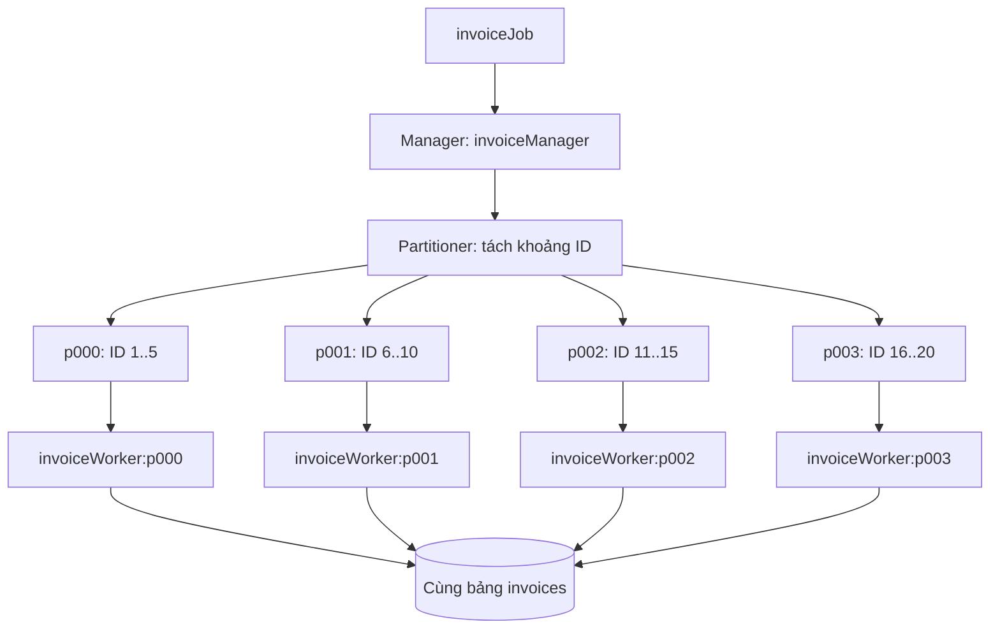

# Partition theo primary key khi mở rộng Spring Batch

Trong các job Spring Batch đọc hàng triệu bản ghi từ cơ sở dữ liệu, một worker duy nhất thường không tận dụng hết CPU và khả năng xử lý song song của hệ thống. **Partition theo primary key (PK)** là cách chia tập bản ghi thành nhiều phần độc lập theo khóa chính, sau đó giao mỗi phần cho một worker step. Kỹ thuật này thuộc nhóm **database scaling** ở tầng xử lý batch: nó giúp tăng độ song song, cô lập tiến độ của mỗi phần dữ liệu và hỗ trợ restart khi một partition thất bại.

Bài học thuộc module `SPRING_BATCH_SCALING_OPERATIONS`, nơi mục tiêu là mở rộng Spring Batch bằng multi-threaded step, parallel steps, partitioning và xử lý phân tán, đồng thời đo nút thắt, đảm bảo thread safety và vận hành restart/retry theo tài nguyên thực tế. Ở đây, ta tập trung vào quyết định chia dữ liệu **theo PK** và hệ quả đối với SQL, chỉ mục, tính đúng đắn, hiệu năng và JobRepository.

## 1. Hiểu đúng phạm vi: chia workload, không phải chia bảng vật lý

Giả sử bảng `invoices` có khóa chính dạng số nguyên tăng dần:

```sql
CREATE TABLE invoices (
    id BIGINT PRIMARY KEY,
    amount DECIMAL(18, 2) NOT NULL,
    processed BOOLEAN NOT NULL DEFAULT FALSE
);
```

Một truy vấn tuần tự có thể là:

```sql
SELECT id, amount
FROM invoices
WHERE id BETWEEN 1 AND 20
ORDER BY id;
```

Nếu chia bốn partition theo PK, các worker đọc những đoạn không giao nhau:

| Partition | Khoảng PK bao gồm hai đầu | Điều kiện SQL | Tên worker `StepExecution` ví dụ |
| --- | --- | --- | --- |
| `p000` | `1–5` | `id >= 1 AND id <= 5` | `invoiceWorker:p000` |
| `p001` | `6–10` | `id >= 6 AND id <= 10` | `invoiceWorker:p001` |
| `p002` | `11–15` | `id >= 11 AND id <= 15` | `invoiceWorker:p002` |
| `p003` | `16–20` | `id >= 16 AND id <= 20` | `invoiceWorker:p003` |



Các worker cùng truy cập **một bảng vật lý**. Đây là *application-level partitioning* cho một job, khác với:

- **Database table partitioning**: DBMS quản lý các phân vùng vật lý của bảng (ví dụ range partition theo ngày), ảnh hưởng đến lưu trữ và query planning.
- **Sharding**: dữ liệu được phân phối sang nhiều máy/cụm cơ sở dữ liệu, thường cần quy tắc định tuyến và xử lý giao dịch xuyên shard.
- **Multi-threaded step**: nhiều thread cùng thực thi trong một step; không mặc nhiên có các `StepExecution` độc lập cho từng dải PK.

Partition theo PK trong Spring Batch có thể hoạt động dù bảng chưa được DBMS partition vật lý. Nếu bảng đã được chia vật lý, nên thiết kế điều kiện truy vấn để DBMS vẫn áp dụng được partition pruning khi có liên quan.

## 2. Điều kiện để dùng PK range hiệu quả

Một phương án chia theo khoảng PK thường phù hợp khi:

1. PK có **thứ tự toàn phần, ổn định**, dễ so sánh và đặt điều kiện range; trường hợp điển hình là `BIGINT`.
2. Mỗi bản ghi được gán vào **đúng một khoảng** và phạm vi quét được xác định trước.
3. Truy vấn dùng chỉ mục PK hoặc chỉ mục phù hợp, tránh quét toàn bảng cho từng worker.
4. Mỗi worker có thể xử lý bản ghi của mình độc lập; tác vụ ghi không tạo tranh chấp quá lớn trên cùng một tài nguyên.
5. Có chiến lược ghi idempotent và restart; tên partition và ranh giới dữ liệu có thể tái tạo ổn định.

**Không có yêu cầu PK phải liên tục.** Nếu bảng có ID `1, 2, 8, 13, 20` thì khoảng `1–5` chứa hai dòng, còn khoảng `6–10` chứa một dòng. Khoảng vẫn đúng về mặt bao phủ, nhưng **khối lượng giữa các worker có thể lệch nhau**.

Không nên áp dụng máy móc phép chia khoảng số cho UUID ngẫu nhiên, PK dạng chuỗi hoặc khóa ghép. Khi đó nên cân nhắc gán key theo danh sách, hash bucket có chỉ mục hỗ trợ, hoặc partition dựa trên tập khóa đã được lưu trước.

## 3. Tính các khoảng PK không giao nhau

Cho:

- `minId`: giá trị PK nhỏ nhất thuộc phạm vi xử lý.
- `maxId`: giá trị PK lớn nhất thuộc phạm vi xử lý.
- `gridSize`: số partition mong muốn.
- `total = maxId - minId + 1`: **độ rộng miền số**, không phải số bản ghi thực có.

Đặt `n = min(gridSize, total)` (khi `total > 0`). Chia `total` thành `n` đoạn; mỗi đoạn có độ dài cơ bản `total / n` và tối đa một đơn vị dư. Với `1..20` và `n = 4` ta nhận bốn khoảng bằng nhau; với `1..11` và `n = 3` ta nhận `1..4`, `5..8`, `9..11`.

Mỗi cặp khoảng kế tiếp phải thỏa:

```text
partition[i].maxId + 1 == partition[i + 1].minId
partition[0].minId == toànBộ.minId
partition[last].maxId == toànBộ.maxId
```

Đây là quy tắc cho các khoảng **đóng** `[minId, maxId]`; có thể thay bằng khoảng nửa mở `[startInclusive, endExclusive)` nhưng phải nhất quán trong cả Partitioner lẫn SQL. Nhầm `<` với `<=` ở biên là nguyên nhân phổ biến làm bỏ sót hoặc xử lý trùng hàng.

### Partitioner tạo khoảng theo PK

`Partitioner` tạo `Map<String, ExecutionContext>`: **key** là định danh logic của partition; **context** là tham số để worker đọc dữ liệu. Lớp sau xử lý cả trường hợp miền nhỏ hơn số worker, đồng thời kiểm tra phép tính số học để tránh overflow:

```java
import java.util.LinkedHashMap;
import java.util.Locale;
import java.util.Map;

import org.springframework.batch.core.partition.support.Partitioner;
import org.springframework.batch.item.ExecutionContext;

public final class IdRangePartitioner implements Partitioner {

    private final long minId;
    private final long maxId;

    // minId/maxId là phạm vi đã chốt cho một lần chạy của job.
    public IdRangePartitioner(long minId, long maxId) {
        if (minId > maxId) {
            throw new IllegalArgumentException("Khoảng PK rỗng hoặc không hợp lệ");
        }
        this.minId = minId;
        this.maxId = maxId;
    }

    @Override
    public Map<String, ExecutionContext> partition(int gridSize) {
        if (gridSize <= 0) {
            throw new IllegalArgumentException("gridSize phải > 0");
        }

        // Kiểm tra tràn số nếu phạm vi long quá rộng.
        long total = Math.addExact(Math.subtractExact(maxId, minId), 1L);
        int count = (int) Math.min((long) gridSize, total);
        long baseSize = total / count;
        long remainder = total % count;

        Map<String, ExecutionContext> result = new LinkedHashMap<>();
        long start = minId;

        for (int i = 0; i < count; i++) {
            long length = baseSize + (i < remainder ? 1 : 0);
            long end = Math.addExact(start, length - 1);

            ExecutionContext context = new ExecutionContext();
            context.putLong("minId", start);
            context.putLong("maxId", end);

            // Ví dụ: p000, p001, p002, ... (ổn định khi restart).
            String key = String.format(Locale.ROOT, "p%03d", i);
            result.put(key, context);

            // Tránh cộng 1 sau partition cuối khi end == Long.MAX_VALUE.
            if (i + 1 < count) {
                start = Math.addExact(end, 1L);
            }
        }

        return result;
    }
}
```

Lớp mẫu giả định `minId <= maxId` và miền số có thể biểu diễn bằng `long`. Một bảng rỗng nên được phát hiện trước khi khởi tạo `IdRangePartitioner`; không tạo partition giả với `minId=0, maxId=0` nếu ID 0 không nằm trong tập cần xử lý.

Với `new IdRangePartitioner(1, 20).partition(4)`, kết quả là:

```text
p000 -> {minId=1,  maxId=5}
p001 -> {minId=6,  maxId=10}
p002 -> {minId=11, maxId=15}
p003 -> {minId=16, maxId=20}
```

Nếu miền `1..20` có nhiều lỗ trống, Partitioner vẫn tạo đúng các khoảng trên. Nó chia **độ rộng keyspace**, chưa bảo đảm cân bằng **số bản ghi** hay thời gian chạy.

## 4. Gắn Partitioner với Spring Batch 5.x

Ví dụ sau xây dựng job xử lý hóa đơn bằng bốn worker song song trên cùng JVM:

- Manager `invoiceManager` yêu cầu bốn partition.
- Worker `invoiceWorker` xử lý các dòng có `id` nằm trong khoảng riêng.
- `JdbcPagingItemReader` đọc theo `id` tăng dần; `JdbcBatchItemWriter` đánh dấu `processed = TRUE` theo PK.
- Reader được khai báo `@StepScope` để mỗi `StepExecution` có trạng thái và tham số `ExecutionContext` riêng.

Ví dụ dùng bảng `invoices` ở đầu bài, có dữ liệu `id = 1..20`, và sử dụng các bean hạ tầng `DataSource`, `JobRepository`, `PlatformTransactionManager` đã được Spring Batch/Spring Boot cấu hình. Lớp `IdRangePartitioner` là lớp vừa định nghĩa ở mục 3.

```java
import java.math.BigDecimal;
import java.util.Map;
import javax.sql.DataSource;

import org.springframework.batch.core.Job;
import org.springframework.batch.core.Step;
import org.springframework.batch.core.configuration.annotation.StepScope;
import org.springframework.batch.core.job.builder.JobBuilder;
import org.springframework.batch.core.repository.JobRepository;
import org.springframework.batch.core.step.builder.StepBuilder;
import org.springframework.batch.core.partition.support.Partitioner;
import org.springframework.batch.item.database.JdbcBatchItemWriter;
import org.springframework.batch.item.database.JdbcPagingItemReader;
import org.springframework.batch.item.database.Order;
import org.springframework.batch.item.database.builder.JdbcBatchItemWriterBuilder;
import org.springframework.batch.item.database.builder.JdbcPagingItemReaderBuilder;
import org.springframework.beans.factory.annotation.Qualifier;
import org.springframework.beans.factory.annotation.Value;
import org.springframework.context.annotation.Bean;
import org.springframework.context.annotation.Configuration;
import org.springframework.core.task.TaskExecutor;
import org.springframework.jdbc.core.namedparam.MapSqlParameterSource;
import org.springframework.scheduling.concurrent.ThreadPoolTaskExecutor;
import org.springframework.transaction.PlatformTransactionManager;

@Configuration
public class InvoiceJobConfiguration {

    public record InvoiceRow(long id, BigDecimal amount) {}

    @Bean
    public Partitioner invoicePartitioner() {
        // Demo cố định 1..20. Production cần chốt phạm vi cho JobInstance.
        return new IdRangePartitioner(1L, 20L);
    }

    @Bean
    @StepScope
    public JdbcPagingItemReader<InvoiceRow> invoiceReader(
            DataSource dataSource,
            @Value("#{stepExecutionContext['minId']}") Long minId,
            @Value("#{stepExecutionContext['maxId']}") Long maxId) {

        return new JdbcPagingItemReaderBuilder<InvoiceRow>()
                .name("invoiceReader")
                .dataSource(dataSource)
                .selectClause("SELECT id, amount")
                .fromClause("FROM invoices")
                .whereClause("WHERE id >= :minId AND id <= :maxId")
                .sortKeys(Map.of("id", Order.ASCENDING))
                .parameterValues(Map.of("minId", minId, "maxId", maxId))
                .rowMapper((rs, rowNum) ->
                        new InvoiceRow(
                                rs.getLong("id"),
                                rs.getBigDecimal("amount")))
                .pageSize(5)
                .build();
    }

    @Bean
    @StepScope
    public JdbcBatchItemWriter<InvoiceRow> invoiceWriter(
            DataSource dataSource) {
        return new JdbcBatchItemWriterBuilder<InvoiceRow>()
                .dataSource(dataSource)
                .sql("UPDATE invoices SET processed = TRUE " +
                     "WHERE id = :id AND processed = FALSE")
                .itemSqlParameterSourceProvider(item ->
                        new MapSqlParameterSource("id", item.id()))
                // Một dòng đã xử lý có thể ảnh hưởng 0 rows khi chạy lại.
                .assertUpdates(false)
                .build();
    }

    @Bean
    public Step invoiceWorker(
            JobRepository jobRepository,
            PlatformTransactionManager transactionManager,
            @Qualifier("invoiceReader")
            JdbcPagingItemReader<InvoiceRow> reader,
            @Qualifier("invoiceWriter")
            JdbcBatchItemWriter<InvoiceRow> writer) {

        return new StepBuilder("invoiceWorker", jobRepository)
                .<InvoiceRow, InvoiceRow>chunk(5, transactionManager)
                .reader(reader)
                .writer(writer)
                .build();
    }

    @Bean
    public ThreadPoolTaskExecutor invoicePartitionExecutor() {
        ThreadPoolTaskExecutor executor = new ThreadPoolTaskExecutor();
        executor.setCorePoolSize(4);
        executor.setMaxPoolSize(4);
        executor.setQueueCapacity(4);
        executor.setThreadNamePrefix("invoice-partition-");
        return executor;
    }

    @Bean
    public Step invoiceManager(
            JobRepository jobRepository,
            @Qualifier("invoicePartitioner") Partitioner partitioner,
            @Qualifier("invoiceWorker") Step worker,
            @Qualifier("invoicePartitionExecutor") TaskExecutor executor) {

        return new StepBuilder("invoiceManager", jobRepository)
                .partitioner("invoiceWorker", partitioner)
                .step(worker)
                .gridSize(4)
                .taskExecutor(executor)
                .build();
    }

    @Bean
    public Job invoiceJob(
            JobRepository jobRepository,
            @Qualifier("invoiceManager") Step manager) {
        return new JobBuilder("invoiceJob", jobRepository)
                .start(manager)
                .build();
    }
}
```

**Lưu ý về dữ liệu thực:** ví dụ chỉ đọc `id` và `amount` rồi cập nhật trạng thái. Khi xử lý nghiệp vụ phức tạp, đặt xử lý vào `ItemProcessor` và kiểm soát các side effect trong `ItemWriter`. Truy vấn mẫu không lọc `processed = FALSE` ở reader, vì vậy retry có thể đọc cả dòng đã xử lý nhưng câu `UPDATE` được bảo vệ bằng điều kiện trạng thái. `assertUpdates(false)` là lựa chọn có chủ đích cho minh họa idempotence; trong nghiệp vụ đòi hỏi cập nhật chính xác một dòng, cần xử lý kết quả `0 rows` theo quy tắc riêng, không mặc định bỏ qua.

Trong ứng dụng thực, `id` và `amount` có thể được chuyển sang DTO phù hợp, SQL phải được điều chỉnh theo dialect DBMS và schema. `gridSize(4)` là số partition yêu cầu; cùng lúc có bao nhiêu worker chạy còn do executor, connection pool và giới hạn DB quyết định. Mỗi worker cần tối thiểu một kết nối đọc/ghi khi cần; nên dành thêm kết nối cho JobRepository, manager và các tác vụ hệ thống.

### Tại sao dùng `@StepScope`?

`ExecutionContext` của `invoiceWorker:p000` chứa `minId=1`, `maxId=5`, trong khi `invoiceWorker:p001` nhận `6..10`. Annotation `@StepScope` cho phép Spring tạo reader đúng theo context của từng `StepExecution`, thay vì dùng chung một reader có vị trí đọc mutable giữa các thread. Tên reader `invoiceReader` vẫn có thể giống nhau, vì metadata restart của reader được lưu trong context **riêng từng step execution**.

Sử dụng `JdbcPagingItemReader` với sort key `id` duy nhất, thứ tự ổn định và điều kiện range giúp tránh vấn đề phân trang thiếu thứ tự. Không dựa vào `OFFSET` lớn cho mỗi truy vấn nghiệp vụ vì chi phí thường tăng theo độ sâu; phải kiểm tra SQL thực tế mà JDBC paging provider sinh cho dialect đang chạy.

## 5. Chốt tập dữ liệu trước khi chia: điểm sống còn của restart

Với dữ liệu đang thay đổi, đọc `MIN(id), MAX(id)` rồi chia ngay chỉ xác định **biên số**, không tự tạo một snapshot nhất quán về các dòng đang tồn tại. Giữa lúc xác định biên và lúc chạy worker, transaction khác có thể thêm hoặc sửa bản ghi. PK tăng dần cũng không chứng minh rằng mọi transaction có ID nhỏ đã commit.

Một lộ trình thiết kế ổn định:

1. **Xác định tập bản ghi hợp lệ** theo một `business cutoff` hoặc snapshot nghiệp vụ có ý nghĩa (ví dụ ngày chốt dữ liệu hoặc batch ID), thay vì chỉ tin vào `MAX(id)`.
2. **Đóng băng ranh giới** và thông tin lọc cho `JobInstance`: truyền qua identifying `JobParameters` hoặc lưu lại bằng bước chuẩn bị và `ExecutionContext` được persist.
3. Tạo map partition với **key và range không thay đổi** giữa các lần retry/restart của cùng `JobInstance`.
4. Để writer có thể thực thi lại một cách an toàn; nếu có message hoặc API bên ngoài, dùng idempotency key/outbox hay cơ chế giao nhận phù hợp.
5. Nếu cần xử lý một snapshot thực sự bất biến, cân nhắc staging table/materialized ID list hoặc kỹ thuật snapshot/locking theo DBMS và SLA, thay vì giả định mọi lần đọc live table sẽ thấy cùng một tập dòng.

Ví dụ lấy biên ban đầu:

```sql
SELECT MIN(id) AS min_id, MAX(id) AS max_id
FROM invoices
WHERE processed = FALSE;
```

Truy vấn này **chỉ dùng để minh họa cách tìm biên**, chưa đủ để bảo đảm không bỏ sót dữ liệu khi các transaction cùng lúc ghi bảng. Nếu `processed` thay đổi trong quá trình chạy, truy vấn lại lúc restart có thể trả về biên khác. Tốt hơn là lưu biên đã chốt ngay từ đầu và dùng lại khi restart.

Thử nghĩ lần chạy đầu đã có ba partition `p000`, `p001`, `p002`. Nếu `p001` thất bại và hai partition còn lại hoàn thành, Spring Batch có thể dựa vào trạng thái đã lưu để chạy lại phần cần thiết. Nhưng nếu bạn đổi tên worker, đổi key `p001`, đổi biên ID hoặc chuyển `p001` sang một tập dữ liệu khác, lịch sử `StepExecution` trở nên khó đối chiếu và có thể dẫn đến bỏ sót/trùng công việc.

**Không nên đổi `gridSize` để “chia lại cho nhanh” khi đang restart cùng JobInstance.** Cơ chế splitter thường phục hồi partition và kích thước lưới từ metadata trước đó. Nếu cần chia tập dữ liệu theo chiến lược khác, hãy thiết kế một lần chạy mới và quy tắc xử lý trùng rõ ràng.

## 6. Từ chia đều ID đến cân bằng khối lượng thực tế

Chia đều **miền số** nhanh, dễ cài đặt và tận dụng index trên PK. Tuy nhiên, một worker xử lý 100 dòng còn worker khác xử lý 1 triệu dòng thì tổng thời gian vẫn bị worker chậm nhất chi phối.

### 6.1. Đo độ lệch trước khi tăng số partition

Có thể đếm số dòng theo khoảng để phát hiện skew:

```sql
SELECT COUNT(*) AS row_count
FROM invoices
WHERE id >= :minId AND id <= :maxId;
```

Quan sát mỗi partition ít nhất các số sau: số dòng đọc/ghi, thời gian chạy, throughput (dòng/giây), lỗi/retry, thời gian chờ connection, lock wait, CPU, disk I/O. Một nhóm partition có cùng số dòng nhưng thời gian xử lý chênh nhau vẫn có thể do join, dữ liệu lớn, contention hoặc xử lý nghiệp vụ không đồng đều.

### 6.2. Chiến lược khi phân bố PK thưa hoặc lệch

| Chiến lược | Cách làm | Khi nên chọn | Lưu ý |
| --- | --- | --- | --- |
| Equal-width PK range | Chia đều khoảng `[minId,maxId]` | PK số tăng tương đối đều, dữ liệu đơn giản | Không cân bằng nếu nhiều lỗ trống |
| Equal-row-count boundaries | Tìm các mốc PK sao cho mỗi khoảng có số dòng gần nhau | Dữ liệu lệch mạnh, partition ít nhưng tương đối lớn | Tính mốc có chi phí; phải lưu mốc để restart |
| Nhiều range nhỏ, nhiều partition hơn worker | Tạo nhiều partition logic và để executor nhận dần | Thời gian xử lý mỗi vùng khó đoán | Tăng số `StepExecution` và metadata; cần benchmark |
| Phân theo shard/bucket có index | Định tuyến từ cột bucket đã tính hoặc bảng ánh xạ | PK không thể range hiệu quả, UUID hoặc phân bố phức tạp | `MOD(id,N)` trực tiếp có thể khó dùng B-tree index |
| Materialized ID list | Chụp tập ID đủ điều kiện vào bảng staging, chia theo dãy hoặc batch ID | Cần snapshot ổn định, điều kiện lọc phức tạp | Phải quản lý vòng đời staging và dọn dẹp |

Ví dụ, nếu tồn tại ID trong `1..100` và `900001..900100`, chia bốn equal-width range gần như chắc chắn có các worker rỗng. Cách đặt ranh giới theo số dòng thực tế sẽ hợp lý hơn. Tuy vậy, ranh giới theo quantile chỉ giúp cân bằng số dòng, không bảo đảm cân bằng thời gian khi từng dòng có chi phí khác nhau.

Với workload biến động, có thể cân nhắc chia thành 100–200 partition logic cho một pool chỉ có 8–16 worker thay vì cố tạo 8 partition rất lớn. Đây là **ví dụ để benchmark**, không phải tỉ lệ tối ưu cố định; quá nhiều partition gây tăng metadata, câu query mở đầu và overhead của framework.

## 7. Thiết kế SQL và tài nguyên DB cho partition theo PK

PK range chỉ tăng tốc khi truy vấn và cơ sở dữ liệu thực sự hỗ trợ:

**Chỉ mục và kế hoạch thực thi**

```sql
-- Ví dụ: điều kiện có thể tận dụng index PK.
SELECT id, amount
FROM invoices
WHERE id >= :minId AND id <= :maxId
ORDER BY id;
```

Chỉ mục PK thường hỗ trợ range scan; nếu còn lọc theo `tenant_id`, `status`, `created_at` hoặc có join, hãy kiểm tra index tổng hợp và kế hoạch thực thi trên DBMS cụ thể. Không giả định cứ có PK index là mọi truy vấn song song đều tối ưu. Với PostgreSQL, có thể dùng `EXPLAIN (ANALYZE, BUFFERS)` trên truy vấn mẫu trong môi trường kiểm thử để xem row count thực, index scan/seq scan và số block đọc.

**Transaction và khóa**

- Tránh khoảng PK chồng nhau. Điều này giảm nguy cơ hai worker cập nhật cùng bản ghi, nhưng vẫn có thể tranh chấp ở bảng khác, unique index, trigger hoặc khóa nghiệp vụ chung.
- Đặt `chunkSize` đủ nhỏ để kiểm soát thời gian giữ transaction và lượng dữ liệu đệm; đủ lớn để giảm overhead commit. Ví dụ `chunk(5)` ở trên dùng để quan sát, không phải cấu hình production.
- Nếu writer cập nhật lại bảng nguồn trong lúc reader paging, xem xét tác động của filter, isolation level và thứ tự sort; keyset paging theo PK duy nhất thường dễ reasoning hơn paging bằng offset.
- Retry cho lỗi deadlock/timeout phải có giới hạn và backoff phù hợp; retry không tự làm cho cập nhật bên ngoài DB trở nên idempotent.

**Connection pool và giới hạn đồng thời**

Giả sử có `N = 8` partition chạy đồng thời. Reader/writer và JobRepository có thể cùng cần nhiều kết nối trong các thời điểm khác nhau; sizing cần đo theo cách dùng transaction và cấu hình pool thực tế. Bắt đầu từ khả năng cung cấp đủ kết nối cho worker cộng phần dự phòng, sau đó quan sát connection wait, DB CPU, lock và I/O. Tăng `gridSize`, thread pool và JDBC pool vô hạn dễ làm DB chậm hơn do tranh chấp.

**Phân tán nhiều máy**

Ở remote partitioning, manager vẫn chia PK range và gửi `StepExecution`/`ExecutionContext` tương ứng cho các worker. Mỗi máy cần kết nối được DB/JobRepository theo kiến trúc triển khai, và lượng kết nối **tổng của cả cụm** phải nằm trong giới hạn DB. ID range phải ổn định dù partition được xử lý ở máy nào; hostname/thread name không nên là một phần của partition key.

## 8. Theo dõi kết quả và phát hiện partition bị nghẽn

Các tên `StepExecution` của ví dụ được tạo dưới dạng `invoiceWorker:p000`, `invoiceWorker:p001`, v.v. Truy vấn metadata để đối chiếu trạng thái và thời gian:

```sql
SELECT STEP_NAME,
       STATUS,
       READ_COUNT,
       WRITE_COUNT,
       COMMIT_COUNT,
       ROLLBACK_COUNT,
       START_TIME,
       END_TIME
FROM BATCH_STEP_EXECUTION
WHERE JOB_EXECUTION_ID = :jobExecutionId
ORDER BY STEP_NAME;
```

Nếu một worker luôn chậm, dùng `STEP_NAME` tra ngược context `minId/maxId` của nó trong `BATCH_STEP_EXECUTION_CONTEXT` thông qua `STEP_EXECUTION_ID` (context thường được serialize vào metadata; cách đọc phụ thuộc serializer/schema của phiên bản Spring Batch). Nên log thêm `jobExecutionId`, `stepExecutionId`, `stepName`, `minId`, `maxId` và metrics theo partition thay vì dựa vào thread name.

Ví dụ trạng thái sau một lỗi:

```text
invoiceManager       FAILED
invoiceWorker:p000   COMPLETED
invoiceWorker:p001   COMPLETED
invoiceWorker:p002   FAILED
invoiceWorker:p003   COMPLETED
```

Trong một `JobInstance` có restart được, partition lỗi có thể được chạy lại theo metadata đã lưu. Các partition hoàn thành thường được bỏ qua theo chính sách mặc định, trừ khi bạn chủ ý cấu hình chạy lại. Đừng xóa metadata để ép restart: có thể mất context/checkpoint của reader.

### Checklist xử lý sự cố

| Hiện tượng | Kiểm tra ưu tiên | Hướng xử lý |
| --- | --- | --- |
| Thiếu bản ghi ở ranh giới | `>=`, `<=`, dấu biên và map context | Thống nhất khoảng đóng hoặc nửa mở; kiểm tra độ phủ |
| Một partition luôn chậm | Số dòng thực, lock wait, query plan, dữ liệu lệch | Đổi ranh giới hoặc tăng số partition logic khi đã đo |
| CPU ứng dụng rảnh nhưng job chậm | JDBC pool, DB CPU/IO, network, slow query | Tối ưu SQL/index và giảm concurrency gây nghẽn |
| Kết quả thay đổi sau restart | Key partition, snapshot, filter và biên có ổn định không | Lưu ranh giới và tập dữ liệu hợp lệ cho JobInstance |
| Dòng bị xử lý hai lần | Cập nhật không idempotent, retry hoặc dữ liệu overlap | Viết idempotent, khóa nghiệp vụ và kiểm soát giao nhận |
| Reader báo trạng thái sai giữa các worker | Reader mutable bị chia sẻ, thiếu `@StepScope` | Tạo reader stateful cho mỗi `StepExecution` |
| Metadata quá nhiều | Số partition nhỏ quá, tạo quá nhiều `StepExecution` | Gộp khoảng, đo overhead và giảm số partition |
| Deadlock nhiều hơn khi tăng thread | Ghi vào tài nguyên chung, index/trigger và thứ tự khóa | Tối ưu thứ tự ghi, giảm parallelism, retry có backoff |

## 9. Chọn partition theo PK hay một phương án khác?

Không phải cứ bảng có PK là nên chia theo PK range. Cân nhắc cả **cách đọc**, **cách ghi** và **ranh giới tính đúng đắn**.

| Đặc điểm workload | Hướng đi thường phù hợp |
| --- | --- |
| Bảng lớn, PK `BIGINT`, đọc nhiều dòng độc lập | PK range partitioning với reader theo keyset |
| Bản ghi phân bố cực lệch theo PK | Boundary theo số dòng hoặc nhiều chunk/range nhỏ |
| Chỉ một phần nhỏ dữ liệu hợp lệ trong bảng rất lớn | Staging danh sách PK, hoặc index theo bộ lọc rồi phân vùng |
| PK là UUID ngẫu nhiên | Phân theo bucket/index phụ trợ hoặc danh sách ID; tránh chia chuỗi tùy tiện |
| Công việc phụ thuộc thứ tự toàn cục hoặc phải cập nhật một tài nguyên duy nhất | Xem xét giảm song song, tuần tự hóa đoạn nhạy cảm hoặc đổi mô hình dữ liệu |
| Mỗi dòng cần gọi API ngoài có giới hạn rate | Batch giới hạn throughput, idempotency và backoff; số worker bị chi phối bởi API |
| Nhiều máy worker, dữ liệu chung | Remote partitioning với context bền vững và quản lý tải DB toàn cụm |

Nên bắt đầu từ một job tuần tự có baseline rõ ràng, chạy thử với 2, 4, 8 partition rồi so sánh throughput, thời gian xử lý, tỷ lệ lỗi, DB CPU/IO và connection wait. Điểm tối ưu thường xuất hiện **trước** khi sử dụng hết số core của tất cả máy, vì database có thể trở thành nút thắt.

## 10. Bài tập kiểm tra hiểu biết

**Bài 1 – Chia khoảng.** Dữ liệu cần xử lý nằm trong `id=10..22`, `gridSize=4`. Theo thuật toán `IdRangePartitioner` ở mục 3, các khoảng là gì?

**Gợi ý/đáp án:** `total = 13`, `baseSize = 3`, `remainder = 1`; các khoảng tương ứng: `p000=10..13`, `p001=14..16`, `p002=17..19`, `p003=20..22`. Mỗi ID thuộc đúng một khoảng.

**Bài 2 – PK thưa.** Một bảng có 100 triệu hàng nhưng ID nằm rải rác trên miền từ 1 đến 1 nghìn tỷ. Chia đều theo độ rộng ID có chắc giúp worker cân bằng không?

**Gợi ý/đáp án:** Không. Cần đo `COUNT(*)`/throughput của từng khoảng; cân nhắc boundary theo số dòng hoặc staging danh sách ID.

**Bài 3 – Restart.** Sau khi partition `p000` và `p001` hoàn thành, `p002` thất bại. Có nên khởi động lại với bộ key partition sinh bằng UUID ngẫu nhiên mỗi lần?

**Gợi ý/đáp án:** Không. Key và phạm vi dữ liệu phải ổn định để khớp lịch sử trong `JobRepository`. Side effect cũng phải chịu được việc thực thi lại.

**Bài 4 – Tăng tốc.** Đổi `gridSize` từ 8 lên 32 nhưng throughput giảm. Bạn sẽ đo gì trước?

**Gợi ý/đáp án:** Query plan, tốc độ mỗi partition, JDBC pool wait, DB CPU/I/O, lock contention, commit/rollback, thời gian đọc/ghi và overhead metadata. Giảm concurrency nếu DB đang bị quá tải.

## 11. Tài liệu tham khảo

- [Spring Batch Reference — Scaling and Parallel Processing](https://docs.spring.io/spring-batch/reference/scalability.html): multi-threaded steps, partitioning và remote partitioning.
- [Spring Batch Reference — Readers and Writers](https://docs.spring.io/spring-batch/reference/readers-and-writers.html): các kiểu item reader/writer, trong đó có JDBC.
- [Spring Batch API — Partitioner](https://docs.spring.io/spring-batch/docs/current/api/org/springframework/batch/core/partition/support/Partitioner.html): đầu ra `Map<String, ExecutionContext>` của việc chia partition.
- [Spring Batch API — JdbcPagingItemReader](https://docs.spring.io/spring-batch/docs/current/api/org/springframework/batch/item/database/JdbcPagingItemReader.html): truy vấn phân trang và trạng thái reader để restart.

**Điểm cần ghi nhớ:** Partition theo primary key là cách giao những dải khóa riêng cho nhiều worker Spring Batch. Nó phát huy hiệu quả khi khoảng PK được tính đúng, key/range ổn định qua restart, reader có trạng thái riêng, SQL tận dụng index và database chịu được mức đồng thời. **Đúng dữ liệu trước, đo nút thắt sau, rồi mới tăng số worker.**
