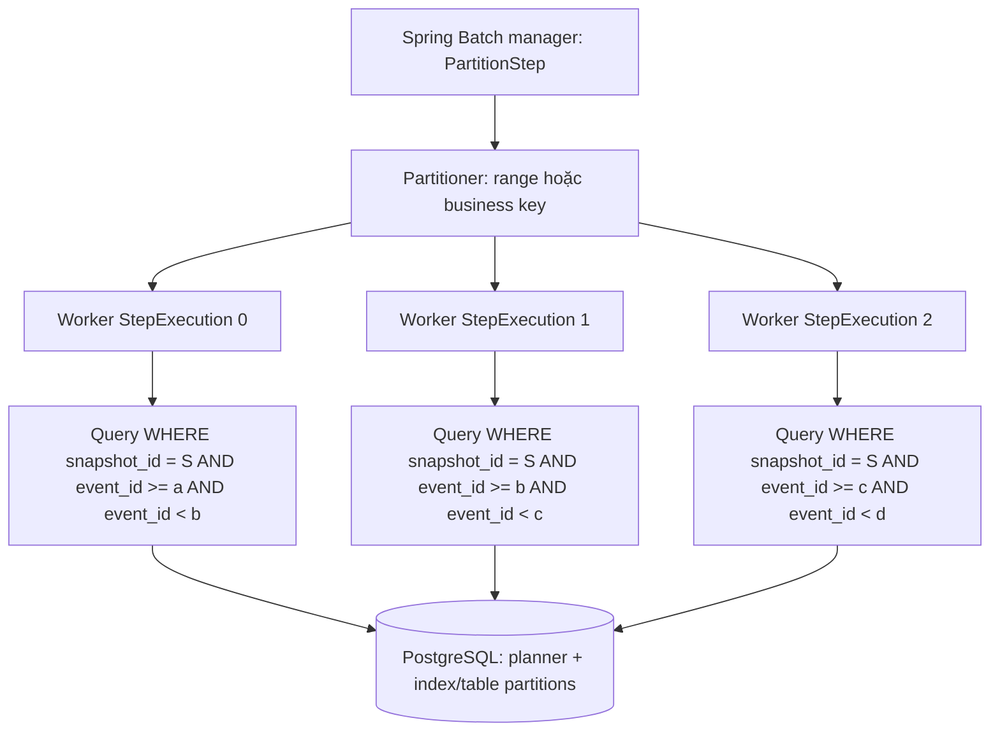

# Index phục vụ phân vùng trong Spring Batch: thiết kế access path, kiểm chứng bằng execution plan

## Mục tiêu bài học

Trong chương **Database scaling** của module **SPRING_BATCH_SCALING_OPERATIONS**, chúng ta mở rộng Spring Batch để xử lý workload dữ liệu lớn bằng multi-threaded step, parallel steps, partitioning và worker phân tán. Một nguyên nhân phổ biến khiến hệ thống không tăng thông lượng khi thêm worker là **mỗi partition vẫn phải quét quá nhiều dữ liệu**: CPU/connection pool tăng, database bị nghẽn, nhưng tốc độ đọc thực tế không tăng.

Bài này tập trung vào **index phục vụ phân vùng** — tức thiết kế index theo **predicate và thứ tự đọc của từng worker partition**, đồng thời phân biệt cơ chế phân chia công việc của Spring Batch với **table partitioning** và **partition pruning** ở database.

Sau bài học, bạn có thể:

- Phân biệt `Spring Batch PartitionStep`, partition range/key, database partitioned table và B-tree/BRIN index.
- Thiết kế index theo `WHERE`, `ORDER BY` và khóa cursor của `JdbcPagingItemReader`.
- Chọn thứ tự cột composite index khi có equality predicate như `snapshot_id`, `tenant_id` và range predicate như `event_id`.
- Đánh giá partial index, covering index, index-only scan, BRIN và chi phí ghi/duy trì index.
- Chia input thành các vùng **không chồng lấn**, lưu partition plan bền vững để restart an toàn.
- Dùng `EXPLAIN (ANALYZE, BUFFERS)`, dữ liệu thống kê và benchmark để kiểm tra index có thực sự được sử dụng.
- Kết hợp index với thread safety, transaction, retry/restart, idempotency và giới hạn kết nối DB.
- Nhận biết khi nào cần tối ưu truy vấn/index trước, khi nào mới nên tăng số partition hoặc chuyển sang kiến trúc remote.

> **Phiên bản và phạm vi:** Ví dụ sử dụng **Spring Batch 5.2.x**, Java 17+, Spring Framework 6 và **PostgreSQL** làm hệ quản trị dữ liệu. SQL `INCLUDE`, `BRIN`, `CREATE INDEX CONCURRENTLY`, `ON CONFLICT` và câu lệnh `EXPLAIN` mang tính PostgreSQL. Với MySQL, Oracle, SQL Server hoặc Spring Batch phiên bản khác, cần đối chiếu dialect, optimizer và API thực tế. Các ví dụ code là những mảnh cấu hình có hướng dẫn wiring, không phải một ứng dụng đầy đủ đã được chạy.

## 1. Phân vùng công việc và phân vùng bảng là hai việc khác nhau

**Spring Batch partitioning** chia một step logic thành nhiều **worker `StepExecution`**. Mỗi worker nhận một `ExecutionContext` như `startId`/`endId`, rồi đọc và xử lý một tập item riêng. Worker có thể chạy trong một JVM với `TaskExecutorPartitionHandler` hoặc trên nhiều JVM khi remote partitioning.

**Database table partitioning** là cách hệ quản trị lưu một bảng logic trên nhiều physical partitions theo giá trị khóa, chẳng hạn `business_date` hoặc `tenant_id`. PostgreSQL có thể **partition prune** nếu query predicate đủ rõ để loại bỏ các table partitions không liên quan.

**Index** là cấu trúc truy cập giúp DB tìm hàng thỏa predicate hoặc phục vụ sort hiệu quả hơn. Một bảng không partition vẫn có index; một bảng partitioned cũng có thể thiếu index thích hợp.



**Không nhầm:** Một `PartitionStep` không tự sinh `CREATE INDEX` hoặc `PARTITION BY` trong PostgreSQL. Ngược lại, database đã được chia table partition không tự tạo các worker `StepExecution` cho Spring Batch. Hai kỹ thuật có thể phối hợp nhưng phải thiết kế và đo riêng.

| Cơ chế | Chia cái gì? | Tính đúng/restart nằm ở đâu? | Vấn đề hiệu năng có thể gặp |
| --- | --- | --- | --- |
| Spring Batch local partitioning | Tập item thành các worker StepExecution trong cùng JVM | `JobRepository`, tên partition, `ExecutionContext`, business sink | Truy vấn mỗi partition quét bảng, DB pool bão hòa, data skew |
| Spring Batch remote partitioning | Worker StepExecution trên các process/host khác | Metadata, truyền lệnh, quản trị in-flight, idempotency | Mạng và DB tập trung, nhiều worker cùng scan |
| PostgreSQL partitioned table | Physical rows được chia theo partition key | DB constraints, transaction, partition DDL | Pruning không xảy ra nếu predicate không phù hợp |
| B-tree index | Thứ tự khóa phục vụ filter/range/order | Khóa/index được DB duy trì | Overhead trên INSERT/UPDATE; index kém chọn lọc |
| BRIN index | Tóm tắt phạm vi giá trị trên các page vật lý | DB index summary | Hợp append-only/correlation; kém nếu dữ liệu phân bố ngẫu nhiên |

## 2. Tình huống mẫu: mười triệu sự kiện trong một snapshot

Giả sử job cần chuẩn hóa hàng triệu sự kiện thanh toán. Input có `snapshot_id` để cố định tập dữ liệu logic, `event_id` tăng dần và `tenant_id` để cách ly nghiệp vụ.

```sql
CREATE TABLE payment_event (
    event_id      bigint PRIMARY KEY,
    snapshot_id   varchar(100) NOT NULL,
    tenant_id     varchar(80) NOT NULL,
    business_date date NOT NULL,
    status        varchar(20) NOT NULL,
    gross_amount  numeric(18,2) NOT NULL
);
```

Một worker xử lý dải `[1_000_000, 1_200_000)`, có nghĩa:

```sql
SELECT event_id, tenant_id, gross_amount
FROM payment_event
WHERE snapshot_id = :snapshotId
  AND event_id >= :startId
  AND event_id <  :endId
ORDER BY event_id ASC;
```

**`startId` bao gồm, `endId` loại trừ**. Dùng cùng một quy ước ở mọi worker:

```text
partition-0: [1_000_000, 1_200_000)
partition-1: [1_200_000, 1_400_000)
partition-2: [1_400_000, 1_600_000)
```

Không có event ID nào thuộc hai dải liền kề. Một dải có thể chứa **ít hơn** 200.000 hàng vì ID có lỗ hổng; `endId-startId` là độ rộng **miền khóa**, không phải số lượng row đảm bảo.

### Index cần ưu tiên cho query này

```sql
CREATE INDEX idx_payment_event_snapshot_id
    ON payment_event (snapshot_id, event_id);
```

Đây là B-tree composite index. Với `snapshot_id = :snapshotId` và `event_id` là điều kiện range, DB có thể sử dụng phần equality rồi range để tìm vùng liên quan trong index. Thứ tự `event_id ASC` còn phù hợp thứ tự khóa index, giảm nhu cầu sort riêng trong nhiều tình huống.

**Chú ý:** `event_id bigint PRIMARY KEY` đã tạo một unique B-tree index trên riêng `event_id`. Index mới **không trùng hoàn toàn** với primary-key index vì có leading key `snapshot_id`. Tuy vậy, nếu nguồn chỉ có một snapshot hoặc range rất chọn lọc, optimizer vẫn có thể dùng primary-key index rồi filter snapshot. Không tự tạo thêm composite index nếu `EXPLAIN` và benchmark không chứng minh lợi ích vượt chi phí duy trì.

## 3. Thiết kế composite index theo predicate thực tế

B-tree nhiều cột hiệu quả khi những điều kiện quan trọng khớp **leftmost prefix** của index. Một nguyên tắc thường dùng cho query range:

1. Đặt các cột **equality thường xuyên** ở phía trước, có cân nhắc tần suất query và tính chọn lọc.
2. Đặt **range key** tiếp theo để DB quét đoạn nhỏ theo thứ tự.
3. Đảm bảo `ORDER BY` của paging được index hỗ trợ khi có thể.
4. Không tự thêm tất cả cột vào một index khổng lồ; chi phí ghi, disk và cache sẽ tăng.

### Các hình dạng truy vấn khác nhau

| Query của worker | Index ứng viên | Nhận xét |
| --- | --- | --- |
| `snapshot_id = S AND event_id BETWEEN ...` | `(snapshot_id, event_id)` | Equality + range; phù hợp paging theo event_id |
| `snapshot_id = S AND tenant_id = T AND event_id range` | `(snapshot_id, tenant_id, event_id)` | Hai equality trước range; tốt nếu mọi query đều filter tenant |
| `tenant_id = T AND event_id range` | `(tenant_id, event_id)` | Không nên phụ thuộc index có leading `snapshot_id` khi query không có điều kiện snapshot |
| `business_date = D AND event_id range` | `(business_date, event_id)` | Phù hợp job chạy theo ngày nếu date là equality |
| `status = 'PENDING' AND snapshot_id = S` | Có thể dùng partial index hoặc `(status, snapshot_id, event_id)` | Cần lưu ý `status` có thể thay đổi trong lúc job chạy |
| `ORDER BY event_id` nhưng không filter | Index PK trên `event_id` có thể đủ | Không nhất thiết thêm composite index |

**Không tạo mọi index trong bảng cùng lúc.** Chọn theo truy vấn nóng và workload đọc/ghi thực tế. Mỗi index thêm làm INSERT/UPDATE/DELETE và VACUUM/maintenance đắt hơn, có thể làm tổng throughput của batch giảm.

### Ví dụ với tenant

```sql
SELECT event_id, tenant_id, gross_amount
FROM payment_event
WHERE snapshot_id = :snapshotId
  AND tenant_id = :tenantId
  AND event_id >= :startId
  AND event_id < :endId
ORDER BY event_id ASC;
```

Index ứng viên:

```sql
CREATE INDEX idx_payment_event_snapshot_tenant_id
    ON payment_event (snapshot_id, tenant_id, event_id);
```

Khi một worker truy vấn cả `snapshot_id` và `tenant_id`, index này có thể giúp thu nhỏ đoạn dữ liệu hơn index `(snapshot_id,event_id)`. Nhưng nếu job **không có tenant predicate**, index mới không chắc thay được index cũ cho workload đó vì `tenant_id` nằm trước `event_id`.

**Thứ tự cột equality không phải quy tắc cứng “cột có cardinality cao nhất đứng đầu”**. Đánh giá tính hữu ích đối với các query khác, phân phối dữ liệu, selectivity và `ORDER BY`; PostgreSQL planner quyết định access path thực tế.

## 4. Index phục vụ paging và keyset scan

`JdbcPagingItemReader` thường đọc nhiều page, lưu state qua `ItemStream` và sử dụng sort key để đảm bảo quá trình đọc có thể restart. Ở workload lớn, một key duy nhất như `event_id` thường dễ kiểm soát hơn sort key không unique.

### Vì sao unique sort key quan trọng?

Giả sử worker đọc:

```sql
ORDER BY business_date
```

Hàng nghìn item có cùng `business_date`. Một checkpoint chỉ dựa vào ngày không thể phân biệt chính xác hàng nào trong ngày đã hoàn tất nếu không có tie-breaker và semantics phù hợp. Với paging keyset, chọn sort key duy nhất hoặc tổ hợp đủ duy nhất.

Ví dụ:

```sql
ORDER BY event_id ASC
```

`event_id` là primary key trong schema mẫu, nên tạo thứ tự rõ. Nếu ID chỉ duy nhất theo tenant, phải bổ sung tenant/snapshot hoặc composite sort key phù hợp.

### OFFSET pagination không phù hợp với page sâu

Một truy vấn tự viết kiểu:

```sql
SELECT event_id, gross_amount
FROM payment_event
WHERE snapshot_id = :snapshotId
ORDER BY event_id
LIMIT 500 OFFSET 4000000;
```

Có thể phải đi qua nhiều entry trước khi bỏ qua hàng triệu row. Index hỗ trợ sort không tự làm `OFFSET` lớn trở thành rẻ.

Nếu tự xây reader/keyset cursor, có thể dùng:

```sql
SELECT event_id, gross_amount
FROM payment_event
WHERE snapshot_id = :snapshotId
  AND event_id > :lastCommittedEventId
  AND event_id < :endId
ORDER BY event_id ASC
LIMIT 500;
```

`lastCommittedEventId` phải có semantics **đã commit**, không phải ID vừa được `read()` khi chunk đang rollback. Không tự viết một reader với `lastReadId` cập nhật liên tục rồi persist bất cứ lúc nào; cần tuân vòng đời checkpoint `open/update/close` và transaction.

**Lưu ý:** `JdbcPagingItemReader` đã có logic paging/restart riêng dựa trên sort key; đoạn keyset SQL trên minh họa access path, **không phải câu SQL cần tự gắn thêm vào builder** khi đã dùng reader chuẩn.

## 5. Hình thức index khác: partial, covering và BRIN

### 5.1. Partial index theo trạng thái

Nếu worker chủ yếu đọc `status = 'PENDING'`:

```sql
CREATE INDEX idx_payment_pending_snapshot_id
    ON payment_event (snapshot_id, event_id)
    WHERE status = 'PENDING';
```

Query có cùng điều kiện:

```sql
SELECT event_id, gross_amount
FROM payment_event
WHERE snapshot_id = :snapshotId
  AND status = 'PENDING'
  AND event_id >= :startId
  AND event_id < :endId
ORDER BY event_id ASC;
```

Index nhỏ hơn một full index khi số row PENDING ít; có thể giúp đọc nhanh. Nhưng **partial index chỉ hữu ích khi planner chứng minh được predicate của query phù hợp**. Với prepared statement và parameterized predicate `status = :status`, generic plan có thể không suy ra được điều kiện partial index tại planning time. Cần kiểm tra explain của statement dạng thực tế.

**Nguy cơ lớn cho restart:** Nếu worker đổi `status` từ PENDING sang DONE trong lúc reader đang paging qua **tập kết quả động**, item có thể dịch khỏi tập đọc và gây bỏ sót/trùng nếu thiết kế dựa trên OFFSET hoặc các boundary không ổn định. Dùng snapshot immutable, process indicator với transaction/claim đúng, hoặc reader strategy chịu được tập dữ liệu thay đổi; **thêm partial index không tự giải quyết tính đúng của checkpoint**.

Partial index còn phải được cập nhật khi status thay đổi, nên với batch ghi trạng thái liên tục, chi phí index churn/VACUUM có thể rất đáng kể.

### 5.2. Covering index và `INCLUDE`

Nếu worker cần lấy thêm `gross_amount`, `tenant_id` mà không muốn truy heap cho mọi row, một ứng viên là:

```sql
CREATE INDEX idx_payment_snapshot_event_cover
    ON payment_event (snapshot_id, event_id)
    INCLUDE (tenant_id, gross_amount);
```

Các cột `INCLUDE` là payload trong index, **không thay thế key columns phục vụ tìm kiếm/sort**. PostgreSQL có thể dùng **index-only scan** nếu mọi cột cần thiết nằm trong index và các điều kiện visibility map cho phép. Index-only scan **không được bảo đảm**, đặc biệt khi bảng cập nhật thường xuyên và heap pages chưa được đánh dấu all-visible.

Cũng cần xem xét:

- Index lớn hơn, ít entry trên mỗi page và tốn RAM/disk.
- Ghi/UPDATE có thể đắt hơn, giảm HOT update opportunities.
- Không cần giữ cả full index và covering index chỉ vì “có vẻ nhanh”; benchmark rồi loại bỏ index dư thừa bằng quy trình migration an toàn.

### 5.3. BRIN khi ID tương quan với thứ tự vật lý

Với bảng cực lớn, append-only và `event_id` tăng tương quan tốt với vị trí vật lý, BRIN có thể nhỏ:

```sql
CREATE INDEX idx_payment_event_id_brin
    ON payment_event USING brin (event_id)
    WITH (pages_per_range = 64);
```

BRIN tóm tắt các page ranges; có thể giảm lượng page cần kiểm tra cho truy vấn ID range lớn. Nhưng BRIN không có tác dụng giống B-tree cho tìm từng hàng chính xác hoặc `ORDER BY event_id LIMIT 500`. Nếu ID được insert ngẫu nhiên hoặc bảng thường xuyên update/move row, hiệu quả BRIN có thể kém.

Nếu đã có PK B-tree và composite index tốt cho paging, không tạo BRIN theo thói quen. Đánh giá số GB index, heap blocks cần đọc và thời gian query dưới tải thật.

### So sánh nhanh

| Loại | Mạnh ở | Đổi lại |
| --- | --- | --- |
| Composite B-tree | Equality + range + ordered paging | Dung lượng và chi phí cập nhật |
| Partial B-tree | Một subset nhỏ, predicate ổn định | Planner cần nhận diện predicate; index churn nếu cột điều kiện thay đổi |
| Covering B-tree / `INCLUDE` | Có thể giảm heap fetch cho query chỉ đọc | Index phình, update tốn hơn, visibility ảnh hưởng index-only |
| BRIN | Bảng append-only lớn, vật lý tương quan với range key | Có false positives, không cung cấp thứ tự như B-tree |
| Không thêm index mới | Workload scan lớn, index hiện có đã phù hợp, ghi là bottleneck | Phải chấp nhận scan nếu planner chọn hợp lý |

## 6. Lập kế hoạch partition bền vững, không tính lại tùy ý khi restart

Index tốt sẽ ít ý nghĩa nếu partition bounds không ổn định. `Partitioner.partition(gridSize)` tạo map `partitionName → ExecutionContext`. Khi restart, **tên partition và phạm vi xử lý phải đủ ổn định** để framework khôi phục đúng worker StepExecution.

Một anti-pattern là mỗi lần restart lại lấy `MIN/MAX(event_id)` trên bảng live rồi tự chia lại theo số worker hiện tại. Nếu nguồn đổi hoặc grid size đổi, `partition-2` có thể chỉ vùng dữ liệu khác checkpoint cũ.

### 6.1. Lưu frozen partition plan

Ví dụ tạo bảng ứng dụng riêng:

```sql
CREATE TABLE batch_partition_plan (
    run_key       varchar(160) NOT NULL,
    partition_no  integer NOT NULL,
    start_id      bigint NOT NULL,
    end_id        bigint NOT NULL,
    PRIMARY KEY (run_key, partition_no),
    CHECK (start_id < end_id)
);
```

Giả sử run `settlement-2026-11-25-v1` đã được lập theo snapshot cố định:

```sql
INSERT INTO batch_partition_plan
    (run_key, partition_no, start_id, end_id)
VALUES
    ('settlement-2026-11-25-v1', 0, 1000000, 1200000),
    ('settlement-2026-11-25-v1', 1, 1200000, 1400000),
    ('settlement-2026-11-25-v1', 2, 1400000, 1600000);
```

Bảng này **không thuộc schema mặc định của Spring Batch**; nó chỉ là hợp đồng business/application giúp freeze dải. Khóa chính tự tạo index `(run_key, partition_no)` phục vụ load plan theo run; không thêm một index trùng lặp.

**Lưu ý:** `CHECK (start_id < end_id)` chỉ kiểm tra từng row, **không ngăn hai row của cùng run chồng lấn**, không bảo đảm không có gap và không tự chứng minh mọi event trong snapshot được phủ. Cần validation trước khi khởi chạy.

### 6.2. Kiểm tra dải có chồng lấn

```sql
WITH ordered AS (
    SELECT partition_no,
           start_id,
           end_id,
           LAG(end_id) OVER (
               PARTITION BY run_key
               ORDER BY start_id, partition_no
           ) AS previous_end
    FROM batch_partition_plan
    WHERE run_key = :runKey
)
SELECT *
FROM ordered
WHERE previous_end IS NOT NULL
  AND start_id < previous_end;
```

Query phải trả **0 hàng** nếu không có overlap của các dải đã sắp. Kiểm tra **gap** bằng `start_id > previous_end` nếu hợp đồng cần các khoảng nối tiếp. Trong hệ thống có ID bị khuyết, gap trong **miền ID** có thể chấp nhận được khi chứng minh không có item nguồn nằm trong gap; kiểm tra chống bỏ sót bằng truy vấn nguồn/đích hoặc validation snapshot.

**Bắt buộc kiểm tra thêm:** min/max của snapshot, vùng ID ngoài plan, số partition rỗng, tenant/snapshot boundary và độ lệch số row. Không dùng `endId = maxId + 1` một cách mù nếu có nguy cơ overflow `BIGINT`; có thể dùng ranh giới được tạo an toàn hoặc mô hình bounds bao gồm với toán tử tương ứng.

### 6.3. Data skew: chia đều ID không đồng nghĩa chia đều rows

Giả sử partition A bao dải 200.000 ID nhưng có 195.000 event, partition B cùng độ rộng chỉ có 2.000 event. Partition B kết thúc nhanh; toàn job vẫn chờ A. Đó là **data skew**, không phải lỗi index.

Có thể cải thiện bằng:

- Lập kế hoạch boundaries dựa trên histogram/row counts của **snapshot đã cố định**.
- Partition theo tenant/account nếu input độc lập và có chỉ mục phù hợp.
- Tăng số partition vừa phải để scheduler phân phối công việc linh hoạt hơn.
- Chia vùng nóng thành nhiều partition nhỏ hơn **ở một kế hoạch mới có version**, không thay đổi tùy ý mapping khi JobInstance lỗi đang cần restart.
- Đo `readCount`, elapsed time, index/heap blocks đọc và DB lock wait **theo partition**.

## 7. Java Spring Batch 5.2: Partitioner lấy dải từ plan đã cố định

Một `Partitioner` có thể đọc bảng `batch_partition_plan`. Ví dụ dưới là code minh họa trong ứng dụng đã có `JdbcTemplate`, `JobRepository` và transaction manager.

### 7.1. Model và Partitioner

```java
public record PartitionRange(
        int partitionNo,
        long startInclusive,
        long endExclusive) {}

public final class StoredRangePartitioner implements Partitioner {

    private final JdbcTemplate jdbc;
    private final String runKey;

    public StoredRangePartitioner(JdbcTemplate jdbc, String runKey) {
        this.jdbc = jdbc;
        this.runKey = runKey;
    }

    @Override
    public Map<String, ExecutionContext> partition(int gridSize) {
        List<PartitionRange> ranges = jdbc.query("""
                SELECT partition_no, start_id, end_id
                FROM batch_partition_plan
                WHERE run_key = ?
                ORDER BY partition_no
                """,
                (rs, row) -> new PartitionRange(
                        rs.getInt("partition_no"),
                        rs.getLong("start_id"),
                        rs.getLong("end_id")),
                runKey);

        if (ranges.isEmpty()) {
            throw new IllegalStateException(
                    "No stored partition plan for runKey=" + runKey);
        }

        Map<String, ExecutionContext> result = new LinkedHashMap<>();

        for (PartitionRange range : ranges) {
            if (range.startInclusive() >= range.endExclusive()) {
                throw new IllegalStateException("Invalid partition bounds");
            }

            String partitionName =
                    String.format(Locale.ROOT,
                            "slice-%04d", range.partitionNo());

            ExecutionContext context = new ExecutionContext();
            context.putLong("startId", range.startInclusive());
            context.putLong("endId", range.endExclusive());

            if (result.put(partitionName, context) != null) {
                throw new IllegalStateException(
                        "Duplicate partition name " + partitionName);
            }
        }

        return result;
    }
}
```

**Điểm đáng chú ý:**

- `partition(int gridSize)` nhận grid size nhưng code đọc **kế hoạch đã freeze**; việc bỏ qua grid size ở đây là chủ đích để **không đổi partition identity khi restart**. Số partition thực tế có thể khác `gridSize`.
- Tên `slice-0000` ổn định theo `partition_no`; worker StepExecution thường được framework đặt tên với prefix step và partition name.
- `startId/endId` nằm trong **ExecutionContext riêng của worker**, không lưu trong singleton mutable field của reader.
- Code **chưa validate cross-range overlap/gaps**; phải validate kế hoạch trước và có test bổ sung.
- `runKey` nên gắn với identifying JobParameters/snapshot ổn định; không lấy timestamp mới khi restart.

### 7.2. Đưa runKey vào Partitioner

Trong cấu hình manager step, Partitioner có thể được tạo theo context thích hợp của **manager StepExecution**:

```java
@Bean("storedRangePartitioner")
@StepScope
Partitioner storedRangePartitioner(
        JdbcTemplate jdbc,
        @Value("#{jobParameters['runKey']}") String runKey) {

    return new StoredRangePartitioner(jdbc, runKey);
}
```

Đây là ví dụ **late binding** `runKey` tại manager step. Không đưa một `Partitioner` singleton mutable dùng chung cho các JobInstance song song rồi cập nhật field `currentRunKey`. Nếu sử dụng job-scoped beans trong hệ thống multi-threaded/partitioned, phải hiểu giới hạn truyền context qua thread; cách đơn giản ở trên áp dụng tại manager và không tạo mutable worker shared state.

## 8. Worker reader: index phải phục vụ chính câu truy vấn được tạo

### 8.1. DTO và `JdbcPagingItemReader`

```java
public record PaymentEvent(
        long eventId,
        String tenantId,
        BigDecimal grossAmount) {}
```

Reader worker nhận bounds từ `StepExecutionContext`:

```java
@Bean("paymentEventReader")
@StepScope
JdbcPagingItemReader<PaymentEvent> paymentEventReader(
        DataSource dataSource,
        @Value("#{jobParameters['snapshotId']}") String snapshotId,
        @Value("#{stepExecutionContext['startId']}") Long startId,
        @Value("#{stepExecutionContext['endId']}") Long endId) {

    return new JdbcPagingItemReaderBuilder<PaymentEvent>()
            .name("paymentEventReader")
            .dataSource(dataSource)
            .selectClause("""
                    SELECT event_id, tenant_id, gross_amount
                    """)
            .fromClause("FROM payment_event")
            .whereClause("""
                    WHERE snapshot_id = :snapshotId
                      AND event_id >= :startId
                      AND event_id < :endId
                    """)
            .parameterValues(Map.of(
                    "snapshotId", snapshotId,
                    "startId", startId,
                    "endId", endId))
            .sortKeys(Map.of("event_id", Order.ASCENDING))
            .pageSize(500)
            .rowMapper((rs, rowNum) -> new PaymentEvent(
                    rs.getLong("event_id"),
                    rs.getString("tenant_id"),
                    rs.getBigDecimal("gross_amount")))
            .saveState(true)
            .build();
}
```

**Vì sao phù hợp với `(snapshot_id,event_id)`?** Reader lọc `snapshot_id` bằng equality, thu hẹp `event_id` bằng range, rồi sort cùng khóa. Một index có thể hỗ trợ đồng thời predicate và ordering.

**Cảnh báo:** `JdbcPagingItemReader` có state và reader này được tạo **riêng theo worker StepExecution** nhờ `@StepScope`. Đừng chia sẻ một instance giữa nhiều thread trong **cùng một multi-threaded step** rồi mặc định nó thread-safe. Ngoài ra, việc đổi `snapshotId`, reader name, sort key hoặc bounds giữa các lần restart có thể làm checkpoint cũ không còn đúng.

### 8.2. Processor và writer idempotent

```java
public record NormalizedPayment(
        String runKey,
        long eventId,
        BigDecimal netAmount) {}

@Bean("paymentProcessor")
@StepScope
ItemProcessor<PaymentEvent, NormalizedPayment> paymentProcessor(
        @Value("#{jobParameters['runKey']}") String runKey) {

    BigDecimal factor = new BigDecimal("0.98");
    return item -> new NormalizedPayment(
            runKey,
            item.eventId(),
            item.grossAmount()
                    .multiply(factor)
                    .setScale(2, RoundingMode.HALF_EVEN));
}
```

Output:

```sql
CREATE TABLE processed_payment (
    run_key      varchar(160) NOT NULL,
    event_id     bigint NOT NULL,
    net_amount   numeric(18,2) NOT NULL,
    PRIMARY KEY (run_key, event_id)
);
```

Primary key tự tạo unique index cho `(run_key,event_id)`; **không thêm một index duplicate** cùng cặp cột chỉ vì writer dùng UPSERT.

```java
@Bean("paymentWriter")
JdbcBatchItemWriter<NormalizedPayment> paymentWriter(
        DataSource dataSource) {

    return new JdbcBatchItemWriterBuilder<NormalizedPayment>()
            .dataSource(dataSource)
            .sql("""
                    INSERT INTO processed_payment
                        (run_key, event_id, net_amount)
                    VALUES (:runKey, :eventId, :netAmount)
                    ON CONFLICT (run_key, event_id)
                    DO UPDATE SET net_amount = EXCLUDED.net_amount
                    """)
            .itemSqlParameterSourceProvider(item ->
                    new MapSqlParameterSource()
                            .addValue("runKey", item.runKey())
                            .addValue("eventId", item.eventId())
                            .addValue("netAmount", item.netAmount()))
            .build();
}
```

Writer idempotent ở mức business key giúp chịu được retry/restart hoặc duplicate delivery. Nhưng nếu cùng `runKey/eventId` bị xử lý lại với payload khác, UPSERT sẽ ghi đè kết quả cũ. **Snapshot phải bất biến** hoặc writer cần thêm điều kiện version/hash để reject mismatch.

### 8.3. Worker Step và manager PartitionStep

```java
@Bean("paymentWorker")
Step paymentWorker(
        JobRepository jobRepository,
        PlatformTransactionManager transactionManager,
        @Qualifier("paymentEventReader")
        ItemStreamReader<PaymentEvent> reader,
        @Qualifier("paymentProcessor")
        ItemProcessor<PaymentEvent, NormalizedPayment> processor,
        @Qualifier("paymentWriter")
        ItemWriter<NormalizedPayment> writer) {

    return new StepBuilder("paymentWorker", jobRepository)
            .<PaymentEvent, NormalizedPayment>chunk(500, transactionManager)
            .reader(reader)
            .processor(processor)
            .writer(writer)
            .build();
}

@Bean("partitionExecutor")
TaskExecutor partitionExecutor() {
    ThreadPoolTaskExecutor executor = new ThreadPoolTaskExecutor();
    executor.setCorePoolSize(4);
    executor.setMaxPoolSize(4);
    executor.setQueueCapacity(8);
    executor.setThreadNamePrefix("db-partition-");
    executor.initialize();
    return executor;
}

@Bean("paymentManager")
Step paymentManager(
        JobRepository jobRepository,
        @Qualifier("paymentWorker") Step worker,
        @Qualifier("storedRangePartitioner") Partitioner partitioner,
        @Qualifier("partitionExecutor") TaskExecutor executor) {

    return new StepBuilder("paymentManager", jobRepository)
            .partitioner(worker.getName(), partitioner)
            .step(worker)
            .gridSize(4)
            .taskExecutor(executor)
            .build();
}
```

Cấu hình này minh họa **local partitioning**, không phải remote chunking. Để có Job hoàn chỉnh, tạo `Job` với `paymentManager` làm step, cung cấp bean `JobRepository`, `PlatformTransactionManager`, DataSource/schema và một partition plan đã freeze.

**Điểm vận hành:** `gridSize(4)` là gợi ý tổ chức, không đồng nghĩa “luôn có bốn truy vấn đồng thời”, đặc biệt khi plan có nhiều partition, executor giới hạn, DB pool còn phục vụ job khác hoặc worker hoàn tất lệch nhau. Đo active threads, DB pending connections, per-partition read/commit rates và tổng thời gian job.

## 9. Database table partitioning và partition pruning

Nếu bảng nguồn được PostgreSQL chia theo `business_date`, điều kiện ngày có thể giúp optimizer loại các physical partitions không cần quét.

### 9.1. Ví dụ range partitioned table

```sql
CREATE TABLE payment_event_by_date (
    business_date date NOT NULL,
    event_id      bigint NOT NULL,
    snapshot_id   varchar(100) NOT NULL,
    tenant_id     varchar(80) NOT NULL,
    gross_amount  numeric(18,2) NOT NULL,
    PRIMARY KEY (business_date, event_id)
) PARTITION BY RANGE (business_date);

CREATE TABLE payment_event_2026_11
    PARTITION OF payment_event_by_date
    FOR VALUES FROM ('2026-11-01') TO ('2026-12-01');

CREATE TABLE payment_event_2026_12
    PARTITION OF payment_event_by_date
    FOR VALUES FROM ('2026-12-01') TO ('2027-01-01');
```

Truy vấn:

```sql
SELECT event_id, gross_amount
FROM payment_event_by_date
WHERE business_date = DATE '2026-11-25'
  AND snapshot_id = :snapshotId
  AND event_id >= :startId
  AND event_id < :endId
ORDER BY event_id;
```

Khi predicate trên partition key được planner nhận diện, PostgreSQL có thể **prune** partition tháng 12. Nhưng trong partition tháng 11 vẫn có thể còn rất nhiều row của các snapshot khác. Vì vậy vẫn cần xem index phục vụ `snapshot_id` và `event_id` **bên trong partition được chọn**.

```sql
CREATE INDEX idx_payment_date_snapshot_event
    ON payment_event_by_date (snapshot_id, event_id);
```

Trong PostgreSQL, tạo index trên **partitioned parent** sẽ tạo cấu trúc index tương ứng trên các child partitions theo cơ chế hỗ trợ của phiên bản. Index trên partitioned table về logic khác với **một global physical index duy nhất** bao mọi partition.

### 9.2. Vì sao DB partitioning không thay Spring Batch partitioning?

Nếu dùng `business_date` để prune chỉ còn một partition tháng 11, nhưng Spring Batch tạo 16 worker đều đọc cùng ngày và mỗi worker có ID range khác nhau, database vẫn nhận **16 query đồng thời** vào physical partition đó. Index tốt và tài nguyên đủ sẽ giúp; nếu tất cả tranh nhau cùng index/heap pages hoặc connections, throughput có thể bão hòa.

Ngược lại, nếu Spring Batch tạo mỗi worker theo ngày khác nhau, mỗi worker có thể truy các physical partitions khác; đó là một cách giảm contention khi business workload cho phép.

### 9.3. Unique constraint phải phù hợp partition key

Trong PostgreSQL declarative partitioning, unique/primary-key constraint của **partitioned parent** có yêu cầu bao gồm các cột partition key tương ứng (vì dữ liệu được tách ra các leaf indexes). Vì vậy ví dụ dùng `PRIMARY KEY (business_date,event_id)`.

Nếu business ID phải unique **toàn hệ thống mà không phụ thuộc business_date**, đừng mặc định rằng một unique index trên từng leaf chứng minh unique toàn parent theo quy tắc mong muốn. Cần thiết kế business key/constraint riêng hoặc cơ chế kiểm soát thích hợp.

### 9.4. Query thiếu partition key có thể không prune

```sql
SELECT *
FROM payment_event_by_date
WHERE snapshot_id = :snapshotId
  AND event_id BETWEEN :startId AND :endId;
```

Nếu PostgreSQL không thể suy ra `business_date` từ predicate, truy vấn có thể phải xem nhiều physical partitions. **Spring Batch chia theo event_id không tự tạo điều kiện `business_date` để prune.**

Cần xác định rõ partition key của database và bảo đảm worker reader có các predicates phù hợp; kiểm chứng bằng `EXPLAIN`.

## 10. Kiểm chứng index bằng `EXPLAIN (ANALYZE, BUFFERS)`

Không đủ để nói “đã tạo index nên job sẽ nhanh”. PostgreSQL optimizer có thể chọn **sequential scan**, bitmap index scan, index scan hoặc index-only scan tùy số row ước lượng, selectivity, kích thước bảng, cache và thống kê.

### 10.1. Explain câu SQL giống worker nhất

```sql
EXPLAIN (ANALYZE, BUFFERS)
SELECT event_id, tenant_id, gross_amount
FROM payment_event
WHERE snapshot_id = 'snapshot-2026-11-25-v1'
  AND event_id >= 1000000
  AND event_id < 1200000
ORDER BY event_id ASC
LIMIT 500;
```

Các trường cần đọc:

| Trường | Cần hiểu |
| --- | --- |
| `Index Scan / Index Only Scan / Bitmap Heap Scan / Seq Scan` | Planner chọn cách truy cập nào |
| `Index Cond` | Predicate nào thực sự được dùng để tìm kiếm trong index |
| `Filter` | Predicate nào còn phải lọc sau access path |
| `actual time, rows, loops` | Thời gian và số row thực tế; giúp phát hiện misestimate |
| `rows` ước lượng | Có lệch nhiều với actual rows không? |
| `Buffers: shared hit/read` | Page được đọc từ cache hay storage; nhiều hits vẫn tiêu CPU/cache |
| `Heap Fetches` | Với Index Only Scan, số lần phải quay về heap do visibility |
| `Sort` | Query có đang sort ngoài index không? Có dùng memory/disk không? |
| `Planning Time / Execution Time` | Phân biệt overhead lên kế hoạch và thời gian thực thi |
| `Partition Pruning` / danh sách child scans | Có bỏ qua physical partitions không, tùy dạng explain |

Không bịa trước kết quả explain hay thời gian chạy của môi trường chưa đo. Nếu planner chọn seq scan với một range chiếm 80% bảng, **seq scan có thể là lựa chọn đúng**; ép index scan mù thường làm hiệu năng tệ hơn.

### 10.2. Thống kê và `ANALYZE`

Sau bulk load hoặc phân phối dữ liệu thay đổi lớn, cần để PostgreSQL cập nhật statistics:

```sql
ANALYZE payment_event;
```

Kiểm tra autovacuum/analyze, histogram, most-common values và số row ước lượng. Nếu `snapshot_id` hoặc `tenant_id` có phân phối cực lệch, planner có thể ước lượng sai. Cân nhắc extended statistics hoặc phân tích workload nếu quan hệ giữa các cột làm estimates không chính xác.

**Không dùng `SET enable_seqscan = off` như “giải pháp production”** để ép index. Chỉ có thể dùng trong thí nghiệm có kiểm soát để so access path, rồi chọn index/query/schema có hiệu quả thực.

### 10.3. Thử cùng SQL với các vùng khác nhau

Một range nóng có 200.000 row có thể có plan/latency khác range thưa chỉ 2.000 row. Thử:

- Dải đầu, giữa, cuối snapshot.
- Dải tenant lớn và tenant nhỏ.
- Trang đầu và trang sau của reader.
- Khi cache nóng và sau thay đổi workload, nếu có thể kiểm soát điều kiện test.
- Với 1, 2, 4, 8 workers đồng thời (không chỉ chạy query đơn lẻ).

**Index có plan tốt khi chạy một query không chứng minh hệ thống chạy 16 worker sẽ nhanh hơn**, vì DB connection pool, lock wait, disk queue, buffer-cache pressure và network có thể trở thành bottleneck mới.

## 11. Tối ưu từ DB đến Spring Batch: thứ tự làm hợp lý

Một quy trình từng bước:

### Bước 1 — Xác định truy vấn thật của worker

Đọc log SQL hoặc instrumentation chính xác của `JdbcPagingItemReader`. Chốt hình dạng truy vấn cần đo, chẳng hạn:

```text
snapshot equality + optional tenant equality + event_id range + stable ordering
```

Không đo một query giả định khác điều kiện/ORDER BY thực tế rồi kết luận index phù hợp.

### Bước 2 — Đo baseline tuần tự

Chạy một worker với snapshot cố định, ghi:

- Read rate (item/giây) và thời gian `read()`/SQL.
- `readCount`, `writeCount`, `filterCount`, `commitCount`, `rollbackCount`.
- Thời gian toàn `JobExecution`, CPU, memory/GC.
- Query latency p50/p95, shared buffer hit/read, DB pool pending.
- Business row count và checksum/sự đầy đủ của output theo run key.

### Bước 3 — Kiểm tra access path

Chạy `EXPLAIN (ANALYZE, BUFFERS)` với query tương đương worker và parameter values tiêu biểu; kiểm tra index cond, rows, sort, heap fetches. Cập nhật stats nếu cần.

### Bước 4 — Chỉ thêm index có cơ sở

Chọn composite index theo equality/range, hoặc partial/covering/BRIN khi workload cho thấy lợi ích. Benchmark trước/sau và đo **chi phí ghi**: unique conflicts, WAL, index bloat, thời gian bulk load và disk.

### Bước 5 — Freeze partition plan và kiểm tra disjoint/coverage

Cố định snapshot/partition names/bounds trước khi chạy; xác minh dải không overlap và phủ đủ business item. Không thay plan của một JobInstance đang cần restart.

### Bước 6 — Tăng concurrency có giới hạn

Thử local partitioning 2 rồi 4 worker trước. Đảm bảo DB pool đủ cho writer, JobRepository và các job khác; theo dõi hot pages, lock wait và queue. Không mặc định tăng grid size là tăng throughput tuyến tính.

### Bước 7 — Kiểm thử failure/restart

Gây lỗi sau khi một số partition đã commit, restart **cùng JobInstance** và kiểm tra worker completed được nhận diện, partition failed được xử lý lại đúng bounds. Writer phải idempotent. Đối soát output thực tế bằng business keys, không chỉ JobStatus.

## 12. Benchmark minh họa: index và concurrency tác động khác nhau

Giả sử một snapshot lớn và cùng logic xử lý. Bảng sau **chỉ để minh họa cách đọc số đo**, không phải benchmark của Spring Batch hay PostgreSQL:

| Cấu hình | Worker song song | Tổng thời gian | DB pool pending | Diễn giải |
| --- | ---: | ---: | --- | --- |
| Không có composite index, range scan | 1 | 90 phút | thấp | Nhiều I/O không cần thiết |
| Composite `(snapshot_id,event_id)` | 1 | 44 phút | thấp | Query ít quét hơn |
| Composite index, local partitioning | 2 | 27 phút | thấp | Còn dư capacity |
| Composite index, local partitioning | 4 | 17 phút | vừa | Cải thiện nhưng không tuyến tính |
| Composite index, local partitioning | 8 | 18 phút | cao | DB contention/pool bắt đầu giới hạn |
| Thêm nhiều index trùng lặp rồi tăng 8 worker | 8 | 22 phút | cao | Ghi/maintenance tăng, chưa chắc tốt |

Với các con số ví dụ, **index phù hợp giúp nhiều trước khi tăng worker**, còn 8 worker không tốt hơn 4. Kết luận luôn phụ thuộc dữ liệu thật và toàn bộ pipeline reader/process/writer.

### Các phép tính nên báo cáo

```text
speedup(index_only) = baseline_duration / indexed_duration

speedup(4_workers)  = indexed_1_worker_duration
                      / indexed_4_worker_duration

throughput_business = committed_valid_business_items
                      / end_to_end_duration_seconds

parallel_efficiency = speedup / worker_count
```

`parallel_efficiency` là chỉ báo gần đúng khi so cùng workload và cùng cấu hình nền, không tách được toàn bộ phần overhead của DB/OS. Một speedup đẹp nhưng output thiếu/trùng hoặc restart sai **không được xem là cải thiện**.

## 13. Index ở bảng đích và contention khi ghi

Index không chỉ dành cho reader. Worker thường ghi sang một bảng business sink với upsert theo khóa nghiệp vụ.

```sql
CREATE TABLE processed_payment (
    run_key      varchar(160) NOT NULL,
    event_id     bigint NOT NULL,
    net_amount   numeric(18,2) NOT NULL,
    PRIMARY KEY (run_key, event_id)
);
```

Khi worker thực hiện:

```sql
INSERT INTO processed_payment
    (run_key, event_id, net_amount)
VALUES (:runKey, :eventId, :netAmount)
ON CONFLICT (run_key, event_id)
DO UPDATE SET net_amount = EXCLUDED.net_amount;
```

B-tree unique index từ primary key phục vụ **conflict detection/idempotency**. Nếu hai worker ghi trùng `(run_key,event_id)` do partition overlap hoặc redelivery, một unique constraint giúp ngăn hai row logic; nhưng tranh chấp trên cùng key có thể làm lock wait và transaction latency tăng.

**Không coi unique constraint là biện pháp thay thế cho partition plan đúng**. Nếu partition overlap, job có thể vẫn “COMPLETED” nhưng tốn gấp đôi workload, writer thực hiện UPSERT nhiều lần và metadata counters không phản ánh số row mới.

### Hot key/hot page

Một số cách giảm contention:

- Phân vùng công việc theo business key độc lập, không để hai worker xử lý cùng `run_key/event_id`.
- Dùng batch JDBC phù hợp, giữ transaction vừa phải, tránh UPDATE không cần thiết.
- Hạn chế index dư thừa; mỗi write phải cập nhật nhiều cấu trúc.
- Nếu nhiều worker cùng cập nhật một hàng `settlement_summary`, chuyển sang staging per-item/per-partition rồi aggregate sau barrier.
- Đo `pg_stat_activity`, lock wait, DB pool và write p95; **đừng kết luận reader index là bottleneck nếu time thực nằm ở writer**.

## 14. Index phục vụ JobRepository có phải bài toán này không?

`JobRepository` có các bảng riêng như `BATCH_JOB_INSTANCE`, `BATCH_JOB_EXECUTION`, `BATCH_STEP_EXECUTION` và context. Chúng phục vụ lifecycle/restart metadata, khác bảng input `payment_event`.

Trong hệ thống nhiều partition:

- Mỗi worker có `StepExecution` và checkpoint riêng; metadata writes tăng.
- DB transaction/connection dành cho repository có thể bão hòa khi chunk quá nhỏ hoặc concurrency quá cao.
- Cần theo dõi lock wait, sequence/key generation, số rows metadata và retention.
- **Không tự thêm/sửa index trong bảng JobRepository một cách mù**, vì đây là schema được Spring Batch quản lý và có ràng buộc phiên bản. Kiểm tra migration/schema 5.2 và plan của các truy vấn metadata trước khi tối ưu.

**Tách phép đo:** Input reader nhanh nhưng JobRepository commit chậm không được sửa bằng một index mới trên `payment_event`. Cần xác định bottleneck thực tế, giảm commit overhead hoặc điều chỉnh metadata/data DB resources phù hợp.

## 15. Test correctness: index không được làm thay đổi tập dữ liệu

Một index tốt phải tăng tốc **cùng truy vấn logic**, không làm khác output hay checkpoint.

### 15.1. Kiểm tra không overlap trong plan

```java
@Test
void rangesAreDisjointAndOrdered() {
    List<PartitionRange> ranges = List.of(
            new PartitionRange(0, 1000, 2000),
            new PartitionRange(1, 2000, 3000),
            new PartitionRange(2, 3000, 4000));

    List<PartitionRange> byStart = ranges.stream()
            .sorted(Comparator.comparingLong(
                    PartitionRange::startInclusive))
            .toList();

    for (int i = 0; i < byStart.size(); i++) {
        assertTrue(byStart.get(i).startInclusive()
                < byStart.get(i).endExclusive());

        if (i > 0) {
            assertTrue(byStart.get(i - 1).endExclusive()
                    <= byStart.get(i).startInclusive());
        }
    }
}
```

Unit test này chỉ xác minh **ba dải ví dụ**; không chứng minh plan thật phủ toàn bộ snapshot. Integration test phải đọc plan trong DB, so sánh snapshot min/max, phát hiện gap chứa business items và test partition rỗng.

### 15.2. Đối soát đủ item sau job

```sql
SELECT s.event_id
FROM payment_event s
LEFT JOIN processed_payment p
  ON p.event_id = s.event_id
 AND p.run_key = :runKey
WHERE s.snapshot_id = :snapshotId
  AND p.event_id IS NULL
ORDER BY s.event_id;
```

Nếu mọi item snapshot đều hợp lệ và phải được ghi, query này phải trả **0 hàng** sau `COMPLETED`. Nếu processor filter/skip, bổ sung predicate nghiệp vụ chính xác. Chỉ số `writeCount` không thay thế truy vấn độ phủ.

### 15.3. So output trước và sau thêm index

Dùng cùng snapshot và hai run key test độc lập, so:

- Tập business keys.
- Giá trị output per key hoặc checksum có kiểm soát.
- Filter/skip counts theo đúng semantics.
- Tổng rows đã commit và số keys bị duplicate.
- Restart sau fault injection: worker partition đã COMPLETED được skip/khôi phục đúng; worker FAILED xử lý lại từ checkpoint.
- SQL plan latency và end-to-end duration.

Index không được phép sửa business semantics, nhưng code query thay đổi cùng lúc với index có thể làm query đọc lệch phạm vi. Do đó **thay index trước, giữ logic query cố định** cho phép so sánh tốt hơn.

### 15.4. Test partitioning khi có dữ liệu skew

Tạo fixture có 90% row tập trung trong 10% khoảng ID. Kiểm tra:

1. Dải nào nhiều row và mất thời gian nhất.
2. Nhiều partition thưa có làm tăng overhead metadata vô ích không.
3. Index và planner có thay access path giữa dải nóng/lạnh không.
4. Grid size tăng có giảm makespan hay chỉ tăng lock/connection wait.
5. Plan lưu sẵn có ổn định qua restart cùng `JobInstance` không.

## 16. Vận hành index trên bảng lớn

### 16.1. Tạo index trong production

PostgreSQL hỗ trợ:

```sql
CREATE INDEX CONCURRENTLY idx_payment_snapshot_event_new
    ON payment_event (snapshot_id, event_id);
```

`CREATE INDEX CONCURRENTLY` thường tránh khóa chặn write kéo dài như cách tạo index thông thường, nhưng **tốn nhiều tài nguyên hơn, lâu hơn và có thể thất bại để lại invalid index** cần xử lý. Nó không chạy được trong **transaction block**; tool migration như Flyway/Liquibase cần cấu hình non-transactional migration tương ứng.

Đừng chạy tạo index lớn đồng thời với peak batch mà không tính ngân sách I/O, WAL, disk, replication lag và khả năng rollback. Sau khi đo index mới, nếu cần bỏ index cũ, dùng kế hoạch migration riêng; tránh drop index đang hỗ trợ workload khác.

### 16.2. Quan sát thống kê index và VACUUM

Có thể bắt đầu từ các view PostgreSQL như `pg_stat_user_indexes` và `pg_stat_user_tables` để xem số scans, tuples fetched và vacuum/analyze signals. Dữ liệu thống kê không nói đầy đủ một query riêng; kết hợp `EXPLAIN`, query monitoring và workload thực tế.

Với bảng ghi nhiều:

- Index bloat, dead tuples và visibility map có thể ảnh hưởng index-only scan.
- Autovacuum và `ANALYZE` cần được cấp tài nguyên phù hợp.
- REINDEX/maintenance phải có kế hoạch để tránh ảnh hưởng SLA.
- Partial index trên trạng thái thay đổi liên tục dễ tạo write amplification.
- Index `INCLUDE` nhiều cột lớn có thể làm cache pressure tăng.

### 16.3. Retention và bảng partitioned

Với PostgreSQL table partitioning theo ngày/tháng, có thể áp dụng retention qua detach/drop physical partitions theo chính sách lưu trữ; tuy nhiên thao tác DDL đó **không được phép xóa input snapshot của một JobInstance vẫn cần restart hoặc audit**.

Không chỉ nhìn job đã `FAILED` hay `COMPLETED`: cần biết retention của dataset, JobRepository, business sink và yêu cầu replay. Khi partition table bị drop, index của nó cũng biến mất; một worker restart không thể đọc lại dữ liệu đã bị xóa.

## 17. Những lỗi thiết kế thường gặp

| Sai lầm | Triệu chứng | Cách khắc phục |
| --- | --- | --- |
| Tăng `gridSize` nhưng query không có range predicate | N worker đều full-scan cùng bảng | Đưa bounds vào `WHERE` và index phù hợp |
| Index chỉ có `event_id` khi query lọc snapshot cực chọn lọc | DB đọc nhiều row rồi filter snapshot | Benchmark `(snapshot_id,event_id)` |
| Đặt range key trước equality key theo thói quen | Quét nhiều vùng index không cần thiết | Tối ưu theo query shape thực tế |
| Sort key không unique | Paging/restart có thể bỏ sót/trùng | Chọn khóa duy nhất và cố định |
| Dùng `OFFSET` lớn cho reader tùy chỉnh | Mỗi trang sâu ngày càng chậm | Keyset/reader paging có checkpoint tốt |
| Chia range theo `MIN/MAX` của bảng live mỗi lần restart | Bounds thay đổi, checkpoint sai | Freeze partition plan theo run/snapshot |
| Lấy ID width làm row count | Partition skew lớn | Đo row counts và lập bounds theo phân phối |
| Dùng partial index `status=PENDING` với input đang bị worker cập nhật | Tập query thay đổi khi paging | Snapshot/process indicator và transaction đúng |
| Nghĩ DB partition pruning thay Spring Batch partitioning | Không có worker song song hoặc vẫn scan nhiều | Phân biệt hai tầng và phối hợp predicate |
| Nghĩ Batch partitioning tự prune DB table | Query chạm mọi leaf partitions | Thêm điều kiện DB partition key nếu phù hợp |
| Tạo covering index khổng lồ | Đọc nhanh hơn ít, writer/DB chậm hơn | Đo index-only/heap fetch và write cost |
| Bỏ qua writer unique index/idempotency | Retry/restart ghi trùng | Business key + unique constraint + validation |
| Thêm index duplicate với PK/UNIQUE có sẵn | Disk và write amplification | Kiểm tra indexes trước migration |
| Ép `enable_seqscan=off` ở production | Plan có thể tệ trên query khác | Dùng optimizer + statistics và benchmark |
| Tạo index concurrently trong transaction migration | SQL thất bại | Non-transactional migration có kiểm soát |
| Chạy benchmark chỉ một query | Tốc độ thực của N worker không cải thiện | Benchmark toàn job và nhiều mức concurrency |

## 18. Checklist production

- [ ] Phân biệt Spring Batch partitioning, database table partitioning, partition pruning và index.
- [ ] Mỗi worker có query chứa đúng `snapshot/tenant/date` equality và range bounds của partition.
- [ ] Dải dùng một quy ước [start, end) hoặc một quy ước khác nhất quán; không overlap, không bỏ sót.
- [ ] Tên partition, range và snapshot được freeze cho cùng JobInstance để restart đúng.
- [ ] `JdbcPagingItemReader` có sort key unique, name ổn định và `saveState` được quyết định có chủ đích.
- [ ] Composite index được chọn theo `WHERE`, `ORDER BY` và selectivity thực tế.
- [ ] Không tạo index duplicate với PK hoặc unique constraint có sẵn.
- [ ] Có `EXPLAIN (ANALYZE, BUFFERS)` cho nhiều ranges, tenants và các page khác nhau.
- [ ] Có thống kê `ANALYZE`/autovacuum và kiểm tra misestimate, index/heap blocks, sort.
- [ ] Nếu dùng partial/covering/BRIN index, đã đo cả write amplification và tính ổn định predicate.
- [ ] Nếu dùng PostgreSQL partitioned table, query có predicate giúp pruning và unique constraints bao gồm partition key khi cần.
- [ ] Tăng partition concurrency theo ngân sách DB connection/CPU/I/O, không chỉ theo số core worker.
- [ ] Có writer idempotent, unique business key và kiểm tra output thiếu/thừa sau retry/restart.
- [ ] Có test partition range disjoint/coverage, data skew, worker fail và restart cùng JobInstance.
- [ ] Dùng runKey/snapshot cố định và output staging/versioning khi cần reprocess có chủ đích.
- [ ] Index migration production có kế hoạch `CREATE INDEX CONCURRENTLY`/rollback/disk/WAL nếu cần.
- [ ] Có monitoring DB lock wait, pool pending, read latency, step/partition throughput và JobRepository overhead.
- [ ] Quyết định “thêm index”, “chia partition” hay “tối ưu writer” dựa trên bottleneck đã đo, không theo cảm giác.

## Câu hỏi tự kiểm tra

**1. Đã dùng Spring Batch `PartitionStep` thì còn cần index không?** Có thể cần. Partitioning chỉ chia vùng công việc; nếu mỗi worker query vẫn scan nhiều page, số worker tăng có thể làm DB quá tải.

**2. Index `(snapshot_id,event_id)` mạnh nhất khi nào?** Khi query có `snapshot_id = ...` và range/order theo `event_id`, đồng thời planner đánh giá access path đó có lợi so với scan khác.

**3. Vì sao `(snapshot_id,tenant_id,event_id)` không mặc nhiên thay `(snapshot_id,event_id)` cho mọi query?** Vì query không có tenant predicate có thể không tận dụng event_id range thuận lợi sau cột tenant đứng giữa.

**4. `gridSize=8` có nghĩa tám worker chạy và tám DB queries hoạt động đồng thời?** Không. Còn phụ thuộc partition plan, executor, resource pool, scheduling và thiết kế handler.

**5. Chỉ tạo partial index cho PENDING có đảm bảo restart đúng không?** Không. Nếu tập PENDING thay đổi khi worker xử lý, reader/paging/checkpoint vẫn phải có thiết kế chống bỏ sót/trùng.

**6. Index-only scan luôn nhanh và không truy heap?** Không. Cần các cột phù hợp trong index và visibility map cho phép; `Heap Fetches` có thể vẫn xảy ra.

**7. PostgreSQL partitioned table theo ngày có tự prune khi worker chỉ lọc `event_id` không?** Không mặc định. Query cần predicate trên partition key hoặc điều kiện planner có thể suy ra để loại physical partitions.

**8. Tại sao tạo index nhiều hơn đôi khi làm batch chậm đi?** Mỗi write phải cập nhật thêm index; disk/WAL, cache pressure, bloat và lock/maintenance overhead tăng.

**9. Khi nào nên dùng BRIN thay B-tree?** Khi bảng rất lớn, dữ liệu tương quan vật lý tốt với khóa range và query quét vùng tương đối lớn; phải benchmark vì BRIN không thay B-tree cho ordered paging nhỏ.

**10. Điều gì quan trọng nhất khi restart một partition?** Tên partition, bounds, snapshot và checkpoint phải tương thích, writer idempotent, rồi đối soát tập business keys đã commit.

## Tài liệu tham khảo

- [Spring Batch 5.2 — Scaling and Parallel Processing](https://docs.spring.io/spring-batch/reference/5.2/scalability.html): multi-threaded steps và partitioning, manager/worker.
- [Spring Batch 5.2 — Spring Batch Partitioning](https://docs.spring.io/spring-batch/reference/5.2/scalability.html#partitioning): `Partitioner`, `ExecutionContext`, grid size và restart.
- [Spring Batch 5.2 — Database Readers and Writers](https://docs.spring.io/spring-batch/reference/5.2/readers-and-writers/database.html): `JdbcPagingItemReader` và sort keys.
- [Spring Batch 5.2 — Configuring a Step for Restart](https://docs.spring.io/spring-batch/reference/5.2/step/chunk-oriented-processing/restart.html): StepExecution/ExecutionContext và checkpoint.
- [PostgreSQL — Multicolumn Indexes](https://www.postgresql.org/docs/current/indexes-multicolumn.html): điều kiện leftmost prefix, range và B-tree nhiều cột.
- [PostgreSQL — Index-Only Scans and Covering Indexes](https://www.postgresql.org/docs/current/indexes-index-only-scans.html): `INCLUDE`, visibility map và heap fetch.
- [PostgreSQL — Partial Indexes](https://www.postgresql.org/docs/current/indexes-partial.html): predicate implication và cách optimizer dùng partial index.
- [PostgreSQL — BRIN Indexes](https://www.postgresql.org/docs/current/brin.html): correlation với thứ tự vật lý và page-range summaries.
- [PostgreSQL — Declarative Partitioning](https://www.postgresql.org/docs/current/ddl-partitioning.html): partition pruning, per-partition indexes và ràng buộc khóa.
- [PostgreSQL — Using EXPLAIN](https://www.postgresql.org/docs/current/using-explain.html): index/seq/bitmap scans, estimates và actual plan.
- [PostgreSQL — Monitoring Database Activity](https://www.postgresql.org/docs/current/monitoring-stats.html): index/table statistics, lock/activity signals.
- [PostgreSQL — Building Indexes Concurrently](https://www.postgresql.org/docs/current/sql-createindex.html): `CONCURRENTLY` và hạn chế transaction.

**Điều cần nhớ:** **Index phục vụ phân vùng phải khớp với câu `WHERE` và `ORDER BY` của mỗi worker**, không chỉ dựa vào việc có nhiều `StepExecution`. Với Spring Batch chạy theo snapshot và ID range, composite B-tree như `(snapshot_id,event_id)` thường là ứng viên tốt để thử, nhưng cần **`EXPLAIN (ANALYZE, BUFFERS)` và benchmark thực** để quyết định. Giữ partition plan và checkpoint ổn định qua restart, đo cả reader lẫn writer/DB pool, và bảo vệ business output bằng idempotency; chỉ tăng worker khi database còn capacity và correctness đã được chứng minh.
