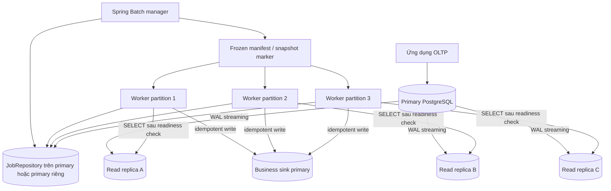
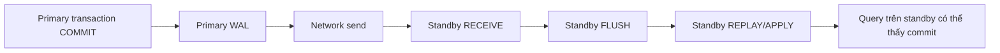
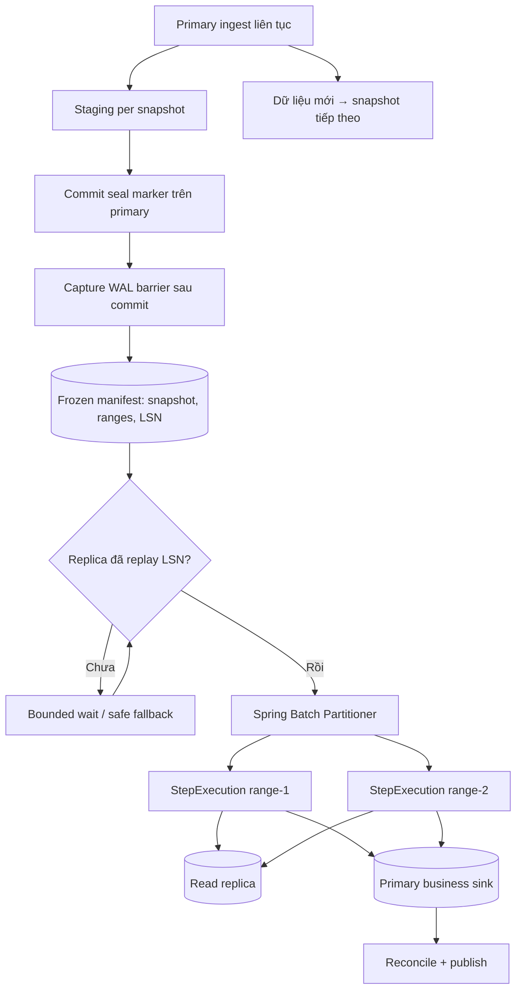

# Database replica và giới hạn consistency

## 1. Tại sao tăng replica vẫn có thể làm batch sai?

Một hệ thống Spring Batch phải tổng hợp **80 triệu đơn hàng** mỗi đêm. Primary database tiếp nhận giao dịch trực tuyến; đội vận hành tạo ba read replicas để giảm tải và cho 12 worker đọc song song. Throughput tăng, nhưng báo cáo đôi khi thiếu đơn hàng đã được xác nhận vài giây trước khi job bắt đầu. Một partition đọc thấy bản ghi mới, partition khác lại chưa thấy; job vẫn `COMPLETED` vì không có exception nào.

Đây là giới hạn của **replication consistency**: replica tăng **năng lực phục vụ truy vấn đọc**, nhưng không tự bảo đảm mọi worker đều thấy **cùng một thời điểm dữ liệu** hoặc thấy ngay những transaction đã commit trên primary.

Bài **“Database replica và giới hạn consistency”** thuộc chương **Database scaling** của module **SPRING_BATCH_SCALING_OPERATIONS**. Module tập trung mở rộng Spring Batch qua multi-threaded step, parallel steps, partitioning và mô hình phân tán, nhưng throughput chỉ có giá trị khi kiểm soát thread safety, retry/restart và tính đúng nghiệp vụ.

> **Quy tắc quan trọng:** một truy vấn `SELECT` chạy thành công trên replica chỉ chứng minh **replica trả lời được truy vấn**, không chứng minh replica đã nhận và replay toàn bộ các commit mà business batch cần nhìn thấy.

### Mục tiêu học tập

Sau bài này, bạn có thể:

1. Phân biệt primary, read replica, read scaling, high availability và consistency.
2. Hiểu replication lag, WAL `receive/flush/replay`, read-after-write và các giới hạn của snapshot đa worker.
3. Chọn đọc primary, đọc replica có **LSN readiness barrier**, hoặc đọc một **snapshot/staging bất biến**.
4. Cấu hình Spring Batch để **reader có thể dùng replica**, nhưng `JobRepository` và writer dùng database/transaction manager phù hợp.
5. Thiết kế `Partitioner`, `@StepScope`, checkpoint và nguồn cố định cho restart.
6. Đo replica saturation, standby query conflicts, failover và đối soát dữ liệu thay vì chỉ đo số rows/giây.

## 2. Primary và replica khác vai trò

| Thành phần | Vai trò chính | Rủi ro cần quản lý |
| --- | --- | --- |
| **Primary** | Nhận giao dịch đọc/ghi của ứng dụng và tạo WAL | CPU, connections, write I/O, cạnh tranh OLTP |
| **Physical streaming replica / hot standby** | Replay WAL, cho phép truy vấn đọc khi `hot_standby` bật | Chậm replay, bị hủy query khi xung đột recovery |
| **Logical replica/subscriber** | Nhận một tập thay đổi theo logical publication/subscription | Khác biệt schema/DDL, scope dữ liệu, delay và ordering |
| **Application read router** | Quyết định query tới primary hay replica | Route sai transaction, đọc stale hoặc ghi vào readonly node |
| **Spring Batch JobRepository** | Lưu `JobInstance`/`JobExecution`/`StepExecution`/`ExecutionContext` | Metadata phải bền vững và update được |
| **Business writer/sink** | Ghi dữ liệu kết quả và publish | Idempotency, transaction boundary, retry/restart |

**Read replica không phải sharding.** Một physical replica thường chứa một bản sao của cùng dataset; ba replicas không có nghĩa dữ liệu được chia làm ba shard. Nếu mỗi worker đều truy vấn **toàn bộ bảng** từ một replica khác nhau mà không có range/ownership, bạn chỉ nhân số lần đọc và có thể nhân dữ liệu đầu ra.

**Read scaling không đồng nghĩa write scaling.** Replication làm tăng năng lực đọc ở một số tình huống, còn writes vẫn phải theo kiến trúc primary/topology của database. Thêm read replicas có thể tăng tải WAL/replication slots, network và storage, nên lợi ích không tuyến tính.

### 2.1. Mô hình triển khai tham khảo



Sơ đồ **minh họa** ba read replicas và một business sink. Trong production, `JobRepository` có thể dùng một **database primary riêng**, hoặc cùng primary nghiệp vụ theo nhu cầu. Điểm không được thay đổi là metadata **không được vô tình route đến một replica chỉ đọc hoặc có replication lag**.

## 3. Những mức consistency cần phân biệt

| Khái niệm | Câu hỏi | Trên replica bất đồng bộ |
| --- | --- | --- |
| **Eventual consistency** | Replica có hội tụ về primary sau một thời gian không? | Có nếu replication hoạt động và không mất dữ liệu ngoài chính sách |
| **Read-your-writes** | Vừa ghi thành công trên primary, lần đọc sau có thấy không? | **Không mặc định** |
| **Monotonic reads** | Đã thấy version 8, lần đọc kế có thể quay về version 7? | Có thể khi chuyển sang replica chậm hơn |
| **Consistent snapshot trong một transaction** | Hai câu query trong cùng transaction có cùng ảnh chụp không? | Phụ thuộc isolation và thời điểm lấy snapshot |
| **Consistent snapshot đa worker** | Mọi worker có thấy chính xác cùng trạng thái nguồn không? | **Không tự có** chỉ vì cùng query/cutoff |
| **Linearizable read** | Mỗi read phản ánh tất cả writes đã hoàn tất trước đó theo thứ tự thời gian thực? | Không suy ra từ async replica |
| **Durability/failover** | Commit có sống sót khi primary mất không? | Tùy sync mode, failover target và WAL đã nhận/flush |
| **Batch completeness** | Mọi record thuộc manifest/snapshot đã tạo ra output đúng? | Cần hợp đồng nguồn + đối soát |

Không dùng “replica đồng bộ” như một cam kết tuyệt đối “mọi query đọc đều nhất quán như primary”. Cần biết **synchronous mode nào**, bao nhiêu standby được chờ, replica nào là target, các transactions có cùng semantics hay không.

### 3.1. Timeline lỗi read-after-write

```text
10:00:00.000  Primary COMMIT order_id=502, version=8.
10:00:00.020  API trả "đã tạo đơn hàng".
10:00:00.100  Spring Batch worker A đọc replica A (đã replay).
10:00:00.110  Worker A thấy order_id=502.
10:00:00.120  Worker B đọc replica B (chưa replay).
10:00:00.130  Worker B chưa thấy order_id=502.
10:00:05.000  Replica B mới replay được commit.
```

Cùng câu SQL có thể trả tập hàng khác nhau. Nếu worker B đã kết thúc vùng ID của nó và ghi `COMPLETED`, năm giây sau replica bắt kịp **không tự kích hoạt Spring Batch chạy lại** phần dữ liệu đã bỏ lỡ.

### 3.2. Monotonic reads bị phá khi load balancer đổi backend

```text
Request 1 -> replica A: customer.balanceVersion = 12
Request 2 -> replica B: customer.balanceVersion = 11
```

Không có write mới nào làm version giảm; chỉ vì hai replicas đang ở **hai vị trí replay**. Với job cần kiểm tra phiên bản trạng thái, lần đọc thứ hai có thể “lùi thời gian”. Có thể pin worker vào một replica đã xác minh, dùng session/LSN guard hoặc đọc primary cho query cần strong freshness.

## 4. Replication lag: receive, flush và replay khác nhau

Với PostgreSQL physical streaming replication, primary ghi **WAL**, standby nhận WAL rồi replay để phản ánh thay đổi trong dữ liệu truy vấn được.



Khi hỏi “replica đã bắt kịp chưa?”, phải hỏi **bắt kịp tới pha nào**.

| Pha | Ý nghĩa | Đủ để query thấy dữ liệu? |
| --- | --- | --- |
| `sent_lsn` | Primary đã gửi WAL đến đâu | **Không** |
| `write_lsn` / `flush_lsn` | Standby đã ghi/flush WAL đến đâu theo status | **Không nhất thiết** |
| `replay_lsn` | Standby đã replay đến đâu | **Có thể** đọc được transaction đã replay nếu snapshot query được lấy phù hợp |
| `pg_last_wal_receive_lsn()` | Standby đã nhận WAL đến đâu | **Không đủ** |
| `pg_last_wal_replay_lsn()` | Standby đã apply WAL đến đâu | Tín hiệu cần cho freshness barrier |
| `pg_last_xact_replay_timestamp()` | Timestamp của transaction replay mới nhất | Không phải chứng cứ lag đã về 0 |

**Quan trọng:** đo thời gian `now() - pg_last_xact_replay_timestamp()` không phải replication lag tuyệt đối. Nếu primary **không có giao dịch mới**, timestamp vẫn cũ và số chênh lệch cứ tăng dù replica đã bắt kịp hoàn toàn. Nếu không có transaction nào được replay, hàm còn có thể trả `NULL`.

### 4.1. Ví dụ độ trễ theo bytes

Giả sử primary current WAL location là `0/50000000`, replica replay tới `0/4F000000`. Trong cùng timeline, khoảng cách WAL xấp xỉ:

```text
0x50000000 - 0x4F000000 = 0x01000000 = 16 MiB WAL
```

**16 MiB WAL ≠ 16 MiB business rows**, và cũng không tương đương **16 giây**. Tốc độ replay thay đổi theo I/O, query conflicts, transaction sizes và workload. Dùng **bytes lag + time/age + trend + end-to-end freshness**, không chỉ một số duy nhất.

## 5. PostgreSQL synchronous replication có những mức cam kết nào?

Ở PostgreSQL, `synchronous_commit` phối hợp với `synchronous_standby_names` và cấu hình standby để xác định primary phải chờ đến đâu trước khi trả COMMIT thành công.

| Chế độ | Cam kết chính (khi có synchronous standby cấu hình đúng) | Có bảo đảm transaction đã visible cho read trên standby đang được chờ? |
| --- | --- | --- |
| `local` | Primary flush WAL local; không chờ standby | Không |
| `remote_write` | Chờ standby nhận và ghi WAL vào filesystem của nó | Không |
| `on` | Chờ standby flush WAL bền vững theo cấu hình | **Không nhất thiết replay** |
| `remote_apply` | Chờ standby được chọn replay/apply tới commit | **Có** trên standby được xác nhận, theo điều kiện thiết lập |
| `off` | Không chờ local WAL flush theo mức thường lệ | Không; thay đổi cả durability tradeoff |

**Hai giới hạn dễ bị bỏ qua:**

1. Nếu `synchronous_standby_names` không cấu hình, các mode `remote_apply`/`remote_write` không tự tạo một synchronous standby. Phải kiểm tra cấu hình thực, không đọc một tham số riêng lẻ rồi kết luận.
2. `remote_apply` áp cho **tập synchronous standby theo chính sách**, không bảo đảm mọi replica khác sau load balancer đã cùng vị trí replay. Cascaded replicas hoặc async replicas vẫn có lag.

**Tradeoff:** mức nhất quán/durability mạnh hơn có thể tăng **COMMIT latency** và coupling availability với standby. Không tự đổi `synchronous_commit` trong production chỉ để giúp một nightly batch: tác động tới toàn bộ OLTP, latency, availability và RPO phải được đánh giá với DBA.

## 6. Cần consistency đến mức nào cho từng loại batch?

| Công việc | Tính nhất quán yêu cầu | Gợi ý |
| --- | --- | --- |
| Dashboard dự báo chấp nhận chậm 2–5 phút | Eventual/staleness bounded | Replica có lag monitoring và correction |
| Đối soát tài chính cuối kỳ | Tập record/số tiền **chính xác** tới mốc chốt | Sealed snapshot/manifest, barrier hoặc primary |
| Import dữ liệu có thể chạy lại và dedup | At-least-once với hợp đồng rõ | Replica + immutable staging + idempotent sink |
| Đọc và cập nhật trạng thái cùng entity trong một workflow | Read-your-writes/transaction coherence | Thường ưu tiên primary hoặc transaction phù hợp |
| Phát hiện bản ghi mới nhất theo `MAX(id)` | Cần commit-complete boundary | Không dựa vào một replica lagging hoặc ID sequence đơn thuần |
| Xử lý CDC thay đổi liên tục | Theo offset/commit order | CDC log + immutable micro-batch/staging |
| Query phân tích lịch sử không đổi | Historical immutable dataset | Replica thường rất phù hợp nếu có retention |
| Cleanup/xóa dữ liệu theo giá trị vừa được ghi | Mức nhất quán cao | Không dùng replica stale để quyết định xóa |

Một batch đọc replica có thể phù hợp **nếu snapshot đầu vào đã đóng và replication catch-up được chứng minh**. Ngược lại, query “đọc toàn bộ các đơn hàng mới nhất tại thời điểm bấm Run” không có giao thức chốt nguồn sẽ khó kiểm chứng ngay cả khi replica lag chỉ vài milliseconds.

## 7. Thiết kế an toàn: sealed snapshot trước khi chia partition

Cách dễ kiểm chứng nhất là tách nguồn đang thay đổi khỏi input của job:

1. Nguồn OLTP tiếp tục write trên primary.
2. Quy trình ingest tạo `snapshotId` hoặc `businessBatchId` cho dữ liệu batch.
3. Ghi dữ liệu vào **staging có thể seal** trên primary; tất cả rows phải commit xong trước khi seal.
4. Commit một **seal marker**/manifest chỉ khi staging đầy đủ; ngăn INSERT/UPDATE/DELETE vào snapshot sau seal.
5. Sau seal, lấy **LSN marker sau COMMIT** trên primary; chỉ triển khai đọc replica đã apply tới marker đó.
6. `Partitioner` phát các range cố định của sealed snapshot.
7. Worker đọc replica có predicate `snapshot_id + range`, writer idempotent.
8. Sau mọi partition thành công, đối soát output và publish.



**Sealed marker phải có nghĩa nghiệp vụ thật:** mọi worker ghi staging đã hoàn tất và commit, không còn transaction “đến muộn” sẽ insert thêm vào snapshot đó. Chỉ một cột `snapshot.status='READY'` không tự bảo vệ invariant nếu hệ thống vẫn cho phép writer khác bổ sung rows sau READY.

### 7.1. Schema minh họa

```sql
CREATE TABLE invoice_snapshot (
    snapshot_id TEXT NOT NULL,
    invoice_id BIGINT NOT NULL,
    invoice_version BIGINT NOT NULL,
    amount NUMERIC(18, 2) NOT NULL,
    PRIMARY KEY (snapshot_id, invoice_id)
);

CREATE TABLE snapshot_registry (
    snapshot_id TEXT PRIMARY KEY,
    status TEXT NOT NULL,
    expected_rows BIGINT,
    expected_total NUMERIC(24, 2),
    sealed_at TIMESTAMPTZ,
    CHECK (status IN ('PREPARING', 'READY', 'ARCHIVED'))
);
```

Một producer/ingester **phải giữ quyền kiểm soát** chuyển `PREPARING → READY` sau khi đã xử lý hết input và commit; không dùng cùng `snapshot_id` cho dữ liệu đang tiếp tục thay đổi. Bảng trên **không tự ngăn update** của một snapshot READY; cần service permissions, transaction protocol, triggers hoặc immutable tables/storage phù hợp.

### 7.2. Sự thật quan trọng về snapshot đa worker

`REPEATABLE READ` trong PostgreSQL tạo ảnh chụp nhất quán **trong một transaction** ở một connection, nhưng **không** tự tạo **cùng một snapshot** cho nhiều worker connections độc lập, nhất là ở các replicas với WAL replay khác nhau.

- Worker A có thể bắt đầu transaction khi replica đã replay tới LSN X.
- Worker B bắt đầu sau đó, replica đã replay tới X+Y.
- Cả hai có thể giữ snapshot ổn định riêng, nhưng **không đồng nhất** nếu nguồn vẫn mutate.

Để batch có kết quả xác định qua nhiều worker và qua restart, ưu tiên **dataset đã materialize và bất biến** thay vì chỉ tăng isolation của từng reader connection.

## 8. WAL replay barrier: chờ đúng mốc trên replica

Nếu dùng PostgreSQL physical streaming replicas, có thể yêu cầu **read-after-seal visibility** bằng một **WAL LSN barrier**.

### 8.1. Lấy LSN sau khi seal transaction đã COMMIT

```sql
-- Thực thi trên PRIMARY, trong một statement/transaction mới
-- SAU KHI giao dịch ghi snapshot + seal marker đã COMMIT.
SELECT pg_current_wal_lsn() AS required_replay_lsn;
```

LSN lấy **sau commit** đại diện một vị trí **không sớm hơn** WAL commit record cần nhìn thấy (có thể chậm hơn một chút nếu có writes khác). Không lấy `pg_current_wal_lsn()` **trước** khi transaction seal commit rồi giả rằng mốc đó đã bao trùm commit.

**Không nhầm với `MAX(invoice_id)`:** sequence IDs và thứ tự commit không nhất thiết đồng nhất, nên MAX ID không cho phép suy ra replica đã thấy mọi transaction trong dải.

### 8.2. Kiểm tra trên chính replica worker sẽ đọc

```sql
-- Trên READ REPLICA được chọn, trong context thích hợp:
SELECT
    pg_is_in_recovery() AS is_standby,
    pg_last_wal_receive_lsn() AS received_lsn,
    pg_last_wal_replay_lsn() AS replayed_lsn,
    pg_last_wal_replay_lsn() >= CAST(:requiredLsn AS pg_lsn)
        AS replay_ready;
```

Điều kiện triển khai:

- **Bắt buộc `is_standby=true`** nếu đường đọc này được thiết kế chỉ đọc từ standby; nếu standby đã được promote, phải đánh giá lại routing.
- `replayed_lsn` có thể là `NULL` khi chưa replay; coi `NULL` là **not ready**, không coi là bằng 0.
- Chỉ so sánh LSN trong **cùng lineage/timeline** của PostgreSQL cluster. Sau failover/promotion, phải xác minh lại topology, không dùng số LSN trần để so giữa hai timeline độc lập.
- Kiểm tra **đúng replica cụ thể**. Nếu query guard chạy trên A nhưng reader pool lại được load balancer sang B đang chậm, barrier đã bị vô hiệu.
- Sau khi đủ replay, reader nên mở **transaction/snapshot mới** phù hợp. Một transaction `REPEATABLE READ` đã lấy snapshot trước readiness check có thể tiếp tục nhìn trạng thái cũ.
- Đây là guard **freshness tại một mốc**, **không** tự tạo global point-in-time snapshot nếu dữ liệu vẫn được update sau seal.

### 8.3. Bounded wait với timeout và fallback rõ

```text
input:
  requiredLSN = LSN lấy sau snapshot seal COMMIT
  replicaId   = replica cụ thể của worker
  timeout     = 30 giây (chỉ minh họa)
  pollPeriod  = 250 ms (chỉ minh họa)

while còn thời gian:
    check replica identity, timeline và replay LSN
    if replica đang recovery AND replayLSN >= requiredLSN:
        mới cho reader bắt đầu từ snapshot chưa mở
        return READY
    if replica lỗi/promoted/timeline không khớp:
        break và tái đánh giá
    sleep với backoff nhỏ

khi hết hạn:
    fail rõ / chọn replica khác đã verify / đọc primary theo policy
```

**Không poll vô hạn** vì một replica tắt replication hoặc bị giữ replay bởi long-running query sẽ không bắt kịp trong SLA. **Fallback sang primary** có thể làm job đúng hơn về freshness nhưng làm tăng tải OLTP: cần concurrency cap/admission control và thông báo vận hành, không fallback cả trăm workers cùng lúc.

### 8.4. Cơ chế PostgreSQL version mới

Ở các phiên bản PostgreSQL mới (ví dụ PostgreSQL 19), tài liệu mô tả thêm phương thức chờ WAL/LSN như lệnh `WAIT` với `standby_replay`. Không assume lệnh này có trên PostgreSQL 15/16/17/18; với hạ tầng nhiều phiên bản, cách poll `pg_last_wal_replay_lsn()` sau khi xác minh target và timeout vẫn là phương án khái niệm dễ hiểu. Kiểm chứng quyền thực thi, semantics và version trước khi áp dụng bất kỳ API chờ nào.

## 9. LSN readiness không đồng nghĩa exactly-once hoặc global snapshot

Một số điều **LSN barrier không giải quyết**:

| Vấn đề | Vì sao còn tồn tại |
| --- | --- |
| Hàng mới insert **sau** seal marker | Replica vẫn có thể replay chúng trước/during reader; cần snapshot ID bất biến |
| Hai queries đọc ở hai thời điểm | Nếu nguồn mutable, mỗi query có thể thấy state khác |
| Read replica load balancer đổi node | Guard trên A không bảo vệ B |
| Failover với timeline mới | LSN comparison có thể không còn cùng lineage |
| Worker restart | Cần giữ lại cùng input snapshot và partition mapping, không chỉ một LSN |
| Ghi output thành công rồi crash | LSN nguồn không thay thế idempotent writer |
| Replication logical lọc bảng | Physical WAL barrier không áp nguyên xi cho mọi logical subscriber |
| Business cutoff theo event time | WAL LSN là vị trí apply log, không phải event-time watermark |

### 9.1. Một ví dụ dễ nhầm: status READY nhưng rows chưa commit

```text
T1: ingest worker đang chờ, đã được cấp invoice_id=100.
T2: commit status READY, ghi seal marker.
Manager lấy requiredLSN sau T2.
Replica replay tới requiredLSN, bắt đầu đọc.
T1: cuối cùng mới COMMIT invoice_id=100.

=> Barrier đạt nhưng invoice 100 vẫn vắng mặt tại thời điểm đọc.
```

Sai ở **seal protocol**, không ở replica barrier. Một snapshot chỉ thật sự đóng khi mọi writers của snapshot đã commit hoặc bị từ chối và `READY` được publish **sau đó**, với cơ chế ownership và transaction đúng.

## 10. Routing DataSource an toàn cho Spring Batch

Một hệ thống Spring Batch thường có ít nhất **ba loại truy cập DB**:

1. **JobRepository metadata:** phải ghi và đọc trạng thái đúng cho lifecycle/restart.
2. **Input reader:** có thể đọc từ replica **nếu consistency contract cho phép**.
3. **Business writer:** ghi vào primary/sink có transaction và idempotency phù hợp.

**Không chọn replica chỉ vì SQL bắt đầu bằng `SELECT`.** `JobExplorer`, `JobRepository`, constraint checks, read-modify-write và quyết định publish có thể đọc metadata cần **freshness cao**. Một `AbstractRoutingDataSource` đơn giản route toàn bộ transaction `readOnly=true` sang replica có thể làm **JobRepository/JobExplorer đọc stale** hoặc khiến job đánh giá trạng thái sai.

### 10.1. Cách đơn giản và dễ kiểm chứng: explicit DataSource

```java
// Các DataSource đã được cấu hình riêng, với quyền tối thiểu:
// primaryBatchDataSource: database PRIMARY chứa JobRepository
// replicaDataSource: replica được phép SELECT snapshot
// businessWriteDataSource: database PRIMARY nhận output

@Bean("replicaInvoiceReader")
@StepScope
JdbcPagingItemReader<InvoiceRow> replicaInvoiceReader(
        @Qualifier("replicaDataSource") DataSource replicaDataSource,
        @Value("#{stepExecutionContext['snapshotId']}") String snapshotId,
        @Value("#{stepExecutionContext['fromId']}") Long fromId,
        @Value("#{stepExecutionContext['toId']}") Long toId) {

    return new JdbcPagingItemReaderBuilder<InvoiceRow>()
            .name("replicaInvoiceReader")
            .dataSource(replicaDataSource)
            .selectClause(
                    "SELECT invoice_id, invoice_version, amount")
            .fromClause("FROM invoice_snapshot")
            .whereClause(
                    "WHERE snapshot_id = :snapshotId " +
                    "AND invoice_id >= :fromId " +
                    "AND invoice_id < :toId")
            .parameterValues(Map.of(
                    "snapshotId", snapshotId,
                    "fromId", fromId,
                    "toId", toId))
            .sortKeys(Map.of("invoice_id", Order.ASCENDING))
            .rowMapper((rs, rowNum) -> new InvoiceRow(
                    rs.getLong("invoice_id"),
                    rs.getLong("invoice_version"),
                    rs.getBigDecimal("amount")))
            .pageSize(250)
            .saveState(true)
            .build();
}
```

`InvoiceRow` là record/domain type do ứng dụng định nghĩa:

```java
record InvoiceRow(
        long invoiceId,
        long invoiceVersion,
        BigDecimal amount) {}
```

Ví dụ dựa trên **Spring Batch 5.x**; phần imports, bean `DataSource`/pool, cấu hình `JobRepository`, phiên bản Postgres driver và thiết lập routing/failover cụ thể được lược bỏ. Trên Spring Batch 6.x, một số builder API khác; phải kiểm tra dependency chính xác.

### 10.2. Guard phải chạy trước reader mở snapshot

`@StepScope` cung cấp reader riêng cho từng `StepExecution`. Tuy nhiên **không bảo đảm** guard LSN chạy trước khi reader đã mở JDBC connection và tạo snapshot. Có thể đặt **preflight trong manager trước dispatch** nếu mọi workers dùng cùng replica đã pin, hoặc thêm startup guard trong worker trước `ItemStream.open` của reader.

**Hợp đồng startup worker:**

```text
partition context -> snapshotId/range/requiredLsn
             |
             v
select exact replica and verify topology
             |
             v
wait until that replica replayed requiredLsn
             |
             v
create/open reader transaction or connection
             |
             v
read immutable snapshot rows
             |
             v
write sink with idempotency; checkpoint
```

Nếu `replicaDataSource` là pool sau endpoint tự load-balance, phải xác nhận **connection được guard và reader sử dụng có cùng target/được bảo vệ cùng policy**. Đừng đọc endpoint A rồi query endpoint B mà không biết.

### 10.3. Worker Step dùng transaction manager cho writer

```java
@Bean("replicaReadWorkerStep")
Step replicaReadWorkerStep(
        JobRepository repository,
        @Qualifier("businessWriteTransactionManager")
            PlatformTransactionManager writerTransactionManager,
        @Qualifier("replicaInvoiceReader")
            ItemStreamReader<InvoiceRow> reader,
        @Qualifier("idempotentInvoiceWriter")
            ItemWriter<InvoiceRow> writer) {

    return new StepBuilder("replicaReadWorkerStep", repository)
            .<InvoiceRow, InvoiceRow>chunk(250, writerTransactionManager)
            .reader(reader)
            .writer(writer)
            .build();
}
```

**Cực kỳ quan trọng về transaction:**

- Reader dùng connection từ **replicaDataSource**, writer dùng **business primary DataSource**. Một local `DataSourceTransactionManager` cho primary **không tự bao trùm** connection replica vào cùng một transaction.
- Nếu `JobRepository` ở một DB khác business sink, commit writer và commit metadata có thể **không nguyên tử**. Crash giữa hai lần commit có thể làm một chunk được replay.
- Dù metadata và writer cùng primary, side effects HTTP, message broker và filesystem vẫn không tự nằm trong cùng transaction.
- Vì vậy **snapshot nguồn phải ổn định và writer phải idempotent**; không khẳng định “đã dùng `chunk(...)` nên exactly-once”.
- `readOnly=true` trên transaction không phải security boundary để ngăn writer route nhầm; phải dùng account/permissions và DataSource topology rõ.

### 10.4. JobRepository không được định tuyến vào replica

Một failure nguy hiểm:

```text
manager create JobExecution -> PRIMARY
worker read StepExecution metadata -> lagging REPLICA
worker thấy metadata chưa có / trạng thái cũ
worker retry sai hoặc lỗi "execution not found"
```

Trong distributed partitioning, manager và workers phải thấy metadata lifecycle đúng; một `JobRepository` dùng database bền vững có quyền ghi và consistency phù hợp. **Đừng cấu hình `JobRepository` vào read replica chỉ để giảm tải SELECT**.

Nếu muốn tăng năng lực metadata, đo `JobRepository` workload, tối ưu connection pool, số StepExecutions và database capacity riêng; không đánh đổi correctness lấy route stale.

## 11. Partitioner: chia range logic không phụ thuộc replica

Việc có **ba replicas** không có nghĩa nên tạo đúng **ba partitions**. Partition count quyết định granularity xử lý/restart; replica count là một yếu tố năng lực I/O.

Giả sử manifest đóng băng gồm:

```json
{
  "businessBatchId": "billing-2026-11",
  "manifestId": "billing-snap-v1",
  "snapshotId": "snapshot-2026-11-v1",
  "requiredReplayLsn": "0/50000000",
  "ranges": [
    {"name": "range-000", "fromId": 0, "toId": 1000000},
    {"name": "range-001", "fromId": 1000000, "toId": 2000000},
    {"name": "range-002", "fromId": 2000000, "toId": 3000000}
  ]
}
```

**Đây là dữ liệu minh họa:** ranges phải được tính từ snapshot thật, kiểm tra không overlap và bao phủ đúng tập record nghiệp vụ. `requiredReplayLsn` không được sinh ngẫu nhiên; phải ghi lại mốc sau commit của seal transaction và giữ đúng timeline/source cluster.

### 11.1. Java Partitioner mẫu

```java
record InvoiceSlice(String name, long fromId, long toId) {}

final class SealedInvoicePartitioner implements Partitioner {
    private final String snapshotId;
    private final String requiredReplayLsn;
    private final List<InvoiceSlice> slices;

    SealedInvoicePartitioner(
            String snapshotId,
            String requiredReplayLsn,
            List<InvoiceSlice> frozenSlices) {
        this.snapshotId = snapshotId;
        this.requiredReplayLsn = requiredReplayLsn;
        this.slices = List.copyOf(frozenSlices);
    }

    @Override
    public Map<String, ExecutionContext> partition(int gridSize) {
        Map<String, ExecutionContext> contexts = new LinkedHashMap<>();
        for (InvoiceSlice slice : slices) {
            if (slice.fromId() >= slice.toId()) {
                throw new IllegalArgumentException("Invalid ID range");
            }
            ExecutionContext context = new ExecutionContext();
            context.putString("snapshotId", snapshotId);
            context.putString("requiredReplayLsn", requiredReplayLsn);
            context.putLong("fromId", slice.fromId());
            context.putLong("toId", slice.toId());
            if (contexts.putIfAbsent(slice.name(), context) != null) {
                throw new IllegalArgumentException(
                        "Duplicate partition name: " + slice.name());
            }
        }
        return contexts;
    }
}
```

Code không tự triển khai manifest repository hay validate toàn bộ gap/overlap. Trong production cần một preflight kiểm tra business slice coverage, snapshot completeness, current replication lineage và tồn tại của staging data.

**Điểm then chốt:**

- `gridSize` là **hint** cho `Partitioner`, không ép implementation này trả đúng `gridSize` entries.
- Partition name/range/`snapshotId` không thay đổi trong mọi restart của **cùng JobInstance**.
- Có thể đổi **replica phục vụ** một partition sau sự cố **chỉ khi** replica thay thế đã được xác minh có cùng snapshot/lineage và đạt barrier; không đổi nội dung partition.
- Không lưu credential, raw SQL hoặc object JDBC Connection trong `ExecutionContext`.

### 11.2. Pool executor không phải replica traffic controller toàn cụm

```java
@Bean("replicaPartitionExecutor")
ThreadPoolTaskExecutor replicaPartitionExecutor() {
    ThreadPoolTaskExecutor pool = new ThreadPoolTaskExecutor();
    pool.setThreadNamePrefix("replica-batch-");
    pool.setCorePoolSize(4);
    pool.setMaxPoolSize(4);
    pool.setQueueCapacity(12);
    return pool;
}

@Bean("replicaPartitionManager")
Step replicaPartitionManager(
        JobRepository repository,
        @Qualifier("replicaReadWorkerStep") Step worker,
        @Qualifier("sealedInvoicePartitioner") Partitioner partitioner,
        @Qualifier("replicaPartitionExecutor") TaskExecutor executor) {

    return new StepBuilder("replicaPartitionManager", repository)
            .partitioner(worker.getName(), partitioner)
            .step(worker)
            .gridSize(4)
            .taskExecutor(executor)
            .build();
}
```

Đây là **local partitioned step** trong Spring Batch 5.x. Khi dùng remote partitioning, manager và worker ở các process khác, có message transport và reply/correlation riêng; vẫn phải có guard replica ở worker node thật.

Pool `core=max=4` giới hạn **tasks của pool đó**. Với bốn pods đều có pool riêng, có thể có tới 16 tasks hoạt động. Dùng **replica admission quotas** nếu cần đảm bảo không quá N heavy readers trên mỗi database instance; `gridSize` không phải giới hạn toàn cụm.

## 12. Read-only replica có thể làm hủy truy vấn dài

Một read replica PostgreSQL cần replay WAL để bắt kịp primary. Truy vấn dài trên hot standby có thể giữ snapshot hoặc xung đột với replay của các thao tác cleanup/DDL, dẫn đến **recovery conflicts**.

Những triệu chứng thường thấy:

- Query batch bị cancel với thông báo liên quan đến recovery conflict.
- `pg_stat_database_conflicts` tăng.
- `replay_lag`/WAL bytes behind tăng khi standby bị chậm apply.
- Truy vấn lâu hơn do I/O contention với WAL replay.
- Một replica chậm hơn các replica khác vì CPU, disk, network hoặc workload analytic.

### 12.1. Hai nhóm cấu hình có tradeoff

| Thiết lập PostgreSQL | Có thể giúp gì? | Chi phí/rủi ro |
| --- | --- | --- |
| `max_standby_streaming_delay` | Cho standby chờ một khoảng trước khi cancel query xung đột với WAL replay | Chờ nhiều gây replication lag; giới hạn **không** là timeout của từng query |
| `max_standby_archive_delay` | Tương tự khi replay WAL từ archive | Phụ thuộc trạng thái replay và archive |
| `hot_standby_feedback` | Giảm cleanup conflicts bằng cách báo nhu cầu snapshot từ standby | Có thể làm primary giữ dead tuples lâu, **table bloat** |
| Query `statement_timeout` | Chặn query quá dài | Đặt quá thấp gây fail/retry storm |
| Giảm chunk/query transaction duration | Hạ thời gian giữ resources và snapshot | Tăng overhead commit/read paging |
| Dedicated analytic replica | Cô lập một phần workload đọc | Vẫn có lag/maintenance và chi phí vận hành |

Không tự đặt `max_standby_streaming_delay=-1` để “không bị cancel”: standby có thể **tụt replay rất xa**. Với job cần freshness, “query được chạy xong” nhưng dữ liệu quá cũ vẫn là failure nghiệp vụ. Cần chọn tradeoff dưới sự phối hợp với DBA.

### 12.2. Timeout và retry đúng tầng

- Một query bị cancel do standby recovery conflict là **lỗi truy vấn ở replica**, không nhất thiết là dữ liệu invalid.
- Không retry vô hạn ngay lập tức cùng query 30 phút trên replica đang lag; có thể làm replay càng tệ.
- Dùng bounded retry, backoff và replica fallback **sau guard**, hoặc đọc primary với admission limit.
- Khi chuyển replica, phải giữ `snapshotId`/partition range và checkpoint tương thích.
- Nếu source mutable, retry trên replica khác có thể thấy dữ liệu khác: **không thể gọi đó là restart an toàn**.

## 13. Replication lag và throughput không phải cùng một vấn đề

Tăng số worker đọc replica có thể:

- Tăng CPU/query I/O trên replica, khiến **WAL replay chậm**.
- Tăng disk/cache contention giữa reader và apply process.
- Tăng network traffic của client, nhưng không tăng write capacity primary.
- Dùng nhiều connections hơn, gây connection saturation.
- Tăng metadata/JobRepository writes do quá nhiều StepExecutions nhỏ.
- Làm replica B chậm hơn A, gây dữ liệu quan sát không đồng đều.

### 13.1. Ví dụ scaling (số giả định)

Giả sử đọc 400 GB sealed snapshot:

| Concurrent readers | Job runtime | Replica replay lag P95 | Nhận xét |
| ---: | ---: | ---: | --- |
| 1 | 220 phút | 0,3 giây | Baseline |
| 2 | 130 phút | 0,5 giây | Tăng tốc |
| 4 | 78 phút | 1 giây | Còn headroom |
| 8 | 65 phút | 6 giây | Storage gần bão hòa |
| 16 | 72 phút | 25 giây | Query contention và lag tăng |
| 32 | 90 phút | 90 giây | Có thể vượt freshness SLA |

**Các số hoàn toàn minh họa**, không phải benchmark PostgreSQL. Không kết luận replica “chịu được 16 threads” chỉ vì CPU còn 60%; storage IOPS, WAL replay, query conflicts và cache có thể là bottleneck trước.

### 13.2. Khác biệt capacity giữa replicas

Không chia đều 12 worker thành “4+4+4” nếu:

- Replica A cùng availability zone với workers, B/C ở cross-zone.
- Một replica có storage/CPU yếu hơn, đang bảo trì hoặc chạy analytics.
- Replica C đang bắt kịp WAL sau network outage.
- Query/data skew khiến partition lớn dồn vào một node.

Một scheduler có thể chọn **read replica readiness + current capacity** trước khi dispatch, nhưng phải có **ổn định source identity và error handling**. Nếu backpressure xảy ra, giảm admission hoặc tạm pause dispatch; không tự đổi snapshot/range để “cân bằng lại” JobInstance đang restart.

## 14. Truy vấn giám sát replication trên PostgreSQL

### 14.1. Trên PRIMARY: xem từng streaming standby

```sql
SELECT
    application_name,
    client_addr,
    state,
    sync_state,
    sent_lsn,
    write_lsn,
    flush_lsn,
    replay_lsn,
    pg_wal_lsn_diff(
        pg_current_wal_lsn(),
        replay_lsn
    ) AS replay_bytes_behind,
    write_lag,
    flush_lag,
    replay_lag
FROM pg_stat_replication
ORDER BY application_name;
```

- `pg_stat_replication` là view trên **primary**, đại diện các WAL sender connections.
- `replay_bytes_behind` dựa trên **LSN primary hiện tại so với replay LSN được standby báo lại** và có thể `NULL`. Đây là tín hiệu độ trễ, không là một global consistency guarantee.
- `write_lag`, `flush_lag`, `replay_lag` là các phép đo liên quan WAL synchronization/response theo tài liệu PostgreSQL; **`NULL` không đồng nghĩa zero lag**.
- Quyền nhìn thấy toàn bộ statistics có thể cần role/privileges phù hợp.
- Nếu primary có nhiều timelines/failover, đừng so sánh LSN cũ của một cluster với LSN mới từ node không cùng lineage.

### 14.2. Trên REPLICA: xác minh receive và replay

```sql
SELECT
    pg_is_in_recovery() AS is_standby,
    pg_last_wal_receive_lsn() AS receive_lsn,
    pg_last_wal_replay_lsn() AS replay_lsn,
    pg_last_xact_replay_timestamp() AS last_replayed_xact_time;
```

```sql
SELECT
    status,
    receive_start_lsn,
    written_lsn,
    flushed_lsn,
    latest_end_lsn
FROM pg_stat_wal_receiver;
```

**Lưu ý về version:** các cột `pg_stat_wal_receiver` có thể khác giữa các major PostgreSQL versions; ví dụ query thứ hai cần đối chiếu hệ quản trị thực. Với một số version, columns như `written_lsn`/`flushed_lsn` được định nghĩa, nhưng không nên copy mù vào môi trường cũ mà không kiểm tra. Để giám sát nền tảng, query `pg_last_wal_receive_lsn`/`pg_last_wal_replay_lsn` ở trên dễ di chuyển hơn.

### 14.3. Recovery conflicts trên standby

```sql
SELECT
    datname,
    confl_tablespace,
    confl_lock,
    confl_snapshot,
    confl_bufferpin,
    confl_deadlock
FROM pg_stat_database_conflicts
ORDER BY datname;
```

Đây là các counters tích lũy theo database; cần quan sát **delta theo thời gian** chứ không chỉ giá trị tuyệt đối. Nếu `confl_snapshot` tăng mạnh trong giờ batch, kiểm tra long-running reader queries, WAL replay và vacuum cleanup conflicts.

### 14.4. Không lấy timestamp “last replay” làm một SLA duy nhất

```sql
SELECT now() - pg_last_xact_replay_timestamp()
    AS time_since_last_replayed_transaction;
```

Nếu primary ít transaction, số này có thể tăng dù replica đã apply mọi WAL hiện có. Nó hữu ích như tín hiệu phụ về độ tuổi transaction cuối được replay, **không phải replication delay chuẩn**; cần đối chiếu LSN lag và producer activity.

## 15. Tối ưu connection và query routing

### 15.1. Tính ngân sách connection

Giả sử hệ thống có:

- Ba replica nodes, mỗi node cho phép **tối đa 50 application connections** cho batch sau khi trừ phần dành cho ứng dụng khác/maintenance.
- 12 worker pods, mỗi pod có một Hikari pool `maximumPoolSize=20`.
- Nếu không có giới hạn điều phối, tổng connection capacity lý thuyết từ 12 pools là **240**, vượt xa 150 connection budget của ba replicas.

Không có nghĩa 240 connections đều active mọi lúc, nhưng đó là rủi ro **oversubscription**. Mỗi replica cần quota/routing capacity riêng; ngoài pool input còn có connections cho primary sink và JobRepository.

### 15.2. Tách rõ read pool và write/metadata pool

| Pool | DB endpoint | Policy |
| --- | --- | --- |
| Input reader pool | Replica được pin hoặc router có readiness guard | Read-only SQL quyền hạn, latency/lag threshold |
| Business writer pool | Primary/sink | Transaction, idempotency, commit timeouts |
| JobRepository pool | Primary metadata DB | Write/read-consistent, không route stale |
| Admin/monitoring pool | Primary + replicas | Quyền tối thiểu, low-frequency queries |

Đừng gộp mọi `DataSource` vào một bean `@Primary` rồi hy vọng qualifier của reader/writer luôn hoạt động khi refactor. Test bằng query `pg_is_in_recovery()` trên từng pool để chứng minh endpoint đích đúng trong mọi môi trường.

### 15.3. Query read-only không bảo đảm consistency

`Connection.setReadOnly(true)` hoặc `@Transactional(readOnly=true)` có thể là hint hoặc cấu hình transaction; chúng **không quyết định** replica đã replay tới mốc cần thiết. Trên một hệ thống có routing theo readOnly, một transaction đọc Job metadata có thể bị chuyển sang stale replica. **Routing và freshness guard là hai tầng riêng**.

## 16. Restart, replay và tính đúng khi replica bị lag

### 16.1. Lỗi khi chia partition theo dữ liệu live

```text
JobInstance A:
    partition-000: id [0, 1000000)
    partition-001: id [1000000, 2000000)

Worker partition-001 đọc replica B lúc 01:01:
    replica chưa replay record id=1500001 (primary đã COMMIT).
    worker quét xong vùng id và báo COMPLETED.

01:02 replica B mới bắt kịp.
01:10 job lỗi ở partition-000, restart JobInstance A.

Spring Batch thường bỏ qua partition-001 đã COMPLETED.
=> Record id=1500001 có thể vĩnh viễn không vào output của A.
```

Đây là **lỗi completeness**, không phải Spring Batch bị lỗi `JobRepository`. Framework chỉ biết worker hoàn tất query của nó, không thể suy ra replica đã chứa mọi transaction cần thiết.

### 16.2. Hai nguyên tắc bắt buộc

1. **Frozen snapshot/manifest:** không thay đổi dữ liệu nguồn và không tái gán partition names/ranges khi restart.
2. **Readiness của đúng replica:** trước khi worker quét, xác nhận replica đã apply mốc seal, hoặc chọn primary/replica khác đã verify.

Nếu snapshot không thể bất biến, có thể phải dùng CDC/offset + micro-batch, overlap/reconciliation hoặc một snapshot-consistent export thay vì giả định mỗi worker đọc live replica cùng lúc sẽ cho tập dữ liệu hoàn chỉnh.

### 16.3. LSN guard phải được áp lại sau reconnect

Một kết nối replica có thể mất sau khi worker đã bắt đầu. Nếu pool tự reconnect tới một node khác, worker **không được mặc định node mới cũng đã đạt barrier**. Phải tái xác minh target, replay position, timeline và reader snapshot/offset trước khi tiếp tục. Nếu không thể tái tạo đúng nguồn và checkpoint, **fail an toàn** để operator xử lý.

### 16.4. Writer idempotent minh họa

```sql
CREATE TABLE invoice_projection (
    business_batch_id TEXT NOT NULL,
    invoice_id BIGINT NOT NULL,
    invoice_version BIGINT NOT NULL,
    amount NUMERIC(18, 2) NOT NULL,
    PRIMARY KEY (business_batch_id, invoice_id)
);

INSERT INTO invoice_projection (
    business_batch_id, invoice_id, invoice_version, amount
)
VALUES (
    :batchId, :invoiceId, :invoiceVersion, :amount
)
ON CONFLICT (business_batch_id, invoice_id)
DO UPDATE SET
    invoice_version = EXCLUDED.invoice_version,
    amount = EXCLUDED.amount
WHERE invoice_projection.invoice_version < EXCLUDED.invoice_version;
```

Replay **cùng hoặc cũ hơn** không làm giảm version; nhưng nếu cùng `invoice_version` mà amount khác, dữ liệu nguồn đang vi phạm invariant và cần fail/đối soát. SQL này không bảo vệ notification/email, HTTP payment hoặc broker publish; external side effects cần dedup/outbox riêng.

### 16.5. JobRepository và business sink có transaction khác nhau

Nếu writer commit thành công ở primary sink nhưng job metadata checkpoint chưa kịp persist, một chunk có thể được đọc và ghi lại khi restart. Replica lag chỉ làm rủi ro phức tạp hơn; giải pháp vẫn cần **idempotent writer** và reconciliation.

**Không** tự sửa `BATCH_*` để đánh dấu completed, không fake remote replies và không tăng identifying `run.id` để gọi đó là restart. Một JobInstance mới thường xử lý lại toàn bộ từ đầu theo flow của nó.

## 17. Failover: replica có thể được promote thành primary

Failover làm thay đổi một loạt giả định:

- Endpoint trước đây là read replica có thể trở thành **new primary**.
- Primary cũ có thể bị demote hoặc tách khỏi cluster.
- Replicas được xây dựng lại có thể cần catch-up từ nguồn/timeline khác.
- LSN values không nên được so giữa **hai lịch sử WAL không cùng lineage**.
- Connection pools có thể giữ các connections cũ và báo lỗi khi role thay đổi.
- Synchronous commit policy và tập synchronous standbys có thể đổi sau failover.
- Nếu dùng asynchronous replication và promotion trước khi replica nhận hết WAL, **RPO có thể khác 0**, tùy thời điểm failover.

### 17.1. Runbook khi failover xảy ra giữa job

1. Tạm dừng dispatch/fallback tự động nếu chưa rõ topology.
2. Xác minh primary mới bằng cơ chế chính thức của HA system và role query.
3. Xác minh JobRepository metadata có còn nhất quán và cùng lịch sử JobInstance.
4. Xác minh sealed snapshot/manifest đã được replicate đầy đủ trên topology mới; nếu mất WAL/dữ liệu thì **không được gọi đó là cùng snapshot** chỉ vì ID giống.
5. Drain/quiesce workers cũ hoặc đảm bảo fencing để tránh hai generations ghi.
6. Tái xác định replay barrier cho đúng cluster/timeline; không so LSN một cách máy móc.
7. Restart **cùng JobInstance** khi source/checkpoint/batch metadata còn đúng; nếu không, cần correction/rerun với business recovery plan.
8. Đối soát unique output và publish marker, không chỉ status job.

### 17.2. Read replica failover ≠ transaction distributed atomic

Giữa source replica, sink primary, JobRepository và middleware thường **không có một transaction XA chung**. Sự cố giữa các hệ thống có thể gây replay, ack/reply timeout hoặc đẩy lại chunk. Hãy xử lý bằng bounded retries, transaction boundary minh bạch, idempotency và runbook, không hứa exactly-once end-to-end từ replication.

## 18. Kiểm thử consistency và lag có chủ đích

Chỉ benchmark trong trạng thái replica khỏe không đủ. Phải tạo lag để chứng minh batch **không silently complete với dữ liệu thiếu**.

| Test | Cách dựng tình huống | Kết quả cần chứng minh |
| --- | --- | --- |
| **A. Commit trước replay** | Commit invoice mới trên primary, giữ replica chưa apply | Worker chờ barrier/fallback; không quét thiếu rồi COMPLETED |
| **B. Hai replicas khác lag** | A apply trước, B apply chậm | Worker chọn B phải guard riêng; không reuse check của A |
| **C. Load balancer chuyển node** | Chuyển reader sang replica chưa đạt barrier | Revalidate hoặc fail, không âm thầm đọc |
| **D. Snapshot READY quá sớm** | Một writer commit sau seal | Preflight phát hiện contract sai hoặc test fail coverage |
| **E. Long query trên standby** | Tạo cleanup/replay conflict trong môi trường test | Bounded retry/timeout, metrics conflict và không mất dữ liệu |
| **F. Replay lag tăng do load** | Tăng workers và OLTP WAL generation | Admission control thay vì mở thêm vô hạn |
| **G. Worker crash giữa chunk** | Kill trước commit rồi restart | Checkpoint/transaction đúng, output unique |
| **H. Sink commit, metadata fail** | Chặn JobRepository sau sink commit | Replay idempotent, đối soát đúng |
| **I. Primary failover** | Promote standby theo test topology | Topology/LSN guard không dùng sai timeline |
| **J. Replica promote trong khi query** | Thay role/endpoint giữa worker | Connection/transaction xử lý đúng, không skip |
| **K. Snapshot dữ liệu bị sửa** | UPDATE/DELETE một row sau seal | Bị ngăn hoặc fingerprint mismatch |
| **L. Backfill late arrival** | Commit một record event-time cũ sau batch | Đi vào correction/next batch theo contract |
| **M. Concurrent OLTP + batch** | Read query nặng cùng workload primary | Primary SLA, replica lag và throughput trong budget |

### 18.1. Tạo lag có kiểm soát trong test environment

Trong môi trường PostgreSQL staging có quyền quản trị, một cách là **tạm dừng WAL replay** hoặc làm gián đoạn replication/network để tạo lag, sau đó quan sát barrier timeout và resume. PostgreSQL có các công cụ điều khiển replay nhưng **không dùng trên production để thử bài học**. Thời gian giữ pause phải ngắn, kiểm soát dung lượng WAL, replication slots và retention; không làm đầy disk.

Không dựa vào `Thread.sleep(100)` để “hy vọng replica chưa kịp” vì test dễ flaky; test harness cần biết khi nào commit hoàn tất và when replay đã bị chặn. Dùng latches/chaos proxy/replication observability và timeouts xác định.

### 18.2. Assertions bắt buộc

- **Một JobInstance** với identifying `manifestId` ổn định qua restart.
- `requiredReplayLsn` đã được đạt trên **đúng replica** trước reader transaction.
- Không partition nào quét dữ liệu cần thiết khi node chưa sẵn sàng.
- `JobExecution` cuối `COMPLETED` chỉ sau khi business reconciliation thành công.
- Mỗi record nguồn đúng một output theo business key/version; không có hàng thiếu hoặc duplicate side effects.
- Không có primary/replica routing sai role, kể cả sau failover.
- Long-running standby read không khiến `replay_lag` vượt policy mà không được alert.
- Retries/reader reopens không làm bỏ qua records do checkpoint nằm trên input snapshot khác.
- Khi guard timeout, hành vi rõ ràng: fail, chờ với giới hạn, hoặc fallback có kiểm soát; không report success giả.

## 19. Quan sát hệ thống và cảnh báo

### 19.1. Metric tối thiểu

| Metric đề xuất | Mục đích |
| --- | --- |
| `replica_replay_bytes_behind` | Khoảng cách WAL apply đến primary |
| `replica_replay_lag_seconds` (theo provider semantics) | Lag gần đúng và trend |
| `replica_readiness_wait_seconds` | Worker mất bao lâu chờ mốc seal |
| `replica_readiness_timeouts_total` | Số lần guard không đạt trong SLA |
| `replica_identity_mismatch_total` | Sai node/role/timeline hoặc load balancer đổi |
| `replica_conflict_cancellations_total` | Query bị cancel do recovery conflicts |
| `replica_read_connections_active` | Pool pressure trên từng replica |
| `replica_query_duration_seconds` | P95/P99 query latency |
| `primary_wal_generation_bytes_per_second` | Tốc độ WAL từ OLTP/staging |
| `batch_partition_duration_seconds` | Skew và tail latency từng partition |
| `batch_unique_output_rows` | Kết quả nghiệp vụ không trùng |
| `batch_reconciliation_mismatch_total` | Chênh lệch nguồn/đích |
| `batch_primary_fallback_total` | Số worker phải đọc primary |
| `batch_job_restart_total` | Theo dõi RTO và recovery load |

Tên metric là **đề xuất**, không phải tất cả đều có sẵn mặc định trong Spring Batch/Prometheus. Tránh nhét `invoiceId` hoặc từng `JobExecutionId` làm metric label cardinality cao; dùng structured logs/traces cho ID chi tiết.

### 19.2. Cảnh báo không chỉ nhìn replay lag

- `replay_lag` tăng cùng `oldest_batch_wait_age` và readiness timeouts.
- Lag trung bình thấp nhưng **một replica** có lag cao; scheduler đang dispatch tới node ấy.
- `pg_stat_database_conflicts` tăng khi batch có queries dài.
- Replica connections/CPU/IOPS cao trong khi apply rate giảm.
- Có source snapshot READY nhưng một replica không bao giờ đạt required LSN.
- Primary fallback tăng đột ngột, làm OLTP response time xấu.
- Worker đã completed nhưng sink reconciliation mismatch.
- Sau failover có reader connection trỏ wrong role/timeline.
- Replication slot/WAL retention tăng, nguy cơ đầy storage.

`replay_lag` trả `NULL` không nhất thiết là “0”; khi idle có thể không có giá trị đo gần đây. Phải xử lý **UNKNOWN** một cách minh bạch trong alert và readiness decision.

## 20. Runbook chọn nơi đọc theo yêu cầu nhất quán

### Bước 1 — Chốt business consistency contract

Nguồn cho phép stale bao lâu? Có bắt mọi giao dịch tới mốc chốt không? Job có được chạy correction/backfill không? Dữ liệu có mutable không?

### Bước 2 — Xác định topology thật

Primary nào, replicas nào, physical hay logical replication, async hay sync? Replica nào đang nhận/replay WAL, có failover nào mới xảy ra?

### Bước 3 — Đóng snapshot và manifest

Nếu là batch quan trọng, tạo snapshot/manifest đã seal, mốc WAL sau COMMIT và range ownership bất biến.

### Bước 4 — Chọn replica theo readiness và resource headroom

Với mỗi target, kiểm tra role/timeline, replay LSN ≥ barrier, DB connection/CPU/IOPS; chỉ dispatch nếu đạt. Tránh load balancer đổi target trong khi reader chưa được revalidate.

### Bước 5 — Ràng buộc các transaction

JobRepository dùng primary metadata phù hợp, business writer dùng sink primary, reader dùng replica pin; xác định rõ các nguồn commit không đồng nhất và idempotency.

### Bước 6 — Giám sát khi chạy

Per-replica lag, query conflicts, partition progress, pool wait, primary fallback, JobRepository health và business reconciliation.

### Bước 7 — Phục hồi đúng JobInstance

Khi worker lỗi, xác minh nguồn vẫn cùng snapshot, replica sau reconnect đã đạt barrier, partition ID/range và checkpoint ổn định. Không tăng `run.id` để tạo JobInstance khác như một cách “retry”.

### Bước 8 — Publish sau đối soát

Sau khi mọi partition hoàn tất theo policy, so expected record count/unique keys/totals, rồi publish version. Nếu dữ liệu sai, fail/correction workflow; không tuyên bố hoàn thành chỉ vì không còn exception.

## 21. Case study: báo cáo doanh thu đa replica

Một doanh nghiệp thương mại điện tử xử lý **120 triệu orders/ngày**. Primary ghi orders 24/7; ba read replicas phục vụ analytics. Nightly Spring Batch chạy lúc 00:05, chia 24 partitions theo giờ `created_at` của ngày trước.

**Thiết kế ban đầu:**

1. Mỗi worker query một replica bất kỳ qua read load balancer.
2. Manager chốt `MAX(order_id)` trên primary lúc 00:05.
3. Các worker đọc theo `created_at` và `order_id <= highWatermark`.
4. Partition đọc trên replica lag 20 giây, không thấy một số đơn đã commit trước 00:05.
5. Worker báo `COMPLETED`; job hoàn tất nhưng tổng tiền thiếu.
6. Hôm sau replica đã bắt kịp, song JobInstance cũ không tự đọc lại những rows thiếu.

**Phương án cải thiện:**

1. Nguồn tạo một **staging/snapshot** theo business day có quy tắc late arrival và correction.
2. Đợi mọi ingest transaction của snapshot commit, seal manifest và ghi expected counts/totals.
3. Chốt WAL LSN **sau seal COMMIT** trên primary.
4. Manager tạo 24 logical partitions theo fixed ranges trong snapshot, ID ổn định.
5. Worker chọn replica với capacity phù hợp và chờ **chính replica đó** replay ≥ required LSN.
6. Reader `@StepScope` đọc `snapshot_id` + range qua replica, writer UPSERT vào business sink với business key/version.
7. Giám sát `pg_stat_replication`, conflict cancels, query duration, pool saturation và phân bố work per replica.
8. Nếu một node lag, giới hạn wait, chọn replica khác đã verify hoặc fallback primary với admission budget; không silently skip.
9. Khi worker crash, restart **cùng JobInstance/manifest**; replay writer idempotent.
10. Đối soát total orders, total amount và số unique invoice/order IDs trước khi publish dashboard.
11. Late arrivals thuộc ngày đã đóng đi theo **correction/backfill** riêng thay vì lén thêm vào manifest cũ.

**Kết quả cần đo:** runtime, P95 replay wait, số fallback, primary latency, replica I/O/CPU, số recovery conflict, output unique count và tổng doanh thu. Tăng throughput mà doanh thu sai **không phải scaling thành công**.

## 22. Những hiểu lầm thường gặp

| Nhận định | Điều đúng |
| --- | --- |
| “Replica chỉ đọc nên dữ liệu luôn nhất quán.” | Nó có thể stale so với primary; readonly không đồng nghĩa fresh. |
| “Có ba replica tức là ba shards.” | Replica sao chép dữ liệu, sharding phân vùng dữ liệu. |
| “Primary COMMIT thì mọi replica thấy ngay.” | Async replicas có receive/replay lag. |
| “`synchronous_commit=on` bảo đảm standby đã apply.” | Khi có sync standby, `on` chờ WAL flush, không nhất thiết replay. |
| “`remote_apply` làm mọi replica trên cluster đồng bộ.” | Chỉ đáp ứng các synchronous standby được chọn; node khác có thể lag. |
| “`pg_last_wal_receive_lsn` đủ để đọc dữ liệu mới.” | Receive chưa phải replay. |
| “`now() - pg_last_xact_replay_timestamp()` luôn là lag thực.” | Idle primary có thể làm số này lớn dù standby bắt kịp. |
| “`replay_lag = NULL` nghĩa bằng 0.” | NULL có thể không có measurement gần đây. |
| “`MAX(id)` phản ánh thứ tự commit.” | Sequence allocation và commit order có thể khác. |
| “Đạt LSN barrier là có global snapshot.” | Nó bảo đảm mốc replay, không đóng băng updates về sau. |
| “Một `REPEATABLE READ` trên từng worker bảo đảm cùng snapshot.” | Transactions ở các connections/replicas có snapshot khác nhau. |
| “JobRepository read-only query có thể route replica.” | Có nguy cơ đọc metadata stale, phá lifecycle/restart. |
| “`@Transactional(readOnly=true)` luôn bảo đảm consistent read.” | Đó là cấu hình read-only, không là replica freshness check. |
| “Tăng worker càng nhiều càng nhanh.” | Replica IOPS/replay/query conflicts có thể bão hòa. |
| “Đổi replica sau failover không cần kiểm tra.” | Phải validate role, topology/timeline, barrier và dữ liệu. |
| “`gridSize(4)` nghĩa bốn replicas hoặc bốn partitions.” | Nó là hint, khác số replicas và worker concurrency. |
| “Partition COMPLETED sẽ tự làm lại khi replica bắt kịp.” | Spring Batch không biết đã bỏ sót dữ liệu vì stale read. |
| “DB UPSERT giúp exactly-once cho HTTP/API.” | API/broker/email cần idempotency riêng. |
| “Tắt hot standby feedback không có tradeoff.” | Tùy workload: cancellation vs primary bloat. |
| “Replica failover chỉ là đổi JDBC URL.” | Metadata, snapshot, WAL lineage và RPO có thể thay đổi. |

## 23. Tự kiểm tra

**Câu 1.** Một transaction commit trên primary, replica đã `receive_lsn` vượt commit LSN nhưng `replay_lsn` còn thấp hơn. Worker có nên bắt đầu đọc dữ liệu cần transaction đó không?

*Gợi ý:* Không. Đã nhận WAL chưa đồng nghĩa đã apply và visible; cần replay barrier hoặc đọc primary/snapshot phù hợp.

**Câu 2.** Vì sao `synchronous_commit=on` có synchronous standby vẫn không giống `remote_apply`?

*Gợi ý:* `on` chờ standby flush WAL; `remote_apply` chờ standby được chọn replay commit cho query visibility.

**Câu 3.** Job chốt `MAX(id)=1000`, nhưng transaction id=999 chưa commit khi worker đọc. Sau đó transaction commit và batch kế tiếp chỉ query `id>1000`. Có thể xảy ra gì?

*Gợi ý:* Record 999 bị bỏ sót; cần sealed snapshot/commit-aware watermark hoặc CDC, không dựa vào sequence ID.

**Câu 4.** Worker A kiểm tra replica A đã replay tới LSN X; JDBC pool của reader đổi sang replica B đang lag. Guard còn hợp lệ không?

*Gợi ý:* Không. Readiness phải ràng buộc đúng node/lineage được đọc hoặc kiểm tra lại.

**Câu 5.** Một replica query bị cancel khi standby áp WAL cleanup, làm gì trước khi tăng `max_standby_streaming_delay` lên vô hạn?

*Gợi ý:* Đo recovery conflicts, latency và lag; tối ưu query/chunk, retry bounded và đánh giá primary bloat/hot_standby_feedback với DBA.

**Câu 6.** `JobRepository` đang ở primary nhưng một `AbstractRoutingDataSource` tự route mọi transaction `readOnly` sang replica. Nguy cơ?

*Gợi ý:* Job metadata reads có thể stale, gây lỗi state/StepExecution; dùng metadata pool primary rõ ràng.

**Câu 7.** Sau khi một job failed và restart, có thể chuyển worker sang replica mới không?

*Gợi ý:* Chỉ khi input snapshot và partition identity giữ nguyên, node mới cùng dữ liệu/topology hợp lệ, đạt barrier và checkpoint còn tương thích.

## 24. Checklist production

- [ ] Có contract consistency theo từng loại business batch, không mặc định stale-read luôn chấp nhận.
- [ ] Phân biệt primary, physical replica, logical subscriber, sharding và read routing.
- [ ] Đã xác định replication async/sync mode và synchronous standby policy thật.
- [ ] Không coi `receive/flush` là `replay` hay `remote_apply` của một node là của mọi replica.
- [ ] Có immutable snapshot/manifest/partition ranges cho các job cần completeness.
- [ ] Seal được thực hiện **sau khi tất cả writes thuộc snapshot commit**; không thêm rows sau seal.
- [ ] Mốc `requiredReplayLsn` được chốt **sau seal COMMIT** từ primary đúng cluster.
- [ ] Worker guard trên đúng replica/timeline trước khi reader mở snapshot.
- [ ] Guard có timeout, fallback/admission policy và phát hiện replica promote/role change.
- [ ] Reader `@StepScope` có unique deterministic sort key và source dataset bất biến.
- [ ] `JobRepository` dùng read/write-consistent primary metadata, không route stale.
- [ ] Business writer dùng sink primary, transaction và business idempotency rõ.
- [ ] Hiểu nhiều DataSources thường có transaction boundaries khác nhau; không claim exactly-once mặc định.
- [ ] Partition IDs, reader state và identifying JobParameters không đổi qua restart.
- [ ] Không dùng `gridSize` làm giới hạn tài nguyên toàn cluster hoặc số replicas.
- [ ] Đã đo per-replica WAL replay lag bytes/time, CPU/IOPS, connections và conflict cancellations.
- [ ] Đã test hot standby query cancellation, replay slowdown và backpressure.
- [ ] Đã test replica lag chủ động, load balancer đổi node và fallback đúng ngữ nghĩa.
- [ ] Đã test primary failover, timeline/LSN validation và source snapshot recovery.
- [ ] Đã test worker crash sau sink COMMIT nhưng trước metadata/reply, writer replay idempotent.
- [ ] RPO/RTO, snapshot retention và quyền metadata/replica rõ ràng với DBA/SRE.
- [ ] Có metric alerts khi `replay_lag` UNKNOWN hoặc readiness wait quá SLA.
- [ ] Publish output chỉ sau khi source coverage, unique business rows và totals được đối soát.
- [ ] Có correction/backfill cho late arrivals hoặc dữ liệu mới sau snapshot seal.
- [ ] Đã benchmark worker count/replica count dưới peak OLTP và WAL generation thực tế.

## Tài liệu tham khảo

- [Spring Batch — Scaling and Parallel Processing](https://docs.spring.io/spring-batch/reference/scalability.html): partitioning, multi-threaded/remote steps và worker metadata.
- [Spring Batch 5.2 — Scaling and Parallel Processing](https://docs.spring.io/spring-batch/reference/5.2/scalability.html): Java partitioned step, `Partitioner` và `TaskExecutor`.
- [Spring Batch — Configuring a JobRepository](https://docs.spring.io/spring-batch/reference/job/configuring-repository.html): metadata persistence/transactions và restartability.
- [Spring Batch — Database ItemReaders and ItemWriters](https://docs.spring.io/spring-batch/reference/readers-and-writers/database.html): `JdbcPagingItemReader` và sort key unique.
- [Spring Batch — Late Binding of Job and Step Attributes](https://docs.spring.io/spring-batch/reference/step/late-binding.html): `@StepScope`, `ExecutionContext` và JobParameters.
- [Spring Batch — Configuring a Step for Restart](https://docs.spring.io/spring-batch/reference/step/chunk-oriented-processing/restart.html): ItemStream checkpoint và restart.
- [PostgreSQL — Log-Shipping Standby Servers](https://www.postgresql.org/docs/current/warm-standby.html): streaming replication, synchronous standby và `remote_apply`.
- [PostgreSQL — Replication Configuration](https://www.postgresql.org/docs/current/runtime-config-replication.html): hot standby, delay, recovery conflicts và feedback.
- [PostgreSQL — WAL Configuration](https://www.postgresql.org/docs/current/runtime-config-wal.html): `synchronous_commit` và durability/apply semantics.
- [PostgreSQL — Monitoring Statistics](https://www.postgresql.org/docs/current/monitoring-stats.html): `pg_stat_replication`, `pg_stat_wal_receiver` và lag fields.
- [PostgreSQL — System Administration Functions](https://www.postgresql.org/docs/current/functions-admin.html): `pg_current_wal_lsn`, `pg_last_wal_replay_lsn`, `pg_is_in_recovery`.
- [PostgreSQL — Hot Standby](https://www.postgresql.org/docs/current/hot-standby.html): read queries trên standby, recovery conflicts và `hot_standby_feedback`.
- [PostgreSQL 19 — WAIT](https://www.postgresql.org/docs/current/sql-wait.html): ví dụ version-specific WAL visibility waiting; không dùng trên phiên bản chưa hỗ trợ.

**Ghi nhớ:** database replica **mở rộng khả năng đọc**, nhưng **không tự cung cấp một snapshot nhất quán cho toàn bộ Spring Batch job**. Để vừa nhanh vừa đúng, hãy chốt input bất biến, đặt **WAL replay barrier trên đúng replica**, giữ `JobRepository` và writer ở database có consistency phù hợp, giới hạn concurrency theo lag/IOPS, kiểm thử failover/restart và **đối soát output nghiệp vụ**. Một job báo `COMPLETED` sau khi đọc dữ liệu stale vẫn có thể là một job **thiếu dữ liệu**.
