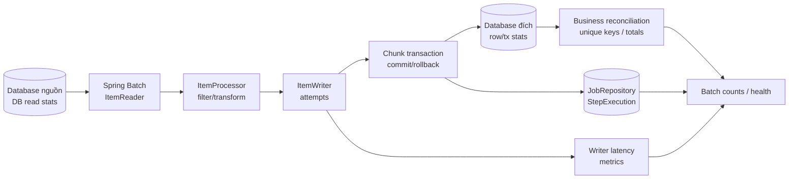
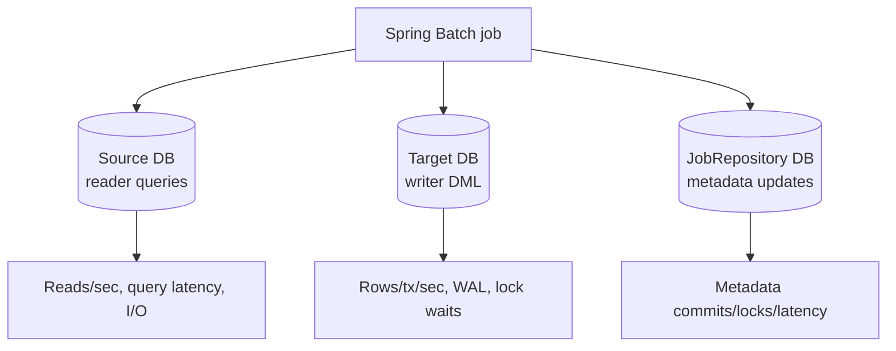
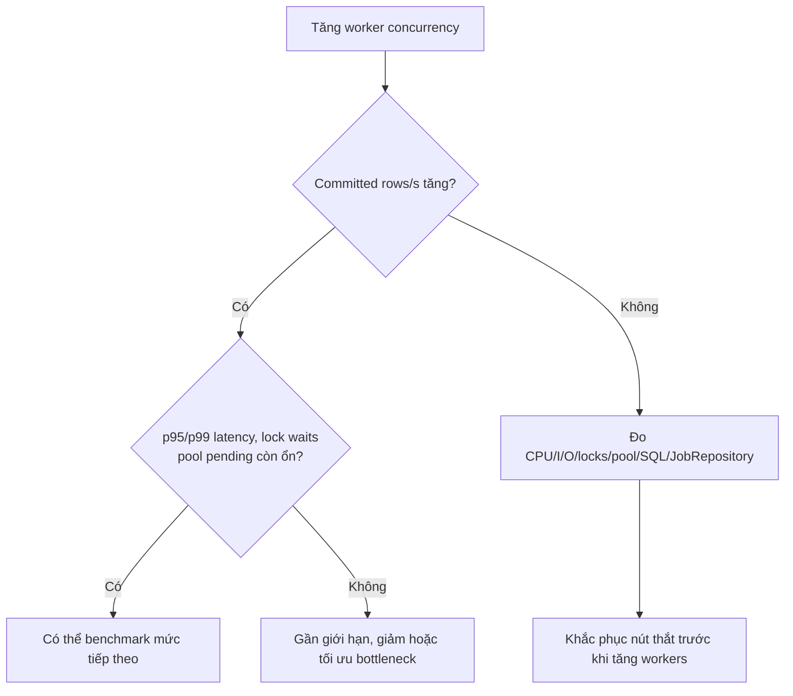
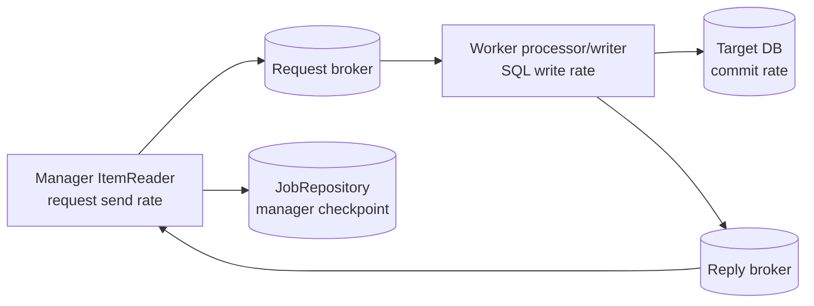
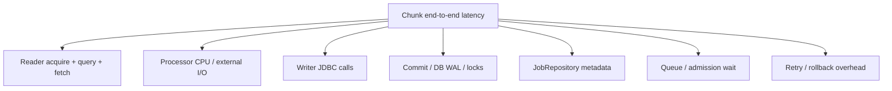

# Đo throughput database trong Spring Batch: từ item/s đến commit/s và giới hạn mở rộng

Một Spring Batch job xử lý 5 triệu đơn hàng đang chạy ở mức 8.000 item/s. Bạn tăng số worker từ 8 lên 16, CPU ứng dụng vẫn còn dư, nhưng tổng thời gian chạy gần như không giảm. Có phải cần thêm thread, tăng kích thước chunk, mở rộng connection pool hay tối ưu SQL?

Không thể trả lời chỉ bằng `StepExecution.getWriteCount()` hoặc số request/s gửi vào database. Với workload dữ liệu lớn, **throughput database** phải được đo trên **công việc thực sự được hoàn tất**, kèm latency, contention, transaction, rollback và tính đúng đắn dữ liệu. Số item reader trả ra, số item writer nhận, số lần SQL thực thi và số bản ghi nghiệp vụ mới được commit có thể khác nhau rất nhiều.

Bài **“Đo throughput database”** thuộc chương **Database scaling** của module **SPRING_BATCH_SCALING_OPERATIONS**. Module học cách mở rộng Spring Batch qua multi-threaded step, parallel steps, partitioning và các mô hình xử lý phân tán, đo nút thắt, bảo đảm thread safety, retry/restart và chọn kiến trúc theo tài nguyên thực tế.

**Mục tiêu của bài:**

- Định nghĩa chính xác **items/s, rows/s, statements/s, transactions/s, commits/s và bytes/s**.
- Phân biệt số đếm `StepExecution` với database counters và **business outcomes đã commit**.
- Thiết kế benchmark có baseline, warm-up, observation window và dữ liệu đầu vào ổn định.
- Dùng PostgreSQL `pg_stat_database`, `pg_stat_statements`, `pg_stat_activity`, `pg_locks` và chỉ số pool như HikariCP để tìm bottleneck.
- Instrument JDBC writer/Chunk listener bằng Micrometer mà không nhầm **writer invocation** với **successful DB commit**.
- Đánh giá chunk size, JDBC batching, concurrency, partitioning, connection pool và JobRepository overhead.
- Kiểm chứng retry/restart, transaction bất đồng nhất và idempotent writer bằng SQL reconciliation.
- Xây dashboard, cảnh báo, ma trận fault injection và quy trình tối ưu an toàn.

## 1. Đừng nói “database throughput” nếu chưa nêu đơn vị

Tùy kiến trúc, một chunk có thể:

1. Đọc 200 dòng từ database nguồn.
2. Lọc 20 dòng trong `ItemProcessor`.
3. Gửi 180 item đến `ItemWriter`.
4. Thực thi một số JDBC batch statements.
5. Gặp unique constraints hoặc `ON CONFLICT`.
6. Commit một transaction, hoặc rollback/retry.
7. Cập nhật `JobRepository` ở một database có thể khác.

Đây là **nhiều loại throughput**, không phải một số duy nhất.

| Chỉ số | Đơn vị | Nó trả lời điều gì? | Dễ bị hiểu nhầm |
| --- | --- | --- | --- |
| **Input read throughput** | logical items/s | Reader trả ra bao nhiêu item? | Không phải DB rows/s nếu reader lọc/join/aggregate |
| **Writer invocation throughput** | items passed to writer/s | Writer nhận bao nhiêu item qua các callback? | Có thể gồm attempts sẽ rollback |
| **DB statement throughput** | SQL statements/s | DB thực thi bao nhiêu lệnh? | Một statement có thể tác động 0, 1 hoặc nhiều rows |
| **DB transaction throughput (TPS)** | commits/s, rollbacks/s | DB hoàn tất bao nhiêu transactions? | Có cả app khác, metadata và transaction không liên quan |
| **Rows affected throughput** | rows inserted/updated/deleted/s | DB đã tác động bao nhiêu rows? | Update cùng row nhiều lần ≠ số business IDs unique |
| **Business committed throughput** | successful business operations/s | Có bao nhiêu đơn hàng hợp lệ đã có output đúng? | Phải có contract và đối soát độc lập |
| **Storage/network throughput** | bytes/s, IOPS | Hạ tầng DB tiêu thụ bao nhiêu tài nguyên? | Không nói trực tiếp số business rows đúng |

**Hãy chọn KPI chính là một kết quả nghiệp vụ đã commit**, chẳng hạn *unique valid orders hoàn tất mỗi giây*, và sử dụng các metrics còn lại để giải thích vì sao KPI tăng hoặc giảm.

### Một ví dụ ngay từ đầu

```text
Input reader:                  20.000 items/s
Processor filter:              2.000 items/s
Writer receives:              18.000 items/s
DB SQL INSERT attempts:       18.000 rows/s
ON CONFLICT DO NOTHING:        6.000 rows/s trùng đã tồn tại
New committed business rows:  12.000 rows/s
```

Đây là số liệu **giả định**. Nếu dashboard hiển thị 18.000 write items/s nhưng thực tế chỉ có 12.000 rows/s mới được commit, không nhất thiết hệ thống sai: cần xem **ngữ nghĩa của UPSERT/dedup** và mục tiêu đo.

## 2. Ba lớp đo phải đồng thời tồn tại



Ba lớp:

- **Application layer:** `readCount`, `writeCount`, `commitCount`, chunk latency, worker concurrency.
- **Database layer:** query execution times, transactions, row operations, pool waits, locks, WAL/I/O.
- **Business outcome layer:** records đúng/thiếu/trùng, số tiền/tổng hợp/checksum, external side effects.

Một dashboard đủ dùng cho **quyết định scale** cần cả ba. Nếu chỉ có application metrics, bạn không biết đang bão hòa DB. Nếu chỉ có database TPS, bạn không biết job nào tạo workload. Nếu chỉ có business row count sau khi chạy xong, bạn chưa biết bottleneck xuất hiện khi nào.

## 3. Công thức cơ bản để đo throughput

Trong một khoảng đo từ \(t_0\) tới \(t_1\):

\[
T=\frac{N(t_1)-N(t_0)}{t_1-t_0}
\]

Trong đó \(N\) là **cumulative counter** tương ứng với loại công việc đang đo, và thời gian tính bằng giây.

Ví dụ có 180.000 business rows mới được commit trong 60 giây:

\[
T_{\text{business}} = \frac{180\,000}{60}
                    = 3\,000\text{ rows/s}
\]

Nếu trong cùng 60 giây database ghi nhận 3.600 committed transactions:

\[
T_{\text{DB transactions}} = \frac{3\,600}{60}
                            = 60\text{ commits/s}
\]

**Không thể suy rằng một transaction chỉ commit 50 rows** nếu có nhiều ứng dụng, repository metadata, DDL, housekeeping, read-only transactions hoặc UPSERT cùng chạy. Chỉ khi đã cô lập đúng workload và có thông tin statement/row phù hợp mới có thể diễn giải mối quan hệ.

### Dùng đồng hồ nào?

- Đo duration trong Java bằng **monotonic clock** như `System.nanoTime()`.
- Dùng wall-clock timestamps cho tương quan log/metric theo thời gian, không dùng đồng hồ hệ thống nhảy giờ làm thước đo interval chính xác.
- Đọc database cumulative counters tại **hai snapshot** có timestamp tương ứng.
- Đừng tính rate từ các counters vừa được reset hoặc DB restart mà không phát hiện **reset epoch**.

### Throughput tổng và theo partition

Với \(P\) worker partitions xử lý **các tập dữ liệu không chồng lấn**, throughput tổng có thể gần:

\[
T_{\text{total}} \approx \sum_{p=1}^{P} T_p
\]

Điều kiện quan trọng: mỗi \(T_p\) đo **cùng đơn vị và cùng khoảng thời gian**, không double count manager aggregate và worker counters, không cộng unique business keys thuộc nhiều partition nếu phạm vi chồng lấn.

## 4. Throughput khác latency, concurrency và backlog

- **Throughput:** hoàn tất được bao nhiêu công việc/giây.
- **Latency:** một chunk/SQL statement/transaction mất bao lâu.
- **Concurrency:** có bao nhiêu worker/connection/transaction hoạt động cùng lúc.
- **Backlog:** bao nhiêu chunk/record đang chờ.

Ví dụ hai cấu hình:

| Cấu hình | Worker concurrency | Committed rows/s | p95 DB commit latency | Queue wait |
| --- | ---: | ---: | ---: | ---: |
| A | 4 | 4.000 | 90 ms | 15 ms |
| B | 16 | 4.100 | 700 ms | 350 ms |

Số liệu **minh họa**, không phải benchmark đo thật. B có thêm 12 workers nhưng chỉ tăng 2,5% throughput; độ trễ tăng mạnh. Đây có thể là dấu hiệu **database saturation hoặc lock contention**.

### Little's Law

Trong trạng thái ổn định:

\[
L=\lambda W
\]

- \(L\): số logical operations trung bình ở trong vùng đo.
- \(\lambda\): số operations/s hoàn tất.
- \(W\): thời gian trung bình trong vùng đo.

Nếu mục tiêu là 20 chunks/s với thời gian **admission → commit** trung bình 0,4 s, lượng in-flight trung bình xấp xỉ 8 chunks. Nhưng **Little's Law không bảo đảm** đặt 8 workers sẽ đạt throughput đó; DB pool/CPU/locks và độ lệch chunk có thể tạo giới hạn khác.

**Không lấy p95 latency thay cho average trong phương trình rồi coi kết quả là định luật chính xác.** p95/p99 được đo riêng để đánh giá tail latency và rủi ro timeout.

## 5. Những bộ đếm Spring Batch bạn thực sự có

`StepExecution` cung cấp:

| API | Nó đo gì? | Không bảo đảm điều gì? |
| --- | --- | --- |
| `getReadCount()` | Items được framework ghi nhận đọc theo Step lifecycle | Không phải số physical SQL rows fetched |
| `getWriteCount()` | Items writer ghi nhận theo framework/contribution | Không phải số rows mới đã commit trong DB |
| `getFilterCount()` | Items processor trả `null` theo logic lọc | Không phải lỗi |
| `getReadSkipCount()` | Skip lỗi read | Không phải số SQL retries |
| `getProcessSkipCount()` | Skip lỗi process | Không phải số item có lỗi transient |
| `getWriteSkipCount()` | Skip lỗi write | Không phải mọi DB statement failure |
| `getSkipCount()` | Tổng các nhóm skip | Không phải unique business IDs qua mọi restart |
| `getCommitCount()` | Commit count Step ghi nhận | Không phải tổng database xact_commit |
| `getRollbackCount()` | Rollback count Step ghi nhận | Không phải retryCount hoặc số DB deadlocks |
| `getStatus()` | Trạng thái StepExecution | `COMPLETED` không chứng minh dữ liệu đúng |

**Đặc biệt:** `readCount` và `writeCount` có thể khác do filter, skip hoặc một processor/writer với semantics riêng. Khi retry/rollback, các callback có thể được gọi lại; đừng lấy một callback counter trong RAM làm số rows đã commit.

### StepExecution có phải nguồn số đo realtime không?

`StepExecution` là nguồn metadata hữu ích, nhưng update/persist gắn với lifecycle checkpoint. Đối tượng đang chạy trong RAM và bản ghi trong `JobRepository` có thể khác nhau tạm thời. Nếu muốn throughput gần realtime, hãy dùng **Micrometer timers/counters** có semantics rõ; sau job phải **đối soát với repository và business output**.

## 6. Xây chỉ số throughput theo contract nghiệp vụ

Giả sử mỗi input `staging_orders(batch_id,id,amount)` phải tạo đúng một row `processed_orders(batch_id,order_id,normalized_amount)`, với `batch_id` là snapshot bất biến.

**Contract:**

- Mỗi `(batch_id, id)` hợp lệ sinh đúng một `processed_orders`.
- `(batch_id,order_id)` có unique constraint.
- Processor có thể filter/skip theo policy, được audit độc lập.
- Không có người ghi ngoài workload này vào cùng `batch_id`.
- Output values phải chính xác theo rule version.

KPI cuối job:

\[
T_{\text{unique committed}} =
\frac{\text{số output keys hợp lệ được commit}}
{\text{elapsed processing seconds}}
\]

Nếu phải đo **giá trị mới được commit trong một khoảng**, cần có nguồn count/timestamp **phản ánh commit thực**. `created_at` trên row có thể được set trước khi transaction commit, nên chỉ dùng để xấp xỉ theo bucket nếu độ trễ transaction chấp nhận được; không xem timestamp đó là commit timestamp đáng tin ở mọi DB.

### Khi dùng UPSERT

`ON CONFLICT DO NOTHING` có thể khiến writer nhận 200 item nhưng không tạo row mới vì chúng đã tồn tại. `ON CONFLICT DO UPDATE` có thể cập nhật lại cùng row nhiều lần; database row operation counters tăng nhưng unique record count không tăng. Cần đo riêng:

- Item attempts được chuyển tới writer.
- Rows inserted vs updated vs unchanged (nếu API/SQL trả được).
- Unique business keys có trạng thái cuối đúng.
- Transaction commits và retries.

## 7. Ví dụ schema nguồn và đích để benchmark

PostgreSQL minh họa:

```sql
CREATE TABLE staging_orders (
    batch_id varchar(80) NOT NULL,
    id bigint NOT NULL,
    amount numeric(18,2) NOT NULL,
    PRIMARY KEY (batch_id, id)
);

CREATE TABLE processed_orders (
    batch_id varchar(80) NOT NULL,
    order_id bigint NOT NULL,
    normalized_amount numeric(18,2) NOT NULL,
    processor_version varchar(24) NOT NULL,
    PRIMARY KEY (batch_id, order_id)
);

-- Khóa chính staging_orders hỗ trợ truy vấn theo batch_id, id.
-- Tránh tạo chỉ mục dư thừa khi chưa đo execution plan.
```

Nếu job chia partition theo ID, các khoảng phải **nửa mở** và không chồng lấn, ví dụ `[1,250001)`, `[250001,500001)`. Query:

```sql
SELECT id, amount
FROM staging_orders
WHERE batch_id = :batchId
  AND id >= :startId
  AND id < :endId
ORDER BY id;
```

**Không benchmark bằng cách bỏ `ORDER BY` rồi vẫn tuyên bố reader restart được**. Với JDBC paging, sort key phải xác định/duy nhất và nguồn dữ liệu ổn định; nếu input thay đổi giữa các page hoặc restart, offset/key checkpoint có thể sai.

### Tại sao dữ liệu test phải giống production?

- Dải ID phân bố lệch → một số partition chậm hơn.
- Row kích thước lớn → I/O/serialization/heap tăng.
- Index selectivity thấp → query scan nặng.
- Writer UPSERT trên keys đã tồn tại → khác insert mới.
- Constraint/trigger/foreign key/indexes tạo overhead thực tế.
- Autovacuum/checkpoint/WAL flush gây tail latency.

Benchmark 100.000 rows trong DB sạch có thể khác hoàn toàn 100 triệu rows với nhiều index và transaction cạnh tranh.

## 8. Đo throughput từ output DB: chuẩn và giới hạn

Đối với test run độc lập, phép đo dễ kiểm nhất:

```sql
-- Lấy số output row của đúng batch sau khi run hoàn tất.
SELECT COUNT(*) AS committed_output_rows
FROM processed_orders
WHERE batch_id = :batchId;

-- Kiểm tra tổng giá trị nghiệp vụ.
SELECT SUM(normalized_amount) AS total_amount
FROM processed_orders
WHERE batch_id = :batchId;
```

Chụp count trước/sau một khoảng hoặc trước/sau run, tính delta và elapsed seconds.

**Giới hạn quan trọng:**

1. `COUNT(*)` trên bảng lớn có thể đắt; **không chạy liên tục mỗi giây** trên production để tạo metric.
2. Nếu writer update các rows đã có, count không tăng dù DB tốn nhiều công.
3. Nếu nhiều job ghi cùng `batchId`, delta không còn là throughput riêng job.
4. Nếu transaction còn mở, read từ session khác có thể chưa thấy rows uncommitted.
5. Nếu query trên read replica, replication lag làm rate lệch so với primary.
6. Nếu processor filter/skip, expected output phải loại đúng các business keys đó.

**Cách dùng:** kiểm tra trước/sau benchmark và ở các điểm audit ít tốn kém; để theo dõi realtime, dùng counters/event log được thiết kế theo transaction hoặc telemetry.

## 9. Đo committed outcomes bằng ledger trong cùng transaction

Với nghiệp vụ cần measurement bền vững ở mức operation, có thể dùng **business ledger** hoặc trạng thái xử lý mỗi item được viết cùng transaction output:

```sql
CREATE TABLE batch_commit_ledger (
    batch_id varchar(80) NOT NULL,
    operation_id varchar(160) NOT NULL,
    result_code varchar(20) NOT NULL,
    committed_at timestamp with time zone
        NOT NULL DEFAULT CURRENT_TIMESTAMP,
    PRIMARY KEY (batch_id, operation_id)
);
```

Ví dụ logic trong **cùng transaction database**:

```text
BEGIN
  write/validate processed_orders
  INSERT batch_commit_ledger(batchId, operationId, SUCCESS)
    ON CONFLICT DO NOTHING
COMMIT
```

Khi output và ledger **thực sự cùng DB transaction**, record `SUCCESS` trong ledger giúp audit kết quả đã commit; crash trước commit rollback cả hai. Với DB khác resource hoặc API ngoài transaction, cần outbox/dedup/compensation.

**Lưu ý:**

- `operation_id` là **business operation key ổn định qua retry/restart**, không đơn thuần là `JobExecutionId`.
- Ledger row timestamp `CURRENT_TIMESTAMP` không phải commit timestamp chính xác của PostgreSQL; mặc định nó gắn với transaction start time. Muốn vẽ throughput **theo giây commit**, cần phù hợp granularity/timing hoặc phát event **sau commit** với pipeline telemetry.
- Một operation có thể được update/compensate; phải định nghĩa “SUCCESS” có nghĩa gì.
- Ledger thêm writes/index/WAL; **đo overhead** trước khi bắt buộc sử dụng.
- Không ghi cả input payload lớn, credential hay serialized domain object vào ledger.

Đây là công cụ correctness/audit, **không phải yêu cầu bắt buộc cho mọi job Spring Batch**.

## 10. Thực nghiệm phải cô lập database nguồn, đích và JobRepository

Một job có thể dùng ba datasource:



Đôi khi cả ba dùng **một database cluster**, đôi khi khác cluster hoặc thậm chí khác công nghệ. Cách đo phải bám **sơ đồ tài nguyên thực tế**.

- Nếu source/target/JobRepository cùng cluster, PostgreSQL `pg_stat_database.xact_commit` thường chứa transaction của **cả business DML lẫn metadata**, không thể gán hết cho writer.
- Nếu source là API/object storage, `readCount` không đại diện DB read throughput.
- Nếu target là Kafka hoặc HTTP, “writer database throughput” có thể không tồn tại; đo sink-specific metric.
- Nếu read replica đang lag, reader throughput có thể cao nhưng input không đúng snapshot/độ mới.
- Nếu nhiều batch jobs chung pool, cần biết DB-wide measurements là **cộng dồn của toàn bộ workloads**.

Nên ghi ra một bảng tài nguyên trước benchmark: DB endpoint, schema, datasource pool, cluster size, số job/threads, chunk size, partition plan và trách nhiệm transaction.

## 11. PostgreSQL: đo database-wide TPS và row operations

Với PostgreSQL, `pg_stat_database` có các cumulative counters theo database.

```sql
SELECT
    clock_timestamp() AS observed_at,
    datname,
    xact_commit,
    xact_rollback,
    tup_returned,
    tup_fetched,
    tup_inserted,
    tup_updated,
    tup_deleted,
    blks_read,
    blks_hit,
    temp_bytes,
    deadlocks
FROM pg_stat_database
WHERE datname = current_database();
```

Chạy truy vấn tại \(t_0\), chờ một khoảng đo hợp lý rồi chạy tại \(t_1\) trên **snapshot mới**, tính:

```text
commit_tps       = delta(xact_commit)    / elapsed_seconds
rollback_tps     = delta(xact_rollback)  / elapsed_seconds
insert_rows_per_s= delta(tup_inserted)   / elapsed_seconds
update_rows_per_s= delta(tup_updated)    / elapsed_seconds
delete_rows_per_s= delta(tup_deleted)    / elapsed_seconds
deadlocks_per_s  = delta(deadlocks)      / elapsed_seconds
```

### Cách diễn giải đúng

- `xact_commit` gồm transactions của **cả ứng dụng khác** cùng database.
- `tup_inserted`, `tup_updated` và `tup_deleted` là **row operations thống kê**, không phải unique business records đã commit theo batch. Chỉ số có thể chịu ảnh hưởng hoạt động khác và khác với kết quả cuối sau rollback.
- `tup_returned` và `tup_fetched` không đồng nghĩa “Spring Batch ItemReader đọc bao nhiêu rows”.
- `blks_hit` và `blks_read` giúp quan sát cache vs block reads; không suy thẳng ra “đọc disk 1 block = 8 KB thực” cho mọi tình huống I/O/cache.
- Counters có thể reset do thao tác quản trị, restart/version hoặc stats reset; nếu delta âm, phải xác định reset epoch thay vì tính rate âm.
- Các số thống kê có thể được snapshot/cache trong transaction đọc; thu thập ở **các phiên/transaction mới** hoặc dùng cơ chế làm mới snapshot khi cần, tránh đọc cùng snapshot cũ.

**Đừng reset thống kê production** chỉ để đo một bài batch. `pg_stat_reset()` có thể ảnh hưởng hệ thống quan sát chung; dùng delta và nguồn metrics đã triển khai.

## 12. PostgreSQL: tìm SQL nào tiêu tốn thời gian

Nếu môi trường đã bật extension `pg_stat_statements` và được cấp quyền đọc phù hợp:

```sql
SELECT
    queryid,
    calls,
    rows,
    total_exec_time,
    mean_exec_time,
    shared_blks_hit,
    shared_blks_read,
    query
FROM pg_stat_statements
WHERE query ILIKE '%processed_orders%'
ORDER BY total_exec_time DESC
LIMIT 20;
```

Đây là ví dụ **điều tra**; không phải luôn có extension hoặc đủ quyền. Text query có thể đã được normalize, và pattern tìm kiếm có thể không khớp nếu statement được chuẩn hóa/đổi SQL.

`pg_stat_statements` giúp xác định:

- SQL nào được gọi nhiều lần (`calls`).
- Tổng thời gian thực thi (`total_exec_time`).
- Latency trung bình (`mean_exec_time`).
- Rows processed theo thống kê query (`rows`).
- Buffer hits/reads ở mức câu SQL.

### Những giới hạn cần nhớ

- `calls` không nhất thiết bằng số business items; một JDBC batch có thể tương tác với driver/database theo cách khác với 1 item = 1 statement.
- `rows` là row count theo thống kê thực thi SQL, không phải unique business outputs của batch.
- SQL có thể được dùng bởi nhiều jobs; query normalized không tự gắn chính xác JobExecutionId.
- Một câu query có tổng thời gian lớn vì chạy rất nhiều lần nhưng latency mỗi lần thấp; cần xem **calls và mean/p95**.
- `pg_stat_statements` có đặc tính phiên bản/cấu hình (extension, query ID, track settings); chỉ so sánh khi các điều kiện đã xác nhận.

Khi muốn biết statement có dùng index tốt không, chạy `EXPLAIN (ANALYZE, BUFFERS)` trên **query đại diện ở môi trường an toàn**. `ANALYZE` thực thi câu SQL; với DML có side effects, **không chạy trực tiếp trên production như một phép thử vô hại**.

## 13. PostgreSQL: điều tra lock waits và sessions đang nghẽn

`pg_stat_activity` cho trạng thái session và wait event tại thời điểm quan sát:

```sql
SELECT
    application_name,
    state,
    wait_event_type,
    wait_event,
    COUNT(*) AS sessions
FROM pg_stat_activity
WHERE datname = current_database()
GROUP BY application_name, state,
         wait_event_type, wait_event
ORDER BY sessions DESC;
```

**Tại sao hữu ích?**

- Nhiều sessions có `wait_event_type='Lock'` → contention/transaction kéo dài.
- Nhiều sessions active chờ I/O → có thể I/O-bound, nhưng cần đối chiếu `wait_event`/I/O metrics.
- Nhiều sessions idle in transaction → kiểm tra code giữ transaction/connection quá lâu.
- Database có 40 active sessions nhưng chỉ 8 CPU cores không mặc định sai; đánh giá throughput/latency trước khi giảm kết nối.

### Đặt application_name

JDBC PostgreSQL có khả năng dùng `ApplicationName`/`application_name` để giúp phân biệt pool/ứng dụng trong `pg_stat_activity`. Hãy cấu hình một **tên ổn định của service/job type**, không nhét `JobExecutionId` hoặc credential vào connection URL.

**Nhưng:** `application_name` là metadata do client đặt, không phải bộ lọc bảo mật và không tạo per-job cumulative counters trong `pg_stat_database`. Nó giúp tra cứu sessions và wait states, **không tự tách được row throughput theo JobExecution**.

### Lock view

`pg_locks` và `pg_stat_activity` có thể hỗ trợ tìm transaction/blocker, nhưng phân tích blocker/blockee cần join logic đúng phiên bản và đủ quyền; tránh kết luận từ một snapshot duy nhất. Theo dõi **xu hướng lock wait**, thời gian transaction và deadlock rate khi tăng concurrency.

## 14. PostgreSQL: theo dõi WAL, disk và DB resource

Throughput cao có thể bị giới hạn ở:

- CPU do SQL/JSON/conversion/index maintenance.
- Disk read/write IOPS hoặc throughput.
- WAL generation/flush, replication.
- Shared buffer cache, checkpoint pressure.
- Lock waits/row conflicts.
- Temp files do sort/hash spill.
- Autovacuum/dead tuples sau update/upsert.

Một số nguồn đo:

| Nguồn | Dữ liệu | Điều cần cẩn trọng |
| --- | --- | --- |
| `pg_stat_database` | Commits, rollbacks, row ops, cache hits/reads, temp bytes | Theo database, không theo Job |
| `pg_stat_statements` | Query calls/time/rows/buffers | Cần extension và query grouping |
| `pg_stat_activity` | Sessions và wait events | Ảnh chụp thời điểm; lấy mẫu |
| `pg_locks` | Lock trạng thái hiện tại | Không tự chỉ ra business impact |
| `pg_stat_wal` (khi version hỗ trợ) | WAL counters ở mức cluster | Không tách đúng một job |
| `pg_stat_io` (PostgreSQL version hỗ trợ) | I/O theo backend/object/context | Cần kiểm tra version/ý nghĩa cột |
| OS/cloud monitoring | CPU, disk latency, network, IOPS | Có thể gồm jobs khác cùng host |

Không nên đưa một SQL cố định cho `pg_stat_io` mà khẳng định chạy được trên mọi PostgreSQL version. Kiểm tra **phiên bản DB và permissions** trước khi xây collector.

## 15. Connection pool: throughput thường bị giới hạn trước khi CPU đầy

HikariCP (thường dùng với Spring Boot) có các chỉ số như:

- `hikaricp.connections.active`: connections đang mượn.
- `hikaricp.connections.idle`: connections rảnh.
- `hikaricp.connections.pending`: threads đang chờ connection.
- `hikaricp.connections.max`: giới hạn pool.
- Timers cho thời gian acquire connection khi instrumentation đã bật.

**Tên metrics/tag cụ thể** tùy Micrometer binder, Spring Boot version và registry. Trước khi tạo alert, xác minh endpoint metrics/Prometheus thực.

### Ví dụ chẩn đoán

```text
Worker threads:         32
Target DataSource pool:  8 connections
Pool active:             8
Pool pending:           24
DB CPU utilization:     45%
Committed rows/s:       không tăng khi 16 -> 32 workers
```

Dữ liệu minh họa gợi ý **pool có thể đang giới hạn concurrency**, nhưng **không có nghĩa tăng pool lên 32 là đúng**: DB còn lock, I/O, connection memory và các ứng dụng khác. Thử thay đổi có kiểm soát và đo throughput/latency cùng nguồn DB metrics.

### Không tăng pool theo số worker một cách máy móc

Giả sử 4 Spring Batch pods, mỗi pod 32 connections: tổng khả năng lên đến 128 connections vào database. Cộng thêm application traffic và JobRepository pools. Một database nhỏ có thể bị quá tải hoặc dành nhiều memory cho backend connections. **Ngân sách connections là cấp cluster**, không chỉ cấu hình của một JVM.

## 16. Cách đánh giá JDBC batching và chunk size

Chunk size và JDBC batch size là hai khái niệm liên quan nhưng **không đồng nghĩa tuyệt đối**:

- `chunk(200)`: Spring Batch gom tối đa khoảng 200 items cho một giao dịch chunk theo lifecycle.
- `JdbcBatchItemWriter`: gửi batch update cho items khi được gọi, phụ thuộc driver/database.
- PostgreSQL JDBC driver có thể có tùy chọn tối ưu batching (chẳng hạn rewrite batched inserts trong một số cấu hình), nhưng hiệu quả phụ thuộc SQL, prepared statements, version/driver; **cần đo bằng traffic/SQL stats thực**.
- DB có thể xử lý JDBC batch khác nhau tùy constraints, `RETURNING`, UPSERT, trigger.

### Tại sao batching thường giúp?

Gửi nhiều row trong một batch có thể giảm số round trips và chi phí protocol/statement setup. Nhưng chunk quá lớn làm transaction giữ locks lâu hơn, tăng WAL burst, memory và số work cần replay sau lỗi.

| Chunk size | Lợi ích tiềm năng | Rủi ro |
| --- | --- | --- |
| 1–20 | Transaction nhỏ, lỗi dễ cô lập | Nhiều round trips/commit overhead |
| 100–500 | Cân bằng thường gặp để thử nghiệm | Cần đủ memory/DB pool |
| 1.000–5.000 | Có thể giảm overhead khi insert thuận lợi | Transaction dài, lock/GC/rollback cost |
| Rất lớn | Ít commits, có thể đẩy batching | Một lỗi có thể rollback lượng work lớn; restart chậm |

Các khoảng trên là **gợi ý cho ma trận thử**, không phải mức tối ưu chuẩn của Spring Batch.

## 17. Ví dụ JdbcBatchItemWriter với unique business key

Giả sử writer cần idempotent upsert theo `(batch_id,order_id)`. Mẫu Java 17+, Spring Batch 5.x:

```java
import java.math.BigDecimal;
import javax.sql.DataSource;

import org.springframework.batch.item.database.JdbcBatchItemWriter;
import org.springframework.batch.item.database.builder.JdbcBatchItemWriterBuilder;
import org.springframework.context.annotation.Bean;
import org.springframework.jdbc.core.namedparam.MapSqlParameterSource;

public record NormalizedOrder(
        String batchId,
        long orderId,
        BigDecimal normalizedAmount,
        String processorVersion) {}

@Bean
public JdbcBatchItemWriter<NormalizedOrder> normalizedOrderWriter(
        DataSource targetDataSource) {

    return new JdbcBatchItemWriterBuilder<NormalizedOrder>()
        .dataSource(targetDataSource)
        .sql("""
            INSERT INTO processed_orders (
                batch_id, order_id, normalized_amount, processor_version
            )
            VALUES (
                :batchId, :orderId, :normalizedAmount, :processorVersion
            )
            ON CONFLICT (batch_id, order_id)
            DO UPDATE SET
                normalized_amount = EXCLUDED.normalized_amount,
                processor_version = EXCLUDED.processor_version
            """)
        .itemSqlParameterSourceProvider(item ->
            new MapSqlParameterSource()
                .addValue("batchId", item.batchId())
                .addValue("orderId", item.orderId())
                .addValue("normalizedAmount", item.normalizedAmount())
                .addValue("processorVersion", item.processorVersion()))
        .assertUpdates(false)
        .build();
}
```

**Đây là các snippets đặt trong cấu hình Spring; `NormalizedOrder` phải ở source file/class hợp lệ riêng.** Sử dụng record với explicit SQL parameter provider để không lệ thuộc JavaBean getter mapping của record.

### Đọc throughput từ ví dụ này như thế nào?

- `writeCount` cho biết số item framework đã đưa qua writer/contribution.
- Database có thể ghi một **INSERT** hoặc **UPDATE** tùy xung đột.
- Nếu gọi lại với cùng dữ liệu, row có thể vẫn được UPDATE; unique output row count không tăng, nhưng WAL/lock/CPU vẫn tăng.
- Một lỗi xảy ra sau khi đã chạy một số statements trong transaction có thể dẫn đến rollback/retry.
- Không sử dụng `COUNT(processed_orders)` delta để đo tổng **DB work** của UPSERT.

**Idempotency:** mẫu upsert thích hợp với *trạng thái hiện tại* khi cùng operation/version phải sinh cùng giá trị và không có side effect khác. Với append-only ledger hoặc event, dùng operation ID/dedupe và transaction/outbox phù hợp.

## 18. Đo writer latency bằng Micrometer nhưng đặt đúng tên

Một wrapper `ItemWriter` có thể đo thời gian **gọi writer**, không phải thời gian DB commit của chunk:

```java
import java.util.Objects;

import io.micrometer.core.instrument.Counter;
import io.micrometer.core.instrument.MeterRegistry;
import io.micrometer.core.instrument.Timer;

import org.springframework.batch.item.Chunk;
import org.springframework.batch.item.ItemWriter;

public final class MeasuredItemWriter<T> implements ItemWriter<T> {
    private final ItemWriter<T> delegate;
    private final MeterRegistry registry;
    private final Timer callLatency;
    private final Counter itemsAttempted;

    public MeasuredItemWriter(
            ItemWriter<T> delegate,
            MeterRegistry registry,
            String logicalStepName) {

        this.delegate = Objects.requireNonNull(delegate);
        this.registry = Objects.requireNonNull(registry);

        this.callLatency = Timer.builder("batch.db.writer.call")
                .description("ItemWriter invocation time, not commit time")
                .tag("step", logicalStepName)
                .register(registry);

        this.itemsAttempted =
                Counter.builder("batch.db.writer.item.attempt")
                    .tag("step", logicalStepName)
                    .register(registry);
    }

    @Override
    public void write(Chunk<? extends T> chunk) throws Exception {
        itemsAttempted.increment(chunk.size());
        Timer.Sample sample = Timer.start(registry);
        try {
            delegate.write(chunk);
        } finally {
            sample.stop(callLatency);
        }
    }
}
```

**Semantics bắt buộc ghi rõ:**

- `itemsAttempted` đếm **items được chuyển tới một invocation**; retry/recovery có thể đếm cùng business item nhiều lần.
- `callLatency` đo callback writer từ vào tới ra (gồm thời gian chờ bên trong), **không nhất thiết gồm transaction commit sau callback**.
- Một invocation có thể ném exception và rollback; counter đã tăng, nhưng output không commit.
- Nếu delegate là `ItemStream` hoặc `StepListener` cần đăng ký delegate đúng lifecycle bằng `.stream(delegate)` / listener cần thiết; bọc thành `ItemWriter` có thể làm framework không tự nhận diện interface bổ sung.
- Nếu nhiều threads cùng gọi writer, **delegate phải thread-safe**; Metric registry không biến writer stateful thành thread-safe.
- Dùng tags có cardinality thấp, không thêm item ID, raw SQL hoặc token.

### Gắn wrapper vào Step

```java
@Bean
public Step writeOrdersStep(
        JobRepository jobRepository,
        PlatformTransactionManager targetTxManager,
        ItemReader<NormalizedOrder> reader,
        JdbcBatchItemWriter<NormalizedOrder> jdbcWriter,
        MeterRegistry meterRegistry) {

    var measured = new MeasuredItemWriter<>(
            jdbcWriter, meterRegistry, "writeOrdersStep");

    return new StepBuilder("writeOrdersStep", jobRepository)
            .<NormalizedOrder, NormalizedOrder>chunk(
                    200, targetTxManager)
            .reader(reader)
            .writer(measured)
            .build();
}
```

`ItemReader` có thể cần `ItemStream` registration như thông thường, và bean config phải tuân version Step builder đang dùng. Đây là mẫu tối thiểu tập trung vào writer metric, không thiết lập toàn bộ pipeline ingestion.

## 19. Đo successful chunk completion với ChunkListener

Nếu muốn thấy tốc độ chunks **hoàn tất ở Spring Batch Step** thay vì writer callbacks, có thể dùng `ChunkListener.afterChunk`:

```java
import io.micrometer.core.instrument.Counter;
import io.micrometer.core.instrument.MeterRegistry;

import org.springframework.batch.core.scope.context.ChunkContext;
import org.springframework.batch.core.ChunkListener;

public final class ChunkCompletionReporter
        implements ChunkListener {

    private final Counter successfulChunks;

    public ChunkCompletionReporter(
            MeterRegistry registry, String logicalStepName) {
        this.successfulChunks =
                Counter.builder("batch.chunk.completed")
                    .description("Observed afterChunk callbacks")
                    .tag("step", logicalStepName)
                    .tag("result", "success")
                    .register(registry);
    }

    @Override
    public void afterChunk(ChunkContext context) {
        successfulChunks.increment();
    }
}
```

Gắn vào Step builder bằng `.listener(chunkCompletionReporter)`.

### Chỉ số này là gì và không phải gì?

- `afterChunk` được gọi sau một chunk transaction thành công trong lifecycle chunk chuẩn; nó hữu ích như **observed successful chunk events**.
- Không phải một counter database authoritative, và không bảo đảm job-specific **rows committed**.
- Nếu JVM crash sau DB commit nhưng trước callback/export, counter có thể thấp hơn số DB commits.
- Nếu JobRepository và writer ở hai DB khác, việc framework gọi callback không có nghĩa đã có một **transaction nguyên tử xuyên resource**.
- Khi retry/restart nhiều execution, muốn gộp theo JobInstance phải tránh đếm trùng event.
- `afterChunkError` có thể giúp quan sát lỗi chunk, nhưng không được suy rằng mỗi callback = một DB rollback nếu chưa kiểm chứng transaction path.

**Đừng lấy `afterChunk` × `chunkSize` làm exact committed row count.** Chunk cuối có thể nhỏ, processor có thể filter/skip và writer có thể UPSERT.

## 20. Đo transaction commit latency đúng hơn

Writer callback chỉ là một phần của chunk transaction. Muốn đo latency từ **bắt đầu chunk đến sau commit**, cần instrument ở ranh giới lifecycle phù hợp, ví dụ `ChunkListener.beforeChunk` và `afterChunk` cùng correlation theo thread/chunk.

Nhưng với multi-threaded Step:

- Listener có thể được gọi đồng thời; **không lưu một `long startNanos` field singleton**.
- `ThreadLocal` có thể hữu ích nếu `beforeChunk`/`afterChunk` chạy cùng thread theo contract đang dùng; phải cleanup trong success/error path và test đúng framework/version.
- Không dùng timestamp trong `ExecutionContext` để đo từng chunk: context là metadata bền vững, không phải per-thread timer cache.
- Thời gian chờ executor queue **không nằm trong** chunk execution nếu timer bắt đầu ở `beforeChunk`; muốn latency end-to-end, đo từ admission.
- Một lỗi commit có thể diễn ra sau writer callback; metric phải phân biệt success/error.

### Mẫu logic khái niệm

```text
on beforeChunk:
    start monotonic timer cho chunk execution context

on afterChunk:
    record elapsed duration với result=success
    cleanup local timer state

on afterChunkError:
    record elapsed duration với result=error
    cleanup local timer state

Định nghĩa: chunk execution latency theo listener lifecycle;
không tự coi là độc lập với mọi database commit/ack.
```

**Không cần tự instrument mọi giao dịch** nếu hệ thống đã có JDBC tracing/metrics chính xác; instrumentation chồng nhiều lớp có thể làm tăng overhead và gây nhầm đơn vị.

## 21. Đọc StepExecution qua JobExplorer sau run

`JobExplorer` có thể đọc counts từ repository để làm report cuối:

```java
import org.springframework.batch.core.JobExecution;
import org.springframework.batch.core.StepExecution;
import org.springframework.batch.core.explore.JobExplorer;

public final class StepThroughputInspector {
    private final JobExplorer explorer;

    public StepThroughputInspector(JobExplorer explorer) {
        this.explorer = explorer;
    }

    public void inspect(long jobExecutionId) {
        JobExecution job = explorer.getJobExecution(jobExecutionId);
        if (job == null) {
            throw new IllegalArgumentException(
                    "JobExecution not found");
        }

        for (StepExecution step : job.getStepExecutions()) {
            System.out.printf(
                "step=%s id=%d status=%s read=%d write=%d "
                + "commit=%d rollback=%d skip=%d%n",
                step.getStepName(),
                step.getId(),
                step.getStatus(),
                step.getReadCount(),
                step.getWriteCount(),
                step.getCommitCount(),
                step.getRollbackCount(),
                step.getSkipCount());
        }
    }
}
```

Đây là **metadata report**, không tính elapsed runtime và không tự tạo DB throughput chính xác. Có thể tính elapsed với `startTime/endTime` nếu có và semantics phù hợp; cần phân biệt thời gian Step active, queue wait, pause/restart và thời gian toàn Job.

### Tại sao cần phân biệt JobInstance và JobExecution?

Một JobInstance restart có **JobExecution mới**. Nếu mỗi execution có `writeCount=1000`, cộng thành 2000 không chắc là 2000 **unique committed business records**. Item có thể bị xử lý lại do rollback/restart.

Report nên có ba cấp:

1. **StepExecution-level:** counters/framework result của từng lần thực thi.
2. **JobInstance-level:** toàn bộ lịch sử restart, không cộng mù các counters.
3. **Business batch-level:** unique committed keys/expected output theo `batchId/snapshot`.

## 22. Phân biệt database TPS và Spring Batch commit count

Ví dụ:

```text
Chunk size = 200 items
Step reports commitCount = 100
PostgreSQL pg_stat_database xact_commit delta = 650
```

Không thể suy “Spring Batch đã commit 650 chunks”. Một chunk có thể đi qua:

- Một transaction writer.
- Transaction metadata của `JobRepository` (cùng hoặc khác resource).
- Những transaction đọc/điều phối khác.
- Các SQL/transactions của health checks, service khác cùng database.

Ngược lại, PostgreSQL xact_commit tăng thấp hơn số chunk events trong một khoảng có thể do bạn đang đọc **nhầm DB** hoặc window không đồng bộ, metrics lag, hoặc các transaction/resources không cùng nơi.

**Đặt mục tiêu đo rõ ràng:**

- `StepExecution.commitCount`: theo dõi chunk execution/lifecycle.
- `pg_stat_database.xact_commit/s`: theo dõi **database-wide transaction load**.
- Ledger/business outcomes: theo dõi **giá trị thực đã được commit**.
- Query/connection metrics: giải thích bottleneck.

## 23. Tối ưu theo benchmark: thay một biến mỗi lượt

Một benchmark có nhiều biến:

- `chunkSize`.
- Number of worker threads/partitions.
- Executor queue capacity và in-flight window.
- JDBC batch/driver options.
- Pool `maximumPoolSize`.
- Reader pageSize/fetchSize.
- Query indexes, sorting, predicate.
- Output unique constraints/UPSERT strategy.
- Database hardware/IOPS, shared workload.
- JobRepository DB location/transaction settings.

**Nếu cùng lúc tăng threads, tăng chunk size và thêm index, bạn không biết yếu tố nào tạo improvement.**

Ma trận thử gợi ý:

| Run | chunkSize | Worker concurrency | Pool cap | Trọng tâm |
| --- | ---: | ---: | ---: | --- |
| A | 100 | 1 | 4 | Baseline tuần tự |
| B | 100 | 4 | 8 | Hiệu ứng concurrency |
| C | 100 | 8 | 12 | Tìm knee of saturation |
| D | 200 | 8 | 12 | Ảnh hưởng chunk size |
| E | 500 | 8 | 12 | Throughput vs transaction latency |
| F | 200 | 16 | 20 | Kiểm tra scale thêm có lợi không |

**Các con số chỉ là thí dụ kế hoạch test**, không phải cấu hình production nên dùng. Trong thực tế, nếu database shared, phải xét tổng pool capacity của tất cả ứng dụng; tăng pool cap 20 trên mỗi pod không nhất thiết an toàn.

### Đo warm-up và steady state

- Tách thời gian khởi động Spring container/JobRepository/partition initialization.
- Cache JIT, connection pool, DB buffer cache và JDBC prepared statements có thể khác sau warm-up.
- Nếu job ngắn không có steady state, hãy báo **end-to-end throughput** thay vì giả một steady-state không tồn tại.
- Chạy nhiều lần trên snapshot tương đương; có kế hoạch cleanup output tránh lần sau thành UPSERT toàn bộ.
- Ghi cả p50/p95/p99 và error/retry rate để nhận diện trường hợp throughput cao nhờ bỏ dữ liệu.

## 24. Tìm điểm bão hòa khi tăng số workers



### Throughput scaling efficiency

Nếu \(T_1\) là throughput với 1 worker, \(T_n\) với n workers:

\[
E(n)=\frac{T_n}{nT_1}
\]

Ví dụ:

```text
T1 = 1.000 committed rows/s
T4 = 3.200 rows/s -> E(4) = 0,80
T8 = 4.000 rows/s -> E(8) = 0,50
T16= 4.200 rows/s -> E(16)= 0,2625
```

Đây là ví dụ giả định. Khi tăng từ 8 lên 16 chỉ thêm 200 rows/s, nên xem xét **DB contention** hoặc bottleneck khác thay vì mặc định mở thêm worker.

**Một nuance:** scaling efficiency thấp không tự kết luận database là nút thắt. Reader, broker, serialization, CPU processor hoặc uneven partitions cũng có thể giới hạn throughput. Phải so sánh metrics từ mọi stage.

## 25. Đo data skew theo partition

Trong partitioning, tổng throughput có thể thấp vì **một partition chậm**:

```text
Partition A: 200.000 rows, 45 s
Partition B: 200.000 rows, 48 s
Partition C: 200.000 rows, 47 s
Partition D: 200.000 rows, 180 s  <-- straggler
```

Các worker khác hoàn tất sớm nhưng manager vẫn phải chờ D. Thêm workers có thể **không giúp D** nếu nó bị nhiều rows/SQL plan/lock khác biệt.

### Số đo per-partition

- Input logical rows/partition.
- Processing duration, completed committed rows/s.
- Reader SQL latency/fetch-size/cache behavior.
- Writer batches/s, transaction latency.
- Lock wait và DB pool wait.
- Retry/rollback/skip count.
- Data range, `snapshotId` và partition plan version.

Nếu muốn biết đúng partition nào chậm, dùng **structured logs/StepExecution metadata** theo `stepExecutionId/partitionName`. Với Micrometer, đừng tạo unbounded time-series cardinality theo hàng nghìn partition IDs.

### Giữ mapping ổn định qua restart

Không tự thay `bucketCount`, range hay hash function giữa chừng để sửa skew khi có các `StepExecution` đã `COMPLETED`. Restart phải nhận lại **cùng logical work**; thay partition plan ở JobInstance mới hoặc qua migration/reconciliation có chứng minh.

## 26. Parallel steps và database contention

Hai Steps chạy song song có thể cạnh tranh cùng tài nguyên:

- `loadCustomersStep` và `loadOrdersStep` đều ghi một bảng/index.
- Một Step đọc replica, Step khác ghi primary nhưng replication lag tăng.
- Nhiều job cùng cập nhật `JobRepository`, tạo metadata contention.
- Một Step đọc bảng mà Step khác update liên tục, phá source snapshot assumptions.
- Parallel Steps làm tăng tổng JDBC connections; pool cap riêng từng Step không bảo đảm toàn JVM/cluster cap.

**Đo throughput tổng và theo Step** để tránh tối ưu cục bộ. Một Step tăng từ 4.000 lên 7.000 rows/s nhưng làm Step khác giảm 5.000 xuống 1.000 rows/s thì tổng tiến độ giảm.

## 27. Multi-threaded Step: thread safety và checkpoint quan trọng hơn raw rows/s

Dùng `TaskExecutor` trong chunk Step có thể tăng concurrent writes, nhưng Spring Batch **không bảo đảm mọi ItemReader stateful hỗ trợ concurrent access**. `@StepScope` là scope theo `StepExecution`, không phải mỗi thread.

```text
Chunk A đọc ID 1..100 và còn xử lý.
Chunk B đọc ID 101..200, commit trước.
Reader lưu checkpoint sau ID 200.
Chunk A rollback rồi JVM crash.
Restart từ 201 có thể bỏ sót ID 1..100.
```

Tăng database throughput mà gây **mất bản ghi khi restart** là tối ưu thất bại.

Phương án cần xem xét:

- Reader thread-safe đúng contract.
- Tránh checkpoint một pointer đơn khi commit order có thể đảo.
- Nếu cần restart mạnh, chia partition theo snapshot/range để mỗi worker StepExecution có reader/context riêng.
- Writer idempotent theo unique business key.
- Test kill JVM sau **commit đảo thứ tự** rồi đối soát toàn bộ output.

**Benchmark throughput phải chạy cùng fault-injection tests** khi đổi concurrency model.

## 28. Remote partitioning và database throughput

Trong remote partitioning, mỗi worker JVM xử lý một worker `StepExecution`; nhiều JVM có thể cùng truy cập source/target DB.

Cần đo ít nhất:

- Throughput per worker JVM và tổng committed business throughput.
- Partition skew theo logical ranges.
- Tổng DB connections **của tất cả workers**, không chỉ một process.
- JobRepository metadata writes và worker StepExecutionContext overhead.
- Broker dispatch queue/lag nếu có.
- Retry/restart của worker đã fail.

**Giới hạn ở cấp cluster** quan trọng hơn cấu hình từng pod. Ví dụ 6 pods × 12 JDBC connections = 72 connection slots tiềm năng. Database cũng phải phục vụ ứng dụng khác; số thực dùng cần đo.

Nếu remote workers có quyền riêng, các metrics/tables phải phân biệt resource roles mà không lưu credential trong context hay log.

## 29. Remote chunking: manager throughput khác worker DB throughput

Remote chunking thông thường có **manager đọc và gửi `ChunkRequest`**, worker process/write và gửi `ChunkResponse`.



Các chỉ số có thể không khớp:

- **Request publish rate** ở manager.
- **Request receive/execute rate** ở worker.
- **DB transaction/rows affected rate** ở target.
- **Reply accepted/completion rate** ở manager.
- **Unique committed business rows/s** ở target.

Nếu worker DB đã commit nhưng reply bị mất, manager có thể chờ/timeout rồi retry. Throughput publish cao có thể chỉ là **nhiều request attempts**, không phải nhiều business rows mới. Cần message identity/correlation, in-flight window có giới hạn, idempotent writer và reconciliation.

**Đừng lấy số messages consumed/s × chunkSize làm exact rows/s.** Chunk có thể nhỏ hơn, filter/skip, retry hoặc duplicate delivery.

## 30. Retry, rollback và commit không chắc chắn

### Retry tăng DB work nhưng không nhất thiết tăng output

Giả sử một logical chunk gồm 200 items:

```text
Attempt 1: SQL chạy, transaction rollback do deadlock.
Attempt 2: SQL chạy lại, transaction commit.
Business rows mới được commit: 200
DB attempts xử lý: có thể ~400 row operations ở writer path
Spring Batch write callbacks: có thể chạy lại do retry/recovery
```

Đây là mô hình đơn giản để giải thích: thống kê row operations của database, JDBC batch behavior và Step counts phụ thuộc implementation cụ thể. Điều chắc chắn là **throughput ở tầng attempts khác throughput ở tầng committed outcomes**.

### Cửa sổ lỗi khi resource khác nhau

JobRepository ở DB-A, writer ở DB-B:

```text
T1: DB-B commit output thành công.
T2: DB-A chưa persist checkpoint.
T3: Worker/JVM crash.
T4: Restart từ checkpoint cũ.
T5: Writer xử lý lại một phần output đã có.
```

Không có một local JDBC transaction tự động commit nguyên tử cả hai DB. Đo output đúng phải xét **unique business keys và side effects**, không chỉ số Step commits. Upsert/dedup làm dữ liệu cuối có thể đúng nhưng database throughput bị tiêu tốn bởi replay.

### Khi skip/filter tồn tại

Một Step `COMPLETED` có skip count > 0 vẫn có thể hợp lệ nếu nghiệp vụ cho phép, nhưng **committed rows/s** thấp hơn **input items/s**. Nếu skip rate tăng bất thường sau deploy, không coi đó là “database chậm”: phải điều tra data quality và policy.

## 31. Xác định nút thắt bằng phân rã thời gian

Một chunk có thể tiêu tốn thời gian ở:

1. **Reader SQL:** thời gian acquire connection, query, fetch.
2. **Processor:** CPU/memory/remote calls.
3. **Writer SQL:** statement execution/JDBC batching.
4. **Commit:** WAL flush/locks/transaction completion.
5. **JobRepository:** StepExecution/context updates.
6. **Queue/admission:** chờ executor slot/broker/consumer.
7. **Retry/recovery:** thực hiện lại work sau lỗi.



Không nên cộng các histogram p95 riêng rồi coi là p95 tổng; các phase có thể chồng lấn và percentiles **không cộng được** theo cách đó. Dùng traces/monotonic timers theo scope với correlation và đo end-to-end latency trực tiếp.

### Câu hỏi điều tra thường gặp

| Dấu hiệu | Khả năng | Kiểm tra tiếp |
| --- | --- | --- |
| Writer latency cao, DB lock waits cao | Contention/transaction kéo dài | Lock blockers, SQL/index, chunk size |
| Pool pending cao, DB CPU thấp | Pool cap/connection leak/wait khác | Hikari active/pending, transaction duration |
| DB CPU cao, query total_exec_time cao | SQL/index/CPU-bound | pg_stat_statements, EXPLAIN |
| WAL/disk latency cao khi tăng chunk | Write amplification/checkpoint pressure | WAL/IO metrics, index count |
| Commit count cao, rows/transaction rất thấp | Chunk quá nhỏ/overhead commit | Benchmark chunk size |
| Read rate thấp, writer nhàn | Reader/query/input bottleneck | SQL read plan, I/O, snapshot |
| Worker CPU cao, DB nhàn | Processor CPU-bound | CPU profile, allocation/GC |
| Manager queue lag cao | Backpressure/consumer limit | In-flight window, broker stats |
| Repository DB chậm | Metadata contention | JobRepository update latency, row locks |
| Retry/rollback tăng | Over-concurrency/DB deadlock | DB locks, connection pool, retry policy |

## 32. Observability: thiết kế metrics có đơn vị rõ

Một bộ tên tự định nghĩa (không phải built-in bảo đảm của Spring Batch):

| Metric | Type | Đơn vị/semantics |
| --- | --- | --- |
| `batch_db_writer_call_seconds` | Timer/histogram | Duration mỗi writer callback |
| `batch_db_writer_item_attempt_total` | Counter | Tổng item passed vào writer invocation |
| `batch_chunk_completed_total` | Counter | Successful `afterChunk` callbacks quan sát được |
| `batch_chunk_failed_event_total` | Counter | Failed chunk callbacks quan sát được |
| `batch_business_committed_total` | Counter hoặc durable ledger | Business ops thành công, cần định nghĩa exactly-once/dedup |
| `batch_db_query_seconds` | Timer | Latency query cụ thể nếu instrument |
| `batch_db_commit_seconds` | Timer | Latency commit tại ranh giới được đo |
| `batch_db_pool_pending` | Gauge | Connection acquisition waiters |
| `batch_chunk_inflight` | Gauge | Chunk tasks admitted chưa hoàn tất |
| `batch_db_retry_attempt_total` | Counter | Attempts bổ sung thực sự, không phải mỗi exception |
| `batch_db_rollback_total` | Counter | Rollbacks theo event/source xác định |
| `batch_reconciliation_missing_total` | Gauge/counter theo batch | Business keys bị thiếu |

**Tránh dùng `batch_business_committed_total` tăng đơn giản trong `afterWrite` rồi tuyên bố exactly-once.** Callback có thể chạy trước commit và metrics không có transaction chung với database. Nếu business count là chỉ số audit bắt buộc, lấy từ ledger/DB trạng thái có idempotency và đối soát.

### Tránh high-cardinality tags

Nên tag `job_name`, `logical_step`, `db_role=source/target/repository`, `result` và `worker_pool` nếu tập hữu hạn. Tránh `JobExecutionId`, `StepExecutionId`, `orderId`, `chunkSequence`, raw SQL values và credentials làm labels của mọi time-series.

IDs chi tiết phù hợp trong structured logs/traces với retention/ACL. Không log nguyên record payload/`ExecutionContext`/DB connection URL có password.

## 33. PromQL minh họa throughput và saturation

Nếu các metric tùy chỉnh và exporters được cấu hình như sau, có thể xây dashboard:

```promql
# Item writer attempts/s, không phải committed rows/s.
sum by (step) (
  rate(batch_db_writer_item_attempt_total[5m])
)
```

```promql
# Successful chunk callback events/s.
sum by (step) (
  rate(batch_chunk_completed_total[5m])
)
```

```promql
# p95 writer invocation latency khi histogram bật.
histogram_quantile(
  0.95,
  sum by (le, step) (
    rate(batch_db_writer_call_seconds_bucket[5m])
  )
)
```

```promql
# Hikari pool pending threads, tên metric do exporter mapping quyết định.
max by (pool) (
  hikaricp_connections_pending
)
```

**Đọc đúng ý nghĩa của query:** một số Micrometer metrics ở Java có dấu chấm và timer tự đổi tên/đơn vị khi export sang Prometheus. `_bucket` chỉ tồn tại khi histogram được bật; tên tags có thể khác `step`/`pool`. Kiểm tra `/actuator/prometheus` hoặc registry thực trước khi kết luận dashboard bị thiếu dữ liệu.

### Database-wide committed transactions/s

Với PostgreSQL exporter có metric phù hợp, tính `rate()` của counter `xact_commit` trên cùng database, nhưng **không gắn là throughput của một Spring Batch job riêng** nếu database shared.

## 34. Benchmark end-to-end cần đảm bảo reproducibility

Một kết quả benchmark tối thiểu nên ghi:

```text
Job name:             importOrders
Business batchId:     B2026-11
Input snapshot:       orders-2026-11-v3 (immutable)
Spring Batch version: pinned 5.x in test environment
JDK/driver:           version pin của lần test
Source DB:            PostgreSQL cluster A
Target DB:            PostgreSQL cluster B
JobRepository:        PostgreSQL cluster C
Chunk size:           200
Worker concurrency:   8
Partition plan:       range-v1 / 8 partitions
Connection pool:      source=8, target=12, repository=4
Observed duration:    steady 300 seconds
Commit throughput:    measured via target DB + ledger
Input/read throughput: measured via Step + source DB stats
Error rate:           documented skip/retry/rollback
Output reconciliation: PASS/FAIL
```

**Không benchmark trên production bằng test tạo write amplification lớn** nếu chưa có kế hoạch tác động hạ tầng và dữ liệu. Đặc biệt tránh `TRUNCATE` bảng dùng chung hoặc reset DB statistics trên production.

### Báo cáo trước/sau tối ưu

| Chỉ số | Baseline | Candidate | Ý nghĩa |
| --- | ---: | ---: | --- |
| Committed business rows/s | 3.200 | 4.400 | +37,5% |
| Input items/s | 3.400 | 4.700 | Đã theo kịp nguồn |
| Writer call p95 | 75 ms | 85 ms | Tăng nhẹ |
| Chunk commit p95 | 120 ms | 145 ms | Cần xem lock/WAL |
| DB lock wait p95 | 20 ms | 35 ms | Có xu hướng tăng |
| Pool pending | 0–2 | 2–4 | Chưa bão hòa? |
| Rollback/retry rate | 0,1% | 0,2% | Cần đánh giá |
| Missing/duplicate business keys | 0 | 0 | Correctness gate |

Số liệu **được đặt ra để minh họa cách report**, không phải kết quả đo thực. Một candidate chỉ “tốt hơn” khi đạt mục tiêu throughput, latency/SLO và correctness, không chỉ khi rows/s tăng.

## 35. Kiểm thử rollback: writer attempt không phải commit

Bài test đơn giản nhưng quan trọng:

```text
Input 1.000 orders.
Chunk size 100.
Writer đo item attempts bằng Micrometer.
Inject lỗi ở cuối chunk 3 sau khi đã chạy DML.
Transaction DB target rollback chunk 3.

Kỳ vọng trong thiết kế tuần tự, cùng transaction:
  Output mới đã commit: 200 orders.
  Writer attempts observed: có thể 300 hoặc hơn,
     tùy thời điểm lỗi và retry/recovery.
  Database commit count: phụ thuộc cả DB transactions khác.
  StepExecution writeCount: theo lifecycle, không coi là
     300 rows đã commit.
```

Test phải xác nhận **transaction manager thực sự quản lý target DB**. Nếu writer gọi API bên ngoài hoặc dùng `REQUIRES_NEW` ở một chỗ, rollback Step không tự rollback những side effects đó.

### Vì sao test lỗi cần đi cùng benchmark?

Một cấu hình với chunk size 5.000 có thể nhanh trên dữ liệu sạch, nhưng nếu cứ mỗi 20.000 items có một lỗi writer thì số item phải replay và thời gian phục hồi lớn. KPI **expected goodput** dưới lỗi thực tế có thể thấp hơn cấu hình chunk nhỏ hơn.

## 36. Kiểm thử restart: throughput phải phản ánh unique outcome

Một kịch bản:

1. Chuẩn bị input snapshot cố định 10.000 orders.
2. Chạy với chunk size 200, 4 worker partitions không chồng lấn.
3. Inject lỗi vào một partition khi nó đã commit một phần.
4. Lưu `JobInstanceId`, `JobExecutionId`, `StepExecutionId` và StepExecutionContext của worker lỗi.
5. Restart **cùng JobInstance** bằng identifying JobParameters giống nhau.
6. Verify partition completed bị skip theo policy và partition lỗi khôi phục đúng range/checkpoint.
7. Thu metrics attempts/rows/s riêng lần đầu và lần restart.
8. Đối soát output có đúng 10.000 **unique keys** (trừ filter/skip hợp lệ), giá trị đúng, không side effects lặp.
9. Báo cáo cả **retry/replay overhead** và **goodput** của toàn lifecycle.

**Không cộng mọi `writeCount` của các StepExecutions cũ/mới rồi gọi là unique committed rows**. Restart và retry có thể xử lý lại item mà DB unique constraint ngăn trùng.

### Kiểm thử khi chunk commit đảo thứ tự

Nếu dùng multi-threaded Step với reader stateful chung, hãy cố ý cho chunk B commit trước A rồi kill JVM. Đo throughput của lần chạy đầu có thể rất cao nhưng nếu restart bỏ sót A thì **không đạt correctness gate**. Chỉ dùng kết quả benchmark cho kiến trúc đã chứng minh an toàn.

## 37. Kiểm thử tải và failure matrix

| Kịch bản | Can thiệp | Các chỉ số/bằng chứng cần có |
| --- | --- | --- |
| Baseline tuần tự | 1 worker, chunk 100 | Goodput, reader/writer latency, DB TPS |
| Tăng concurrency | 2→4→8→16 workers | Throughput knee, pool pending, locks |
| Thay chunk size | 50→200→1000 | Commits/s, WAL/latency/rollback cost |
| Nguồn chậm | Delay reader query/fetch | Source DB wait và manager idle |
| Đích chậm | Delay writer SQL | Pool pending, target lock waits |
| Missing index | Query scan trên fixture lớn | pg_stat_statements/EXPLAIN, I/O |
| Unique conflict lớn | UPSERT dữ liệu đã tồn tại | Attempts ≠ new committed rows |
| DB deadlock | Hai transaction tranh lock | Rollback/retry tăng, goodput giảm |
| DB connection pool cap nhỏ | 16 workers, pool 4 | Pending wait, throughput plateau |
| JobRepository slow | Delay metadata writes | Chunk throughput và metadata latency |
| Crash trước commit | Kill JVM giữa chunk | Không ghi nửa chunk khi cùng transaction |
| Crash sau target commit | Chặn repository update/kill | Replay an toàn/idempotency |
| Partition skew | Một range chứa nhiều rows | Tail partition duration |
| Remote worker mất reply | Worker commit rồi drop reply | Attempts/replies/unique committed rows tách biệt |
| Rollback deployment | Chạy binary trước đó | Metadata schema/reader compatibility |
| Input snapshot đổi | Sửa source giữa run | Chặn resume sai hoặc có policy rõ |
| External side effect | Mock API ack mơ hồ | Idempotency/outbox/reconciliation |
| Concurrent workloads | Chạy thêm ứng dụng cạnh tranh DB | Fair-share throughput và latency |

**Mục tiêu của fault injection không phải chỉ là Step `COMPLETED`.** Cần đo output đúng sau khi phục hồi và chi phí retries/replays.

## 38. Runbook khi tăng worker mà throughput database không tăng

1. **Định nghĩa throughput đang xem:** input/s, writer attempts/s, DB transaction/s hay unique committed business rows/s?
2. **Kiểm business outcome:** có filter/skip/UPSERT conflicts làm chênh lệch không? Input snapshot có bất biến không?
3. **Chốt thời gian đo:** warm-up, steady-state, time window, counters có reset/lag không?
4. **Xem StepExecution metrics:** read/write/commit/rollback/skip; phân biệt JobExecution sau restart.
5. **Xem database-wide stats:** `pg_stat_database` commit/rollback, row ops, blocks/temp/deadlocks; đừng gán hết cho job.
6. **Xem SQL:** `pg_stat_statements` top total_exec_time/calls/rows/buffers, kế hoạch query/indices.
7. **Xem pool và waits:** Hikari active/pending/max, `pg_stat_activity` wait_event_type, lock waits.
8. **Xem I/O/WAL:** disk latency, WAL/replication/checkpoint, CPU/GC.
9. **Xem pipeline:** reader, processor, broker queue, in-flight window, partition skew, metadata DB.
10. **Điều chỉnh một biến:** chunk size, worker count, pool, index/query, batching hoặc throttle.
11. **Chạy lại benchmark trên snapshot tương đương**, so sánh committed goodput và p95/p99 latency.
12. **Kiểm rollback/restart/idempotency**, không chọn cấu hình sai dữ liệu dù nhanh.
13. **Đặt alerts sau tối ưu** để phát hiện sớm thay đổi bottleneck khi workload tăng.

### Khi nào nên giảm concurrency?

Nếu thêm workers làm **transaction latency tăng, lock waits/rollbacks tăng**, còn committed business rows/s gần như không đổi, hãy ưu tiên giảm concurrency hoặc tối ưu DB trước. Một số benchmark sẽ cho thấy **knee** — điểm sau đó tăng worker chủ yếu tăng độ trễ.

### Khi nào cần tăng concurrency?

Nếu DB CPU/I/O/pool còn dư, writer latency ổn, queue đợi worker lớn và mỗi chunk độc lập, có thể thử tăng concurrency vừa phải. Nhưng đừng bỏ qua reader thread safety, StepExecutionContext và partition restart invariants.

## 39. Checklist production: đo throughput database đúng

- [ ] KPI chính có tên/đơn vị rõ và đại diện **business outcomes đã commit**.
- [ ] Đã phân biệt `readCount`, `writeCount`, item attempts và DB rows/s.
- [ ] Không dùng `StepExecution.commitCount` thay cho database `xact_commit`.
- [ ] Có baseline throughput/latency/rollback/skip ở cùng input snapshot.
- [ ] Dữ liệu benchmark đại diện production về kích thước, index, conflicts và skew.
- [ ] Có observation window, warm-up policy và monotonic duration.
- [ ] Cumulative DB counters được tính delta đúng, nhận biết stats reset.
- [ ] PostgreSQL `pg_stat_database` được hiểu là **database-wide**, không per-job.
- [ ] Đã kiểm tra `pg_stat_statements` availability/permission/version.
- [ ] SQL query hot spots được đo, có kế hoạch EXPLAIN an toàn.
- [ ] Hikari active/idle/pending/max được quan sát theo **pool và toàn cluster**.
- [ ] Có DB CPU, I/O, WAL, lock waits/deadlocks và commit latency.
- [ ] Chunk size/JDBC batching được benchmark riêng với concurrency.
- [ ] Có chỉ số rows inserted/updated/unchanged nếu writer UPSERT.
- [ ] Có mục tiêu throughput và latency tail p95/p99, không chỉ average.
- [ ] Partition skew và StepExecution per worker được theo dõi.
- [ ] Multi-threaded Step được audit reader/writer thread safety.
- [ ] Checkpoint đúng khi commit đảo thứ tự hoặc dùng partitioning an toàn.
- [ ] Remote chunking tách publish, processed, reply và committed outcomes.
- [ ] Retry/rollback/redelivery không được đếm thành unique business rows mới.
- [ ] JobRepository overhead được đo riêng khi có thể.
- [ ] Metrics tags có cardinality thấp và không chứa secret/PII.
- [ ] Không dùng continuous `COUNT(*)` scan bảng lớn làm realtime metric.
- [ ] Có fault injection cho DB deadlock, pool saturation và crash/restart.
- [ ] Có transaction/idempotency contract cho writer và external side effects.
- [ ] Có SQL đối soát missing/extra keys, tổng/giá trị nghiệp vụ.
- [ ] Sau tối ưu, chỉ publish dữ liệu khi correctness gate đạt.

## 40. Bài tập và câu hỏi tự đánh giá

1. Phân biệt **input items/s**, **writer invocation items/s** và **unique committed rows/s**.
2. Một writer nhận 20.000 items/s nhưng 5.000 items/s bị `ON CONFLICT DO NOTHING`. Throughput insert mới là bao nhiêu?
3. `StepExecution.getCommitCount()` có bằng PostgreSQL `xact_commit` tăng trong cùng thời gian không? Vì sao?
4. Khi đo 120.000 rows sau 40 giây, throughput trung bình là bao nhiêu rows/s?
5. Trong Little’s Law, dùng average hay p95 latency để tính số in-flight trung bình?
6. Nếu database-wide TPS tăng nhưng business goodput không tăng, những nguyên nhân nào có thể giải thích?
7. `pg_stat_statements.calls` có tương đương số Java items mà writer nhận không?
8. Một JDBC batch với 200 items có thể gây bao nhiêu round trips/SQL calls? Điều gì quyết định?
9. Vì sao `COUNT(*)` theo batch trước/sau phù hợp audit nhưng không phải metric realtime rẻ?
10. Nếu UPSERT cùng key 3 lần, output unique count và database update work có thể khác thế nào?
11. Nêu ba dấu hiệu database đã bão hòa khi tăng workers.
12. Tại sao tăng Hikari maximumPoolSize từ 8 lên 64 không chắc làm throughput tăng?
13. Nếu 4 pods có pool max 20, cluster có thể có bao nhiêu connections từ ứng dụng này?
14. `readCount` có thể lớn hơn `writeCount` trong những trường hợp nào?
15. Tại sao đo writer callback latency không đủ đo transaction commit latency?
16. Nếu dùng `ItemWriteListener.afterWrite` hoặc writer wrapper, có thể khẳng định item đã commit không?
17. Vì sao `afterChunk` metric không phải nguồn exactly-once business commits?
18. Một partition có 5 lần latency so với các partition khác, bạn đo gì để xác định skew hay DB contention?
19. Một JobInstance restart, làm sao tránh double count các StepExecution cũ và mới?
20. Trong remote chunking, request publish rate khác worker committed DB rows/s ở đâu?
21. Khi worker commit nhưng reply bị mất, database throughput và manager completion metrics lệch như thế nào?
22. Nêu cách thiết kế business ledger để audit kết quả commit mà không dựa vào exporter metrics.
23. Vì sao `CURRENT_TIMESTAMP` trong PostgreSQL không mặc định là transaction commit timestamp?
24. Tạo ma trận benchmark 1, 4, 8, 16 workers, chunkSize 100/500 với dữ liệu cố định; chọn KPI và stop condition.
25. Thiết kế một fault-injection test xảy ra DB deadlock, rollback/retry rồi restart; chứng minh output đúng.
26. Khi tăng concurrency làm throughput plateau và p99 latency tăng, bạn sẽ ưu tiên chỉnh những yếu tố nào?
27. Vì sao measurement từ read replica có thể gây hiểu nhầm về committed throughput của primary?
28. Nếu `pg_stat_database.tup_inserted` tăng 1 triệu, có thể kết luận job đã commit thêm 1 triệu unique orders không?
29. Khi nguồn SQL dùng pagination mà order không duy nhất, đo throughput cao có nguy cơ che giấu lỗi gì?
30. Những dữ liệu nào bắt buộc ghi vào benchmark report để lần chạy sau so sánh có ý nghĩa?

## Kết luận

**Đo throughput database cho Spring Batch không chỉ là đọc một số rows/s từ dashboard.** Cần phân biệt **input items**, **writer attempts**, **SQL/transaction activity** và **unique business outcomes đã commit**. `StepExecution` cho biết tiến độ framework; PostgreSQL statistics và HikariCP cho biết mức tải hạ tầng; ledger/quarantine và SQL reconciliation chứng minh dữ liệu cuối có đủ, đúng và không trùng.

Khi scale qua multi-threaded steps, parallel steps, partitioning hoặc remote chunking, hãy benchmark với **cùng input snapshot**, đo latency/locks/pool/I/O cùng throughput, kiểm soát retry/rollback và đảm bảo thread safety/restart. Một cấu hình chỉ thực sự cải thiện hệ thống khi **committed goodput tăng trong giới hạn tài nguyên, độ trễ và correctness**, không phải khi nó thực hiện nhiều SQL attempts hơn.
