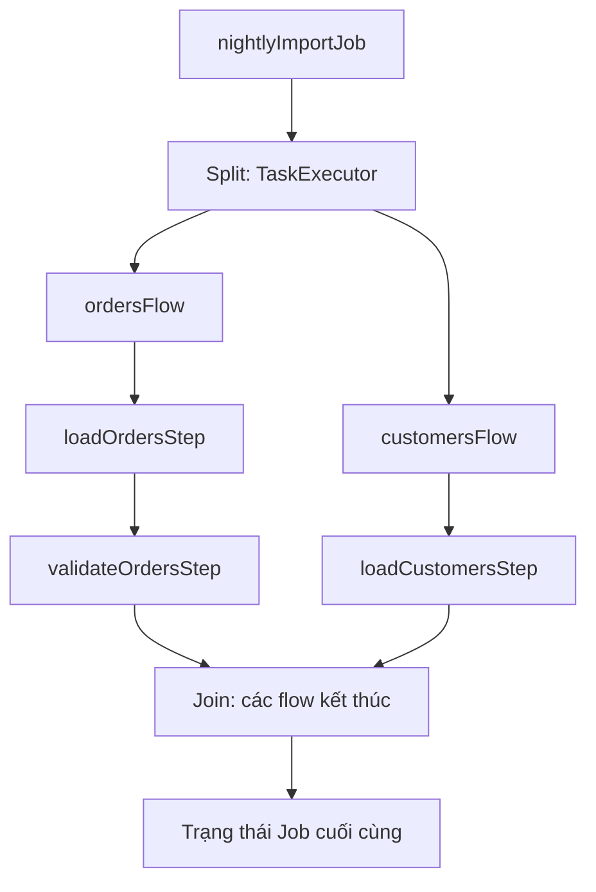
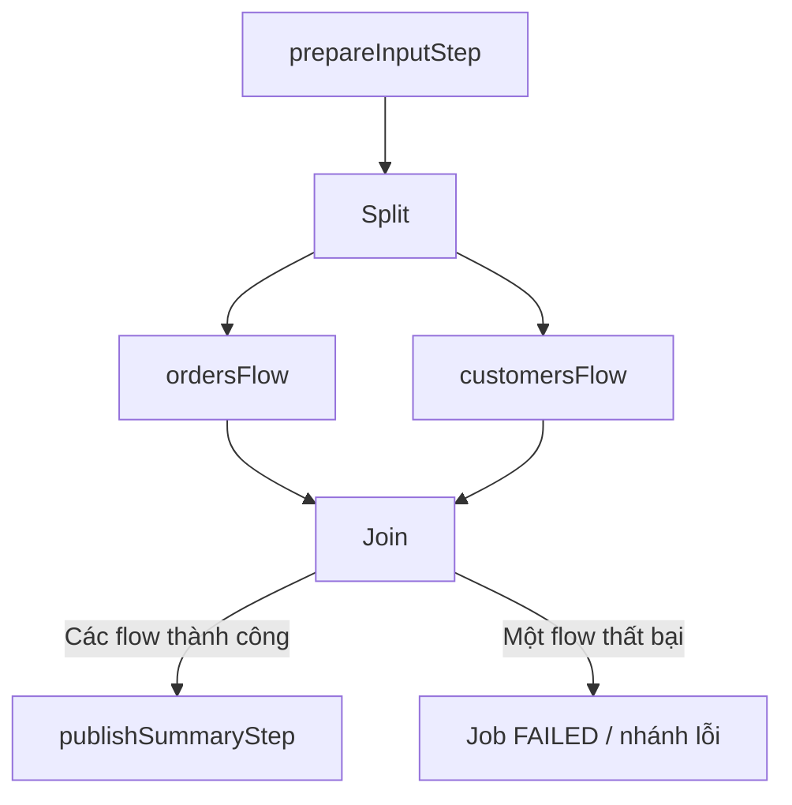

# Parallel flow trong một Job Spring Batch

Khi một batch job cần thực hiện nhiều nhánh nghiệp vụ độc lập, chạy các step nối tiếp có thể làm tăng tổng thời gian xử lý dù CPU, I/O và cơ sở dữ liệu còn tài nguyên. **Parallel flow** cho phép các *flow* khác nhau chạy đồng thời **bên trong cùng một Job**. Mỗi flow bao gồm một hoặc nhiều step có thứ tự và điều kiện chuyển trạng thái riêng; Spring Batch dùng `split(TaskExecutor)` để điều phối những flow này đồng thời và chờ chúng kết thúc.

Bài học thuộc chương **Mô hình đồng thời** của module **SPRING_BATCH_SCALING_OPERATIONS**. Mục tiêu không chỉ là biết cú pháp `split`, mà còn hiểu khi nào mô hình phù hợp với workload dữ liệu lớn, cách đo nút thắt, bảo đảm thread safety, retry/restart, theo dõi trạng thái và chọn giữa parallel flows, multi-threaded step, partitioning hay xử lý phân tán.

> **Phiên bản của ví dụ:** Java 17+, Spring Batch 5.x và Spring Boot 3.x. Các bean `JobRepository`, `PlatformTransactionManager` và `DataSource` được giả định đã cấu hình đúng. Với phiên bản thư viện khác, kiểm tra lại API builder và cách tự cấu hình trước khi áp dụng.

## 1. Parallel flow là gì?

Một **flow** trong Spring Batch là một nhánh điều khiển gồm các step và quy tắc chuyển tiếp. Ví dụ, flow A nhập đơn hàng rồi kiểm tra tổng số; flow B đồng bộ khách hàng. Hai flow độc lập có thể chạy đồng thời, vì chúng không phải chờ đầu ra của nhau.



Trong sơ đồ:

1. Job bắt đầu ở điểm `split`.
2. Spring Batch giao `ordersFlow` và `customersFlow` cho một `TaskExecutor`.
3. Hai flow có thể thực thi trên hai thread khác nhau. Bên trong `ordersFlow`, `validateOrdersStep` vẫn đợi `loadOrdersStep` hoàn tất thành công.
4. Split đồng bộ kết quả sau khi các nhánh hoàn tất; một nhánh thất bại thường khiến toàn bộ Job thất bại theo quy tắc chuyển trạng thái, dù nhánh khác có thể đã hoàn tất và commit dữ liệu.
5. Nếu muốn có step chung phía sau split, cần đặt step đó **sau điểm join** trong graph của Job, và quyết định rõ cách xử lý khi một nhánh không hoàn thành.

**Parallel flow là đồng thời ở cấp flow, không tự động đồng thời ở cấp item.** Nếu `loadOrdersStep` là một chunk step tuần tự, các item trong step này vẫn được xử lý theo cách tuần tự, dù bên cạnh nó có một flow khác đang chạy. Có thể kết hợp parallel flows với partitioning hoặc multi-threaded step bên trong từng flow, nhưng phải tính lại giới hạn tài nguyên.

## 2. So sánh với các mô hình concurrency khác

| Mô hình | Đơn vị được chạy đồng thời | Trường hợp phù hợp | Điều cần cảnh giác |
| --- | --- | --- | --- |
| Sequential steps | Không có nhánh song song | Step có quan hệ phụ thuộc trực tiếp | Tổng thời gian bằng chuỗi các step |
| **Parallel flows** | Các **nhánh nghiệp vụ** riêng trong cùng Job | Nhập đơn hàng và khách hàng độc lập; nhiều pipeline không phụ thuộc nhau | Cạnh tranh DB, lỗi một flow, phụ thuộc ngầm giữa các nhánh |
| Multi-threaded step | Nhiều chunk trong một step | Một nguồn dữ liệu lớn, xử lý item đồng thời được | Reader/writer có trạng thái và thứ tự/checkpoint |
| Local partitioning | Nhiều `StepExecution` của cùng worker step | Chia một tập dữ liệu thành các khoảng ID/file/tenant | Thiết kế partition không chồng lấp; tài nguyên mỗi worker |
| Remote partitioning | Worker partition ở JVM/node khác | Một JVM không đủ CPU/RAM hoặc cần scale-out | Middleware, kết nối mạng, delivery/retry và vận hành |
| Remote chunking | Chunk được xử lý từ xa | Phân tán xử lý chunk qua kênh truyền thông | Bảo đảm gửi/nhận, thông lượng broker, idempotency |

Cách chọn nhanh theo tính chất dữ liệu:

- **Có nhiều nhánh độc lập với mục tiêu khác nhau:** cân nhắc parallel flows.
- **Có một nguồn lớn cần chia phạm vi dữ liệu:** cân nhắc partitioning.
- **Muốn nhiều chunk của cùng step xử lý đồng thời:** cân nhắc multi-threaded step, kiểm tra thread safety đặc biệt kỹ.
- **Một tiến trình không đủ tài nguyên:** xem xét remote partitioning/chunking sau khi đo bottleneck.

Ví dụ: flow nhập đơn hàng **không nên** chạy song song với flow tính doanh thu dựa trên chính đơn hàng vừa nhập, trừ khi đã thiết kế snapshot, ranh giới đồng bộ hoặc dependency chính xác. Nếu flow B cần dữ liệu đã được flow A commit, hai flow không thật sự độc lập và thứ tự phải được mô tả trong graph.

## 3. Các thành phần tạo parallel flow

### 3.1. `Flow`

`Flow` mô tả các step và nhánh chuyển trạng thái. Một flow có thể chứa một step hoặc nhiều step chạy nối tiếp, cũng như các điều kiện dựa trên `ExitStatus`. Thông thường sử dụng `FlowBuilder<SimpleFlow>`:

```java
Flow ordersFlow = new FlowBuilder<SimpleFlow>("ordersFlow")
    .start(loadOrdersStep)
    .next(validateOrdersStep)
    .build();
```

`next(...)` biểu thị phụ thuộc thứ tự trong flow: step sau chỉ chạy theo chuyển trạng thái phù hợp của step trước. Không có hai step nào trong chính đoạn cấu hình này tự động chạy song song với nhau.

### 3.2. `split(TaskExecutor)`

Split điều phối các flow thành những nhánh concurrent. Một cách khai báo Job trên Spring Batch 5:

```java
Job job = new JobBuilder("nightlyImportJob", jobRepository)
    .start(ordersFlow)
    .split(flowTaskExecutor)
    .add(customersFlow)
    .end()
    .build();
```

- `start(ordersFlow)` đặt flow đầu tiên trong graph.
- `split(flowTaskExecutor)` cấu hình cơ chế thực thi concurrent cho các nhánh.
- `add(customersFlow)` thêm flow chạy cùng nhóm split; khi có nhiều nhánh độc lập, có thể thêm các flow khác.
- `end()` kết thúc phần định nghĩa flow trong Job builder, sau đó `build()` tạo Job.

**Không nhầm `split` với `partitioner`.** Split không chia `ExecutionContext` thành nhiều vùng dữ liệu; mỗi flow phải tự xác định nguồn, bước xử lý và ranh giới ghi của mình.

### 3.3. `TaskExecutor`

`TaskExecutor` quyết định việc thực thi flow được giao cho thread nào và quy tắc xếp hàng. `ThreadPoolTaskExecutor` thường hữu ích hơn executor tạo thread không giới hạn khi vận hành dữ liệu lớn:

```java
@Bean("flowTaskExecutor")
public ThreadPoolTaskExecutor flowTaskExecutor() {
    ThreadPoolTaskExecutor executor = new ThreadPoolTaskExecutor();
    executor.setCorePoolSize(2);
    executor.setMaxPoolSize(2);
    executor.setQueueCapacity(2);
    executor.setThreadNamePrefix("batch-flow-");
    return executor;
}
```

Ở ví dụ có **hai flow**, pool hai thread giúp cả hai có cơ hội chạy đồng thời. Nếu một pool chỉ có một worker thread, hai flow sẽ phải chờ nhau trên executor và khó đạt mục tiêu về hiệu năng. Ngược lại, đặt pool 50 thread không làm hai flow biến thành 50 đơn vị xử lý: số nhánh độc lập mới là một giới hạn song song.

Spring Batch không bảo đảm hai flow bắt đầu đúng cùng một mili giây; thread scheduling, JVM, DB connection pool và các resource có thể làm chúng khởi động lệch. Một executor đồng bộ như `SyncTaskExecutor` cũng không tạo ra song song thực sự.

## 4. Ví dụ thực tế: nhập đơn hàng và khách hàng trong một Job

Một batch ban đêm chuẩn hóa dữ liệu từ hai staging table:

- **`ordersFlow`:** đưa đơn hàng có amount hợp lệ sang `clean_orders`, sau đó kiểm tra số dòng.
- **`customersFlow`:** chuẩn hóa email và ghi sang `clean_customers`.
- Hai pipeline dùng bảng nguồn/đích khác nhau nên có thể chạy đồng thời.

Đây là ví dụ `TaskletStep` nhỏ để làm rõ orchestration; với dữ liệu khổng lồ, các bước SQL đơn giao dịch lớn có thể cần thay bằng chunk-oriented step, bulk load có checkpoint hoặc partitioning phù hợp. Việc chọn kỹ thuật bên trong step độc lập với cách tổ chức flow.

### 4.1. Chuẩn bị dữ liệu PostgreSQL

```sql
CREATE TABLE source_orders (
    id BIGINT PRIMARY KEY,
    amount NUMERIC(18, 2) NOT NULL
);

CREATE TABLE clean_orders (
    id BIGINT PRIMARY KEY,
    amount NUMERIC(18, 2) NOT NULL
);

CREATE TABLE source_customers (
    id BIGINT PRIMARY KEY,
    email VARCHAR(255) NOT NULL
);

CREATE TABLE clean_customers (
    id BIGINT PRIMARY KEY,
    email VARCHAR(255) NOT NULL
);

INSERT INTO source_orders(id, amount) VALUES
(1, 120.50), (2, 42.00), (3, -10.00);

INSERT INTO source_customers(id, email) VALUES
(10, ' AN@EXAMPLE.COM '),
(11, 'b@example.com');
```

Kết quả mong đợi: `clean_orders` nhận ID 1 và 2; đơn hàng 3 bị **lọc theo điều kiện SQL**; `clean_customers` nhận ID 10 và 11 với email đã chuẩn hóa. Đây là quy tắc demo, không phải chính sách nghiệp vụ hay skip/recovery mặc định. Nếu cần ghi nhận dữ liệu không hợp lệ, bổ sung bước quarantine/audit riêng.

### 4.2. Cấu hình Job và hai Flow

```java
package example.batch;

import java.util.Objects;
import org.springframework.batch.core.Job;
import org.springframework.batch.core.Step;
import org.springframework.batch.core.job.builder.FlowBuilder;
import org.springframework.batch.core.job.builder.JobBuilder;
import org.springframework.batch.core.job.flow.Flow;
import org.springframework.batch.core.job.flow.support.SimpleFlow;
import org.springframework.batch.core.repository.JobRepository;
import org.springframework.batch.core.step.builder.StepBuilder;
import org.springframework.batch.repeat.RepeatStatus;
import org.springframework.beans.factory.annotation.Qualifier;
import org.springframework.context.annotation.Bean;
import org.springframework.context.annotation.Configuration;
import org.springframework.core.task.TaskExecutor;
import org.springframework.jdbc.core.JdbcTemplate;
import org.springframework.scheduling.concurrent.ThreadPoolTaskExecutor;
import org.springframework.transaction.PlatformTransactionManager;

@Configuration
public class ParallelFlowJobConfiguration {

    @Bean("flowTaskExecutor")
    public ThreadPoolTaskExecutor flowTaskExecutor() {
        ThreadPoolTaskExecutor executor = new ThreadPoolTaskExecutor();
        executor.setCorePoolSize(2);
        executor.setMaxPoolSize(2);
        executor.setQueueCapacity(2);
        executor.setThreadNamePrefix("batch-flow-");
        return executor;
    }

    @Bean("loadOrdersStep")
    public Step loadOrdersStep(
            JobRepository jobRepository,
            PlatformTransactionManager transactionManager,
            JdbcTemplate jdbc) {

        return new StepBuilder("loadOrdersStep", jobRepository)
            .tasklet((contribution, chunkContext) -> {
                jdbc.update("""
                    INSERT INTO clean_orders(id, amount)
                    SELECT id, amount FROM source_orders
                    WHERE amount >= 0
                    ON CONFLICT(id) DO UPDATE
                    SET amount = EXCLUDED.amount
                    """);

                return RepeatStatus.FINISHED;
            }, transactionManager)
            .build();
    }

    @Bean("validateOrdersStep")
    public Step validateOrdersStep(
            JobRepository jobRepository,
            PlatformTransactionManager transactionManager,
            JdbcTemplate jdbc) {

        return new StepBuilder("validateOrdersStep", jobRepository)
            .tasklet((contribution, chunkContext) -> {
                Long expected = jdbc.queryForObject(
                    "SELECT COUNT(*) FROM source_orders WHERE amount >= 0",
                    Long.class);
                Long actual = jdbc.queryForObject(
                    "SELECT COUNT(*) FROM clean_orders",
                    Long.class);

                if (!Objects.equals(expected, actual)) {
                    throw new IllegalStateException(
                        "Order import count mismatch: " +
                        expected + " vs " + actual);
                }
                return RepeatStatus.FINISHED;
            }, transactionManager)
            .build();
    }

    @Bean("loadCustomersStep")
    public Step loadCustomersStep(
            JobRepository jobRepository,
            PlatformTransactionManager transactionManager,
            JdbcTemplate jdbc) {

        return new StepBuilder("loadCustomersStep", jobRepository)
            .tasklet((contribution, chunkContext) -> {
                jdbc.update("""
                    INSERT INTO clean_customers(id, email)
                    SELECT id, LOWER(TRIM(email))
                    FROM source_customers
                    WHERE TRUE
                    ON CONFLICT(id) DO UPDATE
                    SET email = EXCLUDED.email
                    """);

                return RepeatStatus.FINISHED;
            }, transactionManager)
            .build();
    }

    // Hai step chạy tuần tự trong nhánh đơn hàng.
    @Bean("ordersFlow")
    public Flow ordersFlow(
            @Qualifier("loadOrdersStep") Step loadOrdersStep,
            @Qualifier("validateOrdersStep") Step validateOrdersStep) {

        return new FlowBuilder<SimpleFlow>("ordersFlow")
            .start(loadOrdersStep)
            .next(validateOrdersStep)
            .build();
    }

    // Một flow chỉ có một step cũng hợp lệ.
    @Bean("customersFlow")
    public Flow customersFlow(
            @Qualifier("loadCustomersStep") Step loadCustomersStep) {

        return new FlowBuilder<SimpleFlow>("customersFlow")
            .start(loadCustomersStep)
            .build();
    }

    // Cả hai flow ở cùng một Job, chạy trên pool hai thread.
    @Bean("nightlyImportJob")
    public Job nightlyImportJob(
            JobRepository jobRepository,
            @Qualifier("ordersFlow") Flow ordersFlow,
            @Qualifier("customersFlow") Flow customersFlow,
            @Qualifier("flowTaskExecutor") TaskExecutor executor) {

        return new JobBuilder("nightlyImportJob", jobRepository)
            .start(ordersFlow)
            .split(executor)
            .add(customersFlow)
            .end()
            .build();
    }
}
```

**Giải thích đường chạy:**

1. `nightlyImportJob` dùng `ordersFlow` và `customersFlow` làm hai nhánh của một split.
2. Executor có hai worker thread, nên hai flow có thể thực thi đồng thời.
3. `ordersFlow` chạy `loadOrdersStep`, rồi `validateOrdersStep` theo thứ tự; `customersFlow` chạy `loadCustomersStep` độc lập.
4. Mỗi tasklet chạy trong transaction do `PlatformTransactionManager` cấp, kết quả được lưu vào metadata `JobRepository`.
5. Lệnh PostgreSQL `ON CONFLICT` giúp những lần xử lý lại cùng ID tạo kết quả nhất quán hơn, miễn dữ liệu nguồn đầu vào không thay đổi ngoài dự kiến.
6. Sau khi hai flow kết thúc, Job tổng hợp trạng thái để xác định kết quả chung. Nếu một nhánh lỗi, Job không mặc định bỏ qua lỗi để báo `COMPLETED`.

Với ứng dụng Spring Boot chỉ có một Job bean, có thể để Boot tự khởi chạy job; khi có nhiều Job hoặc muốn khởi chạy có kiểm soát, cấu hình `spring.batch.job.name=nightlyImportJob` hoặc dùng launcher riêng. **Không vừa bật auto-launch vừa gọi `JobLauncher` thủ công cho cùng job instance** nếu chưa có cơ chế chống chạy trùng.

**Giới hạn của dữ liệu minh họa:** Các bảng `clean_*` trong SQL dùng một tập dữ liệu demo. Nếu vận hành nhiều ngày/batch window, thêm `batch_id` hoặc mốc snapshot vào khóa bảng, bộ lọc query và identifying `JobParameters`. Phép so sánh `COUNT(*)` toàn bảng ở `validateOrdersStep` chỉ phù hợp khi bảng đích dành riêng cho bộ dữ liệu đang chạy. Với dữ liệu lớn, thay việc đếm toàn bảng và insert một giao dịch lớn bằng phương án phù hợp tải và yêu cầu checkpoint.

## 5. Điểm join: chờ các nhánh, quản lý kết quả sau split

**Join** là điểm đồng bộ logic sau khi tất cả flow trong split đã kết thúc; đây không phải một step hay một transaction commit chung. Mỗi flow giữ trạng thái và transaction của riêng nó. Có thể thiết kế thêm bước hậu xử lý sau join, ví dụ tạo báo cáo tổng hợp khi đơn hàng và khách hàng đều đã xử lý thành công:



Việc đặt `publishSummaryStep` sau split tạo **ràng buộc thời gian**: bước tổng hợp chỉ bắt đầu khi kết quả nhánh đáp ứng điều kiện chuyển tiếp. Trường hợp một flow thất bại, cần xác định chính sách: fail toàn job, đi đến bước cảnh báo, hay dùng `ExitStatus` tùy chỉnh. Không nên cho bước tổng hợp chạy sớm bằng cách dựa vào thời gian ngủ hoặc tự dò bảng đích.

Flow trong Spring Batch có thể kết nối bằng `FlowBuilder`, chuyển tiếp theo `on(...)`, `to(...)` hoặc dùng decision step khi nghiệp vụ phức tạp. Phải xem xét trạng thái trả về của từng nhánh; không coi `split` là một điều kiện `COMPLETED` bất kể kết quả.

### Khi một nhánh lỗi, nhánh kia ra sao?

Giả sử `ordersFlow` thất bại ở `validateOrdersStep`, nhưng `customersFlow` đã ghi thành công:

- Công việc đã commit của `customersFlow` **không được rollback** chỉ vì flow đơn hàng lỗi.
- Spring Batch không bảo đảm tất cả nhánh khác bị hủy ngay lập tức; một flow còn chạy có thể tiếp tục đến khi hoàn tất theo điều phối của split.
- Trạng thái cuối Job phản ánh lỗi theo graph và bộ tổng hợp trạng thái; trường hợp bình thường là Job `FAILED` khi một nhánh thất bại không được xử lý đặc biệt.
- Khi restart cùng `JobInstance`, metadata `JobRepository` giúp Spring Batch quyết định step đã hoàn tất có cần chạy lại hay không. Mặc định step `COMPLETED` không chạy lại khi restart, trừ khi được cấu hình và điều kiện cho phép.

**Không có transaction toàn Job.** Với nhiều flow chạy song song, các transaction của từng step độc lập. Nếu nghiệp vụ yêu cầu các nhánh cùng thành công hoặc cùng thất bại ở mức dữ liệu, phải thiết kế cơ chế commit hai pha, publish cuối cùng, trạng thái nháp và quy trình bù phù hợp; parallel flows không tự mang lại atomicity xuyên nhánh.

## 6. Retry, restart và JobRepository

### 6.1. Job instance và tham số nhận diện

Một `JobInstance` được xác định bởi **tên Job + identifying JobParameters**. Ví dụ:

```text
jobName  = nightlyImportJob
batchKey = 2026-11-26
sourceVersion = v3
```

Nếu job thất bại, khởi chạy lại **cùng tham số nhận diện** có thể tạo `JobExecution` mới của cùng instance, miễn Job restartable và trạng thái metadata cho phép. Tạo `run.id` mới mỗi lần thay cho restart sẽ tạo instance khác và có thể khiến những bước đã hoàn tất chạy lại từ đầu. Nếu job đã `COMPLETED`, không thể khởi chạy lại instance đó theo luồng thông thường.

Giữ nguyên **tên step** giữa các lần restart. Đổi tên `loadOrdersStep` hoặc `loadCustomersStep` có thể khiến Spring Batch coi đó là step mới, không khớp metadata/chính sách phục hồi trước đó.

### 6.2. Retry trong từng step

Parallel flow là orchestration, **không tự thêm retry policy cho các step**. Với chunk-oriented step, có thể cấu hình:

```java
new StepBuilder("loadOrdersChunkStep", jobRepository)
    .<Order, Order>chunk(200, transactionManager)
    .reader(reader)
    .writer(writer)
    .faultTolerant()
    .retry(TransientDataAccessException.class)
    .retryLimit(3)
    .build();
```

Đây là đoạn minh họa cho một **chunk step thay thế**, với `Order`, `reader` và `writer` cần được định nghĩa trong ứng dụng; không phải code thêm trực tiếp vào ví dụ tasklet phía trên. Nếu dùng tasklet thì tự xử lý lỗi/retry ở lớp phù hợp hoặc khai thác cơ chế retry của Spring; `faultTolerant()` là API của chunk builder, không áp trực tiếp cho tasklet theo cách tương tự.

**Retry có giới hạn** cho lỗi tạm thời như deadlock/timeout giúp tránh làm thất bại job vì sự cố ngắn. Với lỗi dữ liệu cố định hoặc vi phạm nghiệp vụ, cần xác định fail, skip/quarantine hoặc sửa nguồn; retry vô hạn chỉ tăng thời gian xử lý và tải DB.

### 6.3. Trường hợp khôi phục

| Tình huống | Hậu quả | Cách xử lý |
| --- | --- | --- |
| `loadOrdersStep` thất bại trước commit | Transaction hiện tại rollback; flow đơn hàng dừng theo transition mặc định | Sửa lỗi và restart cùng instance |
| `customersFlow` đã `COMPLETED`, `ordersFlow` lỗi | Dữ liệu khách hàng vẫn đã commit | Restart dựa trên metadata, bảo đảm writer idempotent |
| Executor không nhận thêm task | Split không lập lịch được toàn bộ nhánh | Kiểm tra thread/queue/rejection policy, fail rõ ràng |
| JVM hoặc pod bị kill | Mọi flow đang chạy đều dừng; metadata có thể còn `STARTED` | Xác minh tiến trình không còn chạy, recovery có kiểm soát |
| Đổi JobParameters khi chạy lại | Tạo JobInstance mới | Chỉ dùng tham số mới cho batch window mới |
| Một nhánh gọi hệ thống ngoài trước khi lỗi | Side effect có thể xảy ra trước khi Job fail | Idempotency key/outbox/compensation |

Khi process bị kill đột ngột, không phải lúc nào Spring Batch cũng kịp ghi `FAILED` vào `JobRepository`. Trước khi can thiệp vào metadata có trạng thái `STARTED`, cần xác minh không có job còn hoạt động và dùng quy trình vận hành phù hợp. Không sửa trực tiếp bảng metadata tùy tiện để ép chạy lại.

## 7. Thread safety và phụ thuộc dữ liệu

Flow thường chạy trên **các thread khác nhau trong cùng JVM**; chúng vẫn có thể sử dụng cùng các bean singleton trong Spring context. Điều này dẫn đến hai lớp rủi ro:

**Rủi ro về trạng thái chương trình:**

- Reader, writer hoặc processor có mutable state cần được kiểm tra thread safety và scope phù hợp. Một `ItemReader` có cursor dùng chung giữa hai flow là sai nếu các flow xử lý những stream khác nhau.
- Với chunk step, dùng `@StepScope` để mỗi `StepExecution` có reader/state riêng khi phù hợp.
- Không dùng biến `static` hoặc singleton field để lưu `currentFlow`, `lastProcessedId` hoặc buffer ghi chưa đồng bộ.
- `JdbcTemplate` và pool kết nối được thiết kế để sử dụng concurrent, nhưng các thao tác phải có transaction/ràng buộc dữ liệu đúng.

**Rủi ro về tài nguyên và phụ thuộc nghiệp vụ:**

- Hai flow cùng cập nhật một bảng, nhiều hàng hoặc cùng khóa có thể gây deadlock, race condition hoặc tạo output không nhất quán.
- Một flow đọc dữ liệu của flow kia trong khi flow kia đang ghi có thể thấy snapshot chưa hoàn thiện hoặc hành vi khác theo isolation level.
- Hai flow cùng ghi vào **một file** hoặc dùng chung writer có offset sẽ có nguy cơ ghi xen kẽ/ghi đè.
- Các step độc lập phải có ranh giới rõ: source, bảng đích, file, khóa phân vùng, thời điểm chốt dữ liệu.
- Các lỗi độc lập không đồng nghĩa có thể chấp nhận kết quả một phần: phải xác định luật đối soát và phát hành output.

Bảo đảm thread safety ở Java **không đủ** để bảo đảm tính đúng đắn của job nếu hai flow tranh chấp cùng dữ liệu. Cần kết hợp thiết kế dữ liệu, transaction isolation, khóa/idempotency và điều kiện chuyển tiếp.

## 8. Sizing và đo hiệu quả parallel flows

Mục tiêu thực tế là giảm **elapsed time** toàn Job trong khi vẫn đảm bảo throughput, ổn định và khả năng phục hồi.

Nếu hai flow độc lập có thời gian tuần tự `T_A = 14 phút` và `T_B = 9 phút`:

- Chạy nối tiếp: lý tưởng khoảng **23 phút**.
- Chạy song song: lý tưởng khoảng **14 phút**, cộng chi phí scheduling/đồng bộ.
- Speedup lý tưởng khoảng `23 / 14 ≈ 1,64`, **không phải gấp hai**.

Đây là ước tính bỏ qua contention. Nếu cả hai flow cùng gây nghẽn database, thời gian mỗi nhánh có thể tăng đáng kể, thậm chí làm Job chậm hơn chạy tuần tự.

### Những chỉ số nên thu thập

| Nhóm | Chỉ số | Dùng để tìm |
| --- | --- | --- |
| Job | Tổng elapsed time, `BatchStatus`, `ExitStatus` | Có thật sự giảm SLA không |
| Flow | Thời gian bắt đầu/kết thúc, flow chậm nhất | Nhánh nào là critical path |
| Step | `readCount`, `writeCount`, `skipCount`, `rollbackCount`, transaction duration | Bước nào thực sự nặng |
| Executor | Active thread, queue size, rejected tasks | Có đủ khả năng chạy concurrent không |
| JDBC | Active/idle/pending connections, acquisition time, timeout | Có nghẽn pool kết nối không |
| DB | CPU, IOPS, slow query, lock wait, deadlock | Có cạnh tranh tại dữ liệu không |
| JVM | CPU usage/throttling, heap, GC pause, thread count | Runtime đã đầy tài nguyên chưa |

**Bẫy sizing:** Hai flow không chỉ dùng hai connection. Nếu mỗi flow gồm chunk step có cursor reader giữ connection, transaction ghi, metadata của `JobRepository` và hoạt động phụ, số connection có thể cao hơn rất nhiều. Cần đo dưới tải đại diện và để dự phòng cho service khác cùng DB.

Quy trình thử hiệu năng:

1. Đo baseline tuần tự với cùng snapshot dữ liệu, CPU/heap/DB và workload.
2. Chạy split với hai flow, pool hai thread; lặp lại đủ lần để loại nhiễu từ warmup và cache.
3. So sánh tổng elapsed time, thời gian từng step/flow, query latency, số connection đang chờ, CPU và rollback.
4. Thử kịch bản một flow bị chậm để xem Job bị kéo dài theo critical path ra sao.
5. Chỉ tăng số flow/pool nếu có **nhánh độc lập thật sự** và tài nguyên còn dư.
6. Kiểm tra restart, dừng pod và dữ liệu output; một cấu hình nhanh nhưng gây kết quả sai không đạt mục tiêu.

Với ba nhánh hoặc nhiều hơn, pool size nhỏ hơn số flow sẽ khiến một số nhánh phải chờ; pool size lớn hơn số flow không tạo thêm song song. Nếu các flow còn sử dụng executor riêng cho multi-threaded chunk/partitioning, cần cộng tổng số worker dự kiến để không oversubscribe DB/CPU.

## 9. Xử lý lỗi và quan sát trong vận hành

Một Job chạy split nên có logging/Micrometer hoặc công cụ giám sát phù hợp để truy vết từng `StepExecution`:

```text
jobName=nightlyImportJob
jobExecutionId=...
stepName=loadOrdersStep
stepExecutionId=...
thread=batch-flow-1
status=COMPLETED
readCount=...
writeCount=...
elapsedMs=...
```

Tên flow không nhất thiết được lưu như một trường độc lập bên cạnh mỗi `StepExecution`; nếu cần truy vết tên nhánh, chủ động thêm nó vào MDC/log hoặc quy ước tên step. Với ứng dụng nhiều instance và nhiều job, chú ý gắn `jobExecutionId`, step name và batch window để log không lẫn.

Các cảnh báo hữu ích gồm: một nhánh `FAILED` hoặc `STOPPED`; elapsed time flow vượt baseline; số lỗi retry/rollback tăng; deadlock DB; executor từ chối task; JDBC pool timeout; JVM hết bộ nhớ hoặc pod bị kill; kết quả đối soát giữa các nhánh sai.

Khi triển khai trong Kubernetes:

- Một batch `Job`/pod chứa cả graph parallel flow và thread pool cục bộ.
- Tăng `replicas` của một `Deployment` không làm tăng số thread trong cùng instance; mỗi replica có thể khởi chạy Job khác, gây trùng.
- Nếu muốn scale-out qua nhiều pod, cần thiết kế phân tán và điều phối job/worker, không chỉ tăng tham số `split`.
- Phải đặt CPU/memory limit và sizing JDBC connection tương thích với tổng tải đồng thời, kiểm soát graceful shutdown và mã thoát của process.

## 10. Những lỗi thiết kế thường gặp

| Sai lầm | Hậu quả | Cách xử lý |
| --- | --- | --- |
| Đưa hai step có quan hệ dữ liệu phụ thuộc vào hai flow song song | Đọc dữ liệu chưa được tạo xong; kết quả không ổn định | Giữ step phụ thuộc ở cùng flow theo thứ tự, hoặc đặt sau join |
| Dùng executor đồng bộ hoặc chỉ một thread | Các nhánh vẫn chạy lần lượt | Dùng pool đủ thread, xác minh thực tế có concurrency |
| Nghĩ `split` sẽ chia một nguồn dữ liệu lớn | Một flow vẫn xử lý cả dữ liệu | Dùng partitioning hoặc mô hình khác phù hợp |
| Hai flow chia sẻ reader có state | Lặp/thiếu bản ghi, race condition | Tách reader/`@StepScope` và phạm vi dữ liệu |
| Hai flow ghi cùng tệp hoặc dòng DB | Ghi đè, deadlock hoặc sai kết quả | Tách nguồn/đích, khóa đúng, transaction/idempotency |
| Khi một flow fail, giả định flow kia đã rollback | Dữ liệu commit một phần không được xử lý | Thiết kế trạng thái xuất bản, bù/restart |
| Tăng thread khi DB đã bão hòa | Throughput giảm, timeout tăng | Đo bottleneck và giới hạn concurrency |
| Thay JobParameters khi muốn restart | Tạo JobInstance mới, các step có thể chạy lại từ đầu | Dùng đúng identifying parameters và metadata |
| Chỉ xem trạng thái toàn Job | Không biết flow nào chậm hoặc lỗi | Theo dõi step/flow và nguồn tài nguyên |

## 11. Bài tập thực hành

### Bài tập 1: Thiết kế graph

Một Job gồm:

- Đọc dữ liệu danh mục.
- Nhập đơn hàng.
- Đồng bộ thông tin khách hàng.
- Sinh báo cáo doanh thu cần kết quả đơn hàng và khách hàng.
- Gửi thông báo hoàn tất.

Hãy xác định các bước nào chạy song song và bước nào phải nằm sau điểm join. Vẽ sơ đồ Mermaid, ghi rõ dependency. Giải thích vì sao sinh báo cáo trước khi cả hai nhánh hoàn tất là không an toàn.

### Bài tập 2: Đo tốc độ và tài nguyên

Giả sử flow A mất 12 phút, flow B mất 8 phút khi chạy tuần tự. Khi chạy đồng thời, mỗi flow chậm hơn 20% vì cùng dùng DB.

1. Ước lượng thời gian chạy tuần tự và song song.
2. Tính speedup của Job sau khi trừ phần thời gian overhead giả định 1 phút.
3. Đề xuất hai chỉ số để xác nhận DB là nút thắt thay vì CPU.
4. Nêu điều kiện để **không** tăng pool size.

Gợi ý: tổng thời gian song song bị chi phối bởi nhánh lâu nhất, không phải tổng hai thời gian nhánh.

### Bài tập 3: Lỗi và restart

Kịch bản: `ordersFlow` đã hoàn tất `loadOrdersStep`, nhưng `validateOrdersStep` thất bại; `customersFlow` đã hoàn tất và commit.

Hãy mô tả trạng thái Job, output có thể đã tồn tại, bước nào cần chạy khi restart cùng `JobInstance` và điều kiện để bảo đảm không xuất hiện dữ liệu trùng. Kiểm tra cả trường hợp JVM bị kill đột ngột, khiến metadata chưa kịp đổi trạng thái.

### Bài tập 4: Chọn kiến trúc

Có một pipeline tính phí 50 triệu giao dịch và một pipeline đồng bộ 2 triệu khách hàng. Hai pipeline độc lập; một JVM có CPU giới hạn, DB source dùng chung. Hãy so sánh hai phương án:

- Hai flow chạy đồng thời, mỗi flow thực hiện chunk tuần tự.
- Hai flow chạy đồng thời, trong đó flow tính phí dùng thêm local partitioning.

Chọn phương án dựa trên số connection, độ lệch partition, CPU, DB contention và yêu cầu restart. Giải thích vì sao nhiều thread hơn có thể khiến hiệu năng xấu đi.

## 12. Checklist trước khi triển khai

- [ ] Các flow thật sự độc lập về dữ liệu hoặc có dependency được mô tả rõ.
- [ ] `split(TaskExecutor)` dùng executor có giới hạn concurrency phù hợp số nhánh.
- [ ] Các step trong từng flow có tên duy nhất và quy tắc chuyển trạng thái rõ.
- [ ] Reader/writer/processor/listener có mutable state được kiểm tra thread safety và scope.
- [ ] DB connection pool, số transaction đồng thời, lock wait và CPU/heap đã đo dưới tải.
- [ ] Kết quả sau join không được phát hành trước khi tất cả nhánh cần thiết hoàn tất.
- [ ] Việc một nhánh fail không làm dữ liệu commit của nhánh khác trở nên không thể phục hồi.
- [ ] Writer có idempotency hoặc rollback đúng; JobParameters ổn định để restart.
- [ ] Có log/metrics giúp xác định thời gian, số bản ghi và lỗi của từng step/flow.
- [ ] Đã thử nghiệm trường hợp một flow lỗi, flow khác thành công, executor đầy và pod bị kill.
- [ ] Đã so sánh elapsed time với chạy tuần tự, xác nhận speedup có ý nghĩa thực tế.

**Kết luận:** Parallel flow cho phép nhiều nhánh nghiệp vụ độc lập trong **một Spring Batch Job** chạy đồng thời bằng `split(TaskExecutor)`. Nó phù hợp khi có những workflow khác nhau cần hoàn thành trong một batch window và vẫn dùng chung cơ chế quản lý `JobRepository`. Thành công phụ thuộc vào graph đúng dependency, khả năng rollback/restart độc lập của từng step, an toàn tài nguyên dùng chung và phép đo hiệu năng. Khi cần chia một tập dữ liệu lớn thành nhiều phần của cùng bước xử lý, partitioning là mô hình bổ sung thích hợp hơn.
