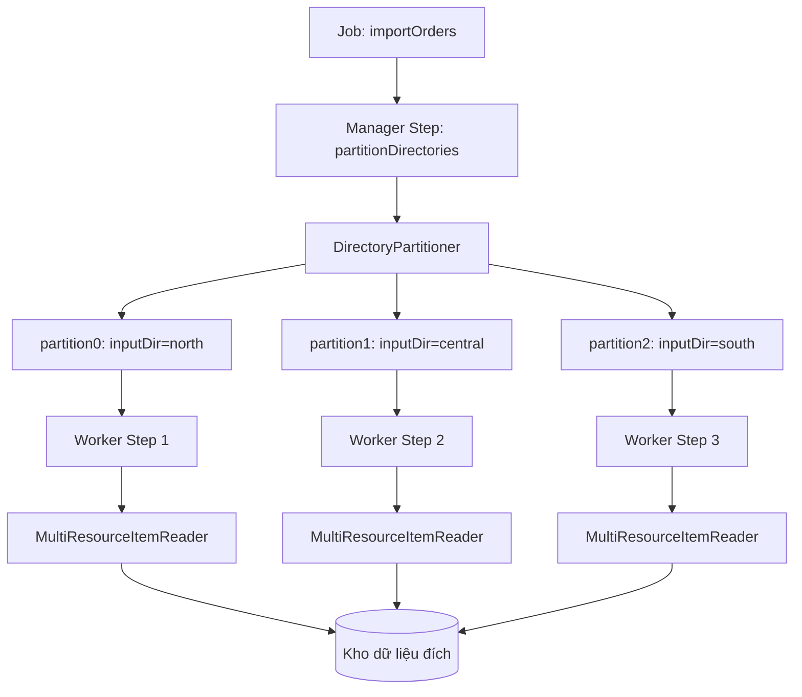

# Partition theo thư mục trong Spring Batch

## 1. Khi nào cần chia dữ liệu theo thư mục?

Giả sử mỗi đêm hệ thống nhận hàng chục nghìn file CSV, được tổ chức theo khu vực hoặc đối tác. Một bước Spring Batch đọc tuần tự mọi file sẽ mất nhiều giờ, dù máy còn CPU và các nguồn I/O chưa được tận dụng hết. **Partition theo thư mục** là cách tạo các `StepExecution` độc lập, mỗi `StepExecution` xử lý một thư mục hoặc một nhóm thư mục, rồi cho nhiều worker chạy đồng thời.

Bài học thuộc **File scaling** của module **SPRING_BATCH_SCALING_OPERATIONS**: mở rộng Spring Batch cho workload dữ liệu lớn bằng cách phân tích nút thắt, chọn mô hình partition phù hợp, bảo đảm thread safety, retry/restart và vận hành theo tài nguyên thực tế.

Sau bài học, bạn sẽ biết:

- Nhận diện trường hợp nên chia theo thư mục thay vì theo file, dòng dữ liệu hoặc bước xử lý.
- Cài đặt `Partitioner` tạo `ExecutionContext` cho từng thư mục và cấu hình local partitioning.
- Dùng `@StepScope`, `MultiResourceItemReader` để cô lập reader của mỗi partition.
- Thiết kế tập input bất biến, checkpoint, idempotency và restart khi một thư mục lỗi.
- Đo hiệu năng, giảm chênh lệch tải và mở rộng sang remote partitioning khi cần.

## 2. Mô hình dữ liệu và ranh giới partition

Ví dụ thư mục của một **đợt nhập liệu đã chốt**:

```text
/data/import/run-20261126-01/
├── north/
│   ├── orders-001.csv
│   └── orders-002.csv
├── central/
│   ├── orders-001.csv
│   └── orders-002.csv
└── south/
    ├── orders-001.csv
    └── orders-002.csv
```

Mỗi file có header `order_id,amount` và các dòng dữ liệu đơn hàng. Một partition đọc các file **tuần tự bên trong thư mục**; các partition của `north`, `central` và `south` có thể chạy **song song**. Dữ liệu trong thư mục phải độc lập hoặc writer phải xử lý được việc nhiều partition ghi đồng thời.



Ở mô hình này:

- **Manager step** dùng `Partitioner` để quyết định phần việc, sau đó nhờ `PartitionHandler` điều phối các worker.
- **Worker step** là một cấu hình step thống nhất nhưng mỗi lần thực thi nhận một `ExecutionContext` riêng, chứa đường dẫn thư mục cần đọc.
- **JobRepository** lưu metadata từng `StepExecution` và trạng thái checkpoint để hỗ trợ khôi phục.
- **TaskExecutor** chỉ quyết định số worker chạy đồng thời trong **cùng JVM**. Muốn dùng nhiều máy phải thiết kế **remote partitioning** với hạ tầng truyền lệnh phù hợp.

Đừng nhầm `gridSize` với số thư mục: tham số `partition(int gridSize)` cung cấp một **gợi ý** về mức chia nhỏ công việc. `Partitioner` tự định nghĩa số context trả về; ví dụ dưới đây trả một context cho **mỗi thư mục**, nên ba thư mục tạo ba partition dù `gridSize` là 4 hay 8.

### So sánh ranh giới chia việc

| Chiến lược | Phù hợp khi | Rủi ro/điểm đổi chác |
|---|---|---|
| Một partition/thư mục | Mỗi thư mục gồm nhiều file nhỏ, nghiệp vụ cần nhóm theo đối tác/khu vực | Một thư mục rất lớn có thể chi phối thời gian toàn job |
| Một partition/file | File độc lập, dung lượng file tương đối đồng đều | Nhiều file nhỏ gây nhiều `StepExecution` và overhead metadata |
| Một partition/nhóm thư mục | Có hàng chục nghìn thư mục rất nhỏ | Phải tạo danh sách nhóm ổn định khi restart |
| Một partition/vùng byte hoặc dòng | Một số file đơn lẻ rất lớn | Phải xử lý ranh giới record, encoding, header và định dạng nhiều dòng |

`MultiResourcePartitioner` có sẵn của Spring Batch tạo **một partition cho mỗi Resource**, thường thích hợp khi mỗi file là một đơn vị công việc. Nó **không tự biến một thư mục thành một partition** và có thể bỏ qua `gridSize`. Muốn một worker chịu trách nhiệm cả thư mục, hãy dùng `Partitioner` tùy biến như bên dưới.

## 3. Trình tự xử lý của một job

1. **Chốt input:** producer hoàn tất ghi file, tạo manifest hoặc đánh dấu đợt nhập đã sẵn sàng. Không để worker đọc file vẫn còn được ghi.
2. **Liệt kê thư mục:** manager nhận thư mục gốc của một đợt chạy, lọc các thư mục con hợp lệ và sắp xếp ổn định.
3. **Tạo partition:** mỗi tên partition duy nhất được gắn `ExecutionContext`, ví dụ `inputDir=/data/import/run-20261126-01/north`.
4. **Chạy worker:** `TaskExecutorPartitionHandler` phân phối các `StepExecution` tới pool thread; mỗi worker khởi tạo reader scoped theo đường dẫn của nó.
5. **Đọc/ghi theo chunk:** worker lần lượt đọc file CSV trong thư mục, ghi dữ liệu đích trong transaction và cập nhật checkpoint sau commit.
6. **Tổng hợp:** manager nhận trạng thái các worker; job chỉ thành công khi các partition bắt buộc hoàn thành theo chính sách của job.
7. **Lưu kết quả và lưu trữ:** chỉ chuyển input sang archive/xóa sau khi đã đối soát thành công và không còn tiến trình cần restart.

**Phân biệt hai loại song song:** bên ngoài, nhiều worker xử lý các thư mục khác nhau; bên trong một worker, `MultiResourceItemReader` đọc tuần tự các file của thư mục. Không cần thêm `taskExecutor` cho chính worker step nếu yêu cầu chỉ là song song theo thư mục.

## 4. Tạo DirectoryPartitioner

Ví dụ Java dưới đây minh họa **Spring Batch 6.x** (package `ExecutionContext` ở `org.springframework.batch.infrastructure.item`). Trong Spring Batch 5.x, các import và một số chữ ký builder khác; kiểm tra đúng API của phiên bản dự án trước khi áp dụng.

```java
import java.io.IOException;
import java.nio.file.Files;
import java.nio.file.LinkOption;
import java.nio.file.Path;
import java.util.Comparator;
import java.util.LinkedHashMap;
import java.util.List;
import java.util.Map;
import java.util.stream.Stream;

import org.springframework.batch.core.partition.Partitioner;
import org.springframework.batch.infrastructure.item.ExecutionContext;

public final class DirectoryPartitioner implements Partitioner {
    private final Path inputRoot;

    public DirectoryPartitioner(Path inputRoot) {
        this.inputRoot = inputRoot.toAbsolutePath().normalize();
    }

    @Override
    public Map<String, ExecutionContext> partition(int gridSize) {
        if (!Files.isDirectory(inputRoot, LinkOption.NOFOLLOW_LINKS)) {
            throw new IllegalArgumentException("Invalid input root: " + inputRoot);
        }

        List<Path> directories;
        try (Stream<Path> paths = Files.list(inputRoot)) {
            directories = paths
                .filter(p -> Files.isDirectory(p, LinkOption.NOFOLLOW_LINKS))
                .sorted(Comparator.comparing(p -> p.getFileName().toString()))
                .toList();
        } catch (IOException e) {
            throw new IllegalStateException("Cannot list " + inputRoot, e);
        }

        if (directories.isEmpty()) {
            throw new IllegalStateException("No input directories: " + inputRoot);
        }

        Map<String, ExecutionContext> result = new LinkedHashMap<>();
        for (int i = 0; i < directories.size(); i++) {
            ExecutionContext context = new ExecutionContext();
            context.putString("inputDir", directories.get(i).toString());
            result.put("partition" + i, context);
        }
        return result;
    }
}
```

Điểm quan trọng:

- `Files.list(inputRoot)` chỉ lấy **thư mục con trực tiếp**, không đi sâu tùy ý. Nếu cần cây nhiều cấp, phải định nghĩa rõ cấp nào là đơn vị partition và cách chống trùng.
- Danh sách thư mục được **sort trước khi đặt tên partition**. Khi input bất biến, cùng `partition0` sẽ trỏ đến cùng thư mục ở lần restart.
- `ExecutionContext` chỉ chứa **String đường dẫn**. Không cho `Path`, stream, `Resource[]` hoặc object nặng vào context persist của JobRepository; context cần serialize an toàn.
- Ví dụ chủ động báo lỗi nếu root rỗng. Hệ thống có yêu cầu coi đợt không có dữ liệu là thành công phải quy định rõ hành vi khác.
- `gridSize` không được dùng để cắt danh sách; giới hạn **thread chạy đồng thời** do `TaskExecutor` và handler đảm nhận.

**Giới hạn của ví dụ:** tên `partition0`, `partition1` ổn định **chỉ khi danh sách thư mục không thay đổi**. Production nên chốt danh sách trước khi chạy và giữ nguyên qua các lần restart. Với directory ID được quản lý tập trung, có thể dùng tên partition dựa trên ID đó thay cho thứ tự để phục vụ truy vết; ID phải duy nhất trong cùng step.

## 5. Dùng StepScope để đọc đúng thư mục

Mỗi partition cần reader riêng. `MultiResourceItemReader` lần lượt đọc nhiều Resource trong **một step** và ủy quyền cho `FlatFileItemReader`; nó không tự tạo worker song song.

Ví dụ class item:

```java
import java.math.BigDecimal;

public record OrderRow(long orderId, BigDecimal amount) {}
```

Ví dụ reader cho CSV có header `order_id,amount`:

```java
import java.nio.file.Files;
import java.nio.file.LinkOption;
import java.nio.file.Path;
import java.util.List;
import java.util.stream.Stream;

import org.springframework.batch.core.configuration.annotation.StepScope;
import org.springframework.batch.infrastructure.item.file.FlatFileItemReader;
import org.springframework.batch.infrastructure.item.file.MultiResourceItemReader;
import org.springframework.batch.infrastructure.item.file.builder.MultiResourceItemReaderBuilder;
import org.springframework.batch.infrastructure.item.file.mapping.DefaultLineMapper;
import org.springframework.batch.infrastructure.item.file.transform.DelimitedLineTokenizer;
import org.springframework.beans.factory.annotation.Value;
import org.springframework.context.annotation.Bean;
import org.springframework.core.io.FileSystemResource;
import org.springframework.core.io.Resource;

@Bean
@StepScope
MultiResourceItemReader<OrderRow> directoryReader(
        @Value("#{stepExecutionContext['inputDir']}") String inputDir)
        throws Exception {

    Path directory = Path.of(inputDir);
    List<Path> files;
    try (Stream<Path> paths = Files.list(directory)) {
        files = paths
            .filter(p -> Files.isRegularFile(p, LinkOption.NOFOLLOW_LINKS))
            .filter(p -> p.getFileName().toString().endsWith(".csv"))
            .sorted()
            .toList();
    }
    if (files.isEmpty()) {
        throw new IllegalStateException("No CSV files: " + directory);
    }

    DelimitedLineTokenizer tokenizer = new DelimitedLineTokenizer();
    tokenizer.setNames("order_id", "amount");

    DefaultLineMapper<OrderRow> mapper = new DefaultLineMapper<>();
    mapper.setLineTokenizer(tokenizer);
    mapper.setFieldSetMapper(fields -> new OrderRow(
            fields.readLong("order_id"),
            fields.readBigDecimal("amount")));
    mapper.afterPropertiesSet();

    FlatFileItemReader<OrderRow> delegate = new FlatFileItemReader<>();
    delegate.setName("ordersCsvDelegate");
    delegate.setLinesToSkip(1);
    delegate.setLineMapper(mapper);
    delegate.setStrict(true);

    Resource[] resources = files.stream()
        .map(FileSystemResource::new)
        .toArray(Resource[]::new);

    return new MultiResourceItemReaderBuilder<OrderRow>()
        .name("directoryReader")
        .resources(resources)
        .delegate(delegate)
        .saveState(true)
        .build();
}
```

Ở mỗi `StepExecution`, Spring khởi tạo bean `@StepScope` và giải biểu thức `stepExecutionContext['inputDir']` theo partition đang chạy. Nhờ vậy reader có trạng thái riêng cho mỗi worker và không phải chia sẻ cùng instance `FlatFileItemReader` giữa các thread.

Lưu ý ba điểm:

1. `Files.list` liệt kê file **ngay trong thư mục**, không xử lý thư mục con. Nếu input nằm ở nhiều tầng, cần quy tắc rõ về nơi file thuộc partition nào.
2. `MultiResourceItemReader` cần **thứ tự Resource không đổi** khi restart. Reader mặc định sắp xếp Resource theo filename; việc sort trước chỉ giúp đầu vào dễ dự đoán. Đưa file mới vào hoặc đổi tên file giữa các lần chạy có thể làm checkpoint trỏ nhầm.
3. Đây là ví dụ CSV đơn giản: cần bổ sung charset, policy với file trống, định dạng quote, cột lỗi, version schema và kiểm tra checksum/size theo đặc tả dữ liệu thật.

Trong hệ thống production, thay việc liệt kê trực tiếp bằng **manifest bất biến** lưu danh sách file của mỗi thư mục cùng size/hash/version. Worker đọc từ manifest của đợt chạy để bảo đảm không bỏ sót hoặc đọc thêm file mới sau khi restart.

## 6. Cấu hình worker Step và manager Step

Ví dụ Spring Batch 6.x dưới đây dùng writer đã được cấu hình riêng để ghi vào database. `ordersWriter` phải được triển khai cùng transaction và khóa dữ liệu nghiệp vụ; đoạn code tập trung vào **kiến trúc partition**:

```java
import org.springframework.batch.core.partition.Partitioner;
import org.springframework.batch.core.repository.JobRepository;
import org.springframework.batch.core.step.Step;
import org.springframework.batch.core.step.builder.StepBuilder;
import org.springframework.batch.core.configuration.annotation.StepScope;
import org.springframework.batch.infrastructure.item.ItemWriter;
import org.springframework.batch.infrastructure.item.file.MultiResourceItemReader;
import org.springframework.beans.factory.annotation.Qualifier;
import org.springframework.beans.factory.annotation.Value;
import org.springframework.context.annotation.Bean;
import org.springframework.core.task.TaskExecutor;
import org.springframework.scheduling.concurrent.ThreadPoolTaskExecutor;
import org.springframework.transaction.PlatformTransactionManager;

@Bean
@StepScope
Partitioner directoryPartitioner(
        @Value("#{jobParameters['inputRoot']}") String inputRoot) {
    return new DirectoryPartitioner(Path.of(inputRoot));
}

@Bean
ThreadPoolTaskExecutor directoryTaskExecutor() {
    ThreadPoolTaskExecutor executor = new ThreadPoolTaskExecutor();
    executor.setCorePoolSize(4);
    executor.setMaxPoolSize(4);
    executor.setQueueCapacity(64);
    executor.setThreadNamePrefix("directory-batch-");
    executor.initialize();
    return executor;
}

@Bean
Step directoryWorkerStep(
        JobRepository jobRepository,
        PlatformTransactionManager transactionManager,
        MultiResourceItemReader<OrderRow> directoryReader,
        @Qualifier("ordersWriter") ItemWriter<OrderRow> writer) {
    return new StepBuilder("directoryWorkerStep", jobRepository)
        .<OrderRow, OrderRow>chunk(100)
        .transactionManager(transactionManager)
        .reader(directoryReader)
        .writer(writer)
        .build();
}

@Bean
Step partitionDirectories(
        JobRepository jobRepository,
        Partitioner directoryPartitioner,
        @Qualifier("directoryWorkerStep") Step workerStep,
        @Qualifier("directoryTaskExecutor") TaskExecutor executor) {
    return new StepBuilder("partitionDirectories", jobRepository)
        .partitioner("directoryWorkerStep", directoryPartitioner)
        .step(workerStep)
        .gridSize(4)
        .taskExecutor(executor)
        .build();
}
```

Các `@Bean` trên thuộc một class `@Configuration`, có các import Java/Spring tương ứng và được ghép vào một Job do ứng dụng cung cấp. `OrderRow`, `ordersWriter` và Job launcher là thành phần nghiệp vụ của ví dụ, không phải API có sẵn. `inputRoot` nên là **job parameter định danh**, trỏ đến thư mục snapshot đã chốt; restart phải dùng lại cùng JobInstance và bộ job parameter định danh tương ứng.

**Tại sao có hai step?** `partitionDirectories` chỉ chia và điều phối; `directoryWorkerStep` mới thực hiện chunk transaction. Mỗi partition tạo một `StepExecution` khác nhau, dù dùng chung cấu hình worker step. Với pool 4 thread và ba thư mục, tối đa ba worker chạy đồng thời trong ví dụ.

### Hệ quả đối với thread safety

- Reader stateful được khai báo `@StepScope`; mỗi partition có reader riêng.
- Processor/writer singleton có thể được gọi từ **nhiều worker thread**. Nếu có mutable state, buffer hoặc output stream dùng chung, phải tách theo scope hoặc bảo đảm thread safety.
- Nếu mỗi worker ghi file kết quả, đặt đường dẫn khác nhau theo partition và dùng cơ chế publish file an toàn; tuyệt đối tránh nhiều worker cùng append vào một file khi chưa thiết kế đồng bộ.
- Nếu ghi DB, số concurrent transaction chịu giới hạn connection pool, lock, index và khả năng commit của hệ thống đích. Đặt pool đủ nhưng không tăng vô hạn.

## 7. Restart và bảo toàn dữ liệu

Partitioning phát huy giá trị khi có nhiều thư mục nhưng chỉ một số thư mục lỗi. Giả sử `north`, `central` hoàn tất và `south` lỗi giữa file thứ hai:

```text
directoryWorkerStep:partition0 (north)   COMPLETED
directoryWorkerStep:partition1 (central) COMPLETED
directoryWorkerStep:partition2 (south)   FAILED

Restart cùng JobInstance:
  partition0 -> giữ COMPLETED
  partition1 -> giữ COMPLETED
  partition2 -> chạy lại / phục hồi từ checkpoint
```

Spring Batch lưu trạng thái partition và checkpoint trong JobRepository; khi restart cùng JobInstance, các partition đã hoàn tất thường được bỏ qua, còn partition chưa thành công được thực thi lại. Tuy vậy, khả năng khôi phục **đúng bản ghi** phụ thuộc vào cấu hình `ItemStream` và tập file không đổi.

| Vấn đề | Vì sao nguy hiểm? | Cách giải quyết |
|---|---|---|
| Thêm thư mục mới vào root | Thứ tự `partition0, partition1...` có thể thay đổi | Chốt manifest thư mục, giữ nguyên partition names và root input |
| Thêm file vào thư mục đang chạy | Vị trí file của `MultiResourceItemReader` khi restart có thể đổi | Chốt manifest file, không cho producer sửa input |
| Thay nội dung file cùng tên | Checkpoint vẫn trỏ vào vị trí cũ nhưng bản ghi đã khác | Input immutable, checksum/size và version |
| Worker lỗi sau ghi DB nhưng trước cập nhật metadata | Khi chạy lại có thể ghi trùng | Writer idempotent, unique key, transaction phù hợp |
| Writer đích không hỗ trợ rollback | Rollback chunk không xóa side effect bên ngoài | Outbox/idempotency key, cơ chế đối soát và bù trừ |
| Chuyển file sang archive khi job chưa xong | Restart không còn resource ở đường dẫn cũ | Archive sau khi job hoàn tất và đối soát |

**ExecutionContext không phải kho chứa manifest lớn.** Context của partition nên giữ các trường nhỏ như `inputDir`, `manifestUri`, `manifestVersion` hoặc `partitionId`; manifest có thể lưu trong kho riêng có version và checksum. Chỉ persist giá trị tương thích serializer của JobRepository.

**Tách input snapshot khỏi kết quả output:** không lấy lại cùng thư mục đang được writer tạo file để `Files.list`. Nếu xử lý nhập liệu và tạo output trong cùng cây thư mục, phải giới hạn mẫu tên/tầng thư mục rõ ràng để không tự đọc lại output.

## 8. Retry, skip và xử lý file lỗi

Một partition có thể chứa nhiều file. Nếu file `orders-002.csv` sai cấu trúc, chính sách lỗi cần dựa vào mức nghiêm trọng:

- **Lỗi tạm thời:** DB tạm gián đoạn, kho object storage không phản hồi hoặc dịch vụ downstream hết quota; retry có backoff và giới hạn số lần.
- **Lỗi một record:** Có thể dùng skip với giới hạn và lưu bảng lỗi nếu nghiệp vụ cho phép; cần ghi được tên file, số dòng, partition ID để đối soát.
- **Lỗi một file:** Không mặc định bỏ qua toàn bộ file khi reader phát lỗi; nếu muốn quarantine theo file, cần bước xác thực riêng hoặc chính sách xử lý file độc lập.
- **Lỗi môi trường:** Input không còn, quyền truy cập bị thu hồi, manifest thay đổi; nên fail fast và điều tra thay vì retry mãi.

Không giả định Spring Batch tự khôi phục side effect từ các API bên ngoài. Transaction ở worker step chủ yếu bảo vệ tài nguyên có tham gia transaction, ví dụ cơ sở dữ liệu. Nếu writer gọi dịch vụ thanh toán hoặc phát thông báo, cần khóa idempotency riêng.

### Chống ghi trùng bằng khóa nghiệp vụ

Ví dụ table đích:

```sql
CREATE TABLE imported_order (
    import_run_id VARCHAR(64) NOT NULL,
    source_order_id BIGINT NOT NULL,
    amount DECIMAL(18, 2) NOT NULL,
    PRIMARY KEY (import_run_id, source_order_id)
);
```

Writer có thể dùng `UPSERT` theo khóa `(import_run_id, source_order_id)` hoặc quy tắc nghiệp vụ tương đương. Đừng dùng `partition0` làm khóa duy nhất cho record: partition là đơn vị điều phối, có thể thay đổi khi bạn chuyển từ chia thư mục sang chia file.

## 9. Chênh lệch tải và điều chỉnh hiệu năng

Ba thư mục có kích thước khác nhau: `north` 10.000 record, `central` 800.000, `south` 20.000. Dù có bốn thread, job thường bị chi phối bởi partition `central`. Đây là **data skew**, lỗi thiết kế chia việc thường gặp ở file scaling.

Chỉ số gần đúng:

```text
concurrency hiệu dụng <= min(
    số partition có thể chạy,
    số thread worker,
    năng lực DB / I/O / mạng của hệ thống
)

throughput = số record đã commit / thời gian thực đo
```

| Thông số | Tăng có thể giúp | Đồng thời phải kiểm tra |
|---|---|---|
| Số worker thread | Xử lý nhiều thư mục độc lập hơn | Disk contention, DB pool, lock, context switching |
| Chunk size | Ít transaction/commit hơn | Bộ nhớ, rollback lớn hơn, thời gian giữ lock |
| Số partition | Dễ phân bổ công việc giữa worker | Overhead StepExecution, log/metrics, tải metadata |
| Số file trong một thư mục | Thuận tiện nhóm nghiệp vụ | Độ lệch tải, số lần mở/đóng file, reader tuần tự |
| Số kết nối DB | Giảm chờ connection khi writer nhiều | DB có thể bão hòa CPU/disk/index/locks |

**Cách giảm skew:**

1. Liệt kê file theo size hoặc số dòng ước tính trong bước chuẩn bị.
2. Nếu một thư mục rất lớn, chia tiếp theo **file** hoặc nhóm file đã chốt. Một directory partition không bắt buộc phải là ranh giới tối ưu mãi mãi.
3. Nếu có hàng nghìn thư mục rất nhỏ, gom nhiều thư mục thành **một partition** theo tổng số byte/record gần tương đương.
4. Không gộp hai nhóm dữ liệu có ràng buộc thứ tự hoặc transaction chéo nếu chưa thiết kế cơ chế đồng bộ.
5. Thử nghiệm 1, 2, 4, 8 worker trên dữ liệu thật, đo cả thời gian job và mức sử dụng DB/I/O thay vì chỉ đo CPU.

### Bộ chỉ số vận hành nên có

| Tầng | Chỉ số |
|---|---|
| Tổng job | Thời gian bắt đầu/kết thúc, record/giây, số partition COMPLETED/FAILED, số lần restart |
| Mỗi partition | Directory ID, số file, byte, record, thời gian, file đang xử lý, số lần retry/skip |
| Reader | Tốc độ đọc, số file mở, độ trễ filesystem/object storage, lỗi parse |
| Writer | Thời gian commit, tốc độ ghi, DB connection wait, lock wait, deadlock, duplicate đã chặn |
| Hệ thống | CPU, RAM, GC, disk throughput/IOPS, network, số thread và executor queue depth |

Một hàng đợi executor dài không phải bằng chứng phải tăng thread. Nếu DB đang đạt giới hạn commit, tăng worker chỉ khiến các thread chờ lâu hơn và tăng cạnh tranh tài nguyên.

## 10. Vận hành an toàn trên nhiều máy

Ví dụ trên là **local partitioning**: manager và workers chạy trên các thread của cùng process/JVM. Nếu 10 TB dữ liệu và một máy không đủ năng lực, có thể chuyển sang **remote partitioning**, trong đó worker step chạy trên nhiều instance. Bản chất `DirectoryPartitioner` vẫn là tạo execution context theo thư mục, nhưng cần một `PartitionHandler`/integration flow để chuyển điều phối qua middleware.

Với nhiều máy, đường dẫn `/data/import/...` phải **được nhìn thấy nhất quán** từ mỗi worker. Có thể dùng:

- Shared filesystem được mount đúng vị trí, kiểm soát locking và throughput.
- Object storage; `ExecutionContext` chứa URI/prefix hoặc ID manifest, worker tải/stream Resource qua adapter phù hợp.
- Một service phân phối work item qua API; phải xử lý authentication, retry và timeout.

Đường dẫn local của máy manager không tự xuất hiện trên máy worker. Đừng chỉ tăng số Pod rồi mong `FileSystemResource` của manager truy cập được ở mọi node.

Cần quy trình giao nhận input: producer ghi vào vùng tạm, kiểm tra checksum, publish manifest rồi mới đổi trạng thái đợt thành **ready**. Sau khi job thành công mới chuyển trạng thái **processed/archived**. Cách này tránh worker đọc file dở và giảm rủi ro khác biệt danh sách file giữa các lần restart.

## 11. Sai lầm thường gặp và cách nhận biết

| Triệu chứng | Nguyên nhân có thể | Cách kiểm tra |
|---|---|---|
| Chỉ một partition chạy dù có 8 thread | Chỉ có một thư mục; `Partitioner` trả một context | Log số partition, kiểm tra danh sách thư mục |
| Tăng thread nhưng job không nhanh hơn | Một thư mục chiếm phần lớn workload, DB đích nghẽn | So sánh thời gian từng partition và DB metrics |
| Sau restart đọc trùng hoặc bỏ sót record | File list thay đổi, checkpoint không được lưu, writer thiếu idempotency | So sánh manifest/hash, `ExecutionContext`, lịch sử commit |
| Reader lỗi khi nhiều worker chạy | Dùng chung reader stateful thay vì `@StepScope` | Kiểm tra phạm vi bean và luồng gọi |
| Worker ghi nhầm file output | Nhiều partition dùng cùng đường dẫn writer | Đặt output path riêng theo partition và gộp ở bước sau |
| Local chạy được, remote không tìm thấy file | Worker khác host không có mount hoặc URI đúng | Kiểm tra quyền truy cập từ chính host/container worker |
| Có rất nhiều `StepExecution` rất nhỏ | Partition theo từng file/thư mục quá vụn | Gom nhóm từ manifest, kiểm soát overhead |
| Job hoàn thành nhưng số record thiếu | File bị thay đổi, filter sai, skip quá rộng | Đối chiếu manifest, tổng record/byte, skip log và số ghi đích |

## 12. Bài thực hành có thể kiểm chứng

Tạo một thư mục `run-test-001` chứa bốn thư mục con; mỗi thư mục chứa ba CSV với cùng schema nhưng số dòng khác nhau (ví dụ 2.000, 5.000, 50.000, 8.000 dòng). Dùng writer ghi vào database có unique key theo run và order ID.

1. Chạy 1 worker, ghi nhận thời gian, throughput, tỉ lệ sử dụng CPU/DB và số record theo thư mục.
2. Chạy lại trên **một JobInstance/dataset thử nghiệm mới** với 2 rồi 4 worker, so sánh tổng thời gian và thời gian của partition chậm nhất.
3. Giả lập lỗi ghi DB ở thư mục có 50.000 dòng, kiểm tra những partition COMPLETED không phải thực thi lại khi restart cùng JobInstance.
4. Thử input mutation **chỉ trên môi trường thử nghiệm** (thêm một CSV trước restart), quan sát nguy cơ đổi thứ tự rồi sửa bằng manifest bất biến.
5. Thử worker ghi trùng cùng khóa, xác minh unique key/UPSERT bảo vệ kết quả; đối chiếu tổng số row đã commit với danh sách input.
6. Chia thư mục 50.000 dòng thành hai partition theo file hoặc nhóm file và xem tổng thời gian có cải thiện hay không.

Một kết quả đạt yêu cầu phải chứng minh được: không thư mục nào được xử lý hai lần do chia partition chồng lấn, tổng record hợp lệ khớp input snapshot, restart không nhân đôi dữ liệu, và mức concurrency được chọn dựa trên throughput cùng tài nguyên thực tế.

## 13. Quy tắc lựa chọn kiến trúc

**Chọn partition theo thư mục** khi folder là ranh giới nghiệp vụ tự nhiên, danh sách input có thể đóng băng, reader/processor/writer làm việc độc lập giữa các folder và workload đủ lớn để bù chi phí điều phối.

Nếu chỉ có vài file nhỏ, một `MultiResourceItemReader` tuần tự có thể đơn giản và đủ nhanh. Nếu mỗi file đã là một đơn vị độc lập có kích thước gần nhau, `MultiResourcePartitioner` giúp giảm code tùy biến. Nếu dữ liệu nằm trong vài file cực lớn, chia theo folder sẽ không giải quyết skew; cần xem xét chia theo file hoặc dải record. Nếu có nhiều host và storage chung phù hợp, remote partitioning cho phép scale ra ngoài một JVM nhưng kéo theo yêu cầu về hạ tầng, quan sát và khôi phục.

Điểm cốt lõi của **file scaling** là chọn **ranh giới partition ổn định và không chồng lấn**, giữ input bất biến suốt JobInstance, cô lập các reader stateful và đo nút thắt trước khi tăng mức song song.

## Tài liệu tham khảo

- [Spring Batch Reference — Scaling and Parallel Processing (Partitioning)](https://docs.spring.io/spring-batch/reference/6.0/scalability.html).
- [Spring Batch Reference — Multi-File Input](https://docs.spring.io/spring-batch/reference/6.0/readers-and-writers/multi-file-input.html).
- [Spring Batch API — Partitioner](https://docs.spring.io/spring-batch/reference/api/org/springframework/batch/core/partition/Partitioner.html).
- [Spring Batch API — MultiResourcePartitioner](https://docs.spring.io/spring-batch/reference/api/org/springframework/batch/core/partition/support/MultiResourcePartitioner.html).
- [Spring Batch API — MultiResourceItemReader](https://docs.spring.io/spring-batch/reference/api/org/springframework/batch/infrastructure/item/file/MultiResourceItemReader.html).
