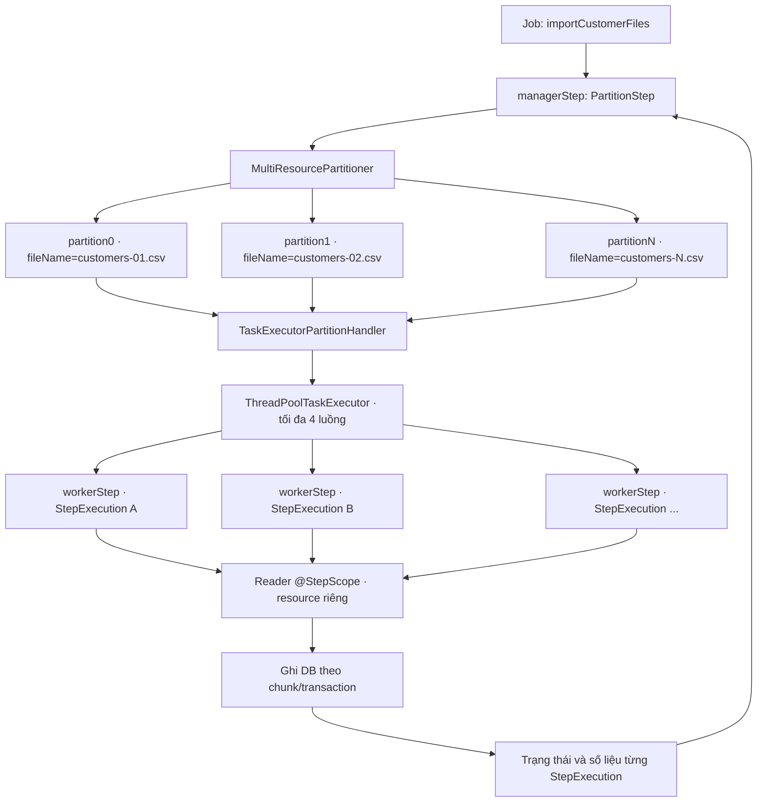

# Partition theo file trong Spring Batch

## 1. Partition theo file giải quyết bài toán gì?

Khi một Spring Batch job cần nhập hàng trăm file CSV, JSONL hoặc log mỗi ngày, cách xử lý tuần tự từng file sẽ khiến thời gian hoàn thành kéo dài dù CPU, ổ đĩa và hệ thống đích còn tài nguyên. **Partition theo file** chia tập input thành nhiều phần công việc độc lập; mỗi worker step đọc một file (hoặc một nhóm file), xử lý và ghi kết quả. Các worker có thể chạy đồng thời, còn Spring Batch theo dõi trạng thái của từng partition để hỗ trợ giám sát và restart.

Ví dụ: hệ thống nhận 12 file `customers-01.csv` đến `customers-12.csv`, mỗi file có 200.000 bản ghi. Với pool bốn thread, manager tạo 12 partition và thực thi tối đa bốn partition tại cùng thời điểm. Một worker chỉ mở file được giao; khi nó kết thúc, executor tiếp tục nhận file còn lại.

Bài học nằm trong phạm vi **File scaling** của module `SPRING_BATCH_SCALING_OPERATIONS`: mở rộng xử lý dữ liệu lớn bằng partitioning, đo bottleneck, kiểm soát thread safety, retry/restart và lựa chọn kiến trúc phù hợp tài nguyên thực tế.

Mục tiêu:

- Giải thích cách ánh xạ **file → `ExecutionContext` → worker `StepExecution`**.
- Cấu hình local partitioning với `MultiResourcePartitioner`, `TaskExecutor` và reader `@StepScope`.
- Phân biệt một worker xử lý một file với nhiều worker chia sẻ cùng một reader, cũng như phân biệt **nhiều file nhỏ** với **một file rất lớn**.
- Thiết kế input bất biến, ranh giới partition ổn định, ghi idempotent, restart và giám sát an toàn.

> **Phiên bản:** ví dụ Java sử dụng API **Spring Batch 5.x** với Spring Framework 6 và Java 17+. Spring Batch 6 có những thay đổi package/API, vì vậy cần đối chiếu tài liệu phiên bản thực tế trước khi chuyển mã.

## 2. Kiến trúc: mỗi file là một phần công việc

Trong **local partitioning**, `managerStep` là `PartitionStep` điều phối các worker trong cùng JVM. `Partitioner` trả về `Map<String, ExecutionContext>`: khóa là tên partition, giá trị chứa thông tin đầu vào cần thiết để chạy worker. `TaskExecutorPartitionHandler` dùng `TaskExecutor` để gọi cùng một định nghĩa `workerStep` với các `StepExecution` khác nhau.



Sơ đồ gom các worker vào cùng một hộp reader để biểu diễn **cùng cấu hình reader**; khi chạy thực tế, `@StepScope` cấp **instance riêng** cho từng `StepExecution`. Các worker không nên chia sẻ vị trí con trỏ đọc hay bộ đệm mutable.

| Thành phần | Trách nhiệm | Điều cần nhớ |
| --- | --- | --- |
| `Resource[]` | Danh sách file đã chọn cho job | Cố định danh sách cho cùng `JobInstance` khi cần restart |
| `MultiResourcePartitioner` | Tạo một `ExecutionContext` cho mỗi `Resource` | **Một file = một partition**; bỏ qua giá trị `gridSize` |
| `managerStep` | Khởi tạo/theo dõi các worker execution | Không trực tiếp đọc các dòng CSV |
| `TaskExecutorPartitionHandler` | Giao `workerStep` cho executor | Chạy cục bộ trong cùng JVM |
| `ThreadPoolTaskExecutor` | Giới hạn số worker chạy cùng lúc | Thread pool 4 ≠ chỉ tạo 4 partition |
| `FlatFileItemReader` `@StepScope` | Chỉ đọc file trong context của worker | Mỗi worker có reader và trạng thái restart riêng |
| `JdbcBatchItemWriter` | Ghi dữ liệu qua transaction của chunk | Phải xử lý khóa dữ liệu, duplicate và tính idempotent |

Giả sử hệ thống nạp ba file, `MultiResourcePartitioner` sẽ tạo các context tương tự:

| Step execution | `stepExecutionContext['fileName']` |
| --- | --- |
| `fileWorkerStep:partition0` | `file:/data/input/customers-01.csv` |
| `fileWorkerStep:partition1` | `file:/data/input/customers-02.csv` |
| `fileWorkerStep:partition2` | `file:/data/input/customers-03.csv` |

Đường dẫn trong bảng mang tính minh họa. Với `MultiResourcePartitioner`, giá trị `fileName` là URL của `Resource`; trên máy Windows, URL file có dạng phù hợp ổ đĩa Windows.

## 3. Ví dụ đầy đủ: nạp nhiều CSV vào database

### 3.1. Dữ liệu và điều kiện chuẩn bị

Mỗi file `customers-XX.csv` có cấu trúc:

```csv
id,fullName
1001,Nguyen Van A
1002,Tran Thi B
```

Bảng đích dùng để minh họa:

```sql
CREATE TABLE customer_import (
    customer_id BIGINT PRIMARY KEY,
    full_name VARCHAR(200) NOT NULL
);
```

Đặt các file đã **được ghi xong hoàn toàn** vào một thư mục input. Cấu hình pattern (tùy hệ điều hành):

```yaml
batch:
  input:
    pattern: "file:/data/input/customers-*.csv"
```

Ví dụ giả định ứng dụng Spring Boot đã cấu hình `DataSource`, `JobRepository` và `PlatformTransactionManager` cùng schema metadata Spring Batch. SQL `INSERT` chỉ phù hợp khi ID giữa các file không trùng và bảng chưa chứa ID đó. Phần vận hành ở dưới giải thích cách bổ sung upsert/idempotency cho production.

### 3.2. Cấu hình Java cho Spring Batch 5.x

```java
import java.io.IOException;
import java.net.MalformedURLException;
import java.util.Arrays;
import java.util.Comparator;
import javax.sql.DataSource;

import org.springframework.batch.core.Job;
import org.springframework.batch.core.Step;
import org.springframework.batch.core.configuration.annotation.StepScope;
import org.springframework.batch.core.job.builder.JobBuilder;
import org.springframework.batch.core.partition.support.MultiResourcePartitioner;
import org.springframework.batch.core.repository.JobRepository;
import org.springframework.batch.core.step.builder.StepBuilder;
import org.springframework.batch.item.database.JdbcBatchItemWriter;
import org.springframework.batch.item.database.builder.JdbcBatchItemWriterBuilder;
import org.springframework.batch.item.file.FlatFileItemReader;
import org.springframework.batch.item.file.builder.FlatFileItemReaderBuilder;
import org.springframework.beans.factory.annotation.Qualifier;
import org.springframework.beans.factory.annotation.Value;
import org.springframework.context.annotation.Bean;
import org.springframework.context.annotation.Configuration;
import org.springframework.core.io.Resource;
import org.springframework.core.io.UrlResource;
import org.springframework.core.io.support.ResourcePatternResolver;
import org.springframework.scheduling.concurrent.ThreadPoolTaskExecutor;
import org.springframework.transaction.PlatformTransactionManager;

@Configuration
public class FilePartitionJobConfig {

    public static final class Customer {
        private final long id;
        private final String fullName;

        public Customer(long id, String fullName) {
            this.id = id;
            this.fullName = fullName;
        }

        public long getId() {
            return id;
        }

        public String getFullName() {
            return fullName;
        }
    }

    @Bean
    public MultiResourcePartitioner filePartitioner(
            ResourcePatternResolver resolver,
            @Value("${batch.input.pattern}") String inputPattern) throws IOException {

        Resource[] files = resolver.getResources(inputPattern);
        if (files.length == 0) {
            throw new IllegalStateException("No input files: " + inputPattern);
        }

        // Thứ tự ổn định nếu tập file không thay đổi.
        Arrays.sort(files, Comparator.comparing(Resource::getDescription));

        MultiResourcePartitioner partitioner = new MultiResourcePartitioner();
        partitioner.setResources(files);
        partitioner.setKeyName("fileName");
        return partitioner;
    }

    @Bean
    @StepScope
    public FlatFileItemReader<Customer> customerFileReader(
            @Value("#{stepExecutionContext['fileName']}") String fileUrl)
            throws MalformedURLException {

        return new FlatFileItemReaderBuilder<Customer>()
                .name("customerFileReader")
                .resource(new UrlResource(fileUrl))
                .encoding("UTF-8")
                .linesToSkip(1)
                .strict(true)
                .saveState(true)
                .delimited()
                .names("id", "fullName")
                .fieldSetMapper(fs -> new Customer(
                        fs.readLong("id"),
                        fs.readString("fullName")))
                .build();
    }

    @Bean
    public JdbcBatchItemWriter<Customer> customerWriter(DataSource dataSource) {
        return new JdbcBatchItemWriterBuilder<Customer>()
                .dataSource(dataSource)
                .sql("INSERT INTO customer_import(customer_id, full_name) "
                        + "VALUES (:id, :fullName)")
                .beanMapped()
                .build();
    }

    @Bean
    public Step fileWorkerStep(
            JobRepository jobRepository,
            PlatformTransactionManager transactionManager,
            FlatFileItemReader<Customer> customerFileReader,
            JdbcBatchItemWriter<Customer> customerWriter) {

        return new StepBuilder("fileWorkerStep", jobRepository)
                .<Customer, Customer>chunk(500, transactionManager)
                .reader(customerFileReader)
                .writer(customerWriter)
                .build();
    }

    @Bean
    public ThreadPoolTaskExecutor filePartitionExecutor() {
        ThreadPoolTaskExecutor executor = new ThreadPoolTaskExecutor();
        executor.setCorePoolSize(4);
        executor.setMaxPoolSize(4);
        executor.setQueueCapacity(32);
        executor.setThreadNamePrefix("file-partition-");
        return executor;
    }

    @Bean
    public Step fileManagerStep(
            JobRepository jobRepository,
            MultiResourcePartitioner filePartitioner,
            @Qualifier("fileWorkerStep") Step fileWorkerStep,
            @Qualifier("filePartitionExecutor")
            ThreadPoolTaskExecutor filePartitionExecutor) {

        return new StepBuilder("fileManagerStep", jobRepository)
                .partitioner("fileWorkerStep", filePartitioner)
                .step(fileWorkerStep)
                .gridSize(4)
                .taskExecutor(filePartitionExecutor)
                .build();
    }

    @Bean
    public Job importCustomerFiles(
            JobRepository jobRepository,
            @Qualifier("fileManagerStep") Step fileManagerStep) {

        return new JobBuilder("importCustomerFiles", jobRepository)
                .start(fileManagerStep)
                .build();
    }
}
```

### 3.3. Giải thích các liên kết quan trọng

1. `filePartitioner` lấy danh sách file từ `ResourcePatternResolver`, sắp xếp để thứ tự ổn định và cấu hình `MultiResourcePartitioner`. Mỗi file trở thành một partition với khóa `fileName`.
2. `fileManagerStep` định danh delegate bằng `.partitioner("fileWorkerStep", ...)` và `.step(fileWorkerStep)`. Builder tự tạo handler local sử dụng executor đã chọn.
3. `customerFileReader` dùng `@StepScope` và late binding: biểu thức `#{stepExecutionContext['fileName']}` trả về URL của file thuộc partition đang chạy. `UrlResource` mở chính URL đó.
4. `fileWorkerStep` xử lý theo chunk 500 item. Mỗi chunk chạy với transaction của `PlatformTransactionManager`; `JdbcBatchItemWriter` thực hiện batch insert vào cơ sở dữ liệu.
5. `filePartitionExecutor` giới hạn song song tối đa bốn worker. Với 12 file, có 12 `StepExecution`, còn tối đa bốn worker được chạy cùng lúc.

**Hai con số rất dễ nhầm:** `gridSize(4)` không cắt danh sách file thành bốn phần khi dùng `MultiResourcePartitioner`: lớp này **bỏ qua `gridSize`** và tạo một partition cho mỗi resource. Chính cấu hình thread pool mới quyết định mức đồng thời. Nếu có 500 file rất nhỏ, việc tạo 500 partition có thể gây overhead metadata/khởi tạo lớn; khi đó cân nhắc một custom `Partitioner` gom các file thành nhóm, mỗi partition sử dụng `MultiResourceItemReader` hoặc cơ chế đọc nhiều file riêng biệt.

**Vì sao không chia sẻ reader singleton?** `FlatFileItemReader` là reader có trạng thái (file hiện tại, số item đã đọc, vị trí restart), không thread-safe. `@StepScope` tạo instance riêng cho từng worker, trong khi `JdbcBatchItemWriter` được thiết kế thread-safe sau khi cấu hình xong nên có thể dùng chung giữa các transaction đồng thời. Không đặt `@StepScope` trực tiếp lên bean `Step`.

### 3.4. Nếu cần cấu hình `TaskExecutorPartitionHandler` tường minh

Cách dùng `.step(...).taskExecutor(...)` ở trên phù hợp khi chỉ cần local partitioning. Khi cần khởi tạo handler độc lập, có thể thay phần cấu hình manager bằng:

```java
@Bean
public TaskExecutorPartitionHandler filePartitionHandler(
        @Qualifier("fileWorkerStep") Step workerStep,
        @Qualifier("filePartitionExecutor") ThreadPoolTaskExecutor executor) {
    TaskExecutorPartitionHandler handler = new TaskExecutorPartitionHandler();
    handler.setStep(workerStep);
    handler.setTaskExecutor(executor);
    handler.setGridSize(4);
    return handler;
}

@Bean
public Step fileManagerStep(
        JobRepository jobRepository,
        MultiResourcePartitioner partitioner,
        TaskExecutorPartitionHandler handler) {
    return new StepBuilder("fileManagerStep", jobRepository)
            .partitioner("fileWorkerStep", partitioner)
            .partitionHandler(handler)
            .build();
}
```

Đoạn thay thế trên cần import `org.springframework.batch.core.partition.support.TaskExecutorPartitionHandler` và **chỉ dùng thay thế** hai bean liên quan trong ví dụ chính, không đăng ký đồng thời hai bean `fileManagerStep`. Khi đã truyền handler tường minh qua `.partitionHandler(handler)`, cấu hình executor và delegate phải nằm trên chính handler.

## 4. Chọn chiến lược partition theo loại workload

Không phải workload file nào cũng hưởng lợi từ cách một file = một partition:

| Tình huống | Chiến lược phù hợp | Lưu ý |
| --- | --- | --- |
| 20–200 file độc lập, kích thước tương đương | `MultiResourcePartitioner`, một file/worker execution | Dễ tách trạng thái, retry và giám sát |
| Hàng chục nghìn file rất nhỏ | Gom nhiều file vào mỗi partition, có thể đọc nhóm qua `MultiResourceItemReader` | Giảm số `StepExecution`, tránh chi phí metadata |
| Một file CSV 100 GB | Tách trước thành nhiều file hợp lệ; hoặc tự xây partitioner có ranh giới record | `MultiResourcePartitioner` không tự chia *một file* thành nhiều phần |
| File nén `.gz` duy nhất | Nén từng shard độc lập hoặc tách và xử lý từng shard | Không tùy tiện seek theo byte trong gzip thường |
| File đích phải là một file duy nhất | Mỗi worker ghi file tạm riêng, sau đó merge khi các worker hoàn thành | Không để nhiều writer đồng thời ghi chung file |
| Dữ liệu nằm ở các node khác nhau / quá tải một máy | Remote partitioning với worker phân tán và nơi lưu file dùng chung | Cần vận hành message broker, worker, storage và idempotency |

`MultiResourceItemReader` **không tự làm cho nhiều file chạy song song**; nó là reader tuần tự qua một danh sách resource trong phạm vi một step execution. Khi ghép với một `Partitioner` gom file thành nhóm, mỗi worker có thể dùng một `MultiResourceItemReader` riêng cho nhóm của mình. Ngược lại, một `MultiResourceItemReader` duy nhất trong một step thông thường chỉ đọc các file nối tiếp.

### Một file lớn: vì sao chia theo byte khó hơn chia theo file?

Muốn chia một file thành các khoảng `[startByte, endByte)`, bạn phải xác định **ranh giới record thật**. Với văn bản UTF-8, một vị trí byte bất kỳ có thể rơi giữa ký tự nhiều byte. Với CSV có dấu nháy và xuống dòng trong trường dữ liệu, ký tự newline không nhất thiết kết thúc record. Cần xử lý thêm header, BOM, CRLF, dữ liệu lỗi và offset checkpoint.

Vì vậy, ưu tiên **pre-split file theo record hợp lệ** thành các shard có checksum/manifest, rồi chạy một file = một partition. Chỉ xây reader đọc từng khoảng byte khi biết chắc định dạng cho phép truy cập ngẫu nhiên và đã có bộ lập chỉ mục ranh giới record. Với JSON array hoặc gzip đơn khối, thường phải chọn giải pháp streaming/chia shard khác, không cắt byte cơ học.

## 5. Thread safety, I/O và điều chỉnh hiệu năng

Partitioning giúp scale khi các file độc lập, nhưng throughput vẫn có giới hạn bởi tài nguyên:

- **Thread:** Pool bốn thread cho phép tối đa bốn `StepExecution` chạy đồng thời; các partition còn lại chờ trong executor. Không đồng nghĩa mỗi worker có một CPU core riêng.
- **Reader:** Mỗi worker có file handle và state riêng nhờ `@StepScope`. Tránh chia sẻ parser, `StringBuilder`, buffer hoặc bộ đếm mutable giữa các partition nếu chưa kiểm soát đồng bộ.
- **Writer và DB:** `JdbcBatchItemWriter` dùng chung an toàn sau khởi tạo, nhưng các câu SQL đồng thời vẫn phải cạnh tranh connection pool, WAL, index và lock. Không nên tăng số thread vượt xa số connection có thể phục vụ ổn định.
- **Ổ đĩa / network:** Nhiều file đọc cùng lúc có thể tốt cho object storage có băng thông lớn, nhưng có thể làm tăng seek hoặc nghẽn IOPS ở ổ cứng truyền thống hoặc filesystem chia sẻ.
- **Kích thước file lệch nhau:** Nếu 11 file nhỏ và 1 file cực lớn, các worker sẽ nhàn rỗi khi file lớn cuối cùng còn chạy. Có thể chia file lớn thành shard hoặc sắp lịch file lớn trước để giảm đuôi thời gian.
- **Chunk size:** `chunk(500)` là điểm xuất phát để đo. Chunk lớn giảm chi phí transaction/round-trip nhưng tăng bộ nhớ và lượng công việc phải replay khi transaction lỗi.

Công thức trực giác về thời gian kết thúc là:

```text
Tổng thời gian ≈ thời gian khởi tạo/điều phối
               + thời gian worker chậm nhất trên lịch chạy
               + thời gian tranh chấp ở DB, disk hoặc network
```

Không giả định rằng bốn worker luôn nhanh hơn một worker bốn lần. Hãy đo throughput (records/s, MB/s), thời gian từng partition, thời gian chờ connection, CPU, IO wait, read latency, write latency và số transaction rollback trên cùng một tập dữ liệu.

Một quy trình benchmark thực tế: chạy với `corePoolSize` 1, 2, 4 rồi 8; giữ nguyên input snapshot, schema/index và chunk size. Sau mỗi lần, so sánh **wall-clock time của toàn job** và p95 duration của các partition, đồng thời kiểm tra saturation ở DB và filesystem. Dừng tăng thread khi tổng throughput không còn cải thiện hoặc lỗi tranh chấp tăng.

## 6. Restart, retry và tính nhất quán của file

### 6.1. Danh sách file phải ổn định trong một `JobInstance`

Spring Batch lưu metadata của từng worker `StepExecution` trong `JobRepository`. Khi restart **cùng `JobInstance`**, các partition đã hoàn tất có thể được bỏ qua, các partition chưa hoàn tất được chạy lại theo trạng thái đã lưu. Tuy nhiên, điều này chỉ đáng tin khi **tên partition và file được gán cho tên đó không đổi**.

Ví dụ danh sách ban đầu:

```text
partition0 -> customers-01.csv   COMPLETED
partition1 -> customers-02.csv   FAILED
partition2 -> customers-03.csv   COMPLETED
```

Nếu trước lúc restart có người thêm `customers-00.csv` vào thư mục rồi ứng dụng quét lại, cách đặt tên theo chỉ số có thể dịch toàn bộ ánh xạ. `partition0` lúc này có thể trỏ sang file mới nhưng metadata cũ đã `COMPLETED`. Đây là lỗi thiết kế nguy hiểm: dữ liệu mới có thể không được xử lý hoặc dữ liệu cũ bị lặp.

**Nguyên tắc vận hành:**

1. Chỉ nhận file đã hoàn thành và khóa tập input theo một **manifest/snapshot** cố định, chẳng hạn gắn với `batchId`/`JobParameters`; lưu danh sách đường dẫn, kích thước và checksum hoặc version/ETag khi phù hợp.
2. Giữ nguyên nội dung, vị trí và thứ tự gán file–partition trong mọi lần restart của cùng `JobInstance`. Nếu danh sách thay đổi, tạo một job instance mới sau khi xác định rõ dữ liệu cần xử lý.
3. Không tự động xóa/move file gốc ngay sau khi một worker thành công nếu các worker khác còn cần restart. Chỉ archive/cleanup bằng step hậu xử lý hoặc quy trình riêng sau khi toàn job thành công.
4. Đảm bảo file đầu vào không bị ghi nối tiếp trong lúc worker đọc; có thể tải về file tạm, xác nhận checksum rồi atomic rename vào thư mục ready.

Ví dụ Java ở mục 3 sắp xếp danh sách đã quét, nhưng **chỉ sắp xếp là chưa đủ để bảo vệ restart** nếu tập file thay đổi. Với production, truyền một danh sách file cố định từ manifest thay cho quét glob mới ở mỗi lần chạy.

### 6.2. Checkpoint và dữ liệu ghi ra

`FlatFileItemReader` được cấu hình `saveState(true)`, nên mỗi worker lưu tiến độ đọc vào `ExecutionContext` của step. Với chunk-oriented step, trạng thái reader và transaction được checkpoint theo tiến độ commit. Khi restart, worker có thể tiếp tục từ vị trí đã commit (trong điều kiện file không đổi và metadata nhất quán).

Transaction của worker A không bao trùm worker B. Nếu A đã commit và B lỗi, không có rollback toàn cục tự động cho các transaction của A. Database writer phải có cách xử lý khi job được chạy lại, khi các dòng trùng giữa hai file hoặc khi một transaction đã thực hiện nhưng trạng thái cuối cùng không được ghi nhận như mong đợi.

Ví dụ `INSERT` với `PRIMARY KEY` cố tình làm lộ duplicate. Trong hệ thống thực, hãy lựa chọn rõ một trong các chính sách: upsert theo khóa nghiệp vụ, ghi vào staging theo `(batchId, fileId, rowId)` rồi merge, hoặc từ chối trùng với báo cáo đối soát. Câu lệnh upsert phụ thuộc hệ quản trị CSDL, nên không mặc định áp dụng một cú pháp SQL cho mọi hệ.

### 6.3. Retry và skip lỗi có chọn lọc

- Lỗi tạm thời từ mạng/DB như timeout có thể cấu hình `faultTolerant().retry(...)` với giới hạn số lần và backoff phù hợp; cần phân biệt lỗi có thể phục hồi với lỗi dữ liệu.
- Bản ghi CSV sai định dạng, thiếu cột, sai mã hóa hoặc khóa ID trùng là lỗi nghiệp vụ/dữ liệu; chỉ `skip(...)` nếu có chính sách ghi nhận dòng lỗi, giới hạn skip và kế hoạch xử lý bổ sung.
- Với tác vụ ngoài transaction DB (upload file, gửi thông báo, gọi API), framework không đảm bảo exactly-once end-to-end. Cần khóa idempotency, outbox hoặc cơ chế reconciliation.
- Không chia sẻ một file output giữa nhiều `FlatFileItemWriter` không được cô lập. Nếu cần xuất file, đặt tên file tạm riêng theo partition và hợp nhất sau khi tất cả worker hoàn thành.

## 7. Kiểm tra job và điều tra lỗi

### 7.1. Kiểm tra chức năng

Chuẩn bị ba file input cố định (mỗi file có header, ID không trùng), chạy job và quan sát:

1. Metadata xuất hiện `fileManagerStep` và các worker `fileWorkerStep:partition0`, `fileWorkerStep:partition1`, `fileWorkerStep:partition2`.
2. Mỗi worker mở đúng một file; tổng `READ_COUNT` bằng số dòng dữ liệu của ba file, không tính ba dòng header; `WRITE_COUNT` bằng số bản ghi được ghi thành công.
3. Số bản ghi trong `customer_import` bằng tổng số ID hợp lệ không trùng; không thiếu hay nhân đôi dữ liệu.
4. Chạy với 1 và 4 thread; kết quả dữ liệu phải như nhau. Chỉ kỳ vọng thời gian giảm khi tài nguyên đích cho phép.
5. Gây lỗi DB tạm thời trong **môi trường thử nghiệm** khi một partition đang ghi, quan sát job failed, khôi phục dịch vụ DB rồi restart cùng `JobInstance` với input không đổi. Kiểm tra những partition `COMPLETED` được giữ lại và partition lỗi được xử lý theo chính sách restart.

Tham khảo truy vấn metadata (schema chuẩn Spring Batch 5.x):

```sql
SELECT STEP_NAME, STATUS, READ_COUNT, WRITE_COUNT,
       COMMIT_COUNT, ROLLBACK_COUNT
FROM BATCH_STEP_EXECUTION
WHERE JOB_EXECUTION_ID = :jobExecutionId
ORDER BY STEP_NAME;
```

Để xác định **file nào thuộc partition**, đọc `StepExecutionContext` tương ứng hoặc log có gắn tên step, tên file và `jobExecutionId`; tránh log toàn bộ PII trong dữ liệu CSV.

### 7.2. Các lỗi thường gặp

| Triệu chứng | Nguyên nhân có thể | Hướng xử lý |
| --- | --- | --- |
| Không có partition nào | Pattern glob không khớp file, đường dẫn/quyền đọc sai | Fail fast khi không có file; kiểm tra path, URI, quyền và môi trường chạy |
| Mọi worker đọc cùng một file | Reader singleton hoặc gán resource trực tiếp theo cấu hình global | Dùng `@StepScope` và `#{stepExecutionContext['fileName']}` |
| Có 20 file nhưng chỉ bốn worker chạy đồng thời | Pool giới hạn bốn thread | Đây là hành vi dự kiến, không phải lỗi của `gridSize` |
| `gridSize(4)` nhưng có 20 partition | `MultiResourcePartitioner` bỏ qua `gridSize` | Dùng custom partitioner để gom file nếu số partition quá nhiều |
| Job restart đọc nhầm/bỏ sót file | Danh sách đầu vào hoặc thứ tự file đã thay đổi | Freeze manifest và gắn partition với file ổn định |
| Job đọc trùng hoặc lỗi duplicate key | File trùng dữ liệu, job chạy lại, write không idempotent | Áp dụng unique key/upsert/staging và đối soát |
| Chạy song song lại chậm | DB connection pool, index, lock hoặc disk đã bão hòa | Đo bottleneck, giảm thread hoặc chỉnh chunk/pool |
| File lớn chạy rất lâu dù worker khác xong | Kích thước file lệch nhau | Split shard hợp lệ, cân bằng kích thước, ưu tiên file lớn |
| File CSV chứa newline trong chuỗi bị parse sai | Tokenizer/record separator không hỗ trợ cấu trúc input | Dùng parser hỗ trợ CSV multiline/quote, kiểm thử định dạng thực |

## 8. Lựa chọn kiến trúc theo mức độ mở rộng

Với workload có nhiều file độc lập và tải vừa, local partitioning là lựa chọn đơn giản: quản lý một JVM, một `JobRepository`, một pool và hệ file mà worker truy cập được. Khi số file tăng, trước tiên nên đo IO/DB, gom file nhỏ, chia file lớn hợp lệ và quản lý manifest. Chuyển sang **remote partitioning** chỉ khi một máy không đủ CPU, memory, IO hoặc yêu cầu cách ly tải; khi đó phải đảm bảo mọi worker nhìn thấy input cùng phiên bản và kết quả ghi idempotent.

Một thiết kế file scaling đáng tin cần đồng thời trả lời bốn câu hỏi: **mỗi worker đọc file nào, file đó có bất biến trong quá trình chạy/restart không, kết quả ghi có thể lặp an toàn không, và điểm nghẽn thật nằm ở đâu?** Trả lời rõ bốn câu hỏi này giúp dùng partitioning để tăng throughput mà vẫn giữ dữ liệu và lịch sử job nhất quán.

### Tài liệu tham khảo

- [Spring Batch 5.2 Reference — Scaling and Parallel Processing](https://docs.spring.io/spring-batch/reference/5.2/scalability.html).
- [Spring Batch 5.2 API — MultiResourcePartitioner](https://docs.spring.io/spring-batch/docs/5.2.6/api/org/springframework/batch/core/partition/support/MultiResourcePartitioner.html).
- [Spring Batch 5.2 Reference — Late Binding of Job and Step Attributes](https://docs.spring.io/spring-batch/reference/5.2/step/late-binding.html).
- [Spring Batch 5.2 Reference — FlatFileItemReader](https://docs.spring.io/spring-batch/reference/5.2/readers-and-writers/flat-files/file-item-reader.html).
- [Spring Batch 5.2 API — JdbcBatchItemWriter](https://www.springframework.org/spring-batch/docs/5.2.3/api/org/springframework/batch/item/database/JdbcBatchItemWriter.html).
