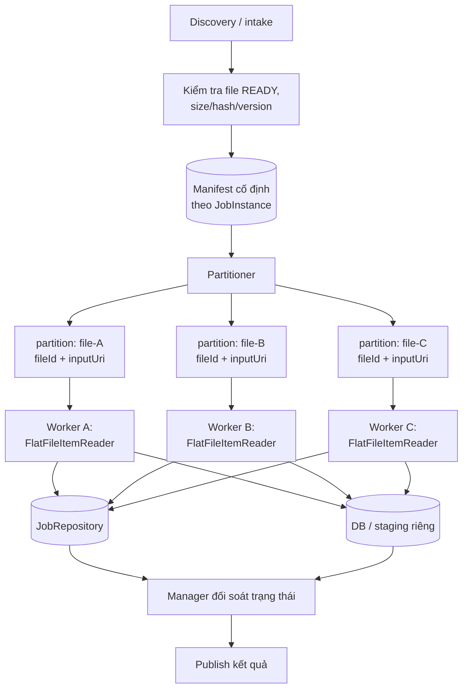
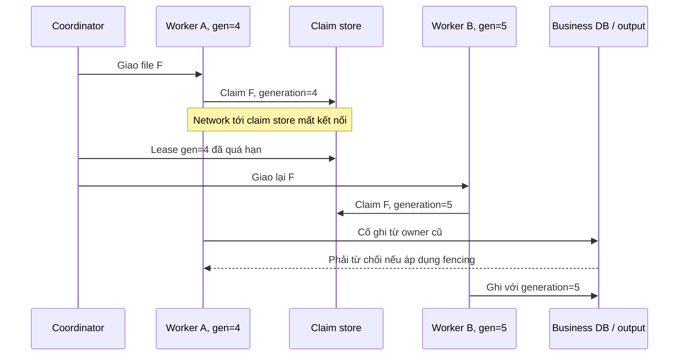
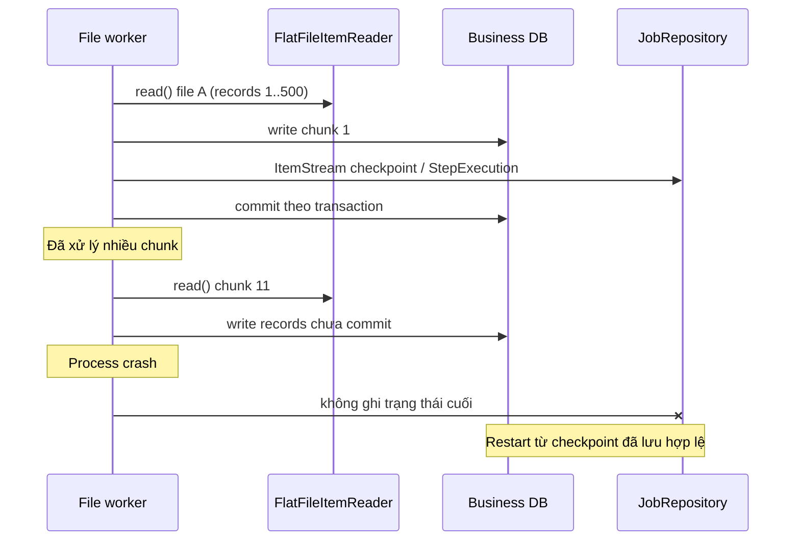

# File ownership giữa worker

## 1. Vấn đề: chia nhiều worker nhưng ai được quyền xử lý file?

Trong chương **File scaling** thuộc module **SPRING_BATCH_SCALING_OPERATIONS**, chúng ta cần mở rộng Spring Batch cho workload dữ liệu lớn bằng multi-threaded step, parallel steps, partitioning và những mô hình phân tán phù hợp. Đối với dữ liệu dạng file, quyết định quan trọng không chỉ là **chạy bao nhiêu worker** mà còn là **worker nào sở hữu file nào, trong khoảng thời gian nào, và chuyện gì xảy ra khi worker bị lỗi**.

Giả sử mỗi đêm hệ thống nhận 800 file CSV, mỗi file từ vài MB tới vài GB. Ta chạy 16 worker để parse, validate và nhập dữ liệu vào database. Nếu cả 16 worker cùng quét thư mục rồi tùy ý mở những file có đuôi `.csv`, những sự cố sau có thể xảy ra:

- Hai worker đọc cùng một file, tạo **bản ghi trùng** ở đích.
- Một worker đang xử lý nhưng worker khác đổi tên hoặc xóa file, khiến checkpoint không thể restart.
- Hai writer mở cùng một file output, ghi xen dòng hoặc làm hỏng nội dung.
- Worker crash sau khi commit dữ liệu nhưng trước khi thông báo hoàn thành; supervisor giao lại file mà không kiểm tra kết quả cũ.
- Việc quét thư mục ở lần restart thấy danh sách file khác lần đầu, làm partition name và trạng thái lưu trong `JobRepository` không còn khớp.

**File ownership** là hợp đồng xác định **một phần việc logic gắn với file hoặc một vùng byte/bản ghi** được giao cho owner nào, tránh các owner không hợp lệ cùng gây tác dụng phụ. Trong Spring Batch, `Partitioner` và `StepExecution` giúp chia việc và checkpoint; nhưng nếu triển khai qua nhiều JVM/broker, ứng dụng vẫn phải thiết kế **claim, retry, idempotency và công bố kết quả** phù hợp.

### Mục tiêu học tập

Sau bài này, bạn có thể:

1. Phân biệt **input ownership**, **output ownership**, **ownership của partition/attempt** và **quyền publish kết quả**.
2. Thiết kế **manifest bất biến** cho một `JobInstance` để phân phối file cho worker mà không quét lại tùy tiện.
3. Cấu hình local partitioning với một `FlatFileItemReader` `@StepScope` cho từng file trong Spring Batch 5.x.
4. Giải thích vì sao `gridSize`, pool size, partition count và số file thực tế không nhất thiết bằng nhau.
5. Dùng claim/lease/fencing để hạn chế việc xử lý trùng khi remote worker crash hoặc message được phát lại.
6. Bảo vệ file output bằng tên riêng, staging, kiểm tra checksum và publish sau khi toàn bộ job hợp lệ.
7. Xử lý checkpoint/restart, file đầu vào thay đổi, file lớn cần chia record range và những giới hạn của filesystem/object storage.
8. Đo backlog, thời gian từng file, retry/duplicate, I/O throughput và chi phí metadata để chọn kiến trúc thực tế.

> **Nguyên tắc:** Một file chỉ nên có **một owner có quyền ghi kết quả cho một phần việc tại một thời điểm**, trừ khi hệ thống cố ý chia file thành những vùng độc lập với quy tắc record boundary rõ ràng. **Không nhận được heartbeat hoặc reply không chứng minh owner cũ đã ngừng.**

## 2. Ba kiểu ownership phải phân biệt

| Kiểu | Tài nguyên được sở hữu | Tác dụng | Rủi ro nếu nhầm |
| --- | --- | --- | --- |
| **Input file ownership** | Một file/version hoặc range dữ liệu cần đọc | Chỉ worker được giao xử lý phần đầu vào đó | Hai worker đọc trùng, không xác định checkpoint |
| **Output file ownership** | Đường dẫn/file tạm mà một worker ghi | Tránh nhiều writer cùng mở file và ghi đè | File hỏng, lost update, đè checkpoint |
| **Publish ownership** | Quyền chuyển staging thành kết quả chính thức | Không công bố dữ liệu chưa đầy đủ | File cuối xuất hiện khi một số worker còn lỗi |

Ngoài ra còn có **execution ownership**: `StepExecution` hiện tại thuộc lần chạy nào, `JobInstance` nào và worker/attempt nào đang được phép thực thi. Một worker có thể đọc input mà không sở hữu đường dẫn output chung; một manager có thể có quyền công bố kết quả nhưng **không trực tiếp đọc từng dòng**.

### Ví dụ

```text
Input manifest (cố định):
  file A: orders-01.csv, version V1
  file B: orders-02.csv, version V7
  file C: orders-03.csv, version V2

Work assignment:
  partition:file-A -> worker JVM 1 -> read A -> DB / staging A
  partition:file-B -> worker JVM 2 -> read B -> DB / staging B
  partition:file-C -> worker JVM 1 -> read C -> DB / staging C

Publish:
  manager -> verify A + B + C -> publish manifest/result
```

Worker JVM 1 xử lý **hai file** nhưng không phải cùng lúc; mỗi file vẫn là **một phần việc có owner và checkpoint**. Nếu worker JVM 1 crash giữa file C, dữ liệu của A đã hoàn thành không tự rollback. File C cần khôi phục dựa trên metadata và kết quả đích.

## 3. Kiến trúc một file cho một partition

Chiến lược dễ quản lý nhất khi có nhiều file độc lập là **mỗi file một partition**, với một `ExecutionContext` chứa định danh file/version/URI.



Trong Spring Batch, manager `PartitionStep` dùng splitter và `PartitionHandler` để giao các worker `StepExecution`. Một worker step có cấu hình chung nhưng được tạo **trạng thái thực thi riêng** theo partition; `@StepScope` giúp reader nhận đúng file trong context của nó.

### 3.1. Những tham số khác nhau

| Đại lượng | Ví dụ | Nó quyết định điều gì? |
| --- | ---: | --- |
| File trong manifest | 800 | Số đơn vị dữ liệu đầu vào |
| Partition thực tế | 800 | Nếu partitioner trả **một partition/file** |
| `gridSize` | 32 | Gợi ý đưa cho partitioner; không tự bảo đảm 32 partition |
| Worker thread local | 16 | Số task có thể chạy đồng thời trong executor |
| Worker JVM remote | 4 | Số process có thể nhận task; còn phụ thuộc concurrency từng JVM |
| Chunk size | 500 | Nhịp xử lý/commit trong **mỗi** worker step |
| Open file handles | Tùy thực tế | Bị ảnh hưởng bởi reader/writer, worker concurrency và OS |

Nếu có 800 file nhưng chỉ 16 worker, **không cần mở 800 file cùng lúc**. Mỗi worker xử lý hết một partition rồi mới nhận phần việc kế tiếp. Tuy nhiên tạo 800 `StepExecution` và context có chi phí metadata; có thể nhóm nhiều file nhỏ thành mỗi partition một danh sách ổn định khi cần giảm overhead.

## 4. Manifest là hợp đồng cố định của JobInstance

Một nguồn sai rất phổ biến là `Partitioner` quét lại thư mục `/dropbox/*.csv` mỗi khi chạy hoặc restart. Nếu file mới xuất hiện, file cũ bị chuyển chỗ hoặc thứ tự listing thay đổi, cùng tên `partition3` có thể trỏ sang file khác, trong khi `JobRepository` vẫn giữ checkpoint cũ.

**Nên tách hai giai đoạn**:

1. **Discovery/intake:** xác định các file thực sự đã sẵn sàng, kiểm tra độ toàn vẹn, lập **manifest bất biến** cho kỳ chạy.
2. **Processing:** partitioner đọc **manifest của đúng `JobInstance`** để phát các partition ổn định; restart không chọn file mới tùy tiện.

Ví dụ một mục manifest:

```json
{
  "jobKey": "orders-2026-11-26-run01",
  "manifestVersion": 1,
  "fileId": "vendor-A/orders-001@sha256:7f3a...",
  "inputUri": "file:/data/ready/vendor-A/orders-001.csv",
  "sizeBytes": 15204381,
  "checksumSha256": "7f3a...",
  "recordFormat": "CSV_V1",
  "partitionName": "file_001",
  "state": "READY"
}
```

Giá trị hash được rút gọn chỉ để minh họa; triển khai thực phải dùng checksum đầy đủ. `jobKey` ở đây là định danh nghiệp vụ gắn với identifying parameters và manifest, **không thay thế** ID `JobInstance` do Spring Batch tạo.

### Một file có thể có nhiều định danh

| Định danh | Mục đích | Điều cần tránh |
| --- | --- | --- |
| `inputUri` | Chỉ nơi mở file | URI có thể được tái sử dụng cho nội dung mới |
| `fileId` | Định danh logic file của kỳ chạy | Không được thay đổi sau restart |
| `checksum/versionId` | Chứng minh phiên bản nội dung cụ thể | Không tự coi filename là content hash |
| `partitionName` | Khóa partition trong `StepExecution` | Không phụ thuộc thứ tự quét thư mục |
| `jobKey/manifestId` | Giữ tập input cố định | Không đưa file mới vào run đang lỗi cần restart |

**Không dùng basename đơn lẻ làm định danh toàn cục:** hai vendor có thể gửi cùng tên `data.csv`. Khóa tốt hơn thường gồm source, kỳ dữ liệu, file ID và version/hash. Với object storage có version ID, có thể lưu version ID; nếu hệ thống không bật versioning, cần staging/snapshot bất biến và checksum.

### Làm sao biết file đã READY?

- Producer upload vào **đường dẫn staging** rồi tạo completion marker hoặc publish metadata khi upload hoàn tất.
- Trên một filesystem hỗ trợ, producer có thể ghi file tạm rồi **rename trong cùng filesystem** trước khi đánh dấu READY.
- Với object storage, dùng object version/ETag/checksum và trạng thái hoàn tất upload; **không giả định rename là atomic** (thường là copy + delete).
- Kiểm tra size, checksum, format và quyền truy cập trước khi manager dispatch.
- Không dựa duy nhất vào “file size không thay đổi trong 5 giây” để coi file đã hoàn tất: producer có thể tạm ngừng lâu hơn.

Manifest nên được lưu bền vững ngoài `ExecutionContext` lớn, ví dụ bảng input manifest. `ExecutionContext` chỉ nên chứa **manifestId, fileId, URI/version** và checkpoint cần thiết; không chứa hàng nghìn URL, toàn bộ file bytes hoặc object lớn.

## 5. Input file ownership không chỉ là lock file

File lock ở mức hệ điều hành có thể hữu ích trong một số tình huống cục bộ, nhưng không nên coi nó là cách duy nhất để phân quyền batch phân tán:

- Lock cơ chế advisory/mandatory khác nhau theo OS và filesystem.
- Network filesystem có thể có ngữ nghĩa lock/lease riêng; crash/network partition khiến trạng thái khó suy đoán.
- Object storage không có `FileChannel.lock()` kiểu local filesystem.
- Một process đã mất lock vẫn có thể giữ buffer hoặc tiếp tục side effect ở database khác.
- Khóa file không gắn mặc định với `JobInstance`/`StepExecution` và restart metadata.

**Khuyến nghị:**

1. Dùng partition assignment và `JobRepository` để mô tả **công việc Batch**.
2. Với một cluster có nguy cơ dispatch trùng, dùng **claim/lease có tính atomic** ở hệ thống điều phối.
3. Khi cần chuyển ownership tự động mà worker cũ có thể còn chạy, sử dụng **fencing** hoặc cơ chế từ chối tác dụng phụ của owner cũ.
4. Bảo đảm dữ liệu đích xử lý an toàn việc phát lại bằng business key/idempotency.

Nếu tất cả worker chỉ **đọc một file bất biến**, việc nhiều worker mở file đọc có thể an toàn về mặt filesystem, nhưng **không đồng nghĩa nghiệp vụ cho phép xử lý cùng các record nhiều lần**. “Read-only file” không loại bỏ trách nhiệm phân vùng dữ liệu và dedup output.

## 6. Ví dụ Spring Batch 5.x: một file một StepExecution

Ví dụ giả định có ba file CSV đầu vào đã được xác nhận READY và lưu trong manifest của một `JobInstance`. Mỗi record gồm `orderId,amount`; worker đọc một file bằng `FlatFileItemReader` rồi ghi kết quả vào bảng PostgreSQL `imported_order(file_id, order_id, amount)`. Cặp `(file_id, order_id)` có ràng buộc unique/primary key.

**Điều kiện để chạy thực tế:**

- Java 17+, Spring Batch 5.x, Spring Framework tương thích.
- Đã cấu hình `JobRepository`, `PlatformTransactionManager` và `DataSource`.
- File phải có URI trỏ tới **cùng nội dung** mà worker đang chạy có quyền truy cập. `file:/data/...` ở manager có thể **không tồn tại** trên JVM remote nếu không có shared mount hoặc copy/lookup tương ứng.
- Với restart, ba file bên dưới được lấy từ **manifest đã chốt**, không quét lại thư mục; ví dụ hard-code chỉ để dễ học.
- File là UTF-8, có một dòng header, mỗi dòng dữ liệu chỉ gồm hai cột CSV đơn giản, **không có multiline quoted field**.

### 6.1. Partitioner từ manifest bất biến

```java
import java.util.LinkedHashMap;
import java.util.List;
import java.util.Map;

import org.springframework.batch.core.partition.support.Partitioner;
import org.springframework.batch.item.ExecutionContext;
import org.springframework.context.annotation.Bean;
import org.springframework.context.annotation.Configuration;

@Configuration
class FileOwnershipBatchConfig {

    record FileEntry(String partitionName, String fileId, String uri) {}
    record OrderRow(String fileId, String orderId,
                    java.math.BigDecimal amount) {}

    @Bean
    Partitioner fileManifestPartitioner() {
        // Production: nạp từ manifest của JobInstance trước khi partition.
        // Cùng JobInstance phải luôn có cùng danh sách và partitionName.
        List<FileEntry> frozenManifest = List.of(
            new FileEntry("file_001", "vendorA-001-v1",
                          "file:/data/ready/vendorA-001.csv"),
            new FileEntry("file_002", "vendorA-002-v1",
                          "file:/data/ready/vendorA-002.csv"),
            new FileEntry("file_003", "vendorB-001-v1",
                          "file:/data/ready/vendorB-001.csv")
        );

        return gridSize -> {
            Map<String, ExecutionContext> contexts =
                new LinkedHashMap<>();

            for (FileEntry entry : frozenManifest) {
                ExecutionContext ctx = new ExecutionContext();
                ctx.putString("fileId", entry.fileId());
                ctx.putString("inputUri", entry.uri());
                contexts.put(entry.partitionName(), ctx);
            }
            return contexts;
        };
    }
}
```

Ở ví dụ này, `gridSize` được nhận như tham số nhưng **không dùng để quyết định số partition**. Nếu manifest có ba file, partitioner trả ba context. Đây là hành vi hợp lệ của `Partitioner.partition(int)`: `gridSize` là **gợi ý**, còn map trả về mới xác định các partition thật.

Không nên gắn partition name với số thứ tự do `Files.list(...)` hoặc API object listing trả về ở mỗi lần chạy. Nếu manifest đã tồn tại thì dùng lại tên `file_001`, `file_002`... tương ứng đúng file như lần đầu. Đối với file name do bên ngoài cung cấp, cần chuẩn hóa/sinh partition key không có ký tự nguy hiểm và không collision.

### 6.2. Reader theo StepExecution, không chia sẻ cursor

```java
import org.springframework.batch.core.configuration.annotation.StepScope;
import org.springframework.batch.item.file.FlatFileItemReader;
import org.springframework.batch.item.file.builder.FlatFileItemReaderBuilder;
import org.springframework.beans.factory.annotation.Value;
import org.springframework.context.annotation.Bean;
import org.springframework.core.io.ResourceLoader;

@Bean
@StepScope
FlatFileItemReader<OrderRow> ownedFileReader(
        ResourceLoader resources,
        @Value("#{stepExecutionContext['inputUri']}") String inputUri,
        @Value("#{stepExecutionContext['fileId']}") String fileId) {

    return new FlatFileItemReaderBuilder<OrderRow>()
        .name("ownedFileReader")
        .resource(resources.getResource(inputUri))
        .strict(true)
        .encoding("UTF-8")
        .linesToSkip(1)
        .saveState(true)
        .delimited()
        .names("orderId", "amount")
        .fieldSetMapper(fields -> new OrderRow(
            fileId,
            fields.readString("orderId"),
            fields.readBigDecimal("amount")))
        .build();
}
```

Trong ví dụ, record `OrderRow` được khai báo ở phần cấu hình trước; khi tách code thành nhiều file Java, dùng class/record công khai hoặc import DTO tương ứng.

**Vì sao cần `@StepScope`?**

- Mỗi worker `StepExecution` có instance reader và cursor riêng.
- `inputUri`, `fileId` được *late-bind* từ context của chính partition.
- Reader có `ItemStream` và `saveState(true)` để ghi nhận vị trí đọc phục vụ restart.
- Không dùng một singleton `FlatFileItemReader` mutable cho nhiều thread/partition.

**Cảnh báo restart:** `saveState(true)` lưu tiến độ do reader hỗ trợ, nhưng không tự lưu lại toàn bộ nội dung file. Nếu file đổi, bị thay thế, xóa hoặc encoding/parser khác giữa hai lần chạy, checkpoint theo dòng có thể không còn nghĩa.

### 6.3. Writer vào database theo khóa nghiệp vụ

```java
import javax.sql.DataSource;
import org.springframework.batch.item.database.JdbcBatchItemWriter;
import org.springframework.batch.item.database.builder.JdbcBatchItemWriterBuilder;
import org.springframework.beans.factory.annotation.Bean;
import org.springframework.jdbc.core.namedparam.MapSqlParameterSource;

@Bean
JdbcBatchItemWriter<OrderRow> importedOrderWriter(
        DataSource dataSource) {
    return new JdbcBatchItemWriterBuilder<OrderRow>()
        .dataSource(dataSource)
        .sql("""
            INSERT INTO imported_order
                (file_id, order_id, amount)
            VALUES (:fileId, :orderId, :amount)
            ON CONFLICT (file_id, order_id)
            DO UPDATE SET amount = EXCLUDED.amount
            """)
        .itemSqlParameterSourceProvider(row ->
            new MapSqlParameterSource()
                .addValue("fileId", row.fileId())
                .addValue("orderId", row.orderId())
                .addValue("amount", row.amount()))
        .build();
}
```

Ví dụ SQL dùng PostgreSQL; bảng đích cần `PRIMARY KEY (file_id, order_id)` hoặc unique constraint tương ứng. Lệnh `ON CONFLICT` cho phép lặp lại việc ghi cùng khóa mà không tạo **hai hàng**, nhưng **không tự đúng nghiệp vụ** nếu file đầu vào có các version khác nhau hoặc dữ liệu bị thay đổi giữa hai attempts. Với dữ liệu tài chính, thường cần thêm `sourceVersion`/`businessDate` và đối soát thay vì luôn để “last writer wins”.

### 6.4. Worker Step và manager PartitionStep

```java
import org.springframework.batch.core.Job;
import org.springframework.batch.core.Step;
import org.springframework.batch.core.job.builder.JobBuilder;
import org.springframework.batch.core.repository.JobRepository;
import org.springframework.batch.core.step.builder.StepBuilder;
import org.springframework.batch.core.partition.support.Partitioner;
import org.springframework.batch.item.database.JdbcBatchItemWriter;
import org.springframework.batch.item.file.FlatFileItemReader;
import org.springframework.beans.factory.annotation.Qualifier;
import org.springframework.context.annotation.Bean;
import org.springframework.core.task.TaskExecutor;
import org.springframework.scheduling.concurrent.ThreadPoolTaskExecutor;
import org.springframework.transaction.PlatformTransactionManager;

@Bean
Step ownedFileWorker(
        JobRepository repository,
        PlatformTransactionManager transactionManager,
        FlatFileItemReader<OrderRow> ownedFileReader,
        JdbcBatchItemWriter<OrderRow> importedOrderWriter) {
    return new StepBuilder("ownedFileWorker", repository)
        .<OrderRow, OrderRow>chunk(500, transactionManager)
        .reader(ownedFileReader)
        .writer(importedOrderWriter)
        .build();
}

@Bean
TaskExecutor fileWorkerExecutor() {
    ThreadPoolTaskExecutor executor = new ThreadPoolTaskExecutor();
    executor.setCorePoolSize(4);
    executor.setMaxPoolSize(4);
    executor.setQueueCapacity(16);
    executor.setThreadNamePrefix("file-worker-");
    executor.initialize();
    return executor;
}

@Bean
Step ownedFileManager(
        JobRepository repository,
        @Qualifier("ownedFileWorker") Step worker,
        Partitioner fileManifestPartitioner,
        @Qualifier("fileWorkerExecutor") TaskExecutor executor) {

    return new StepBuilder("ownedFileManager", repository)
        .partitioner("ownedFileWorker", fileManifestPartitioner)
        .step(worker)
        .gridSize(8)
        .taskExecutor(executor)
        .build();
}

@Bean
Job ownedFileImportJob(
        JobRepository repository,
        @Qualifier("ownedFileManager") Step manager) {
    return new JobBuilder("ownedFileImportJob", repository)
        .start(manager)
        .build();
}
```

Đây là ví dụ **local partitioning** trong Spring Batch 5.x. Ba file tạo ba partition dù `gridSize=8`, và executor tối đa bốn thread nên không có nghĩa sẽ có tám worker đang chạy. Khi đưa sang remote partitioning, phải cấu hình remote handler, request/reply channel và triển khai worker step ở JVM khác.

**Quan trọng:** Đoạn code chỉ thực hiện **phân công file và nhập dữ liệu**. Nó chưa triển khai distributed claim/lease, manifest persistence, staged output, checksum, monitoring, transport hoặc quản trị files đã hoàn tất. Trong một JVM và chỉ một manager đang chạy hợp lệ, `PartitionStep` đã giúp chia `StepExecution` riêng; khi có duplicate delivery hoặc nhiều coordinator, cần phần ownership mở rộng ở mục tiếp theo.

## 7. Distributed claim: không để hai worker nhận cùng một file

Trong local partitioning, manager và `TaskExecutorPartitionHandler` điều phối các partition trong một JVM. Với remote partitioning qua broker, một request có thể bị gửi lại khi worker crash, mất ACK hoặc manager timeout. **Không nên chỉ tin rằng một request message luôn đến đúng một consumer đúng một lần**.

Một phương án là lưu **file work registry** bên ngoài schema Batch, có trạng thái và owner:

| Cột | Vai trò |
| --- | --- |
| `job_key` | Định danh nghiệp vụ cố định của run/manifest |
| `file_id` | File/version logic trong manifest |
| `input_uri` / `content_hash` | Đối chiếu nguồn bất biến |
| `state` | `READY`, `CLAIMED`, `PROCESSED`, `PUBLISHED` hoặc `QUARANTINED` |
| `owner_id` | Worker/process đang giữ claim |
| `generation` | Số thế hệ ownership tăng dần |
| `lease_expires_at` | Thời hạn lease theo đồng hồ của store |
| `updated_at` | Phục vụ chẩn đoán và cảnh báo |

### 7.1. Ví dụ PostgreSQL claim store

```sql
-- Bảng của ứng dụng, KHÔNG phải bảng BATCH_* chuẩn.
CREATE TABLE batch_file_work (
    job_key           TEXT NOT NULL,
    file_id           TEXT NOT NULL,
    input_uri         TEXT NOT NULL,
    content_hash      VARCHAR(64) NOT NULL,
    state             TEXT NOT NULL
        CHECK (state IN ('READY', 'CLAIMED',
                        'PROCESSED', 'PUBLISHED', 'QUARANTINED')),
    owner_id          TEXT,
    generation        BIGINT NOT NULL DEFAULT 0,
    lease_expires_at  TIMESTAMPTZ,
    updated_at        TIMESTAMPTZ NOT NULL DEFAULT CURRENT_TIMESTAMP,
    PRIMARY KEY (job_key, file_id)
);

CREATE INDEX batch_file_work_claimable_idx
    ON batch_file_work(state, lease_expires_at);
```

Khi lập manifest, ứng dụng chèn đúng một row/file/version cho `job_key`; không cấp hai file khác nội dung nhưng cùng `file_id` trong một run.

Một **claim nguyên tử** bằng PostgreSQL:

```sql
UPDATE batch_file_work
SET owner_id = :ownerId,
    generation = generation + 1,
    state = 'CLAIMED',
    lease_expires_at = CURRENT_TIMESTAMP + INTERVAL '90 seconds',
    updated_at = CURRENT_TIMESTAMP
WHERE job_key = :jobKey
  AND file_id = :fileId
  AND (
      state = 'READY'
      OR (state = 'CLAIMED'
          AND lease_expires_at < CURRENT_TIMESTAMP)
  )
RETURNING generation, input_uri, content_hash;
```

Ý nghĩa:

1. Chỉ **một** transaction có thể thành công theo điều kiện cập nhật khi tranh chấp cùng row tại một thời điểm.
2. Worker chỉ bắt đầu xử lý khi nhận được một row trả về và lưu `generation`.
3. Nếu không có row, phần việc đang được giữ bởi owner khác, đã hoàn thành hoặc không còn claimable: không xử lý tự phát.
4. Worker xác minh URI/version/hash của input khớp manifest trước khi đọc.
5. Lease hết hạn **không giết** worker cũ; nó chỉ cho phép coordinator **xem xét** chuyển quyền theo chính sách.

**Đây là minh họa cho PostgreSQL**, chưa phải một giao thức failover production hoàn chỉnh. Cần chiến lược phát hiện process còn sống, kiểm soát claim giữa nhiều coordinator, transaction, retry và fencing tại tài nguyên đích.

### 7.2. Gia hạn lease và từ chối heartbeat của owner cũ

```sql
UPDATE batch_file_work
SET lease_expires_at = CURRENT_TIMESTAMP + INTERVAL '90 seconds',
    updated_at = CURRENT_TIMESTAMP
WHERE job_key = :jobKey
  AND file_id = :fileId
  AND owner_id = :ownerId
  AND generation = :generation
  AND state = 'CLAIMED'
  AND lease_expires_at >= CURRENT_TIMESTAMP;
```

Nếu `rowsAffected=0`, worker **không được coi mình vẫn sở hữu file**. Hệ thống phải chuyển sang đường mất ownership có kiểm soát, ngăn side effect mới và phát cảnh báo.

### 7.3. Fencing: lease hết hạn vẫn có zombie worker



**Cảnh báo:** `generation` trong claim store **chỉ là một token**, chưa tự chặn worker A ghi vào DB hoặc file. Để fencing thực sự:

- Mỗi đường ghi quan trọng phải **kiểm tra generation hiện hành** tại nơi ghi hoặc qua một tài nguyên có atomic guard tương đương.
- Nếu business DB và claim store là cùng DB, có thể thiết kế transaction serialize ownership row với business write; phải kiểm tra concurrency/lock trong bản triển khai.
- Nếu ghi object storage hoặc API không hỗ trợ fencing, dùng idempotency, conditional write/version checks hoặc quy trình xác nhận owner cũ đã dừng trước failover.
- Response/notification từ attempt cũ không được phép thay thế kết quả của generation mới.

**Không dựa vào UUID attempt token đơn lẻ** để xác định owner mới hơn owner cũ: UUID phân biệt attempt nhưng không cho biết thứ tự generation.

### 7.4. Đánh dấu file đã xử lý

Sau khi worker xử lý xong, một bước cập nhật có điều kiện có thể chuyển `CLAIMED` sang `PROCESSED`:

```sql
UPDATE batch_file_work
SET state = 'PROCESSED',
    lease_expires_at = NULL,
    updated_at = CURRENT_TIMESTAMP
WHERE job_key = :jobKey
  AND file_id = :fileId
  AND owner_id = :ownerId
  AND generation = :generation
  AND state = 'CLAIMED';
```

Chỉ khi row count đúng kỳ vọng, dữ liệu nghiệp vụ và checkpoint phù hợp mới coi file đã xử lý thành công. Nếu business writer commit ở DB khác với claim update, hai trạng thái **có thể lệch khi crash**; cần reconcile và idempotency. `PROCESSED` cũng chưa nhất thiết nghĩa dữ liệu đã được **publish** cho người dùng cuối.

## 8. Output ownership: không cho nhiều worker ghi chung một file

`FlatFileItemWriter` hỗ trợ state/restart nhưng **không thread-safe khi nhiều thread cùng dùng một writer**. Ngay cả khi mỗi worker có instance riêng, nếu hai instance cùng trỏ vào **một đường dẫn file**, vẫn có nguy cơ truncate, append chen lẫn, header/footer sai và nội dung hỏng.

Thiết kế khuyến nghị:

```text
JobInstance: 2026-11-26/orders-import

Worker partition0:
    staging/orders-import/partition0/attempt-4.csv.tmp

Worker partition1:
    staging/orders-import/partition1/attempt-2.csv.tmp

Worker partition2:
    staging/orders-import/partition2/attempt-1.csv.tmp

Manager / finalizer:
    kiểm tra mọi partition COMPLETED
    kiểm tra checksum và business count
    publish manifest hoặc kết quả tổng
```

**Tách ba khái niệm**:

- `partitionName` xác định phần việc logic.
- `attempt/generation` xác định lần worker ghi file tạm.
- `finalOutputKey` xác định kết quả được công bố, không nên trỏ tới file đang được writer mở.

### 8.1. Tạo tên output theo context

```java
import org.springframework.batch.core.configuration.annotation.StepScope;
import org.springframework.batch.item.file.FlatFileItemWriter;
import org.springframework.batch.item.file.builder.FlatFileItemWriterBuilder;
import org.springframework.beans.factory.annotation.Value;
import org.springframework.context.annotation.Bean;
import org.springframework.core.io.FileSystemResource;

@Bean
@StepScope
FlatFileItemWriter<OrderRow> partitionOutputWriter(
        @Value("#{stepExecutionContext['outputPath']}") String outputPath) {

    return new FlatFileItemWriterBuilder<OrderRow>()
        .name("partitionOutputWriter")
        .resource(new FileSystemResource(outputPath))
        .encoding("UTF-8")
        .lineAggregator(row ->
            row.orderId() + "," + row.amount())
        .saveState(true)
        .shouldDeleteIfEmpty(true)
        .build();
}
```

Đây là **lựa chọn thay thế cho JDBC writer** ở mục 6 khi nghiệp vụ cần xuất file, không nên đồng thời dùng cả hai writer mà không có kế hoạch transaction/side-effect rõ ràng.

`outputPath` phải do **manifest/partition assignment đáng tin cậy** sinh ra; không nối trực tiếp path do input file khai báo nếu có nguy cơ path traversal (`../`), symlink, ghi đè tài liệu ngoài staging hoặc collision giữa hai partition.

**Cảnh báo restart file writer:** `saveState(true)` và khả năng restart của `FlatFileItemWriter` chỉ hoạt động đúng khi resource, writer name, checkpoint và cách quản lý file tương thích. Không tùy tiện bật `append(true)` hoặc `shouldDeleteIfExists(true)` để “sửa” lỗi mà chưa thử crash ở giữa chunk. File tạm của attempt mới và file cần resume của attempt cũ là **hai chiến lược khác nhau**; nếu chọn tên có generation mới thì phải quyết định dựng lại toàn file hay sao chép/phục hồi theo checkpoint một cách nhất quán.

### 8.2. Công bố file: atomic rename có điều kiện

Trên một filesystem nhất định, rename/move **trong cùng filesystem** có thể cung cấp thao tác chuyển tên gần như atomic hoặc hỗ trợ `ATOMIC_MOVE`. Nhưng:

- Không giả định filesystem/network share nào cũng hỗ trợ `ATOMIC_MOVE`.
- Atomic rename chỉ bảo vệ **tên file**, không tự chứng minh dữ liệu đã được flush/fsync và bền vững sau mất điện.
- Nếu cần durability cao, cân nhắc fsync file và thư mục theo khả năng OS/filesystem, rồi xác minh.
- Move giữa hai filesystem có thể là copy rồi delete, không atomic.
- Reader không nên nhìn thấy file `final` cho đến khi worker đã đóng file, xác minh checksum và manager đồng ý publish.

Ví dụ Java minh họa kiểm tra hỗ trợ atomic move:

```java
import java.nio.file.Files;
import java.nio.file.Path;
import java.nio.file.StandardCopyOption;

void publishSameFilesystem(Path staged, Path finalPath)
        throws java.io.IOException {
    // Chỉ gọi sau khi file staged đã đóng, verify và được phép publish.
    Files.move(
        staged,
        finalPath,
        StandardCopyOption.ATOMIC_MOVE
    );
}
```

Nếu filesystem không hỗ trợ, lệnh có thể ném `AtomicMoveNotSupportedException`. Không nên fallback âm thầm sang copy/move không atomic nếu consumer yêu cầu “file xuất hiện là đã đầy đủ”. Thiết kế publish bằng manifest/ready marker hoặc chuyển dữ liệu tới nơi có thể đảm bảo contract cần thiết.

### 8.3. Object storage: staging + manifest/pointer thay vì giả định rename

Đối với S3-compatible hoặc object store:

1. Worker upload tới **key staging riêng**, tốt nhất immutable theo attempt.
2. Xác minh complete upload, size, checksum/version ID theo khả năng provider.
3. Manager chỉ chọn các **successful attempt** có trạng thái chính xác.
4. Publish **manifest phiên bản** hoặc cập nhật pointer/index theo conditional write nếu provider hỗ trợ.
5. Consumer chỉ đọc tập key được liệt kê trong manifest đã publish.
6. Dọn staging cũ theo retention sau khi hết cửa sổ restart/audit.

Không nên định nghĩa “rename object” như một thao tác file POSIX atomic. Với nhiều object output, **publish manifest** thường rõ ràng và dễ kiểm toán hơn việc coi hàng loạt upload là một transaction.

## 9. Restart: file owner cũ đã làm gì trước khi crash?

### 9.1. Crash trong quá trình đọc file

Giả sử worker đọc file A chứa 10.000 record, chunk size 500; mười chunk đầu đã commit, chunk thứ 11 đang ghi:



Nếu metadata và business write thuộc **cùng transaction phù hợp**, giao dịch chưa commit thường rollback cùng checkpoint của chunk. Khi restart, reader quay lại trạng thái gần nhất đã lưu, và chunk chưa commit được thực hiện lại.

Nếu metadata và business database dùng **hai transaction manager độc lập**, có cửa sổ lỗi: dữ liệu đã commit nhưng checkpoint chưa lưu. Khi replay, writer cần idempotent. Với file output hoặc HTTP POST, side effect thường không tham gia một JDBC transaction chung nên yêu cầu chống trùng càng quan trọng.

### 9.2. Ma trận crash quanh file ownership

| Thời điểm lỗi | Điều chưa rõ | Hành động an toàn |
| --- | --- | --- |
| File chưa READY nhưng đã được quét | Producer có còn ghi file? | Không dispatch; yêu cầu marker/manifest đáng tin |
| Worker đã claim nhưng chưa mở file | Request có thật sự được nhận? | Kiểm tra owner, lease, process, broker |
| Worker đọc nửa file rồi crash | Checkpoint và output đã commit đến đâu? | Khôi phục từ context, kiểm tra file/version |
| Worker commit DB rồi crash trước reply | Manager đã thấy thành công chưa? | Đối chiếu DB và repository, không gửi lại mù |
| Worker mất heartbeat nhưng còn sống | Owner cũ có thể tiếp tục ghi? | Fencing hoặc xác minh đã dừng trước failover |
| Worker ghi file tạm rồi crash trước đóng | File tạm có thể thiếu footer/flush | Không publish, kiểm tra và resume/rebuild |
| Worker `COMPLETED` nhưng publish thất bại | Staging còn nguyên? | Retry **publish idempotent**, không xử lý lại input tùy tiện |
| Manager crash khi worker remote còn chạy | Worker cũ có thể đã tiếp tục commit | Xác minh ownership/StepExecution trước dispatch mới |
| File bị ghi đè cùng URI giữa restart | Checkpoint đang ứng với nội dung cũ | Từ chối resume, dùng immutable version/snapshot |

**Không sửa `BATCH_STEP_EXECUTION.STATUS` hoặc `VERSION` bằng SQL tùy ý để mở khóa restart**. Trước khi dùng đường recovery quản trị phù hợp phiên bản, phải xác minh tiến trình cũ không còn tác dụng phụ và metadata/dữ liệu đích đã được đối soát.

### 9.3. Tên partition và file version phải ổn định

`JobInstance` được định danh bởi tên job và identifying `JobParameters`. Khi restart cùng `JobInstance`:

- Dùng **cùng manifestId/version** và partition names.
- Mỗi partition được khôi phục với **cùng fileId, URI/version và format**.
- Các partition đã `COMPLETED` thường được bỏ qua theo cơ chế mặc định; phần thất bại/không hoàn tất được xem xét chạy lại.
- Không đổi `gridSize`/thuật toán group khiến `partition3` trỏ sang file mới khi checkpoint cũ còn tồn tại.
- Khi worker cũ còn `STARTED` sau crash, cần recovery metadata có kiểm soát trước khi restart hợp lệ.

**Process restart khác Batch restart.** Container được khởi động lại chỉ tạo một JVM mới; nó không tự chọn đúng `JobInstance` và khôi phục từng `StepExecution`.

## 10. Một file quá lớn: chia theo range có nghĩa là chia ownership

“Một file một partition” sẽ tạo *straggler* nếu một file 200 GB trong khi các file khác chỉ 100 MB. Có thể chia một file thành nhiều vùng dữ liệu, nhưng phải xác định **ranh giới bản ghi**.

### 10.1. Đơn vị sở hữu lúc này là range, không phải cả file

```text
File: events-2026-11-26.log (immutable)

partition0 -> bytes [0, 128 MiB)          -> record boundaries được điều chỉnh
partition1 -> bytes [128 MiB, 256 MiB)    -> record boundaries được điều chỉnh
partition2 -> bytes [256 MiB, 384 MiB)    -> record boundaries được điều chỉnh
partition3 -> bytes [384 MiB, end)        -> record boundaries được điều chỉnh
```

Nếu `partition1` bắt đầu ở byte 128 MiB giữa một dòng CSV, việc parse trực tiếp từ byte đó có thể tạo một record lỗi hoặc bỏ sót. Phải:

- Seek tới mốc byte rồi **tìm điểm bắt đầu record hợp lệ tiếp theo**.
- Định nghĩa quy tắc **nửa mở** `[start,end)` để tránh hai partition xử lý cùng record.
- Chỉ cho partition trước xử lý record bắt đầu trong vùng của nó theo quy tắc thống nhất.
- Xử lý BOM, CRLF, UTF-8 multibyte characters, line ending và header.
- Kiểm soát trường CSV có **newline bên trong dấu ngoặc kép**: tìm ký tự `\\n` không đủ để xác định record boundary.
- Với `gzip` thông thường hoặc format nén không hỗ trợ seek/split, chia byte tùy ý thường không khả thi; cân nhắc chia thành file nhỏ từ upstream, giải nén/staging hoặc format splittable.

**`FlatFileItemReader` mặc định không tự cung cấp thuật toán chia byte-range an toàn cho arbitrary CSV**. Nếu cần range-based reader, hãy xây dựng/test một reader có thể seek + parse đúng định dạng, hỗ trợ `ItemStream` và lưu checkpoint theo record boundary.

### 10.2. Khi nào không nên chia trong file?

- CSV có quoted multiline fields khó nhận diện boundary khi không parse toàn bộ.
- File đang được producer append, không có snapshot/version bất biến.
- File nén không hỗ trợ chia độc lập.
- Mỗi record phụ thuộc vào state của record trước đó hoặc thứ tự toàn cục.
- Dữ liệu có footer/trailer tổng hợp cần validate toàn file.

Trong những trường hợp đó, giải pháp đơn giản và đáng tin hơn thường là **split upstream thành nhiều file có manifest** hoặc dùng staging/schema trung gian, thay vì ép random-access concurrency.

## 11. MultiResourceItemReader, MultiResourcePartitioner và file ownership

Spring Batch có nhiều lựa chọn đọc nhiều file:

| Lựa chọn | Cách hoạt động | Điểm cần lưu ý |
| --- | --- | --- |
| `MultiResourceItemReader` | Một step đọc nhiều resource theo thứ tự | Không tự tạo một worker `StepExecution` cho mỗi file |
| `MultiResourcePartitioner` | Tạo partition context từ nhiều resource | Phải giữ resource list và naming ổn định cho restart |
| Custom `Partitioner` từ manifest | Quyết định file/group/range cụ thể, context rõ | Tự chịu trách nhiệm snapshot, naming và validation |
| Remote chunking | Manager đọc file và gửi chunk item sang worker | Reader/file ownership tập trung ở manager, worker không sở hữu file nguồn |
| Remote partitioning | Giao `StepExecution` với file URI/manifest cho worker | Worker phải truy cập được file phiên bản đúng, có duplicate/timeout policy |

Nếu có 20.000 file rất nhỏ, **một file một StepExecution** có thể làm JobRepository có quá nhiều metadata so với lượng công việc hữu ích. Có thể nhóm, ví dụ 50–200 file/partition, nhưng mỗi nhóm phải được snapshot **cố định**, có thứ tự và checkpoint đủ để biết **đang ở file nào và dòng nào**. Nếu chỉ lưu tên file cuối mà không lưu offset, một crash có thể khiến xử lý lặp nhiều dữ liệu.

Không chuyển sang remote chunking chỉ để “worker sở hữu từng file”: trong remote chunking chuẩn, **manager mới là nơi đọc file**, worker thường sở hữu chunk message và business processing, không sở hữu input file.

## 12. Storage và đường dẫn không đồng nghĩa với owner

### 12.1. Local filesystem

Ưu điểm: đọc tuần tự nhanh, seek/rename có thể hiệu quả, ít phụ thuộc mạng. Hạn chế: đường dẫn file trên manager **không nhất thiết tồn tại** trên worker JVM khác.

Nếu worker remote nhận `file:/data/input/001.csv`, phải bảo đảm:

- Cùng file được mount ở đúng đường dẫn trên worker, **hoặc**
- Có cơ chế chuyển file sang local staging của worker và xác minh checksum, **hoặc**
- Dùng URI chung qua một service/object store phù hợp.

### 12.2. Shared filesystem/NFS

Tất cả worker có thể nhìn thấy cùng path, nhưng quyền truy cập chung không tự ngăn worker trùng. Cần kiểm tra cache consistency, lock/rename semantics, giới hạn open files, network throughput và lỗi mount. Đặc biệt, không dựa hoàn toàn vào NFS file lock như distributed lease cho business side effects.

### 12.3. Object storage

Input identity nên gắn với bucket/key cùng version/checksum. Worker đọc bằng client phù hợp, timeout và retry có giới hạn. Không giả định:

- Object key chỉ được ghi một lần.
- ETag luôn là SHA-256 của file.
- Rename/copy có ngữ nghĩa atomic như filesystem.
- Multipart upload đang diễn ra đã sẵn sàng để consumer đọc theo kỳ vọng.

Nếu phải kiểm toán, lưu version ID và checksum đáng tin cậy theo provider/hợp đồng upload, rồi kiểm tra trước khi xử lý.

### 12.4. Đường dẫn phải được kiểm soát

Không cho producer tùy ý yêu cầu worker mở `file:/etc/...` hoặc ghi `../../results/xxx`. Dùng allowlist prefix/bucket, normalized path, kiểm tra symlink/race phù hợp môi trường, quyền tối thiểu và giới hạn kích thước/format để tránh path traversal, zip bomb hoặc dữ liệu độc hại.

## 13. Thread safety và tài nguyên của file worker

### 13.1. @StepScope là theo StepExecution

Một `@StepScope FlatFileItemReader` trong partitioning tạo target riêng cho **mỗi worker `StepExecution`**, không phải target riêng cho **mỗi thread** bất kỳ. Nếu bật multi-threaded chunks bên trong cùng worker step, nhiều chunk thread vẫn có thể truy cập cùng reader và checkpoint. `FlatFileItemReader` và `FlatFileItemWriter` không nên được mặc định coi là thread-safe.

Vì vậy, mô hình dễ restart hơn thường là **nhiều partition độc lập**, mỗi partition xử lý tuần tự file/range của mình, thay vì nhiều thread tranh nhau một reader/file writer.

### 13.2. Pool và tài nguyên I/O

| Tài nguyên | Nguy cơ khi tăng worker | Metric nên đo |
| --- | --- | --- |
| Open file descriptors | Quá giới hạn OS/JVM | Open handles, errors “too many open files” |
| Disk throughput/IOPS | Nhiều đọc ngẫu nhiên làm chậm toàn job | Read bandwidth, IOPS, queue depth |
| Shared filesystem | NFS/SMB bị bão hòa | Latency, throughput, server load |
| Object storage/API | Rate limit, 429/503, request cost | Request rate, retry, P95/P99 latency |
| Heap memory | Chunk lớn, nhiều reader buffer | Heap, GC, OOM |
| JobRepository | Nhiều StepExecution và checkpoint | DB commit latency, metadata rows, pool pending |
| Database đích | Lock/index/transaction contention | Commit latency, deadlock, connection wait |
| File staging | Dung lượng tmp vượt giới hạn | Used/free space, stale temp files |

Với 16 worker, mỗi worker mở một input file và một output file, con số tối thiểu đã là khoảng 32 handle cho hai loại file đó, chưa kể log, thư viện, socket, connection pool và những resource khác. Đây chỉ là ví dụ, **không phải công thức cố định** cho OS open file limit.

## 14. Đo hiệu năng: ownership tốt còn cần cân bằng tải

Nếu mỗi worker xử lý một file độc lập, tổng thời gian manager thường bị chi phối bởi **file/partition chậm nhất** và số đợt xử lý khi worker ít hơn partition.

\[
T_{\text{job}} \gtrsim \max(T_1,\ldots,T_P) + T_{\text{dispatch/aggregate}}
\]

Biểu thức này mô tả **giới hạn dưới trực giác** khi các partition có thể chạy song song; với 800 file và chỉ 16 worker, tổng thời gian còn phụ thuộc cách schedule nhiều đợt, backlog và mức độ tranh chấp I/O.

### Ví dụ dữ liệu lệch

| File | Kích thước | Thời gian xử lý |
| --- | ---: | ---: |
| `file_A.csv` | 120 MB | 30 giây |
| `file_B.csv` | 150 MB | 35 giây |
| `file_C.csv` | 8 GB | 22 phút |
| `file_D.csv` | 100 MB | 25 giây |

Chạy bốn worker không giúp job xong sau 35 giây nếu `file_C` giữ một worker suốt 22 phút. Giải pháp có thể là:

- Phân loại file lớn/nhỏ từ manifest rồi ưu tiên file lớn được giao sớm.
- Nhóm nhiều file nhỏ để giảm metadata overhead.
- Split **chỉ những file có format splittable** thành vùng an toàn.
- Bổ sung worker khi I/O, DB và repository còn headroom.
- Nếu đối tượng cần xử lý là cùng một file quá lớn, cân nhắc thay format upstream thay vì tăng `gridSize` vô nghĩa.

### Chỉ số nên có

| Metric | Nguồn | Câu hỏi |
| --- | --- | --- |
| File READY/CLAIMED/PROCESSED/PUBLISHED | Manifest/claim store | Backlog còn bao nhiêu? |
| Số duplicate claims, lease renew failures | Claim store | Có cạnh tranh hoặc zombie owner? |
| File size và duration từng partition | Manifest/JobRepository | Có skew theo kích thước? |
| Rows/s, bytes/s và parse error count | Reader/worker | Nút thắt parse hay I/O? |
| Chunk commit/rollback/retry count | `StepExecution` | Đã tiến triển, có retry storm không? |
| Open handles, disk/NFS/object latency | OS/storage | File system đang bão hòa? |
| Queue age, redelivery, DLQ | Remote middleware | Worker có nhận kịp và ACK đúng? |
| Staging bytes, orphan temp file age | Output storage | Có file tạm không được cleanup? |
| Business keys/checksum/manifest completeness | Reconciliation | Output có đầy đủ và đúng không? |

Đừng chỉ đo “số file đã xử lý”: một file 10 KB và một file 10 GB không có chi phí như nhau. Hãy kết hợp bytes, rows, số lỗi và thời gian xử lý từng partition.

## 15. Quan sát qua JobRepository và manifest

### 15.1. Truy vấn các worker StepExecution

```sql
SELECT
    STEP_EXECUTION_ID,
    JOB_EXECUTION_ID,
    STEP_NAME,
    STATUS,
    EXIT_CODE,
    READ_COUNT,
    WRITE_COUNT,
    COMMIT_COUNT,
    ROLLBACK_COUNT,
    START_TIME,
    END_TIME,
    LAST_UPDATED
FROM BATCH_STEP_EXECUTION
WHERE JOB_EXECUTION_ID = ?
ORDER BY STEP_EXECUTION_ID;
```

Trong partitioning, một job execution thường có **manager step** và các worker như `ownedFileWorker:file_001`, `ownedFileWorker:file_002`. Manager có thể tổng hợp counters của worker; **không cộng count manager với mọi worker** nếu không muốn đếm trùng.

`LAST_UPDATED` là thời điểm metadata gần nhất được lưu, **không phải heartbeat bắt buộc theo chu kỳ cố định**. Một worker đang đọc/ghi chunk dài có thể chưa cập nhật metadata dù vẫn đang hoạt động.

### 15.2. Kết hợp claim store với metadata

```sql
-- Minh họa PostgreSQL: ánh xạ file_id với step name
-- cần do ứng dụng quản lý; không suy nó từ SQL một cách mù.
SELECT
    job_key, file_id, state,
    owner_id, generation,
    lease_expires_at, updated_at
FROM batch_file_work
WHERE job_key = :jobKey
ORDER BY file_id;
```

Không có một cột mặc định trong `BATCH_STEP_EXECUTION` tự động ánh xạ sang `file_id` ứng dụng. Muốn dashboard join chính xác, nên lưu `partitionName`/`fileId` trong registry hoặc dùng context qua API `JobExplorer`, thay vì parse tên step theo quy tắc không được cam kết.

### 15.3. Runbook khi file có owner không rõ

1. Xác định `jobKey/manifestId`, `fileId`, version/hash, `partitionName` và `StepExecutionId`.
2. Kiểm tra file đang READY, CLAIMED, PROCESSED hay PUBLISHED; có attempt cũ nào chưa hoàn tất?
3. Xác minh owner process/JVM/container thật và broker request/reply.
4. Đọc `JobRepository`: status, checkpoint, read/write/commit/rollback count.
5. Kiểm tra output tạm/DB đích: dữ liệu đã commit, checksum, số business key.
6. Nếu lease hết hạn nhưng owner cũ chưa được fencing, **không giao lại vô điều kiện**.
7. Nếu input URI đã đổi nội dung, **không resume với checkpoint cũ**; xử lý bằng quy trình snapshot/version.
8. Chỉ khởi động lại cùng `JobInstance` sau khi metadata ở trạng thái cho phép, owner cũ không còn gây xung đột và writer có chính sách chống trùng.
9. Khi mọi partition `COMPLETED` và reconciliation đạt, finalizer publish output.
10. Dọn staging theo retention có kiểm tra và ghi lại audit.

**Không xóa file input ngay khi một worker báo `COMPLETED`**. Có thể còn nhu cầu restart, đối soát, audit hoặc các partition khác chưa xong; retention phải được quyết định ở cấp quy trình.

## 16. Những sai lầm thường gặp

| Ngộ nhận | Vì sao nguy hiểm | Cách làm đúng |
| --- | --- | --- |
| “Mọi worker cùng quét thư mục là tự chia tải.” | Có thể cùng đọc một file | Manifest + partition assignment/claim |
| “Một file chỉ cần đúng một thread đọc, không cần owner.” | Hai JVM vẫn có thể đọc trùng | Phân quyền theo fileId/version/jobKey |
| “`gridSize(8)` nghĩa là đúng tám file/worker.” | Partitioner quyết định số entry; executor quyết định concurrency | Quan sát partition map và pool |
| “`@StepScope` cho một reader riêng cho mọi chunk thread.” | Scope theo `StepExecution` | Một partition một reader hoặc xử lý thread-safety |
| “Đổi tên file sau khi worker mở luôn an toàn.” | FS semantics và checkpoint có thể không khớp | Input immutable, lifecycle rõ |
| “S3 rename atomic như POSIX.” | Thường là copy/delete, không phải một rename transaction | Staging + versioned manifest |
| “File lock đủ cho exactly-once DB write.” | File lock không bao phủ transaction DB | Claim/fencing + business idempotency |
| “Lease hết hạn nghĩa là worker cũ đã chết.” | Zombie worker vẫn có thể commit | Fencing hoặc xác minh đã dừng |
| “UUID token tự ngăn owner cũ.” | Không có thứ tự hay kiểm tra ở đích | Monotonic generation và fenced writes |
| “`FlatFileItemWriter` thread-safe nếu có nhiều instance.” | Nhiều instance cùng path vẫn ghi xung đột | Output path riêng cho partition/attempt |
| “`saveState(true)` đủ để restart dù file đổi.” | Checkpoint không còn gắn với nội dung cũ | URI/version/hash/snapshot bất biến |
| “Đếm newline để chia mọi CSV lớn.” | Quoted multiline, UTF-8, CRLF | Parser/range-aware reader hoặc split upstream |
| “Commit DB xong rồi mất reply nghĩa là chưa xử lý.” | Output có thể đã được commit | Đối chiếu + idempotency |
| “Chỉ cần worker `COMPLETED` thì xóa input.” | Có thể cần audit/restart/reconciliation | Retention và finalization cấp job |
| “Cộng manager READ_COUNT với worker READ_COUNT.” | Metadata manager có thể đã tổng hợp worker | Chọn một nguồn count đúng phạm vi |

## 17. Bài thực hành: 1.200 file CSV, 12 worker

**Tình huống:** Mỗi đêm hệ thống nhận 1.200 file CSV của 15 đối tác, kích thước từ 20 KB đến 5 GB. Có ba JVM worker, mỗi JVM chạy bốn partition đồng thời. Một số worker có thể crash hoặc mất kết nối broker. Cần nhập dữ liệu không trùng, phục hồi sau lỗi và chỉ publish kết quả khi toàn bộ file hợp lệ.

Thực hiện:

1. **Manifest:** tạo danh sách file READY theo `businessDate`, ghi `fileId`, URI/version, size, checksum, format và partitionName. Lưu `manifestId` trong identifying job parameters hoặc context theo thiết kế.
2. **Phân công:** tạo một file/partition cho nhóm file trung bình; benchmark metadata overhead khi có 1.200 `StepExecution`. Với file rất nhỏ, thiết kế manifest nhóm cố định.
3. **Reader:** dùng `FlatFileItemReader` `@StepScope`, đọc từ URI trong `ExecutionContext` và bật checkpoint. Đảm bảo file input là immutable.
4. **Writer:** ghi PostgreSQL với ràng buộc unique business key/file version và chiến lược UPSERT/validation rõ ràng.
5. **Ownership:** dùng bảng `batch_file_work`, claim atomic và renew lease theo owner/generation; từ chối xử lý nếu claim thất bại.
6. **Crash giữa chunk:** kill một worker JVM sau nhiều chunk đã commit. Đối chiếu `JobRepository`/input version/DB đích trước khi restart.
7. **Redelivery:** cố ý phát lại cùng `StepExecutionRequest` sau khi worker cũ đã commit. Kiểm thử idempotency và nguy cơ hai owner cùng ghi.
8. **Mất heartbeat:** làm worker không renew lease nhưng vẫn ghi DB; xác minh thiết kế fencing hoặc quy trình điều tra có ngăn zombie writer không.
9. **Output file:** thay writer DB bằng mỗi partition một output temp file; thử restart sau crash trong khi file chưa đóng và kiểm tra footer/size/checksum.
10. **Publish:** chỉ sau khi mọi partition `COMPLETED` và business reconciliation đạt, tạo manifest phiên bản kết quả; không coi object storage rename là atomic.
11. **File lớn:** thử chia một file có 100 triệu dòng theo byte offset; viết test chống mất/trùng record ở boundary. Lặp lại với quoted multiline CSV để thấy giới hạn của newline split.
12. **Tối ưu:** so sánh 4, 8, 12, 24 worker theo bytes/s, rows/s, FD, disk/network throughput, DB wait, repository latency và straggler duration.
13. **Runbook:** mô tả cách xử lý file bị khóa claim, worker mất reply, input bị thay thế, staging orphan và publish lỗi.

### Câu hỏi tự kiểm tra

1. Input ownership, output ownership và publish ownership khác nhau ở đâu?
2. Vì sao partitioner không nên quét lại danh sách file theo thứ tự bất kỳ khi restart?
3. `gridSize`, số file, số partition và số thread có luôn giống nhau không?
4. `@StepScope` giúp `FlatFileItemReader` tránh chia sẻ cursor giữa các worker như thế nào?
5. Vì sao `FlatFileItemWriter` không nên được nhiều worker cùng ghi vào một output path?
6. Một file đã commit DB nhưng response mất: cơ chế nào giúp replay không tạo trùng?
7. Lease hết hạn có chứng minh owner cũ đã chết không? Vì sao cần fencing?
8. Vì sao chỉ ghi `generation` trong registry chưa ngăn được owner cũ ghi DB?
9. Trường hợp nào nên dùng `MultiResourceItemReader`, trường hợp nào nên dùng partitioning theo file?
10. Tại sao không chia arbitrary CSV lớn bằng các byte range thô?
11. Khi nào filesystem atomic move hữu ích và vì sao object storage cần manifest/pointer?
12. Những metric nào giúp biết bottleneck nằm ở file I/O, JobRepository hay database đích?
13. Nếu input file đổi nội dung trong lúc job lỗi, checkpoint còn đáng tin không?
14. Vì sao một partition `COMPLETED` không tự chứng minh toàn bộ file set đã được publish đúng?

## 18. Tài liệu tham khảo

- [Spring Batch 5.2 — Scaling and Parallel Processing / Partitioning](https://docs.spring.io/spring-batch/reference/5.2/scalability.html).
- [Spring Batch 5.2 — FlatFileItemReader](https://docs.spring.io/spring-batch/reference/5.2/readers-and-writers/flat-files/file-item-reader.html).
- [Spring Batch 5.2 — FlatFileItemWriter](https://docs.spring.io/spring-batch/reference/5.2/readers-and-writers/flat-files/file-item-writer.html).
- [Spring Batch 5.2 — ItemStream](https://docs.spring.io/spring-batch/reference/5.2/readers-and-writers/item-stream.html).
- [Spring Batch 5.2 — Late Binding / Step Scope](https://docs.spring.io/spring-batch/reference/5.2/step/late-binding.html).
- [Spring Batch 5.2 — JobRepository](https://docs.spring.io/spring-batch/reference/5.2/job/configuring-repository.html).
- [Spring Batch 5.2 — Batch Meta-Data Schema](https://docs.spring.io/spring-batch/reference/5.2/schema-appendix.html).
- [Spring Integration — Messaging Endpoints](https://docs.spring.io/spring-integration/reference/endpoint.html).

**Ghi nhớ:** File scaling đáng tin cậy bắt đầu từ **manifest file/version cố định**, **một owner hợp lệ cho mỗi partition hoặc record range**, reader `@StepScope` với checkpoint riêng và output không ghi đè lẫn nhau. Spring Batch `PartitionStep` và `JobRepository` giúp quản lý thực thi/restart; khi mở rộng qua nhiều JVM và broker, cần thêm claim, fencing khi chuyển owner, idempotency và đối soát. Chỉ công bố file/output sau khi tất cả worker liên quan đã hoàn tất và dữ liệu thật đã được xác minh.
