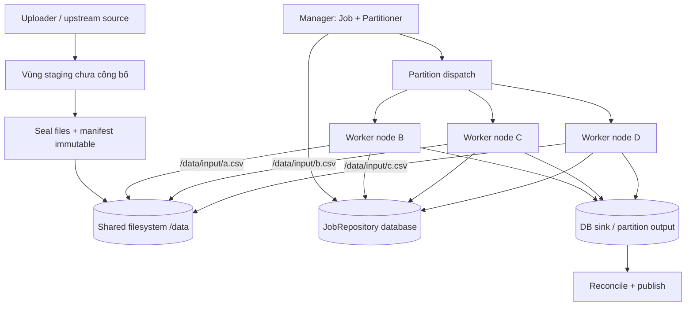
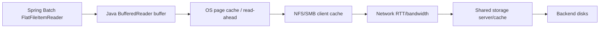
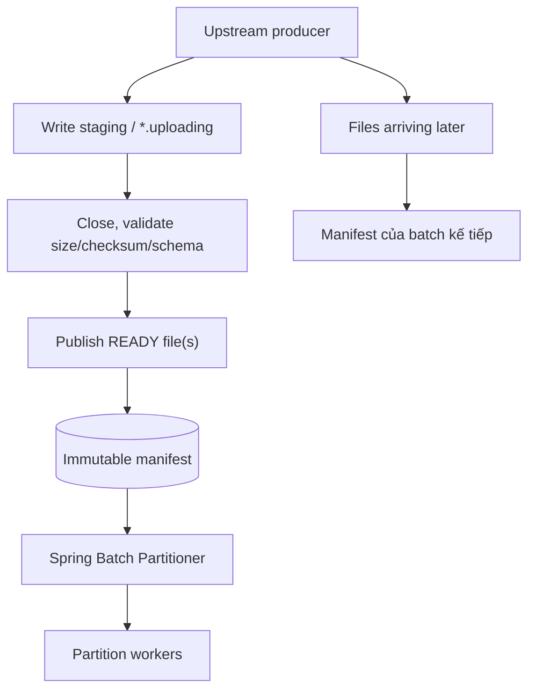
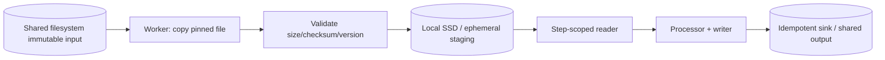

# Shared filesystem và latency

## 1. Bài toán: nhiều worker cùng đọc file, nhưng job vẫn chậm

Một hệ thống Spring Batch nhập **2 TB dữ liệu CSV mỗi đêm**. Tệp được lưu trên một shared filesystem, manager chạy ở node A và tám worker chạy trên các node B–I. Mỗi worker được giao những file độc lập thông qua partitioning. Đội vận hành tăng worker từ 4 lên 16, nhưng thời gian toàn job gần như không giảm; đôi lúc còn tăng và xuất hiện lỗi mở file.

Nguyên nhân có thể nằm ở **độ trễ của shared filesystem (shared filesystem latency)**, chứ không phải ở Java processor:

- Mỗi lần `open`, `stat`, `lookup`, `close` hoặc liệt kê thư mục có thể cần một hay nhiều thao tác mạng/metadata.
- Đọc hàng nghìn file nhỏ phải trả chi phí metadata lặp đi lặp lại.
- Nhiều worker cùng chia sẻ một backend, quota throughput/IOPS, cache, network hoặc một điểm nóng trong thư mục.
- Một file đang upload/chỉnh sửa có thể được worker khác mở trước khi nó hoàn tất.
- Khi manager và worker không mount **cùng namespace và cùng nội dung**, đường dẫn `/shared/input/a.csv` có thể hợp lệ ở một máy nhưng sai trên máy khác.
- Worker bị lỗi mạng giữa lúc đọc có thể để lại checkpoint trên một phiên bản file không còn khôi phục được.

Bài **“Shared filesystem và latency”** thuộc chương **File scaling** của module **SPRING_BATCH_SCALING_OPERATIONS**. Mục tiêu của module là mở rộng Spring Batch cho workload dữ liệu lớn qua multi-threaded step, parallel steps, partitioning và xử lý phân tán, đồng thời đo bottleneck, bảo đảm thread safety, retry/restart và vận hành thực tế.

> **Nguyên tắc nền tảng:** shared filesystem giải quyết việc **nhiều process nhìn thấy cùng một tập file**; nó **không cam kết** độ trễ giống local SSD, không tự cân bằng I/O cho từng worker và không tự biến các file đang thay đổi thành một snapshot nhất quán.

### Kết quả cần đạt

Sau bài học, bạn có thể:

1. Phân biệt **latency mỗi thao tác**, **throughput**, **IOPS**, **metadata operations** và **thời gian hoàn thành toàn job**.
2. Hiểu ưu/nhược điểm NFS, SMB, cloud-managed shared filesystem và storage được mount vào container.
3. Cấu hình Spring Batch partition theo file với `ExecutionContext`, `@StepScope` và đường dẫn mà worker thực sự truy cập được.
4. Thiết kế **manifest bất biến**, cơ chế file-ready, staging/publish an toàn và khôi phục sau lỗi mạng.
5. Giảm chi phí open/close, group file nhỏ, xử lý skew của file lớn và giới hạn concurrency theo tài nguyên storage.
6. Benchmark cold/warm cache, metadata latency, throughput theo số client và xác định lúc nên chuyển sang object storage hoặc local staging.

## 2. Shared filesystem là gì trong kiến trúc batch?

Shared filesystem là hệ thống file mà **nhiều node/process có thể cùng truy cập** thông qua một giao diện tên file/thư mục. Một vài ví dụ kiến trúc:

| Mô hình | Ví dụ | Đặc trưng đáng chú ý |
| --- | --- | --- |
| File local | SSD/NVMe gắn trên một node | Thường có latency thấp, nhưng worker ở node khác không tự đọc được |
| Network File System | NFS trên NAS/on-prem | Shared namespace, có network RTT, cache và mount semantics |
| SMB/CIFS share | `\\\\server\\data` trên Windows hoặc mount SMB Linux | Quyền, file locking và hành vi cache tùy server/client |
| Managed shared filesystem | Amazon EFS, Azure Files, Filestore | Nhiều client cùng mount; latency/throughput/quotas khác nhau |
| Kubernetes persistent volume loại shared | PVC có access mode phù hợp và CSI driver | Nhiều pod có thể mount nếu provider hỗ trợ; mount path/UID/GID cần nhất quán |
| Object storage | S3, Azure Blob, GCS | Thường truy cập qua API/object key, **không phải POSIX filesystem mặc định** |

**Đừng đánh đồng object storage với shared filesystem.** Một thư viện/driver có thể trình bày object storage như thư mục mount, nhưng semantics `rename`, append, locking, directory listing và atomicity có thể khác POSIX. Phải kiểm chứng adapter cụ thể thay vì coi mọi đường dẫn `/mnt/...` là NFS.

### 2.1. Sơ đồ dữ liệu và điều khiển



Ở đây **JobRepository database** và **shared filesystem** là **hai hệ thống có chức năng khác nhau**. File chung chứa dữ liệu; JobRepository persist `JobExecution`, `StepExecution` và `ExecutionContext`. Có shared mount **không** thay thế được JobRepository bền vững, và dùng chung JobRepository **không** làm file local tự xuất hiện ở mọi worker.

### 2.2. Shared path phải thực sự cùng namespace

Giả sử manager tạo một partition context:

```text
partitionName = "file-000042"
inputPath     = "/data/batch/2026-11-26/part-042.csv"
```

Nếu worker B mount share dưới `/data/batch` nhưng worker C lại mount dưới `/mnt/nas`, worker C mở path trên sẽ lỗi `FileNotFoundException`. Nguy hiểm hơn, nếu `/data/batch` tồn tại trên worker C nhưng trỏ **local disk khác**, worker có thể đọc **sai dữ liệu mà không lỗi**.

Có hai cách:

1. **Đồng nhất mount path ở mọi worker** và xác minh nó tham chiếu cùng backend/export.
2. Gửi **logical resource ID** trong `ExecutionContext` rồi tra một **trusted storage registry** ở worker để chuyển ID thành path local tương ứng.

Không gửi một Java `InputStream` hoặc file descriptor đã mở từ manager sang worker qua broker. Worker cần **tự mở cùng file bất biến** theo resource contract.

## 3. Latency, throughput và IOPS khác nhau thế nào?

| Thuật ngữ | Đơn vị | Câu hỏi cần trả lời |
| --- | --- | --- |
| **Operation latency** | ms/op | Mở/stat/đóng file tốn bao lâu? |
| **Metadata latency** | ms/lookup, ms/stat, ms/list | Truy vấn tên và thuộc tính file có chậm không? |
| **Read latency** | ms/read request | Bao lâu tới khi có dữ liệu đầu tiên/đủ block? |
| **Throughput** | MB/s, GiB/s | Mỗi giây chuyển được bao nhiêu byte? |
| **IOPS/ops/s** | operations/s | Có thể thực hiện bao nhiêu thao tác mỗi giây? |
| **End-to-end job runtime** | phút/giờ | Tất cả partition hoàn tất và dữ liệu được publish khi nào? |
| **Tail latency** | P95/P99 | Những lần mở/đọc file chậm nhất ảnh hưởng SLA thế nào? |
| **Queue/wait time** | ms/s | Worker chờ storage/DB/API hay thực sự xử lý? |

### 3.1. Vì sao nhiều file nhỏ thường chậm?

Xét hai workload có cùng tổng dung lượng:

- **A:** 100.000 file, mỗi file 10 KB → khoảng **1 GB**.
- **B:** 10 file, mỗi file 100 MB → cũng khoảng **1 GB**.

Giả định mỗi file tạo tổng cộng **8 ms chi phí open/metadata/close**, chưa tính đọc payload, và các thao tác ấy diễn ra tuần tự:

```text
Workload A:
100.000 file × 8 ms/file = 800.000 ms = 800 giây ≈ 13,3 phút

Workload B:
10 file × 8 ms/file = 80 ms = 0,08 giây
```

**Đây là phép tính minh họa**, không phải latency chuẩn của NFS/EFS/SMB. Cache, parallelism, batched I/O và cách client triển khai có thể làm kết quả khác. Nó cho thấy cùng **1 GB dữ liệu** chưa đủ để dự báo runtime: **số lần thao tác file** cũng quan trọng.

### 3.2. Mô hình chi phí đọc một file

Có thể ước lượng sơ bộ:

```text
T_file ≈ T_lookup_open
       + T_data_transfer
       + T_parse_process
       + T_close
       + T_wait_downstream

T_data_transfer ≈ fileBytes / effectiveReadBandwidth
```

Khi mạng hoặc shared filesystem bị tranh chấp, thêm `T_queue` hoặc giảm `effectiveReadBandwidth`. Với ứng dụng dùng buffered reading và OS page cache, **không phải mỗi lời gọi Java `read()` đều là một network round-trip**; số RPC thực tế phụ thuộc block size, read-ahead, cache và protocol. Do đó không nên tính `network RTT × số record` nếu chưa đo.

### 3.3. Băng thông cao không bảo đảm metadata nhanh

Một shared filesystem có thể chuyển hàng trăm MB/s khi đọc file lớn nhưng có latency open/close đáng kể. Ngược lại, nhiều file nhỏ có thể gặp **metadata-ops bottleneck** trước khi đạt giới hạn bandwidth.

| Workload | Metric ưu tiên |
| --- | --- |
| Scan 1.000 file lớn, đọc tuần tự | Throughput, network bytes, storage read limits |
| Scan 1 triệu file vài KB | Open/stat/close ops/s, directory lookup, cache |
| Nhiều worker cùng tạo output | Create/rename/metadata latency, lock/permission errors |
| Random seeks nhiều đoạn | Read IOPS, request size, page cache hit |
| Worker ở xa storage | RTT, p95 operation latency, cross-zone traffic |
| Input nóng và đầu vào mới | Cache consistency, file-ready protocol, version/checksum |

## 4. Tác động của network và cache

### 4.1. Những tầng cache cùng tồn tại



Một `FlatFileItemReader` đọc từng record vẫn có thể thực hiện I/O theo block qua `BufferedReader` và OS. Khi đo performance, cần phân biệt:

- **Cold cache:** client chưa có dữ liệu/metadata, có thể phải đọc từ storage backend.
- **Warm cache:** page cache/dentry cache đã có, tốc độ có thể tăng nhiều.
- **Read-ahead:** client dự đoán các byte kế tiếp của truy cập tuần tự.
- **Attribute/directory cache:** giảm metadata round trips nhưng kéo theo giới hạn về khả năng nhìn thấy thay đổi.

Không lấy kết quả benchmark lần hai trên cùng file rồi tuyên bố đó là tốc độ cold read của production.

### 4.2. NFS và tính nhất quán quan sát

NFS thường sử dụng các cơ chế client cache và mô hình **close-to-open consistency** tùy phiên bản, mount option, server/client. Khi process A đóng file sau khi ghi, process B mở lại thường được thiết kế để thấy thay đổi phù hợp; nhưng **đừng xem đây là transaction snapshot toàn cục**:

- Process B có thể đọc file **trong khi A vẫn đang ghi** nếu hai bên không có protocol phối hợp.
- Attribute/directory cache có thể khiến thay đổi chưa được nhìn thấy tức thì trong một số điều kiện.
- Một file bị xóa, rename, remount hoặc backend failover có thể gây `ESTALE`, `EIO`, timeout hay lỗi file handle khác tùy hệ thống.
- Lock semantics khác theo NFS/SMB/protocol và cấu hình; lock advisory không thay thế quy tắc nghiệp vụ về ownership.

**Kết luận:** dùng **immutable inputs + ready/seal marker + manifest** thay vì hy vọng mọi worker đều quan sát thao tác ghi tức thời và theo đúng thứ tự.

### 4.3. Những tối ưu mount dễ có tác dụng phụ

Các option NFS như read/write sizes, attribute cache hoặc lookup cache có thể ảnh hưởng hiệu năng. Ví dụ hướng dẫn Amazon EFS nhấn mạnh latency **mỗi thao tác** và khuyến nghị tránh vô hiệu hóa cache bừa bãi vì tác động rất lớn lên metadata performance.

Tuy nhiên:

- **Không** yêu cầu mọi môi trường chỉnh `rsize/wsize` thành một giá trị chung.
- Không tắt attribute cache để “chắc chắn file mới xuất hiện” rồi khiến hàng triệu `stat` thành round trips.
- Không dùng thủ thuật cache để thay thế protocol công bố input bất biến.
- Chỉ điều chỉnh mount options theo khuyến nghị provider và đo trên workload thật.
- Test lại sau nâng kernel/client/driver hoặc thay AZ/network/topology.

## 5. File-ready protocol: không đọc file đang upload

Nếu upstream chép trực tiếp `orders.csv` vào thư mục mà worker đang quét, worker có thể mở file khi mới ghi được 40%, parse tới EOF, ghi `COMPLETED` và bỏ mất phần còn lại.

Một protocol an toàn hơn:

1. Upstream ghi vào **vùng staging riêng** hoặc tên file tạm, ví dụ `orders.csv.uploading`.
2. Đóng và flush/đảm bảo dữ liệu bền vững theo contract của storage.
3. Kiểm tra kích thước, checksum (nếu có), schema và số record kỳ vọng.
4. **Publish** file cuối theo cơ chế được storage hỗ trợ; với filesystem có atomic rename thì dùng rename trong cùng filesystem.
5. Ghi **manifest bất biến** chỉ gồm các file đã `READY`, với identity/version rõ ràng.
6. Scheduler chạy Spring Batch với `manifestId` là identifying `JobParameter`.
7. Worker chỉ mở input thuộc manifest, không liệt kê lại thư mục “mới nhất” ở mỗi lần restart.



**Chú ý:** `Files.move(..., ATOMIC_MOVE)` chỉ bảo đảm rename atomic nếu filesystem/provider thực sự hỗ trợ. Một rename atomic **không tự cam kết mọi data và directory metadata đã được fsync bền vững qua mất điện**. Độ bền cần thiết phụ thuộc filesystem/server và quy trình `fsync`/mount/provider.

### 5.1. Vì sao không scan folder trong Partitioner mỗi lần?

```text
JobExecution #1:
partition-0000 -> a.csv -> COMPLETED
partition-0001 -> b.csv -> FAILED

Trong lúc job dừng: c.csv được upload, danh sách sort khác.

Restart cùng JobInstance:
partition-0000 -> a.csv
partition-0001 -> c.csv   (sai nếu mapping được tạo lại)
partition-0002 -> b.csv

=> Checkpoint của b.csv có thể được gán cho c.csv hoặc c.csv
   bị xử lý như một phần của đợt cũ không được cho phép.
```

Vấn đề này độc lập với NFS latency: **file mới và thứ tự listing thay đổi** làm mapping logical partition không bền vững. Kể cả dùng `MultiResourcePartitioner` tiện lợi, phải đảm bảo resource list và partition name mapping ổn định qua restart.

## 6. Manifest cố định và nhận diện file bất biến

Ví dụ manifest ở một vùng bền vững mà các worker đọc được:

```json
{
  "businessBatchId": "warehouse-import-2026-11-26",
  "manifestId": "manifest-20261126-v1",
  "mountNamespace": "shared-prod-input-v1",
  "inputs": [
    {
      "partitionId": "file-00001",
      "logicalFileId": "source-A-20261126-1",
      "relativePath": "input/2026-11-26/a.csv",
      "sizeBytes": 157286400,
      "sha256": "example-valid-digest-must-be-supplied"
    },
    {
      "partitionId": "file-00002",
      "logicalFileId": "source-A-20261126-2",
      "relativePath": "input/2026-11-26/b.csv",
      "sizeBytes": 104857600,
      "sha256": "example-valid-digest-must-be-supplied"
    }
  ]
}
```

Các giá trị `sha256` trong JSON trên là **chuỗi minh họa**, **không phải SHA-256 hợp lệ**. Trong production, manifest creator phải tạo digest thật và mọi worker cần policy đối chiếu fingerprint phù hợp.

**Các ràng buộc nên có:**

| Thuộc tính | Tại sao cần |
| --- | --- |
| `manifestId` | Giữ đúng cùng danh sách khi restart |
| `partitionId` | Map tên `StepExecution` tới đúng file |
| `logicalFileId` | Identity không phụ thuộc path hiển thị |
| `mountNamespace` | Phân biệt môi trường/mount chỉ tới backend nào |
| `relativePath` đã chuẩn hóa | Tránh hard-code path host cụ thể trong manifest |
| `sizeBytes + sha256` | Phát hiện file bị thay thế sau seal |
| `schemaVersion` / encoding | Reader parse giống lần đầu |
| `sourceGeneration` hoặc immutable version | Có nguồn để mở lại đúng nội dung |
| `retentionUntil` | Không xóa file trước khi mọi JobInstance có thể restart |
| `expectedRecords` nếu có | Đối soát sau xử lý |

Có thể dùng một **trusted registry** để chuyển `mountNamespace + relativePath` thành `/data/shared/...` trên từng worker. Registry không được lấy trực tiếp tùy ý từ request của người dùng hoặc ghi secret vào `ExecutionContext`.

### 6.1. Kiểm tra toàn vẹn so với hiệu năng

Tính SHA-256 **toàn file 500 GB** ngay trước mỗi lần reader mở sẽ thêm một lượt đọc I/O, làm tăng latency trước xử lý. Các lựa chọn cần cân nhắc:

- Tính checksum **khi producer seal** input; ngăn overwrite bằng policy/ACL/read-only mount.
- Ghi nhận immutable snapshot/version từ storage nếu được hỗ trợ.
- Kiểm tra size/metadata và checksum khi ingest, rồi chỉ spot-check/verify khi có dấu hiệu bất thường theo chính sách.
- Nếu nghiệp vụ đòi checksum end-to-end mỗi lần, **tính chi phí I/O đó vào benchmark**.
- Không coi `lastModifiedTime` hoặc size giống nhau là bằng chứng chắc chắn nội dung không đổi.
- Với file có thể bị sửa khi đang đọc, chỉ verify đầu file chưa đủ; cần **bảo đảm immutable bằng kiến trúc**, không dựa vào thời điểm chạy `Files.size()`.

## 7. Shared filesystem và cách chia file trong Spring Batch

Có hai kiểu phân chia dễ dùng:

| Chiến lược | Khi phù hợp | Điểm yếu |
| --- | --- | --- |
| **Một file → một partition** | File đủ lớn, độ lớn tương đương, đọc độc lập | File rất lớn tạo straggler; file cực nhỏ làm metadata quá nhiều |
| **Nhiều file → một partition** | Hàng chục nghìn file nhỏ | Reader nhiều resources phải checkpoint cả file hiện tại và vị trí |
| **Một file lớn → nhiều record ranges** | Format hỗ trợ tách đúng biên record/block | Reader phức tạp, không được cắt byte tùy ý |
| **Local staging từng partition** | Shared FS RTT cao, CPU parse nặng, đủ local disk | Cần copy/checksum, cleanup và versioning |
| **Direct object storage** | Nguồn vốn là immutable object, multi-node | SDK/retry/throughput semantics khác filesystem |

Nếu chỉ cần **một file/partition**, `MultiResourcePartitioner` tạo một `ExecutionContext` cho mỗi resource. Theo API Spring Batch, implementation này **bỏ qua `gridSize`**, nên `gridSize=4` với 1.000 resource **không có nghĩa chỉ bốn partitions được tạo**. Concurrency thực tế do executor/handler quyết định.

Khi cần grouping, manifest ổn định hoặc định danh partition không phụ thuộc vào thứ tự resource, hãy dùng `Partitioner` tùy biến như bên dưới.

## 8. Java: Partitioner dùng đường dẫn trên shared mount

Ví dụ tiếp theo dùng API quen thuộc của **Spring Batch 5.x** và Java 17+. Chúng minh họa cơ chế, không phải ứng dụng đầy đủ; import, `Job`, `DataSource`, `ManifestRepository` và xử lý errors được rút gọn.

### 8.1. Định nghĩa input đã đóng băng

```java
record SharedFileEntry(
        String partitionId,
        String relativePath,
        long sizeBytes
) {}

final class SharedFilePartitioner implements Partitioner {

    private final Path trustedRoot;
    private final List<SharedFileEntry> frozenEntries;

    SharedFilePartitioner(
            Path trustedRoot,
            List<SharedFileEntry> frozenEntries) {
        this.trustedRoot = trustedRoot.toAbsolutePath().normalize();
        this.frozenEntries = List.copyOf(frozenEntries);
    }

    @Override
    public Map<String, ExecutionContext> partition(int gridSize) {
        Map<String, ExecutionContext> result = new LinkedHashMap<>();

        for (SharedFileEntry file : frozenEntries) {
            Path relative = Path.of(file.relativePath()).normalize();
            if (relative.isAbsolute() || relative.startsWith("..")) {
                throw new IllegalArgumentException("Unsafe relative path");
            }

            Path absolute = trustedRoot.resolve(relative).normalize();
            if (!absolute.startsWith(trustedRoot)) {
                throw new IllegalArgumentException("Path outside trusted root");
            }

            ExecutionContext context = new ExecutionContext();
            context.putString("inputPath", absolute.toString());
            context.putLong("expectedSizeBytes", file.sizeBytes());

            if (result.putIfAbsent(file.partitionId(), context) != null) {
                throw new IllegalArgumentException("Duplicate partition ID");
            }
        }
        return result;
    }
}
```

**Ý nghĩa:**

- Mỗi `partitionId` ổn định và map tới đúng **relative path** của manifest.
- `ExecutionContext` chứa **đường dẫn mà worker sẽ mở**, kích thước kỳ vọng; context nhỏ, không chứa stream/secret.
- `gridSize` là hint bị implementation này cố ý bỏ qua; số partition bằng số entries.
- `trustedRoot` phải là path đã được **cấu hình đúng trên worker đang đọc**. Với remote workers mount path khác nhau, gửi `relativePath + mountNamespace` thay vì absolute path từ manager rồi resolve ở worker.
- `startsWith(trustedRoot)` chỉ là một bước kiểm tra **path syntax**. Symlink có thể thoát khỏi root dù chuỗi path đã normalize; cần **allowlist và resolve real path an toàn**, quyền filesystem/read-only mount, tránh TOCTOU nếu manifest do nguồn không tin cậy tạo.

**Vẫn cần preflight production** kiểm tra file tồn tại, đúng backend/mount, không bị thay đổi, không có entry trùng logical file và manifest đã khóa. Partitioner không nên mở/tính checksum toàn bộ file ngay trong mỗi lần `partition(...)` để tránh hàng nghìn network metadata ops ở manager.

### 8.2. Đọc file bằng @StepScope

```java
record InvoiceRow(String invoiceId, BigDecimal amount) {}

@Bean("sharedFileReader")
@StepScope
FlatFileItemReader<InvoiceRow> sharedFileReader(
        @Value("#{stepExecutionContext['inputPath']}") String inputPath) {

    return new FlatFileItemReaderBuilder<InvoiceRow>()
            .name("sharedFileReader")
            .resource(new FileSystemResource(inputPath))
            .linesToSkip(1)
            .delimited()
            .names("invoiceId", "amount")
            .fieldSetMapper(fields -> new InvoiceRow(
                    fields.readString("invoiceId"),
                    fields.readBigDecimal("amount")))
            .saveState(true)
            .build();
}
```

**Cần biết:**

1. `@StepScope` tạo reader instance theo **worker StepExecution**, giúp nhiều partition không dùng chung vị trí đọc.
2. `FileSystemResource` mở file từ **filesystem mà process worker nhìn thấy**; không mở một URI S3/GCS bằng SDK tự động.
3. `saveState(true)` và reader name ổn định phục vụ checkpoint, nhưng **không bảo đảm restart đúng** nếu file nội dung/encoding hoặc số dòng thay đổi.
4. `@StepScope` **không** biến singleton processor/writer có mutable state thành thread-safe. Nếu một worker StepExecution lại dùng multi-threaded chunk, reader step-scoped vẫn có thể bị các thread đó cùng truy cập.
5. Reader thường buffer dữ liệu; đừng tự đọc từng byte với một network file handle không có buffering nếu không cần.
6. Hãy kiểm thử file rỗng, thiếu header, CSV quoted newline, CRLF/UTF-8, permission và input biến mất giữa lần đọc.

### 8.3. Worker Step ghi vào sink idempotent

```java
@Bean("sharedFileWorkerStep")
Step sharedFileWorkerStep(
        JobRepository jobRepository,
        PlatformTransactionManager transactionManager,
        @Qualifier("sharedFileReader")
            ItemStreamReader<InvoiceRow> reader,
        ItemWriter<InvoiceRow> idempotentInvoiceWriter) {

    return new StepBuilder("sharedFileWorkerStep", jobRepository)
            .<InvoiceRow, InvoiceRow>chunk(200, transactionManager)
            .reader(reader)
            .writer(idempotentInvoiceWriter)
            .build();
}
```

`idempotentInvoiceWriter` là một dependency do ứng dụng triển khai, không phải bean Spring Batch mặc định. Ví dụ có thể là JDBC UPSERT theo `businessBatchId + sourceRecordId`. `chunk(200)` nghĩa là kích thước transaction chunk, **không phải 200 thread hay 200 file**.

### 8.4. Manager Step chạy local partitioning

```java
@Bean("filePartitionExecutor")
ThreadPoolTaskExecutor filePartitionExecutor() {
    ThreadPoolTaskExecutor pool = new ThreadPoolTaskExecutor();
    pool.setThreadNamePrefix("shared-file-partition-");
    pool.setCorePoolSize(4);
    pool.setMaxPoolSize(4);
    pool.setQueueCapacity(16);
    return pool;
}

@Bean("sharedFileManagerStep")
Step sharedFileManagerStep(
        JobRepository jobRepository,
        @Qualifier("sharedFileWorkerStep") Step worker,
        @Qualifier("sharedFilePartitioner") Partitioner partitioner,
        @Qualifier("filePartitionExecutor") TaskExecutor executor) {

    return new StepBuilder("sharedFileManagerStep", jobRepository)
            .partitioner(worker.getName(), partitioner)
            .step(worker)
            .gridSize(4)
            .taskExecutor(executor)
            .build();
}
```

Đây là **local partitioning**, tức worker tasks là threads trong một JVM, dù input có thể nằm trên shared NFS mount. Với **remote partitioning**, manager dùng remote `PartitionHandler` và middleware; các worker là process/node khác, phải mở được file qua mount/registry tương ứng.

**Lưu ý phiên bản:** `chunk(200, transactionManager)` minh họa Spring Batch 5.x. Spring Batch 6.x có API builder khác; đối chiếu documentation của phiên bản trong dự án trước khi copy. Không dùng đoạn cấu hình local ở đây như một remote setup hoàn chỉnh.

### 8.5. Vì sao queue nhỏ có thể reject?

Nếu partitioner trả 1.000 partitions, executor `max=4`, `queue=16`, handler có thể submit nhiều tasks nhanh hơn thời gian hoàn thành và gây `TaskRejectedException`. `gridSize(4)` **không nhất thiết là bộ giới hạn số partition được sinh**.

Giải pháp không phải chỉ tăng queue lên 1.000. Cần:

- Cân bằng file và **group file nhỏ** thành partition phù hợp.
- Giới hạn dispatch nếu handler/protocol hỗ trợ.
- Theo dõi active threads, queued tasks, rejected tasks và metadata overhead.
- Chọn số partitions có cơ sở giữa **throughput** và **granularity của restart**.
- Không discard task im lặng; fail/retry có kiểm soát với nguồn bất biến.

## 9. Một file lớn và nhiều file nhỏ cần xử lý khác nhau

### 9.1. Nhiều file nhỏ: hạn chế round-trip metadata

Với 200.000 file 5 KB, mỗi file một partition có hai chi phí: **network open/close** và **StepExecution/JobRepository**.

**Cách làm tốt hơn:**

1. Chốt danh sách file bằng manifest, thứ tự deterministically.
2. Gom nhiều file nhỏ thành một group theo **tổng bytes + số file + ước lượng thời gian đọc**.
3. Một `ExecutionContext` chỉ giữ `manifestId + groupId` thay vì nhét 1.000 file paths.
4. Worker dùng `MultiResourceItemReader` hoặc reader composite phù hợp, mở file trong group theo thứ tự ổn định.
5. Kiểm thử checkpoint khi đang ở file thứ N, chunk vừa commit và worker crash.
6. Không giả định gộp file luôn giúp throughput nếu metadata backend đã đủ nhanh và workload yêu cầu isolation từng file.

Một ví dụ trọng số để lập kế hoạch:

```text
estimatedCost(file) =
    fixedOpenCloseCost
  + fileSize / measuredReadThroughput
  + estimatedRecords * averageProcessingCostPerRecord
```

Nếu chỉ cân bằng tổng bytes, một group chứa 10.000 file nhỏ có thể chậm hơn group chứa một file lớn dù cùng dung lượng.

### 9.2. File lớn: stream tuần tự, không cắt tùy tiện

Với file 500 GB, mở/đóng chỉ là phần nhỏ; throughput và CPU parse có thể là bottleneck. Khi muốn chia thành nhiều partitions:

| Format | Có thể chia? | Điều cần chứng minh |
| --- | --- | --- |
| CSV có quoted newline | Không chia byte tùy ý | Record boundary chính xác, encoding, header |
| JSON Lines | Có thể theo ranh giới dòng | Mỗi dòng là record hợp lệ; xử lý CRLF/UTF-8 |
| GZIP stream phổ biến | Không seek tới byte bất kỳ | Cần splittable compression/index/block |
| Parquet/ORC | Có row group/stripe | Reader hỗ trợ đọc đúng block, predicate, checkpoint |
| Nhiều file output từ upstream | Tách ngay khi producer ghi | Mỗi chunk/file bất biến, manifest ổn định |

Với định dạng không splittable, tăng số worker không chia nhỏ **một file duy nhất**. Thay vì cố đọc file đó qua nhiều streams và gây NFS read storms, cân nhắc upstream sharding trước khi nén hoặc chuyển sang định dạng có boundaries xác định.

### 9.3. Không tạo một thư mục duy nhất chứa mọi output

Hàng trăm nghìn file trong một directory có thể khiến listing và metadata operations kém hiệu quả tùy filesystem/provider. Có thể tổ chức:

```text
/data/batch/input/2026-11-26/00/...
/data/batch/input/2026-11-26/01/...
/data/batch/input/2026-11-26/02/...

/data/batch/output/staging/<businessBatchId>/<partitionId>.part
/data/batch/output/published/<businessBatchId>/...
```

Tránh thiết kế **tất cả worker cùng tạo/xóa/rename hàng nghìn file tại một hot directory** mà chưa đo metadata latency. Nhưng đừng chia thư mục theo công thức cứng mà không có bằng chứng: filesystem hiện đại có cấu trúc directory khác nhau.

## 10. Ghi output lên shared filesystem: collision và publish

Đọc file bất biến từ shared mount tương đối dễ. **Nhiều workers cùng ghi** tạo thêm rủi ro:

- Hai workers mở cùng output path ở chế độ truncate/append.
- Partition retry ghi đè vào file đã publish.
- Consumer thấy file mới **chưa viết xong**.
- Worker crash để lại `*.part`, lần restart append/truncate sai.
- Rename/move giữa hai mount khác nhau **không còn atomic**.
- Một thao tác `write()` hoàn tất trên client không nhất thiết đồng nghĩa dữ liệu đã bền vững theo toàn bộ yêu cầu storage.

### 10.1. Quy tắc ownership

Mỗi worker partition chỉ được ghi **một tập output path riêng**, ví dụ:

```text
businessBatchId = invoice-2026-11
partitionId     = file-00042

Staging path:
  /data/output/staging/invoice-2026-11/file-00042.part

Published path:
  /data/output/published/invoice-2026-11/file-00042.csv
```

Nếu hai workers khác nhau có thể nhận lại cùng partition do mất reply hoặc replay, **chỉ có “mỗi partition một file” vẫn chưa đủ**: hai executions có thể cùng mở `file-00042.part`. Cần **fencing/lease**, một writer generation được phép publish, hoặc output paths tách theo attempt rồi chọn **một artifact hợp lệ** theo business reconciliation.

### 10.2. Chỉ publish khi file đã hoàn chỉnh

Mẫu đơn giản:

1. Writer ghi vào **staging path** có ownership riêng.
2. Close writer và đảm bảo checkpoint/file integrity theo policy.
3. Đối soát rows/count/checksum và mọi partition phải đạt trạng thái yêu cầu.
4. Publish bằng một thao tác rename/move **atomic trên cùng filesystem nếu hỗ trợ**, hoặc dùng versioned artifact + publish marker.
5. Consumer chỉ đọc những file/version đã được publish, không quét `*.part`.
6. Cleanup staging theo retention, không xóa sớm khi còn JobInstance có thể restart.

**Không nên** dùng `Files.copy(source, published)` rồi để consumer quét folder `published`: consumer có thể thấy file chưa copy xong. Nếu storage không hỗ trợ atomic rename, sử dụng **immutable object/artifact + một manifest/marker atomic theo cơ chế storage được hỗ trợ**.

### 10.3. Java: yêu cầu ATOMIC_MOVE và fail nếu không hỗ trợ

```java
import java.io.IOException;
import java.nio.file.AtomicMoveNotSupportedException;
import java.nio.file.Files;
import java.nio.file.Path;
import java.nio.file.StandardCopyOption;

final class FilePublisher {

    static void publish(Path staged, Path finalPath)
            throws IOException {
        // Preconditions do workflow thực hiện:
        // - staged đã close/validate, không có writer đang mở
        // - finalPath là tên mới không được hai executions tranh
        // - hai path thuộc cùng filesystem hỗ trợ atomic rename
        // - các partition và reconciliation đã hoàn thành

        try {
            Files.move(staged, finalPath, StandardCopyOption.ATOMIC_MOVE);
        } catch (AtomicMoveNotSupportedException unsupported) {
            // Không tự fallback sang copy + delete không atomic.
            throw new IOException(
                    "Storage does not support required atomic publish",
                    unsupported);
        }
    }
}
```

**Giới hạn ví dụ:**

- `ATOMIC_MOVE` có thể ném exception nếu backend không hỗ trợ hoặc hai path khác `FileStore`/provider.
- Khi target **đã tồn tại**, hành vi thay thế dưới `ATOMIC_MOVE` có yếu tố **implementation-specific**; mẫu trên yêu cầu **final path mới**, chặn cạnh tranh bởi workflow trước khi gọi.
- `rename atomic` không đồng nghĩa **durable after power loss** nếu dữ liệu/directory metadata chưa được flush theo filesystem contract.
- `Files.move` không phải distributed transaction giữa broker, JobRepository và filesystem; nếu crash sau rename nhưng trước metadata update, recovery phải đối soát artifact trước khi thử publish lại.
- Với cloud object storage, dùng API publish/version/conditional write riêng thay vì mặc nhiên có POSIX rename.

### 10.4. Cảnh giác với FlatFileItemWriter khi restart

`FlatFileItemWriter` có trạng thái `ItemStream` và nhiều tùy chọn như `append`, `shouldDeleteIfExists`, `saveState`. Tùy cấu hình, lần mở lại có thể resume/truncate đến vị trí checkpoint hoặc tạo file mới.

**Không kết luận rằng `append(true)` luôn an toàn.** Nếu chunk cuối đã được ghi vật lý nhưng checkpoint chưa persist, append có thể nhân đôi records. Cần test cụ thể:

- Crash trước và sau chunk commit.
- File staging còn tồn tại khi StepExecution restart.
- Writer name/state key không bị đổi giữa deploy.
- Hai attempts vô tình cùng mở file output.
- Publish được gọi lại sau khi file cuối đã tồn tại.

Đối với dữ liệu tài chính, có thể dễ xác minh hơn nếu **ghi DB staging idempotent**, rồi xuất file trong một bước riêng sau khi input processing hoàn tất; đây là tradeoff giữa durability, throughput và chi phí lưu trữ.

## 11. Khác biệt local partitioning và remote partitioning

| Khía cạnh | Local partitioning | Remote partitioning |
| --- | --- | --- |
| Vị trí worker | Nhiều threads cùng JVM | Nhiều processes/pods/nodes |
| Đọc local path | Cùng filesystem view của JVM | Phải mount chung hoặc map logical ID |
| Latency shared FS | Nếu chạy trên host client, cùng mount | Khác client/AZ có thể có RTT khác |
| JobRepository | Shared metadata DB | Worker và manager cần topology/permissions phù hợp |
| In-flight failure | JVM crash ảnh hưởng nhiều tasks | Worker/node/broker có failure windows riêng |
| Credential | User chạy JVM | UID/GID/ACL/IAM/service identity theo pod/node |
| Scale | CPU/RAM/network một máy | Nhiều node, nhưng shared backend có quota chung |
| Checkpoint | StepExecution per partition | Tương tự, cộng lỗi dispatch/reply/reconnect |

### 11.1. Remote partitioning không “truyền file”

Remote partitioning chuyển **định danh công việc/StepExecution**, không tự động truyền nội dung tệp qua mạng. Nếu worker không mount filesystem và không có reader truy cập shared storage, việc manager cung cấp path trong `ExecutionContext` vẫn chưa đủ.

Đừng gửi một absolute path tương ứng với host manager rồi cho rằng nó là portable. Với deployment phân tán có mount path khác nhau, dùng **mount namespace + relative path** và worker-specific resolver đã xác thực.

### 11.2. Remote chunking có thể tránh hoặc tạo bottleneck khác

Trong **remote chunking**, manager đọc item và gửi chunk payload cho worker xử lý/ghi. Như vậy chỉ **manager reader** cần truy cập shared filesystem nếu input là file, nhưng:

- Manager có thể trở thành **điểm nghẽn I/O** khi phải đọc hết file từ shared mount.
- Broker phải vận chuyển payload chunk; serializing large records tạo overhead network/memory.
- Các worker không tự đọc file song song nếu pattern là remote chunking manager-reader.
- Mất reply sau commit phải được xử lý bằng idempotency, không chỉ checkpoint manager.

Nếu khối lượng file lớn và có thể chia file độc lập, **remote partitioning** (worker tự mở file) thường tự nhiên hơn. Nếu chi phí processor cao nhưng reader rất nhẹ, **remote chunking** có thể phù hợp. Quyết định bằng benchmark và failure model, không bằng tên kiến trúc.

## 12. Khi nào nên copy file xuống local staging?

Một cách giảm network latency là **stage mỗi partition trên local SSD của worker**, sau đó parse/transform từ local file. Mẫu:



### 12.1. Có lợi khi nào?

- File lớn được parse nhiều pass, có random access hoặc CPU-intensive processing.
- Network file system có RTT cao nhưng local disk đủ nhanh và có không gian.
- Worker cần re-open/seek nhiều lần, network metadata chiếm thời gian lớn.
- Cần giảm repeated reads qua network khi worker xử lý lại cùng input trong một run.

### 12.2. Không nên lúc nào?

- File chỉ được đọc tuần tự **một lần**, copy thêm có thể **tăng gấp đôi I/O** và làm chậm end-to-end.
- Local ephemeral disk không đủ dung lượng hoặc có nguy cơ bị evict/OOM due to storage pressure.
- Worker di chuyển pod khác khi restart; local staged file cũ không tự còn đó.
- Cùng một file được nhiều workers copy lại, gây traffic đột biến.
- CPU parse/DB writer mới là bottleneck, local SSD không giải quyết.

### 12.3. Nguyên tắc an toàn

- Shared source bất biến hoặc có pin version/checksum.
- Local temp path có tên riêng cho `JobInstance + partition + attempt` và quyền phù hợp.
- Copy xong **verify** rồi chỉ cho reader mở file local; không đọc file copy dở.
- Nếu worker khác thực thi lại partition, nó có thể copy lại đúng source; checkpoint phải tương thích với cùng byte content.
- Cleanup local staging theo lifecycle và đừng xem local cache là nguồn lưu trữ cuối.
- Nếu chọn local staging, đo cả **copy time** vào tổng Job runtime, không chỉ thời gian `FlatFileItemReader` sau đó.

## 13. Đo latency và throughput có hệ thống

Một benchmark đúng nên giữ **dữ liệu, filesystem, số worker và trạng thái cache** càng rõ ràng càng tốt.

### 13.1. Bộ chỉ số đề xuất

| Metric | Vì sao cần |
| --- | --- |
| `file_open_duration_ms` P50/P95/P99 | Chi phí mở file, metadata RTT |
| `file_stat_duration_ms` | Attribute lookup/cached metadata |
| `file_close_duration_ms` | Chi phí close/flush |
| `file_read_bytes_total` | Dung lượng thực đã đọc theo worker |
| `file_read_throughput_mbps` | Năng lực đọc theo client và toàn filesystem |
| `file_read_calls_total` | Phát hiện quá nhiều lời gọi nhỏ |
| `storage_request_size_bytes` | Hiệu quả I/O size/read-ahead nếu quan sát được |
| `storage_errors_total` theo loại | `ESTALE`, timeout, `EIO`, permission errors |
| `worker_wait_on_storage_ms` | Đo thời gian chờ I/O so với CPU |
| `shared_fs_metadata_ops_per_sec` | Giới hạn metadata backend |
| `cache_hit_ratio` hoặc proxy phù hợp | So sánh cold/warm cache |
| `executor_active_threads`/queue | Mức concurrency và backlog |
| `StepExecution.readCount`/`writeCount` | Quan sát tiến độ batch |
| `job_duration` và `partition_duration` | Phát hiện straggler/critical path |
| `input_output_reconciliation_mismatch` | Kiểm tra tính đúng sau restart |

Đây là **tên metric gợi ý**, không phải metric mặc định Spring Batch/OS/EFS đều phát ra đúng cùng tên. Có thể dùng Micrometer, OpenTelemetry, profiler, client-side filesystem telemetry, `iostat`/`nfsstat` hoặc monitoring của storage provider phù hợp. Luôn xác minh **đo được tầng nào**: Java duration không đồng nghĩa server-side I/O latency.

### 13.2. Bốn bài đo tách biệt

1. **Metadata-only:** mở, stat, đóng nhiều file nhỏ theo quy tắc giống production, không đọc lớn.
2. **Sequential read:** đọc các file lớn bằng reader/buffer thực tế, đo bytes/s và CPU.
3. **Concurrent read:** lặp ở 1 → 2 → 4 → 8 → 16 workers, giữ tổng input không đổi.
4. **End-to-end batch:** reader + processor + writer + JobRepository, có churn, queue và DB/API tải thực.

Nếu chỉ đo `cp` hoặc `dd` một file lớn, bạn **chưa đo được** chi phí reader mở 200.000 files nhỏ hoặc latency của checkpoint và writer.

### 13.3. Ví dụ benchmark minh họa

Giả sử job cần đọc **400 GB** từ shared filesystem. Các con số sau chỉ **giả định**:

| Local/remote workers | Tổng runtime | Throughput hiệu dụng | Quan sát |
| ---: | ---: | ---: | --- |
| 1 | 200 phút | ~33,3 MB/s | Baseline, metadata và parse |
| 2 | 116 phút | ~57,5 MB/s | Tăng hiệu quả |
| 4 | 69 phút | ~96,6 MB/s | Còn headroom |
| 8 | 62 phút | ~107,5 MB/s | Backend storage gần trần |
| 16 | 70 phút | ~95,2 MB/s | Contention, network và retry tăng |

Ví dụ trên xem `MB` là đơn vị thập phân, lấy `400.000 MB / (runtime phút × 60)`. Nó không dự đoán kết quả của EFS hay NFS cụ thể. Nếu bạn chỉ nhìn CPU và thấy 16 worker sử dụng nhiều CPU hơn, có thể lầm tưởng scale tốt dù **job lâu hơn**.

### 13.4. Đo cold cache và warm cache

- Ghi rõ client đã mount bao lâu, đã đọc dataset này trước đó chưa.
- Tránh so sánh lần **cold read** của một worker với lần **warm read** của tám workers.
- Nếu muốn đo cold-cache đúng, cần phương pháp làm lạnh cache có kiểm soát và được phép, không phá cache production đang phục vụ ứng dụng khác.
- Kiểm tra hiệu ứng read-ahead và filesystem client caching.
- Lặp lại nhiều lượt, đo median/P95 và độ biến động.
- Bổ sung một test ở **giờ cao điểm** khi shared storage cũng phục vụ các workload khác.

## 14. Nút thắt hay gặp và hướng xử lý

| Triệu chứng | Nguyên nhân khả dĩ | Hướng kiểm tra/giải pháp |
| --- | --- | --- |
| File nhỏ mở rất lâu | Metadata RTT, hot directory, cache config | Group file nhỏ, đo open/close và directory ops |
| File lớn đọc chậm liên tục | Bandwidth/IOPS, network, backend read quota | Sequential throughput, read sizes, cross-zone RTT |
| Thêm worker nhưng tổng throughput không tăng | Shared filesystem hoặc DB/API đã bão hòa | Đo resource chung; giới hạn concurrency |
| Worker chỉ fail ở node mới | Mount path/ACL/UID/GID, DNS, security group | So mount namespace và file identity |
| File chưa upload xong đã đọc | Thiếu ready/seal protocol | Staging + publish + immutable manifest |
| Restart đọc sai file | Listing thay đổi, partition name tái sử dụng | Pin input/version và partition identity |
| Bị `ESTALE`/`EIO` giữa file | NFS failover, stale handle, network/storage | Phân loại lỗi, reopen đúng version, check checkpoint |
| Output bị ghi lẫn | Hai partitions/attempts cùng file path | Partition-exclusive staging, fencing, publish gate |
| Rename mất tính atomic | Khác filesystem, adapter không hỗ trợ | Same filesystem + ATOMIC_MOVE, hoặc version marker |
| Queue tăng nhưng workers chờ I/O | Storage backend chậm | Backpressure, bounded executor, optimize I/O |
| JobRepository chậm | Quá nhiều StepExecutions cho file nhỏ | Grouping, giảm partition count, metadata tuning |
| Slow tail của vài partition | File sizes skew, unbalanced groups | LPT estimated cost, split file lớn an toàn |

**Khi nhiều hệ thống cùng chậm, đừng đổi nhiều biến một lúc.** Ví dụ tăng số worker, tăng DB pool, đổi NFS mount options và tăng chunk size cùng lúc sẽ làm benchmark khó diễn giải.

## 15. Backpressure khi shared filesystem không theo kịp

Nếu manager tạo 1.000 partition tasks nhanh hơn worker có thể mở và xử lý file, backlog ở executor/broker tăng. Nếu nhiều worker cùng tăng đọc, shared filesystem có thể overload, làm mỗi worker chậm hơn và phát sinh retry.

Một hệ thống ổn định phải có:

- **Bounded producer/dispatch:** không submit vô hạn StepExecutions vào queue.
- **Bounded concurrency:** giới hạn số file đang mở và số worker đang đọc đồng thời.
- **Storage-aware admission:** nếu p95 open latency, read throughput hoặc error rate xấu đi, giảm concurrency hoặc pause job mới.
- **Backoff** cho lỗi transient; không retry cùng lúc hàng nghìn metadata ops.
- **Circuit breaker/stop** khi shared storage thực sự down; job giữ checkpoint và báo lỗi, không bỏ input.
- **Monitoring** backlog age và actual completed partitions, không chỉ số task submitted.

### 15.1. Tình huống nhiều reader cùng mở một file?

Cùng một file bất biến có thể được nhiều reader mở để đọc, nhưng điều đó chưa chắc hiệu quả vì có thể cạnh tranh cache/network. **Tránh** hai partition xử lý trùng tập record nếu sink không có hợp đồng dedup. Cần tách ownership theo file hoặc record range đã kiểm chứng; shared read access không phải giấy phép xử lý trùng.

### 15.2. Retry và lỗi mạng

Một `IOException`/timeout khi đọc NFS có thể là transient, nhưng sau restart:

1. File version/size/checksum phải vẫn đúng như manifest.
2. Reader checkpoint/offset phải có khả năng tái tạo trên **đúng byte content**.
3. Những chunk đã commit trước đó không bị tự rollback toàn step.
4. Writer phải idempotent vì một số item có thể bị replay sau lỗi.
5. Nếu file bị xóa, remount sang backend khác hoặc thay nội dung, **fail an toàn**, không đọc “file cùng tên mới nhất” rồi tiếp tục checkpoint cũ.

Không mặc định mọi loại `IOException` đều retry được vô hạn. Retry `ESTALE`, permission denied hay disk full cần chính sách khác nhau và quan sát operation-specific.

## 16. Restart và kiểm chứng input/output trong môi trường shared

### 16.1. Ví dụ partition fail

```text
JobInstance: sharedFileImportJob(manifestId=manifest-20261126-v1)

sharedFileWorkerStep:file-00001 -> COMPLETED
sharedFileWorkerStep:file-00002 -> FAILED (NFS timeout)
sharedFileWorkerStep:file-00003 -> COMPLETED

Restart cùng JobInstance:
- file-00001 và file-00003 thường không thực thi lại.
- file-00002 được mở lại từ input pinned, checkpoint phù hợp.
- Không quét lại folder để gán file mới cho file-00002.
- Writer replay phải không tạo duplicate business rows.
```

**Phân biệt restart và rerun:** restart là một `JobExecution` mới cho cùng `JobInstance` khi hợp lệ; tăng identifying `run.id` có thể tạo **JobInstance khác** và đọc lại toàn bộ input. Nếu input đã thay đổi không tương thích checkpoint, không “sửa” bằng cách rerun không kiểm soát; cần một recovery/correction workflow nghiệp vụ.

### 16.2. Đầu ra DB idempotent minh họa

Với PostgreSQL có thể dùng business key để ngăn duplicate khi replay:

```sql
CREATE TABLE imported_invoice (
    business_batch_id TEXT NOT NULL,
    source_record_id TEXT NOT NULL,
    source_version BIGINT NOT NULL,
    amount NUMERIC(18, 2) NOT NULL,
    PRIMARY KEY (business_batch_id, source_record_id)
);

INSERT INTO imported_invoice (
    business_batch_id, source_record_id, source_version, amount
)
VALUES (
    :batchId, :recordId, :sourceVersion, :amount
)
ON CONFLICT (business_batch_id, source_record_id)
DO UPDATE SET
    source_version = EXCLUDED.source_version,
    amount = EXCLUDED.amount
WHERE imported_invoice.source_version < EXCLUDED.source_version;
```

Điều kiện đúng nếu `source_version` có thứ tự đơn điệu trên từng record. Trường hợp payload khác nhau nhưng version giống nhau cần phát hiện/đối soát, không âm thầm lấy bản đến trước. Side effect HTTP/email/broker vẫn cần idempotency/outbox riêng; một DB transaction không tự bao trùm chúng.

### 16.3. Bốn phép đối soát bắt buộc

| Kiểm chứng | Ý nghĩa |
| --- | --- |
| Manifest entries vs processed source IDs | Mọi file dự kiến có được xử lý không |
| Expected record counts vs output unique keys | Có thiếu/trùng record không |
| Business totals/checksum vs sink | Kết quả có đúng nghiệp vụ không |
| StepExecution/JobExecution statuses vs publish marker | Có publish file/dataset khi partition chưa xong không |

Không chỉ dựa vào `readCount`/`writeCount` của Spring Batch để kết luận no duplicates: một item có thể bị xử lý lại sau crash, còn sink phải bảo vệ uniqueness theo nghiệp vụ.

## 17. Security, quyền truy cập và isolation

Shared filesystem giúp chia sẻ dữ liệu nhưng cũng mở rộng **phạm vi tác động của một worker bị lỗi hoặc bị xâm nhập**.

- Input directory nên là **read-only** đối với workers; producer có quyền ghi vào staging/ready theo quy trình.
- Output staging là vùng có **ownership theo batch/partition**, tránh mọi worker có quyền ghi mọi output.
- Kiểm tra UID/GID/ACL, SMB share credentials, NFS export policies, mount options và service identity.
- Không lưu password, access token, secret mount credentials trong `ExecutionContext`/`JobParameters`.
- Chặn path traversal (`..`), symlink escape, đường dẫn absolute từ nguồn không tin cậy và names có ký tự đặc biệt.
- Dùng TLS/in-transit encryption hoặc network isolation phù hợp provider; không giả định NFS/SMB đã mã hóa trên mọi cấu hình.
- Log file identity/partition ID ở mức cần thiết; tránh full path chứa tenant/PII nếu không có nhu cầu audit.
- Thiết kế retention rõ: không xóa snapshot cũ khi JobInstance còn `FAILED` có thể restart.
- Trong multi-tenant deployment, kiểm tra isolation tại tầng mount/ACL/sink, không coi mỗi partition ID là một chính sách bảo mật.

**Kubernetes PVC `ReadWriteMany` chỉ mô tả access mode được volume/provider hỗ trợ**, không tự bảo đảm NFS latency thấp, lock semantics hoặc identical mount paths trong mọi manifest. Chọn CSI driver, vùng mạng và resource quota theo hệ thống thật.

## 18. Test plan: chứng minh shared filesystem chịu được tải và restart

| Test | Cách gây lỗi/tải | Kỳ vọng |
| --- | --- | --- |
| Nhiều file nhỏ | 100.000 file 10 KB, tăng worker 1→16 | Metadata ops/latency được đo; không thiếu file |
| Ít file lớn | 10 file 10 GB, đọc tuần tự và song song | Throughput và saturation rõ |
| Cold vs warm cache | Lặp benchmark có kiểm soát | Không nhầm cached result với storage thật |
| Same mount namespace | Mở cùng relative ID ở 3 worker nodes | Size/checksum/version trùng |
| Wrong mount path | Một pod mount share ở path khác | Preflight fail rõ, không đọc local file sai |
| Writer đang upload | Delay `close/rename` của producer | Reader không đọc file trước ready/seal |
| File đổi sau seal | Thay input trên một node | Mismatch được chặn hoặc đọc pinned immutable version |
| Fail NFS giữa reader | Network drop/forced unmount trong test | Step fail/retry có giới hạn, restart đúng snapshot |
| `ESTALE`/file deleted | Detach/rename input đang dùng | Không silent skip; incident và phục hồi đúng version |
| Worker crash sau commit | Kill sau DB commit trước metadata/reply | Sink không duplicate sau restart |
| Concurrent output attempts | Hai workers cùng partition ID | Không publish hai artifact trái nhau |
| Atomic move unsupported | Từ local temp sang shared mount | Fail đúng, không tự copy+delete rồi tuyên bố atomic |
| JobRepository reboot | DB metadata tạm mất kết nối | Không tự đánh dấu success sai |
| 1.000 partitions, queue 16 | Submit load vượt executor | Rejection được xử lý, không mất task |
| Multiple nodes/AZ | So latency các node khác zone | Phát hiện network RTT hoặc throughput skew |
| Rolling deploy | Worker mới và cũ cùng quãng thời gian | Metadata/reader checkpoint tương thích |

### 18.1. Tách thử nghiệm correctness khỏi performance

Một test 100.000 file có thể pass về throughput nhưng vẫn bỏ sót 10 file vì producer công bố quá sớm. Một test restart có thể `COMPLETED` nhưng output bị duplicate. Vì vậy cần **hai bộ assertions**:

- **Performance:** throughput, p95 latency, CPU, open handles, queue depths, storage IOPS, job duration.
- **Correctness:** file IDs/versions, record IDs, totals, no duplicate business effects, StepExecution mapping, publish marker.

**Chỉ đánh dấu PASS khi cả hai nhóm đạt ngưỡng đã định nghĩa**, hoặc ghi rõ một kết quả chưa kiểm chứng.

### 18.2. Mẫu benchmark có thể tái lập

```text
Scenario: shared-fs-small-files-cold-cache
Mount namespace: shared-prod-input-v1
Input manifest: M-20261126-A
File count: 100000
File size distribution: p50=10KB; p99=25KB
Workers: 1, 2, 4, 8, 16
Reader: FlatFileItemReader / grouped MultiResourceItemReader
Observations:
  p50/p95/p99 open latency
  metadata ops/s
  read bytes/s
  CPU and GC
  storage throttling / network RTT
  partition duration and job runtime
  output unique record count
Validation:
  same manifest and input versions for each measured run
  cold/warm cache labeled
  no missing/duplicate business records
```

Với output thật, mỗi lượt benchmark dùng **isolated business batch/version** hoặc sandbox sink để không tự gây trùng dữ liệu giữa các lượt đo. Không chạy benchmark phá cache hoặc inject lỗi vào storage production đang phục vụ workload khác.

## 19. Runbook khi shared filesystem chậm hoặc lỗi

### Bước 1 — Xác định dấu hiệu

Job chậm toàn bộ hay chỉ một vài partition? `file_open_duration` tăng hay `read throughput` giảm? Có error `EIO/ESTALE` hay DB writer chậm? Ghi lại time window, batch ID và worker nodes.

### Bước 2 — Xác minh shared mount thực sự đúng

Trên các workers liên quan, kiểm tra namespace/export identity, mount path, permissions, network route và cùng file version. **Đừng chỉ nhìn path string giống nhau**.

### Bước 3 — Phân loại bottleneck

- Metadata ops bottleneck: nhiều file nhỏ, open/close/stat thường xuyên.
- Data throughput bottleneck: file lớn, network/backend IOPS.
- Hot directory hoặc lock contention: create/rename/list quá nhiều.
- Downstream bottleneck: DB/API nhanh chậm độc lập với storage.
- Queue/dispatch bottleneck: quá nhiều StepExecutions/threads đang chờ.

### Bước 4 — Hạn chế khuếch đại sự cố

Tạm dừng job mới khi storage đang lỗi, giảm worker concurrency nếu retries/IOPS tăng quá tải; không restart đồng loạt hàng nghìn partitions. Giữ snapshot và metadata để có thể phục hồi.

### Bước 5 — Xác định trạng thái đã commit

Tra `JobRepository` và sink, phân biệt StepExecution `COMPLETED`, `FAILED`, `STARTED` mồ côi và file output đã publish. Nếu worker cũ còn chạy, quiesce/fence trước khi restart để tránh hai generations ghi trùng.

### Bước 6 — Phục hồi theo version

Khôi phục đúng input immutable và mount/backend, test có thể mở file từ **worker node thật**. Chỉ restart cùng JobInstance khi checkpoint/partition mapping tương thích; nếu đầu vào không còn đúng version, cần correction/rerun có chủ đích.

### Bước 7 — Đối soát sau phục hồi

Kiểm tra source file IDs/record counts, business output unique keys, totals, trạng thái mọi partitions và published artifacts. Không kết luận chỉ vì số lỗi NFS giảm hoặc JobExecution chuyển `COMPLETED`.

### Bước 8 — Cải thiện cấu hình

Dựa trên số đo, chọn grouping file nhỏ, read-ahead/buffering, local staging, mount/network topology phù hợp, worker pool giới hạn hoặc storage service có quota cao hơn. Ghi lại benchmark trước/sau để tránh tối ưu sai nút thắt.

## 20. Case study: 120.000 file CSV trên NFS

Một nền tảng bán lẻ tạo **120.000 CSV files** ban đêm, trung bình 20 KB/file, tổng khoảng **2,4 GB**. Trước đây một JVM xử lý tuần tự hoàn tất trong 75 phút. Nhóm triển khai remote partitioning với 12 worker pods cùng mount NFS. Sau thay đổi job chạy **90 phút** dù CPU còn rảnh.

### 20.1. Điều tra

- Mỗi file trở thành một `StepExecution`; metadata JobRepository rất nhiều.
- Mỗi worker liên tục `stat/open/close` những file nhỏ, nhiều round trips tới NFS.
- Các pods cùng truy cập một thư mục lớn đang có producer upload.
- `gridSize(12)` không tự gộp 120.000 files thành 12 groups.
- Một vài file đang ghi dở bị reader mở, gây parse errors/retries.

### 20.2. Cải tiến

1. Producer ghi staging, kiểm tra checksum/record count và publish một manifest bất biến khi hết upload.
2. Chia 120.000 file thành các **nhóm công việc** có tổng estimated cost gần nhau, ví dụ **240 groups** để thử nghiệm; nhóm vẫn chứa nhiều files.
3. `Partitioner` sinh 240 contexts nhỏ chỉ chứa `manifestId/groupId`; reader group mở file theo thứ tự bất biến và checkpoint được kiểm chứng.
4. Worker pods cùng một shared mount namespace, có quyền read-only trên input; path resolution được preflight.
5. Giữ mức worker concurrency **4, 8, 12** để benchmark; không giả định 12 luôn nhanh nhất.
6. Theo dõi `open/close P95`, metadata ops/s, NFS network bytes, CPU/GC, JobRepository updates và throughput thực.
7. Cân nhắc bundle file upstream thành những file lớn hơn khi format/pipeline cho phép, để giảm metadata overhead.
8. Writer idempotent theo business key; output staging riêng và publish sau toàn job, không để consumer thấy file chưa hoàn tất.
9. Test NFS timeout, worker kill, restart cùng manifest và file version.
10. Chỉ scale thêm khi metric cho thấy CPU/worker processing là bottleneck còn shared filesystem có headroom.

### 20.3. Kết quả mong đợi

Không dự đoán “240 groups chắc chắn cho runtime X phút”; hiệu quả phụ thuộc network, filesystem server, cache, chi phí parser và DB writer. Mục tiêu có thể kiểm chứng là **ít StepExecutions/open calls hơn, thấp hơn về metadata overhead, không đọc file dở và restart an toàn**.

## 21. Những hiểu lầm thường gặp

| Nhận định | Điều đúng |
| --- | --- |
| “Shared filesystem có nghĩa tốc độ như local SSD.” | Remote storage có RTT, quota và backend contention riêng. |
| “Nhiều worker luôn làm shared FS nhanh hơn.” | Có thể nhanh hơn tới một ngưỡng rồi bão hòa hoặc chậm lại. |
| “Cùng path string thì chắc chắn cùng file.” | Mount path có thể trỏ backend khác hoặc không mount. |
| “NFS luôn lập tức nhìn thấy mọi write từ node khác.” | Cache/close-to-open và thời điểm producer seal phải được xét. |
| “Queue lớn giúp hết latency.” | Queue chỉ che backlog, không tăng I/O throughput. |
| “Một file nhỏ = một partition là tối ưu.” | Open/metadata và StepExecution overhead có thể áp đảo payload. |
| “`gridSize(4)` tự gộp 100.000 file thành bốn groups.” | Không; Partitioner/manifest quyết định số logical partitions. |
| “`@StepScope` làm mọi shared singleton thread-safe.” | Scope theo StepExecution; writer/processor dùng chung vẫn phải an toàn. |
| “FileSystemResource tự đọc được mọi URI cloud object.” | Không; cần resource/SDK đúng storage protocol. |
| “Rename luôn atomic khi chuyển từ local sang shared mount.” | Cross-filesystem move không bảo đảm atomic. |
| “`ATOMIC_MOVE` thành công tức dữ liệu bền vững sau mất điện.” | Atomic visibility và durability là hai vấn đề khác nhau. |
| “File đã được liệt kê là đã upload xong.” | Cần ready/seal/manifest, không chỉ directory listing. |
| “Restart có thể quét lại file mới nhất.” | Mapping partition/checkpoint có thể thay đổi. |
| “File size giống nhau nghĩa nội dung không đổi.” | Cần fingerprint/version hoặc nguồn thực sự immutable. |
| “Tính checksum cả file ở mỗi restart miễn phí.” | Có thể thêm lượt đọc cực lớn, ảnh hưởng I/O. |
| “File output mỗi partition tự tránh race khi redelivery.” | Hai attempts của cùng partition vẫn có thể ghi cùng path. |
| “Warm cache benchmark thể hiện throughput production.” | Phải đo cold/warm và peak resource contention. |
| “Job COMPLETED nghĩa file output không trùng.” | Cần kiểm chứng business totals, ownership và publish. |
| “Thêm pods sẽ giải quyết metadata server bottleneck.” | Thường chỉ tăng metadata request rate và contention. |

## 22. Câu hỏi tự kiểm tra

**Câu 1.** Có 100.000 file, chi phí open/close/metadata trung bình 8 ms/file. Nếu các thao tác diễn ra tuần tự, tổng chi phí xấp xỉ bao nhiêu?

*Gợi ý:* `100.000 × 0,008 s = 800 s ≈ 13,3 phút`, chưa kể đọc payload và xử lý.

**Câu 2.** Manager tạo context `/data/a.csv`, worker ở một pod khác cũng có đường dẫn `/data/a.csv`. Như vậy đã chắc chắn đọc đúng file chưa?

*Gợi ý:* Chưa; phải kiểm tra mount/export identity, nội dung và quyền. Hai path giống nhau vẫn có thể trỏ hai backend khác.

**Câu 3.** Khi tăng worker từ 8 lên 16, tổng throughput giảm và file-open P95 tăng. Điều đó gợi ý bottleneck nào?

*Gợi ý:* Metadata/network/shared filesystem saturation hoặc contention, cần đo cùng DB/API trước khi kết luận.

**Câu 4.** Producer đang ghi file `orders.csv` và worker thấy file xuất hiện trong listing. Có nên đọc ngay?

*Gợi ý:* Không; phải chờ protocol publish/ready, xác minh file hoàn tất và manifest bất biến.

**Câu 5.** `Files.move(temp, final, ATOMIC_MOVE)` giữa local SSD và NFS có chắc atomic không?

*Gợi ý:* Không. Provider có thể ném `AtomicMoveNotSupportedException`; cần kiểm tra same filesystem và thiết kế publish khác khi không hỗ trợ.

**Câu 6.** Một worker bị NFS timeout, StepExecution `FAILED`. Trước khi restart cần giữ nguyên những gì?

*Gợi ý:* JobInstance identifying params, manifest, partition names, file content/version, reader checkpoint và writer idempotency.

**Câu 7.** Vì sao copy 500 GB từ shared FS xuống local SSD có thể làm một job đọc tuần tự **chậm hơn**?

*Gợi ý:* Copy thêm một lượt I/O/network; nếu reader chỉ đọc một lần và không bị latency bottleneck đáng kể, lợi ích local read không bù chi phí copy.

## 23. Checklist trước production

- [ ] Đã xác nhận shared filesystem type/protocol, backend và mount namespace của mọi worker.
- [ ] Worker thực sự mở đúng cùng file ID/version; không chỉ so sánh path string.
- [ ] Có file-ready/seal protocol, manifest bất biến và source retention cho restart.
- [ ] Kiểm tra symlink/path traversal, ACL, UID/GID và input read-only policies.
- [ ] Có số đo open/stat/close latency, sequential throughput, storage errors và p95/p99.
- [ ] Đã tách benchmark cold cache/warm cache, một worker và nhiều workers.
- [ ] Đã xác định bottleneck metadata hay data transfer hay CPU/DB writer.
- [ ] `Partitioner` tạo stable partition IDs và không scan lại folder lúc restart.
- [ ] `ExecutionContext` nhỏ, không chứa secret hoặc raw payload lớn.
- [ ] `@StepScope` reader theo worker StepExecution, checkpoint được kiểm chứng.
- [ ] Với nhiều file nhỏ, đã xem xét grouping và overhead JobRepository.
- [ ] Với file lớn, có giải pháp chia theo record/block hợp lệ hoặc streaming tuần tự.
- [ ] Executor/dispatch có giới hạn; khi queue đầy không discard work units.
- [ ] Đã tính tổng concurrency trên nhiều pods/jobs và storage connection quota.
- [ ] Worker writer dùng output riêng; retry/redelivery không ghi đè cùng staging path thiếu kiểm soát.
- [ ] Publish output chỉ sau close, validate, reconcile và atomic mechanism đã được kiểm chứng.
- [ ] Không giả định cross-filesystem move là atomic hay rename đồng nghĩa durable.
- [ ] Local staging nếu dùng có verify/copy time/cleanup và restart protocol rõ.
- [ ] Đã test input thay đổi, NFS timeout, stale file handles, worker crash và mount path sai.
- [ ] Có metrics network RTT/storage IOPS/metadata throughput, resource headroom và errors.
- [ ] Có runbook quiesce workers, đối soát, phục hồi đúng file version và restart cùng JobInstance.
- [ ] Đã đối soát source IDs, unique outputs và business totals trước publish.
- [ ] Không thay đổi mount options/cache strategy khi chưa benchmark và tham khảo tài liệu provider.

## Tài liệu tham khảo

- [Spring Batch — Scaling and Parallel Processing](https://docs.spring.io/spring-batch/reference/scalability.html): local/remote partitioning, `PartitionHandler` và worker `StepExecution`.
- [Spring Batch 5.2 — Scaling and Parallel Processing](https://docs.spring.io/spring-batch/reference/5.2/scalability.html): cấu hình StepBuilder, partitioning và concurrency.
- [Spring Batch — Late Binding of Job and Step Attributes](https://docs.spring.io/spring-batch/reference/step/late-binding.html): `@StepScope` và `stepExecutionContext`.
- [Spring Batch — Flat File ItemReaders and Writers](https://docs.spring.io/spring-batch/reference/readers-and-writers/flat-files/file-item-reader.html): `FlatFileItemReader` và cách đọc file.
- [Spring Batch — MultiResourcePartitioner API](https://docs.spring.io/spring-batch/reference/api/org/springframework/batch/core/partition/support/MultiResourcePartitioner.html): một resource/partition, `gridSize` bị bỏ qua.
- [Spring Batch — Restarting a Step](https://docs.spring.io/spring-batch/reference/step/chunk-oriented-processing/restart.html): `ItemStream`/`ExecutionContext` và restart.
- [AWS EFS — Performance Tips](https://docs.aws.amazon.com/efs/latest/ug/performance-tips.html): tác động của file operation latency, file nhỏ và metadata cache.
- [AWS EFS — Performance Specifications](https://docs.aws.amazon.com/efs/latest/ug/performance.html): latency, IOPS, throughput và các giới hạn cấu hình.
- [Java 17 Files.move API](https://docs.oracle.com/en/java/javase/17/docs/api/java.base/java/nio/file/Files.html): `ATOMIC_MOVE`, yêu cầu provider và exception.
- [Linux NFS — nfs(5)](https://man7.org/linux/man-pages/man5/nfs.5.html): mount behavior, cache/attribute consistency và NFS client semantics.
- [Linux NFS — nfsstat(8)](https://man7.org/linux/man-pages/man8/nfsstat.8.html): quan sát thống kê NFS client/server.
- [Kubernetes — Persistent Volumes](https://kubernetes.io/docs/concepts/storage/persistent-volumes/): access modes, PVC và storage provisioning.

**Điểm cần nhớ:** shared filesystem giúp nhiều Spring Batch workers truy cập **cùng tập file**, nhưng latency của metadata operations, cache/network, shared I/O quota và quy tắc publish/restart có thể là giới hạn thực. Hãy **chốt manifest bất biến, xác minh mount identity, dùng reader riêng theo StepExecution, group file nhỏ, bảo vệ output bằng staging/publish và đo p95 open latency lẫn throughput tổng**. Chỉ tăng worker hoặc đổi loại storage sau khi xác định đúng bottleneck và đã kiểm thử dữ liệu không mất/trùng khi lỗi mạng hoặc restart.
