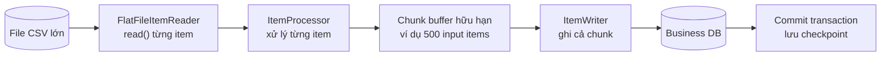
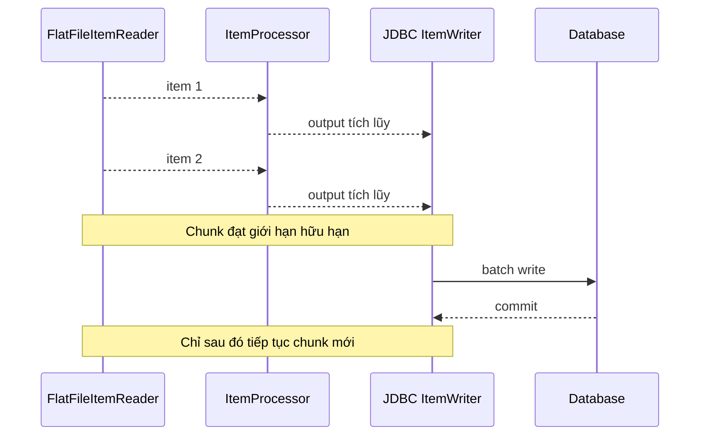
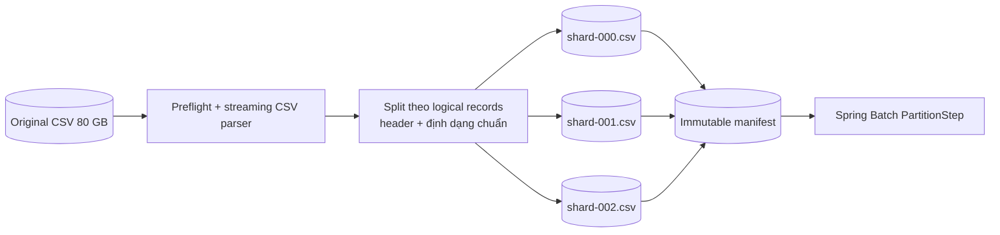

# Đọc file lớn theo chunk trong Spring Batch: streaming, checkpoint và mở rộng an toàn

## 1. Bài toán và mục tiêu học tập

Trong chương **File scaling** của module **SPRING_BATCH_SCALING_OPERATIONS**, ta muốn xử lý file dữ liệu lớn mà **không nạp toàn bộ nội dung vào RAM**, đồng thời vẫn giữ khả năng **retry/restart**, kiểm soát lỗi bản ghi và mở rộng throughput bằng tài nguyên thực tế. Đây là nền tảng trước khi chuyển từ một reader tuần tự sang nhiều worker xử lý các file/shard độc lập.

Giả sử hệ thống nhận một file CSV thanh toán kích thước 80 GB với hàng chục triệu bản ghi. Yêu cầu:

- Đọc tuần tự đúng từng bản ghi logic, không cần lưu cả file vào `List`.
- Xử lý theo chunk hữu hạn, ghi kết quả bằng transaction và commit định kỳ.
- Khi lỗi ở giữa file, restart **cùng JobInstance** từ checkpoint phù hợp, không xử lý lại từ đầu một cách thiếu kiểm soát.
- Không bỏ sót, nhân đôi hoặc thay đổi thứ tự nghiệp vụ vì chia file sai ranh giới byte/dòng.
- Quan sát throughput, memory, file I/O, parse errors, retry, rollback và thời gian resume.
- Khi một reader đơn không đủ nhanh, chia workload thành các file shard có manifest cố định rồi dùng partitioning, không vội chia một file nén bằng offset ngẫu nhiên.

Sau bài học, bạn cần giải thích và áp dụng được `FlatFileItemReader`, `ItemStream`, `chunk(size, transactionManager)`, `@StepScope`, `ExecutionContext`, `MultiResourceItemReader` và phân vùng file theo worker `StepExecution`.

> **Phiên bản minh họa:** Java 17+, Spring Batch **5.2.x**, Spring Framework 6 và PostgreSQL. Ví dụ là những đoạn cấu hình và test tham khảo; chưa phải project chạy độc lập vì cần application context, imports, hạ tầng database, schema và dữ liệu test. Với Spring Batch 6 hoặc object storage SDK khác, cần kiểm tra API và lifecycle đúng phiên bản.

## 2. “Đọc theo chunk” có ba nghĩa cần tách rõ

| Thuật ngữ | Phạm vi | Ví dụ | Có bảo đảm restart không? |
| --- | --- | --- | --- |
| **Streaming read** | Cách đọc nguồn | Reader trả **một item** từ `InputStream`/file mỗi lần `read()` | Chỉ khi có reader/`ItemStream` và input phù hợp |
| **Spring Batch chunk processing** | Đơn vị commit | Gom tối đa khoảng 500 item để processor/writer rồi commit | Có thể, nếu checkpoint và transaction đúng |
| **File sharding / partitioning** | Đơn vị song song | 80 GB được chuẩn bị thành 32 file độc lập | Cần manifest, tên partition và checkpoint riêng |

Sơ đồ:



**Điều rất dễ nhầm:** `chunk(500)` **không** yêu cầu hệ điều hành đọc 500 dòng trong một lệnh I/O, **không** tạo 500 thread và **không** nghĩa file được chia thành 500 byte/record cố định. Nó cấu hình **commit interval** và cách framework gom các input items của một chunk-oriented step.

Trong một chunk step tuần tự, `read()` và `process()` được thực thi theo vòng đời của chunk; `ItemReader.read()` thường trả một item, hoặc `null` khi EOF. Writer nhận `Chunk<? extends T>` sau khi processor hoàn tất/loại bỏ những item filter.

### Ví dụ logic với chunk size 3

```text
Input: A B C D E F G

Chunk 1:
  read A -> process A
  read B -> process B
  read C -> process C
  writer.write([A', B', C'])
  COMMIT + update StepExecutionContext

Chunk 2:
  read D -> process D
  read E -> process E
  read F -> process F
  writer.write([D', E', F'])
  COMMIT + update StepExecutionContext

Chunk 3:
  read G -> process G
  read() -> null (EOF)
  writer.write([G'])
  COMMIT / step completion
```

Đây là mô hình đơn giản khi không filter/skip/retry. Nếu processor trả `null`, item **bị filter** nên chunk output có thể ít hơn số input. Nếu một transaction rollback, cùng item có thể được đọc/xử lý lại theo semantics của reader và fault-tolerance policy.

## 3. Vì sao `Files.readAllLines` dễ làm job hết bộ nhớ?

Không nên viết:

```java
// Anti-pattern: toàn bộ file được giữ trong bộ nhớ.
List<String> lines = Files.readAllLines(path, StandardCharsets.UTF_8);

for (String line : lines) {
    process(line);
}
```

Với file hàng chục GB, các đối tượng `String`, `List`, dữ liệu parser và GC overhead có thể lớn hơn nhiều kích thước file trên disk. Thậm chí chưa chạy processor, JVM đã có nguy cơ `OutOfMemoryError`.

Một ví dụ Java streaming cơ bản:

```java
try (BufferedReader reader = Files.newBufferedReader(
        path, StandardCharsets.UTF_8)) {

    String line;
    while ((line = reader.readLine()) != null) {
        processLine(line);
    }
}
```

Cách thứ hai giới hạn lượng dữ liệu lưu trong RAM tại một thời điểm, **nhưng vẫn thiếu** nhiều chức năng Spring Batch: tracking `JobExecution`, checkpoint per commit, skip/retry policy, listener, metrics, transaction coordination và khả năng restart bằng `JobRepository`.

Vì vậy, trong ứng dụng Spring Batch, hãy ưu tiên **`FlatFileItemReader`** hoặc reader có giao ước `ItemStream` phù hợp thay vì tự dựng vòng lặp bên ngoài step.

### Bộ nhớ không hoàn toàn là O(1)

Một cách đánh giá gần đúng khi chunk-oriented step tuần tự:

```text
RAM working set ≈
    reader internal buffers
  + chunk input items
  + chunk processed items
  + writer/JDBC batch buffers
  + framework + application objects
```

Nếu một item có kích thước trung bình sau parse là `s` byte và chunk size là `B`, phần chunk phụ thuộc vào khoảng `O(B × s)` (có thể thêm nhiều bản sao/overhead). **Không phụ thuộc trực tiếp vào tổng số dòng của file**, nhưng vẫn có thể tăng mạnh khi `B` quá lớn hoặc một bản ghi duy nhất cực dài.

Giới hạn record length, payload size, nested data và memory của writer phải được xác định bằng profiling. Streaming một file 80 GB **không đồng nghĩa** an toàn nếu một dòng chứa chuỗi 500 MB.

## 4. File CSV mẫu và hợp đồng dữ liệu

Ví dụ mỗi file shard hoặc file đơn bắt đầu bằng header:

```csv
payment_id,amount,currency
1001,125.50,VND
1002,42.00,VND
1003,300.25,VND
```

Hợp đồng:

- `payment_id` là business key **duy nhất trong một run**. Nếu domain cho phép trùng ID có chủ đích, phải đổi khóa idempotency thành `(runKey, sourceFileId, recordId)` hoặc khóa nghiệp vụ phù hợp.
- `amount` là số thập phân parse bằng `BigDecimal`; không dùng `double` cho tiền.
- `currency` được validate theo danh mục nghiệp vụ, không chỉ kiểm tra có ba ký tự.
- Encoding là UTF-8, delimiter là dấu phẩy, newline được parser hỗ trợ đúng.
- Header, thứ tự cột và phiên bản schema được **khóa theo manifest** của input.
- File **bất biến** trong suốt các lần chạy/restart của cùng JobInstance.

### File format có thể phức tạp hơn CSV đơn giản

Phải xác định rõ:

| Đặc điểm | Rủi ro nếu bỏ qua |
| --- | --- |
| UTF-8 BOM | Header đầu tiên bị thêm ký tự BOM, đọc sai tên cột |
| CRLF/LF | Đếm dòng và parsing khác với raw byte offset |
| Quoted comma | `"A,B"` không phải hai cột |
| Quoted newline | Một **record logic** có thể chiếm nhiều dòng vật lý |
| Escaped quotes | Tokenizer phải hiểu `""` trong quoted field |
| Empty/null representation | Chuỗi rỗng khác null/0 trong nhiều nghiệp vụ |
| Invalid encoding | Decoder có thể lỗi hoặc thay ký tự theo policy |
| Truncated file | Restart có thể gặp EOF sớm hơn |
| Duplicate header | Reader có thể đọc header giữa file như data |
| Schema version | Parser phiên bản mới có thể đọc khác bản cũ |
| Compression | `.gz` thường không thể random-seek hiệu quả |

**Không tách file CSV thành shard bằng cách cắt tùy tiện tại byte offset**: byte đó có thể nằm giữa một ký tự UTF-8 hoặc trong một field chứa newline đã được quote.

## 5. Cấu hình `FlatFileItemReader` đọc dạng luồng

Một reader điển hình với Spring Batch 5.2:

```java
public record PaymentCsvRow(
        long paymentId,
        BigDecimal amount,
        String currency) {}
```

```java
@Bean("paymentCsvReader")
@StepScope
FlatFileItemReader<PaymentCsvRow> paymentCsvReader(
        ResourceLoader resourceLoader,
        @Value("#{jobParameters['inputUri']}") String inputUri) {

    Resource resource = resourceLoader.getResource(inputUri);

    return new FlatFileItemReaderBuilder<PaymentCsvRow>()
            .name("paymentCsvReader")
            .resource(resource)
            .encoding(StandardCharsets.UTF_8.name())
            .strict(true)
            .linesToSkip(1)
            .delimited()
            .delimiter(",")
            .names("payment_id", "amount", "currency")
            .fieldSetMapper(fields -> new PaymentCsvRow(
                    fields.readLong("payment_id"),
                    fields.readBigDecimal("amount"),
                    fields.readString("currency")))
            .saveState(true)
            .build();
}
```

**Các quyết định quan trọng:**

- `@StepScope` cho phép bind tham số **khi step thực thi**. Nó **không** tự biến reader thành thread-safe cho nhiều chunk threads của **cùng một StepExecution**.
- `ResourceLoader.getResource(inputUri)` hỗ trợ resource schemes mà ứng dụng có cấu hình (ví dụ `file:`, `classpath:`); **không mặc định hỗ trợ mọi object-store URI** như `s3:` hoặc `gs:`.
- `strict(true)` giúp fail khi resource không tồn tại thay vì âm thầm coi input rỗng; vẫn phải kiểm tra file trống/cut-off khi nghiệp vụ yêu cầu.
- `linesToSkip(1)` bỏ header; **không tự kiểm tra header có đúng schema**. Cần header callback/validator riêng trong production.
- `.delimited()` sử dụng tokenizer cho format có dấu phân cách. Cấu hình delimiter, quote, field set mapping và record separator theo định dạng nguồn thực.
- `name("paymentCsvReader")` xác định key namespace trong `ExecutionContext`; giữ ổn định khi restart.
- `saveState(true)` bật lưu state cần thiết. Nếu tắt, step không thể dựa vào state reader này để resume đúng vị trí.
- `read()` trả một `PaymentCsvRow` rồi tiếp tục; không tạo `List` chứa toàn bộ file.

### Không chấp nhận mọi đường dẫn từ request

Nếu inputUri do client gửi, cần **allowlist nguồn và path normalization**. Không cho request tự do đọc `file:/etc/...`, đường dẫn tuyệt đối ngoài kho dữ liệu, hoặc object URI tùy ý. Input được chọn từ **manifest đã đăng ký** của một work order; credentials/ACL và checksum phải được kiểm tra ở tầng lưu trữ.

### Về CSV có newline bên trong dấu nháy kép

Nếu format CSV cho phép record kéo dài nhiều dòng vật lý, cần `RecordSeparatorPolicy` phù hợp hoặc parser chuyên dụng có **khả năng kiểm thử restart/checkpoint**. Không giả định mỗi `readLine()` của `BufferedReader` là một record; `linesToSkip(1)` và line-number errors cũng cần hiểu theo logical/physical lines.

Khi format quá phức tạp, ưu tiên chuyển đổi đầu vào sang **shard định dạng chuẩn** với validation và manifest trước khi chạy bước xử lý chính.

## 6. Processor stateless và writer giao dịch

Giả sử job chỉ chuẩn hóa giá trị currency và ghi PostgreSQL. Mã không phụ thuộc vào state mutable chia sẻ giữa các item:

```java
public record NormalizedPayment(
        String runKey,
        long paymentId,
        BigDecimal amount,
        String currency) {}
```

```java
@Bean("paymentProcessor")
@StepScope
ItemProcessor<PaymentCsvRow, NormalizedPayment> paymentProcessor(
        @Value("#{jobParameters['runKey']}") String runKey) {

    return row -> {
        if (row.amount() == null || row.amount().signum() < 0) {
            throw new InvalidPaymentException("Negative/invalid amount");
        }

        String currency = row.currency().trim()
                .toUpperCase(Locale.ROOT);

        if (!Set.of("VND", "USD", "EUR").contains(currency)) {
            throw new InvalidPaymentException("Unsupported currency");
        }

        return new NormalizedPayment(
                runKey, row.paymentId(),
                row.amount().setScale(2, RoundingMode.HALF_EVEN),
                currency);
    };
}
```

`InvalidPaymentException` là exception do ứng dụng định nghĩa; đoạn code chưa cho phép skip nó, nên lỗi sẽ khiến job fail theo policy mặc định. Một hệ thống thật có thể dùng quarantine nếu hợp đồng nghiệp vụ cho phép, nhưng **không được tùy tiện skip payment bắt buộc**.

### Bảng kết quả và unique key

```sql
CREATE TABLE normalized_payment (
    run_key    varchar(160) NOT NULL,
    payment_id bigint NOT NULL,
    amount     numeric(20,2) NOT NULL,
    currency   varchar(3) NOT NULL,
    PRIMARY KEY (run_key, payment_id)
);
```

`runKey` là khóa logic bất biến của work order/JobInstance, **không** lấy từ `JobExecutionId` (ID này đổi giữa các lần restart).

```java
@Bean("paymentWriter")
JdbcBatchItemWriter<NormalizedPayment> paymentWriter(
        DataSource dataSource) {

    return new JdbcBatchItemWriterBuilder<NormalizedPayment>()
            .dataSource(dataSource)
            .sql("""
                INSERT INTO normalized_payment
                    (run_key, payment_id, amount, currency)
                VALUES (:runKey, :paymentId, :amount, :currency)
                ON CONFLICT (run_key, payment_id) DO NOTHING
                """)
            .itemSqlParameterSourceProvider(item ->
                    new MapSqlParameterSource()
                            .addValue("runKey", item.runKey())
                            .addValue("paymentId", item.paymentId())
                            .addValue("amount", item.amount())
                            .addValue("currency", item.currency()))
            .assertUpdates(false)
            .build();
}
```

`ON CONFLICT DO NOTHING` giúp replay một record không tạo row thứ hai; `assertUpdates(false)` cho phép SQL ảnh hưởng 0 row khi key đã tồn tại. Nhưng đây là **first-write-wins**, có nguy cơ che kết quả khác nhau của cùng key. Production cần so `payload hash/version` hoặc fail khi replay không khớp, tránh ghi dữ liệu cũ sai.

**Điều kiện:** PostgreSQL writer dùng cùng transaction manager phù hợp với datasource và checkpoint khi có thể. Với DB nghiệp vụ khác repository transaction, hoặc với API/file output, **không mặc định có một transaction nguyên tử xuyên các tài nguyên**.

## 7. Định nghĩa chunk step và job

```java
@Bean("importPaymentsStep")
Step importPaymentsStep(
        JobRepository jobRepository,
        PlatformTransactionManager transactionManager,
        @Qualifier("paymentCsvReader")
        ItemStreamReader<PaymentCsvRow> reader,
        @Qualifier("paymentProcessor")
        ItemProcessor<PaymentCsvRow, NormalizedPayment> processor,
        @Qualifier("paymentWriter")
        ItemWriter<NormalizedPayment> writer) {

    return new StepBuilder("importPayments", jobRepository)
            .<PaymentCsvRow, NormalizedPayment>
                    chunk(500, transactionManager)
            .reader(reader)
            .processor(processor)
            .writer(writer)
            .build();
}

@Bean("importPaymentsJob")
Job importPaymentsJob(
        JobRepository jobRepository,
        @Qualifier("importPaymentsStep") Step importStep) {

    return new JobBuilder("importPaymentsJob", jobRepository)
            .start(importStep)
            .build();
}
```

Một file lớn có thể được xử lý **trong một StepExecution** mà không cần partitioning. Đó nên là baseline đầu tiên vì checkpoint và data flow đơn giản hơn.

### Vì sao bắt đầu với chunk 500?

`500` chỉ là giá trị thí nghiệm. Phải benchmark theo kích thước record, thời gian DB transaction, API quota và retry cost. Nếu một row có payload 1 MB thì 500 items có thể tiêu RAM lớn; nếu mỗi row vài chục byte, chunk 500 có thể chưa đủ để tối ưu JDBC batching.

| Chunk size | Điểm mạnh | Đổi lại |
| --- | --- | --- |
| Rất nhỏ, ví dụ 10 | Rollback ít item, commit thường xuyên | Overhead DB transaction/JobRepository cao |
| Vừa, ví dụ 100–1.000 | Điểm xuất phát benchmark phổ biến | Phụ thuộc workload thật |
| Rất lớn, ví dụ 50.000 | Giảm số commit nếu sink đủ capacity | RAM/lock time, rollback work và retry latency tăng |

**Không** nên suy từ kích thước file (80 GB) ra chunk size. Chọn theo **item footprint, per-item latency, transaction cost và giới hạn nguồn/đích**, không theo tổng bytes.

## 8. Vòng đời checkpoint của `ItemStream`

Một `ItemStreamReader` có vòng đời:

```text
open(ExecutionContext)
  -> read()
  -> read()
  -> ...
  -> update(ExecutionContext) ở checkpoint boundary
  -> commit / persist state theo lifecycle transaction
  -> ...
close()
```

`FlatFileItemReader` quản lý vị trí/đếm item đã đọc trong `ExecutionContext` của StepExecution. Khi một JobInstance bị FAILED rồi restart hợp lệ, framework tạo **JobExecution mới** và có thể khôi phục state reader từ lần trước.

### Ví dụ: fail khi đã commit nhiều chunk

File có các record ID 1–10, `chunk(3)`. Lần đầu:

| Thời điểm | Reader đã trả item | Business output đã commit | Checkpoint bền vững |
| --- | --- | --- | --- |
| Bắt đầu | Chưa đọc | Trống | Đầu file |
| Chunk 1 commit | 1, 2, 3 | 1–3 | Sau 3 |
| Chunk 2 commit | 4, 5, 6 | 1–6 | Sau 6 |
| Chunk 3 lỗi trước commit | 7, 8, 9 | Vẫn 1–6 | Vẫn sau 6 |
| Restart | Reader khôi phục state | Giữ 1–6 | Tiếp tục xử lý chưa commit |
| Hoàn thành | 7–10 | Đủ 1–10 | Cuối file |

Bảng minh họa trường hợp writer DB và checkpoint được điều phối đúng với transaction. Nếu worker commit ngoại vi nhưng metadata không commit cùng transaction, **cùng record có thể được xử lý lại**. Vì vậy idempotent writer vẫn cần thiết.

### File phải không đổi qua restart

Nếu sau failure file bị sửa:

- Thêm một dòng trước vị trí checkpoint: item ở checkpoint cũ có thể trỏ sang item khác.
- Xóa một dòng: có thể bỏ sót record.
- Đổi encoding/newline hoặc parser version: item index chưa chắc còn tương đương.
- Đổi URI sang file khác dù cùng tên: checkpoint cũ không còn dùng được.

**Không coi timestamp của file là bằng chứng đủ rằng byte content không thay đổi**. Dùng manifest chứa size, checksum đáng tin cậy, storage version ID/immutable object key và schema/parser version.

### Restart có thể cần quét lại đoạn đầu file

`FlatFileItemReader` dựa trên vị trí item được lưu; khi mở lại một file tuần tự, việc khôi phục vị trí có thể cần **đọc/skip qua các record trước checkpoint**, thay vì seek tức thì tới byte offset. Với file rất lớn, **resume time** có thể đáng kể dù lượng item cần xử lý còn ít.

Đo `time_to_first_resumed_item`. Nếu restart tại 90% của file 80 GB quá chậm, cân nhắc upstream sharding, checkpoint byte offset được thiết kế cẩn thận hoặc format có chỉ mục/block-seek; không sửa nội bộ `ExecutionContext` bằng SQL để nhảy nhanh hơn.

## 9. JobInstance identity và immutable file manifest

Một job xử lý một file logic nên có bộ identifying parameters ổn định, ví dụ:

```java
JobParameters params = new JobParametersBuilder()
        .addString("runKey", "payments-2026-11-25-v1", true)
        .addString("manifestId", "manifest-20261125-v1", true)
        .addString("inputUri",
                "file:/data/immutable/payments-20261125-v1.csv", true)
        .addString("traceId", "scheduler-request-123", false)
        .toJobParameters();
```

`inputUri` trong ví dụ cố định như một resource được quản lý; trong production có thể chỉ dùng **manifest ID đã xác thực** làm identifying key và resolve URI từ registry. Đừng thêm `System.currentTimeMillis()` hay UUID identifying khi chỉ muốn restart.

### Manifest nên chứa gì?

| Trường | Tác dụng |
| --- | --- |
| `manifestId` / `runKey` | Danh tính work order đã chốt |
| `resourceUri` | Nơi file thực sự được lưu |
| `storageVersionId` | Bảo vệ chống object bị thay thế |
| `sizeBytes` | Phát hiện file cắt thiếu và capacity planning |
| `checksumAlgorithm` / `checksum` | Xác nhận nội dung |
| `encoding` | Giải mã đúng |
| `formatVersion` / `headerSchema` | Parser không âm thầm đổi semantics |
| `expectedRecordCount` | Kiểm tra độ phủ sau job |
| `createdAt` | Audit/provenance, không phải ID của mỗi attempt |
| `shardNo` và `totalShards` nếu đã chia file | Lập partition plan ổn định |

Không bắt buộc tính checksum toàn file **trong mỗi `read()`**; nó sẽ biến read thành bottleneck. Tính/kiểm tra lúc staging, preflight hoặc theo chính sách trust của immutable storage; nếu cần kiểm tra toàn bộ bytes, phải dự trù thêm một lượt I/O.

## 10. Xử lý lỗi đọc: parse, skip, retry khác nhau

Một file lớn thường có vài dòng xấu, nhưng chính sách recovery phụ thuộc nghiệp vụ.

### Nhóm lỗi

| Lỗi | Ví dụ | Phản ứng hợp lý |
| --- | --- | --- |
| **Malformed record** | Thiếu cột, sai quote/number | Fail hoặc skip/quarantine có giới hạn |
| **Domain-invalid item** | Amount âm, currency không hỗ trợ | Validation, quarantine/skip khi được phép |
| **Transient storage I/O** | Network share tạm mất | Retry có giới hạn nếu reader state an toàn; có thể phải restart step |
| **File truncated/replaced** | EOF đến sớm hoặc checksum mismatch | **Fail**, không coi là completed input |
| **DB deadlock** | Writer commit lỗi | Retry transaction/chunk có giới hạn |
| **OutOfMemoryError** | Dòng/chunk quá lớn | Thiết kế lại memory/backpressure; không skip toàn bộ lỗi JVM |
| **Poison record** | Record luôn lỗi khi retry | Retry vô hạn là sai; quarantine hoặc fail có audit |
| **Parser version incompatible** | Logic CSV quote/encoding thay đổi | Migration/reprocess version, không ép checkpoint cũ |

### Chỉ skip lỗi đã được duyệt

Ví dụ một worker được phép bỏ qua tối đa 10 dòng malformed trong một StepExecution:

```java
new StepBuilder("importPayments", jobRepository)
        .<PaymentCsvRow, NormalizedPayment>
                chunk(500, transactionManager)
        .reader(reader)
        .processor(processor)
        .writer(writer)
        .faultTolerant()
        .skip(FlatFileParseException.class)
        .skipLimit(10)
        .retry(TransientDataAccessException.class)
        .retryLimit(3)
        .build();
```

**Đoạn code là cấu hình policy minh họa**, không dùng để thay thế step đã khai báo ở trên mà không thống nhất beans. Một exception do tokenizer/field mapper có thể được bọc khác nhau; test phải xác nhận exception thực tế để skip đúng class.

- `skipLimit` không phải retry limit.
- `skip` không tự ghi một quarantine record bền vững.
- `FlatFileParseException` có thể chứa nội dung dòng gây lỗi; đừng log nguyên bản nếu chứa dữ liệu cá nhân.
- Với file thanh toán bắt buộc không được thiếu record, **không** nên skip để job COMPLETED mà bỏ qua đối soát.
- `retry` lỗi DB transient không bảo đảm tất cả side effects ngoài DB transaction đều có thể lặp lại an toàn.

### Log lỗi có thể vi phạm yêu cầu dữ liệu

```java
// Không nên log mọi dòng CSV nguyên văn vào file tập trung.
log.warn("Invalid line: {}", rawLine);
```

Ưu tiên ghi **run key, file ID, dòng/record index, error category, hash/tokenized identifier** và một reference vào vùng quarantine bảo mật nếu cần điều tra. Đặt retention và access controls rõ ràng.

## 11. Backpressure: streaming không phải queue vô hạn

Trong chunk step **tuần tự**, reader thường **chỉ đọc khi pipeline cần item tiếp theo**. Nếu writer/DB commit chậm, reader cũng chậm lại. Điều này tự nhiên giới hạn số item đang được giữ trong bộ nhớ.



Nếu tự thêm prefetch queue, hãy xác định:

1. Queue capacity tính theo **items và bytes**, không chỉ số message.
2. Ai sở hữu item đã dequeue nhưng chưa commit?
3. Khi JVM crash, có thể replay từ file/checkpoint mà không mất/trùng không?
4. Có còn một transaction boundary rõ giữa reader position và writer commit không?
5. Khi queue đầy, producer block, reject hay drop? Với dữ liệu tài chính, **silent drop không chấp nhận được**.

Không ghép một `ArrayBlockingQueue` vào reader rồi lưu offset **khi enqueue**, vì enqueue không có nghĩa business sink đã commit. Đây là một dạng sai lệch checkpoint phổ biến.

## 12. Khi một file đơn trở thành nút thắt

Trước khi chia shard, đo **bottleneck thật**:

| Triệu chứng | Giả thuyết | Cách kiểm chứng |
| --- | --- | --- |
| `read()` p95 cao | Storage I/O hoặc parser nặng | Disk/network latency, CPU parse, kích thước record |
| `process()` p95 cao | CPU-heavy hoặc external API | CPU profile, quota, thread blocking |
| Writer/commit chậm | DB pool/index/locks | JDBC batch latency, transaction duration, lock waits |
| `readCount` tăng chậm nhưng reader latency thấp | Downstream đang chặn | Process/write/commit time |
| GC dày, heap tăng | Chunk/item/buffering quá lớn | Heap histogram, GC logs, live object sizes |
| Restart mất nhiều phút trước khi có output | Reader phải skip phần đầu file | Time-to-first-item sau restart |
| CPU một core bão hòa dù máy còn nhiều core | Pipeline xử lý tuần tự | CPU samples, wall-clock stage fractions |
| Nhiều shard rảnh, một shard rất chậm | Data skew/record size lệch | Per-shard record count, bytes và latency |

### Throughput metrics

```text
input_record_rate     = delta(successful_read_items) / delta_seconds
processed_attempt_rate= delta(process_calls) / delta_seconds
business_commit_rate  = delta(committed_business_keys) / delta_seconds
file_byte_rate        = delta(bytes_read) / delta_seconds

Đơn vị phải được ghi rõ: records/s, attempts/s, bytes/s.
```

Không lấy `StepExecution.readCount` rồi chia cho một khoảng 10 giây tùy ý nếu counter là tích lũy cả job. Sử dụng delta ở **cùng cửa sổ**. `readCount` không bằng số dòng vật lý khi file có header, multiline CSV, skip hoặc retry.

## 13. Multi-threaded step không phải cách chia một reader file đơn an toàn

Với `TaskExecutor` ở chunk step, nhiều chunk có thể chạy đồng thời, nhưng **reader state được chia sẻ trong một StepExecution** nếu cấu hình không tách reader. `FlatFileItemReader` có cursor và `ExecutionContext` mutable, không mặc định thread-safe.

**Điểm dễ hiểu sai:** `@StepScope` nghĩa là scope theo **StepExecution**, không phải “một reader cho mỗi thread”.

Có thể đồng bộ hóa các thao tác `read()` qua wrapper như `SynchronizedItemStreamReader` trong một số tình huống, nhưng điều đó **không chứng minh restart an toàn** khi nhiều chunk hoàn tất và commit **không theo thứ tự item được đọc**. State offset tuyến tính có thể tiến qua những item có transaction chưa commit.

Vì vậy, để scale file lớn, thường an toàn hơn khi:

1. Duy trì một step tuần tự cho một file đơn nếu throughput đáp ứng SLA.
2. Chia nguồn **thành nhiều file độc lập** tại bước staging, có manifest.
3. Dùng local/remote partitioning: **mỗi worker StepExecution có reader riêng** trên một file.
4. Bảo vệ kết quả bằng business idempotency và kiểm thử restart sau một partition FAILED.

Không nhầm việc manager có 4 partition threads với worker tự có 4 chunk threads: hai tầng concurrency khác nhau và phải kiểm toán riêng.

## 14. Chia file thành shard: ranh giới phải theo record logic

Một file 80 GB không có nghĩa có thể cắt tại 8 offset cách đều 10 GB để được 8 CSV files hợp lệ. Nếu cắt giữa một quoted field, giữa ký tự UTF-8 hoặc sau một dấu escape, hai shard có thể parse sai.

### Hai lựa chọn

**Lựa chọn A — Split upstream có kiểm soát:**



Bước staging phải:

- Đọc theo record logic, không cắt raw byte mù.
- Giữ header/charset/parser version được chốt.
- Đảm bảo **mỗi input record xuất hiện đúng một lần** trong các shard.
- Ghi shard vào tên tạm, flush/sync theo yêu cầu storage, xác nhận checksum và **atomic publish/manifest** sau khi thành công.
- Nếu staging crash, không publish manifest trỏ đến các shard chưa hoàn tất; retry staging theo run key an toàn.
- Freeze danh sách shard, thứ tự và checksums cho cùng JobInstance.

**Lựa chọn B — Byte-range reader chuyên dụng:**

Có thể cần cho file rất lớn trên storage hỗ trợ seek/range reads, nhưng phải biết boundary logical record, UTF-8 decoder state, multiline CSV, semantics `endOffset` và checkpoint theo **byte offset đã commit**. Đây là **bài toán reader riêng**, không phải cấu hình `startByte/endByte` đơn giản vào `FlatFileItemReader`.

Với file có gzip nguyên khối, offset trong dữ liệu nén không tương ứng trực tiếp với ranh giới record giải nén; **không** dùng random HTTP range như cách chia gzip stream tùy ý. Ưu tiên upstream tạo nhiều `.gz` shards hoặc format splittable có index phù hợp.

## 15. Manifest và naming cho nhiều file

Một manifest đã freeze có thể chứa:

```json
{
  "manifestId": "manifest-20261125-v1",
  "runKey": "payments-2026-11-25-v1",
  "formatVersion": "payment-csv-v2",
  "encoding": "UTF-8",
  "totalShards": 3,
  "expectedRecords": 60000000,
  "shards": [
    {"shardNo":0,"uri":"file:/data/shards/part-000.csv","records":20000000},
    {"shardNo":1,"uri":"file:/data/shards/part-001.csv","records":20000000},
    {"shardNo":2,"uri":"file:/data/shards/part-002.csv","records":20000000}
  ]
}
```

JSON chỉ minh họa dữ liệu, không phải schema Spring Batch. Trong production bổ sung `sizeBytes`, checksum, storage object version, header/schema hash, thời điểm publish và trạng thái validation. Một `manifestId` có thể được xác định bằng versioned database row/object registry thay vì tin input JSON từ client.

### Quy tắc đặt tên

- `part-000` phải tiếp tục chỉ **cùng shard bytes** khi job restart.
- Không dùng `UUID.randomUUID()` hay `JobExecutionId` để sinh partition name.
- Không lấy thứ tự của một `HashMap` hoặc kết quả glob không sort làm thứ tự ổn định.
- Không tự chia lại shard số 0 thành dữ liệu khác khi đổi worker count.
- Một file manifest đã publish thì **không được append/overwrite** shards đang được dùng.

Lợi ích: Spring Batch có thể dựa vào **tên worker StepExecution** và context đã persist để phân biệt shard đã `COMPLETED` với shard `FAILED`.

## 16. Lập partition plan từ manifest đã xác nhận

Dùng một bảng ứng dụng chứa các file shard; đây **không phải** bảng mặc định của `JobRepository`:

```sql
CREATE TABLE payment_file_shard (
    manifest_id  varchar(100) NOT NULL,
    run_key      varchar(160) NOT NULL,
    shard_no     integer NOT NULL,
    resource_uri varchar(600) NOT NULL,
    checksum_sha256 varchar(64) NOT NULL,
    record_count bigint NOT NULL,
    PRIMARY KEY (manifest_id, shard_no),
    UNIQUE (manifest_id, resource_uri)
);
```

Một manifest phải bất biến sau khi được đưa vào job. Unique key chỉ ngăn trùng `shard_no` và URI trong một manifest, **không tự chứng minh** shard byte content không bị thay hoặc input record không xuất hiện hai lần.

### Tính đúng trước khi tạo JobExecution

- Manifest phải tồn tại và có đúng các shards đã publish.
- Mỗi resource URI có version/checksum đúng.
- Không có shard trùng cùng nội dung vô tình.
- Tổng `record_count` của shards khớp `expectedRecords` nếu hợp đồng yêu cầu.
- Mỗi shard header/schema hợp lệ.
- Một business key không xuất hiện ở hai shards nếu pipeline yêu cầu uniqueness, hoặc writer/aggregation phải xử lý duplicates theo policy.
- Nếu một shard rỗng, vẫn biết có cho phép worker zero-row hay không.

## 17. Java `Partitioner`: một StepExecution cho một file shard

Ví dụ ứng dụng có `JdbcTemplate` và một bảng `payment_file_shard` đã được freeze.

```java
public record ShardInfo(int number, String resourceUri) {}

public final class FileShardPartitioner implements Partitioner {

    private final JdbcTemplate jdbc;
    private final String manifestId;

    public FileShardPartitioner(
            JdbcTemplate jdbc, String manifestId) {
        this.jdbc = jdbc;
        this.manifestId = manifestId;
    }

    @Override
    public Map<String, ExecutionContext> partition(int gridSize) {
        List<ShardInfo> shards = jdbc.query("""
                SELECT shard_no, resource_uri
                FROM payment_file_shard
                WHERE manifest_id = ?
                ORDER BY shard_no
                """,
                (rs, rowNum) -> new ShardInfo(
                        rs.getInt("shard_no"),
                        rs.getString("resource_uri")),
                manifestId);

        if (shards.isEmpty()) {
            throw new IllegalStateException(
                    "No immutable shards in manifest=" + manifestId);
        }

        Map<String, ExecutionContext> result = new LinkedHashMap<>();

        for (ShardInfo shard : shards) {
            String name = String.format(
                    Locale.ROOT, "shard-%05d", shard.number());

            ExecutionContext context = new ExecutionContext();
            context.putString("resourceUri", shard.resourceUri());

            if (result.put(name, context) != null) {
                throw new IllegalStateException(
                        "Duplicate partition name=" + name);
            }
        }

        return result;
    }
}
```

`partition(int gridSize)` ở đây cố ý không chia lại manifest theo grid size. **Số worker StepExecution có thể nhiều hơn số thread chạy đồng thời**; `gridSize` không được dùng để thay đổi shard identity trong một restart.

### Late binding manifest tại manager

```java
@Bean("fileShardPartitioner")
@StepScope
Partitioner fileShardPartitioner(
        JdbcTemplate jdbc,
        @Value("#{jobParameters['manifestId']}") String manifestId) {

    return new FileShardPartitioner(jdbc, manifestId);
}
```

Đây là manager-scoped partitioner tạo context theo file; reader thực tế nằm ở **worker StepExecution**. `@StepScope` không phải bằng chứng có thể gọi tùy tiện bean này từ một thread không có StepContext; để framework resolve nó trong lifecycle step quản lý.

## 18. Worker reader theo `StepExecutionContext`

Một file shard có cùng schema CSV như file ban đầu:

```java
@Bean("shardCsvReader")
@StepScope
FlatFileItemReader<PaymentCsvRow> shardCsvReader(
        ResourceLoader resourceLoader,
        @Value("#{stepExecutionContext['resourceUri']}")
        String resourceUri) {

    return new FlatFileItemReaderBuilder<PaymentCsvRow>()
            .name("shardCsvReader")
            .resource(resourceLoader.getResource(resourceUri))
            .encoding(StandardCharsets.UTF_8.name())
            .strict(true)
            .linesToSkip(1)
            .delimited()
            .delimiter(",")
            .names("payment_id", "amount", "currency")
            .fieldSetMapper(fields -> new PaymentCsvRow(
                    fields.readLong("payment_id"),
                    fields.readBigDecimal("amount"),
                    fields.readString("currency")))
            .saveState(true)
            .build();
}
```

**Quan trọng:** Mỗi worker có `StepExecutionContext` riêng nên các reader `@StepScope` được tạo theo worker step. Cùng `name("shardCsvReader")` **không làm checkpoint va chạm** khi context của từng worker tách biệt.

Trong local partitioning, bốn worker có thể đọc bốn files trên cùng filesystem. Trong remote partitioning, **mỗi worker host phải truy cập URI tương ứng**, hoặc có downloader/cache kiểm chứng checksum/version. `file:/data/shards/...` ở manager **không mặc định tồn tại** ở host remote khác.

## 19. Worker Step và manager PartitionStep

```java
@Bean("fileWorker")
Step fileWorker(
        JobRepository repository,
        PlatformTransactionManager transactionManager,
        @Qualifier("shardCsvReader")
        ItemStreamReader<PaymentCsvRow> reader,
        @Qualifier("paymentProcessor")
        ItemProcessor<PaymentCsvRow, NormalizedPayment> processor,
        @Qualifier("paymentWriter")
        ItemWriter<NormalizedPayment> writer) {

    return new StepBuilder("fileWorker", repository)
            .<PaymentCsvRow, NormalizedPayment>
                    chunk(500, transactionManager)
            .reader(reader)
            .processor(processor)
            .writer(writer)
            .build();
}

@Bean("filePartitionExecutor")
ThreadPoolTaskExecutor filePartitionExecutor() {
    ThreadPoolTaskExecutor executor = new ThreadPoolTaskExecutor();
    executor.setCorePoolSize(4);
    executor.setMaxPoolSize(4);
    executor.setQueueCapacity(8);
    executor.setThreadNamePrefix("file-worker-");
    executor.initialize();
    return executor;
}

@Bean("fileManager")
Step fileManager(
        JobRepository repository,
        @Qualifier("fileWorker") Step worker,
        @Qualifier("fileShardPartitioner") Partitioner partitioner,
        @Qualifier("filePartitionExecutor") TaskExecutor executor) {

    return new StepBuilder("fileManager", repository)
            .partitioner(worker.getName(), partitioner)
            .step(worker)
            .gridSize(4)
            .taskExecutor(executor)
            .build();
}

@Bean("shardedImportJob")
Job shardedImportJob(
        JobRepository repository,
        @Qualifier("fileManager") Step manager) {

    return new JobBuilder("shardedImportJob", repository)
            .start(manager)
            .build();
}
```

Đây là **local partitioning** với `TaskExecutorPartitionHandler` được Spring Batch quản lý qua partition DSL; không phải remote chunking. Cấu hình hạ tầng và worker beans giả định đã được đăng ký như các đoạn trước.

### Điều kiện để scale thật

- Storage có đủ I/O bandwidth cho nhiều readers đồng thời.
- DB sink có connection pool/lock capacity phù hợp.
- File descriptors và heap/direct memory không bị bão hòa.
- Chunks/transactions và worker StepExecutions không tạo quá nhiều metadata writes.
- Shard sizes tương đối cân bằng; không để một shard chiếm 80% workload.
- Bắt đầu với 2–4 workers, tăng theo kết quả đo, không mặc định `maxPoolSize=32` tốt hơn.

**Không** thêm `taskExecutor` vào worker chunk step cùng lúc với partition manager nếu reader/StepExecution checkpoint chưa được audit hoàn chỉnh. Mỗi partition có reader riêng đã đủ để khai thác song song qua file shards.

## 20. `MultiResourceItemReader`: đọc nhiều file tuần tự hay partition?

Nếu có nhiều file nhưng chưa cần song song, Spring Batch có `MultiResourceItemReader` để đọc lần lượt một danh sách `Resource` bằng một delegate reader. Nó thích hợp khi:

- Tổng throughput một worker đủ SLA.
- Muốn một StepExecution kiểm soát thứ tự file rõ ràng.
- Muốn checkpoint theo resource và vị trí reader delegate.

Dạng cấu hình minh họa:

```java
@Bean("multiFileReader")
@StepScope
MultiResourceItemReader<PaymentCsvRow> multiFileReader(
        @Qualifier("csvDelegateReader")
        FlatFileItemReader<PaymentCsvRow> delegate,
        @Qualifier("orderedInputResources")
        Resource[] resources) {

    MultiResourceItemReader<PaymentCsvRow> reader =
            new MultiResourceItemReader<>();

    reader.setName("multiFileReader");
    reader.setResources(resources);
    reader.setDelegate(delegate);
    reader.setComparator(Comparator.comparing(
            Resource::getDescription));
    reader.setSaveState(true);

    return reader;
}
```

`csvDelegateReader` và `orderedInputResources` là các beans/cấu hình **ứng dụng phải cung cấp**; delegate cần hỗ trợ `ResourceAwareItemReaderItemStream`, có tên, tokenizer và checkpoint hợp lệ. Không coi snippet là một bean tự chạy nếu thiếu wiring.

**Cảnh báo quan trọng:** Comparator theo `Resource.getDescription()` chỉ là minh họa cho **thứ tự deterministic**, không phải hợp đồng bất biến mạnh. Trong production, dùng **thứ tự shardNo từ manifest**, hoặc prefix thứ tự cố định trong URI và test comparator. Nếu resource order thay đổi giữa restarts, vị trí resource được lưu có thể trỏ nhầm file.

### So sánh hai cách

| Phương án | Cách thực thi | Ưu điểm | Giới hạn |
| --- | --- | --- | --- |
| `MultiResourceItemReader` | Nhiều file **tuần tự** trong một step | Đơn giản, giữ một pipeline và một checkpoint logic | Không tăng throughput bằng nhiều worker |
| `MultiResourcePartitioner` hoặc custom `Partitioner` | Một hoặc nhiều file per worker StepExecution | Song song, checkpoint riêng, cô lập shard FAILED | Cần stable partition names/manifest và resource availability |
| Tự chia byte-range từ một file | Nhiều readers vào các vị trí trong file | Không cần lưu nhiều bản sao file nếu hạ tầng hỗ trợ | Khó đúng với quoted CSV, compression, charset, restart |

`MultiResourcePartitioner` là một lựa chọn có sẵn khi **mỗi resource là một partition**; custom partitioner như phần 17 dễ mở rộng hơn khi cần manifest, storage version, audit và kế hoạch restart bất biến.

## 21. File nén và object storage: tối ưu khác nhau

### 21.1. Gzip một file nguyên khối

Một `.gz` lớn thường cần giải nén tuần tự; đọc file nén dưới dạng stream giúp **tiết kiệm disk/network** nhưng restart/seek giữa file có thể tốn thời gian. Chunk size 500 **không khiến gzip trở thành splittable**.

Các hướng:

- Chia thành nhiều shards **trước khi nén**, tạo nhiều file `part-000.csv.gz` độc lập.
- Tạo format chứa nhiều block có index/seek support nếu hạ tầng phù hợp.
- Lập kế hoạch staging/checksum và đo chi phí decompress CPU.
- Khi worker restart, có thể phải giải nén lại phần đầu shard để đến checkpoint; shard nhỏ hơn giảm thời gian resume.

### 21.2. Object storage và HTTP ranges

Trên object storage, phải xem:

- Resource API có hỗ trợ stream và mở lại hay không.
- Storage object version/immutability, không chỉ URI.
- Network bandwidth, request/GET costs, throttling, retry và timeout.
- Việc tải lại bytes khi restart.
- Multipart/range semantics so với logical CSV record boundaries.
- Worker local cache và checksum verification.
- Không đưa access keys vào JobParameters, logs hoặc YAML.

Spring `ResourceLoader` thông thường **không tự hỗ trợ mọi cloud storage scheme**. Nếu cần `s3:`/`gs:`/`azure:`, dùng Resource implementation/SDK adapter phù hợp và test reopen behavior trước khi dựa vào `FlatFileItemReader`.

### 21.3. CSV, JSONL, Parquet và splittability

CSV dòng đơn giản hoặc JSON Lines có khả năng chia theo record boundary nếu parser/encoding đảm bảo; quoted multiline CSV làm điều này khó hơn. Parquet/Avro container có block/row group hỗ trợ parallel reads, nhưng cần reader/library tương thích để tích hợp Spring Batch.

Không nhất thiết mọi workload phải được xử lý bằng `FlatFileItemReader`; ưu tiên **định dạng dữ liệu và reader phù hợp** thay vì ép một file CSV nén nguyên khối vào nhiều thread.

## 22. Throughput, memory và tài nguyên khi scale file

### Ví dụ phép tính

Giả sử file chứa 12 triệu records, job đọc/ghi hoàn tất trong 40 phút:

```text
T = 40 × 60 = 2.400 giây
Business throughput = 12.000.000 / 2.400
                    = 5.000 records/giây
```

Nếu file 24 GB theo cách tính thập phân, tốc độ end-to-end trung bình theo file size khoảng `24.000 MB / 2.400 s = 10 MB/s`. Đây là **tốc độ tương đương dữ liệu input**, không phải đo raw disk I/O: cache, compression, multiple passes và bytes đọc thực tế có thể khác.

Khi 4 shard workers chạy đồng thời và hoàn thành trong 13 phút, speedup minh họa:

```text
Speedup = 40 / 13 ≈ 3,08 lần
Parallel efficiency (4 workers) ≈ 3,08 / 4 ≈ 77%
```

Các con số chỉ để luyện tính, **không phải benchmark của Spring Batch 5.2**.

### Nên đo gì?

| Nhóm | Chỉ số |
| --- | --- |
| Batch | `readCount`, `writeCount`, `filterCount`, skip counts, commit/rollback, elapsed time |
| File | bytes read, records/s, reopen time, decode errors, time-to-first-item after restart |
| JVM | heap used, live records, allocation rate, GC pause, direct buffers |
| Storage | read latency, throughput, file descriptors, network GET requests/bytes |
| Processor | p50/p95/p99 process time, CPU %, external API wait/quota |
| Writer | batch insert time, transaction latency, DB pool active/pending, lock waits |
| Partition | per-shard duration, bytes/records, slowest partition, work skew |
| Recovery | checkpoint age, restart duration, replay attempts, business duplicate conflicts |
| Correctness | expected keys, committed unique keys, missing/extra keys, payload mismatch |

**Không** suy từ `readCount` rằng file đã đọc đúng từng dòng vật lý: header, multiline records, skips/retries và filter có semantics khác. Đừng đếm `ItemWriter.write` calls như số row committed khi writer có UPSERT hoặc transaction rollback.

## 23. Kịch bản benchmark có kiểm soát

### Baseline — Một file, một worker

- Input immutable, ví dụ 5 triệu CSV records.
- Chunk sizes: 100, 500, 1.000.
- Dùng cùng processor và JDBC writer.
- Đo wall-clock, peak heap/GC, read/process/write p95 và business rows commit.

### Bước 2 — Nhiều files tuần tự

- Split input thành 8 shards đúng record boundaries.
- Dùng `MultiResourceItemReader` theo thứ tự manifest.
- So overhead file open/close, checkpoint và thời gian resume khi lỗi giữa shard cuối.

### Bước 3 — Local partitioning

- Dùng 2 rồi 4 workers, mỗi worker một file/shard.
- Tăng DB connections đủ cho transaction + JobRepository, không vượt ngân sách chung.
- Đo per-shard skew: cùng bytes không bảo đảm cùng CPU parse cost.
- Kiểm tra restart sau khi một worker FAILED.

### Bước 4 — Remote partitioning khi thực sự cần

- Chỉ chuyển remote nếu local JVM/host/IO không đủ và tài nguyên phân tán giúp giải quyết bottleneck.
- Dùng resource URIs mọi worker có thể truy cập hoặc tải staging local có checksum.
- Bổ sung broker/manager/worker lifecycle, in-flight ownership, retries và metrics.
- Test worker crash khi file shard đang xử lý, không chỉ happy path.

### Bảng kết quả giả định

| Cấu hình | Workers | Chunk | Duration | Peak heap/worker | Kết luận sơ bộ |
| --- | ---: | ---: | ---: | ---: | --- |
| Một file tuần tự | 1 | 100 | 52 phút | 240 MB | Baseline |
| Một file tuần tự | 1 | 500 | 40 phút | 280 MB | Giảm commit overhead |
| Một file tuần tự | 1 | 5.000 | 43 phút | 650 MB | Chunk quá lớn, rollback đắt |
| 8 shards, đọc tuần tự | 1 | 500 | 41 phút | 285 MB | Phù hợp restart theo resource |
| 8 shards, partitioning | 4 | 500 | 13 phút | 300 MB | Tăng throughput |
| 8 shards, partitioning | 8 | 500 | 14 phút | 310 MB | DB pool/storage bão hòa |

Số liệu trên **chỉ minh họa**, không dùng như thông số mặc định. Nếu concurrency cao làm transaction failures hoặc business output sai, cấu hình đó phải bị loại dù nhanh hơn.

## 24. Kiểm thử reader và checkpoint trên một file nhỏ

Một unit test cho `FlatFileItemReader` có thể dùng `ByteArrayResource` và `ExecutionContext` để kiểm tra reader trả item tuần tự và có thể reopen từ checkpoint.

### Reader factory cho test

```java
private FlatFileItemReader<PaymentCsvRow> newReader(
        Resource resource, String name) {

    return new FlatFileItemReaderBuilder<PaymentCsvRow>()
            .name(name)
            .resource(resource)
            .encoding(StandardCharsets.UTF_8.name())
            .strict(true)
            .linesToSkip(1)
            .delimited()
            .names("payment_id", "amount", "currency")
            .fieldSetMapper(fields -> new PaymentCsvRow(
                    fields.readLong("payment_id"),
                    fields.readBigDecimal("amount"),
                    fields.readString("currency")))
            .saveState(true)
            .build();
}
```

### Test đọc lại từ state đã lưu

```java
@Test
void readerResumesAfterSavedCheckpoint() throws Exception {
    Resource csv = new ByteArrayResource("""
            payment_id,amount,currency
            1001,12.50,VND
            1002,20.00,VND
            1003,30.00,VND
            """.getBytes(StandardCharsets.UTF_8));

    ExecutionContext persisted = new ExecutionContext();

    FlatFileItemReader<PaymentCsvRow> first =
            newReader(csv, "checkpointableReader");

    first.open(persisted);
    assertEquals(1001L, first.read().paymentId());

    // Minh họa checkpoint sau khi item đầu đã xử lý thành công.
    first.update(persisted);
    first.close();

    FlatFileItemReader<PaymentCsvRow> resumed =
            newReader(csv, "checkpointableReader");

    resumed.open(persisted);
    assertEquals(1002L, resumed.read().paymentId());
    assertEquals(1003L, resumed.read().paymentId());
    assertNull(resumed.read());
    resumed.close();
}
```

Test này dùng **chính cùng ExecutionContext object** để mô phỏng state đã được persist. Nó **không phải** integration test của `JobRepository`, rollback hay database transaction; Spring Batch sẽ quản lý thời điểm persist context trong step thực.

### Trường hợp test cần bổ sung

| Test | Điều cần chứng minh |
| --- | --- |
| File 0 bản ghi nhưng có header | Reader trả EOF; business policy quyết định có chấp nhận |
| File không tồn tại và `strict(true)` | Step fail; không coi là zero records thành công |
| Số cột sai hoặc amount không parse được | `FlatFileParseException`/mapping failure đúng policy |
| UTF-8 BOM/CRLF | Header/parser xử lý đúng |
| Quoted comma/multiline record | Một logical record không bị tách sai |
| File bị thay sau checkpoint | Preflight/version/checksum phát hiện |
| Restart sau chunk đã commit | Reader tiếp tục đúng, output không thiếu/trùng |
| Restart gần cuối file rất lớn | Đo resume latency/skip cost |
| Lỗi writer DB tạm thời | Retry không nhân đôi business side effects |
| Skip record xấu | Có quarantine/audit; tổng số input được đối soát |
| Tạo file shard rồi crash trước publish manifest | Manifest chưa tham chiếu shard dang dở |
| Chạy 4 shards, một worker FAILED | Restart không xử lý lại tùy tiện các shard COMPLETED |
| Đổi tên/thứ tự shard giữa restart | Bị chặn bởi immutable manifest/validation |

## 25. Integration test: FAILED → restart → COMPLETED

Để chứng minh restart thực, dùng `@SpringBatchTest`, datasource test bền qua **hai lần launch**, input immutable và writer có fault injector.

### Tiêm lỗi một lần trước write của chunk thứ hai

```java
public final class FailOnceWriter
        implements ItemWriter<NormalizedPayment> {

    private final ItemWriter<NormalizedPayment> delegate;
    private final AtomicBoolean failOnce;

    public FailOnceWriter(
            ItemWriter<NormalizedPayment> delegate,
            AtomicBoolean failOnce) {
        this.delegate = delegate;
        this.failOnce = failOnce;
    }

    @Override
    public void write(Chunk<? extends NormalizedPayment> chunk)
            throws Exception {

        boolean contains1004 = chunk.getItems().stream()
                .anyMatch(item -> item.paymentId() == 1004L);

        if (contains1004 && failOnce.compareAndSet(true, false)) {
            throw new IllegalStateException(
                    "Injected failure before chunk commit");
        }

        delegate.write(chunk);
    }
}
```

Với `chunk(3)` và input IDs 1001–1007, lần đầu có thể commit 1001–1003 rồi FAIL ở chunk chứa 1004. Restart cùng JobInstance tiếp tục 1004–1007, writer idempotent chịu được replay nếu có.

**Không dùng `chunk(500)` với chỉ bảy test items rồi kỳ vọng một chunk đã commit trước khi lỗi**. Test profile phải cấu hình `chunk(3)` hoặc seed đủ dữ liệu. `FailOnceWriter` phải được **wiring** vào worker step ở test profile; class tự đứng một mình không tạo lỗi.

### Skeleton integration assertions

```java
@Test
void failedCsvStepRestartsSameJobInstance() throws Exception {
    JobParameters params = new JobParametersBuilder()
            .addString("runKey", "payments-test-v1", true)
            .addString("manifestId", "manifest-test-v1", true)
            .addString("inputUri", "file:/test/immutable.csv", true)
            .toJobParameters();

    JobExecution first = jobLauncherTestUtils.launchJob(params);
    assertEquals(BatchStatus.FAILED, first.getStatus());

    JobExecution second = jobLauncherTestUtils.launchJob(params);
    assertEquals(BatchStatus.COMPLETED, second.getStatus());

    assertNotEquals(first.getId(), second.getId());
    assertEquals(
            first.getJobInstance().getInstanceId(),
            second.getJobInstance().getInstanceId());

    Long committed = jdbcTemplate.queryForObject("""
            SELECT COUNT(*) FROM normalized_payment
            WHERE run_key = ?
            """, Long.class, "payments-test-v1");

    assertEquals(7L, committed);
}
```

Đây là **skeleton** cần `@SpringBatchTest`, `@SpringBootTest`, `JobLauncherTestUtils` chọn đúng job, fixture immutable CSV thực sự tồn tại, bảng DB, transaction manager và writer fail-once đã được inject. Các ví dụ/test **chưa được chạy**; không coi là test production-ready.

**Không xóa repository giữa lần FAILED và restart**. Nếu cleanup metadata trước lần hai, bạn đã tạo JobInstance mới và không còn kiểm tra đúng cơ chế checkpoint.

## 26. Đối soát dữ liệu sau khi đọc xong file

Giả sử manifest ghi `expectedRecordCount` và các record có business key duy nhất. Sau khi job COMPLETED, cần kiểm tra:

- Đủ các `payment_id` hợp lệ được ghi.
- Không có payment ID ngoài manifest/snapshot.
- Amount/currency khớp transformation version.
- Những record được skip/quarantine đã được phân loại hợp lệ, có audit.
- Không có shard nào FAILED hoặc đang in-flight, nhất là remote workers.

SQL cơ bản:

```sql
SELECT run_key,
       COUNT(*) AS committed_rows
FROM normalized_payment
WHERE run_key = :runKey
GROUP BY run_key;
```

**`COUNT(*) = expectedRecordCount` chưa đủ để chứng minh correctness** nếu key có duplicates, source filter, record bị thiếu nhưng output thừa, hoặc overwrite sai payload. Nên đưa file records đã được chuẩn hóa vào staging/source-of-truth table có checksum rồi dùng `LEFT JOIN`/set comparison theo keys.

Ví dụ nếu đã có `payment_staging` với `(manifest_id,payment_id)`:

```sql
SELECT s.payment_id
FROM payment_staging s
LEFT JOIN normalized_payment n
  ON n.payment_id = s.payment_id
 AND n.run_key = :runKey
WHERE s.manifest_id = :manifestId
  AND n.payment_id IS NULL
ORDER BY s.payment_id;
```

Query phải trả 0 hàng khi mọi record hợp lệ bắt buộc có output. `payment_staging` là bảng **ứng dụng minh họa**, không phải metadata Spring Batch. Nếu nghiệp vụ cho phép duplicates hay nhiều outputs/item, cần sửa join key và phép đối soát theo business contract.

### Đừng cộng `writeCount` mọi JobExecution thành số item duy nhất

Một JobInstance có thể FAILED rồi restart, một số chunk/item được replay. `StepExecution.writeCount` phản ánh số item framework ghi nhận ở step attempt, **không nhất thiết là số row INSERT mới** khi writer dùng `ON CONFLICT DO NOTHING`. Đối soát bằng unique business keys đã commit.

## 27. Runbook khi file lớn thất bại giữa chừng

1. **Khoanh danh tính:** job name, identifying parameters, `runKey`, manifest ID, file/storage version, format/encoding.
2. **Kiểm tra source:** có đổi size/checksum/version, bị truncate, xóa hoặc chưa publish hết không?
3. **Đọc `JobRepository`:** trạng thái JobExecution/StepExecution, `readCount`, `writeCount`, skip/rollback/commit counts và checkpoint.
4. **Phân loại lỗi:** parse/encoding, bad record, transient DB, storage I/O, timeout, OOM, worker thread safety hay resource exhaustion.
5. **Kiểm tra downstream:** business rows đã commit, API/outbox side effects, duplicates, missing/extra keys.
6. **Kiểm tra in-flight:** với partitioning/remote, tìm worker/transaction cũ còn chạy; không coi manager timeout nghĩa worker đã dừng.
7. **Chặn lịch trùng:** không tự thêm identifying `run.id`/timestamp để launch instance mới, gây đọc lại toàn bộ file.
8. **Khắc phục đúng tầng:** sửa DB pool, chunk size, file format, permission, parser hoặc bad input theo business policy.
9. **Bảo toàn manifest và checkpoint:** không sửa `ExecutionContext` bằng SQL; nếu file/rules thật sự thay đổi, lập reprocess version mới có chủ đích.
10. **Restart cùng JobInstance** khi metadata và worker lifecycle đủ điều kiện; theo dõi thời gian reader reopen/skip.
11. **Đối soát hoàn tất:** coverage theo manifest, data quality, bad records/quarantine, checksum/amount, duplicate và downstream publish.
12. **Ghi audit:** nguồn lỗi, số records đã commit, thời gian resume, shard failures, các thay đổi cấu hình và bằng chứng không mất item.

### Metadata `STARTED` sau process crash

Nếu JVM bị kill, JobRepository có thể còn `STARTED` dù process không còn. Không UPDATE `BATCH_JOB_EXECUTION.STATUS` bằng SQL tùy tiện. Phải xác minh worker đã thực sự dừng, giải quyết broker/in-flight và thực hiện runbook recovery đã được kiểm chứng.

## 28. Các anti-pattern thường gặp

| Sai lầm | Hậu quả | Cách xử lý |
| --- | --- | --- |
| `Files.readAllLines` cho file 80 GB | Heap/GC/OOM | `FlatFileItemReader` streaming |
| “`chunk(500)` = đọc 500 byte/lệnh I/O” | Hiểu sai commit interval | Phân biệt item/chunk/byte |
| Chunk thật lớn để “nhanh hơn” | OOM, lock lâu, rollback đắt | Benchmark theo item footprint/transaction |
| `saveState(false)` mà vẫn kỳ vọng resume | Reader có thể bắt đầu lại | Checkpoint hoặc process-indicator thay thế |
| Đổi file sau khi job FAILED | Offset/item count trỏ sai | Immutable manifest + version/checksum |
| Dùng `@StepScope` như mỗi thread có reader riêng | Cursor race trong multi-threaded step | Partition một reader per worker StepExecution |
| Cắt UTF-8 CSV theo raw offset | Ký tự/record bị chia giữa shard | Split theo logical record/format splittable |
| Dùng gzip nguyên khối rồi chia random range | Không giải nén/seek đúng | Pre-split nhiều compressed shards |
| File shard order không ổn định | MultiResource restart sai resource | Frozen ordered manifest |
| Tạo partition name theo JobExecutionId | Restart mất identity worker | Deterministic name theo shardNo |
| Writer append một file chung từ nhiều workers | Output interleave/duplicate | Per-partition outputs + atomic merge/publish |
| Bỏ qua `FlatFileParseException` không audit | Mất dữ liệu nghiệp vụ | Skip có policy + quarantine |
| Checkpoint offset được update khi enqueue | Có thể skip item chưa commit | Persist theo successful transaction |
| Dùng `JobExecutionId` làm dedupe key | ID đổi sau restart | Stable runKey/business ID |
| Tin `COUNT(*)` là đủ | Thiếu item/bù bằng extra hoặc mismatch | Coverage + checksum/value comparison |
| Đọc nhiều workers trên cùng volume đã bão hòa | Throughput giảm, I/O contention | Đo bandwidth, giảm concurrency/cân bằng shards |
| Dùng object URI không hỗ trợ bởi ResourceLoader | Reader không mở được | Resource implementation/SDK adapter |
| Ghi inputUri tự do từ HTTP request | Đọc trái phép file/data | Allowlist + work-order manifest validation |
| Tắt validation khi file bị truncate | Job có thể COMPLETED với output thiếu | Manifest/checksum/record-count verification |
| Benchmark happy path không test restart | Tăng tốc nhưng resume sai | Fault injection & reconciliation |

## 29. Checklist production

- [ ] File được đọc dạng streaming, không giữ toàn bộ records trong `List`/heap.
- [ ] Phân biệt **streaming read**, **chunk commit** và **file sharding/partitioning**.
- [ ] Chunk size được chọn theo memory, transaction, write cost và rollback cost đã đo.
- [ ] `FlatFileItemReader` có `name`, `saveState` và `strict` phù hợp.
- [ ] Charset, newline, delimiter, quoting, escape, header và schema version có hợp đồng và tests.
- [ ] Input resource/manifest **bất biến** qua mọi JobExecution restart cùng JobInstance.
- [ ] Reader không bị dùng chung không an toàn giữa các chunk threads.
- [ ] Source URI được allowlist và resolve qua registry/manifest, không nhận đường dẫn tùy ý.
- [ ] `ItemProcessor` không lưu shared mutable state hoặc đã được audit thread safety.
- [ ] Writer giao dịch/idempotent theo business key ổn định; detect replay payload mismatch.
- [ ] Parse/data errors có skip/retry/quarantine policy hợp lệ, không silently drop.
- [ ] Theo dõi `readCount`, `writeCount`, skip, commit/rollback và business committed keys.
- [ ] Đã test FAILED → restart cùng JobInstance với output đầy đủ/không trùng.
- [ ] Đã đo `time_to_first_resumed_item` với file lớn, nhất là khi gần cuối.
- [ ] Nếu chia file, shard boundaries dựa trên **logical records**, không raw byte tùy tiện.
- [ ] Shards được publish atomically cùng **ordered manifest** và checksums.
- [ ] Worker partition name gắn cố định với shardNo; mapping không thay đổi trong restart.
- [ ] MultiResourceItemReader có thứ tự resources deterministic và delegate hỗ trợ ItemStream.
- [ ] Remote workers thực sự truy cập được immutable shard URI và xác minh storage version.
- [ ] Với gzip, đã xác định seek/restart cost và chiến lược pre-split nếu cần.
- [ ] Có capacity budget cho filesystem/object store throughput, DB pool, CPU/GC và executor.
- [ ] Không nâng concurrency quá mức khi bottleneck nằm ở writer/DB hoặc storage bandwidth.
- [ ] Có business reconciliation về record coverage và payload correctness trước publish.
- [ ] Có runbook khi JobRepository `STARTED` tồn dư, file bị thay hoặc worker cũ còn in-flight.

## 30. Câu hỏi tự kiểm tra

**1. `chunk(1.000)` nghĩa Spring Batch sẽ đọc 1.000 dòng CSV vào RAM một lần rồi mới chạy processor?** Không theo nghĩa I/O block. `ItemReader.read()` trả từng item; framework gom input theo commit interval và writer nhận một chunk. Thời điểm process theo từng item phụ thuộc chunk provider/processor pipeline.

**2. Dùng `FlatFileItemReader` có chắc chắn không bao giờ OOM không?** Không. Chunk quá lớn, record cực dài, parser/writer buffers, downstream caches hoặc leaks vẫn có thể tiêu hết memory.

**3. Vì sao `saveState(true)` vẫn chưa đủ để restart an toàn nếu file bị sửa?** Vì checkpoint tham chiếu vị trí logic trên nội dung cũ; khi input đổi, cùng vị trí có thể là record khác.

**4. Vì sao không cắt CSV tại offset byte chia đều?** Có thể cắt giữa ký tự UTF-8, quoted field hoặc logical record nhiều dòng.

**5. Vì sao `@StepScope` không tự cho phép multi-threaded step đọc một file an toàn?** Scope là theo StepExecution; nhiều chunk threads của cùng StepExecution vẫn có thể chia sẻ reader state và commit out of order.

**6. `MultiResourceItemReader` có làm nhiều file chạy đồng thời không?** Không, nó đọc các resources tuần tự trong một reader; muốn song song cần partitioning hoặc kiến trúc khác.

**7. Vì sao tạo nhiều `.gz` shards thường dễ restart hơn một `.gz` nguyên khối?** Mỗi worker chỉ phải mở/giải nén lại một shard nhỏ hơn; một gzip stream nguyên khối thường không hỗ trợ random seek hiệu quả.

**8. Nếu reader đã đọc item 1004 rồi writer rollback, được coi item đã hoàn tất chưa?** Chưa. Chỉ state bền vững phù hợp transaction và output đã commit mới quyết định tiến độ.

**9. Tăng worker từ 4 lên 16 nhưng throughput giảm, nên kiểm tra gì?** Storage bandwidth, DB pool/locks, heap/GC, executor queue, file handle limit và shard skew.

**10. Job `COMPLETED`, `writeCount=10.000` có đủ chứng minh 10.000 records CSV đúng không?** Không. Cần so expected keys/manifest với business output, filter/skip records và payload/version.

## Tài liệu tham khảo

- [Spring Batch 5.2 — Chunk-oriented Processing](https://docs.spring.io/spring-batch/reference/5.2/step/chunk-oriented-processing.html): mô hình read/process/write và commit interval.
- [Spring Batch 5.2 — Flat File Item Readers](https://docs.spring.io/spring-batch/reference/5.2/readers-and-writers/flat-files/file-item-reader.html): `FlatFileItemReader`, line mapper, tokenizer và file records.
- [Spring Batch 5.2 — ItemStream](https://docs.spring.io/spring-batch/reference/5.2/readers-and-writers/item-stream.html): `open/update/close`, checkpoint và restart.
- [Spring Batch 5.2 — Scaling and Parallel Processing](https://docs.spring.io/spring-batch/reference/5.2/scalability.html): multi-threaded step, partitioning và worker execution.
- [Spring Batch 5.2 — Configuring a Step for Restart](https://docs.spring.io/spring-batch/reference/5.2/step/chunk-oriented-processing/restart.html): trạng thái step, reader checkpoint và restart policy.
- [Spring Batch 5.2 — Testing](https://docs.spring.io/spring-batch/reference/5.2/testing.html): `@SpringBatchTest` và Job/Step integration tests.
- [Spring Batch 5.2 API — FlatFileItemReader](https://docs.spring.io/spring-batch/docs/5.2.x/api/org/springframework/batch/item/file/FlatFileItemReader.html): streaming line read và ItemStream implementation.
- [Spring Batch 5.2 API — FlatFileItemReaderBuilder](https://docs.spring.io/spring-batch/docs/5.2.x/api/org/springframework/batch/item/file/builder/FlatFileItemReaderBuilder.html): fluent builder và line tokenizer configuration.
- [Spring Batch 5.2 API — MultiResourceItemReader](https://docs.spring.io/spring-batch/docs/5.2.x/api/org/springframework/batch/item/file/MultiResourceItemReader.html): đọc nhiều resources và lưu state.
- [Spring Batch 5.2 API — MultiResourcePartitioner](https://docs.spring.io/spring-batch/docs/5.2.x/api/org/springframework/batch/core/partition/support/MultiResourcePartitioner.html): chia resource thành partition contexts.
- [Spring Framework — Resource Abstraction](https://docs.spring.io/spring-framework/reference/core/resources.html): `Resource`, `ResourceLoader` và supported schemes.

**Điều cần nhớ:** **Đọc file lớn theo chunk không có nghĩa tải toàn bộ file, và chunk size không phải kích thước byte của lần đọc I/O.** Spring Batch dùng reader trả từng item, chunk-oriented step gom item để commit theo transaction và `ItemStream` lưu checkpoint. Muốn scale vượt khả năng một file reader, hãy chia dữ liệu theo **logical record** thành các shards bất biến, freeze manifest, cấp **mỗi worker StepExecution một reader** và giữ mapping ổn định qua restart. Mọi tối ưu phải được kiểm chứng bằng **throughput, memory, transaction metrics và đối soát business output**, không chỉ dựa vào số thread hoặc `readCount`.
