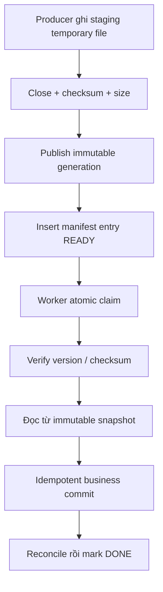
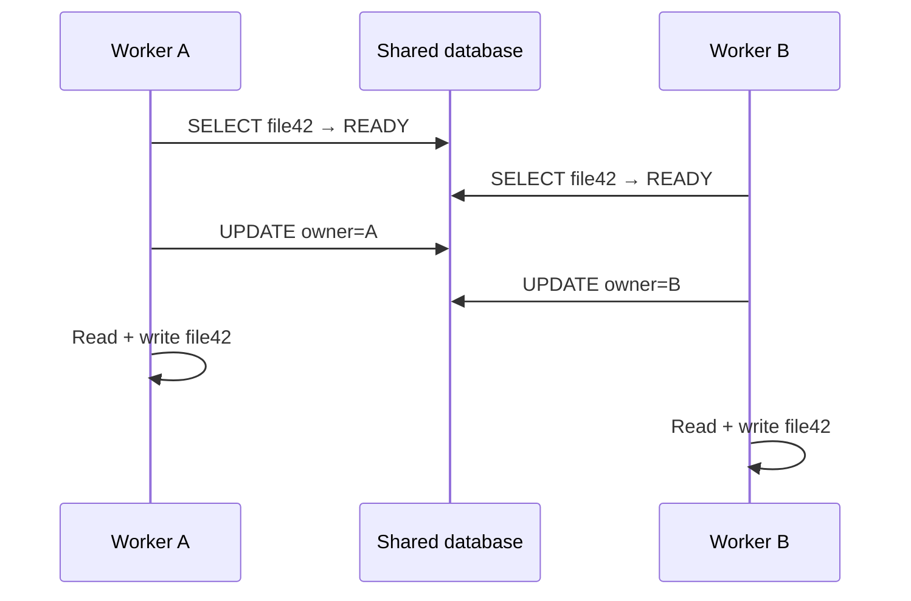
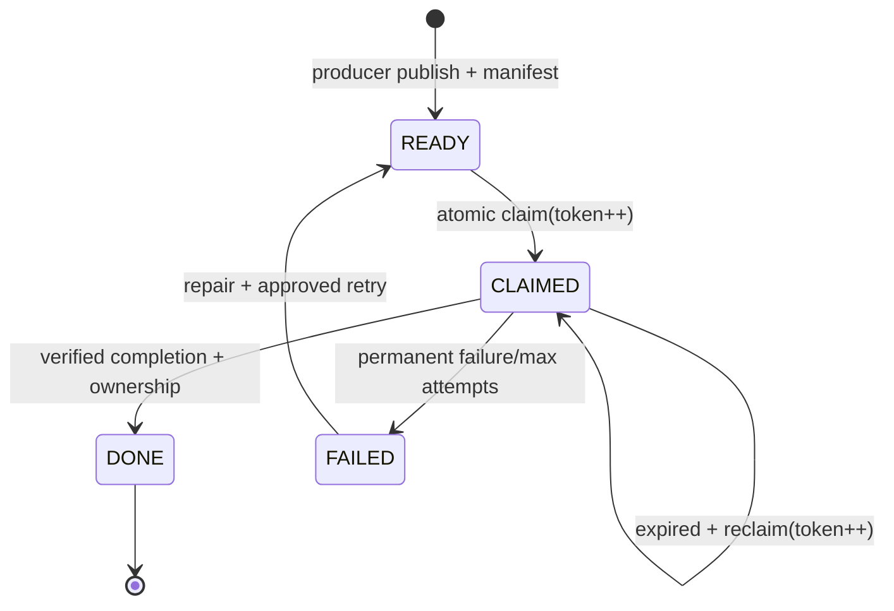
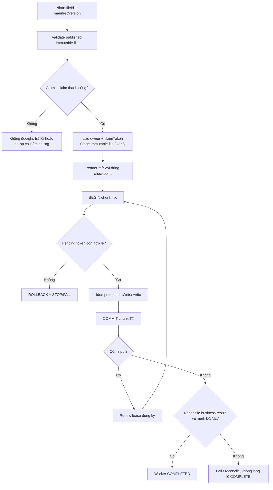

# Tránh hai worker xử lý cùng file trong Spring Batch

> **Chương:** File scaling  
> **Mục tiêu:** Tránh việc hai worker cùng đọc và gây tác dụng nghiệp vụ lên **cùng một phiên bản file** khi dùng multi-threaded steps, parallel steps, local/remote partitioning và nhiều JobExecution/JVM. Bài tập trung vào immutable manifest, atomic claim, lease/fencing token, `@StepScope`, checkpoint/restart, writer idempotent, observability và fault injection. Ví dụ hướng đến **Spring Batch 5.2.x**, Java 17, PostgreSQL và Spring JDBC.

## 1. Bài toán: Hai worker đều thấy file chưa xử lý

Một hệ thống nhận 40.000 file CSV mỗi đêm; để kịp SLA, người vận hành tăng lên 16 worker. Nếu mỗi worker quét cùng thư mục rồi tự chọn file chưa xử lý:

```text
Worker A: list /incoming → invoice-042.csv
Worker B: list /incoming → invoice-042.csv

Worker A: SELECT is_processed(file042) → false
Worker B: SELECT is_processed(file042) → false

Worker A: đọc và ghi 50.000 item vào DB
Worker B: đọc và ghi cùng 50.000 item vào DB
```

Lỗi không nhất thiết nằm ở reader hoặc writer. Nó nằm ở **quyền sở hữu công việc**: thao tác kiểm tra trạng thái rồi quyết định đọc file không nguyên tử giữa các tiến trình.

Hậu quả có thể là insert trùng, cộng số dư hai lần, append chồng nội dung file đích, database deadlock, checkpoints mâu thuẫn và JobRepository metadata khó khôi phục. Trong remote execution, một worker có thể đã xử lý file thành công nhưng mất reply; hệ điều phối giao lại cùng công việc cho worker khác.

**`gridSize`, `@StepScope` và `retryLimit` không tự khóa file trên toàn cluster.** Chúng giải quyết chia việc, phạm vi bean và retry; kiểm soát quyền sở hữu file phải được thiết kế riêng.

## 2. Ba lớp bảo vệ và bốn invariant

Nên tách ba lớp:

| Lớp | Câu hỏi | Cơ chế |
| --- | --- | --- |
| **Phân công** | File thuộc partition nào trong snapshot này? | Immutable manifest, `Partitioner`, tên partition ổn định |
| **Sở hữu runtime** | Worker nào đang được phép xử lý file/version? | Atomic claim, owner ID, lease, fencing token |
| **Tác dụng nghiệp vụ** | Nếu file hoặc item bị phát lại, output có ghi trùng không? | Unique business key, idempotent writer, transaction/outbox |

Bốn invariant cần kiểm chứng:

1. **At-most-one valid owner:** Một file/version chỉ có tối đa một claim hợp lệ tại một thời điểm.
2. **No stale write:** Owner cũ không được commit effect sau khi claim đã bị thay thế.
3. **Recoverability:** Worker chết không khiến file bị giữ mãi; có thể reclaim/restart có kiểm soát.
4. **Business effect không trùng:** Event được replay vẫn chỉ có hiệu ứng nghiệp vụ hợp lệ một lần.

Không thể hứa mỗi file “chỉ được mở đúng một lần” mà vẫn phục hồi sau crash. Một hệ **at-least-once** có thể đọc lại file, nhưng phải bảo đảm owner cũ bị chặn ở nơi ghi và output được dedup.

### Phân công không phải ownership

`Partitioner` có thể tạo map với một key cho mỗi file trong **một lần chia việc**, nhưng hai JobInstances khác nhau vẫn có thể sử dụng cùng manifest. Ngược lại, claim nguyên tử có thể đảm bảo một owner trong DB nhưng không ngăn JVM cũ tỉnh lại sau GC pause và cố ghi. Do đó cần **claim + fencing**.

## 3. File identity: Đường dẫn và tên file chưa đủ

Cùng bytes có thể xuất hiện dưới nhiều đường dẫn; cùng object key có thể chứa bytes khác nhau sau khi bị overwrite.

| Thuộc tính | Vì sao cần? |
| --- | --- |
| `sourceSystem` / `tenantId` | Tách namespace giữa các nguồn |
| `bucketName` / canonical logical path | Tìm vị trí file |
| `objectVersionId` / generation | Phân biệt các lần publish tại cùng path |
| `manifestFileId` | ID ổn định để partition/restart |
| `expectedSize` | Kiểm tra file có bị truncate/append |
| `sha256` | Kiểm chứng đúng bytes của phiên bản |
| `publishedAt` | Chỉ tiêu thụ file đã được producer công bố hoàn chỉnh |

Với object storage có versioning:

```text
fileIdentity = (sourceSystem, bucket, objectKey, objectVersionId)
```

Với filesystem không hỗ trợ versioning, dùng published generation/manifest ID **và cam kết file bất biến**. Đường dẫn `/incoming/a.csv` đơn lẻ không đủ nếu producer có thể ghi đè.

**ETag không phải lúc nào cũng là MD5 nội dung**, nhất là multipart upload; nếu cần kiểm tra bytes hãy dùng checksum được contract storage/producer bảo đảm.

### Unique file identity khác unique business event

Giả sử file A và file B đều chứa event `PAY-42`. Bảng claim có thể cho phép hai file được xử lý bởi hai workers khác nhau, nhưng bảng output vẫn phải quyết định event `PAY-42` có được áp dụng hai lần không. Unique key theo **file ID** không thay thế unique key theo **business event ID**.

## 4. Publish file theo snapshot bất biến

Một producer vẫn đang append file khi worker bắt đầu đọc sẽ làm checkpoint trở nên không đáng tin, dù chỉ một worker sở hữu nó.

Quy trình khuyến nghị:



- Với POSIX filesystem, atomic rename có thể dùng **trong cùng filesystem** nếu FS thực sự hỗ trợ. Move qua filesystem/volume hoặc object store thường có semantics khác.
- Với object store, nên dùng object **version/generation** hoặc content-addressed immutable key; không giả định rename là thao tác nguyên tử.
- Worker không quét `/latest` động khi restart; cần manifest freeze gắn với identifying `JobParameters`.
- Kiểm tra size/hash/version trước khi xử lý và đảm bảo bytes không thay dưới chân reader (ví dụ stage bản immutable, hoặc truy cập versioned object).
- Không xóa source file ngay khi claim; chỉ archive/cleanup theo retention sau khi business effects đã được xác minh và file DONE.

## 5. Các cách chia file và rủi ro

| Mô hình | Lợi ích | Nguy cơ trùng |
| --- | --- | --- |
| Một step tuần tự dùng `MultiResourceItemReader` | Đơn giản | Hai JobExecutions cùng resource list |
| Một file/một local partition | Reader tách biệt, checkpoint rõ | Partitioner cấp cùng file hai lần qua hai runs |
| N file/partition | Giảm metadata overhead | File list/group thay đổi khi restart |
| Remote partitioning | Scale nhiều JVM | Duplicate dispatch, old worker còn chạy |
| Workers tự poll một table queue | Cân bằng dữ liệu lệch kích thước | SELECT-then-UPDATE race nếu không atomic |
| Broker gửi message chứa file ID | At-least-once delivery | Redelivery sau worker commit nhưng chưa ACK |
| Nhiều CronJob/pods | Khởi chạy tự động | Scheduler overlap với cùng business date |

**Hai chiến lược chính:**

- **Static partition map:** Manager nạp **manifest bất biến** và chỉ định `fileId` cụ thể cho worker; phù hợp với restart bằng `ExecutionContext`.
- **Dynamic claiming queue:** Worker lấy file READY từ DB bằng thao tác atomic claim; cân bằng tốt khi số files rất lớn và size lệch nhau.

Có thể kết hợp một bản đồ partition với global file claim để chống hai JobInstances trùng nhau, nhưng không để worker được phân công file A lại tự claim file B mà không cập nhật metadata/ownership contract.

## 6. Anti-pattern: SELECT rồi UPDATE

```java
// PHẢN VÍ DỤ: hai JVM có thể đồng thời vượt qua kiểm tra.
if (!fileRepository.isDone(fileId)) {
    fileRepository.markProcessing(fileId, workerId);
    processFile(fileId);
}
```

`synchronized` hoặc `ReentrantLock` chỉ khóa threads **chia sẻ cùng JVM**. Hai pods có locks riêng. `FileChannel.lock()` có thể phù hợp trong một số filesystem được kiểm chứng nhưng không phải distributed lock chung cho NFS, SMB, object storage hay các môi trường container.



Ngay cả khi `markProcessing` dùng `@Transactional`, hai câu SQL riêng không tạo compare-and-set hợp lệ. Cần thao tác **claim nguyên tử trên một row** và một ràng buộc unique cho identity.

## 7. Bảng registry file có lease và fencing token

Ví dụ PostgreSQL:

```sql
CREATE TABLE ingest_file (
    file_id BIGINT GENERATED BY DEFAULT AS IDENTITY PRIMARY KEY,
    source_system VARCHAR(80) NOT NULL,
    bucket_name VARCHAR(255) NOT NULL,
    object_key VARCHAR(1024) NOT NULL,
    object_version VARCHAR(160) NOT NULL,
    expected_size BIGINT NOT NULL CHECK (expected_size >= 0),
    expected_sha256 CHAR(64) NOT NULL,

    status VARCHAR(20) NOT NULL DEFAULT 'READY'
        CHECK (status IN ('READY', 'CLAIMED', 'DONE', 'FAILED')),
    owner_id VARCHAR(160),
    claim_token BIGINT NOT NULL DEFAULT 0,
    lease_until TIMESTAMPTZ,
    attempt_count INTEGER NOT NULL DEFAULT 0,
    updated_at TIMESTAMPTZ NOT NULL DEFAULT CURRENT_TIMESTAMP,

    CONSTRAINT uk_ingest_file_version UNIQUE (
        source_system, bucket_name, object_key, object_version
    )
);

CREATE INDEX idx_ingest_file_queue
    ON ingest_file (status, lease_until, file_id);
```

**Tại sao cần từng trường?**

- Unique constraint chống hai scanners đăng ký **cùng file version** thành hai công việc.
- `status='READY'` có thể claim; `'CLAIMED'` gắn owner và lease; `'DONE'` không được claim lại như việc mới.
- `claim_token` tăng một đơn vị ở **mỗi lần claim/reclaim**, giúp chặn owner cũ.
- `lease_until` dựa vào clock DB để tránh lệch giờ giữa hosts.
- `attempt_count` để giới hạn replay, chuyển file lỗi dữ liệu cố định sang quarantine thay vì vòng lặp vô hạn.

Không dùng `JobExecution ID` làm identity file: restart hợp lệ tạo execution mới; file đó vẫn phải giữ một identity bất biến.

## 8. Atomic claim theo file ID bằng UPDATE ... RETURNING

Worker đã được phân công `fileId=42` phải claim **trước khi mở file**:

```sql
UPDATE ingest_file
SET status = 'CLAIMED',
    owner_id = :owner_id,
    claim_token = claim_token + 1,
    lease_until = CURRENT_TIMESTAMP + INTERVAL '2 minutes',
    attempt_count = attempt_count + 1,
    updated_at = CURRENT_TIMESTAMP
WHERE file_id = :file_id
  AND (
      status = 'READY'
      OR (
          status = 'CLAIMED'
          AND lease_until < CURRENT_TIMESTAMP
      )
  )
RETURNING file_id, owner_id, claim_token, lease_until;
```

Kết quả:

- **1 row** trả về: owner đã nhận quyền, lưu token để xử lý.
- **0 rows**: file đã DONE, FAILED hoặc đang được một owner hợp lệ giữ; **không đọc file**.
- DB exception hoặc timeout của câu claim: **không biết mình đã được cấp quyền hay chưa**, phải truy vấn/reconcile claim theo owner/request ID hoặc retry nguyên transaction claim theo contract; tuyệt đối không “claim lỗi nhưng cứ chạy”.
- Để đạt phân công nguyên tử, đặt statement trong **transaction ngắn**; không giữ lock tới khi file 50 GB được xử lý hết.

Với PostgreSQL `READ COMMITTED`, concurrent conditional UPDATE được bảo vệ bởi row lock và đánh giá lại điều kiện khi cần. Ở isolation khác có thể xuất hiện serialization errors; cần xử lý chúng với retry có giới hạn ở **tầng claim**, không biến lỗi claim thành quyền xử lý.

### Dynamic queue với SKIP LOCKED

```sql
WITH candidate AS (
    SELECT file_id
    FROM ingest_file
    WHERE status = 'READY'
       OR (
           status = 'CLAIMED'
           AND lease_until < CURRENT_TIMESTAMP
       )
    ORDER BY file_id
    FOR UPDATE SKIP LOCKED
    LIMIT 1
)
UPDATE ingest_file AS f
SET status = 'CLAIMED',
    owner_id = :owner_id,
    claim_token = f.claim_token + 1,
    lease_until = CURRENT_TIMESTAMP + INTERVAL '2 minutes',
    attempt_count = f.attempt_count + 1,
    updated_at = CURRENT_TIMESTAMP
FROM candidate c
WHERE f.file_id = c.file_id
RETURNING f.file_id, f.object_key, f.object_version,
          f.owner_id, f.claim_token, f.lease_until;
```

`FOR UPDATE SKIP LOCKED` giúp nhiều workers tránh chờ cùng một row; nhưng **không hứa strict FIFO/fairness**. Nó không thay lease khi worker chết, không thay fencing để chặn zombie worker và không giới hạn số lần reclaims.

## 9. Java 17 + Spring JDBC: Claim, renew và markDone

Mẫu repository cho claim **một file ID** bằng `NamedParameterJdbcTemplate`:

```java
package com.example.batch.files;

import java.time.Instant;
import java.util.List;
import java.util.Map;
import java.util.Optional;

import org.springframework.jdbc.core.namedparam.NamedParameterJdbcTemplate;
import org.springframework.stereotype.Repository;

@Repository
public class FileClaimRepository {

    private final NamedParameterJdbcTemplate jdbc;

    public FileClaimRepository(NamedParameterJdbcTemplate jdbc) {
        this.jdbc = jdbc;
    }

    public record Claim(long fileId, String ownerId,
                        long token, Instant leaseUntil) {}

    public Optional<Claim> tryClaim(long fileId, String ownerId) {
        List<Claim> rows = jdbc.query("""
            UPDATE ingest_file
            SET status = 'CLAIMED',
                owner_id = :owner,
                claim_token = claim_token + 1,
                lease_until = CURRENT_TIMESTAMP + INTERVAL '2 minutes',
                attempt_count = attempt_count + 1,
                updated_at = CURRENT_TIMESTAMP
            WHERE file_id = :id
              AND (status = 'READY'
                  OR (status = 'CLAIMED'
                      AND lease_until < CURRENT_TIMESTAMP))
            RETURNING file_id, owner_id, claim_token, lease_until
            """,
            Map.of("id", fileId, "owner", ownerId),
            (rs, rowNum) -> new Claim(
                    rs.getLong("file_id"),
                    rs.getString("owner_id"),
                    rs.getLong("claim_token"),
                    rs.getTimestamp("lease_until").toInstant()));

        return rows.stream().findFirst();
    }

    public boolean renew(Claim claim) {
        return jdbc.update("""
            UPDATE ingest_file
            SET lease_until = CURRENT_TIMESTAMP + INTERVAL '2 minutes',
                updated_at = CURRENT_TIMESTAMP
            WHERE file_id = :id
              AND owner_id = :owner
              AND claim_token = :token
              AND status = 'CLAIMED'
              AND lease_until > CURRENT_TIMESTAMP
            """, params(claim)) == 1;
    }

    public boolean markDone(Claim claim) {
        return jdbc.update("""
            UPDATE ingest_file
            SET status = 'DONE', owner_id = NULL,
                lease_until = NULL,
                updated_at = CURRENT_TIMESTAMP
            WHERE file_id = :id
              AND owner_id = :owner
              AND claim_token = :token
              AND status = 'CLAIMED'
              AND lease_until > CURRENT_TIMESTAMP
            """, params(claim)) == 1;
    }

    private Map<String, Object> params(Claim claim) {
        return Map.of(
                "id", claim.fileId(),
                "owner", claim.ownerId(),
                "token", claim.token());
    }
}
```

**Mã mẫu chưa phải cơ chế ownership hoàn chỉnh:**

1. `ownerId` cần duy nhất cho một **lần cấp quyền**, không chỉ hostname. Nên gắn node ID, JobExecution/StepExecution ID và một attempt ID riêng.
2. `tryClaim` trả `Optional.empty()` thì worker **không được đọc/ghi file**.
3. `renew() == false` là **mất quyền**, phải ngừng side effects và báo fail/reconciliation; không giả định chỉ là một cảnh báo.
4. `markDone() == false` không được coi là DONE; cần đối soát trước khi quyết định retry/fail.
5. Gọi các update này từ transaction **ngắn**, không mở transaction từ lúc claim tới khi đọc xong file.
6. Nếu connection timeout sau một câu UPDATE, outcome có thể chưa rõ; cần thiết kế claim request id/owner identity và reconciliation trước khi tự claim lại.
7. Nếu worker đã claim nhưng còn một worker khác chạy với **token cũ**, chỉ bảng registry chưa ngăn nó commit. Phải có fencing ở đích.
8. Demo chưa có max attempts/FAILED transition, dedup claim request hay backpressure; cần triển khai và integration test riêng.

## 10. Lease expiry và zombie worker: Fencing mới chặn được ghi trùng

Timeline:

```text
t0  Worker A claim file=42, token=7, lease 2 phút
t1  Worker A bị GC pause hoặc network partition 3 phút
t2  Lease A hết hạn; worker B reclaim, token=8
t3  Worker B đọc và ghi đúng file version
t4  Worker A tỉnh dậy, tưởng vẫn có quyền với token=7
t5  Nếu writer không kiểm tra token, A và B có thể cùng ghi
```

`lease_until` là hạn **ủy quyền**, không phải lệnh OS cưỡng chế dừng worker. **Fencing token** là số generation tăng mỗi lần cấp quyền và được kiểm tra ở **đúng nơi side effect được commit**.

### Fencing trong cùng PostgreSQL database

Nếu business output và `ingest_file` dùng **cùng database/transaction manager**, tại đầu mỗi chunk transaction:

```sql
BEGIN;

SELECT file_id
FROM ingest_file
WHERE file_id = :file_id
  AND status = 'CLAIMED'
  AND owner_id = :owner_id
  AND claim_token = :claim_token
  AND lease_until > CURRENT_TIMESTAMP
FOR UPDATE;

-- Nếu SELECT không trả row: ROLLBACK, throw StaleOwnershipException.
-- Nếu có row: giữ row lock tới khi business transaction hoàn tất.

-- INSERT/UPDATE business rows cùng transaction,
-- có unique business key và conflict validation.

COMMIT;
```

Tại sao `FOR UPDATE` quan trọng? Nếu chỉ đọc token rồi thả lock, owner mới có thể reclaim **giữa lúc** worker cũ ghi. Giữ row lock đến commit buộc người reclaim đợi transaction đang ghi hoàn tất; chunk tiếp theo của owner cũ phải xác minh lại token.

**Những điều kiện bắt buộc:**

- Ownership check và writes nằm **cùng physical DB transaction**.
- Không được xử lý tiếp khi SELECT không trả row; rollback và fail/stop.
- Kiểm tra **mỗi chunk có side effect**, không chỉ một lần ở `beforeStep`.
- Chunk không nên giữ transaction quá lâu; lease TTL phải hợp lý với tail latency.
- Không đánh dấu business success hoặc mark DONE khi ownership check thất bại.
- Với HTTP/object storage hoặc DB khác, DB-row lock không tự fencing downstream; cần kiểm tra token ở sink, outbox/idempotency hoặc protocol tương đương.

**Fencing không thay idempotency:** Nếu worker hợp lệ bị crash sau business commit, token mới có thể replay; unique business key vẫn cần ngăn double effect.

## 11. Renew lease và xử lý heartbeat thất bại

Giả sử file mất 40 phút để xử lý và TTL chỉ 2 phút. Nếu không renew, file sẽ bị worker khác reclaim dù owner vẫn chạy.

Cấu hình minh họa, phải benchmark trên workload thật:

```text
Lease TTL                 = 120 giây
Heartbeat interval        = 30 giây
P99 duration một chunk    = 8 giây
Clock so sánh             = PostgreSQL CURRENT_TIMESTAMP
Action khi renew bị từ chối = dừng ghi / fail worker
Fencing                   = kiểm tra tại mỗi chunk TX
```

Có thể renew giữa các chunks, hoặc qua thread/connection riêng theo một hợp đồng rõ. **Cẩn thận:** Nếu chunk TX đang giữ `FOR UPDATE` trên row `ingest_file`, heartbeat ở connection khác cố UPDATE cùng row **có thể bị block**. Do đó chọn TTL dài hơn tail latency của chunk, gia hạn giữa chunks hoặc thiết kế cơ chế cấp quyền tinh vi hơn.

`CURRENT_TIMESTAMP` của PostgreSQL cố định ở **đầu transaction**; claim/heartbeat nên dùng transaction ngắn. Không dùng đồng hồ máy A so với máy B để tự quyết định lease hết hạn.

Khi renew trả 0, nghĩa là token/owner/status/lease không còn hợp lệ. Không tiếp tục đọc/ghi file rồi hy vọng lần sau renew được. Cần dừng một cách fail-safe và đối soát những chunks đã commit.

## 12. Mô hình trạng thái file và các chuyển đổi hợp lệ



| Trạng thái | Hành vi worker khác |
| --- | --- |
| READY | Được thử claim |
| CLAIMED còn lease | Không xử lý; đợi hoặc báo trùng lịch |
| CLAIMED hết lease | Có thể reclaim bằng token mới; fencing chặn token cũ |
| DONE | No-op sau khi đối soát, không nhận như file mới |
| FAILED | Quarantine/điều tra, không tự lặp vô hạn |

Không có transition `DONE → READY` tự động chỉ vì một scheduler phát lại cùng file. Khi producer sửa nội dung, tạo **object version/manifest mới** hoặc correction job có semantics riêng. Nếu lỗi chỉ là một số row invalid, `skipLimit` và quarantine cần được áp vào hợp đồng DONE cụ thể: DONE nghĩa là các điều kiện chất lượng dữ liệu **đã đạt**, không phải chỉ hết input.


## 13. Spring Batch 5.2: Partitioner chia file không giao nhau

`Partitioner` có hợp đồng:

```java
public interface Partitioner {
    Map<String, ExecutionContext> partition(int gridSize);
}
```

Mỗi entry trả về là **tên partition → ExecutionContext của worker**. Map key không thể trùng, nhưng các values **vẫn có thể chứa cùng fileId** nếu application tạo sai. Phải kiểm tra uniqueness file identity trước khi trả về.

Ví dụ Partitioner lấy danh sách **từ manifest đã publish** (không list directory động mỗi lần):

```java
package com.example.batch.files;

import java.util.Comparator;
import java.util.HashSet;
import java.util.LinkedHashMap;
import java.util.List;
import java.util.Map;
import java.util.Set;

import org.springframework.batch.core.partition.support.Partitioner;
import org.springframework.batch.item.ExecutionContext;

public final class SnapshotFilePartitioner implements Partitioner {

    public record FileEntry(
            long fileId,
            String trustedLocalPath,
            String objectVersion) {}

    private final List<FileEntry> files;

    public SnapshotFilePartitioner(List<FileEntry> files) {
        this.files = List.copyOf(files);
    }

    @Override
    public Map<String, ExecutionContext> partition(int gridSize) {
        Map<String, ExecutionContext> result =
                new LinkedHashMap<>();
        Set<Long> seen = new HashSet<>();

        for (FileEntry file : files.stream()
                .sorted(Comparator.comparingLong(FileEntry::fileId))
                .toList()) {

            if (!seen.add(file.fileId())) {
                throw new IllegalStateException(
                        "Duplicate fileId: " + file.fileId());
            }

            ExecutionContext context = new ExecutionContext();
            context.putLong("fileId", file.fileId());
            context.putString("localFilePath",
                    file.trustedLocalPath());
            context.putString("objectVersion",
                    file.objectVersion());

            // Tên ổn định xuyên restart, không theo index/tên thread.
            result.put("file-" + file.fileId(), context);
        }
        return result;
    }
}
```

**Giải thích cẩn trọng:**

1. `files` phải thuộc **published manifest của một JobInstance**, với fileId/version bất biến. Constructor không tự lấy directory list thay đổi theo thời gian.
2. `gridSize` là một *hint* cho partitioning/handler; Partitioner có thể tạo một partition trên mỗi file, nên số phần tử không nhất thiết bằng gridSize. Khi có hàng trăm nghìn file nhỏ, cần group ổn định hoặc dynamic queue.
3. Tên `file-42` có thể trở thành `fileWorker:file-42` trong metadata của worker step; tên phải ổn định khi restart.
4. `trustedLocalPath` minh họa **local partitioning cùng hệ filesystem** và được cung cấp từ manifest đã xác minh. Với remote worker, truyền logical object URI/version rồi tải local copy trước khi mở reader; không giả định mọi pod thấy cùng đường dẫn.
5. Partitioner **không claim file** trong đoạn mã này; ownership vẫn do lớp registry/lease riêng. Đừng nhầm uniqueness của map với global lock.
6. Không dùng đường dẫn chứa thông tin người dùng chưa kiểm tra; ngăn path traversal, symlink substitution và đọc ngoài allowlisted root.
7. Nếu job restart, cơ chế `StepExecutionSplitter` có thể sử dụng lại trạng thái các partitions đã tạo. Phải giữ input version/names ổn định và test khi số worker thay đổi.

### Vì sao không lấy tên partition theo chỉ số động?

```text
Run #1:
    partition0 -> a.csv
    partition1 -> b.csv

Restart sau khi directory xuất hiện aa.csv:
    partition0 -> a.csv
    partition1 -> aa.csv
    partition2 -> b.csv
```

Nếu checkpoint của `partition1` đang nằm tại dòng 5.000 của `b.csv`, thay mapping nó sang `aa.csv` gây mất/trùng dữ liệu. Cách đúng là **freeze manifest và partition layout theo logical JobInstance**, không dùng thứ tự list lại từ directory khi restart.

### PartitionNameProvider

Spring Batch có `PartitionNameProvider` cho trường hợp tạo tên partition riêng và hỗ trợ restart mà không phải tính lại toàn bộ partition values. **Tên được trả phải khớp tên trong `Partitioner`**. Không lấy cơ chế này làm lý do thay map tên theo thư mục mới; consistency của manifest vẫn là điều kiện nền tảng.

## 14. @StepScope: Một reader trên mỗi StepExecution, không phải distributed lock

Trong worker step, cấu hình reader theo `ExecutionContext` của partition:

```java
package com.example.batch.files;

import java.math.BigDecimal;

import org.springframework.batch.core.configuration.annotation.StepScope;
import org.springframework.batch.item.file.FlatFileItemReader;
import org.springframework.batch.item.file.builder.FlatFileItemReaderBuilder;
import org.springframework.beans.factory.annotation.Value;
import org.springframework.context.annotation.Bean;
import org.springframework.context.annotation.Configuration;
import org.springframework.core.io.FileSystemResource;

@Configuration(proxyBeanMethods = false)
public class PerFileReaderConfig {

    public record InvoiceRow(
            String eventId, BigDecimal amount) {}

    @Bean
    @StepScope
    public FlatFileItemReader<InvoiceRow> invoiceFileReader(
            @Value("#{stepExecutionContext['localFilePath']}")
                    String path) {

        return new FlatFileItemReaderBuilder<InvoiceRow>()
                .name("invoiceFileReader")
                .resource(new FileSystemResource(path))
                .linesToSkip(1)
                .delimited()
                .names("eventId", "amount")
                .fieldSetMapper(fs -> new InvoiceRow(
                        fs.readString("eventId"),
                        fs.readBigDecimal("amount")))
                .build();
    }
}
```

Trong Spring Batch, `FlatFileItemReader` là stateful `ItemStream`, lưu vị trí để restart. Khi dùng Java configuration, return type của `@StepScope` bean nên thể hiện `ItemStream` (ở đây trả chính `FlatFileItemReader`) để proxy giữ đầy đủ lifecycle `open/update/close`.

**Phân biệt các trường hợp:**

- Local partitioning tạo **nhiều `StepExecution`**, mỗi partition có step-scoped reader của riêng mình.
- Multi-threaded chunk step **không partitioning** vẫn có **một `StepExecution`**; nhiều threads có thể dùng chung step-scoped reader đó. `@StepScope` không biến nó thành một reader mỗi thread.
- Hai `StepExecution` khác nhau vẫn có thể chứa **cùng `localFilePath`** nếu partition map/claim sai. `@StepScope` không ngăn duplicate.
- Với một file lớn chia byte ranges, mỗi worker reader cần offset/range riêng và xử lý biên record, không chỉ tạo nhiều `FlatFileItemReader` đều đọc từ đầu.
- Nếu source file đổi bytes giữa runs, checkpoint line number có thể trỏ nhầm dữ liệu. Cần source version, stable manifest và content verification.

### MultiResourceItemReader có tự chống hai worker đọc cùng file?

Không. `MultiResourceItemReader` đọc nhiều resources trong một step, và comparator giúp ổn định thứ tự resource khi restart. Nhưng nếu hai workers nhận cùng danh sách resource, cả hai vẫn có thể xử lý trùng. Muốn scale an toàn, chia resource sets **không giao nhau** hoặc claim từng file và có checkpoint rõ ràng.

## 15. Ví dụ manager và worker step theo Spring Batch 5.2

Cấu hình local partitioning để mỗi file được cấp cho một worker `StepExecution`:

```java
package com.example.batch.files;

import org.springframework.batch.core.Step;
import org.springframework.batch.core.partition.support.Partitioner;
import org.springframework.batch.core.repository.JobRepository;
import org.springframework.batch.core.step.builder.StepBuilder;
import org.springframework.batch.item.ItemWriter;
import org.springframework.batch.item.file.FlatFileItemReader;
import org.springframework.beans.factory.annotation.Qualifier;
import org.springframework.context.annotation.Bean;
import org.springframework.context.annotation.Configuration;
import org.springframework.scheduling.concurrent.ThreadPoolTaskExecutor;
import org.springframework.transaction.PlatformTransactionManager;

@Configuration(proxyBeanMethods = false)
public class PartitionedFileSteps {

    @Bean
    ThreadPoolTaskExecutor fileWorkerExecutor() {
        ThreadPoolTaskExecutor executor = new ThreadPoolTaskExecutor();
        executor.setCorePoolSize(4);
        executor.setMaxPoolSize(8);
        executor.setQueueCapacity(64);
        executor.setThreadNamePrefix("file-worker-");
        return executor;
    }

    @Bean
    Step fileWorker(
            JobRepository repository,
            PlatformTransactionManager transactionManager,
            @Qualifier("invoiceFileReader")
                    FlatFileItemReader<PerFileReaderConfig.InvoiceRow> reader,
            @Qualifier("guardedInvoiceWriter")
                    ItemWriter<PerFileReaderConfig.InvoiceRow> writer) {

        return new StepBuilder("fileWorker", repository)
                .<PerFileReaderConfig.InvoiceRow,
                  PerFileReaderConfig.InvoiceRow>
                        chunk(200, transactionManager)
                .reader(reader)
                .writer(writer)
                .build();
    }

    @Bean
    Step fileManager(
            JobRepository repository,
            @Qualifier("snapshotFilePartitioner")
                    Partitioner partitioner,
            @Qualifier("fileWorker") Step workerStep,
            @Qualifier("fileWorkerExecutor")
                    ThreadPoolTaskExecutor executor) {

        return new StepBuilder("fileManager", repository)
                .partitioner("fileWorker", partitioner)
                .step(workerStep)
                .gridSize(8)
                .taskExecutor(executor)
                .build();
    }
}
```

**Mã này là cấu trúc Step API, chưa phải ứng dụng hoàn chỉnh.** Cần khai báo:

- `snapshotFilePartitioner` được tạo từ **manifest version đúng của JobInstance**, không hardcode snapshot thay đổi ngầm giữa các launches.
- `guardedInvoiceWriter` có check token và writer idempotent thực tế (phần 16).
- Một cơ chế **claim trước khi mở reader**, đặt token/owner vào worker context, renew và finalize; không được cho reader bắt đầu khi claim thất bại.
- `Job`, JDBC JobRepository, datasource, schema và transaction manager tương thích.
- Quy tắc xử lý khi partition bị từ chối claim, khi manifest chứa file DONE, khi file thiếu/mismatch và khi JobExecution bị restart.
- Nếu worker chạy trên JVM khác, `localFilePath` cần được resolve/stage ở máy đó; không dùng path từ máy manager.

`gridSize(8)` là một cấu hình handler, **không** phải cam kết chỉ có tám files hoặc global owner count. Chọn pool và `gridSize` theo CPU/I/O/DB pool, không theo số file tối đa.

## 16. Thứ tự thực thi worker: Claim trước, fencing trong từng chunk

Một lifecycle worker nên có thứ tự:



Có thể triển khai claim trong `StepExecutionListener.beforeStep`, một dedicated claim/staging step hoặc wrapper worker có trạng thái được truyền rõ ràng. Tuy nhiên, phải kiểm tra **thứ tự lifecycle** của listener, scoped beans và `ItemStream.open`; không tự tin rằng đặt một listener bất kỳ luôn bảo đảm claim đã xảy ra trước mọi I/O.

### Idempotent writer cần unique business key

Ví dụ output PostgreSQL:

```sql
CREATE TABLE imported_invoice_event (
    source_system VARCHAR(80) NOT NULL,
    event_id VARCHAR(160) NOT NULL,
    payload_sha256 CHAR(64) NOT NULL,
    amount NUMERIC(18,2) NOT NULL,
    PRIMARY KEY (source_system, event_id)
);
```

Đường writer **trong cùng chunk DB transaction**:

```text
BEGIN;

-- 1. Lock owner row + verify claimToken/owner/lease (phần 10).
--    Không có row ⇒ ROLLBACK; throw StaleFileOwnershipException.

-- 2. Với mỗi item:
INSERT INTO imported_invoice_event(
    source_system, event_id, payload_sha256, amount
) VALUES (:source, :event, :hash, :amount)
ON CONFLICT (source_system, event_id) DO NOTHING;

-- 3. Nếu duplicate (update count 0):
--      SELECT stored payload_sha256 + canonical payload.
--      Nếu cùng payload: idempotent no-op.
--      Nếu khác: business conflict ⇒ rollback/fail.

COMMIT;
```

Đây là **pseudocode luồng xử lý**, không phải SQL nguyên khối có thể chạy nguyên văn với comments tham số. Cần dựng `ItemWriter<InvoiceRow>` dùng cùng datasource/transaction manager với chunk. Đừng chỉ gọi một phép check token **trước khi mở file**; sau GC pause hoặc lease expiry, token có thể đã stale.

### Không dùng StepExecution ID để chống double insert

`JobExecution` mới khi restart có thể mang ID khác, và partition cũng có thể được thực thi lại. Nếu unique key là `(jobExecutionId,rowIndex)`, replay sẽ ghi thêm bản thứ hai. Dùng `(sourceSystem,eventId)` hoặc identity nghiệp vụ thực sự ổn định qua các runs.

### Nếu output nằm ở hệ khác DB claim

`SELECT ... FOR UPDATE` trong PostgreSQL registry **không ngăn** worker stale gọi một payment API hoặc ghi object storage. Cần:

- Downstream hiểu/kiểm tra fencing generation nếu contract cho phép;
- hoặc idempotency key ổn định, trạng thái request và reconciliation;
- hoặc transactional outbox nếu business state và outbox ở cùng DB;
- hoặc giao thức saga/compensation khi không có atomic commit xuyên hệ.

**Token và idempotency giải quyết hai vấn đề khác nhau:** token chặn owner lỗi thời; idempotency chặn replay một business event đã commit.

## 17. Crash, checkpoint và restart: Cửa sổ dữ liệu trùng

| Worker chết ở mốc nào? | Trạng thái registry | Business effect | Phục hồi |
| --- | --- | --- | --- |
| Trước claim | READY | Chưa ghi | Worker khác claim |
| Sau claim, trước khi mở file | CLAIMED | Chưa ghi | Hết lease, token mới |
| Giữa chunk chưa commit | CLAIMED | Transaction cùng DB có thể rollback | Restart/replay đúng checkpoint |
| Sau chunk commit, trước checkpoint persisted | CLAIMED | Một số item đã commit | Idempotent replay, không double effect |
| Xử lý hết file, trước mark DONE | CLAIMED | Có thể đã ghi đủ | Reclaim/reconcile rồi DONE |
| Sau mark DONE, trước broker ACK | DONE | Output đã tồn tại | Redelivery kiểm tra DONE, không ghi lại |
| Worker pause dài, mất lease rồi tỉnh | Token cũ | Worker mới có thể đang ghi | Fencing reject stale token |
| File bị thay version giữa chừng | Claim version cũ | Có nguy cơ đọc trộn | Fail integrity; không âm thầm chạy tiếp |

`JobRepository` lưu `StepExecution` và `ExecutionContext` phục vụ restart. Nó không phải distributed file lock. Nếu hai JobInstances khác nhau sử dụng cùng file version, cả hai có thể có StepExecutions hợp lệ nhưng claim registry phải ngăn concurrent effects.

### Khác biệt retry trong step và reclaim file

- **Chunk retry:** Có thể rollback một chunk và gọi lại reader/processor/writer trong cùng `StepExecution`.
- **Job restart:** JobExecution mới cho cùng JobInstance, các step chưa hoàn tất có thể tiếp tục từ checkpoint.
- **Reclaim file:** Worker khác nhận quyền file sau lease expiry, với token mới.
- **Broker redelivery:** Message được gửi lại vì thiếu ACK/reply; không nhất thiết tạo retry context Batch giống lần trước.

Mỗi tầng có thể làm cùng bytes được đọc lại. Không coi `retryLimit(3)` là giới hạn số lượt xử lý file trên toàn cluster qua nhiều lần crash.

### Idempotency không biến data corruption thành hợp lệ

Nếu checkpoint/manifest sai, writer no-op theo event ID có thể che item thiếu hoặc bản mới mang payload khác. Cần checksum, row count, payload hash/version, source-to-target reconciliation và quarantine khi conflict.

## 18. Ngăn scheduler overlap và file owner chồng nhau

Ngay từ control plane:

1. Dùng identifying `JobParameters` như `businessDate` và `immutableManifestId`, không random UUID cho mỗi launch lại cùng dữ liệu.
2. Có distributed leader election/scheduling lock nếu nhiều pods cùng chạy `@Scheduled`.
3. Để JDBC `JobRepository` và unique constraints phân xử race trên **cùng JobInstance**.
4. Dùng file claim chung để ngăn **hai JobInstances khác nhau** dùng cùng version.
5. Nếu JobExecution trước còn `STARTED` nhưng process chết, thực hiện runbook chứng minh worker cũ không còn ghi effect trước recovery.
6. Đừng dùng `startNextInstance` để lách lỗi already-running rồi reprocess cùng nguồn mà không kiểm tra output.

Một kiểm tra `JobExplorer.getRunningJobExecutions(...)` rồi `JobLauncher.run(...)` **không phải thao tác nguyên tử** giữa hai scheduler, vì cả hai có thể cùng thấy danh sách rỗng.

### Remote partitioning và lost reply

Manager có thể không nhận kết quả của worker cũ dù worker đã commit DB. Nếu dispatcher giao lại partition, hai worker có thể cùng thấy một file. Ownership/lease/fencing phải có hiệu lực ở worker và sink, không chỉ trong local manager.

## 19. Filesystem locks, rename, NFS và object storage

| Nguồn lưu | Đặc điểm quan trọng | Khuyến nghị |
| --- | --- | --- |
| Local disk, một JVM | Có thể dùng file lock trong phạm vi OS | Vẫn cần restart/idempotency |
| Shared filesystem POSIX | Rename có thể atomic trong cùng filesystem | Test thực tế, có recovery cho `processing` |
| NFS/SMB | Lock/visibility/cache phụ thuộc server/mount | Không dựa vào in-memory/file lock đơn độc |
| Object store versioned | Object version ID/generation ổn định | Manifest theo version + claim DB |
| Object store không versioning | Cùng key có thể bị overwrite | Content-addressed immutable copy |
| Queue/file-ready messages | At-least-once, ACK/reply có thể mất | Idempotency + registry + DLQ |
| Containers nhiều pods | Local filesystem khác nhau mỗi pod | Stage theo version tại worker, không gửi local path mù |

Một kỹ thuật khác là **atomic rename từ inbox sang processing dir**:

```text
/incoming/a.csv
  → /processing/owner-A/a.csv
  → /done/a.csv
```

Cách này có thể là claim nếu storage hỗ trợ atomic rename và namespace chung. Nhưng không giải quyết hoàn toàn:

- Cross-device move thường không atomic.
- Với object storage, rename thường copy + delete.
- Worker chết sau rename khiến file mắc kẹt ở processing dir.
- Worker có file descriptor đang mở vẫn có thể đọc dù path đã đổi.
- Một Job restart có thể ghi lại các side effects đã commit.

Chọn DB claim khi cần ownership xuyên JVM/cluster, có audit và lease-based recovery. Nếu dùng file rename, hãy thêm reaper/lease và writer idempotent.

### Bảo mật path

Không để worker mở đường dẫn tùy ý từ message do người dùng gửi. File ID phải map tới trusted manifest, canonical path nằm trong allowlisted root, symlink/traversal được kiểm soát và bytes được kiểm tra theo published checksum/version.

## 20. Tuning: Khi có hàng trăm nghìn file nhỏ

Một partition/file cho 300.000 file có thể tạo 300.000 `StepExecution`, gây áp lực lên JobRepository và memory. Chọn chiến lược theo kích thước và độ lệch workload:

| Phương án | Metadata overhead | Restart granularity | Phù hợp |
| --- | --- | --- | --- |
| Một file/partition | Cao khi nhiều file | Per file | File lớn/số lượng vừa |
| Nhóm N file/partition | Trung bình | Theo nhóm; cần checkpoint per file | Rất nhiều file nhỏ |
| Dynamic file claim queue | Ít Batch StepExecutions, nhiều claim DB ops | Registry per file | Size skew lớn |
| MultiResourceItemReader tuần tự | Thấp | Resource index + item offset | Một worker hoặc nhóm đã được cấp |
| Range partition của một file lớn | Phụ thuộc số ranges | Theo range | Record boundary xác định |

Khi group files, **đóng băng mapping group → danh sách file có thứ tự** cho cả JobInstance. Worker cần claim từng file trước khi đọc, không dùng một cờ “directory processing” chung khi nhiều owner có thể tiếp cận.

### Thứ cần đo khi tăng số worker

- Successful files/hour và bytes/hour, không chỉ thread count.
- File size/record count skew, thời gian staging.
- DB locks, deadlocks, pool pending, rollbackCount.
- Claim denied/reclaim/renew failures.
- Số stale fencing rejects.
- Business duplicate no-ops và payload conflicts.
- Network/storage throughput, object GET latencies.
- JobRepository write volume và StepExecution count.

Nếu mọi worker cùng update một **hot business key**, file ownership duy nhất không ngăn DB contention giữa những files khác nhau. Có thể cần partition theo business key hoặc local aggregation trước merge.

## 21. Observability và runbook xử lý trùng file

Các log nên có `fileId`, `manifestId`, `objectVersion`, `ownerId`, `claimToken`, `stepExecutionId`, thời gian claim/renew/revoke, và business output reconciliation status.

```text
event=FILE_CLAIM_GRANTED
fileId=42 objectVersion=v007
owner=pod-3:step-901:attempt-a5
claimToken=18 status=CLAIMED

event=FILE_CLAIM_DENIED
fileId=42 requester=pod-4 reason=ACTIVE_OWNER

event=STALE_FILE_OWNER_REJECTED
fileId=42 staleToken=17 currentToken=18
action=ROLLBACK_CHUNK

event=FILE_DONE
fileId=42 claimToken=18
read=50000 applied=49999 duplicateNoop=1
reconciliation=PASS
```

Đây là **mẫu structured logs**, không phải log mặc định của Spring Batch.

| Metric | Ý nghĩa |
| --- | --- |
| `file_claim_attempt_total` | Số lần workers xin quyền |
| `file_claim_denied_total` | Tranh quyền, scheduler duplicate |
| `file_lease_reclaimed_total` | Crash/pause hoặc TTL quá ngắn |
| `file_lease_renew_failed_total` | Mất quyền giữa xử lý |
| `file_stale_token_rejected_total` | Zombie worker bị fencing |
| `file_hash_mismatch_total` | Nội dung khác manifest |
| `file_processing_duration_seconds` | Latency/size skew |
| `file_done_total` | Files hoàn tất đã đối soát |
| `business_duplicate_noop_total` | Event phát lại nhưng không tạo effect mới |
| `business_payload_conflict_total` | Cùng key, dữ liệu không tương đương |
| `broker_redelivery_total` | Remote message replay |
| `db_lock_wait_seconds` | Contention khi claim/output |

**Không dùng `fileId`/`objectKey`/`claimToken` làm Prometheus metric labels** cho hàng triệu file; hãy giữ ID trong structured logs/traces có phân quyền. Metrics nên có labels ổn định như jobName, sourceSystem, workerRole, result.

### Runbook khi phát hiện hai worker cùng xử lý file

1. Lấy **file identity đầy đủ**: source, key, version, size/hash và manifest ID.
2. Đọc registry: status, owner, claim token, lease deadline, attempts.
3. Kiểm tra cả hai workers: pod/JVM còn sống, job/step execution ID, log và broker correlation.
4. Xác định liệu worker cũ có token stale nhưng **vẫn commit được output** hay không.
5. Nếu fencing thiếu, **ngăn side effects mới**, cô lập hệ thống và đối soát.
6. Kiểm tra source bytes và published version, không chỉ tên file.
7. Đối soát business output, duplicates, conflicts, partial commits và outbox/DLQ.
8. Chỉ reclaim/restart khi owner cũ không còn tác động và checkpoint/data đã được xác minh.
9. Cập nhật lease TTL/heartbeat/partition mapping/worker protocol và bổ sung test tái hiện.
10. Ghi audit quyết định recovery; không sửa SQL JobRepository metadata vô kiểm soát.

Không ép `BATCH_STEP_EXECUTION.STATUS='COMPLETED'` hay chỉnh `VERSION` để “giải phóng file”. JobRepository và claim registry là hai trạng thái khác nhau, cần lifecycle riêng.

## 22. Ma trận sự cố và hướng khắc phục

| Triệu chứng | Nguyên nhân | Hướng xử lý |
| --- | --- | --- |
| Hai worker cùng claim một file | SELECT-then-UPDATE không atomic hoặc thiếu constraint | `UPDATE ... RETURNING` + unique identity |
| Một worker claim nhưng worker kia vẫn ghi | Lease expired, stale owner không bị fencing | Token tăng và sink-side token validation |
| File bị đọc nhầm sau restart | Manifest thay đổi, partition name theo index | Freeze manifest, stable fileId/partition names |
| `@StepScope` nhưng vẫn có duplicate | Mỗi StepExecution có reader riêng nhưng cùng path | Unique partition mapping + global claim |
| Worker claim 0 rows rồi vẫn đọc | Không kiểm tra claim result | Fail/skip có kiểm chứng, không mở file |
| File đang xử lý bị reclaim sớm | TTL quá ngắn, heartbeat bị block | Renew/TTL theo tail latency, đo transaction locks |
| Worker chết, file không bao giờ chạy lại | Không reclaim expired lease | Reaper và bounded retry |
| Claim thành công nhưng file thay nội dung | Producer overwrite/live file | Object version/immutable snapshot + hash |
| Job COMPLETED nhưng file còn CLAIMED | Finalize failed, afterStep không được gọi | Reconcile registry/output và retry mark DONE an toàn |
| Broker redelivery tạo duplicate output | Writer không idempotent | Stable business key/dedup/outbox |
| DB lock contention tăng khi scale | Hot business keys, quá nhiều concurrent chunks | Thay partition strategy, giảm workers |
| 100.000 files làm metadata phình | Một partition/file quá nhỏ | Group file ổn định hoặc dynamic queue |
| Không xác minh được commit sau timeout | Business DB/registry khác resource | Reconcile by business key, không retry mù |
| Object rename không atomic | Storage chỉ copy + delete | Dùng versioned immutable publish protocol |
| JobRepository optimistic locking | Hai processes cập nhật cùng StepExecution | Sửa ownership/dispatch, không sửa VERSION thủ công |
| Mark DONE nhưng output thiếu | Không có quality gate/reconciliation | Checksum/count/event ledger trước DONE |

## 23. Bài thực hành và fault injection

**Bài A — Race SELECT-then-UPDATE.** Dùng hai JVM hoặc hai threads cùng đọc READY trước khi update, chứng minh cả hai đều tưởng sở hữu file. Thay bằng conditional UPDATE và kiểm tra chỉ một claim được cấp.

**Bài B — Unique file version.** Đăng ký cùng `(sourceSystem,bucket,objectKey,version)` từ hai scanners đồng thời. Chỉ một row được tạo. Đăng ký version khác phải là công việc mới theo contract.

**Bài C — Atomic claim ở hai JVM.** Dùng chung PostgreSQL, claim cùng `fileId` và kiểm tra chỉ một worker nhận token; worker còn lại không được mở reader.

**Bài D — Dynamic queue SKIP LOCKED.** Tạo 200 files READY, chạy 8 claim workers. Kiểm tra không có file nào được nhận bởi hai owner hợp lệ cùng lúc và số completed được đối soát.

**Bài E — Zombie worker.** Worker A token 7 bị pause quá TTL, B reclaim token 8; A tỉnh lại và thử ghi. Fencing phải rollback/reject transaction của A.

**Bài F — Heartbeat starvation.** Cho chunk transaction giữ row lock lâu hơn nhịp heartbeat, quan sát blocked renew; chỉnh TTL/chunk size hoặc cơ chế heartbeat.

**Bài G — Restart với directory thay đổi.** Manifest ban đầu có A/B. Thêm AA trước restart; mapping worker partition/checkpoint phải vẫn là A/B cũ.

**Bài H — Step-scoped reader.** Hai partitions đọc A và B độc lập; cố tình cấu hình cùng A, quan sát `@StepScope` không chặn đọc trùng.

**Bài I — MultiResourceItemReader order.** Đọc ba files theo comparator cố định, kill giữa file thứ hai, restart bằng cùng resource list; so checkpoint. Thay list giữa runs phải bị chặn.

**Bài J — File 50 GB.** Chia file lớn theo byte/line ranges với record boundary rõ, không cắt record CSV nhiều dòng hoặc UTF-8 multi-byte; kiểm tra ranges không chồng, reader restart đúng.

**Bài K — Crash sau business commit, trước mark DONE.** Worker commit hết rows rồi chết, registry còn CLAIMED. Sau reclaim/replay, output chỉ có một effect/event, registry cuối cùng DONE.

**Bài L — Remote partition duplicate dispatch.** Broker giao cùng partition hai lần; claim/fencing/dedup phải ngăn hai workers cùng commit; JobRepository trạng thái không mâu thuẫn.

**Bài M — Object version mismatch.** Producer ghi đè key trong lúc job đang xử lý v1. Worker phải đọc v1 theo version hoặc fail integrity, không âm thầm dùng v2.

**Bài N — File rename.** Kiểm thử atomic rename cùng filesystem và non-atomic copy/move trên môi trường khác; xây recovery khi process chết sau khi move.

**Bài O — Business duplicate across files.** Hai file khác nhau cùng chứa event ID/payload: output chỉ một effect. Nếu payload khác, fail/quarantine, không `ON CONFLICT DO NOTHING` im lặng.

**Bài P — 100.000 files nhỏ.** So sánh 1 partition/file, 100 files/partition, dynamic queue; đo StepExecution rows, claim QPS, DB pool, throughput và restart cost.

**Bài Q — Scheduler overlap.** Khởi chạy hai JobInstances khác nhau cùng manifest. Registry phải giữ một owner hợp lệ; kiểm tra duplicate launch/correlation logs.

**Bài R — Observability.** Thiết kế alert trên reclaim/stale token, checksum mismatch và output reconciliation, không đánh giá chỉ bằng trạng thái Job COMPLETED.

### Checklist nghiệm thu production

- [ ] File identity bao gồm source namespace và immutable version/generation.
- [ ] Producer chỉ publish manifest khi file đã hoàn chỉnh.
- [ ] Manifest và partition mapping được giữ ổn định xuyên restart.
- [ ] Atomic DB claim thay thế SELECT-then-UPDATE.
- [ ] Có owner ID, lease TTL, renew, reclaims có giới hạn và fencing generation.
- [ ] Worker stale không thể commit business effect ở downstream.
- [ ] Reader riêng cho StepExecution, có checkpoint và kiểm tra file version.
- [ ] Không coi `@StepScope`, `gridSize` hay `JobRepository` là global file lock.
- [ ] Writer idempotent theo business key, kiểm tra payload conflict.
- [ ] Có chiến lược cho side effects ngoài cùng database/transaction.
- [ ] Đã test kill/restart, long pause, duplicate dispatch và lost ACK.
- [ ] Không mark DONE nếu output chưa được đối soát.
- [ ] Có metrics claim/renew/fencing, throughput và data quality.
- [ ] Không sửa trực tiếp Batch metadata để ép kết quả.

## 24. Tài liệu tham khảo chính thức

- [Spring Batch 5.2 — Scaling and Parallel Processing: Partitioning](https://docs.spring.io/spring-batch/reference/5.2/scalability.html)
- [Spring Batch 5.2 — Late Binding of Job and Step Attributes](https://docs.spring.io/spring-batch/reference/5.2/step/late-binding.html)
- [Spring Batch 5.2 — Multi-File Input](https://docs.spring.io/spring-batch/reference/5.2/readers-and-writers/multi-file-input.html)
- [Spring Batch 5.2 — Configuring a Step for Restart](https://docs.spring.io/spring-batch/reference/5.2/step/chunk-oriented-processing/restart.html)
- [Spring Batch 5.2 — Configuring a JobRepository](https://docs.spring.io/spring-batch/reference/5.2/job/configuring-repository.html)
- [Spring Batch 5.2 — Chunk-Oriented Processing](https://docs.spring.io/spring-batch/reference/5.2/step/chunk-oriented-processing.html)
- [Spring Batch 5.2.6 — Partitioner API](https://docs.spring.io/spring-batch/docs/5.2.x/api/org/springframework/batch/core/partition/support/Partitioner.html)
- [Spring Batch 5.2.6 — PartitionStepBuilder API](https://docs.spring.io/spring-batch/docs/5.2.x/api/org/springframework/batch/core/step/builder/PartitionStepBuilder.html)
- [Spring Batch 5.2.6 — MultiResourceItemReader API](https://docs.spring.io/spring-batch/docs/5.2.x/api/org/springframework/batch/item/file/MultiResourceItemReader.html)
- [Spring Batch 5.2.6 — TaskExecutorPartitionHandler API](https://docs.spring.io/spring-batch/docs/5.2.x/api/org/springframework/batch/core/partition/support/TaskExecutorPartitionHandler.html)
- [PostgreSQL — UPDATE RETURNING](https://www.postgresql.org/docs/current/sql-update.html)
- [PostgreSQL — SELECT FOR UPDATE / SKIP LOCKED](https://www.postgresql.org/docs/current/sql-select.html)
- [PostgreSQL — Transaction Isolation](https://www.postgresql.org/docs/current/transaction-iso.html)
- [Spring Framework — Transaction Propagation](https://docs.spring.io/spring-framework/reference/data-access/transaction/declarative/tx-propagation.html)

> **Giới hạn phiên bản và phạm vi:** Bài hướng đến Spring Batch 5.2.x và PostgreSQL. Các database khác có semantics khác nhau về locking/RETURNING/SKIP LOCKED. Mã Java minh họa những thành phần cụ thể nhưng **không phải ứng dụng runnable đầy đủ**: cần triển khai manifest loader, claim lifecycle, staging, guarded writer, Job, bean wiring và integration tests. Không tự suy Spring Batch 6 có cùng API. Các bảng hiệu năng và số liệu ở đây là ví dụ thiết kế, không phải benchmark đo trong dự án.

**Ghi nhớ:** Để tránh hai worker xử lý cùng file, hãy kết hợp **immutable file identity + manifest ổn định + atomic claim + lease/fencing token + idempotent business writer**. `Partitioner` và `@StepScope` chỉ giúp tổ chức worker, không phải distributed locks. Worker cũ có thể tỉnh lại sau khi mất lease; chỉ **fencing ngay tại commit boundary** mới ngăn nó ghi sai. Khi retry/restart hoặc broker redeliver, file có thể được đọc lại, nhưng business effect phải an toàn và kết quả phải được đối soát trước khi mark DONE.
