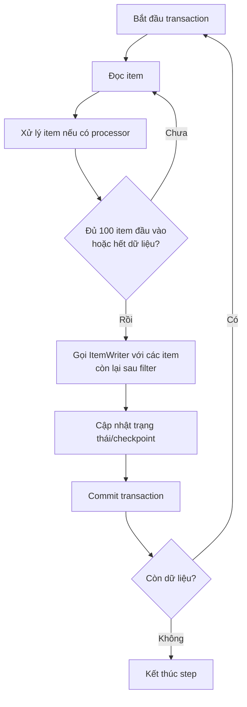
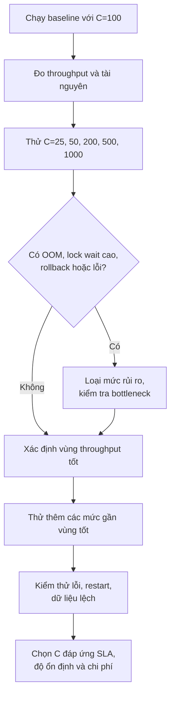

# Chunk size và throughput trong Spring Batch

## 1. Vì sao cần tối ưu chunk size?

Khi xử lý hàng triệu bản ghi, một job có thể tốn nhiều thời gian cho việc bắt đầu và commit transaction, ghi metadata, gọi JDBC hoặc đợi I/O. **Chunk size** là một tham số đơn giản nhưng ảnh hưởng trực tiếp đến số lần commit, kích thước lô ghi, thời gian giữ tài nguyên và phạm vi phải làm lại khi lỗi.

Trong mô hình mở rộng Spring Batch cho dữ liệu lớn, tối ưu chunk size thường là **bước cần đo trước khi tăng số thread, thêm partition hoặc chuyển việc sang worker từ xa**. Mở rộng đồng thời khi mỗi chunk đang sử dụng database kém hiệu quả có thể chỉ khiến nút thắt chuyển từ một kết nối sang toàn bộ connection pool.

Mục tiêu của bài:

- Hiểu chính xác chunk size/commit interval trong `Step` xử lý theo chunk.
- Phân biệt **throughput**, latency, số commit và hiệu năng đọc/ghi.
- Ước lượng lợi ích và chi phí của chunk nhỏ/lớn bằng mô hình đơn giản.
- Cấu hình chunk size trong **Spring Batch 6** và đo kết quả có thể tái lập.
- Nhận diện tác động đến memory, transaction, lock, skip/retry/restart và thread safety.
- Chọn cấu hình dựa trên workload, tài nguyên hệ thống và mức rủi ro có thể chấp nhận.

## 2. Chunk size thực sự điều khiển điều gì?

Trong một chunk-oriented step, Spring Batch đọc từng item, có thể xử lý item qua `ItemProcessor`, gom dữ liệu rồi gọi `ItemWriter` trong một transaction. **Chunk size** là số lượng item đầu vào mục tiêu được đọc cho mỗi chunk, đồng thời là **commit interval** theo cách cấu hình thông thường.

Ví dụ `chunk(100)`:



Sơ đồ thể hiện luồng lý tưởng của một step bình thường. Khi có skip, retry, rollback hoặc các cơ chế tolerance, framework có thể đọc lại, thử lại hoặc chia nhỏ công việc để định vị item lỗi; không thể giả định mỗi chunk luôn đúng 100 bản ghi được ghi ra.

**Ba điểm cần phân biệt:**

1. `chunk(100)` **không có nghĩa 100 item chạy đồng thời**. Với một step tuần tự, công việc vẫn chạy tuần tự, chỉ thay đổi ranh giới commit và lô ghi.
2. Nếu `ItemProcessor` trả `null`, item bị **filter** và không chuyển đến writer; một chunk đọc 100 item có thể chỉ ghi 92 item.
3. Chunk cuối cùng có thể nhỏ hơn cấu hình, ví dụ 250 item với `chunk(100)` tạo các lô tương ứng 100, 100, 50 trong trường hợp không lỗi và không phát sinh xử lý đặc biệt.

### Các tham số liên quan nhưng khác nhau

| Khái niệm | Điều khiển | Có nhất thiết bằng chunk size không? |
|---|---|---|
| **Chunk size / commit interval** | Số item đầu vào mục tiêu trong một transaction của step | Chính là tham số đang tối ưu. |
| **JDBC fetch size** | Gợi ý số hàng driver lấy từ database trong một đợt fetch | Không; còn tùy driver, cursor, DB. |
| **Paging page size** | Số hàng cho mỗi truy vấn trang của paging reader | Không; có thể bằng hoặc khác chunk size. |
| **JDBC batch size** | Số câu lệnh/nhóm tham số đưa vào một lô JDBC thực tế | Không; phụ thuộc cách writer thực hiện batching. |
| **Partition size / grid size** | Phạm vi dữ liệu cho mỗi partition và số partition quản lý | Không; mỗi partition có thể tự có nhiều chunk. |
| **Số worker/thread** | Mức đồng thời thực thi | Không; chunk size không tự tạo thêm thread. |

Thay đổi `chunk(500)` không tự biến mọi `ItemWriter` thành JDBC batch writer. Nếu writer gọi API từ xa **500 lần nối tiếp**, throughput vẫn có thể bị giới hạn bởi 500 lượt mạng. Cần xem cách reader/writer hoạt động và điểm nào thực sự tốn thời gian.

## 3. Chunk size tác động đến throughput như thế nào?

**Throughput** thường đo bằng số bản ghi **thành công** mỗi giây hoặc mỗi phút:

\[
\text{Throughput} = \frac{\text{Số item xử lý thành công}}{\text{Thời gian đã trôi qua}}
\]

Ở bước chỉ transform/filter, cần nói rõ đơn vị: `read items/s`, `written items/s`, `file rows/s`, `orders/s` hay số **kết quả nghiệp vụ được xác nhận/s**. Nếu 30% item bị filter, lấy `readCount / duration` và gọi đó là “thông lượng ghi” sẽ gây hiểu lầm.

**Latency** là thời gian một item hoặc một chunk chờ được xử lý và commit. Chunk lớn có thể nâng tổng số item/s nhưng làm thời gian item đầu tiên chờ commit lâu hơn. Hai chỉ số phục vụ hai mục tiêu khác nhau: import ban đêm thiên về throughput; đồng bộ dữ liệu có hạn chót ngắn thường còn quan tâm latency.

Với \(N\) item, chunk size \(C\), trường hợp không skip/retry:

\[
\text{Số chunk xấp xỉ} = \left\lceil\frac{N}{C}\right\rceil
\]

Một mô hình thô cho step tuần tự:

\[
T(N,C) \approx N(t_{\text{read}} + t_{\text{process}})
+\left\lceil\frac{N}{C}\right\rceil(t_{\text{begin}} + t_{\text{commit}} + t_{\text{meta}})
+\sum_{\text{chunk}} t_{\text{write}}(C)
\]

Trong đó:

- \(t_{\text{read}}, t_{\text{process}}\): thời gian đọc/xử lý bình quân mỗi item.
- \(t_{\text{begin}}, t_{\text{commit}}\): chi phí transaction.
- \(t_{\text{meta}}\): phần chi phí cập nhật metadata/checkpoint, được đơn giản hóa trong mô hình.
- \(t_{\text{write}}(C)\): thời gian ghi cả lô, **không nhất thiết tăng tuyến tính theo \(C\)**.

Mô hình này hữu ích để đặt giả thuyết nhưng không dự báo chính xác vì chưa tính queue, lock, cache, batch flush, thời gian GC, retry và cạnh tranh tài nguyên giữa các job.

### Ví dụ về chi phí commit

Giả sử xử lý đúng 1.000.000 item và chi phí **giả định** cho mỗi lần begin/commit cộng metadata là 8 ms. Chỉ riêng thành phần chi phí cố định này:

| Chunk size | Số chunk xấp xỉ | Chi phí giả định (8 ms/chunk) |
|---:|---:|---:|
| 1 | 1.000.000 | 8.000 s |
| 10 | 100.000 | 800 s |
| 100 | 10.000 | 80 s |
| 500 | 2.000 | 16 s |
| 1.000 | 1.000 | 8 s |
| 5.000 | 200 | 1,6 s |

Tăng chunk từ 1 lên 100 loại bỏ rất nhiều commit. Từ 1.000 lên 5.000 chỉ tiết kiệm khoảng 6,4 giây **ở thành phần chi phí đang xét**. Trong thực tế chunk lớn hơn còn có thể làm memory/lock/retry đắt hơn, nên không thể suy ra 5.000 luôn tối ưu.

## 4. Vì sao chunk quá nhỏ thường chậm?

Với `chunk(1)`, cứ một item lại mở/commit một transaction. Với 1 triệu item, ứng dụng có thể phải thực hiện gần 1 triệu lần commit, kèm cập nhật metadata và tương tác với storage. Chi phí cố định có thể áp đảo logic nghiệp vụ nếu mỗi item chỉ xử lý vài phép tính.

Chunk nhỏ cũng hạn chế khả năng tận dụng `JdbcBatchItemWriter`, prepared statement batching và tối ưu I/O. Tác động có thể thể hiện qua:

- Số commit và transaction log flush cao.
- Nhiều lượt DB/network hơn cho cùng lượng dữ liệu.
- Chi phí cập nhật `ExecutionContext` và thông tin step lặp lại thường xuyên hơn.
- Tổng thời gian chờ transaction nhiều hơn thời gian xử lý dữ liệu thật.

Tuy nhiên, chunk nhỏ có lợi khi item nặng hoặc không đồng đều, bộ nhớ ít, rollback rất tốn kém, DB chịu lock contention, hoặc nghiệp vụ cần checkpoint thường xuyên. Mục tiêu là giảm chi phí **tổng**, không giảm số commit bằng mọi giá.

## 5. Vì sao chunk quá lớn cũng có thể chậm hoặc nguy hiểm?

Một chunk có thể chứa hàng nghìn object, dữ liệu biến đổi, bộ đệm ghi hoặc entity đang được persistence context theo dõi. Dù reader streaming, các item **đang chờ writer** vẫn tiêu thụ bộ nhớ; còn các lớp reader/writer có thể có bộ đệm riêng.

| Tác động | Khi tăng chunk size | Dấu hiệu cần theo dõi |
|---|---|---|
| Transaction | Transaction dài hơn, nhiều thay đổi chưa commit | Transaction duration, DB lock wait, deadlock |
| Memory/GC | Nhiều object còn sống, bộ đệm lớn | Heap usage, allocation, GC pause, OOM |
| Database log | Transaction ghi nhiều thay đổi hơn | WAL/redo log, checkpoint, replication lag |
| Writer | Lô ghi lớn có thể hiệu quả hơn, rồi chạm ngưỡng driver/DB | Batch latency, network RTT, prepared statement errors |
| Retry | Lỗi giữa/sau chunk có thể buộc thử lại nhiều công việc | Retry count, rollback count, lượng việc xử lý lại |
| Restart | Ít mốc commit hơn; phần chưa commit có thể phải làm lại | Thời gian hồi phục, chênh lệch đầu vào/đầu ra |
| Latency | Item đầu tiên đợi lâu hơn trước khi có kết quả commit | p95/p99 chunk duration, end-to-end item latency |

Đặc biệt với JPA, persistence context có thể giữ entity và các state cần dirty checking đến khi flush/clear. `JpaItemWriter` và cách dùng `EntityManager` ảnh hưởng đáng kể đến memory và số SQL; không thể khẳng định mọi kiểu writer đều có cùng ngưỡng tối ưu.

**Không có quy tắc “càng lớn càng tốt”.** Đường cong thường có vùng tăng nhanh, vùng lợi ích giảm dần rồi đôi khi đi xuống khi hệ thống bão hòa.

## 6. Cấu hình chunk size trong Spring Batch 6

Ví dụ một step đọc đơn hàng từ reader, chuyển thành kết quả xử lý và ghi bằng writer đã khai báo trong ứng dụng:

```java
import org.springframework.batch.core.repository.JobRepository;
import org.springframework.batch.core.step.Step;
import org.springframework.batch.core.step.builder.StepBuilder;
import org.springframework.batch.infrastructure.item.ItemReader;
import org.springframework.batch.infrastructure.item.ItemProcessor;
import org.springframework.batch.infrastructure.item.ItemWriter;
import org.springframework.beans.factory.annotation.Value;
import org.springframework.context.annotation.Bean;
import org.springframework.context.annotation.Configuration;
import org.springframework.transaction.PlatformTransactionManager;

@Configuration
public class OrderImportStepConfiguration {

    @Bean
    public Step orderImportStep(
            JobRepository jobRepository,
            PlatformTransactionManager transactionManager,
            ItemReader<OrderRow> orderReader,
            ItemProcessor<OrderRow, OrderUpdate> orderProcessor,
            ItemWriter<OrderUpdate> orderWriter,
            @Value("${batch.order-import.chunk-size:200}") int chunkSize) {

        if (chunkSize < 1) {
            throw new IllegalArgumentException("chunk-size phải >= 1");
        }

        return new StepBuilder("orderImportStep", jobRepository)
                .<OrderRow, OrderUpdate>chunk(chunkSize)
                .transactionManager(transactionManager)
                .reader(orderReader)
                .processor(orderProcessor)
                .writer(orderWriter)
                .build();
    }
}
```

```yaml
# application.yml
batch:
  order-import:
    chunk-size: 200
```

`OrderRow` và `OrderUpdate` là các kiểu dữ liệu của ứng dụng, chưa được định nghĩa ở ví dụ. Các bean `orderReader`, `orderProcessor`, `orderWriter`, `JobRepository` và transaction manager cũng phải được cấu hình. Đoạn mã nhằm minh họa **API cấu hình chunk size**, không phải một project độc lập có thể build ngay.

Trong Spring Batch 6, hướng cấu hình được tài liệu chính thức dùng là:

```java
new StepBuilder("stepName", jobRepository)
    .<Input, Output>chunk(200)
    .transactionManager(transactionManager)
    .reader(reader)
    .processor(processor)
    .writer(writer)
    .build();
```

Điều chỉnh property giữa **các lần chạy thử nghiệm**. Việc thay cấu hình rồi restart một `JobExecution` dở dang cần đánh giá: reader, writer và checkpoint phải đọc lại dữ liệu nhất quán; không coi việc thay chunk size giữa chừng là thao tác luôn an toàn trong mọi ứng dụng.

### Có cần chỉnh `pageSize` hay `fetchSize` bằng chunk size?

Không bắt buộc. Ví dụ `JdbcPagingItemReader` lấy mỗi page 1.000 hàng trong khi step commit từng 200 item vẫn có thể hợp lý. Tối ưu dựa trên query plan, chi phí fetch, driver, bộ nhớ reader và writer, không ghép ba giá trị bằng nhau theo thói quen.

Đối với writer ghi hàng loạt, hãy xác minh writer có thực sự dùng batching. `JdbcBatchItemWriter` hỗ trợ cơ chế JDBC batch; còn một writer tự viết `for (item) jdbcTemplate.update(...)` có thể gửi nhiều thao tác riêng, khiến thay chunk size ít cải thiện phần network.

## 7. Ví dụ thực tế: import 2 triệu đơn hàng

Giả sử một batch chạy ban đêm gồm 2.000.000 bản ghi từ cơ sở dữ liệu nguồn, chuẩn hóa mã hàng, tính giá rồi ghi sang bảng đích. Hệ thống có database giới hạn connection và bước transform tiêu tốn CPU vừa phải.

Đo thử với cùng input, cùng query, cùng số worker và tương tự điều kiện tải:

| Chunk size | Throughput đo được* | Thời gian ước tính cho 2 triệu item* | Heap peak* | Nhận xét |
|---:|---:|---:|---:|---|
| 10 | 2.800 item/s | ~714 s | 230 MiB | Chi phí commit đáng kể |
| 50 | 7.500 item/s | ~267 s | 250 MiB | Cải thiện rõ |
| 200 | 10.500 item/s | ~190 s | 310 MiB | Vùng hiệu quả |
| 500 | 11.000 item/s | ~182 s | 440 MiB | Lợi ích thêm nhỏ |
| 2.000 | 9.300 item/s | ~215 s | 780 MiB | GC/transaction tăng |

\* **Toàn bộ số liệu trong bảng là giả định để luyện cách phân tích**; không phải benchmark của Spring Batch hoặc mức khuyến nghị chung.

Trong kịch bản này, chọn `chunkSize=200` có thể cân bằng throughput, memory và mức cần làm lại khi lỗi. Nếu chính sách vận hành ưu tiên thời gian hoàn tất tối thiểu và tài nguyên vẫn còn dư, `500` cũng đáng cân nhắc. Quyết định chỉ có giá trị sau khi đối soát số bản ghi, kiểm tra skip/retry, p95 chunk duration và xác nhận cấu hình chịu lỗi.

Một kết luận đúng cần trả lời: cải thiện đó đến từ **ít lần commit**, từ **batch insert hiệu quả hơn**, từ **cache nóng lên**, hay đơn giản do database ít tải hơn trong lượt thử?

## 8. Đo throughput đúng cách

### 8.1. Chuẩn hóa dữ liệu và điều kiện

Trước khi so sánh hai chunk size, giữ nhất quán:

1. **Cùng dữ liệu đại diện:** khối lượng, kích thước record, tỷ lệ bản ghi lỗi/trùng, phân bố khóa và dữ liệu lớn bất thường.
2. **Cùng worker/CPU/RAM/DB:** connection pool, indexes, isolation level, batch writer, driver, network, cấu hình retry.
3. **Cùng concurrency:** không vừa đổi chunk size vừa tăng `TaskExecutor`, grid size hoặc số container worker.
4. **Cùng trạng thái dữ liệu:** chạy lại trên dataset độc lập hoặc reset bảng test theo quy trình có kiểm soát, tránh lần hai dùng index/cache thuận lợi hơn mà không nhận ra.
5. **Có warm-up và lặp lại:** để JVM JIT, connection pool và cache ổn định, sau đó chạy nhiều lần và so sánh median cùng độ phân tán.
6. **Đối soát tính đúng đắn:** so tổng input, output, filtered, skipped, lỗi và kết quả nghiệp vụ; throughput cao do mất bản ghi không phải thành công.

Với mỗi mức \(C\), ghi ít nhất thời gian step, số `readCount`, `writeCount`, `commitCount`, `rollbackCount`, CPU, heap peak, GC, DB lock wait và query latency. Nếu workload có retry, còn phải ghi số lần retry và thời gian phải làm lại.

### 8.2. Đọc metadata từ `JobRepository`

Nếu dùng JDBC JobRepository với table prefix mặc định:

```sql
SELECT
    STEP_EXECUTION_ID,
    STEP_NAME,
    STATUS,
    READ_COUNT,
    WRITE_COUNT,
    FILTER_COUNT,
    COMMIT_COUNT,
    ROLLBACK_COUNT,
    READ_SKIP_COUNT,
    PROCESS_SKIP_COUNT,
    WRITE_SKIP_COUNT,
    START_TIME,
    END_TIME
FROM BATCH_STEP_EXECUTION
WHERE JOB_EXECUTION_ID = :jobExecutionId
ORDER BY STEP_EXECUTION_ID;
```

Tùy version/schema và cách triển khai, tên trường hoặc prefix có thể cần điều chỉnh. Hãy kết hợp metadata với đo elapsed time từ ứng dụng/hệ thống giám sát, không dùng `commitCount` như một phép đo throughput thay thế.

Ví dụ cách đọc số liệu:

- `readCount = 200000`, `writeCount = 196000`, `filterCount = 4000` không có nghĩa mất dữ liệu; có thể do chính sách filter hợp lệ.
- Nếu `commitCount` lớn hơn \(\lceil readCount/C\rceil\) đáng kể, cần kiểm tra commit bổ sung, restart, các đường xử lý lỗi và hành vi cụ thể của step.
- Nếu `rollbackCount` tăng khi tăng chunk size, throughput có thể đang suy giảm do lock, lỗi dữ liệu hoặc cách retry.

### 8.3. Micrometer và quan sát thực tế

Spring Batch 6 hỗ trợ metrics dựa trên Micrometer. Theo tài liệu 6.0, việc thu thập built-in metrics cần cấu hình `ObservationRegistry` phù hợp. Các metric đáng quan sát gồm:

| Metric | Câu hỏi nó giúp trả lời |
|---|---|
| `spring.batch.step` | Step chạy tổng cộng bao lâu theo tên và status? |
| `spring.batch.item.read` | Reader có phải thành phần chậm? |
| `spring.batch.item.process` | Processor có tốn CPU hoặc gọi dịch vụ chậm? |
| `spring.batch.chunk.write` | Writer có tăng latency khi chunk lớn? |
| `spring.batch.job` | Thay đổi đó có cải thiện thời gian toàn job không? |

Ví dụ cấu hình quan sát với Micrometer:

```java
@Bean
public ObservationRegistry observationRegistry(MeterRegistry meterRegistry) {
    ObservationRegistry registry = ObservationRegistry.create();
    registry.observationConfig()
            .observationHandler(
                    new DefaultMeterObservationHandler(meterRegistry));
    return registry;
}
```

Cần import các kiểu `io.micrometer.observation.ObservationRegistry`, `io.micrometer.core.instrument.MeterRegistry` và `io.micrometer.core.instrument.observation.DefaultMeterObservationHandler`, cùng dependency tương ứng. Dữ liệu có xuất tới Prometheus/OTel hay không còn tùy cấu hình monitoring của ứng dụng. Để phân tích transaction/lock, kết hợp metrics Spring Batch với database và JVM metrics.

### 8.4. Một biểu mẫu benchmark có thể dùng ngay

```text
Dataset ID: orders-2026-11-sample-2m
Spring Batch: 6.x
Reader/Writer: JdbcPagingItemReader / JdbcBatchItemWriter
DB, driver, JVM, schema: [ghi phiên bản]
Concurrency: 1
Read pageSize / fetchSize: [ghi giá trị]
DataSource maxPoolSize: [ghi giá trị]

chunkSize:
runNumber:
readCount / writeCount / filterCount:
skipCount / rollbackCount / commitCount:
elapsedSeconds:
effectiveWrittenItemsPerSecond:
p95ChunkDurationMs:
peakHeapMiB:
jvmGcPauseMs:
dbLockWaitMs:
sourceDataChecksum / targetDataChecksum:
errors / comments:
```

Chỉ số `effectiveWrittenItemsPerSecond` nên tính trên **thời gian wall-clock thực tế** của step và số item đã hoàn tất theo mục tiêu nghiệp vụ. Đối với output một item thành nhiều hàng, sử dụng thêm số hàng hoặc business key đã được xác nhận ở database.

## 9. Chunk size và transaction, retry, restart

### 9.1. Ranh giới commit ảnh hưởng đến rủi ro

Nếu một chunk có 1.000 item, writer ghi vào một database nằm trong transaction của step, và lỗi xảy ra trước commit, những thay đổi thuộc transaction đó thường bị rollback. Khi thực hiện lại, toàn bộ phần công việc của chunk có thể cần đọc/xử lý/ghi lại.

Nhưng không phải mọi tài nguyên được gọi bên trong `ItemProcessor` hoặc `ItemWriter` đều tham gia transaction:

- Gửi email, ghi object storage, gọi HTTP API có thể đã tạo side effect trước khi database rollback.
- Nếu `JobRepository` và database nghiệp vụ dùng **hai transaction khác nhau**, việc cập nhật dữ liệu và checkpoint không bảo đảm atomic trên cả hai.
- Một lỗi xảy ra sau khi business data commit nhưng trước khi repository ghi nhận có thể khiến restart phát lại một phần dữ liệu đã xử lý.

Vì vậy cần **idempotency** và cơ chế đối soát, chẳng hạn unique key `(import_run_id, order_id)`, `UPSERT` có điều kiện, hoặc staging table rồi publish atomically. Không được suy luận “chỉ có tối đa \(C\) item bị xử lý trùng” nếu các side effect ngoài transaction chưa được kiểm soát.

### 9.2. Skip/retry có thể làm chi phí chunk lớn tăng mạnh

Nếu writer thất bại ở một phần tử trong chunk, cơ chế fault tolerance có thể rollback và thử lại để xác định phần tử lỗi. Chunk lớn làm số phần tử liên quan đến thử lại lớn hơn, nhất là khi writer không cung cấp đủ thông tin lỗi theo từng item.

Ví dụ cấu hình retry trong Spring Batch 6 (minh họa cho trường hợp lỗi DB tạm thời):

```java
RetryPolicy policy = RetryPolicy.builder()
        .maxRetries(3)
        .includes(DeadlockLoserDataAccessException.class)
        .build();

return new StepBuilder("orderImportStep", jobRepository)
        .<OrderRow, OrderUpdate>chunk(200)
        .transactionManager(transactionManager)
        .reader(orderReader)
        .processor(orderProcessor)
        .writer(orderWriter)
        .faultTolerant()
        .retryPolicy(policy)
        .build();
```

Các biến `jobRepository`, `transactionManager`, `orderReader`, `orderProcessor`, `orderWriter` được giả định đã có; `RetryPolicy` và ngoại lệ dùng import phù hợp với Spring Batch 6 và Spring Framework. Giới hạn retry là ví dụ, cần chọn cùng backoff và phân loại lỗi theo đặc tính hệ thống.

**Lỗi tạm thời** như deadlock có thể thử lại. **Lỗi cố định** như dữ liệu sai định dạng thường nên skip theo chính sách nghiệp vụ hoặc fail sớm; retry nhiều lần sẽ chỉ làm throughput xấu đi. Với reader tự viết, bảo đảm `read()` thất bại không âm thầm bỏ qua record rồi trả record tiếp theo khi retry.

### 9.3. Restart phụ thuộc vào reader/writer

Reader cần lưu và phục hồi `ExecutionContext` đủ để xác định vị trí đọc. Với reader dạng paging, cần thứ tự ổn định và khóa duy nhất; nếu dataset thay đổi giữa lúc chạy và restart, vị trí trang có thể không còn tương ứng bản ghi ban đầu.

Chunk nhỏ có thể tạo checkpoint thường xuyên hơn nhưng chi phí commit cao; chunk lớn giảm chi phí đó nhưng mỗi lần rollback có thể phải xử lý lại nhiều dữ liệu hơn. Hãy kiểm thử khôi phục ở **điểm trước commit**, **ngay sau commit** và **khi cập nhật metadata lỗi**. Không coi việc step chạy thành công một lần là bằng chứng restart an toàn.

## 10. Chunk size khi tăng concurrency

Chunk size là **kích thước đơn vị giao dịch**; concurrency là **số đơn vị/nhánh đang xử lý đồng thời**. Hai biến tương tác qua DB pool, memory và lock:

\[
\text{Bộ nhớ đệm item gần đúng} \propto
\text{Số chunk đang xử lý đồng thời}
\times \text{Chunk size}
\times \text{Kích thước item}
\]

Đây chỉ là ước lượng phần object được giữ theo chunk, chưa tính metadata, reader buffer, JPA persistence context hoặc thread stack.

Giả sử một worker xử lý một chunk 500 item và cần 1 connection. Tăng từ 1 lên 8 worker làm số chunk đồng thời và nhu cầu tài nguyên có thể tăng đáng kể; nếu database pool chỉ có 4 connection, 8 worker sẽ tranh chấp và có thể không tăng throughput.

Trong **Spring Batch 6**:

- **Multi-threaded step:** có thể dùng `TaskExecutor` để xử lý item bằng các thread; tài liệu 6.0 mô tả reader/writer vẫn chạy tuần tự ở main step thread trong cơ chế đó. Cần quan tâm thread safety của processor và transaction context giữa thread.
- **Local chunking:** xử lý các chunk song song trong cùng JVM; ảnh hưởng của `chunkSize × số chunk đồng thời` tới memory và DB cần đo riêng.
- **Parallel steps:** những step độc lập chạy đồng thời; mỗi step có thể dùng chunk size khác nhau theo workload.
- **Remote chunking:** manager phân phối các chunk tới worker từ xa; chunk quá nhỏ tăng chi phí message/serialization, chunk quá lớn tăng payload và chi phí retry.
- **Partitioning:** mỗi partition có `StepExecution` và nhiều chunk; cần xét phân bố dữ liệu lệch, số partition, connection pool và memory tổng.
- **RemoteStep:** di chuyển một step sang worker ở xa; bản thân nó không tự làm chunk xử lý song song.

Trước khi mở rộng, đo throughput tại một worker ở các mức chunk. Sau đó mới tăng đồng thời và lặp phép đo: điểm tối ưu của `C=500` ở 1 worker có thể chuyển thành `C=100` ở 16 worker vì lock và memory pressure.

## 11. Quy trình chọn chunk size theo dữ liệu

Một cách thực dụng là kiểm thử theo cấp số nhân rồi thu hẹp phạm vi:



Thực hiện:

1. **Đặt mục tiêu:** ví dụ 2 triệu đơn hàng hoàn tất trong 20 phút, không trùng hóa đơn, heap dưới 70% giới hạn, không phát sinh deadlock kéo dài.
2. **Đo baseline** với `C=100` và một số worker cố định; ghi số liệu đủ chi tiết.
3. **Thử dải nhỏ/lớn** như `25, 50, 100, 200, 500, 1.000`, tùy kích thước record và mức chịu tải. Đây chỉ là dải ban đầu để thăm dò.
4. **Loại ứng viên thiếu an toàn** dù throughput cao: memory chạm trần, lock kéo dài, retry tăng vọt hoặc restart tạo side effect trùng.
5. **Chọn vùng plateau:** khi từ `200` lên `500` chỉ tăng 2% throughput nhưng memory tăng 40%, ưu tiên `200` nếu độ lệch kết quả nằm trong nhiễu benchmark.
6. **Kiểm thử đồng thời** theo số worker/partition dự kiến dùng thật. Tối ưu chunk size và worker count như hai biến có tương tác, không dùng kết quả đơn luồng áp cho cụm.
7. **Ghi lại lý do lựa chọn** bằng số liệu, điều kiện workload và ngày đánh giá để có thể đo lại khi schema, DB hoặc phân bố dữ liệu thay đổi.

### Khi nào nên nghi ngờ vấn đề không nằm ở chunk size?

| Tín hiệu | Hướng điều tra tiếp |
|---|---|
| CPU processor gần 100%, DB nhàn | Tối ưu thuật toán, allocations; cân nhắc xử lý item song song phù hợp thread safety. |
| Reader chậm dù writer nhẹ | Tối ưu query/index, paging/cursor, fetch; chunk lớn chưa chắc giúp. |
| Writer nhiều network round-trip | Dùng batch writer đúng cách hoặc điều chỉnh cách gọi API. |
| DB connection pool thường xuyên cạn | Giảm concurrency, tăng pool có kiểm soát, kiểm tra transaction kéo dài. |
| Lock wait tăng theo số worker | Phân vùng khóa/dữ liệu hợp lý, rút ngắn transaction, kiểm tra index/isolation. |
| GC pause tăng khi nâng chunk | Giảm object giữ lại, xem buffer/JPA context, giảm chunk size. |
| Throughput step tăng nhưng toàn job không nhanh hơn | Đo critical path và các step phụ thuộc, tránh tối ưu một phần không quyết định SLA. |

## 12. Các sai lầm thường gặp

**“Chunk size = số bản ghi writer chắc chắn ghi.”** Sai. Filter, skip và lỗi làm `writeCount` khác số `readCount`.

**“Chunk 10.000 luôn nhanh hơn chunk 100 vì commit ít hơn.”** Sai. Còn lock, heap, driver batch, retry, transaction log và hiệu năng writer.

**“Tăng chunk size cũng tăng số thread.”** Sai. Đồng thời cần `TaskExecutor`, local chunking, parallel steps hoặc partition/remote strategies phù hợp.

**“`pageSize`, `fetchSize`, `chunkSize` bắt buộc bằng nhau.”** Sai. Chúng tối ưu các ranh giới khác nhau và phải được đo riêng.

**“Có transaction nên mọi side effect được rollback.”** Sai. Một API ngoài hoặc database khác có thể không tham gia cùng transaction.

**“Chỉ đo readCount/s là đủ.”** Sai. Cần throughput đầu ra hợp lệ, latency, sử dụng tài nguyên, rollback/skip và kiểm thử restart.

**“Cứ có nhiều worker thì tăng chunk size theo số worker.”** Sai. Nhiều worker làm tăng tải đồng thời; chunk tối ưu có thể **giảm** khi mở rộng.

## 13. Bài tập thực hành

Tạo một job nhập **500.000 giao dịch** có các bước đọc, chuẩn hóa và ghi vào database. Bảo đảm có khoảng 1% item bị filter hợp lệ và một số record cố tình lỗi định dạng.

1. Chạy cùng dataset với `chunkSize = 10, 50, 100, 250, 500, 1.000`; mỗi mức tối thiểu ba lượt sau warm-up.
2. Ghi `readCount`, `writeCount`, `filterCount`, `commitCount`, elapsed seconds, heap peak, CPU, thời gian query DB.
3. Vẽ throughput (`writeCount / elapsedSeconds`) theo chunk size; chỉ ra vùng plateau và độ phân tán giữa các lượt chạy.
4. Với `chunkSize=100` và `500`, ngắt tiến trình gần giữa một chunk rồi restart hợp lệ; đối soát số bản ghi và khóa trùng.
5. Tăng số worker/partition theo điều kiện lab; xác định khi nào DB connection hoặc lock trở thành nút thắt.
6. Viết báo cáo quyết định dưới dạng: “chọn `chunkSize=X` khi concurrency=Y, vì throughput=Z, heap peak=H, rollback=R và dữ liệu được đối soát đầy đủ”.

**Tiêu chí hoàn thành:** nêu được nguyên nhân có chứng cứ cho sự khác biệt giữa các mức chunk, chọn cấu hình phù hợp giới hạn tài nguyên và chứng minh retry/restart không làm mất hoặc trùng kết quả nghiệp vụ.

## 14. Câu hỏi tự kiểm tra

1. Vì sao `chunk(500)` không có nghĩa 500 item được xử lý song song?
2. Với 123.456 item và chunk size 200, trong trường hợp không lỗi/skip và một lần chạy đầy đủ, có khoảng bao nhiêu chunk? Vì sao `commitCount` thực tế cần được quan sát thay vì đoán?
3. Trường hợp nào `writeCount` thấp hơn `readCount` dù job thành công?
4. Tăng chunk size làm `commitCount` giảm nhưng `rollbackCount` tăng mạnh; bạn cần đo yếu tố gì trước khi chọn giá trị cuối?
5. Khác biệt giữa `chunkSize` và `JdbcPagingItemReader.pageSize` là gì?
6. Vì sao throughput 12.000 item/s ở một worker chưa chứng minh hệ thống sẽ đạt 96.000 item/s ở tám worker?
7. Nếu writer gửi HTTP API không hỗ trợ rollback, thiết kế idempotency cần thêm bước nào?
8. Vì sao tối ưu throughput toàn job có thể đòi hỏi sửa query reader hoặc số partition thay vì tăng chunk size?

## Tài liệu tham khảo

- [Spring Batch 6.0 — Chunk-oriented Processing](https://docs.spring.io/spring-batch/reference/6.0/step/chunk-oriented-processing.html).
- [Spring Batch 6.0 — The Commit Interval](https://docs.spring.io/spring-batch/reference/6.0/step/chunk-oriented-processing/commit-interval.html).
- [Spring Batch 6.0 — Configuring a Step](https://docs.spring.io/spring-batch/reference/6.0/step/chunk-oriented-processing/configuring.html).
- [Spring Batch 6.0 — Configuring Retry Logic](https://docs.spring.io/spring-batch/reference/6.0/step/chunk-oriented-processing/retry-logic.html).
- [Spring Batch 6.0 — Scaling and Parallel Processing](https://docs.spring.io/spring-batch/reference/6.0/scalability.html).
- [Spring Batch 6.0 — Micrometer Support](https://docs.spring.io/spring-batch/reference/6.0/spring-batch-observability/micrometer.html).

> **Nguyên tắc vận hành:** chunk size tốt là giá trị đem lại throughput đã **đo được**, trong khi latency, DB locks, memory, tính đúng đắn và thời gian phục hồi vẫn đáp ứng yêu cầu. Hãy tối ưu transaction và I/O trước khi trả chi phí kiến trúc cho nhiều thread hoặc nhiều worker.
