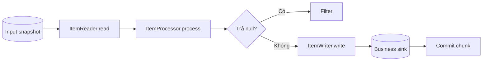
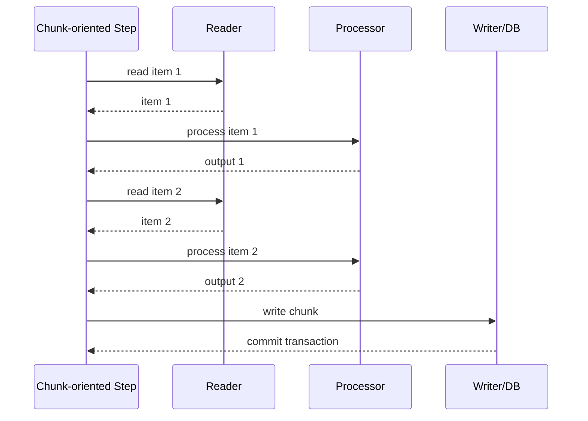
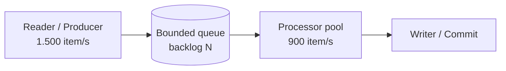
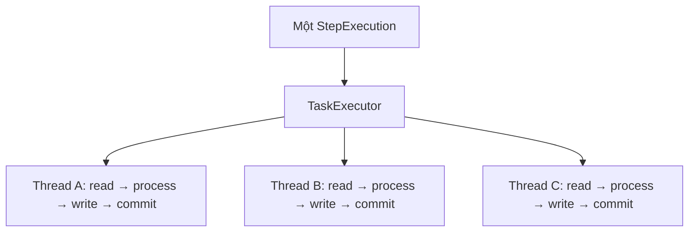

# Read rate so với process rate trong Spring Batch: đo thông lượng đúng và tìm nút thắt

## Mục tiêu bài học

Trong chương **Thông lượng** của module **SPRING_BATCH_SCALING_OPERATIONS**, mục tiêu không chỉ là tăng số thread mà còn phải xác định **đâu là công đoạn giới hạn tốc độ của toàn job**. Một cách chẩn đoán phổ biến là so sánh **read rate** (tốc độ đọc item) với **process rate** (tốc độ xử lý item). Tuy nhiên, nếu định nghĩa và đo sai, hai chỉ số này có thể dẫn tới quyết định mở rộng kiến trúc không hiệu quả hoặc phá tính đúng của dữ liệu.

Sau bài học, bạn có thể:

- Định nghĩa read rate, process rate, output/write rate theo đơn vị và cửa sổ đo nhất quán.
- Phân biệt **số item duy nhất**, **số lượt gọi** và **số lần thử lại** khi có filter, skip, retry, rollback và restart.
- Giải thích vì sao trong chunk-oriented step **tuần tự**, read rate và process rate thường gần bằng nhau ngay cả khi processor xử lý rất chậm.
- Nhìn đúng ý nghĩa chênh lệch read/process trong một pipeline **thật sự bất đồng bộ** có queue/backpressure.
- Dùng latency, queue depth, CPU, database pool, retry rate và transaction time để chỉ ra bottleneck.
- Instrument reader/processor với Micrometer mà **không làm mất hợp đồng `ItemStream` và checkpoint**.
- Thiết kế benchmark và kiểm thử trước khi dùng multi-threaded step, partitioning hoặc remote chunking.
- Chọn biện pháp tăng throughput phù hợp với tài nguyên thật, đồng thời giữ thread safety, idempotency và restartability.

> **Phạm vi:** Ví dụ dùng Spring Batch **5.2.x**, Java 17+, Spring Framework 6 và Micrometer. “Read rate so với process rate” là **phân tích hiệu năng ở cấp stage**, không phải tên hai thuộc tính mặc định có sẵn trên mọi `StepExecution`. `StepExecution` có `readCount`, `writeCount`, `filterCount`, `skipCount`, `commitCount`… nhưng **không có một `processRate` chuẩn duy nhất** đáp ứng mọi mục đích.

## 1. Đầu tiên: read, process, write không phải một phép đếm

Chunk-oriented processing thường có pipeline:



Một item đầu vào có thể:

- Được reader trả về thành công rồi processor biến đổi thành output.
- Bị **filter** vì processor trả về `null`; không tới writer.
- Gặp exception được phép **skip** theo chính sách fault tolerance.
- Được đọc hoặc xử lý **nhiều lần** do rollback/retry/restart.
- Được writer nhận nhưng **không tạo row mới** vì writer dùng UPSERT hoặc `ON CONFLICT DO NOTHING`.
- Gây side effect ngoài transaction trước khi step lỗi; số lần gọi không bằng số lần commit thực.

Vì vậy, cần quyết định đang đo **lượt thực thi của stage** hay **tiến độ nghiệp vụ đã commit**.

### Các loại số đếm

| Chỉ số | Định nghĩa hữu ích | Lưu ý |
| --- | --- | --- |
| `reader.successful_calls` | Số lần `read()` trả item khác `null` trong kỳ đo | Có thể tính lại một item nếu rollback/restart |
| `reader.eof_calls` | Số lần `read()` trả `null` để báo kết thúc | Không phải một item; đừng cộng vào read rate |
| `processor.attempts` | Số lượt gọi `process(item)` | Có thể vượt số item duy nhất do retry |
| `processor.emitted` | Số lượt trả output khác `null` | Không chứng minh output đã commit |
| `processor.filtered` | Số lượt trả `null` | Khác với lỗi skip; có thể xảy ra lại sau rollback |
| `processor.errors` | Số lượt ném exception | Có thể retry, không nhất thiết step FAILED |
| `writer.received_items` | Số output items trong các lượt gọi writer | Có thể bao gồm những lần transaction rollback |
| `business.committed_items` | Số business key/operation đã commit trong sink | Phải xác định qua DB/outbox/nguồn chân lý |
| `StepExecution.readCount` | Số item được framework ghi nhận đã đọc trong tiến độ step | Semantics framework và rollback khác tổng các raw `read()` calls |
| `StepExecution.writeCount` | Số item đã được framework ghi nhận ở phía writer | Không bằng số row INSERT mới nếu writer có UPSERT |

**Ví dụ:** 1.000 input, 100 item bị filter; processor được gọi cho 1.000 item, writer nhận 900 output, trong khi chỉ 870 row mới được insert vì 30 row đã tồn tại. Ba con số 1.000, 900 và 870 **đều có thể đúng**, nhưng mô tả các đại lượng khác nhau.

## 2. Định nghĩa read rate và process rate có đơn vị

Với một cửa sổ thời gian `[t_0,t_1]`, đặt:

- `N_r`: số lượt `read()` trả item khác `null` trong cửa sổ.
- `N_p`: số lượt `process(item)` được gọi trong cửa sổ.
- `N_e`: số lượt processor trả output khác `null`.
- `N_c`: số business item đã commit được xác nhận trong cửa sổ.
- `Δt = t_1 - t_0`, đo bằng giây.

Khi đó:

```text
read_rate_attempt    = delta(reader.successful_calls) / delta_seconds
process_rate_attempt = delta(processor.attempts)       / delta_seconds
emit_rate_attempt    = delta(processor.emitted)        / delta_seconds
commit_rate_business = delta(committed_business_keys)  / delta_seconds

Đơn vị: item/giây hoặc attempt/giây (phải ghi rõ).
```

Một hệ thống có 120.000 item được xử lý trong 240 giây có **end-to-end throughput** khoảng:

```text
120.000 / 240 = 500 item/giây
```

Đây là **tốc độ trung bình trong 240 giây**, không nói processor có năng lực cực đại 500 item/giây. Thời gian có thể bao gồm đọc, xử lý, ghi, commit, GC, chờ kết nối DB và các overhead khác.

### Ba thước đo khác nhau, không được trộn

| Góc nhìn | Công thức/nguồn | Phù hợp để |
| --- | --- | --- |
| **Rate theo cửa sổ** | `delta(counter) / delta(seconds)` | Dashboard throughput, đột biến chậm/lỗi |
| **Rate toàn execution** | `delta(total processed) / wall-clock duration` | SLA, so sánh các lần benchmark |
| **Latency mỗi call** | `Timer`/`System.nanoTime()` quanh `read/process/write` | Phân tích thời gian stage và p95/p99 |

**Không** lấy `StepExecution.readCount` đã tích lũy từ đầu job rồi chia cho “thời gian 10 giây gần nhất”; tử và mẫu không cùng cửa sổ. Với counter tăng theo thời gian, dùng **delta trong cùng cửa sổ** hoặc các hàm rate tương ứng trong monitoring backend.

### Read throughput không phải database fetch capacity

Một `JdbcPagingItemReader` có thể lấy 500 row bằng một query rồi trả từng item qua nhiều lần `read()`. `read rate` đo số item được giao cho Batch pipeline; **không trực tiếp là số SQL queries/giây, số byte/giây hay năng lực tối đa của DB**.

Với file reader, đọc item cũng có thể gồm parse, validation hoặc I/O buffering. Khi so các reader khác nhau, hãy ghi rõ stage boundary bạn đo.

## 3. Bẫy lớn: chunk step tuần tự có hai rate gần bằng nhau

Giả sử pipeline chạy tuần tự, không filter/retry:



Reader **không liên tục đọc độc lập** trong khi processor chạy. Cùng một thread phải chờ processor và writer để đi tiếp trong chu trình chunk. Do đó, nếu đo ở mức toàn step:

```text
read_rate_observed ~= process_rate_observed
```

Điều này vẫn đúng khi processor cực chậm! Processor mất 20 ms/item và reader chỉ mất 0,1 ms/item thì **tốc độ quan sát** của cả hai có thể gần `50 item/giây`, chứ không phải reader tự chạy 10.000 item/giây.

**Kết luận:** Trong local chunking tuần tự, **read rate ≈ process rate không chứng minh reader và processor có cùng hiệu năng**, cũng không chứng minh không có bottleneck.

### Ví dụ minh họa: 120.000 item trong 240 giây

Giả sử profiling của một chạy tuần tự cho thấy tổng thời gian các stage:

| Công đoạn | Tổng thời gian minh họa | Tỉ lệ wall time gần đúng |
| --- | ---: | ---: |
| Reader | 36 giây | 15% |
| Processor | 168 giây | 70% |
| Writer + commit + overhead còn lại | 36 giây | 15% |
| **Tổng** | **240 giây** | **100%** |

Khi ấy observed `readRate` và `processRate` đều gần **500 item/s**. Nhưng **processor** là thành phần chiếm phần lớn wall time; tăng tốc reader không chắc giúp job nhanh đáng kể.

Nếu chia riêng số item cho tổng thời gian **stage thực sự hoạt động** (chỉ để hình dung năng lực, không phải throughput độc lập được đảm bảo):

```text
Reader active-time average    = 120.000 / 36  ~= 3.333 item/s
Processor active-time average = 120.000 / 168 ~=   714 item/s
```

Hai con số trên không phải hai rate mà pipeline tuần tự đang phát ra cùng lúc. Chúng chỉ là **ước lượng dựa trên tổng thời gian stage**. Cache, độ song song, CPU pressure, transaction và batch effect có thể khiến năng lực thực tế khi tách stage thay đổi.

### Dùng service time để khoanh vùng

Ký hiệu:

```text
L_read    = mean latency của một read call trả item
L_process = mean latency của một process call
L_write   = mean wall time ghi + commit cho mỗi chunk
B         = kích thước chunk hữu hiệu

Tối giản ở pipeline tuần tự:
T_per_item ~= L_read + L_process + L_write / B + overhead
throughput ~= 1 / T_per_item
```

Đây là **mô hình gần đúng**; filter, skip, retry, EOF, reader prefetch, commit metadata và batch JDBC làm nó sai lệch. Dùng số đo thực tế để hiệu chỉnh, không lấy công thức làm SLA.

## 4. Với pipeline bất đồng bộ, chênh lệch rate mới có ý nghĩa backlog

Khi producer (reader/manager) và consumer (processor/worker) **thật sự hoạt động độc lập**, có một queue hoặc buffer ở giữa:



Nếu trong một cửa sổ ổn định reader tạo trung bình **1.500 item/s**, còn processor hoàn tất **900 item/s**, thì:

```text
backlog_growth ~= incoming_rate - completed_rate
               ~= 1.500 - 900
               ~= 600 item/giây
```

Trong 3 phút, nếu queue không có giới hạn và không drop:

```text
600 item/s * 180 s = 108.000 item backlog tăng thêm
```

Nhưng **production không nên dùng queue vô hạn**. Với **bounded queue và backpressure**, khi queue đầy, producer phải chậm lại hoặc bị từ chối; observed read/submit rate dần bị kéo xuống gần mức consumer phục vụ được.

### Phân biệt ba trạng thái

| Trạng thái | Read/arrival rate so với process completion rate | Cách diễn giải |
| --- | --- | --- |
| Queue đang tăng | `read > process` | Producer nhanh hơn consumer; backlog và latency tăng |
| Steady state, queue gần ổn định | `read ≈ process` | Dòng vào/ra cân bằng; vẫn có thể backlog tồn tại lớn |
| Queue đang được xả | `read < process` | Consumer xử lý nhanh hơn nguồn đưa vào; queue giảm |

**Điều kiện để áp dụng công thức:** Hai counter phải đếm **cùng loại đơn vị công việc qua cùng boundary**, trong cùng thời gian và không bỏ qua retry/filter/redelivery. Nếu reader đếm input item nhưng worker process counter đếm attempts, một request được redeliver làm phép trừ không còn là tốc độ tăng backlog thật.

### Little's Law và thời gian chờ

Ở trạng thái ổn định với công việc không bị mất:

```text
L = lambda * W

L      = số item trung bình đang ở trong hệ thống/queue theo phạm vi đo
lambda = thông lượng hoàn tất ổn định (item/giây)
W      = thời gian trung bình item lưu ở phạm vi đó (giây)
```

Ví dụ queue có trung bình 4.000 item chờ, worker hoàn tất 800 item/s, thời gian chờ **trung bình** do queue xấp xỉ `4.000/800 = 5 giây`, khi các giả định steady state và cùng phạm vi được đáp ứng.

**Không dùng Little's Law** khi arrival rate dao động cực mạnh, queue đang phình liên tục hoặc counter xử lý lại item nhiều lần mà chưa xác định rõ “item” là gì.

## 5. Spring Batch không có hai stage chạy độc lập chỉ vì thêm TaskExecutor

### 5.1. Chunk-oriented step tuần tự

Reader và processor thường chạy nối tiếp trong thread của chunk. Số lượt đọc/xử lý gần tương ứng, trừ EOF, filter/skip/retry. Đo latency để tìm bottleneck.

### 5.2. Multi-threaded step

Khi `StepBuilder.taskExecutor(taskExecutor)` được cấu hình trong Spring Batch 5.2, các **chunk** có thể được thực thi trên nhiều thread, nhưng **reader/processor/writer của cùng một chunk vẫn thuộc chunk execution**, không mặc nhiên biến thành ba stage độc lập với ba queue.



Vì vậy, **tăng thread count không tự tạo read rate và process rate độc lập**. Reader stateful phải được audit concurrency và checkpoint. `@StepScope` là per StepExecution, **không phải per-thread** trong multi-threaded step.

### 5.3. Local partitioning

`Partitioner` chia input thành các phần độc lập, mỗi worker có `StepExecution`/`ExecutionContext` riêng. Các partition chạy đồng thời nhưng mỗi partition có thể vẫn xử lý chunk theo chuỗi read → process → write.

Khi đó nên đo **rate theo partition** và **aggregate rate theo job**; đừng suy từ một partition nhanh rằng toàn pipeline không bị skew.

### 5.4. Remote chunking

Trong remote chunking, manager **đọc và gửi chunk** qua broker; worker **xử lý và ghi** trên các JVM/process khác. Read/submit rate ở manager và process/commit rate ở worker mới thực sự được tách bởi transport.

Cần đồng thời quan sát:

- Manager reader successful item/s và chunk request/s.
- Broker queue depth, lag, message size, redelivery và DLQ.
- Worker process attempts/s, output items/s và **committed business keys/s**.
- Request/reply round-trip, manager in-flight chunks và timeout.
- Sự cố worker đã commit nhưng reply chưa về; không coi readRate > replyRate là “worker chắc chắn chưa xử lý”.

### 5.5. Remote partitioning

Remote partitioning điều phối **StepExecution của partition** tới worker. Không áp dụng công thức “manager đọc 1.500 item/s, worker xử lý 900 item/s” nếu reader thực sự nằm ở từng worker. Hãy đo rate tại **worker/partition**, cùng định nghĩa và cửa sổ, rồi tổng hợp theo đúng tập partition.

## 6. Measurement contract: cần cố định trước khi đo

Một thiết kế metric hữu ích có thể định nghĩa:

| Metric logic | Đơn vị | Đếm khi | Phạm vi |
| --- | --- | --- | --- |
| `reader.items` | successful call trả input item | `ItemReader.read()` trả non-null | Stage attempt, không phải committed |
| `reader.errors` | lần lỗi | `read()` ném exception | Stage attempt |
| `reader.duration` | seconds per invocation | Bắt đầu/kết thúc một `read()` | Bao gồm read EOF/error nếu dùng finally |
| `processor.attempts` | invocation | Vào `process(item)` | Cả retry/replay |
| `processor.emitted` | invocation | Trả item non-null | Có thể rollback sau đó |
| `processor.filtered` | invocation | Trả `null` | Filter, không phải skip |
| `processor.errors` | invocation | `process` ném exception | Retry vẫn tính attempt |
| `processor.duration` | seconds | Trong `process(item)` | Cần phân tích p95/p99, mean |
| `writer.duration` | seconds per chunk | Quanh `ItemWriter.write(Chunk)` | Chưa bao gồm commit nếu chỉ đo write |
| `chunk.transaction.duration` | seconds per chunk | Bao gồm write + commit boundary đã xác định | Phụ thuộc cách instrument |
| `business.committed` | committed business key/operation | DB/outbox sau commit và đối soát | Nguồn chân lý nghiệp vụ |

**Không lấy số lần `afterRead` trực tiếp làm business committed count.** Event listener có thể được gọi cho các item sau đó bị rollback. Tương tự, `afterProcess` có thể được gọi lại sau retry hoặc trả `null` do filter.

### Rate window nhất quán

Để so read và process:

1. Cùng **job name, step name, run/snapshot và tập worker** (hoặc ghi rõ phạm vi aggregate).
2. Cùng **cửa sổ thời gian** và timezone/clock source; không lấy read ở phút trước và process ở phút sau.
3. Cùng đơn vị: **item**, không lấy `requests/s` so trực tiếp với `items/s` nếu mỗi request chứa nhiều item.
4. Phân biệt **attempts** với **unique committed items**.
5. Ghi nhận warm-up, EOF, stop, backpressure, retry và thời gian worker idle.
6. Quan sát queue/in-flight để giải thích chênh lệch trong hệ phân tán.

## 7. Instrument Java bằng Micrometer mà không phá restart

Một trong các cách an toàn là **decorator**: đo thời gian, count attempts, nhưng giữ nguyên business behavior của delegate. Với reader có state, decorator phải chuyển tiếp đầy đủ `ItemStream.open/update/close` để Spring Batch vẫn quản lý checkpoint đúng.

### 7.1. Decorator reader giữ `ItemStream`

```java
public final class MeteredItemStreamReader<T>
        implements ItemStreamReader<T> {

    private final ItemStreamReader<T> delegate;
    private final Timer readDuration;
    private final Counter readItems;
    private final Counter readEof;
    private final Counter readErrors;

    public MeteredItemStreamReader(
            ItemStreamReader<T> delegate,
            MeterRegistry registry) {

        this.delegate = Objects.requireNonNull(delegate);

        this.readDuration = registry.timer(
                "batch.stage.duration", "stage", "read");
        this.readItems = registry.counter(
                "batch.stage.items", "stage", "read", "outcome", "item");
        this.readEof = registry.counter(
                "batch.stage.events", "stage", "read", "outcome", "eof");
        this.readErrors = registry.counter(
                "batch.stage.events", "stage", "read", "outcome", "error");
    }

    @Override
    public T read() throws Exception {
        long started = System.nanoTime();

        try {
            T item = delegate.read();

            if (item == null) {
                readEof.increment();
            } else {
                readItems.increment();
            }

            return item;
        } catch (Exception ex) {
            readErrors.increment();
            throw ex;
        } finally {
            readDuration.record(
                    System.nanoTime() - started,
                    TimeUnit.NANOSECONDS);
        }
    }

    @Override
    public void open(ExecutionContext context) {
        delegate.open(context);
    }

    @Override
    public void update(ExecutionContext context) {
        delegate.update(context);
    }

    @Override
    public void close() {
        delegate.close();
    }
}
```

**Ý nghĩa:**

- `readItems` chỉ tăng khi delegate trả item khác `null`.
- `readEof` đếm EOF riêng; không cộng vào rate input.
- `readErrors` đếm những exception mà decorator quan sát. Nếu xảy ra `Error` thay vì `Exception`, timer vẫn ghi qua `finally` nhưng error counter trên không bao quát trường hợp đó.
- `Timer` đo elapsed của từng `read()`, kể cả EOF/error; để tính **latency của item thành công**, có thể dùng timer riêng cho từng outcome.
- `ItemStream` được forward; khác với wrapper chỉ implement `ItemReader` khiến delegate có thể mất callback checkpoint khi không được đăng ký.

**Cảnh báo concurrency:** Các meter của Micrometer thường hỗ trợ cập nhật đồng thời; điều đó **không khiến delegate reader thread-safe**. `JdbcPagingItemReader`/cursor vẫn cần đánh giá thread safety, ordering và restartability khi gắn `TaskExecutor`.

### 7.2. Decorator processor đếm attempts, filter, error

```java
public final class MeteredItemProcessor<I, O>
        implements ItemProcessor<I, O> {

    private final ItemProcessor<I, O> delegate;
    private final Timer processDuration;
    private final Counter attempts;
    private final Counter emitted;
    private final Counter filtered;
    private final Counter errors;

    public MeteredItemProcessor(
            ItemProcessor<I, O> delegate,
            MeterRegistry registry) {

        this.delegate = Objects.requireNonNull(delegate);

        this.processDuration = registry.timer(
                "batch.stage.duration", "stage", "process");
        this.attempts = registry.counter(
                "batch.stage.items", "stage", "process",
                "outcome", "attempt");
        this.emitted = registry.counter(
                "batch.stage.items", "stage", "process",
                "outcome", "emitted");
        this.filtered = registry.counter(
                "batch.stage.items", "stage", "process",
                "outcome", "filtered");
        this.errors = registry.counter(
                "batch.stage.items", "stage", "process",
                "outcome", "error");
    }

    @Override
    public O process(I item) throws Exception {
        attempts.increment();
        long started = System.nanoTime();

        try {
            O output = delegate.process(item);
            if (output == null) {
                filtered.increment();
            } else {
                emitted.increment();
            }
            return output;
        } catch (Exception ex) {
            errors.increment();
            throw ex;
        } finally {
            processDuration.record(
                    System.nanoTime() - started,
                    TimeUnit.NANOSECONDS);
        }
    }
}
```

Với code này:

```text
process_attempts = process_emitted + process_filtered + process_errors
```

Đẳng thức phản ánh các đường trả về của **wrapper ví dụ** khi không có `Error`/đường thoát đặc biệt hoặc lỗi của instrumentation; không phải invariant phổ quát của mọi StepExecution. Nếu delegate throw, wrapper đếm một attempt và một error, nhưng Batch có thể retry lần sau.

**Không tính `process_attempts` là số business items duy nhất.** Khi rollback, cùng input có thể đi vào processor lần nữa.

### 7.3. Nối wrapper vào Spring Batch Step

Ví dụ `Payment` và `PreparedPayment` là hai DTO của ứng dụng; `paymentReaderDelegate` đã được cấu hình với paging query, `name(...)` và `saveState(true)` phù hợp.

```java
@Bean("meteredPaymentReader")
@StepScope
ItemStreamReader<Payment> meteredPaymentReader(
        @Qualifier("paymentReaderDelegate")
        ItemStreamReader<Payment> delegate,
        MeterRegistry registry) {

    return new MeteredItemStreamReader<>(delegate, registry);
}

@Bean("meteredPaymentProcessor")
ItemProcessor<Payment, PreparedPayment> meteredPaymentProcessor(
        @Qualifier("paymentProcessorDelegate")
        ItemProcessor<Payment, PreparedPayment> delegate,
        MeterRegistry registry) {

    return new MeteredItemProcessor<>(delegate, registry);
}

@Bean("throughputStep")
Step throughputStep(
        JobRepository jobRepository,
        PlatformTransactionManager transactionManager,
        @Qualifier("meteredPaymentReader")
        ItemStreamReader<Payment> reader,
        @Qualifier("meteredPaymentProcessor")
        ItemProcessor<Payment, PreparedPayment> processor,
        @Qualifier("paymentWriter")
        ItemWriter<PreparedPayment> writer) {

    return new StepBuilder("throughputStep", jobRepository)
            .<Payment, PreparedPayment>chunk(500, transactionManager)
            .reader(reader)
            .processor(processor)
            .writer(writer)
            .build();
}
```

Trong dự án thật:

- Các đoạn `@Bean` nằm trong class `@Configuration`.
- `paymentReaderDelegate`, `paymentProcessorDelegate`, `paymentWriter`, DTO và registry là bean/type ứng dụng tự cung cấp.
- Bean reader delegate có `@StepScope` nếu phụ thuộc JobParameters; không tạo reader singleton có mutable cursor cho nhiều job song song.
- Bảo đảm chỉ **wrapper** được đăng ký lifecycle tại Step, hoặc có chủ đích quản lý delegate; tránh vô tình gọi `open/update/close` hai lần vì đăng ký trùng.
- Wrapper processor ở ví dụ giả định delegate là stateless. Nếu delegate mutable, đo metric không giải quyết race.
- Các meter dùng tag ít cardinality để tránh bùng nổ time series.

**Cũng cần đo writer và thời gian commit**, vì `processDuration` nhỏ nhưng job chậm có thể do `writer.write`, transaction/JobRepository hoặc chờ DB pool. Có thể dùng `ChunkListener`/metrics ở tầng step để đo chunk end-to-end; cần xác định chính xác callback đo bắt đầu/kết thúc so với commit khi diễn giải.

## 8. Lấy rate từ metric: tránh so nhầm timer với counter

Nếu ứng dụng export Micrometer sang Prometheus, một Counter logic như `batch.stage.items` thường được biểu diễn thành một series counter với tên và suffix theo quy ước registry/exporter.

Ví dụ **minh họa**, sau khi kiểm tra tên series thật tại endpoint metrics:

```promql
# Attempts đọc item thành công mỗi giây, trung bình trong 5 phút.
sum(rate(batch_stage_items_total{
  stage="read",outcome="item"
}[5m]))

# Attempts xử lý mỗi giây.
sum(rate(batch_stage_items_total{
  stage="process",outcome="attempt"
}[5m]))

# Output từ processor mỗi giây.
sum(rate(batch_stage_items_total{
  stage="process",outcome="emitted"
}[5m]))
```

**Không copy mù tên series.** Tên `batch_stage_items_total` là ví dụ theo convention; exporter Micrometer/Prometheus, common tags và phiên bản có thể khiến tên thực tế khác. Trước khi dựng dashboard, xem `/actuator/prometheus` hoặc hệ thống metric đang chạy.

### Timer hỗ trợ chẩn đoán latency

Timer có thể export tổng thời gian và count; nếu backend tạo các series thích hợp, mean latency trên cửa sổ có thể tính:

```text
mean_latency_seconds
    ~= rate(timer_total_time_seconds[5m])
       / rate(timer_count[5m])
```

Nên dùng API/backend query đúng series. p95/p99 chỉ có ý nghĩa nếu registry cấu hình histogram/percentile phù hợp; **không lấy p95 latency nhân với số item để dự báo tổng thời gian** như phép tính chính xác.

### Đừng tag mọi payment ID hoặc execution ID

**Tránh** gắn `paymentId`, `jobExecutionId`, `traceId` hoặc `runKey` không giới hạn vào mọi Counter/Timer: cardinality sẽ tăng theo số item/execution và làm monitoring thành bottleneck.

Ưu tiên tags có miền giá trị hữu hạn:

- `job_name`, `step_name` từ danh mục ít thay đổi.
- `stage=read|process|write`.
- `outcome=item|eof|error|filtered|emitted`.
- `worker_role=manager|worker` nếu cần so sánh.

Thông tin ID chi tiết nên nằm trong structured logs/traces và database audit; chỉ dùng per-run metrics khi số run đồng thời và retention được kiểm soát.

## 9. So counter framework với counter instrumentation

Giả sử một step chạy trên 10.000 input item, có 1.000 filter và một chunk rollback rồi retry thành công. Nếu dùng wrapper, có thể thấy:

```text
reader.successful_calls  > StepExecution.readCount
processor.attempts       > StepExecution.readCount
processor.filtered       >= StepExecution.filterCount

business.committed_rows != StepExecution.writeCount
(trong một số writer như UPSERT)
```

Dấu `>`/`>=` trong ví dụ là **khả năng có thể xảy ra** do replay/attempt; không có bảo đảm mọi step fault-tolerant đều thể hiện các bất đẳng thức đó. Framework có thể buffer input và retry processor không cần gọi reader lại, hoặc rollback logic có thể thay đổi số đếm.

Vì sao khác?

| Nguồn số | Thời điểm quan sát | Đặc tính |
| --- | --- | --- |
| Decorator ở `read/process` | Ngay khi method được gọi | Attempt-level, có thể đếm cả lần rollback |
| `StepExecution.readCount` | Framework ghi nhận vào StepExecution | Phản ánh tiến độ execution, checkpoint/commit semantics |
| `StepExecution.filterCount` | Framework nhận filter từ processor | Không thay cho lỗi skip |
| `StepExecution.writeCount` | Framework đếm output qua writer | Không phải số INSERT mới |
| SQL `COUNT(DISTINCT business_key)` | Đọc sink đã commit | Phản ánh tập khóa nghiệp vụ theo transaction/query |
| Message worker reply | Worker báo xử lý theo protocol | Có thể đến trễ/mất reply sau worker commit |

Cần báo cáo rõ nguồn đo để không có tranh luận kiểu “readCount là 10.000 nhưng metric process attempts là 10.080, vậy mất 80 item”. Có thể đó chỉ là **80 lượt gọi thêm** do retry.

### Chỉ số business cuối cùng

```sql
SELECT COUNT(*) AS committed_items
FROM processed_payment
WHERE run_key = :runKey;
```

SQL trên chỉ là nguồn chân lý số **row** của business sink theo run; nếu một item hợp lệ có nhiều output rows, hoặc writer filter/aggregate, cần đối soát bằng business key và định nghĩa logic phù hợp.

## 10. Tìm bottleneck: đọc, xử lý hay ghi?

Khi read rate thấp, **đừng tự động kết luận reader chậm**. Vì chunk step tuần tự, reader cũng chậm theo processor hoặc writer.

### Ma trận tín hiệu

| Dấu hiệu | Giả thuyết hợp lý | Cần đo thêm |
| --- | --- | --- |
| Read rate thấp; `read()` latency cao | Reader/DB/source là bottleneck | Query plan, round trips, index, I/O wait, DB pool |
| Read rate thấp; `process()` latency cao | Processor CPU/API/serialization chậm | CPU profile, p95 process, thread blocking, API quota |
| Read và process attempts gần nhau; writer/commit latency rất cao | Sink, transaction hoặc JobRepository bão hòa | DB locks, batch SQL, transaction time, commit count |
| Read > process trong pipeline async, queue tăng | Worker process capacity thiếu | Consumer active, backlog, queue age, errors |
| Read rate tăng nhưng business committed rate không tăng | Filter, retry, rollback, duplicate, slow writer | Outcome counters, transaction, unique conflicts |
| Rate tăng khi thêm workers rồi giảm | Saturation/overhead | CPU, GC, connection pool, contention |
| Một partition chậm, các partition đã xong | Data skew hoặc hot key | Per-partition rate, input size, locks |
| Manager read nhanh nhưng remote reply chậm | Broker lag/worker processing/reply bottleneck | Request queue, in-flight, worker commit, late reply |

### Ví dụ chẩn đoán từng loại

**Trường hợp A — Reader bị nghẽn:** `readDuration` p95 cao, DB query chờ index scan, CPU processor gần như rảnh. Tăng processor threads không giải quyết được upstream. Tối ưu predicate, index, page size, số round trips, connection pool phù hợp.

**Trường hợp B — Processor nặng CPU:** `processDuration` chiếm phần lớn tổng wall, CPU core đang bão hòa; reader có latency thấp. Có thể tăng parallelism nếu có core dư hoặc giảm tính toán/serialization, nhưng phải kiểm tra thread safety và tính độc lập item.

**Trường hợp C — Processor gọi external API:** p99 process cao, CPU thấp nhưng network latency lớn và quota QPS thấp. Tăng thread có thể cải thiện ở mức vừa phải đến khi API quota bão hòa; sau đó tăng chỉ tạo timeout/retry storm. Dùng concurrency limit và backoff theo hợp đồng API.

**Trường hợp D — Writer/DB bão hòa:** `processDuration` thấp nhưng chunk commit rất lâu, DB pool pending cao và lock wait lớn. Tăng chunk concurrency có thể làm chậm thêm. Ưu tiên batch insert, transaction tuning, index, partition key hoặc giảm contention.

## 11. Tính năng lực khi mở rộng concurrency

Để ước lượng thô, dùng **Little's Law/concurrency-latency** dưới tải ổn định:

```text
throughput <= effective_parallelism / mean_service_time

Ví dụ:
mean_process_service_time = 20 ms = 0,020 s
effective_parallelism     = 4 workers

Năng lực processor lý tưởng (chưa tính contention):
4 / 0,020 = 200 process attempts/giây
```

Đây là **cận ước lượng theo mean latency** ở trạng thái ổn định, không phải bảo đảm thực tế. Khi worker chia sẻ DB pool, CPU, cache/lock hoặc API quota, latency có thể tăng khi concurrency tăng và throughput thấp hơn.

### Độ song song hiệu quả khác pool size

```text
effective_parallelism <= min(
    task_executor_active_capacity,
    step_scheduling_limit,
    DB_connection_capacity,
    external_API_quota_capacity,
    CPU_and_memory_capacity
)
```

Các đại lượng có đơn vị/semantics khác nhau nên công thức `min` là **mô hình minh họa cho bottleneck**, không phải phép tính thực thi theo giá trị raw. Cần chuyển quota/CPU/DB sang capacity cùng đơn vị trước khi so.

Ví dụ executor có `maxPoolSize=16` nhưng database pool chỉ có 6 connection dùng chung nhiều job: không thể giả định 16 chunk đều tiến triển ổn định. Kéo dài transaction có thể giữ connection lâu hơn, làm pending queue tăng.

### Chunk size và rate

- Chunk nhỏ: commit thường xuyên, tăng metadata/transaction overhead, giảm rollback work; có thể làm throughput thấp.
- Chunk lớn: giảm số commit nhưng tăng memory, lock hold time và chi phí retry khi fail.
- `pageSize` của reader là số row đọc theo page, **khác `chunkSize`**; có thể benchmark kết hợp.
- Nếu processor filter nhiều item, kích thước output chunk nhỏ hơn số input.
- Trong remote chunking, chunk lớn tăng payload size, broker pressure và worker processing time; reply timeout phải được đo theo workload thật.

## 12. Quá trình benchmark có kiểm soát

Benchmark có giá trị khi **so cùng input, cùng output contract và cùng môi trường tài nguyên**.

### 12.1. Chốt baseline

Chọn một input snapshot cố định, ví dụ 500.000 payment, seed trong DB test/benchmark có index và phân phối amount giống production. Chạy local chunk step **tuần tự** trước, không bật `TaskExecutor`, ghi thời gian end-to-end và tỷ lệ lỗi/skip.

### 12.2. Thu số liệu ở cùng cửa sổ

Trong mỗi phép thử, ghi:

```text
job_execution_id, job_instance_id, snapshot_id
start_time, end_time, duration_seconds
read_count, write_count, filter_count, skip_count
commit_count, rollback_count
read_attempts, process_attempts, process_emitted
read_p50/p95/p99, process_p50/p95/p99, chunk_p95
DB_pool_active/pending, CPU, GC, API_QPS, broker_queue_depth
output_business_keys, missing_keys, duplicate_keys
```

Các trường `p50/p95/p99` chỉ tồn tại nếu instrumentation thu thập phân phối đủ tốt. Không dùng mỗi `p95` để tính throughput; vẫn cần item count và wall time.

### 12.3. Tăng concurrency theo nấc, không đồng thời đổi mọi tham số

Ví dụ kế hoạch:

| Run | Cấu hình | Mục tiêu |
| --- | --- | --- |
| B0 | 1 thread, chunk 200 | Baseline correctness, xác định bottleneck |
| B1 | 1 thread, chunk 500 | Đo ảnh hưởng commit interval |
| B2 | 2 chunk threads, chunk 500 | Kiểm thử concurrency ở mức thấp |
| B3 | 4 chunk threads, chunk 500 | Kiểm tra bottleneck mới và DB pool |
| B4 | Local partitioning, 4 partitions | So sánh mô hình reader state riêng |
| B5 | Remote workers có queue bounded | Kiểm tra manager/worker backlog, reply latency |

**Chỉ chạy B2/B3 nếu reader/writer và checkpoint thật sự phù hợp multi-threaded step.** Nếu không có bảo đảm restart, bỏ qua hướng đó và thử local partitioning trên input chia được.

### 12.4. Bảng kết quả minh họa

| Config | Input/s end-to-end | Processor mean | DB pool pending | Ghi chú |
| --- | ---: | ---: | --- | --- |
| 1 thread | 420 | 1,8 ms | thấp | Baseline |
| 2 threads | 770 | 1,9 ms | thấp | Cải thiện |
| 4 threads | 1.210 | 2,3 ms | vừa | Gần điểm tối ưu |
| 8 threads | 1.150 | 3,7 ms | cao | Contention tăng |
| 4 partitions | 1.260 | 2,2 ms | vừa | Reader cô lập tốt hơn |

Số liệu là **giả định minh họa cách đọc benchmark**, không phải kết quả chính thức của Spring Batch. Một cấu hình có input/s cao hơn nhưng rollback/duplicate hoặc restart lỗi **không được coi là tối ưu**.

### 12.5. So sánh bằng throughput đúng nghĩa

```text
Throughput business tốt = số item nghiệp vụ hợp lệ
                          đã xử lý và commit đúng
                          / wall-clock duration
```

Nếu test A ghi 1.000.000 item nhưng 5% lỗi/duplicate và test B ghi 950.000 item đúng theo chính sách, không nên kết luận A tốt hơn chỉ vì `readCount` cao. Chỉ so các run đã **PASS invariant nghiệp vụ**.

## 13. Testing: công thức, filter và retry

### 13.1. Unit test reader meter

Một fake `ItemStreamReader` trả ba items rồi EOF:

```java
final class InMemoryReader implements ItemStreamReader<Integer> {
    private final Iterator<Integer> items =
            List.of(10, 20, 30).iterator();

    @Override public Integer read() {
        return items.hasNext() ? items.next() : null;
    }

    @Override public void open(ExecutionContext context) {}
    @Override public void update(ExecutionContext context) {}
    @Override public void close() {}
}
```

Test:

```java
@Test
void countsOnlyNonNullReaderItems() throws Exception {
    SimpleMeterRegistry registry = new SimpleMeterRegistry();

    MeteredItemStreamReader<Integer> reader =
            new MeteredItemStreamReader<>(
                    new InMemoryReader(), registry);

    ExecutionContext context = new ExecutionContext();
    reader.open(context);

    assertEquals(10, reader.read());
    assertEquals(20, reader.read());
    assertEquals(30, reader.read());
    assertNull(reader.read());
    reader.close();

    assertEquals(
            3.0,
            registry.counter("batch.stage.items",
                    "stage", "read",
                    "outcome", "item").count());

    assertEquals(
            1.0,
            registry.counter("batch.stage.events",
                    "stage", "read",
                    "outcome", "eof").count());
}
```

Ví dụ reader giả lập **không hỗ trợ restart thực**; nó chỉ dùng để test meter đếm item và EOF. Với reader sản xuất, phải test `ItemStream.open/update/close` với `ExecutionContext` và restart.

### 13.2. Unit test processor filter và exception

```java
@Test
void separatesAttemptsEmitsFiltersAndErrors() throws Exception {
    SimpleMeterRegistry registry = new SimpleMeterRegistry();

    ItemProcessor<Integer, Integer> delegate = value -> {
        if (value < 0) {
            throw new IllegalArgumentException("Invalid value");
        }
        return value % 2 == 0 ? value * 10 : null;
    };

    MeteredItemProcessor<Integer, Integer> processor =
            new MeteredItemProcessor<>(delegate, registry);

    assertEquals(20, processor.process(2));
    assertNull(processor.process(3));
    assertThrows(IllegalArgumentException.class,
            () -> processor.process(-1));

    assertEquals(3.0, registry.counter(
            "batch.stage.items", "stage", "process",
            "outcome", "attempt").count());

    assertEquals(1.0, registry.counter(
            "batch.stage.items", "stage", "process",
            "outcome", "emitted").count());

    assertEquals(1.0, registry.counter(
            "batch.stage.items", "stage", "process",
            "outcome", "filtered").count());

    assertEquals(1.0, registry.counter(
            "batch.stage.items", "stage", "process",
            "outcome", "error").count());
}
```

Test này bảo đảm **semantics của instrumentation**, chưa chứng minh metering/reporting không có side effect khi một chunk rollback. Cần integration tests.

### 13.3. Integration test rollback/restart

Dùng `@SpringBatchTest`, database test bền qua hai lần launch, input snapshot bất biến và writer fail-once:

1. Cho chunk đầu commit, chunk sau ném lỗi trước commit.
2. Xác nhận lần đầu `JobExecution` `FAILED` và DB chỉ có rows của chunk đã commit.
3. Restart **cùng identifying JobParameters**; lần hai `COMPLETED`.
4. Kiểm tra `StepExecution.readCount`/`writeCount` theo semantics và **tập business keys cuối**.
5. So metrics attempts: có thể lớn hơn số item duy nhất do replay/retry.
6. Không reset `SimpleMeterRegistry` hay DB metadata giữa hai launches nếu test cần quan sát aggregate attempts và restart.

Điểm kiểm tra quan trọng nhất là **unique committed business keys đúng**; không ép `processor.attempts == readCount` cho kịch bản retry.

### 13.4. Test async bounded queue

Nếu kiến trúc thực sự có producer–queue–consumer, chạy test với consumer xử lý chậm có chủ đích:

- Producer submit 100 items/giây, consumer xử lý 60 items/giây.
- Queue capacity 50; xác minh queue tăng đến ngưỡng rồi producer bị **backpressure**/block theo hợp đồng.
- Không mất item hoặc tăng memory vô hạn.
- Khi tắt producer, consumer có thể xả hết queue.
- Khi worker crash, cơ chế redelivery + idempotency khôi phục đúng business keys.

**Lưu ý:** Đây là test của kiến trúc async thật, không phải test mặc định của `StepBuilder.taskExecutor`; thêm executor không tự tạo queue giữa reader và processor.

## 14. Rủi ro hiệu năng khi đo metric sai

### Logging mọi item

```java
// Không nên ghi INFO log mỗi item cho job hàng triệu bản ghi.
log.info("Processed payment {}", paymentId);
```

Hàng triệu log có thể thành **bottleneck mới**, còn log chứa ID nghiệp vụ có thể gây rủi ro dữ liệu. Dùng metrics aggregate, sampling logs và trace theo một số item lỗi khi cần.

### Timer không đại diện cho transaction

Đo riêng `processor.process` có thể cho p95 1 ms, nhưng chunk commit 2 giây vì lock DB. Không dựa vào processor timer để kết luận toàn job phải nhanh. Cần đo **write/commit/transaction boundary** và JobRepository.

### Counter toàn JVM không phải per-run

Micrometer counter thường tích lũy suốt vòng đời registry/process. Nếu hai job cùng chạy hoặc process được dùng lại, counter có thể là tổng của nhiều JobExecution. Đừng lấy raw global counter rồi khẳng định đó là throughput của một run; lọc bằng tag **ít cardinality**, hoặc ghi snapshot counter ở đầu/cuối run khi không có run khác chồng và có khả năng so sánh hợp lệ.

### Sai khác do retries

Một lỗi DB làm processor được gọi thêm 50 lần không có nghĩa job xử lý thêm 50 item nghiệp vụ. Nếu dùng attempts/s để quyết định capacity mà bỏ qua business committed/s, retry storm có thể tạo **ảo giác throughput tăng**.

### Ngẫu nhiên do JIT, GC và input cache

Chạy lần đầu có thể chậm hơn do cold start, class loading, JIT, DB buffer cache. Benchmark cần warm-up phù hợp, nhiều lần lặp, giữ snapshot/SQL plan và báo phân phối kết quả thay vì chỉ một con số đẹp nhất.

## 15. Ma trận quyết định scaling dựa trên read/process metrics

| Quan sát được chứng minh | Biện pháp nên thử trước | Biện pháp nên tránh |
| --- | --- | --- |
| Reader latency cao, DB I/O nghẽn | Index/query/page size, pool, snapshot layout | Tăng processor threads mù |
| Processor CPU nặng, items độc lập, còn CPU cores | Stateless processor, tăng song song có giới hạn, partitioning | Chia sẻ mutable field hoặc cursor không an toàn |
| Processor gọi API chậm/quota thấp | Concurrency limit, batching/timeout/backoff, cache hợp lệ | Retry vô hạn, pool cực lớn |
| Writer/commit latency cao | JDBC batching, transaction tuning, giảm hot row | Tăng thread gây thêm lock contention |
| Async queue tăng liên tục | Tăng consumer capacity khi hạ tầng cho phép, backpressure | Queue vô hạn |
| Manager remote chunk read nhanh, worker reply chậm | Worker processing/DB/broker metrics, kiểm tra late reply | Giả định mọi request chưa reply là chưa commit |
| Các partition lệch workload | Đổi partition key/grid size có kế hoạch và kiểm thử restart | Đổi mapping partition giữa restart mà không đánh giá context |
| Filter cao nhưng processor nhanh | Kiểm tra business rule và output rate | Nhầm output rate thấp thành worker chậm |
| Retry/rollback tăng khi concurrency tăng | Giảm concurrency, fix deadlock và idempotency | Dùng attempts/s làm KPI duy nhất |
| Read ≈ process trong step tuần tự | Đo stage latency và writer/commit | Kết luận không có bottleneck |

## 16. Checklist vận hành production

- [ ] Định nghĩa rõ read rate/process rate là **attempt** hay **unique committed item**, đơn vị và cửa sổ đo.
- [ ] Phân biệt readCount/writeCount/filterCount/skipCount với method invocation counters.
- [ ] Không suy từ `read rate ≈ process rate` rằng reader và processor có cùng năng lực trong chunk step tuần tự.
- [ ] Đo reader latency, processor latency, writer latency và chunk commit duration.
- [ ] Ghi nhận filter, skip, retry, rollback và restart làm attempts khác business output.
- [ ] Với async pipeline, có queue depth, queue age, arrival/completion rates và backpressure rõ ràng.
- [ ] Với remote chunking, tách manager send/read, broker lag, worker commit và reply; xử lý late replies.
- [ ] Với partitioning, đo từng partition và tổng toàn job; kiểm tra data skew và partition naming ổn định.
- [ ] Instrument `ItemStream` qua wrapper nhưng vẫn forward `open/update/close`.
- [ ] Không bật multi-threaded step nếu reader/writer hoặc checkpoint chưa chứng minh an toàn.
- [ ] Meter tags có cardinality kiểm soát; không gắn mọi paymentId/runId lên time series.
- [ ] Benchmark trên cùng snapshot, cùng output contract và cùng tài nguyên; đo nhiều lần có warm-up.
- [ ] Bảo vệ business sink bằng idempotency/unique key và đối soát item đã commit sau mỗi run.
- [ ] Tăng concurrency theo nấc, theo dõi CPU, GC, DB pool, locks, API QPS và queue pressure.
- [ ] Có ngưỡng rollback cấu hình khi throughput giảm hoặc lỗi/retry/duplicate tăng.
- [ ] Chọn kiến trúc theo bottleneck thật: local chunking, multi-threaded, parallel steps, local/remote partitioning hoặc remote chunking khi phù hợp.

## 17. Câu hỏi tự kiểm tra

**1. Vì sao processor chậm mà read rate và process rate của một chunk step tuần tự vẫn xấp xỉ nhau?** Vì reader và processor chạy nối tiếp trong vòng lặp xử lý item; reader phải chờ processor và writer để pipeline tiến lên.

**2. Khi nào read rate lớn hơn process rate thực sự gợi ý backlog?** Khi producer và consumer là các stage độc lập có queue/buffer ở giữa, rate tính cho cùng đơn vị công việc và cùng cửa sổ đo, đồng thời queue/in-flight được xác minh là đang tăng.

**3. `processor.attempts` có thể lớn hơn `StepExecution.readCount` không?** Có, do retry/rollback hoặc việc processor được gọi lại; phải xác định semantics cụ thể.

**4. Filter bằng cách trả `null` có làm processor chậm đi không?** Không nhất thiết. Nó khiến emitted/output rate thấp hơn input/attempt rate; cần đo process latency riêng.

**5. Tăng `TaskExecutor` có làm reader và processor thành hai microservices async độc lập?** Không. Trong multi-threaded chunk step, mỗi chunk vẫn chạy read → process → write theo cơ chế step; các chunk mới có thể chạy đồng thời.

**6. Nếu writer sử dụng UPSERT, `writeCount` có bằng số row mới không?** Không nhất thiết. Writer có thể ghi cập nhật một row đã tồn tại; đối soát qua business sink.

**7. Timer `processDuration` nhỏ nhưng job chậm, nên xem gì?** Writer/commit latency, DB pool, row locks, reader I/O, metadata commits và external systems.

**8. Tại sao phải giữ `ItemStream` khi bọc reader bằng meter decorator?** Vì `open/update/close` liên quan tới checkpoint và restart. Một wrapper chỉ implement `ItemReader` có thể làm delegate không nhận lifecycle nếu không được đăng ký riêng.

## Tài liệu tham khảo

- [Spring Batch 5.2 — Chunk-oriented Processing](https://docs.spring.io/spring-batch/reference/5.2/step/chunk-oriented-processing.html): vòng đời chunk, reader/processor/writer và commit interval.
- [Spring Batch 5.2 — Batch Domain](https://docs.spring.io/spring-batch/reference/5.2/domain.html): `StepExecution`, các counters và checkpoint/JobRepository.
- [Spring Batch 5.2 — Monitoring and Metrics](https://docs.spring.io/spring-batch/reference/5.2/monitoring-and-metrics.html): tích hợp quan sát/metrics của Spring Batch.
- [Spring Batch 5.2 — Scaling and Parallel Processing](https://docs.spring.io/spring-batch/reference/5.2/scalability.html): multi-threaded step, partitioning và remote chunking.
- [Spring Batch 5.2 — ItemStream](https://docs.spring.io/spring-batch/reference/5.2/readers-and-writers/item-stream.html): `open/update/close` và restartability.
- [Spring Batch 5.2 — Testing](https://docs.spring.io/spring-batch/reference/5.2/testing.html): `@SpringBatchTest` và integration testing.
- [Micrometer — Concepts, Counters](https://docs.micrometer.io/micrometer/reference/concepts/counters.html): counter rate và metric naming.
- [Micrometer — Concepts, Timers](https://docs.micrometer.io/micrometer/reference/concepts/timers.html): đo latency, distribution và time units.

**Điều cần nhớ:** **Read rate và process rate là hai góc nhìn khác nhau về dòng item, không phải hai con số tự động chỉ ra bottleneck.** Trong chunk-oriented step tuần tự, chúng thường cùng bị giới hạn bởi **công đoạn chậm nhất của cả pipeline**. Muốn tối ưu Spring Batch cho workload lớn, hãy đo **stage latency, writer/commit, retry/filter, queue/backpressure và business committed throughput** trong cùng cửa sổ, rồi chọn cách scale phù hợp. Mọi cải thiện throughput phải đi kèm **thread safety, checkpoint, retry/restart và kết quả nghiệp vụ chính xác**.
