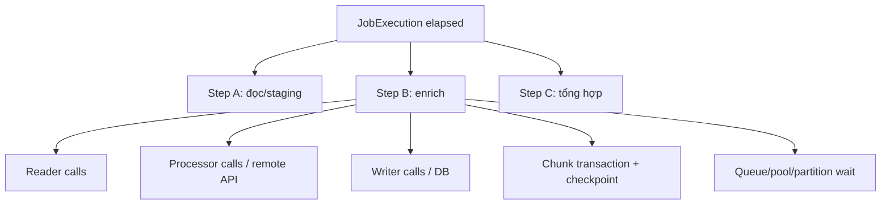
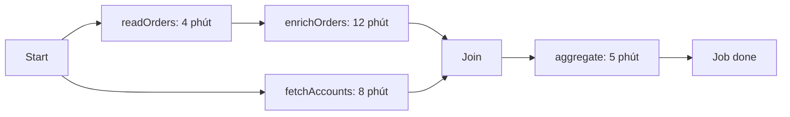
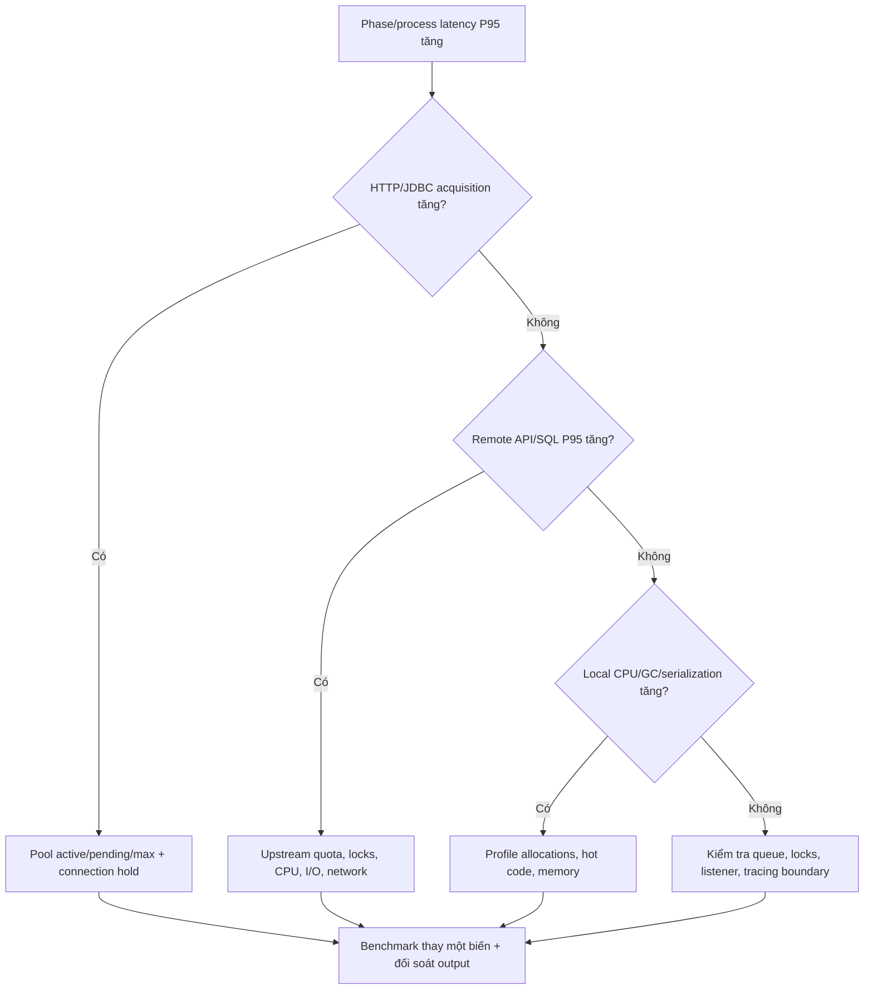
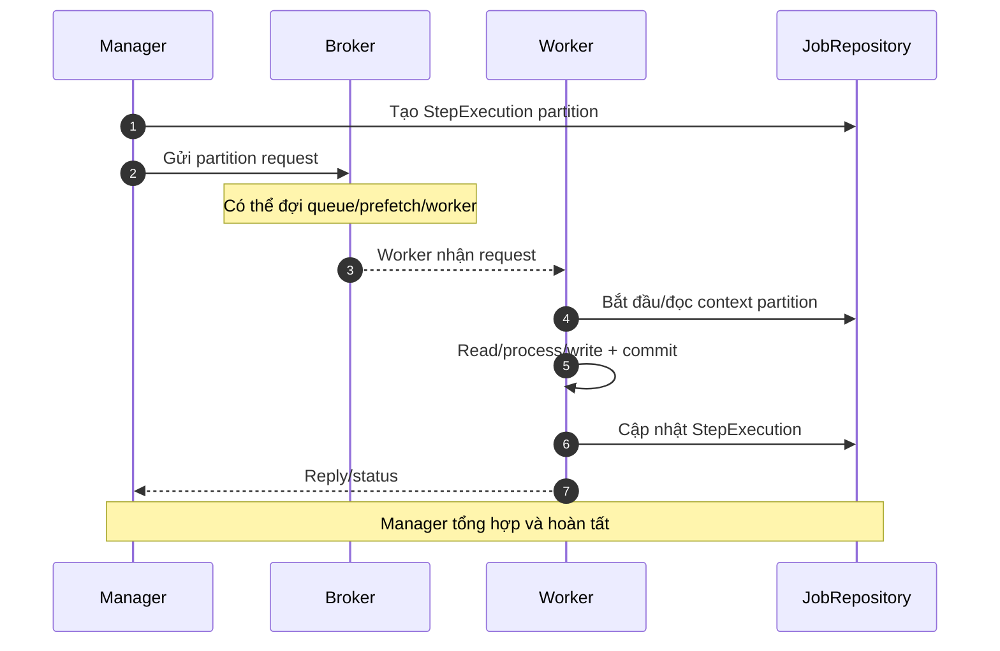
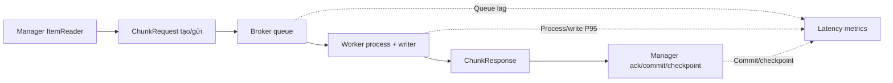

# Latency của từng bước trong Spring Batch: đo đúng, tìm critical path và tối ưu thông lượng

Một batch job xử lý 4 triệu bản ghi trong 40 phút. Dashboard cho thấy `readCount` tăng đều, CPU của worker chỉ sử dụng 45%, còn `JobExecution` vẫn `STARTED`. Liệu vấn đề nằm ở reader đọc chậm, processor chờ API, writer bị database lock, thời gian commit metadata hay một partition cuối đang chạy lâu bất thường? **Không thể trả lời chỉ từ tổng thời gian job và số thread.**

**Latency của từng bước** là thời gian thực hiện một đơn vị công việc ở các cấp khác nhau: toàn bộ `StepExecution`, mỗi chunk, các pha `read/process/write`, transaction commit, chờ connection, chờ queue/broker và các lần retry. Khi đặt các phép đo cạnh nhau, ta xác định được *bước nào nằm trên đường găng (critical path)*, độ trễ do đâu và tăng concurrency có còn mang lại lợi ích hay không.

Bài thuộc chương **Thông lượng** của module **SPRING_BATCH_SCALING_OPERATIONS**. Phạm vi gắn với Spring Batch 5.x: chunk-oriented processing, multi-threaded step, parallel steps, partitioning, remote partitioning, remote chunking, retry/restart và vận hành. Mục tiêu là tăng **business items đã commit trên giây**, nhưng vẫn bảo đảm thread safety, checkpoint, idempotency và thời hạn xử lý thực tế.

## 1. Latency của một StepExecution là gì?

Ở cấp metadata, một `StepExecution` có thông tin thời điểm bắt đầu/kết thúc. Ta thường lấy:

\[
T_{\mathrm{step}}=
t_{\mathrm{end}}-t_{\mathrm{start}}
\]

Với một step hoàn tất, `T_step` mô tả **wall-clock elapsed time** của lần thực thi step, không phải tổng CPU time của các worker. Nó có thể chứa đọc dữ liệu, xử lý, ghi, transaction, listener, chờ lock hoặc remote worker.

Một số phân biệt thiết yếu:

| Khái niệm | Đơn vị | Phạm vi |
| --- | --- | --- |
| **Job elapsed time** | giây/phút | Từ lúc job thực thi đến khi kết thúc theo boundary đo |
| **Step elapsed time** | giây/phút | Một `StepExecution` cụ thể |
| **Chunk duration** | ms/giây | Một chu kỳ chunk, thường liên quan transaction và checkpoint |
| **Item read latency** | µs/ms | Một lời gọi `ItemReader.read()` |
| **Item process latency** | ms/giây | Một lời gọi `ItemProcessor.process(item)` |
| **Writer call latency** | ms/giây | Một lời gọi `ItemWriter.write(Chunk)`, không nhất thiết từng item |
| **Commit latency** | ms/giây | Commit transaction, có thể gồm WAL/network/locks |
| **Queue/broker waiting time** | ms/giây/phút | Công việc chờ trước khi có worker |
| **End-to-end item latency** | ms/giây/phút | Từ lúc item được chấp nhận đến khi kết quả bền vững, nếu có correlation phù hợp |

**Không cộng** 100 latency của item rồi cho rằng đó là thời gian step trong khi các item chạy song song. Tổng worker-time và wall-clock elapsed time có thể khác nhau rất lớn.

## 2. Latency khác throughput như thế nào?

**Latency** đo mất bao lâu để hoàn tất một đơn vị việc; **throughput** đo số đơn vị hoàn tất trên mỗi giây. Cả hai có liên hệ nhưng không thay thế nhau.

Trong mô hình lý tưởng, có `C` operations được xử lý đồng thời, thời gian xử lý trung bình `L` giây/operation:

\[
R_{\mathrm{ideal}}\approx\frac{C}{L}
\]

Nếu mỗi API call mất 200 ms và có 10 request đồng thời:

\[
R_{\mathrm{ideal}}\approx\frac{10}{0,2}=50\text{ calls/s}
\]

Khi API chậm đến 500 ms, cùng 10 slots chỉ còn khoảng 20 calls/s. Tăng workers lên 30 có thể đưa throughput lên cao hơn **nếu API chịu được concurrency**, nhưng cũng có thể gây 429, lock wait, connection pool exhaustion và làm P99 xấu đi.

Với batch, throughput nên dùng:

\[
R_{\mathrm{committed}}=
\frac{\Delta\,\text{business items committed}}
{\Delta t}
\]

Không dùng đơn thuần `readCount / job duration` nếu nhiều item bị filter/skip, chunk rollback hoặc output bên ngoài không đồng bộ với metadata.

## 3. Đừng nhầm ba loại thời gian “bước”

Cụm “latency của từng bước” đôi khi bị hiểu theo ba nghĩa:

1. **Step trong job graph:** `loadCustomersStep`, `enrichCustomersStep`, `writeSummaryStep`.
2. **Pha trong chunk step:** `read()`, `process()`, `write()`, rồi commit/checkpoint.
3. **Bước trong distributed pipeline:** manager đọc và dispatch, broker chuyển, worker chờ/compute/write, trả reply, manager xác nhận.

Cần một mô hình đo cho cả ba:



Sơ đồ thể hiện phân cấp quan sát, **không có nghĩa ba step luôn chạy tuần tự** hoặc tổng latency các pha luôn bằng duration của step. Với parallel steps, duration các step có thể chồng nhau; với chunk đa luồng, các pha có thể đồng thời.

## 4. Nguồn số liệu đáng tin: JobRepository và instrumentation

Có ba cấp đo bổ sung:

| Nguồn | Đo tốt gì? | Không đo trực tiếp gì? |
| --- | --- | --- |
| `JobRepository` (`JobExecution`/`StepExecution`) | Trạng thái, start/end, read/write/skip/commit/rollback counts, checkpoint | Latency của từng lời gọi read/process/write hoặc queue wait |
| Micrometer/Observation, listener, decorator | Timer/latency histogram theo step type, phase, outcome | Không tự biết toàn bộ SQL/DB lock time nếu boundary không bao trùm |
| Client/DB/broker tracing | Hikari checkout, HTTP requests, SQL statements, broker lag | Không tự chứng minh business output exactly once |

Một dashboard production nên đặt **StepExecution elapsed time** cạnh **histogram read/process/write**, **connection wait**, **DB lock wait** và **committed throughput**. Nếu chỉ có một nguồn, nguy cơ kết luận sai khá cao.

**Điều quan trọng:** `StepExecution.getReadCount()` hoặc `getWriteCount()` là counters thuộc lifecycle Spring Batch, **không phải bộ đếm số lần gọi từng method trong mọi tình huống retry/rollback**. Nếu muốn attempts thực ở HTTP/JDBC, hãy đo ngay tại adapter hoặc client.

## 5. Đọc start/end của StepExecution thế nào?

Với JDBC repository, schema metadata thường có `BATCH_JOB_EXECUTION` và `BATCH_STEP_EXECUTION`. Một truy vấn PostgreSQL để tổng hợp latency những step **đã kết thúc**:

```sql
SELECT
    se.JOB_EXECUTION_ID,
    se.STEP_EXECUTION_ID,
    se.STEP_NAME,
    se.STATUS,
    se.START_TIME,
    se.END_TIME,
    ROUND(
        EXTRACT(EPOCH FROM (se.END_TIME - se.START_TIME))::numeric
        * 1000, 2
    ) AS elapsed_ms,
    se.READ_COUNT,
    se.WRITE_COUNT,
    se.COMMIT_COUNT,
    se.ROLLBACK_COUNT
FROM BATCH_STEP_EXECUTION AS se
WHERE se.JOB_EXECUTION_ID = :jobExecutionId
  AND se.START_TIME IS NOT NULL
  AND se.END_TIME IS NOT NULL
ORDER BY elapsed_ms DESC;
```

Điểm cần đọc đúng:

- `END_TIME IS NULL` có thể có nghĩa step **chưa kết thúc hoặc metadata chưa ghi được end time**, không phải latency bằng 0.
- Một step restart có thể có **nhiều StepExecution qua các JobExecution khác nhau**. Không gộp chúng thành một execution rồi suy kết quả của lần chạy hiện tại.
- Thời gian từ start/end thuộc **boundary lifecycle của step**. Nó có thể không bao gồm toàn bộ thời gian chờ schedule/queue trước khi step thực sự bắt đầu.
- Nếu metadata DB dùng schema/prefix khác hoặc database khác PostgreSQL, cần điều chỉnh SQL/time function cho tương thích.
- Timestamp metadata chịu clock/DB/timezone semantics; khi đo latency ngắn trong một process, **dùng monotonic clock** thay vì lấy hiệu hai `Instant.now()`.

### Đo cả bước còn chạy

Để quan sát step đang `STARTED`, có thể tính tuổi hiện tại theo thời điểm DB, nhưng đó là **elapsed-so-far**, không phải duration cuối cùng. Một StepExecution có `LAST_UPDATED` cũ chưa chắc đang kẹt ở repository: chunk có thể mất hàng phút để gọi API hoặc worker đã crash; cần kiểm tra logs, active threads và transaction.

## 6. Đo job graph đúng: critical path chứ không cộng tất cả step duration

Giả sử một job có ba flow:

- Flow A: `readOrders` (4 phút) → `enrichOrders` (12 phút).
- Flow B: `fetchAccounts` (8 phút) chạy **song song** với Flow A.
- Sau khi cả hai flow hoàn tất, `aggregate` (5 phút) mới bắt đầu.

Nếu không có overhead, job duration lý tưởng:

\[
T_{\mathrm{job}}\approx
\max(4+12,\ 8)+5
=21\text{ phút}
\]

Không phải `4+12+8+5=29` phút. **Critical path** là `readOrders → enrichOrders → aggregate`; tối ưu `fetchAccounts` từ 8 xuống 4 phút **có thể không rút ngắn job chút nào**.



Trong thực tế, startup, scheduler, DB connection, JobRepository, listener và lock wait còn tạo overhead. Nhưng nguyên tắc vẫn đúng: **ưu tiên tối ưu bước trên critical path**, không tự động tối ưu bước có duration lớn thứ hai.

## 7. So sánh hai cách đo thời gian: wall-clock và CPU time

Một processor gọi API có thể mất 500 ms trong khi CPU dùng để serialize request/parse response chỉ 15 ms. Nếu chỉ nhìn CPU profiler, bạn có thể kết luận processor “nhẹ”; nhưng worker thread vẫn bị chặn **500 ms wall-clock**.

| Phép đo | Phản ánh | Ví dụ dùng |
| --- | --- | --- |
| Wall-clock monotonic elapsed | Tổng thời gian một thao tác chưa hoàn tất, gồm chờ | Phân tích latency read/process/write, SLA |
| Thread CPU time | CPU thực sự thread tiêu thụ (nếu runtime hỗ trợ) | Phân biệt CPU-bound với blocking |
| Allocation/GC | Chi phí cấp phát và garbage collection | Processor tạo DTO lớn, serialization |
| JDBC transaction duration | Thời gian transaction giữ tài nguyên | DB lock contention, pool starvation |
| Queue age | Thời gian item/request đợi trước xử lý | Executor/broker backpressure |

**Khi tối ưu:** Nếu step I/O-bound, thêm CPU có thể không giúp. Nếu CPU-bound ở processor, tăng thread quá số core có thể làm context switch/GC tăng. Đo cả CPU, wall-clock và downstream latency trước khi chọn mô hình scale.

## 8. Spring Batch 5.x có những metric sẵn nào?

Spring Batch cung cấp các điểm monitoring/metrics cho job, step và chunk khi được tích hợp với Micrometer/Observation theo version và cấu hình. Các metric thuộc họ `spring.batch.*` có thể cho biết thời gian job/step và một số thao tác read/process/write/chunk.

**Không giả định** tên, tag và coverage giống nhau giữa Spring Batch 5.0, 5.2, Boot 3.x và các exporter. Cần:

1. Bật hạ tầng Micrometer/Actuator tương ứng với deployment.
2. Chạy một JobExecution nhỏ qua các bước.
3. Xem **metric thực sự có** (tên, units, tags, timer count).
4. Kiểm tra timer đo toàn bộ step hay chỉ callback của một phase.
5. Xác minh histogram/percentile export nếu cần P95/P99 toàn cluster.
6. Đo thêm gateway/DB/broker mà built-in metrics không bao phủ.

Ví dụ checklist từ Actuator (đường dẫn tùy cấu hình security):

```text
GET /actuator/metrics
GET /actuator/metrics/<metric-name-found-at-runtime>
GET /actuator/prometheus
```

Không mở Actuator metrics endpoint ra Internet công khai. Endpoint có thể chứa tên job/step, trạng thái và thông tin vận hành; áp xác thực/phân quyền và không đưa business IDs nhạy cảm vào tag.

## 9. Custom StepExecution timer với monotonic clock

Khi cần timer riêng cho một loại step, dùng `StepExecutionListener` với `System.nanoTime()`. Listener trong ví dụ là **step-scoped** để một instance không giữ shared mutable `startNanos` giữa nhiều StepExecution đang chạy song song.

```java
import java.util.concurrent.TimeUnit;

import io.micrometer.core.instrument.MeterRegistry;
import io.micrometer.core.instrument.Timer;
import org.springframework.batch.core.ExitStatus;
import org.springframework.batch.core.StepExecution;
import org.springframework.batch.core.StepExecutionListener;
import org.springframework.batch.core.configuration.annotation.StepScope;
import org.springframework.stereotype.Component;

@Component
@StepScope
public class StepWallTimeListener implements StepExecutionListener {

    private final MeterRegistry metrics;
    private long startNanos;

    public StepWallTimeListener(MeterRegistry metrics) {
        this.metrics = metrics;
    }

    @Override
    public void beforeStep(StepExecution stepExecution) {
        startNanos = System.nanoTime();
    }

    @Override
    public ExitStatus afterStep(StepExecution stepExecution) {
        long elapsed = System.nanoTime() - startNanos;

        Timer.builder("batch.custom.step.elapsed")
                .description("Step listener wall-clock elapsed")
                .tag("step_type", "enrichWorkerStep")
                .tag("status", stepExecution.getStatus().name())
                .register(metrics)
                .record(elapsed, TimeUnit.NANOSECONDS);

        return null; // Không sửa ExitStatus của Spring Batch.
    }
}
```

**Ranh giới của metric:**

- Timer đo từ callback `beforeStep` đến `afterStep`, **không hứa bao gồm toàn bộ framework setup hoặc lần persist metadata cuối**.
- Nếu JVM bị kill trước `afterStep`, timer đó có thể **không được ghi**; JobRepository và external monitoring vẫn cần để phát hiện execution chưa kết thúc.
- `@StepScope` tạo instance phù hợp với StepExecution, tránh một field `startNanos` singleton bị ghi đè khi chạy nhiều partition. Phải đăng ký listener vào step thực sự chạy.
- Tag `step_type` cố định theo loại step, không gắn `StepExecutionId` hoặc tên partition có số thứ tự không giới hạn.
- Việc emit metrics không được ném exception làm hỏng job. Cấu hình/kiểm thử registry/exporter phù hợp.
- Một listener đo elapsed không cho biết reader/processor/writer nào là nguyên nhân, vì thế cần các timer phase ở bước tiếp theo.

## 10. Instrument từng pha bằng decorator của ItemReader

Để đo read latency, ta có thể **bọc reader** thay vì copy implementation. Với reader stateful, wrapper phải chuyển tiếp lifecycle `ItemStream.open/update/close` để Spring Batch vẫn lưu checkpoint.

```java
import java.util.concurrent.TimeUnit;

import io.micrometer.core.instrument.MeterRegistry;
import io.micrometer.core.instrument.Timer;
import org.springframework.batch.item.ExecutionContext;
import org.springframework.batch.item.ItemStreamReader;

public final class TimedReader<T> implements ItemStreamReader<T> {

    private final ItemStreamReader<T> delegate;
    private final Timer timer;

    public TimedReader(ItemStreamReader<T> delegate, MeterRegistry metrics) {
        this.delegate = delegate;
        this.timer = Timer.builder("batch.custom.phase.duration")
                .tag("phase", "read")
                .tag("step_type", "enrichWorkerStep")
                .register(metrics);
    }

    @Override
    public T read() throws Exception {
        long start = System.nanoTime();
        try {
            return delegate.read();
        } finally {
            timer.record(System.nanoTime() - start, TimeUnit.NANOSECONDS);
        }
    }

    @Override
    public void open(ExecutionContext context) {
        delegate.open(context);
    }

    @Override
    public void update(ExecutionContext context) {
        delegate.update(context);
    }

    @Override
    public void close() {
        delegate.close();
    }
}
```

**Giới hạn cần nhớ:**

1. `read()` có thể trả `null` khi đến cuối input; timer này vẫn ghi nhận lời gọi EOF.
2. Retry/rollback hoặc reader đặc thù có thể làm số lần gọi read khác với `StepExecution.readCount`.
3. Wrapper chuyển tiếp lifecycle nhưng **không biến delegate thành thread-safe**. Nếu delegate giữ cursor mutable, phải dùng StepScope/partition-specific instance hoặc cơ chế đồng bộ phù hợp.
4. Nếu reader không implement `ItemStreamReader` mà chỉ `ItemReader`, dùng wrapper cùng contract thực tế; không tự ép kiểu khi chưa xác minh.
5. Đo elapsed bên ngoài method gồm I/O và blocking theo bên trong reader, nhưng không tự bao gồm thời gian chờ trước khi thread bắt đầu gọi `read()`.

## 11. Instrument processor và writer đúng đơn vị đo

Processor nhận một item, writer của Spring Batch 5.x nhận **một `Chunk<? extends T>`**. Do đó, latency của writer là **theo lời gọi/chunk**, không phải tự động theo từng item.

```java
import java.util.concurrent.TimeUnit;

import io.micrometer.core.instrument.MeterRegistry;
import io.micrometer.core.instrument.Timer;
import org.springframework.batch.item.Chunk;
import org.springframework.batch.item.ItemProcessor;
import org.springframework.batch.item.ItemWriter;

public final class TimedProcessor<I, O> implements ItemProcessor<I, O> {
    private final ItemProcessor<I, O> delegate;
    private final Timer timer;

    public TimedProcessor(
            ItemProcessor<I, O> delegate, MeterRegistry metrics) {
        this.delegate = delegate;
        this.timer = Timer.builder("batch.custom.phase.duration")
                .tag("phase", "process")
                .tag("step_type", "enrichWorkerStep")
                .register(metrics);
    }

    @Override
    public O process(I item) throws Exception {
        long start = System.nanoTime();
        try {
            return delegate.process(item);
        } finally {
            timer.record(System.nanoTime() - start, TimeUnit.NANOSECONDS);
        }
    }
}

public final class TimedWriter<T> implements ItemWriter<T> {
    private final ItemWriter<T> delegate;
    private final Timer timer;

    public TimedWriter(ItemWriter<T> delegate, MeterRegistry metrics) {
        this.delegate = delegate;
        this.timer = Timer.builder("batch.custom.phase.duration")
                .tag("phase", "write")
                .tag("step_type", "enrichWorkerStep")
                .register(metrics);
    }

    @Override
    public void write(Chunk<? extends T> chunk) throws Exception {
        long start = System.nanoTime();
        try {
            delegate.write(chunk);
        } finally {
            timer.record(System.nanoTime() - start, TimeUnit.NANOSECONDS);
        }
    }
}
```

Đây là **wall-clock timer** cho cả lần thành công và thất bại, giúp không che tail latency của các attempts lỗi. Nếu muốn đo tỷ lệ lỗi, tạo counter riêng hoặc hai timer với `outcome=success/error`, song phải giới hạn tags.

**Không chia P95 writer call duration cho chunk size rồi gọi đó là P95/item**: phép chia phân vị như vậy không đúng thống kê. Có thể tính *mean milliseconds/item* trong cùng cửa sổ bằng tổng duration và số item thực sự ghi, nhưng vẫn phải đặt tên rõ; writer latency mỗi item không đo được nếu writer chỉ có API nhận chunk và không instrument sâu hơn.

Nếu một `ItemProcessor` trả `null` để filter item, timer vẫn tính lần gọi đó. Nếu processor bị retry 3 lần, timer có thể ghi 3 attempts cho một business item.

## 12. Lắp các decorator vào StepBuilder

Ví dụ một chunk step Spring Batch 5.x; các lớp `InvoiceInput`, `InvoiceOutput` và delegate beans là thành phần nghiệp vụ ứng dụng phải cung cấp.

```java
import io.micrometer.core.instrument.MeterRegistry;
import org.springframework.batch.core.Step;
import org.springframework.batch.core.repository.JobRepository;
import org.springframework.batch.core.step.builder.StepBuilder;
import org.springframework.batch.item.ItemProcessor;
import org.springframework.batch.item.ItemStreamReader;
import org.springframework.batch.item.ItemWriter;
import org.springframework.context.annotation.Bean;
import org.springframework.transaction.PlatformTransactionManager;

@Bean
public Step enrichWorkerStep(
        JobRepository jobRepository,
        PlatformTransactionManager businessTransactionManager,
        ItemStreamReader<InvoiceInput> invoiceReader,
        ItemProcessor<InvoiceInput, InvoiceOutput> invoiceProcessor,
        ItemWriter<InvoiceOutput> invoiceWriter,
        MeterRegistry metrics,
        StepWallTimeListener stepWallTimeListener) {

    return new StepBuilder("enrichWorkerStep", jobRepository)
            .<InvoiceInput, InvoiceOutput>chunk(
                    200, businessTransactionManager)
            .reader(new TimedReader<>(invoiceReader, metrics))
            .processor(new TimedProcessor<>(invoiceProcessor, metrics))
            .writer(new TimedWriter<>(invoiceWriter, metrics))
            .listener(stepWallTimeListener)
            .build();
}
```

Lưu ý production:

- Reader stateful cho partitioning nên là `@StepScope` (delegate), với context range/file cố định; không inject một instance mutable dùng chung cho mọi partition.
- Các decorator không giữ state mutable theo item nên tương đối đơn giản; **thread safety của delegate** vẫn là yêu cầu riêng.
- Nếu writer cũng implement `ItemStream` hoặc `ItemStreamReader/Writer`, wrapper kiểu `ItemWriter` đơn thuần **không tự chuyển tiếp open/update/close**. Phải implement/forward `ItemStream` hoặc đăng ký đúng stream theo semantics của Spring Batch, nếu không có thể phá restart. Ví dụ trên giả định writer **không cần** lifecycle ItemStream.
- Tương tự, nếu processor/writer là listener hoặc có lifecycle riêng, wrapping có thể che interface callback; phải đăng ký explicit listener/stream hoặc dùng instrumentation adapter phù hợp.
- Nếu delegate là scoped proxy, phải kiểm thử lifecycle và việc init thực sự diễn ra theo StepExecution.
- Bật/tắt metrics qua cấu hình; đừng làm mất checkpoint vì một thay đổi instrumentation.
- Test callback khi step FAILED và khi chạy nhiều partition để chắc chắn timer/tag được ghi.

## 13. Đo chunk duration và rollback bằng ChunkListener

Một item có thể nhanh nhưng **chunk vẫn chậm** vì writer flush, DB commit, checkpoint hoặc lock wait. Để đo vùng lifecycle của một chunk, dùng `ChunkListener`, nhưng phải biết chính xác boundary.

Trong Spring Batch 5.x, `ChunkListener.beforeChunk` được gọi tại thời điểm chunk sắp được xử lý trong transaction, `afterChunk` khi chunk được xử lý thành công, còn `afterChunkError` khi có lỗi chunk. Phạm vi có thể bao gồm những phần ngoài read/process/write và phụ thuộc flow/transaction của framework.

Mẫu thread-local timer cho multi-threaded chunk step:

```java
import java.util.concurrent.TimeUnit;

import io.micrometer.core.instrument.MeterRegistry;
import io.micrometer.core.instrument.Timer;
import org.springframework.batch.core.ChunkListener;
import org.springframework.batch.core.scope.context.ChunkContext;

public final class ChunkWallTimeListener implements ChunkListener {

    private final ThreadLocal<Long> started = new ThreadLocal<>();
    private final Timer success;
    private final Timer error;

    public ChunkWallTimeListener(MeterRegistry metrics) {
        success = Timer.builder("batch.custom.chunk.duration")
                .tag("outcome", "success")
                .register(metrics);
        error = Timer.builder("batch.custom.chunk.duration")
                .tag("outcome", "error")
                .register(metrics);
    }

    @Override
    public void beforeChunk(ChunkContext context) {
        started.set(System.nanoTime());
    }

    @Override
    public void afterChunk(ChunkContext context) {
        stop(success);
    }

    @Override
    public void afterChunkError(ChunkContext context) {
        stop(error);
    }

    private void stop(Timer timer) {
        Long start = started.get();
        started.remove();
        if (start != null) {
            timer.record(System.nanoTime() - start, TimeUnit.NANOSECONDS);
        }
    }
}
```

**Giới hạn của ví dụ:** `afterChunkError` có timing cụ thể theo lifecycle Spring Batch; không coi nó luôn là timestamp chính xác ngay sau DB rollback vật lý. Callback có thể không chạy khi JVM bị kill. `ThreadLocal` được remove để tránh rò rỉ trên pooled worker threads, nhưng code custom async/off-thread callbacks cần kiểm chứng ngữ cảnh thread. Listener nên đăng ký một lần cho step; metric ở đây không có tag StepExecution ID.

**Không lấy tổng phase timers làm chính xác chunk elapsed:** read/process/write được đo theo calls có thể xảy ra nhiều lần do retry; transaction setup/commit và listener còn nằm ngoài phase timers. Với parallel chunks, durations chồng lấn.

## 14. Gắn latency vào cause: queue, pool, SQL, CPU hay remote API?

Khi `process P95` tăng từ 50 ms lên 700 ms, cần chia sâu vào bên trong:



Một số quy tắc:

- `Hikari acquire latency` lớn: nhiều thread đợi **mượn connection**, không chứng minh query SQL chậm.
- `Hikari usage duration` lớn: connection bị giữ lâu, có thể bởi lock waits hoặc transaction bao cả HTTP call.
- `HTTP request P95` lớn: có thể server chậm, mạng chậm hoặc client-side queue; đo connect/connection lease/read riêng nếu có.
- `DB lock waits` lớn: tăng pool/worker thường chỉ tạo thêm tranh chấp.
- `CPU/GC` lớn: tăng threads quá core hoặc object allocation theo item có thể làm P99 xấu đi.
- `JobRepository write latency` lớn: checkpoint/metadata DB cũng có thể là nút thắt, nhất là nhiều partitions nhỏ.

Không thay `chunk(200)` thành `chunk(2.000)` chỉ vì processor P95 cao: chunk size không chữa latency API cho từng item nếu upstream vẫn chậm.

## 15. Tính thời gian theo chunk: số phép gọi và commit overhead

Nếu có `N` item và chunk size `C`, số chunk lý tưởng:

\[
M_{\mathrm{chunk}}\approx\left\lceil\frac{N}{C}\right\rceil
\]

Với 2.400.000 item:

| Chunk size | Số chunk lý tưởng | Tác động dự kiến |
| ---: | ---: | --- |
| 20 | 120.000 | Nhiều lần commit/checkpoint; overhead cao |
| 100 | 24.000 | Ít transactions hơn |
| 500 | 4.800 | Transaction dài hơn, rollback cost cao |
| 2.000 | 1.200 | Metadata write ít nhưng memory/locks/replay có thể lớn |

Đối với **một chunk tuần tự và không lỗi**, có thể ước lượng trực giác:

\[
T_{\mathrm{chunk}}\approx
\sum T_{\mathrm{read\ calls}}+
\sum T_{\mathrm{process\ calls}}+
T_{\mathrm{writer\ call}}+
T_{\mathrm{transaction/commit}}+
T_{\mathrm{other}}
\]

Đây chỉ là mô hình phân rã theo transaction boundary; thời gian có thể lồng nhau và không đo đủ trong callback. Nếu processor chạy async hoặc step xử lý nhiều chunk song song, **không cộng các durations giữa threads để suy wall-clock**.

**Một mẹo benchmark:** Khi nghi metadata commit overhead, thử cùng workload với chunk size 50/200/500, đo committed throughput, metadata SQL operations/s, DB lock waits, rollback cost và restart correctness. Bước làm giảm số commits có thể đồng thời làm business lock waits tăng; cần đo cả hai phía.

## 16. Phân tích latency ở multi-threaded step

Với multi-threaded step, nhiều chunk trong một `StepExecution` có thể hoàn thành không theo thứ tự đọc. Điều này tạo bốn câu hỏi:

1. Cùng step có bao nhiêu chunk active tại một thời điểm?
2. Histogram `read/process/write` có được cập nhật từ nhiều threads an toàn?
3. Reader/writer có giữ state mutable không thread-safe?
4. Khi một chunk rollback, processor/HTTP call nào bị thử lại và tạo tail latency?

Micrometer `Timer` thread-safe trong cách dùng thông thường; **bản thân Timer không làm delegate thread-safe**. Một singleton reader dùng cursor hoặc bộ đếm chưa đồng bộ có thể đọc trùng/bỏ sót dữ liệu dù P95 đẹp.

**Đừng dùng một field `long startedAt` singleton** trong listener đo một thao tác per-chunk khi nhiều threads gọi. Nó bị ghi đè và sinh duration vô nghĩa; dùng `ThreadLocal` phù hợp callback cùng thread hoặc correlation theo `ChunkContext` nếu execution model yêu cầu.

Khi tăng concurrency, lưu ít nhất:

| Trước/sau | Số liệu |
| --- | --- |
| Worker active/pending | TaskExecutor threads và queue |
| Step wall-clock | Tổng thời gian một StepExecution |
| Phase P50/P95/P99 | Processor và writer có chậm đi không |
| Rollbacks/retries | Concurrency gây tăng xung đột không |
| Data correctness | Có đủ unique business keys sau restart không |
| DB/API saturation | Lock waits, 429, Hikari pending |

Nếu throughput tăng 20% nhưng P99 tăng gấp 10 và rollback nhiều, batch window có thể vẫn trễ khi gặp dữ liệu khó.

## 17. Parallel steps: độ trễ phải đọc theo timeline

Spring Batch có thể chạy nhiều flow/step đồng thời. Bảng thời gian sau là ví dụ:

| Step | Bắt đầu | Kết thúc | Elapsed |
| --- | --- | --- | ---: |
| `extractA` | 00:00 | 00:06 | 6 phút |
| `extractB` | 00:00 | 00:09 | 9 phút |
| `transformA` (phụ thuộc `extractA`) | 00:06 | 00:15 | 9 phút |
| `merge` (chờ cả hai flow) | 00:15 | 00:20 | 5 phút |

Tổng duration bốn StepExecution là `6+9+9+5=29 phút`, nhưng job chỉ mất khoảng **20 phút**. Nếu `extractB` cải thiện từ 9 xuống 5 phút, `merge` vẫn phải chờ `transformA` đến phút 15; job vẫn khoảng 20 phút.

Hãy dùng một timeline/Gantt từ start/end thực, hoặc một distributed trace khi phù hợp. Ưu tiên bước quyết định **thời điểm join được giải phóng**. Nếu một step dài nhưng không nằm trên critical path, tối ưu nó không nhất thiết rút ngắn job.

**Lưu ý:** Hai flow có thể dùng chung API/database; dù logic độc lập, tăng concurrency có thể làm cả hai chậm do tranh tài nguyên. So sánh elapsed khi chạy riêng và khi chạy đồng thời để phát hiện contention ẩn.

## 18. Partitioning: xem max, skew và straggler thay vì chỉ trung bình

Trong local/remote partitioning, manager có thể tạo nhiều `StepExecution` của các partition. Ví dụ tám partition có thời gian:

```text
partition0:  4.5 phút
partition1:  5.0 phút
partition2:  5.2 phút
partition3:  4.7 phút
partition4:  5.1 phút
partition5:  5.4 phút
partition6:  5.0 phút
partition7: 18.0 phút  <-- straggler
```

Nếu tất cả chạy song song đủ tài nguyên, **manager không thể hoàn thành trước partition chậm nhất** (chưa tính setup/aggregation). Trung bình các partition khoảng 6,6 phút nhưng tổng stage vẫn bị chi phối bởi **18 phút**.

Các thống kê nên dùng:

- Min/median/P95/max partition duration; với số partition nhỏ, P95 rất nhạy với mẫu.
- Input item count/bytes per partition.
- Throughput committed per partition, không chỉ elapsed.
- Retry/rollback counts, skipped items và downstream failures.
- Queue wait trước khi worker thực sự chạy.
- CPU/DB/HTTP time theo partition hoặc worker.
- Tỷ lệ chênh lệch max/median để phát hiện skew.

Một partition lâu không nhất thiết có input lớn: có thể do hot business key, deadlock, một file từ xa chậm hoặc worker hết connection. Tách nguyên nhân trước khi tăng gridSize.

### Grid size và active workers khác nhau

`gridSize=32` không có nghĩa 32 partitions cùng chạy. Concurrency còn phụ thuộc local `TaskExecutor` hoặc remote worker instances; partitioner cũng quyết định số partition thực tạo. Với queue, một partition có thể chờ 10 phút trước khi bắt đầu StepExecution. Vì vậy **StepExecution elapsed** có thể không bao gồm toàn bộ dispatch/queue latency.

## 19. Remote partitioning: đo cả manager, broker và worker

Trong remote partitioning, manager tạo partition metadata/requests và worker thực thi StepExecution trên nhiều JVM. Một partition có ít nhất các mốc:



**Các timers cần phân biệt:**

| Timer | Thuộc về | Ý nghĩa |
| --- | --- | --- |
| Dispatch-to-receive | Manager/broker/worker correlation | Queue/network/prefetch wait |
| Receive-to-step-start | Worker runtime | Setup/resources trước step |
| StepExecution elapsed | Worker + repository | Xử lý partition theo lifecycle |
| Step-end-to-reply | Worker/broker | Trễ reply/serialization/network |
| All-partitions-done-to-manager-complete | Manager | Aggregation, metadata update, coordination |

Các mốc từ nhiều JVM có thể có **clock skew**; lấy hiệu hai wall-clock timestamps khác máy đòi clock sync và độ chính xác phù hợp. Đối với latency nội bộ từng JVM, dùng `System.nanoTime()`; đối với distributed tracing, dùng trace spans/correlation và hiểu giới hạn đồng hồ.

Không suy rằng một worker có StepExecution ngắn thì request đó không bị queue 5 phút trước khi worker nhận. Cần cả broker age/queue depth, partition count và reply correlation.

## 20. Remote chunking: manager nhanh hay worker nhanh?

Remote chunking khác remote partitioning: **manager đọc item và gửi `ChunkRequest`**, còn worker process/write chunk rồi trả `ChunkResponse`. Bottleneck có thể ở manager reader, broker, worker API/DB hoặc manager đợi replies.



**Các loại latency nên đo độc lập:**

- Manager read latency/item, thời gian gom chunk.
- Send-to-delivery hoặc queue age của `ChunkRequest`.
- Worker processing time/chunk, HTTP/DB calls và write time.
- Reply transit/correlation/wait, số in-flight chunks.
- Manager commit/checkpoint và total step elapsed.
- Redelivery count, duplicate execution window khi worker đã commit nhưng reply mất.

Không có mặc định “mỗi ChunkRequest là một StepExecution riêng” trong remote chunking chuẩn. Nếu chỉ đo `StepExecution.elapsed` ở manager, bạn có thể nhìn thấy duration lớn mà không biết worker P95 hay queue age mới là nguyên nhân.

Khi reply mất sau khi worker ghi dữ liệu, manager có thể phải recovery/retry theo middleware semantics. **Không dùng việc đo latency để suy exactly-once**; worker writer cần idempotent theo operation ID.

## 21. Timer count khác business item count khi retry/rollback

Một chunk chứa 100 item, processor gọi API. Nếu item X lỗi hai lần rồi thành công lần ba:

- Timer processor có thể ghi nhận **ba lời gọi** cho X.
- `readCount` không nhất thiết tăng ba lần.
- `writeCount` là metadata số item được ghi thành công theo StepExecution, không phải số HTTP request.
- Nếu writer rollback, một số item có thể bị process/write lại tùy semantics.
- HTTP client cũng có thể retry ẩn khiến số requests thật lớn hơn callback count.

Vì vậy cần ba loại metrics:

| Metric | Mục đích |
| --- | --- |
| Attempt-level phase timer | Độ trễ **mỗi lần gọi** read/process/write |
| Business operation success/committed count | Đo **công việc hữu ích** đã hoàn thành |
| Retry/rollback/exhausted count | Giải thích chênh lệch giữa attempts và outputs |

Một **P95 processor latency thấp** không đủ để nói job nhanh nếu mỗi item retry năm lần hoặc worker backlog lớn. Ngược lại, elapsed step lớn không chứng minh từng call chậm: có thể do queue hoặc nhiều items.

**Không bỏ qua lỗi bằng `return null` từ processor:** trong Spring Batch, điều đó thường có nghĩa **filter item**, không phải trì hoãn để xử lý sau. Với dữ liệu bắt buộc, phải có fail/retry/recovery phù hợp.

## 22. Phân vị, histogram và sự khác biệt giữa mean với P99

Giả sử 10.000 lời gọi processor:

- 9.800 calls mất 10 ms.
- 190 calls mất 150 ms.
- 10 calls mất 2.000 ms.

Trung bình:

\[
\bar t=\frac{9.800\times10+190\times150+10\times2.000}{10.000}
=14,65\text{ ms}
\]

Nhưng 10 calls ở đuôi mất 2 giây có thể ảnh hưởng chunk/partition straggler. Với định nghĩa phân vị nearest-rank, P95 vẫn là 10 ms, P99 là 150 ms, P99.9 là 150 ms và P99.99 có thể là 2.000 ms.

| Thống kê | Dùng để |
| --- | --- |
| Mean | Capacity budgeting và tổng chi phí trung bình |
| P50 | Độ trễ “điển hình” |
| P95/P99 | Phát hiện phổ latency cao khi tăng concurrency |
| P99.9/max | Lỗi hiếm, tail spikes, rare large files |
| Histogram buckets | Tổng hợp nhiều JVM đúng cách |
| Success/error split | Biết latency thành công khác thất bại |

**Không lấy trung bình các P95 của 20 pods để suy P95 toàn cluster.** Dùng histogram có bucket tương thích để gộp, hoặc tính từ events/observations theo phương pháp thống kê đúng. Một percentile dựa trên rất ít samples có thể không có ý nghĩa ổn định; xem call volume và cửa sổ thời gian.

Giữ metric tags có cardinality thấp: `step_type, phase, outcome, service`. Đừng gắn raw item ID, JobExecution ID hay partition ID vào mọi time series; lưu chúng trong sampled traces và logs có kiểm soát.

## 23. Đặt SLO latency dựa trên batch window

Một job phải xử lý `N` item trong `T_max` giây, throughput tối thiểu là:

\[
R_{\mathrm{required}}=\frac{N}{T_{\max}}
\]

Nếu `N=4.200.000` và `T_max=30` phút:

\[
R_{\mathrm{required}}=
\frac{4.200.000}{1.800}
\approx2.333,3\text{ item/s}
\]

Một SLO có thể gồm:

- Step `enrichWorkerStep` P95 processor dưới **250 ms** khi upstream bình thường.
- HTTP error rate/retry exhausted dưới ngưỡng đã xác nhận.
- Commit/checkpoint P95 dưới **100 ms** theo boundary đo có bao gồm commit thật.
- Partition max/median ratio dưới một ngưỡng skew thực tế.
- Không có Hikari checkout timeout kéo dài trong giờ batch.
- Job hoàn tất trong 30 phút **với dữ liệu không trùng/thiếu**.

Các con số chỉ là **ví dụ cho cách thiết kế SLO**. Chúng không phải chuẩn của Spring Batch. Với bước có rất ít observations, báo động P99 có thể nhiễu; nên đặt min volume/cửa sổ thích hợp và kết hợp status/error rate.

**Ưu tiên SLO gắn hành động:** “Processor P95 tăng + HTTP 429 tăng → giảm request concurrency và kiểm tra quota”, thay vì cảnh báo “P95 tăng” không có hướng xử lý.

## 24. Theo dõi latency theo thời gian, không chỉ tại cuối job

Nếu chỉ lấy `END_TIME - START_TIME` sau khi job hoàn tất, bạn sẽ không phát hiện job đang trượt SLA giữa chừng.

Dashboard nên có các biểu đồ theo thời gian:

1. Items committed/s theo bước và toàn job.
2. In-flight chunks/partitions và queue age.
3. Processor/Writer latency P50/P95/P99 theo cửa sổ.
4. Read latency và reader/source throughput.
5. Chunk duration, rollbacks và retry exhausted.
6. Hikari active/pending/acquire/usage, HTTP leased/pending/429.
7. Broker backlog/oldest age/reply timeout nếu xử lý phân tán.
8. Job time elapsed, estimated remaining work và SLA remaining.
9. DB lock wait, WAL/commit latency và JobRepository update durations.
10. Output reconciliation indicators: unique business IDs, duplicates và missing items.

**Ước lượng ETA** có thể lấy phần việc còn lại chia cho throughput đã commit gần đây:

\[
T_{\mathrm{remaining}}\approx
\frac{N_{\mathrm{remaining}}}
{R_{\mathrm{committed,recent}}}
\]

Nhưng ETA không chắc chắn nếu data skew, retries hoặc upstream throttling tăng về cuối. Không dùng ETA một mình để tự động ghi `COMPLETED` hay bỏ partition chậm.

## 25. Kiểm tra mốc thời gian và đồng hồ giữa các node

Trong deployment nhiều JVM, việc tính `worker_receive_time - manager_send_time` phụ thuộc **đồng hồ hai máy**. Nếu đồng hồ manager lệch +500 ms so với worker, phép trừ có thể âm dù broker delivery vẫn bình thường.

| Tình huống | Đồng hồ phù hợp |
| --- | --- |
| Elapsed của một method trong cùng thread/JVM | `System.nanoTime()` (monotonic) |
| Elapsed của một StepExecution sau khi hoàn tất | Metadata start/end (wall-clock, DB/runtimes) |
| Queue wait qua nhiều JVM | Clock synchronization + timestamp/correlation hoặc broker-provided age metrics |
| Distributed tracing giữa manager/broker/worker | Spans và trace context, hiểu giới hạn clock skew |
| SLA wall-clock “hoàn tất trước 06:00” | Wall-clock có timezone rõ ràng, đồng bộ NTP |

**Không lưu `System.nanoTime()` vào ExecutionContext** để phục hồi sau restart: monotonic clock chỉ có ý nghĩa trong process/JVM đang chạy, không là timestamp bền vững xuyên JVM.

Khi hiển thị `LocalDateTime` của Spring Batch, phải dùng timezone của hạ tầng/app/DB một cách nhất quán. Đừng so sánh timestamps lấy từ các node không đồng bộ để kết luận một bước “âm thời gian”.

## 26. Benchmark: đổi một biến mỗi lượt để tìm bottleneck

Một phép đo đẹp trên input nhỏ không đại diện production. Benchmark nên gồm dữ liệu đủ lớn, slow items, retry thực tế và cấu hình resource giống deployment.

| Lần | Active workers/chunks | Chunk size | Mục tiêu |
| --- | ---: | ---: | --- |
| A | 1 | 100 | Baseline không concurrency |
| B | 4 | 100 | Xem processor/writer latency khi scale |
| C | 8 | 100 | Kiểm tra pool/API quota, step elapsed |
| D | 16 | 100 | Điểm throughput ngừng tăng, P99/rollback tăng? |
| E | 8 | 500 | Giảm commit/checkpoint overhead |
| F | 8 | 20 | So sánh commit nhiều và transaction ngắn |
| G | 8 | 100 | Inject upstream 503/429 và slow response |
| H | 8 | 100 | Kill worker sau business commit, rồi restart |

Giữ cùng dataset/data distribution và policy retry trong những lượt so sánh concurrency; chỉ thay một biến khi muốn suy quan hệ nhân quả.

**Lưu lại:** StepExecution elapsed, processor/writer histogram, chunk duration, calls/attempts, HTTP P95, DB lock waits, Hikari pending, committed business items/s, job duration, output duplicates/missing và số partition straggler.

Nếu tăng từ 8 lên 16 threads làm throughput tăng 5% nhưng HTTP P99 tăng 400% và 429/rollback tăng rõ, cần xem giới hạn upstream; tiếp tục tăng lên 32 threads có thể làm job chậm hơn.

## 27. Case study: tối ưu job 5.040.000 item trong 35 phút

Giả sử job enrich dữ liệu tài khoản gồm **5.040.000 item** và phải hoàn tất trong **35 phút**, sử dụng local partitioning rồi cân nhắc remote workers. API đích có quota 4.000 requests/s và business writer ghi theo chunk.

Throughput business yêu cầu:

\[
R_{\mathrm{required}}=
\frac{5.040.000}{35\times60}
=2.400\text{ items/s}
\]

Nhóm triển khai đo được (số liệu giả định):

| Chỉ số | 8 worker | 16 worker | 32 worker |
| --- | ---: | ---: | ---: |
| Processor P95 | 110 ms | 135 ms | 285 ms |
| Writer call P95 | 75 ms | 105 ms | 350 ms |
| Chunk/commit P95 | 38 ms | 65 ms | 210 ms |
| HTTP 429 trong phút cao điểm | Hiếm | Hiếm | Tăng rõ |
| DB lock wait | Thấp | Vừa | Cao |
| Committed throughput | 1.800 item/s | 2.750 item/s | 2.050 item/s |
| Job payload time lý tưởng | 46,7 phút | 30,5 phút | 41,0 phút |

Tổng job duration thật còn phụ thuộc startup, partition skew, retry, repository và tail latency; bảng chỉ trình bày phép so sánh.

### Câu hỏi 1 — Phương án nào có khả năng đạt SLA?

**16 worker** có throughput 2.750 item/s, cao hơn yêu cầu 2.400. Payload time lý tưởng:

\[
T_{\mathrm{payload}}=
\frac{5.040.000}{2.750}
\approx1.833\text{ s}=30,55\text{ phút}
\]

Còn khoảng 4,45 phút dư cho các overhead trước mốc 35 phút. Phải đo **JobExecution elapsed** thật, không chỉ tính bằng thông lượng trung bình.

### Câu hỏi 2 — Tại sao 32 worker lại chậm hơn?

Processor, writer và commit P95 đều tăng; HTTP 429 và DB lock waits tăng. Có thể concurrency đã vượt capacity API hoặc làm nhiều writer cùng tranh business keys. Tăng threads không giúp nếu upstream và DB không mở rộng tương ứng.

### Câu hỏi 3 — Có nên tối ưu bước read nếu read P95 chỉ 2 ms?

Chưa có bằng chứng read đang quyết định throughput. Hãy đo read throughput, percent CPU, manager dispatch và critical path; nhưng ưu tiên điều tra process/write/commit vì các tín hiệu đang tăng mạnh.

### Câu hỏi 4 — Nếu một partition chạy gấp bốn lần phần lớn partitions?

Dù tổng throughput trung bình cao, manager phải chờ straggler. Phân tích item count, hot keys, retry/rollback của partition ấy. Có thể cần chia theo business key tốt hơn hoặc cân bằng vùng dữ liệu; **không chỉ tăng gridSize**.

### Câu hỏi 5 — Nên chọn chunk size lớn hơn để giảm commit P95?

Chỉ sau benchmark. Chunk lớn giảm số transaction/checkpoint nhưng có thể giữ DB locks lâu hơn và làm rollback/replay nhiều item. So sánh 100/200/500 trên cùng dữ liệu, đo committed throughput và data correctness.

### Câu hỏi 6 — Có thể tuyên bố “đã tối ưu xong” nếu dashboard P95 đẹp?

Không. Điều kiện nghiệm thu nên gồm **job hoàn tất trong 35 phút ở tải đại diện**, business output đủ/không trùng, restart sau failure an toàn, error/retry rate ổn định và không vượt quota upstream.

## 28. Runbook khi latency một bước tăng bất thường

1. **Định vị bước:** JobExecution, StepExecution ID, loại step, thời điểm và topology hiện hành.
2. **Xác nhận số đo:** Step elapsed hay phase call latency? Timer có đo commit không? Có histogram đủ samples?
3. **Xác định critical path:** Bước dài có thực sự quyết định thời điểm job hoàn tất, hay đang chạy song song với bước dài hơn?
4. **So sánh baseline:** Cùng dataset, chunk size, worker count, phiên bản ứng dụng và downstream.
5. **Phân tách read/process/write:** Xem phase P95/P99, tổng calls, retries, skipped/filtered items.
6. **Đo queue/broker:** Active partitions, pending tasks, request age, reply delay và stragglers.
7. **Kiểm tra pool:** Hikari acquire/usage/pending, HTTP leased/pending, connection/transaction hold time.
8. **Kiểm tra downstream:** API 429/503/P99; SQL locks/slow queries; JobRepository checkpoint time.
9. **Xem CPU/GC:** CPU-bound hay I/O-bound, allocation spikes, serializer context lớn.
10. **Ổn định tải:** Nếu overload, giảm active workers/chunks hoặc rate; tránh retry storm.
11. **Chỉnh một yếu tố:** Concurrency, chunk size, partition key, DB index, API bulk mode hoặc pool limits, rồi đo lại.
12. **Đánh giá restart:** Sau rollback/crash, có reprocess/duplicate output không? Không làm sai checkpoint chỉ để giảm latency.
13. **Chốt bằng kết quả:** Committed items/s, job duration, SLA và business correctness, cùng P95/P99 đã cải thiện.

**Không chỉnh tay `BATCH_STEP_EXECUTION.VERSION/STATUS`** để “làm nhanh” một job đang chờ. Metadata đó là cơ sở của lifecycle/restart; sửa sai có thể làm mất dữ liệu hoặc khởi chạy song song một công việc chưa thực sự dừng.

## 29. Những sai lầm phổ biến khi đo latency

1. **Lấy `END_TIME - START_TIME` của step rồi gọi đó là processor latency** — sai cấp đo.
2. **Cộng duration các parallel steps** rồi coi là job elapsed.
3. **Lấy trung bình partition duration** mà quên partition chậm nhất quyết định join.
4. **Tính P95 writer theo item** từ timer mỗi `write(Chunk)`.
5. **Gắn partition ID hoặc business key vào metric label** khiến cardinality bùng nổ.
6. **Đo bằng `System.currentTimeMillis()` cho lời gọi ngắn**, bị ảnh hưởng clock changes; dùng nanoTime trong JVM.
7. **So timestamp hai máy không đồng bộ** và kết luận queue latency âm.
8. **Đếm readCount như số HTTP attempts** dù có retry và rollback.
9. **Dùng StepExecution LAST_UPDATED làm heartbeat/latency duy nhất**.
10. **Chỉ nhìn average latency**, che tail P99/stragglers.
11. **Lấy trung bình P95 của nhiều pods** rồi coi là P95 toàn cụm.
12. **Quên transaction commit trong custom AOP timer**, đánh giá thấp checkpoint cost.
13. **Bọc reader stateful rồi quên forward ItemStream callbacks**, phá restart.
14. **Bọc ItemStreamWriter rồi che lifecycle stream**, phá open/update/close.
15. **Dùng singleton mutable startNanos cho multi-threaded/partitioned calls**, bị race.
16. **Đo instrumentation quá chi tiết per item bằng log sync**, tự tạo thêm latency.
17. **Tăng worker khi API 429 tăng**, làm tail latency và attempts tệ hơn.
18. **Tăng pool size khi DB đã bị lock**, dịch queue xuống DB.
19. **Tăng chunk size cực lớn để giảm metadata writes**, tạo transaction/rollback dài.
20. **Chỉ tối ưu step có elapsed lớn nhất**, không xét phụ thuộc/critical path.
21. **Bỏ qua broker queue/prefetch/reply delay trong remote chunking**.
22. **Chỉ so throughput đọc, không so committed business output**.
23. **Không test failure/restart**, job nhanh nhưng ghi trùng side effects.
24. **Không định nghĩa bắt đầu/kết thúc của một timer**, so số liệu không cùng boundary.
25. **Không kiểm chứng custom timer thực sự intercept được bean/runtime**, dashboard hiển thị một series không phản ánh job.

## 30. Checklist đo latency từng bước trước production

- [ ] Có danh sách Job/StepExecution và dependency graph để xác định critical path.
- [ ] Phân biệt step wall-clock, chunk duration, read/process per-call và writer per-chunk durations.
- [ ] Có JobRepository timestamps/counters và SQL/JobExplorer đọc trạng thái đúng lifecycle.
- [ ] Sử dụng monotonic clock cho elapsed trong cùng JVM; clock sync khi cần so distributed timestamps.
- [ ] Có Micrometer/Observation timers/histograms với tag `step_type/phase/outcome` hữu hạn.
- [ ] Đã xác minh các metric built-in thực sự tồn tại ở Spring Batch version đang chạy.
- [ ] Nếu dùng custom StepExecutionListener, timing state được cách ly theo StepExecution.
- [ ] Nếu dùng decorator, ItemStream open/update/close và listener callbacks được forward/đăng ký đúng.
- [ ] Timer success/error đều đo được, không nuốt exception hoặc làm hỏng transaction.
- [ ] Có chunk duration và counter commit/rollback/retry để giải thích các attempts lỗi.
- [ ] Có Hikari/HTTP connection wait, SQL lock wait và upstream P95/P99.
- [ ] Có metrics queue/prefetch/reply cho remote partitioning/chunking khi áp dụng.
- [ ] Có max/median partition duration và item counts để phát hiện skew/straggler.
- [ ] Không cộng elapsed các step/worker song song thành tổng job time.
- [ ] Đã đo committed business items/s và output missing/duplicate, không chỉ readCount.
- [ ] Có SLO dựa trên batch window, latency tail, downstream quota và độ tin cậy.
- [ ] Có benchmark với 1/4/8/16 workers, nhiều chunk size và dataset đại diện.
- [ ] Đã thử outage/429/deadlock, metadata timeout, worker crash và restart.
- [ ] Đã tính instrumentation overhead, sampling và low-cardinality metrics.
- [ ] Có runbook triage, giới hạn worker concurrency và quy tắc giảm tải khi P99 tăng.
- [ ] Mọi thay đổi tuning đều được đối chứng bằng job duration **và** dữ liệu đúng.

## 31. Tài liệu tham khảo

- [Spring Batch Reference — Monitoring and Metrics](https://docs.spring.io/spring-batch/reference/monitoring-and-metrics.html): metrics/observability cho job, step và chunk.
- [Spring Batch Reference — Domain Language](https://docs.spring.io/spring-batch/reference/domain.html): JobExecution, StepExecution, trạng thái và các counters.
- [Spring Batch Reference — Chunk-Oriented Processing](https://docs.spring.io/spring-batch/reference/step/chunk-oriented-processing.html): read/process/write, chunk transaction.
- [Spring Batch Reference — Scaling and Parallel Processing](https://docs.spring.io/spring-batch/reference/scalability.html): multi-threaded steps, parallel flows, partitioning và remote processing.
- [Spring Batch Reference — Configuring a JobRepository](https://docs.spring.io/spring-batch/reference/job/configuring-repository.html): metadata persistence và transaction.
- [Spring Batch Reference — Transactions and Retry](https://docs.spring.io/spring-batch/reference/transaction-appendix.html): rollback, retry, transaction boundary.
- [Spring Batch 5.2 API — StepExecutionListener](https://docs.spring.io/spring-batch/docs/5.2.x/api/org/springframework/batch/core/StepExecutionListener.html): callbacks beforeStep/afterStep.
- [Spring Batch 5.2 API — ChunkListener](https://docs.spring.io/spring-batch/docs/5.2.x/api/org/springframework/batch/core/ChunkListener.html): callbacks chunk và lỗi chunk.
- [Spring Batch 5.2 API — ItemStreamReader](https://docs.spring.io/spring-batch/docs/5.2.x/api/org/springframework/batch/item/ItemStreamReader.html): contract của reader cùng lifecycle checkpoint.
- [Micrometer — Timers](https://docs.micrometer.io/micrometer/reference/concepts/timers.html): timer, histogram và percentile.
- [Micrometer — Distribution Summaries](https://docs.micrometer.io/micrometer/reference/concepts/distribution-summaries.html): đo kích thước payload/chunk bên cạnh duration.
- [Spring Boot — Metrics](https://docs.spring.io/spring-boot/reference/actuator/metrics.html): Micrometer, Actuator và exporter.
- [HikariCP — Configuration](https://github.com/brettwooldridge/HikariCP#configuration-knobs-baby): connection pool metrics, timeout, usage.
- [PostgreSQL — Monitoring Database Activity](https://www.postgresql.org/docs/current/monitoring-stats.html): SQL/lock/session diagnostics.
- [OpenTelemetry — Distributed Traces](https://opentelemetry.io/docs/concepts/signals/traces/): spans và correlation khi đo latency phân tán.

> **Ghi nhớ:** Latency của từng bước chỉ hữu ích khi **đo đúng boundary, đúng đơn vị và đúng critical path**. Hãy bắt đầu từ `StepExecution` và job graph, đo sâu read/process/write/chunk, sau đó tách queue, connection wait, remote API, SQL và commit. Với parallel steps hoặc partitioning, tổng durations không phải wall-clock; **partition chậm nhất** có thể quyết định lúc manager hoàn tất. Cuối cùng, một tối ưu chỉ thành công khi **committed throughput, batch window, idempotency và khả năng retry/restart** đều được giữ vững.
