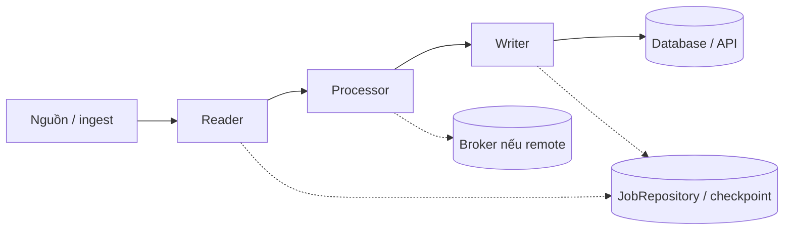
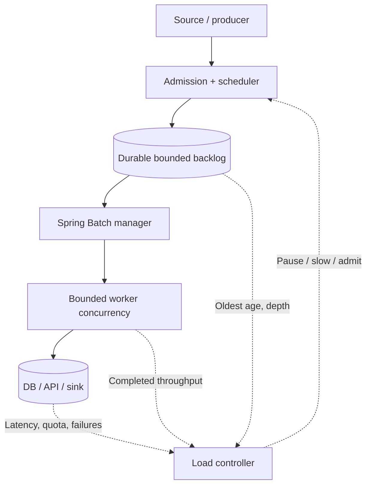
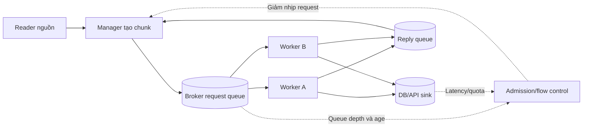
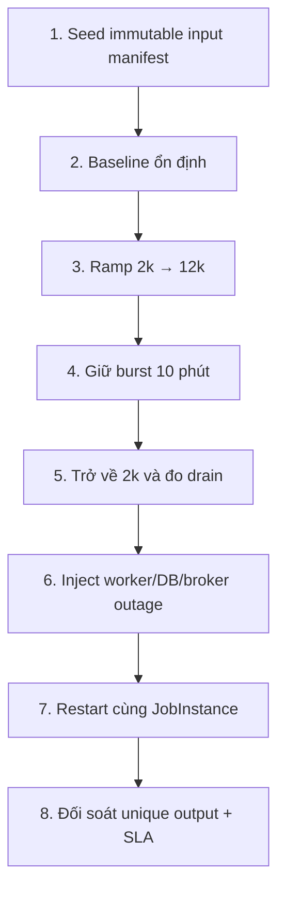

# Peak load và burst

## 1. Peak load và burst: bài toán của throughput, không chỉ thread count

Một hệ thống Spring Batch xử lý dữ liệu giao dịch theo từng lô mỗi vài phút. Trong giờ bình thường, nguồn phát sinh **2.000 record/giây**. Đúng thời điểm khuyến mại, tốc độ tăng lên **12.000 record/giây trong 10 phút**, trong khi pipeline chỉ ghi thành công tối đa khoảng **5.000 record/giây**. CPU của manager vẫn chưa cao; nhưng hàng đợi message, connection pool và thời gian chờ xử lý tăng liên tục.

Đây là tình huống **peak load và burst**:

- **Peak load** là mức tải cao nhất cần chuẩn bị trong một khoảng quan sát/thiết kế: có thể được đo theo giây, phút, giờ hoặc theo phân vị tải. Peak không phải một con số duy nhất nếu chưa xác định khoảng đo.
- **Burst** là một đợt tăng tải nhanh trong thời gian tương đối ngắn. Một burst có thể có đỉnh cao nhưng tổng khối lượng nhỏ, hoặc kéo dài đủ lâu khiến queue đầy và mất SLA.
- **Throughput** của batch là lượng công việc **hoàn thành đúng và commit thành công** trên mỗi đơn vị thời gian, không đơn thuần là số item đã đọc hoặc số request đã publish.
- **Capacity** là tốc độ phục vụ bền vững trong điều kiện tài nguyên, độ trễ, error rate và mức độ nhất quán được chấp nhận.
- **Backlog** là lượng công việc chưa hoàn tất; nó tích lũy khi tốc độ vào lớn hơn tốc độ ra.

Trong chương **Thông lượng** của module **SPRING_BATCH_SCALING_OPERATIONS**, ta tìm cách mở rộng Spring Batch qua multi-threaded step, parallel steps, partitioning và worker phân tán mà vẫn kiểm soát thread safety, retry/restart, dữ liệu trùng và chi phí vận hành.

> **Nguyên tắc:** tối ưu cho số thread tối đa không đồng nghĩa tối ưu cho peak load. Hệ thống cần hấp thụ burst có giới hạn, giảm nhịp nhận việc khi downstream bão hòa, tiêu backlog trong SLA và giữ khả năng khôi phục sau lỗi.

### Mục tiêu học tập

Sau bài học, bạn có thể:

1. Phân biệt **normal load, peak load, burst, sustainable throughput, backlog** và **tail latency**.
2. Tính gần đúng backlog phát sinh, thời gian chạm giới hạn buffer và thời gian tiêu hết backlog.
3. Lập **capacity budget** từ CPU, database, network, broker, API quota và JobRepository.
4. Hiểu vai trò của `chunk size`, `TaskExecutor`, partition count, worker count, queue và message prefetch.
5. Xây dựng **bounded admission** để Spring Batch không đẩy toàn bộ burst xuống nơi đã quá tải.
6. Thiết kế autoscaling/warm-up, retry/backoff, scheduling và fault tolerance không khuếch đại burst.
7. Benchmark peak/burst và chứng minh kết quả đúng sau crash, retry và restart.

## 2. Phân biệt peak rate, sustained rate và burst volume

Giả sử hệ thống phát sinh các record như sau:

| Khoảng thời gian | Arrival rate | Đặc điểm |
| --- | ---: | --- |
| 00:00–06:00 | 800 records/s | Đêm thấp điểm |
| 06:00–09:00 | 2.000 records/s | Tải thường |
| 09:00–09:10 | 12.000 records/s | Burst khuyến mại |
| 09:10–12:00 | 2.000 records/s | Quay về tải thường |
| 12:00–13:00 | 4.000 records/s | Cao điểm kéo dài |
| 13:00–24:00 | 1.500 records/s | Biến động thấp hơn |

**Peak rate** trong ví dụ là 12.000 records/s, nhưng nếu hệ thống chỉ cần xử lý kịp trong **30 phút** sau sự kiện, không nhất thiết phải nâng năng lực tức thời tới 12.000 records/s: có thể xử lý một phần từ backlog, miễn là buffer bền vững và **SLA end-to-end** vẫn đạt.

Ngược lại, nếu dữ liệu là giao dịch cần phản hồi hoặc publish trong **5 giây**, buffering 30 phút không được phép dù dữ liệu cuối cùng vẫn đầy đủ.

### 2.1. Phải nói rõ cửa sổ đo

```text
1-second peak  : 30.000 records/s
1-minute peak  : 12.000 records/s
15-minute peak :  8.000 records/s
1-hour average :  3.200 records/s
daily average  :  1.700 records/s
```

Các số này chỉ minh họa. Dùng một giá trị `daily average` để thiết kế queue hoặc connection pool cho burst một giây sẽ đánh giá thấp tải đỉnh. Ngược lại, chỉ nhìn một spike 100 ms có thể dẫn tới overprovisioning nếu upstream có khả năng buffering an toàn.

Cần lưu **tốc độ theo nhiều resolution**: 1–10 giây cho đỉnh ngắn, 1 phút cho drain/scale decisions, 15–60 phút cho sustained capacity và theo business window để đánh giá SLA.

### 2.2. Burst có hai chiều độc lập

| Chiều | Ví dụ | Vì sao quan trọng? |
| --- | --- | --- |
| **Burst intensity** | 12.000 thay vì 2.000 records/s | Áp lực tức thời lên admission, network và queue |
| **Burst duration** | 10 phút thay vì 10 giây | Quyết định tổng backlog phải giữ |
| **Payload size** | 100 B hay 2 MB mỗi item | Quyết định memory, network, broker disk |
| **Processing cost** | Parse CSV hay gọi API 2 giây | Định hình throughput thực và worker requirement |
| **Skew** | 1 tenant chiếm 70% traffic | Có thể tạo straggler dù tổng worker còn rảnh |
| **Correctness requirement** | Báo cáo hoặc thanh toán | Quyết định có được chờ, lọc, drop hay replay không |

**Hai đợt có cùng 12.000 records/s nhưng payload khác 100 lần không thể dùng một capacity plan.** Đếm record/s phải đi kèm **bytes/s, requests/s và processing-time distribution**.

## 3. Tính backlog và drain time từ tốc độ thực

Ký hiệu:

```text
λ(t) = arrival rate, records/s
μ(t) = completed-and-committed service rate, records/s
B(t) = backlog chưa hoàn tất, records

Khi queue chưa bị giới hạn và không drop:
B(t + Δt) ≈ max(0, B(t) + [λ(t) - μ(t)] × Δt)
```

Đây là **mô hình gần đúng**, chưa bao gồm hiệu ứng kích thước batch biến động, retry, thời gian worker warm-up, database contention và sự phân bố độ trễ.

### 3.1. Ví dụ: burst 10 phút

Trong burst:

```text
Arrival    λ_peak = 12.000 records/s
Completion μ      =  5.000 records/s
Thời gian          =    600 giây

Tăng backlog ≈ (12.000 - 5.000) × 600
              = 4.200.000 records
```

Sau burst, nguồn trở về `λ_normal = 2.000 records/s`; pipeline vẫn hoàn tất `μ = 5.000 records/s`:

```text
Net drain rate = 5.000 - 2.000 = 3.000 records/s

Drain time ≈ 4.200.000 / 3.000
           = 1.400 giây
           ≈ 23 phút 20 giây
```

Nếu burst bắt đầu 09:00, kết thúc 09:10, backlog có thể chưa hết cho tới khoảng **09:33:20**. Đây là bài tính lý tưởng: record thật có các thời gian chờ khác nhau, worker throughput không phải hằng số và SLA cần đo trên từng item/publish boundary.

### 3.2. Khi nào một buffer sẽ đầy?

Giả sử hệ thống có budget tối đa **2 triệu records đang chờ**, ban đầu rỗng:

```text
Net backlog build rate = 7.000 records/s
Time to fill ≈ 2.000.000 / 7.000 ≈ 286 giây ≈ 4 phút 46 giây
```

Nếu một đợt burst kéo dài 10 phút, **buffer 2 triệu records không đủ**. Phải có admission/backpressure trước thời điểm đó, một nguồn có thể replay, tăng capacity thực hoặc chấp nhận một chính sách failure có kiểm soát.

**Không nên coi “queue đầy” là lỗi hiếm cần che giấu.** Đây là một trạng thái thiết kế phải có hành vi rõ: block/timeout, pause, rate limit, stop job và giữ checkpoint, hoặc durable handoff có quota.

### 3.3. Muốn tiêu backlog trong 15 phút sau burst thì sao?

```text
Backlog cần tiêu    = 4.200.000 records
Thời gian cho phép  = 900 giây
Normal arrival      = 2.000 records/s

Service rate cần ít nhất ≈ 2.000 + 4.200.000/900
                        ≈ 6.667 records/s
```

Con số 6.667 records/s là **mức lý thuyết** nếu vẫn nhận dữ liệu thường trong quá trình drain, không có pause, contention, retry hay overhead. Production phải có **headroom** so với mức này; chẳng hạn benchmark 7.500–8.000 records/s và đánh giá tail latency nếu DB/API thật sự hỗ trợ.

### 3.4. Little's Law chỉ dùng đúng điều kiện

Trong một hệ thống tương đối ổn định:

```text
L = λ × W

L = số đơn vị công việc trung bình đang ở trong hệ thống
λ = throughput hiệu dụng trung bình
W = thời gian trung bình một đơn vị ở trong hệ thống
```

Ví dụ hoàn tất 1.000 items/s và mỗi item mất trung bình 0,5 giây từ khi vào tới khi ra, số item trung bình đang trong hệ thống là khoảng **500**.

**Lưu ý:** Little's Law không làm một queue liên tục phình to trở nên ổn định. Không dùng tốc độ producer cao nhất làm throughput đã hoàn tất khi tính `L`. Nếu các job vừa backlog vừa retry, phải xem cả **unique completed business items**.

## 4. Throughput bottleneck quyết định năng lực thực

Với một pipeline:



Thường năng lực end-to-end bị giới hạn bởi thành phần chậm nhất và các tài nguyên dùng chung:

```text
effectiveThroughput <= min(
    sourceReadCapacity,
    processorCapacity,
    sinkCommitCapacity,
    networkTransportCapacity,
    externalApiQuota,
    capacity imposed by shared resources
)
```

Công thức chỉ gợi ý phân tích bottleneck; từng stage có thể pipeline/chia đồng thời hoặc có fixed per-chunk overhead, nên không suy ra throughput chính xác bằng một phép `min` không đo đạc.

| Dấu hiệu | Bottleneck khả dĩ | Cách xác minh |
| --- | --- | --- |
| CPU worker gần 100%, DB nhàn | Processor CPU-bound | CPU profiler, thời gian xử lý/item |
| Worker CPU thấp, DB pool pending tăng | Database connections/locks | Pool metrics, commit latency, DB wait events |
| API 429/503 tăng | Downstream quota/overload | QPS, concurrency, Retry-After |
| File `open/stat` P95 tăng | Shared filesystem metadata | NFS/SMB latency, metadata ops/s |
| Broker queue tăng, worker đang chờ DB | Consumer/sink chậm | Queue age + DB metrics |
| Nhiều worker idle, một partition rất chậm | Data skew/straggler | Per-partition records, duration |
| JobRepository quá nhiều StepExecutions | Metadata overhead | BATCH_* row growth, commit latency |
| GC/heap tăng theo backlog | Queue/payload buffering trong JVM | Heap histogram, queued tasks |
| Network bytes chạm trần | Transport/object storage | Bandwidth và retransmits |

**Không có “một worker = một lượng throughput cố định”.** Khi 8 workers đạt 5.000 records/s mà 16 workers vẫn chỉ đạt 5.100 records/s, có thể nguồn/đích đã bão hòa. Tăng thêm replicas sẽ làm contention và retry nhiều hơn.

## 5. Capacity planning phải xuất phát từ SLA

### 5.1. Bốn câu hỏi trước khi thiết kế

1. **Đỉnh thực tế là gì?** Mức `records/s`, `bytes/s`, `chunks/s` theo các cửa sổ 1 giây, 1 phút, 15 phút và sự kiện kinh doanh.
2. **SLA đo ở đâu?** Sau `ItemWriter.write`, sau database commit, sau manager nhận chunk reply hay sau khi snapshot được publish cho người dùng?
3. **Có bao nhiêu backlog được phép?** Retention, broker disk, worker memory và thời gian tối đa để item chờ?
4. **Nếu quá tải kéo dài thì sao?** Pause upstream, thụ động tạo backlog bền vững, dùng capacity bổ sung, hay fail có điều phối?

Một batch phục vụ báo cáo cuối ngày có thể ưu tiên throughput và buffer. Một batch phát lệnh thanh toán hoặc email khẩn có thể ưu tiên **SLO của từng nghiệp vụ**; khả năng nhận lại dữ liệu và idempotency là bắt buộc.

### 5.2. Tính ngân sách theo từng tài nguyên

| Ngân sách | Ví dụ minh họa | Giới hạn thực |
| --- | --- | --- |
| CPU | 8 vCPU trên worker node | CPU time/item và GC |
| Memory | 6 GiB heap/pod | Items/chunk, queue buffers, JSON objects |
| Database pool | 20 connections/worker | Tổng trên nhiều pods + JobRepository pool |
| DB writes | 7.000 records/s bền vững | WAL/IOPS, indexes, locks, bulk write |
| API quota | 2.000 requests/s | Retry-After, burst token bucket và 429 |
| Broker disk | 50 GB backlog budget | Message bytes, replicas, TTL, DLQ |
| Network | 500 Mbps usable | Payload/request overhead, TLS, zone hops |
| JobRepository | N StepExecutions/s | StepExecution commits, metadata contention |

**Tất cả con số trong bảng chỉ là giả định.** Không lấy DB pool size nhân worker count rồi kết luận DB thật phục vụ được cùng số transactions đồng thời. Giới hạn phải đo bằng **committed throughput tại mức lỗi và P95/P99 latency chấp nhận được**.

### 5.3. Quy đổi số worker từ thời gian xử lý

Trong mô hình đơn giản, mỗi worker làm **một công việc độc lập tại một thời điểm**, trung bình xử lý `s` giây/work unit. Với `n` workers:

```text
theoreticalRate ≈ n / s  (work units/giây)
```

Ví dụ mỗi worker hoàn tất một **chunk 200 records trong 0,4 giây**:

```text
1 worker ≈ 2,5 chunks/s ≈ 500 records/s
8 workers ≈ 20 chunks/s ≈ 4.000 records/s
```

Đây là **ước tính không contention**. Nếu 8 workers đều ghi chung một database giới hạn 3.000 records/s, throughput thực sẽ thấp hơn. Nếu `0,4 giây` chỉ là thời gian CPU mà bỏ qua queue/connection wait, ước tính cũng sai.

Đừng dùng thời gian một item nhân/số worker khi một chunk còn overhead transaction và broker. Thực nghiệm nên đo **time per chunk**, success rate, commit duration và item count distribution.

## 6. Thiết kế hấp thụ burst: buffer hữu hạn và backpressure thật



Một thiết kế có thể kết hợp **bốn lớp**:

1. **Admission control:** chỉ khởi chạy JobInstance hoặc nhận work unit mới khi đủ ngân sách.
2. **Bounded buffers:** queue/broker có dung lượng và retention rõ; không dựa vào heap hoặc disk vô hạn.
3. **Bounded concurrency:** worker threads, DB connections và API calls được giới hạn.
4. **Feedback control:** đo queue age, throughput commit và error rate để giảm nhịp producer hoặc đổi lịch.

Một queue lớn hơn có thể **hấp thụ burst tạm thời**, nhưng nếu `λ > μ` dài hạn, queue nào cũng sẽ đầy. **Chỉ buffer mà không giảm producer/khôi phục capacity không phải một giải pháp bền vững.**

### 6.1. Hành vi khi đầy phải là một hợp đồng

| Chính sách | Ưu điểm | Rủi ro |
| --- | --- | --- |
| Block/chờ có timeout | Tự truyền nhịp chậm về upstream đồng bộ | Thread starvation, deadlock nếu giữ lock/transaction |
| Pause polling/scheduler | Tránh tạo thêm công việc mới | Phải giữ nguồn/offset/retention đủ lâu |
| Rate limit producer | Hạn chế burst theo quota | Cần nguồn có thể chờ hoặc replay |
| Reject có kiểm soát | Không nhận quá khả năng | Producer bắt buộc xử lý lỗi và retry hợp lệ |
| Buffer durable có quota | Chịu burst và bảo vệ nguồn khi restart | Disk/retention, replay và DLQ |
| Scale thêm worker | Tăng service rate nếu còn headroom | Không giúp nếu sink đã đạt trần |
| Drop message | Giảm backlog tức thời | **Không phù hợp** nếu nghiệp vụ yêu cầu xử lý đầy đủ |

Với batch giao dịch, nếu upstream đã **ACK/xóa input** trước khi queue nhận bền vững rồi queue đầy, dữ liệu có thể mất. Chỉ tuyên bố “không mất việc” khi có protocol nguồn → buffer → worker rõ ràng.

### 6.2. Điều tiết theo tín hiệu nào?

- `queue_depth`: hữu ích nhưng không thể hiện unacked/in-flight.
- `oldest_message_age_seconds`: rất sát deadline và user-facing freshness.
- `successfully_committed_records_per_second`: completion rate thật.
- `db_pool_pending_connections` và `db_write_p95`: downstream bão hòa.
- `external_api_429_rate`: quota.
- `worker_idle_ratio`: phân biệt thiếu việc với straggler/blocked workers.
- `reconciliation_mismatch`: correctness đã bị ảnh hưởng; không tiếp tục mở rộng vô điều kiện.

Một controller thường nên có **hysteresis/cooldown** để tránh “pause–resume” liên tục và đòi hỏi hiệu lực tác động được đo sau một khoảng thích hợp.

## 7. Spring Batch: multi-threaded step khi peak load

Một multi-threaded step cho phép xử lý các chunks đồng thời tùy `TaskExecutor`, transaction manager và cấu hình. Nó có thể tăng throughput với workload CPU/IO có thể song song, nhưng phải kiểm soát:

- **ItemReader/ItemWriter state**: nhiều reader stateful không thread-safe nếu chia sẻ cùng StepExecution.
- **Ordering**: chunk hoàn tất không nhất thiết theo thứ tự input.
- **Checkpoint**: một StepExecution có nhiều chunks in-flight khó hơn mô hình mỗi partition có checkpoint riêng.
- **Pool capacity**: không để executor queue tích hàng chục nghìn tasks.
- **Sink contention**: nhiều transactions commit đồng thời có thể gây deadlocks/lock waits.
- **Retry**: chunk lỗi có thể bị làm lại, writer phải idempotent.

**Spring Batch 5.x** đã deprecate `throttleLimit(...)` từ 5.0; tài liệu hướng dẫn thay cơ chế `RepeatOperations` mặc định qua `stepOperations(...)` với `TaskExecutor` có queue giới hạn khi cần kiểm soát throttling. Đừng chỉ tăng `throttleLimit` hoặc giả định Spring Batch 6.x giữ nguyên API. Nếu cần ownership và restart rõ ràng hơn, **partitioned step** thường dễ thiết kế cho input chia thành các ranges/file độc lập.

### 7.1. Chunk size là biến khác concurrency

```text
chunk(100)  => số item trong một transaction chunk
poolSize(8) => tối đa 8 worker threads trong pool đó
gridSize(8) => hint cho partition splitter
```

Thử `chunk(100)`, `chunk(250)`, `chunk(500)` có thể giúp tìm điểm cân bằng giữa commit overhead và memory/rollback cost. **Tăng chunk size không tăng số worker**, đôi khi còn làm timeout lâu hơn và khiến retry tốn hơn.

## 8. Partitioning: chia đều để tránh đỉnh cục bộ và straggler

Nếu peak làm một partition giữ 70% dữ liệu trong khi các partition khác rảnh, tăng worker chưa chắc tăng end-to-end throughput. Cần:

- Phân chia **range/key/file groups** không chồng lấn.
- Ước lượng cost bằng size, record count, historical processing time.
- Chia file lớn theo **record/block boundary hợp lệ**, không cắt byte tùy ý.
- Giữ manifest và **partition name → input mapping bất biến** khi restart.
- Chọn số partitions đủ linh hoạt để có scheduling options, nhưng không quá nhiều tới mức metadata/dispatch áp đảo.

### 8.1. Cân bằng lượng việc không phải cân bằng thread

Ví dụ:

```text
Input groups: 8
group-0000 = 1 triệu records
group-0001 = 1 triệu records
...
group-0006 = 1 triệu records
group-0007 = 10 triệu records
```

Dù có tám workers, group-0007 kéo dài sau khi bảy workers đã rảnh. Đây là **tail of job duration**, không nhất thiết là burst queue. Khi đo peak, phải nhìn **per-partition duration và worker idle**; không chỉ tổng readCount.

### 8.2. Đừng để gridSize đánh lừa

`Partitioner.partition(int gridSize)` trả một map `partitionName → ExecutionContext`. Tham số `gridSize` thường là **gợi ý**, không phải ràng buộc framework bắt implementation tự tạo đúng `gridSize` partitions.

- Một custom partitioner có thể trả 64 groups khi `gridSize=8`.
- `MultiResourcePartitioner` tạo một partition trên mỗi resource và có thể bỏ qua `gridSize`.
- `TaskExecutor` với 8 threads chỉ giới hạn **đồng thời trong pool đó**, không giới hạn 64 StepExecutions có thể được dispatch.
- Nếu queue executor nhỏ hơn số tasks được submit, có thể gặp `TaskRejectedException`.

**Không sửa mapping partition trong cùng JobInstance để đối phó peak**. Một lần restart phải giữ đúng snapshot, bounds và state của partition đã chạy. Nếu cần rebalancing dữ liệu mới, thực hiện khi tạo **manifest của JobInstance mới**.

## 9. Java: cấu hình local partitioning có concurrency hữu hạn

Ví dụ dùng Spring Batch **5.x**, Java 17+ và `ThreadPoolTaskExecutor`. Đây là **local partitioned step** minh họa giới hạn tài nguyên; chưa bao gồm toàn bộ `Job`, cấu hình `DataSource`, các import hoặc cơ chế load immutable manifest.

### 9.1. ThreadPoolTaskExecutor có pool và queue tường minh

```java
@Configuration
class BurstAwareBatchConfiguration {

    @Bean("burstPartitionExecutor")
    ThreadPoolTaskExecutor burstPartitionExecutor() {
        ThreadPoolTaskExecutor executor = new ThreadPoolTaskExecutor();
        executor.setThreadNamePrefix("burst-partition-");
        executor.setCorePoolSize(8);
        executor.setMaxPoolSize(8);
        executor.setQueueCapacity(16);
        return executor;
    }
}
```

Với một pool instance, có tối đa tám worker threads thực thi tasks đồng thời. Queue cho thêm tối đa 16 tasks đang chờ theo cấu hình. **Đây không phải mức 24 tasks toàn cluster**; nhiều JobExecutions/pods hoặc nested executors có thể tạo tải lớn hơn.

`ThreadPoolTaskExecutor` với queue capacity dương thường ưu tiên dùng queue sau khi đạt core pool; `maxPoolSize` lớn hơn core **không có nghĩa các threads mới được tạo ngay khi queue còn chỗ**. Bắt đầu với `core=max` giúp dễ dự đoán concurrency; sau đó benchmark.

**Khi queue đầy:** executor có thể reject task. `TaskRejectedException` phải được xử lý bằng failure/admission protocol; không dùng discard policy hoặc bắt lỗi rồi đánh dấu partition `COMPLETED` giả.

### 9.2. Partitioner từ manifest bất biến

```java
record BatchSlice(String name, long fromId, long toId) {}

final class FrozenBurstPartitioner implements Partitioner {

    private final String snapshotId;
    private final List<BatchSlice> slices;

    FrozenBurstPartitioner(
            String snapshotId,
            List<BatchSlice> frozenSlices) {
        this.snapshotId = snapshotId;
        this.slices = List.copyOf(frozenSlices);
    }

    @Override
    public Map<String, ExecutionContext> partition(int gridSize) {
        Map<String, ExecutionContext> result = new LinkedHashMap<>();

        for (BatchSlice slice : slices) {
            if (slice.fromId() >= slice.toId()) {
                throw new IllegalArgumentException("Invalid range");
            }

            ExecutionContext context = new ExecutionContext();
            context.putString("snapshotId", snapshotId);
            context.putLong("rangeFromInclusive", slice.fromId());
            context.putLong("rangeToExclusive", slice.toId());

            if (result.putIfAbsent(slice.name(), context) != null) {
                throw new IllegalArgumentException(
                    "Duplicate partition name: " + slice.name());
            }
        }
        return result;
    }
}
```

Mỗi slice là một phạm vi `[fromId, toId)` thuộc snapshot đã đóng băng. **Manifest producer** cần kiểm tra trước khi chạy: ranges không overlap, không có gaps ngoài policy, mỗi source row được sở hữu đúng một partition và các names ổn định qua restart.

Ở ví dụ này, implementation **bỏ qua `gridSize`** và trả số partitions bằng `slices.size()`. Khi chạy peak, **không tính lại slices từ `MAX(id)` live** để cố chia thêm việc cho các workers; việc đó có thể làm checkpoint của JobInstance cũ bị gắn với input khác.

### 9.3. @StepScope reader theo partition

```java
record WorkRow(long id, String sourceVersion, BigDecimal amount) {}

@Bean("frozenWorkReader")
@StepScope
JdbcPagingItemReader<WorkRow> frozenWorkReader(
        DataSource dataSource,
        @Value("#{stepExecutionContext['snapshotId']}")
            String snapshotId,
        @Value("#{stepExecutionContext['rangeFromInclusive']}")
            Long fromId,
        @Value("#{stepExecutionContext['rangeToExclusive']}")
            Long toId) {

    return new JdbcPagingItemReaderBuilder<WorkRow>()
            .name("frozenWorkReader")
            .dataSource(dataSource)
            .selectClause(
                "SELECT work_id, source_version, amount")
            .fromClause("FROM immutable_work_snapshot")
            .whereClause(
                "WHERE snapshot_id = :snapshotId " +
                "AND work_id >= :fromId AND work_id < :toId")
            .parameterValues(Map.of(
                "snapshotId", snapshotId,
                "fromId", fromId,
                "toId", toId))
            .sortKeys(Map.of("work_id", Order.ASCENDING))
            .rowMapper((rs, rowNum) -> new WorkRow(
                rs.getLong("work_id"),
                rs.getString("source_version"),
                rs.getBigDecimal("amount")))
            .pageSize(250)
            .saveState(true)
            .build();
}
```

Đây là một reader dùng API Spring Batch 5.x quen thuộc; cần bổ sung imports, cấu hình JDBC dialect và source schema thực. Nó giả định `(snapshot_id, work_id)` là **unique** và snapshot **immutable** cho mọi lần restart. Nếu cùng work ID có nhiều version trong một snapshot, sort key không còn duy nhất, cần mở rộng định danh hoặc làm sạch dữ liệu nguồn trước đó.

**Lưu ý thread safety:** `@StepScope` tạo một reader cho mỗi `StepExecution`; nó không bảo đảm an toàn nếu bạn **lại dùng multi-threaded chunks bên trong chính worker step** và share reader state, cũng không làm một singleton writer mutable trở nên thread-safe.

### 9.4. Worker và manager Step

```java
@Bean("burstWorkerStep")
Step burstWorkerStep(
        JobRepository jobRepository,
        PlatformTransactionManager transactionManager,
        @Qualifier("frozenWorkReader")
            ItemStreamReader<WorkRow> reader,
        @Qualifier("idempotentWorkWriter")
            ItemWriter<WorkRow> writer) {

    return new StepBuilder("burstWorkerStep", jobRepository)
            .<WorkRow, WorkRow>chunk(250, transactionManager)
            .reader(reader)
            .writer(writer)
            .build();
}

@Bean("burstManagerStep")
Step burstManagerStep(
        JobRepository jobRepository,
        @Qualifier("burstWorkerStep") Step worker,
        @Qualifier("frozenBurstPartitioner")
            Partitioner partitioner,
        @Qualifier("burstPartitionExecutor")
            TaskExecutor executor) {

    return new StepBuilder("burstManagerStep", jobRepository)
            .partitioner(worker.getName(), partitioner)
            .step(worker)
            .gridSize(8)
            .taskExecutor(executor)
            .build();
}
```

Hai bean `idempotentWorkWriter` và `frozenBurstPartitioner` phải được ứng dụng cung cấp; các snippets không tự tạo database/schema. `chunk(250)` là số items/transaction chunk. Với Spring Batch **6.x**, một số builder API khác (ví dụ cú pháp chunk và transaction manager); đối chiếu dependency trước khi copy.

**Quan trọng:** nếu manifest có 64 slices, executor queue 16, manager có thể submit quá capacity và gây rejection. Để thực sự bounded dispatch cho hàng nghìn partitions, phải chọn partition grouping/admission strategy hoặc `PartitionHandler` đã được kiểm thử, **không giả định `gridSize(8)` sẽ khiến handler chỉ submit tám tasks**.

### 9.5. Bổ sung admission theo capacity ở tầng ngoài

Một lựa chọn đơn giản là **chỉ cho scheduler khởi chạy một số JobInstances hoạt động** theo `businessBatchId` và tài nguyên dùng chung. Khi chưa có capacity:

```text
on scheduled window W:
    validate source is sealed and durably discoverable
    check total active jobs / DB quota / backlog age
    if capacity available:
        atomically claim W and launch JobInstance(W)
    else:
        persist W as PENDING with immutable manifest
        retry admission later without creating duplicate JobInstance
```

Đây là **pseudocode chính sách**; Spring Batch không tự cung cấp coordinator cluster-wide cho mọi ứng dụng. Việc `atomically claim W` cần một transaction/lease/unique constraint trên registry phù hợp. Nếu chỉ kiểm tra `activeJobCount < N` trong memory của mỗi pod, hai schedulers có thể cùng quyết định launch và vượt ngân sách.

## 10. Remote chunking: manager nhanh hơn worker trong burst

Trong **remote chunking**, manager đọc nguồn, tạo chunk requests rồi gửi qua middleware; worker nhận chunk, processor/writer commit và trả chunk replies.



Peak traffic gây nguy cơ:

1. Manager publish chunks nhanh hơn workers xử lý.
2. Broker chứa backlog lớn, tiêu disk/retention và làm tăng message age.
3. Workers prefetch nhiều requests, chuyển backlog từ broker sang JVM memory.
4. Retry khi DB/API lỗi nhân số attempts, không tăng unique output.
5. Manager thiếu reply hoặc timeout vì chờ lâu, dù worker có thể đã commit.
6. Một restart có thể phát lại chunk; writer cần idempotency và correlation.

**Đừng đánh đồng publisher confirm với worker completion.** Broker nhận request không có nghĩa database đã commit; reply phù hợp và `JobRepository` state mới là một phần của điều khiển. Nếu reply mất sau commit, business sink có thể đã được cập nhật dù manager chưa ghi nhận.

### 10.1. Giới hạn in-flight chunk là một vấn đề riêng

Giả sử cho phép tối đa **64 chunk requests chưa có kết quả**, và mỗi chunk tối đa **250 records**:

```text
Nominal in-flight record budget ≈ 64 × 250 = 16.000 records
```

Nó giúp giới hạn số công việc đang bay nhưng **không tự giới hạn queue broker, API calls phía worker hoặc serialized bytes** nếu một item có kích thước rất lớn.

Một in-flight window cần release slot theo **kết quả giao thức đáng tin**, không tự release với trạng thái `SUCCESS` khi request timeout. Nếu manager chết, trạng thái `Semaphore` trong JVM mất; một implementation production cần khôi phục từ metadata bền vững và thông điệp/side effect đã được đối soát.

**Đây là đề xuất thiết kế, không phải một cờ `maxInFlightChunks(64)` có sẵn trong mọi Spring Batch Integration builder.**

### 10.2. RabbitMQ prefetch không chặn manager publish

Ví dụ `prefetch=2` và tám consumers cho khoảng 16 deliveries chưa ACK trên các consumers này (theo semantics per-consumer thông thường của RabbitMQ). Nó giảm số messages giữ trong worker memory, **không đặt giới hạn manager chỉ được publish 16 chunks**. Broker queue vẫn có thể tăng không giới hạn nếu policy không chặn.

Cần phối hợp: manager admission, broker quota/retention, publisher confirmations, consumer prefetch, worker concurrency, retry/backoff, reply timeout và sink capacity.

### 10.3. Kafka và consumer lag

Với Kafka-based pipeline, workload backlog thường được theo dõi bằng **consumer lag, committed offsets và record age**. `max.poll.records` giới hạn số records trả về trong một `poll()`, không tự giới hạn mọi in-flight tasks trong executor. Consumer `pause()/resume()` cần được dùng cùng heartbeat/rebalance semantics, không block vô hạn.

Nếu message log retention ngắn hơn thời gian tiêu backlog, consumer có thể **mất khả năng đọc dữ liệu cũ** dù scaling lại sau đó. Capacity plan phải bao gồm **time-to-retention-expiry** và DLQ/replay policy.

## 11. Autoscaling: burst ngắn hơn startup time

Một ứng dụng có autoscaler không đồng nghĩa có ngay năng lực cao khi burst tới:

```text
09:00:00  Burst bắt đầu
09:00:30  Monitoring window phát hiện queue tăng
09:01:00  HPA/KEDA quyết định thêm workers
09:02:00  Node/pod được cấp, image pull, startup JVM
09:02:30  Worker kết nối broker, warm-up DB pool
09:02:45  Worker mới bắt đầu commit có ích
09:10:00  Burst kết thúc
```

**Hai phút 45 giây đầu vẫn phải được buffer hoặc backpressure**, và các con số trên chỉ minh họa. Nếu burst chỉ dài 20 giây, autoscaling reactive có thể **đến sau khi sự kiện đã hết**.

### 11.1. Ba hướng chuẩn bị

| Hướng | Phù hợp | Điểm cần cân nhắc |
| --- | --- | --- |
| **Pre-warm capacity** theo lịch kinh doanh | Peak đã biết: flash sale, cuối tháng, settlement | Chi phí idle/headroom |
| **Reactive autoscaling** theo backlog/CPU/lag | Burst không dự báo được | Sampling, startup delay, cooldown |
| **Burst buffering + controlled drain** | Workload có thể chấp nhận chờ | Queue size, retention, age SLA |
| **Predictive schedule** kết hợp autoscale | Có dữ liệu lịch sử đáng tin | Cảnh báo sai, event bất thường |
| **Fallback capacity** ở vùng/cluster khác | Có DR/failover requirement | Quota DB/API vẫn chung, dữ liệu/snapshot phải nhất quán |

Không scale theo **queue depth duy nhất** khi một DB/API đã bão hòa: tăng workers sẽ tạo nhiều timeout hơn. Autoscaler nên có điều kiện guard theo **committed throughput, downstream saturation và error rate**.

### 11.2. Scale-out không được làm mất partition ownership

Trong partitioning, thêm worker chỉ tạo **năng lực thực thi**. Nó không nên làm thay đổi `partitionName → input/range` của một JobInstance đang restart. Trong remote chunking, thêm consumers có thể thay đổi thứ tự hoàn tất requests, nên business key và writer phải chịu được ordering/replay.

Đặc biệt với Kubernetes rolling deploy, hai generations workers có thể tồn tại đồng thời; phải quiesce hoặc fence khi cùng logical partition/side effect có nguy cơ bị xử lý trùng.

### 11.3. Scale-in cũng là một failure scenario

Nếu autoscaler giảm replica khi một worker đang commit:

- Worker có đủ termination grace period để hoàn thành/abort an toàn không?
- Broker delivery đã ACK chưa, reply đã gửi chưa?
- `StepExecution` có thể cập nhật trạng thái/checkpoint không?
- Worker khác có thể nhận lại work item và ghi trùng không?
- Có idempotency key ổn định, cleanup và fencing không?

**Không thiết kế autoscale chỉ cho chiều tăng workers.** Cần kiểm thử scale-in, broker redelivery và restart trong đúng topology production.

## 12. Scheduler burst: nhiều JobInstances cùng khởi chạy

Một đợt peak có thể do **scheduler**, không phải do nguồn tăng. Ví dụ:

- Nhiều cron jobs cùng kích hoạt lúc `00:00`.
- Retry policy khởi chạy lại jobs cùng lúc sau database outage.
- Cluster scheduler mất leader rồi nhiều instances cố “bù” các lần chạy trễ.
- Hệ thống trigger job ngay khi file upload xong, tạo hàng nghìn jobs nhỏ.
- Một job 15 phút chưa xong nhưng lần chạy 15 phút tiếp theo vẫn được launch.

### 12.1. Vì sao thêm JobInstances không đồng nghĩa thêm throughput?

Nếu mỗi job mở pool 8 workers và chạy đồng thời 10 jobs:

```text
Nominal worker tasks = 10 jobs × 8 = 80
```

Cùng database chỉ phục vụ được, ví dụ, 20 concurrent write transactions hiệu quả; 60 tasks dư có thể chờ connection, tăng heap, locks, timeout và retry. Hệ thống đã chuyển từ **đầu vào quá nhanh** sang **oversubscription tài nguyên chung**.

### 12.2. Admission theo business window

Thiết kế nên có:

1. **Immutable input snapshot/manifest** cho từng business window.
2. **Một ownership record** cho mỗi window và policy overlap rõ.
3. **Scheduler jitter** hoặc staggering cho jobs độc lập để tránh start đồng loạt.
4. **Global active-job budget**, kết hợp DB connection/worker quota.
5. **Queue các windows chưa được admit** trong storage bền vững, không chỉ in-memory scheduler.
6. **RTO/SLA theo tuổi window**, có thể ưu tiên window quan trọng nhưng không bỏ quên tenant nhỏ.
7. **Backfill/correction workflow riêng** cho dữ liệu đến muộn, không đổi phạm vi JobInstance đang restart.

Nếu chỉ dùng identifying `run.id` tự tăng cho mỗi attempt, một sự cố launch có thể trở thành nhiều JobInstances đọc **cùng dữ liệu**, nhân burst thêm nhiều lần. Hãy phân biệt **restart cùng JobInstance** và **rerun có chủ đích**.

## 13. Retry storm: đỉnh nhân tạo do xử lý lỗi

Khi downstream gặp lỗi:

```text
Original rate: 1.000 requests/s
  -> Batch fault tolerance retry
  -> Broker redelivery
  -> HTTP client retry
  -> Scheduler retry whole JobInstance

=> Attempts/s có thể lớn hơn original rate nhiều lần.
```

Các tầng retry có thể nhân bậc lên nhau nếu độc lập. Một retry hợp lệ để phục hồi **transient error** có thể đẩy hệ thống vượt quá capacity đang suy yếu.

### 13.1. Retry budget theo toàn pipeline

| Tầng | Retry cần cân nhắc | Rủi ro |
| --- | --- | --- |
| Spring Batch chunk/item retry | `retryLimit`, skip/recover policy | Reprocess item, transaction overhead |
| HTTP client | 429, 503, timeout | Gọi external API quá quota |
| Broker redelivery | ACK/NACK, requeue, DLQ | Poison messages/quay vòng |
| Manager timeout | Chunk/partition reply bị mất | Reissue work đã commit |
| Scheduler/JobOperator | Restart JobInstance | Nhiều jobs cạnh tranh cùng input |
| Infrastructure | Pod restart, network failover | Nhiều attempts đồng thời |

**Cần thống nhất một retry budget end-to-end**: bao nhiêu attempts tối đa, thời gian chờ, backoff/jitter, đâu là lỗi permanent, khi nào fail/stop và cách đối soát committed side effects.

### 13.2. Khi quá tải, backoff tốt hơn retry ngay

- Với `HTTP 429`, tôn trọng `Retry-After` khi phù hợp và giảm concurrency.
- Với DB connection timeout, giảm new submissions, đừng lập tức nhân worker count.
- Với poison message, dùng quarantine/DLQ theo policy, không requeue vô hạn.
- Với broker outage, pause producer hoặc giữ nguồn bền vững; không cố gửi hàng nghìn lần mỗi giây.
- Với reply lost sau commit, **business idempotency** bắt buộc dù đã có backoff.

**DLQ không phải bộ nhớ backlog bình thường cho dữ liệu hợp lệ**. Đẩy toàn bộ burst vào DLQ có thể làm manager chờ replies không tồn tại và biến một lỗi capacity thành lỗi correctness.

## 14. Restartability: peak load không được đổi input checkpoint

Một job có 20 partitions từ manifest `M-20261126` chạy dưới peak. Sau 14 partitions completed, DB bị overload, hai partitions fail và bốn đang thực thi. Trong khi dừng, nguồn có thêm hàng triệu events mới.

**Restart đúng:**

1. Xác định `JobInstance` từ job name + identifying JobParameters.
2. Đối soát các transactions đã commit và xác minh workers cũ đã dừng hoặc fenced.
3. Giữ **manifest M-20261126, snapshot, partition names/ranges và reader keys**.
4. Restart hợp lệ tạo `JobExecution` mới cho **cùng JobInstance**.
5. Các partitions completed thường không chạy lại theo default; những partitions lỗi được khôi phục.
6. Dữ liệu mới thuộc **JobInstance/batch tiếp theo**, không chèn vào ranges của instance cũ.
7. Writer idempotent và final reconciliation chứng minh không missing/duplicate business records.

**Sai thường gặp:** tăng `gridSize`, đổi source listing, phân lại ranges và thay `run.id` để “tận dụng capacity mới”. Nếu mapping partition đổi, checkpoint cũ có thể áp lên dữ liệu khác. Tăng capacity có thể hợp lệ **khi chỉ thay số worker xử lý cùng các logical partitions**, không thay semantics của chúng.

### 14.1. SQL writer idempotent minh họa

Ví dụ PostgreSQL:

```sql
CREATE TABLE processed_work (
    business_batch_id TEXT NOT NULL,
    work_id BIGINT NOT NULL,
    source_version BIGINT NOT NULL,
    amount NUMERIC(18, 2) NOT NULL,
    PRIMARY KEY (business_batch_id, work_id)
);

INSERT INTO processed_work (
    business_batch_id, work_id, source_version, amount
)
VALUES (
    :businessBatchId, :workId, :sourceVersion, :amount
)
ON CONFLICT (business_batch_id, work_id)
DO UPDATE SET
    source_version = EXCLUDED.source_version,
    amount = EXCLUDED.amount
WHERE processed_work.source_version < EXCLUDED.source_version;
```

Câu lệnh bảo vệ khỏi replay có version **bằng hoặc cũ hơn**, nếu `source_version` thực sự đơn điệu theo record. Nếu hai payload cùng version nhưng amount khác nhau, cần detect invariant violation; không âm thầm coi như đã xử lý chính xác.

Đối với payment, email, file output hoặc broker publish, DB UPSERT này **không tự bảo vệ side effects khác**. Cần idempotency key theo business operation, outbox, published artifact version hoặc reconciliation.

### 14.2. Peak làm failure window sau commit dễ xuất hiện hơn

Khi queue và network bão hòa, reply timeout có thể xảy ra sau khi worker đã commit DB. Manager nghĩ request thất bại và phát lại. Nếu writer dùng `INSERT` không có unique key, bản ghi trùng có thể xuất hiện; nếu dùng `balance = balance + amount` không có operation ledger, tiền có thể bị cộng hai lần.

**Backpressure làm ít work in-flight hơn; idempotency làm replay an toàn.** Hai cơ chế giải quyết **hai vấn đề khác nhau** và không thể thay thế cho nhau.

### 14.3. Stale STARTED khi manager bị kill

Khi tiến trình manager chết đột ngột, `JobExecution` có thể vẫn `STARTED` trong repository vì chưa kịp update. Đừng tự UPDATE `BATCH_*` hoặc launch một JobInstance mới chỉ để né lỗi `AlreadyRunning`. Cần xác minh manager/worker generations cũ đã ngừng tác động, đối soát sink, rồi dùng **quy trình recovery được hỗ trợ theo Spring Batch version**.

## 15. Kiểm thử peak và burst: phải tái tạo cả dạng sóng tải

Một load test chỉ chạy ở constant 5.000 records/s không đại diện cho flash sale 12.000 records/s trong 10 phút. Nên có **workload profile**:



Ở môi trường không có broker streaming, có thể mô phỏng burst bằng **nhiều windows/jobs được admit theo tốc độ**, không nhất thiết từng event/s. Nhưng phải giữ business snapshot, timestamps và expected IDs để đối soát.

### 15.1. Ma trận kiểm thử nên có

| Test | Cách dựng | Điều cần chứng minh |
| --- | --- | --- |
| Baseline | Tải thường 2.000/s | Throughput ổn định, tail latency và error budget |
| Step burst | Tăng ngay lên 12.000/s | Queue/admission có giới hạn; không mất record |
| Ramp burst | Tăng dần trong vài phút | Controller/autoscaler phản hồi đúng nhịp |
| Sustained peak | Tải cao kéo dài | Tốc độ phục vụ bền vững, DB/API trong quota |
| Repeated bursts | Nhiều spike trước khi backlog cũ hết | Capacity và retention không tích lũy vô hạn |
| Small vs large payload | Cùng records/s, khác byte size | Không OOM hoặc throttle sai metric |
| Skewed partitions | Một tenant/file lớn bất thường | Straggler được phát hiện, SLA không bị che |
| DB connection saturation | Giảm max connections hoặc tăng lock waits | Admission giảm, retry không storm |
| API 429 | Giới hạn quota trong burst | Bounded retry/backoff và recover |
| Worker scale-out | Thêm pods sau delay thực | Tính đúng warm-up và drain time |
| Worker scale-in | Terminate khi in-flight | ACK/reply/checkpoint/idempotency đúng |
| Broker outage | Pause/bounce broker | Durable input/recovery, no duplicate side effects |
| Manager crash | Kill khi partitions đang chạy | Quiescence/fencing rồi restart hợp lệ |
| Post-commit reply loss | Chặn reply sau DB COMMIT | Replay không làm duplicate |
| Retention expiry | Backlog tuổi vượt budget trong staging | Alert/fail rõ, không mất âm thầm |
| Snapshot change | Có record mới sau seal | Không chen vào JobInstance đang restart |

### 15.2. Cần fault injection đúng điểm

Ném exception **bên trong `ItemWriter.write`** khi DB transaction chưa commit thường làm rollback, **không** chứng minh được kịch bản **commit thành công nhưng reply/ack mất**. Muốn thử trường hợp thứ hai, dùng fault hook/network proxy sau khi quan sát DB commit rồi chặn reply, kill worker hoặc làm broker mất đường return.

Tương tự, để mô phỏng lag do load balancer hoặc database failover, phải kiểm chứng **event được tiêu thụ đúng nguồn, không duplicate và checkpoint khôi phục được**, không chỉ xem số lần retry.

### 15.3. Assertion cho mọi kịch bản

- Không có **silent data loss**: input IDs trong snapshot được cover đúng policy.
- Không có **unexpected business duplication**: unique IDs/version và side effects đúng.
- Backlog **không tăng vô hạn** sau khi tải trở lại mức mà service rate có headroom.
- Queue capacity và timeout/rejection có behavior đo được, không swallow errors.
- `JobRepository` giữ một JobInstance cho restart, không tự tăng identifying `run.id`.
- Các completed partitions không bị chạy lại ngoài cấu hình cho phép.
- Worker concurrency, DB/API quota và memory không vượt resource budget.
- Autoscaler không thêm workers khi sink đã bão hòa mà không có policy.
- Đạt SLA freshness và recovery time theo các ngưỡng được định nghĩa.
- Đối soát source/business totals và trạng thái publish trước khi báo PASS.

## 16. Benchmark công bằng: thay một biến mỗi lần

Giả sử 60 triệu records được xử lý trên một hạ tầng cố định. Bảng **hoàn toàn giả định**:

| Chiến lược | Workers | Tổng runtime | Throughput hiệu dụng | Ghi chú |
| --- | ---: | ---: | ---: | --- |
| Step tuần tự | 1 | 300 phút | ~3.333 records/s | Baseline |
| Partitioning | 4 | 118 phút | ~8.475 records/s | Còn headroom |
| Partitioning | 8 | 75 phút | ~13.333 records/s | Hiệu quả |
| Partitioning | 16 | 68 phút | ~14.706 records/s | Gần trần DB |
| Partitioning | 32 | 74 phút | ~13.514 records/s | Lock/IO contention |

Bảng có giá trị **minh họa quan hệ hiệu năng**, không phải số liệu Spring Batch chính thức. Các mức throughput được làm tròn từ `60.000.000 / (runtime_minutes × 60)`. Trên production, thêm workers có thể cải thiện hoặc suy giảm khác tùy database, network và input skew.

Để so sánh chính xác:

1. Giữ **cùng manifest/snapshot**, parser, schema và business rules.
2. Chạy warm-up có kiểm soát, dán nhãn cold/warm cache.
3. Thử 1–2–4–8–16 workers rồi chỉ tăng thêm khi số đo cho thấy headroom.
4. Giữ chunk size cố định khi so worker count; sau đó tune chunk size riêng.
5. Ghi cả total runtime, business throughput, DB commit P95, CPU/GC, queue age và retry rate.
6. Test **normal steady load, ramp, step burst và sustained peak** riêng biệt.
7. Lặp lại nhiều lần, không lấy run nhanh nhất làm mức bảo đảm.
8. Đo time-to-scale và drain time, không chỉ steady-state throughput.
9. Thử failure/restart với cùng repository/snapshot, không xóa metadata giữa hai lần.
10. Chọn cấu hình đạt SLA với **headroom**, không chọn thread count cho số benchmark cao nhất nếu error rate/consistency xấu.

### 16.1. Đo throughput nào mới có ý nghĩa?

| Chỉ số | Có thể bị “thổi phồng” vì |
| --- | --- |
| `readCount/s` | Đọc xong nhưng writer fail hoặc skip |
| `processor calls/s` | Retry xử lý lại item nhiều lần |
| `broker publish/s` | Request accepted nhưng worker chưa commit |
| `ACK/s` | Có thể là transport ack trước publish/business sink |
| `writeCount/s` | Không nhất thiết bằng unique rows trong external sink |
| **unique committed business records/s** | Gần mục tiêu nhất nhưng cần định nghĩa filter/updates |
| **published business snapshots/s** | Phù hợp khi đầu ra phải qua đối soát toàn batch |

Ở job có filter/skip hợp lệ, **output count** không bắt buộc bằng input count; phải có bảng rule để giải thích chênh lệch. Thông lượng đúng là throughput theo **hợp đồng nghiệp vụ**, không chỉ theo counter kỹ thuật.

## 17. Theo dõi peak và burst trong production

### 17.1. Metric nên có

| Metric đề xuất | Ý nghĩa |
| --- | --- |
| `arrival_records_per_second` | Tốc độ dữ liệu đi vào theo nhiều cửa sổ |
| `committed_records_per_second` | Tốc độ kết quả được commit thành công |
| `unique_business_records_per_second` | Throughput nghiệp vụ sau dedup |
| `ingest_bytes_per_second` | Tải network/storage của payload |
| `queue_depth` | Số work units đang chờ |
| `oldest_message_age_seconds` | Tail freshness và backlog age |
| `inflight_chunks` | Work units chưa có kết quả theo protocol |
| `consumer_unacked_count` | Messages đã giao nhưng chưa ACK |
| `executor_active_threads` | Work đang chạy trên từng pool |
| `executor_queue_size` | Tasks chờ trong JVM |
| `executor_rejected_total` | Work bị từ chối cần điều tra |
| `db_pool_pending_connections` | Tắc nghẽn lấy connection |
| `db_commit_p95_seconds` | Writer DB đang chậm |
| `api_429_503_total` | Quota/availability của downstream |
| `retry_attempts_total` | Amplification do retries |
| `partition_duration_p95` | Straggler/partition skew |
| `job_execution_duration_seconds` | SLA chạy job |
| `backlog_drain_eta_seconds` | Ước lượng thời gian giải phóng hàng chờ |
| `reconciliation_mismatch_total` | Mismatch dữ liệu — cảnh báo correctness |
| `autoscaling_time_to_ready_seconds` | Độ trễ scale-out thực |
| `batch_restart_recovery_seconds` | RTO sau lỗi |

Các metric names là **đề xuất**, không phải mặc định Spring Batch/Micrometer/RabbitMQ/Kafka đều có đúng tên. Tránh gắn mỗi `businessRecordId`/`JobExecutionId` làm metric label cardinality cao; giữ ID ở logs/traces và business audit có kiểm soát.

### 17.2. Những tín hiệu cần alert cùng nhau

- `arrivalRate > committedRate` kéo dài **và** oldest queue age tăng.
- Queue gần capacity nhưng `executorActive` thấp: có thể listener lỗi/route sai.
- Worker active cao, DB pending tăng, throughput giảm: downstream saturation.
- Retry/redelivery tăng nhưng unique business output không tăng.
- Auto-scale thêm workers nhưng committed throughput không cải thiện.
- Snapshot mới đang chờ vượt freshness SLA; scheduler backlog cũ chưa drain.
- JobExecution vẫn `STARTED` quá budget trong khi worker pod đã chết.
- DLQ depth/oldest age tăng, missing replies và timeout.
- Sau restart, reconciliation mismatch hoặc duplicate business effects tăng.

**Queue depth thấp không phải bằng chứng pipeline rảnh** nếu consumer prefetch nhiều messages chưa ACK hoặc một partition lớn đang giữ critical path.

### 17.3. Ước lượng drain ETA theo thực đo

```text
if committedRate <= newArrivalRate:
    drainETA = ∞  (không tự hết theo tốc độ hiện tại)
else:
    drainETA ≈ backlog / (committedRate - newArrivalRate)
```

ETA chỉ có giá trị khi tốc độ tương đối ổn định trong cửa sổ ước lượng, không bị giới hạn bởi retention mới, retries hoặc scheduler tạo thêm Jobs. Khi error rate tăng hoặc autoscale đang warm-up, nên hiển thị **ETA không chắc chắn** thay vì hứa thời điểm cụ thể.

## 18. Case study: flash sale và 24 batch windows tồn đọng

Một nền tảng thương mại điện tử có pipeline cập nhật warehouse theo **cửa sổ 5 phút**. Ngày thường mỗi cửa sổ chứa 600.000 events (2.000 events/s). Trong flash sale kéo dài 10 phút, nguồn phát 12.000 events/s; hai windows tương ứng chứa tổng 7,2 triệu events. Năng lực warehouse ghi ổn định là 5.000 events/s, hạn mức DB connection cố định.

### 18.1. Thiết kế ban đầu

1. Scheduler phát JobInstance mỗi 5 phút ngay cả khi job trước chưa xong.
2. Mỗi job mở pool tám workers và queue dài; nhiều Jobs cùng giữ DB connections.
3. Event bị biến đổi nhiều lần do retry khi database timeout.
4. Một vài source files bị thêm mới trong lúc job đang chạy, `Partitioner` scan lại listing khi restart.
5. Đội vận hành tăng workers lên 64 và tưởng throughput sẽ tăng tương ứng.
6. Broker backlog tăng, JobRepository và DB sink đều chậm; report bị trễ, khó đối soát.

### 18.2. Thiết kế cải thiện

1. **Seal từng input window** thành manifest có `businessWindowId`, bounds và nguồn bất biến.
2. Lưu windows chờ trong một registry bền vững; dùng **admission control** không cho hàng chục jobs tranh cùng DB vượt quota.
3. Burst có thể làm backlog tăng dự kiến 4,2 triệu events trong 10 phút ở capacity 5.000 events/s; phải tính trước retention và SLA.
4. Chọn mức group/partition count từ file sizes, record costs và JobRepository overhead; không tái chia JobInstance đang restart.
5. Dùng bounded workers và read/writer pools; ưu tiên **committed warehouse throughput**, không tăng thread theo backlog khi DB bão hòa.
6. Với API phụ trợ, dùng per-service rate limiting, bounded retry và jitter.
7. Nếu lịch flash sale đã biết, **pre-warm capacity** trước sự kiện; nếu API/DB không thể tăng, điều chỉnh kế hoạch drain hoặc nghiệp vụ freshness SLA.
8. Khi một worker commit nhưng mất reply, writer UPSERT/idempotency chặn duplicate; manager không tạo fake success.
9. Theo dõi queue oldest age, time-to-drain, active jobs, per-partition stragglers và reconciliation.
10. Publish warehouse snapshot chỉ sau khi **mọi window/partition bắt buộc hoàn tất** và output được đối soát.
11. Với late arrivals sau window seal, chạy next window/correction workflow, không mở rộng phạm vi JobInstance đã có checkpoint.

### 18.3. Đánh giá kết quả

Một thiết kế được coi là tốt khi:

- Burst không làm vượt resource budget hoặc mất dữ liệu chưa được ghi bền vững.
- Sau burst backlog được tiêu trong SLA dự kiến.
- Steady-state committed throughput và tail latency ổn định.
- RTO sau lỗi không vượt giới hạn vận hành.
- Mọi `businessWindowId` có trace từ input snapshot tới published output.
- Không có unexpected duplicate business rows hoặc side effects.
- Không cần tăng worker vô hạn để giải quyết bottleneck cố định ở database.

**Không có cấu hình “8 workers, queue 16” tối ưu cho mọi tổ chức.** Những con số chỉ là ví dụ; quyết định cuối cùng phải dựa trên workload và benchmark thực.

## 19. Sai lầm phổ biến

| Nhận định | Điều cần nhớ |
| --- | --- |
| “Daily average đủ để sizing.” | Peak/burst phải đo theo cửa sổ ngắn và durataion. |
| “Burst 12.000/s nghĩa phải xử lý ngay 12.000/s.” | Phụ thuộc SLA, khả năng buffer và drain time. |
| “Queue lớn làm consumer nhanh hơn.” | Queue chỉ lưu chờ; không tăng sink capacity. |
| “Không có lỗi nghĩa hệ thống chịu peak tốt.” | Có thể dữ liệu còn backlog hàng giờ và trễ publish. |
| “Tăng workers luôn tăng throughput.” | DB/API quota, network, locks có thể bão hòa. |
| “`gridSize(8)` luôn tạo đúng tám partitions.” | Nó chỉ là hint cho `Partitioner`. |
| “Tăng chunk size lên 1.000 nghĩa 1.000 thread.” | Chunk size là item/transaction, khác concurrency. |
| “`throttleLimit` là lời giải chuẩn trên mọi Spring Batch version.” | Deprecated từ Spring Batch 5.0; xem API/step operations theo version. |
| “Pool max=32 luôn chạy 32 threads.” | Queue/core pool policy có thể giữ concurrency thấp hơn. |
| “CallerRunsPolicy chắc chắn bảo vệ trần workers.” | Thread submit có thể chạy thêm công việc, tạo deadlock nếu dùng sai. |
| “Prefetch 2 thì manager chỉ publish hai chunks.” | Prefetch giới hạn delivery chưa ACK của consumer, không giới hạn producer. |
| “Publisher confirm là worker đã commit DB.” | Broker receipt khác business completion. |
| “Autoscaler có nghĩa burst không cần buffer.” | Phát hiện/startup/warm-up luôn có độ trễ. |
| “Scale-in không ảnh hưởng correctness.” | In-flight chunk có thể redeliver hoặc mất reply. |
| “Retry càng mạnh thì job càng sớm hồi phục.” | Retry storm có thể làm sink tệ hơn. |
| “Queue rỗng nghĩa không còn work.” | Có thể còn in-flight, unacked hoặc straggler. |
| “Job COMPLETED nghĩa không có duplicate.” | Phải đối soát unique business IDs và side effects. |
| “Khi peak có thể chia lại partition lúc restart.” | Thay mapping có thể làm checkpoint sai. |
| “Tăng `run.id` là cách restart nhanh.” | Có thể tạo JobInstance mới và xử lý lại toàn bộ. |
| “Backpressure thay thế idempotency.” | Backpressure giới hạn tải; idempotency bảo vệ replay. |
| “Drop message khi quá tải chấp nhận được cho mọi batch.” | Chỉ hợp lệ nếu business contract cho phép mất dữ liệu. |

## 20. Câu hỏi tự kiểm tra

**Câu 1.** Peak tới 12.000 records/s trong 10 phút, worker chỉ hoàn tất 5.000 records/s. Backlog tăng thêm bao nhiêu?

*Gợi ý:* `(12.000 − 5.000) × 600 = 4.200.000 records`.

**Câu 2.** Sau peak, arrival còn 2.000 records/s, completion vẫn 5.000 records/s. 4,2 triệu backlog cần bao lâu để hết theo mô hình lý tưởng?

*Gợi ý:* `4.200.000 / (5.000 − 2.000) = 1.400 giây ≈ 23 phút 20 giây`.

**Câu 3.** Queue chỉ chứa được 2 triệu records. Với backlog tăng 7.000 records/s, sau bao lâu đầy từ trạng thái rỗng?

*Gợi ý:* Khoảng `286 giây`, tức 4 phút 46 giây.

**Câu 4.** Vì sao tăng workers từ 8 lên 32 có thể khiến runtime lâu hơn?

*Gợi ý:* Sink đã bão hòa; thêm connections/locks/retry và context switching làm giảm throughput thực.

**Câu 5.** `gridSize(8)` có bảo đảm Spring Batch chỉ chạy tám partitions không?

*Gợi ý:* Không. Custom partitioner có thể trả nhiều hơn; executor/handler quyết định concurrency và dispatch.

**Câu 6.** Worker commit DB thành công nhưng manager không nhận chunk reply. Vì sao backlog có thể xuất hiện lại?

*Gợi ý:* Manager/broker có thể redeliver; cần correlation, idempotent sink và recovery theo JobInstance.

**Câu 7.** Một burst chỉ kéo dài 20 giây trong khi autoscaler cần hai phút mới có worker sẵn sàng. Autoscaler có hấp thụ hoàn toàn burst không?

*Gợi ý:* Không. Cần pre-warm hoặc durable buffer/admission đủ cho khoảng trễ, rồi drain.

**Câu 8.** Khi queue depth giảm về 0, có thể tuyên bố job hoàn thành đầy đủ không?

*Gợi ý:* Không. Message có thể còn unacked/in-flight, partition straggler hoặc downstream effects chưa publish; cần JobRepository và business reconciliation.

## 21. Checklist triển khai production

- [ ] Đã đo arrival rate/committed throughput theo nhiều resolution và đủ event mùa vụ.
- [ ] Có peak/burst intensity, duration, payload distribution và processing-cost profile.
- [ ] Định nghĩa business SLA theo **commit/publish hoàn tất**, không chỉ request accepted.
- [ ] Đã tính backlog build, time-to-fill, drain time và retention budget.
- [ ] Có headroom cho variable latency, retries và worker warm-up.
- [ ] Queue/broker buffers có capacity/quotas và timeout/rejection policy rõ ràng.
- [ ] Producer/admission thực sự nhận tín hiệu pause/block/slowdown khi downstream chậm.
- [ ] Có durable source/manifest để không mất dữ liệu nếu queue đầy/JVM crash.
- [ ] `TaskExecutor` pool/queue bounded, task rejection không bị discard im lặng.
- [ ] Không coi `gridSize` là hard limit của partitioner hoặc toàn cluster.
- [ ] `@StepScope` reader có source snapshot và unique deterministic order khi restart.
- [ ] Có strategy cân bằng partition cost, tránh một file/range lớn thành straggler.
- [ ] Thử chunk size và worker count độc lập, đo DB commit latency.
- [ ] Có quota DB connections/API per pod và **tổng toàn cluster**.
- [ ] Remote chunking có request/reply correlation, broker quota và in-flight budget.
- [ ] RabbitMQ prefetch, Kafka lag/offset semantics được kiểm chứng nếu sử dụng.
- [ ] Scheduler có global admission, không chạy đè vô hạn các business windows.
- [ ] Autoscaling tính cả detection/startup/warm-up và scale-in safety.
- [ ] Retry bounded/backoff/jitter, không có retry amplification giữa nhiều tầng.
- [ ] Worker writer idempotent, có outbox/dedup khi gửi external side effects.
- [ ] JobInstance/manifest và partition names giữ nguyên khi restart sau peak outage.
- [ ] Đã kiểm thử sustained peak, short burst, repeated burst, backlog drain và resource saturation.
- [ ] Đã inject DB/API 429/503, broker outage, worker crash và post-commit reply loss.
- [ ] Có metric queue age, inflight, committed rate, retries, rejected tasks, resource saturation.
- [ ] Có cảnh báo **reconciliation mismatch**, không chỉ throughput thấp.
- [ ] Runbook nêu rõ stop/pause, quiesce/fence, drain, restart, đối soát và publish.
- [ ] Business totals, unique record counts và output versions đúng trước khi công bố.
- [ ] Đã benchmark dưới cùng snapshot, warm/cold cache rõ và số liệu đủ lặp lại.

## Tài liệu tham khảo

- [Spring Batch — Scaling and Parallel Processing](https://docs.spring.io/spring-batch/reference/scalability.html): multi-threaded step, parallel flows, partitioning và remote chunking.
- [Spring Batch 5.2 — Scaling and Parallel Processing](https://docs.spring.io/spring-batch/reference/5.2/scalability.html): `TaskExecutor`, `gridSize` và `throttleLimit` deprecation.
- [Spring Batch Integration — Externalizing Batch Process Execution](https://docs.spring.io/spring-batch/reference/spring-batch-integration/externalizing-execution.html): manager/worker chunk requests, replies và partition handlers.
- [Spring Batch — Configuring a Step for Restart](https://docs.spring.io/spring-batch/reference/step/chunk-oriented-processing/restart.html): `ExecutionContext`, `ItemStream` và restart.
- [Spring Batch — Database ItemReaders and ItemWriters](https://docs.spring.io/spring-batch/reference/readers-and-writers/database.html): `JdbcPagingItemReader`, paging và sort keys.
- [Spring Framework — Task Execution and Scheduling](https://docs.spring.io/spring-framework/reference/integration/scheduling.html): `ThreadPoolTaskExecutor`, pool sizing và task rejection.
- [Spring Integration — Message Channels](https://docs.spring.io/spring-integration/reference/channel.html): channel adapters, bounded queues và handoff behavior.
- [RabbitMQ — Consumer Prefetch](https://www.rabbitmq.com/docs/consumer-prefetch): QoS/prefetch giới hạn unacked deliveries.
- [RabbitMQ — Consumer Acknowledgements and Publisher Confirms](https://www.rabbitmq.com/docs/confirms): transport ACK và publisher confirm.
- [Apache Kafka — Consumer Configuration](https://kafka.apache.org/documentation/#consumerconfigs): `max.poll.records`, group liveness và offset semantics.
- [Kubernetes — Horizontal Pod Autoscaling](https://kubernetes.io/docs/tasks/run-application/horizontal-pod-autoscale/): controller cadence, metrics và scale decisions.
- [KEDA — Scalers](https://keda.sh/docs/latest/scalers/): event-driven scaling cho queue/lag metrics.
- [PostgreSQL — INSERT ON CONFLICT](https://www.postgresql.org/docs/current/sql-insert.html): conditional UPSERT chống replay.

**Ghi nhớ:** **peak load** cho biết mức tải cao phải chuẩn bị, còn **burst** quyết định tốc độ backlog tích lũy và áp lực lên admission, queue và worker. Một pipeline Spring Batch được xem là mở rộng tốt khi **tiêu burst trong SLA, không vượt resource budget, không retry storm, không mất/trùng dữ liệu khi restart và có bằng chứng output nghiệp vụ đúng**. Hãy sizing dựa trên **committed throughput và bottleneck thật**, không dựa vào số thread hoặc publisher rate.
