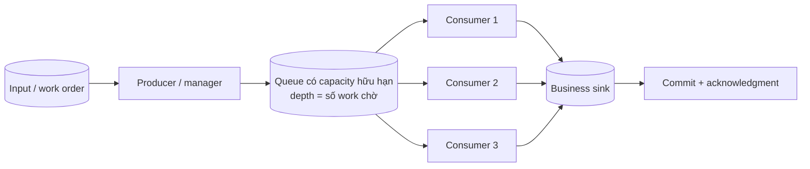
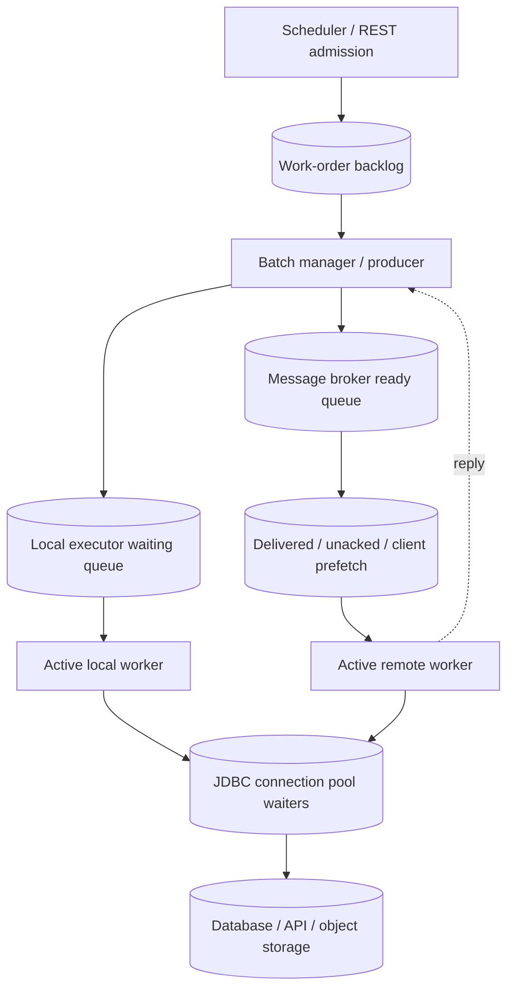
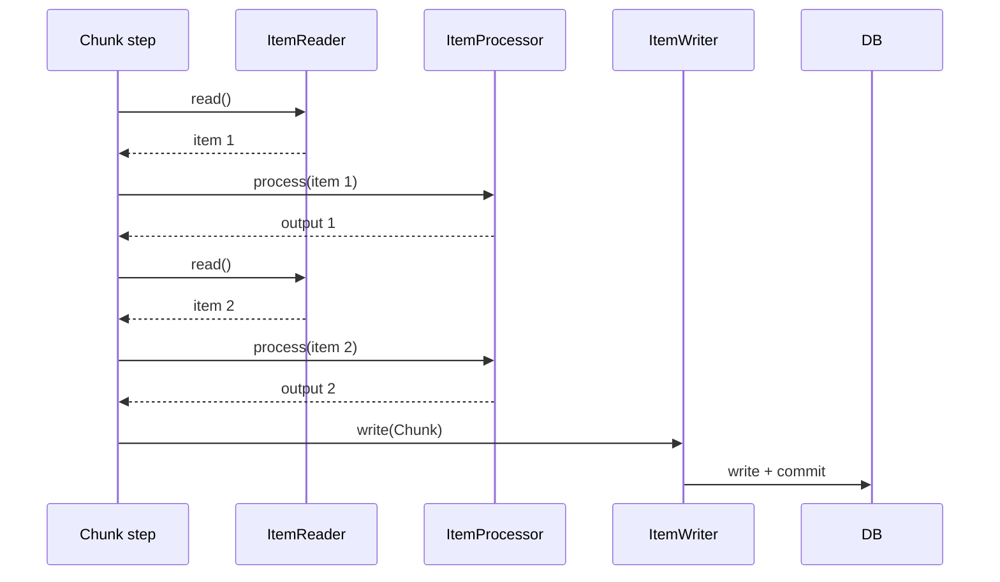
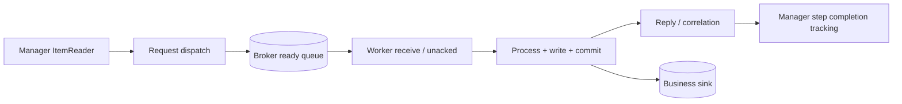

# Queue depth như chỉ báo bottleneck trong Spring Batch: đo đúng backlog, phân biệt nguyên nhân và điều chỉnh thông lượng

## 1. Mục tiêu bài học

Trong chương **Thông lượng** của module **SPRING_BATCH_SCALING_OPERATIONS**, mục tiêu là mở rộng Spring Batch cho workload dữ liệu lớn bằng multi-threaded step, parallel steps, partitioning và các mô hình xử lý phân tán phù hợp. Muốn tăng thông lượng mà vẫn giữ thread safety, retry/restart và độ tin cậy, ta phải biết **công việc đang chờ ở đâu và tại sao nó chưa được hoàn tất**.

**Queue depth** — số work units đang đợi tại một hàng đợi — là chỉ báo hữu ích để phát hiện mất cân bằng giữa tốc độ tạo và tiêu thụ công việc. Nhưng **queue depth không tự chứng minh consumer là bottleneck**, không trực tiếp đo được business throughput, và trong một số mô hình Spring Batch thậm chí **không có queue tách biệt giữa reader và processor**.

Sau khi học, bạn có thể:

- Xác định chính xác queue nằm ở **TaskExecutor**, message broker, client buffer, database pool, manager in-flight hay một hệ thống điều phối bên ngoài.
- Phân biệt queue **ready**, **unacked**, **in-flight**, **retry/delayed**, Kafka **consumer lag** và backlog của business work order.
- Kết hợp queue depth với arrival rate, **committed completion rate**, oldest work age, latency, worker utilization và retry rate.
- Dùng công thức backlog tăng/giảm, time-to-fill, time-to-drain và Little's Law đúng phạm vi, đúng đơn vị.
- Chẩn đoán được queue depth tăng do processor chậm, database lock/pool nghẽn, thiếu consumer, broker routing sai hay **poison message**.
- Hiểu khác biệt khi đo multi-threaded step, parallel steps, local/remote partitioning và remote chunking trong Spring Batch 5.2.x.
- Tạo metric queue depth bằng Micrometer cho `ThreadPoolTaskExecutor` và dựng biểu đồ Prometheus mà không gây bùng nổ cardinality.
- Thiết kế bounded queue/admission control, giới hạn concurrency, retry/backoff và idempotency để tăng throughput **mà không đánh đổi restartability**.
- Kiểm thử áp lực, crash, redelivery và sự đầy đủ của output trước khi thay đổi cấu hình production.

> **Phiên bản minh họa:** Spring Batch **5.2.x**, Java 17+, Spring Framework 6, Spring Integration/Micrometer và broker như RabbitMQ hoặc Kafka. Ví dụ Java/SQL là thành phần tham khảo cần thêm imports, beans, datasource, schema và hạ tầng test. Không coi các metric do ứng dụng tự định nghĩa là metric có sẵn của Spring Batch.

## 2. Queue depth trả lời câu hỏi nào?

Với một pipeline có producer và consumer thực sự độc lập:



**Queue depth** cho biết công việc đang **xếp hàng ở một boundary được xác định**. Nó không trả lời trực tiếp:

- Work này đã được reader lấy khỏi nguồn hay chưa?
- Có item nào đang xử lý trong worker mà chưa ack không?
- Processor có chậm hơn reader hay không?
- Writer đã commit bao nhiêu **business keys**?
- Một item đã được retry/redeliver bao nhiêu lần?
- Công việc cũ nhất đã chờ bao lâu?
- JobInstance/StepExecution nào sẽ tiếp tục khi restart?

Ví dụ broker báo **2.000 messages ready**. Nếu mỗi message là một `ChunkRequest` chứa 500 items thì lượng việc danh nghĩa là khoảng **1.000.000 item attempts**, không phải 2.000 business items. Nếu 20% messages đã từng retry, số unique items còn khác.

**Kết luận ban đầu:** Queue depth là **triệu chứng quan sát**, không phải chẩn đoán hoàn chỉnh. Muốn tìm bottleneck cần đặt nó cạnh **rate, latency, resource utilization và committed output**.

## 3. Trước tiên phải xác định queue đang được đo

Một hệ Spring Batch có thể có nhiều hàng đợi ở các tầng khác nhau:



| Vị trí | Đơn vị đếm thông thường | Trạng thái không được phản ánh |
| --- | --- | --- |
| **Work-order queue** | Job hoặc yêu cầu nghiệp vụ chưa được nhận | Chunk đang chạy trong JobExecution |
| **ThreadPoolTaskExecutor queue** | `Runnable`/task đợi thread | Tasks đang chạy, item/chunk bên trong từng task |
| **Partition manager waiting work** | Partition/worker StepExecution chờ dispatch hoặc execution | Số item thực trong partition |
| **Broker ready** | Message sẵn sàng giao | Messages đã giao nhưng chưa ack |
| **Broker unacked / client prefetch** | Message đã giao đang chờ ack | Commit thành công nhưng reply/ack chưa ghi nhận |
| **Manager in-flight chunks** | `ChunkRequest` chưa nhận kết quả terminal | Số item duy nhất đã commit trong các chunks |
| **Kafka consumer lag** | Khoảng cách offset theo partition/group | Số business operations chưa hoàn thành chính xác |
| **JDBC pool pending** | Thread/request đợi DB connection | Số message broker còn ready |
| **DLQ/delayed retry** | Work đã chuyển luồng phục hồi | Không nhất thiết nằm ở queue ready ban đầu |

Một dashboard ghi nhãn `queue_depth=500` mà không nêu **đơn vị** và **boundary** có rất ít giá trị vận hành. Phải ghi rõ, chẳng hạn:

```text
batch.executor.queue.depth{pool="file-partitions"} = 4 tasks
rabbitmq.messages.ready{queue="chunk.requests"}   = 120 messages
batch.remote.inflight.chunks                       = 24 chunk requests
kafka.consumer.lag{topic="payments",partition="3"} = 10000 offsets
```

Các tên metric trên **mang tính logic minh họa**; tên series Prometheus thực tế phụ thuộc exporter/registry. Không khẳng định chúng là tên mặc định của framework.

### Không cộng các tập có thể chồng lấn

Nếu broker `unacked=80`, trong đó 40 delivery đang ở client prefetch buffer, 30 đang chạy và 10 đang chờ commit, thì **80 đã bao gồm ba tập con này**. Cộng `80+40+30+10=160` sẽ **đếm đôi**.

Hãy định nghĩa một work unit từ lúc admission tới lúc terminal completion, rồi dùng **state machine** hoặc correlation ID để biết nó ở trạng thái nào. Nếu báo cáo nhiều queue liên tiếp, cần biết messages có thể đồng thời xuất hiện ở những nơi nào và tránh cộng trùng.

## 4. Spring Batch tuần tự không tự có queue reader → processor

Trong chunk-oriented step **tuần tự**, reader và processor thường chạy nối tiếp trong cùng vòng chunk:



Reader không được mặc nhiên chạy độc lập để đổ hàng triệu item vào một queue trong khi processor vẫn xử lý item đầu. Vì vậy:

```text
observed_read_rate ≈ observed_process_attempt_rate
```

là điều bình thường trong step không filter/retry đáng kể. **Hai rate gần bằng nhau không chứng minh hai stage có cùng năng lực**. Nếu processor mất 20 ms/item, reader dù đọc rất nhanh vẫn phải chờ processor hoàn tất trước khi pipeline nhận item tiếp theo.

Ở trường hợp này, hãy đo **thời gian `read()`, `process()`, `write(Chunk)`, commit và wait I/O**. Đừng cố “tăng queue depth” giữa reader và processor bằng một queue vô hạn, vì sẽ tạo memory pressure và làm checkpoint khó đúng hơn.

### Khi thêm TaskExecutor cho chunk step

Một multi-threaded step cho phép **nhiều chunk thực thi trên nhiều thread**, nhưng không tự tạo ba stage producer–queue–consumer riêng giữa reader, processor và writer. Queue trong `TaskExecutor` là **task scheduling queue**, không phải `ItemReader` input item queue.

Nếu reader có mutable state, nhiều chunk threads có thể cùng truy cập một `ItemReader` thuộc cùng `StepExecution`. `@StepScope` là **theo StepExecution, không phải theo thread**. Giới hạn queue/executor không giải quyết thread safety hoặc checkpoint commit ngoài thứ tự.

## 5. Định nghĩa arrival, completion và backlog thống nhất

Chọn một boundary rõ ràng, ví dụ **broker request queue** và mỗi đơn vị là **một chunk request**:

- `A(t)`: số request mới được **admit** vào queue tính đến thời điểm `t`.
- `D(t)`: số request rời khỏi **ready queue** vì được delivery, tính đến `t`.
- `C(t)`: số request có **terminal completion** được xác nhận đến `t`.
- `R(t)`: số request được đưa trở lại ready do retry/redelivery, tính đến `t`.
- `Q_ready(t)`: số request currently ready, chưa giao.
- `I(t)`: số request đang in-flight/unacked theo hợp đồng.

Nếu mô hình đơn giản và không expire/drop:

```text
Delta(Q_ready)
  ≈ new_admissions + requeues - deliveries

Delta(Q_outstanding)
  ≈ logical_new_work - terminal_completions

Q_outstanding có thể gồm ready + in-flight + retry-delayed + trạng thái khác
theo một partition state rõ ràng, không đếm chồng.
```

**Phép tính quan trọng:** Lấy `new_admissions` trừ `business commits` **không trực tiếp là biến thiên của broker ready** khi còn in-flight/retries. Chỉ dùng công thức `dQ/dt ≈ λ−μ` cho một backlog được định nghĩa để chứa **toàn bộ work chưa terminal** với accounting không drop/replay trùng.

### Rate theo cùng cửa sổ

```text
lambda_new = Delta(unique_work_admitted) / Delta(seconds)
mu_done    = Delta(unique_work_terminal) / Delta(seconds)

backlog_growth_rate ~= lambda_new - mu_done

Đơn vị: unique work units/giây
```

Nếu một message chứa 200 items, không trừ `messages/s` từ `items/s`. Phải quy đổi tất cả về **same unit** hoặc trình bày hai biểu đồ riêng.

### Không lấy raw `StepExecution.readCount` làm arrival rate

`StepExecution.readCount` là metadata của một execution. Nó không nhất thiết là số messages đã gửi, cũng không phải số business items đã commit. Với retries, rollback, filter hoặc writer UPSERT, `readCount`/`writeCount` và business output có semantics khác.

## 6. Tính thời gian tăng backlog và xả backlog

Giả sử trong một cửa sổ tương đối ổn định:

```text
lambda = 900 business items/s
mu     = 600 business items/s

Net backlog growth = 900 - 600 = 300 items/s
```

Nếu backlog ban đầu là 5.000 items:

```text
Q sau 2 phút ≈ 5000 + 300 × 120
              ≈ 41.000 items
```

Nếu ngân sách outstanding là 50.000 items, thời gian đến ngưỡng (từ hiện tại):

```text
T_to_capacity ≈ (50.000 - 5.000) / 300
              ≈ 150 giây
```

Sau sự kiện, arrival giảm còn 300 items/s, consumer vẫn hoàn tất 600 items/s:

```text
Net drain rate = 600 - 300 = 300 items/s
T_to_drain_from_41k ≈ 41.000 / 300
                    ≈ 136,7 giây
```

Nếu nguồn vẫn tạo 900 items/s thì **không có thời gian xả backlog hữu hạn** trong mô hình này. Thêm buffer chỉ kéo dài lúc quá tải, không tăng capacity của consumer.

**Giới hạn mô hình:** Các công thức là ước tính fluid, không dự đoán chính xác khi arrival burst, worker service time lệch, retry storm, error handling hoặc quota thay đổi theo tải. Khi broker giới hạn queue, producer có thể bị block/reject nên `λ` quan sát sẽ đổi sau khi chạm ngưỡng.

### Queue size theo bytes

Nếu 41.000 items có payload trung bình 4 KiB:

```text
payload_bytes ≈ 41.000 × 4 KiB
              ≈ 160,2 MiB
```

Con số chỉ tính payload. Envelope, metadata, replication, persistence, serialization, unacked deliveries, retry queues và client prefetch có thể làm tiêu thụ RAM/disk lớn hơn. Với queue chứa các `ChunkRequest`, phải đo **chunk payload bytes**, không chỉ số chunks.

## 7. Little's Law: queue depth liên hệ thời gian chờ thế nào?

Trong hệ thống **ổn định**, với một tập work units không bị mất, cùng arrival/departure boundary:

```text
L = lambda × W

L      = số work units trung bình đang trong phạm vi
lambda = throughput hoàn tất ổn định (units/s)
W      = thời gian trung bình work unit ở phạm vi (seconds)
```

Nếu **chỉ xét queue đang chờ**: `L_q = λ × W_q`. Nếu xét cả waiting và service/in-flight: `L_system = λ × W_system`. Không lấy system-wide throughput để tính queue latency khi sample không cùng population.

Ví dụ:

```text
Queue depth trung bình (ready, cùng work units) = 4.000 items
Throughput ổn định                             =   800 items/s

Average wait time ước lượng = 4.000 / 800 = 5 giây
```

**Không dùng Little's Law để kết luận p95/p99**: đó là quan hệ trung bình, không phải phân phối đuôi. Trong quá tải liên tục, `L` không ổn định; lấy queue depth hiện tại chia throughput hiện tại chỉ là phép ước lượng thô không thay thế observed age/latency.

### Queue age mới cho thấy nguy cơ SLA

Một queue có depth 50 nhưng message cũ nhất chờ 45 phút có thể nguy hiểm hơn queue depth 10.000 vừa nhận burst 10 giây trước. Vì vậy dashboard phải có **queue age** hoặc **oldest unprocessed work age**:

- Age của message ready cũ nhất.
- Age của request in-flight lâu nhất.
- Time từ business work order được tạo tới terminal completion.
- p50/p95/p99 end-to-end wait+service.
- Deadline/SLA của từng loại công việc.

Chú ý requeue/redelivery có thể đổi metadata timestamp, nên **broker message age có thể thấp hơn business work age**. Khi nghiệp vụ quan trọng, lưu `firstSeenAt` hoặc canonical work-order creation timestamp ở kho bền vững.

## 8. Bảy mẫu tín hiệu thường gặp khi nhìn queue depth

| Quan sát | Điều có thể xảy ra | Bằng chứng cần bổ sung |
| --- | --- | --- |
| **Depth tăng đều**, workers busy | Arrival vượt service capacity | Arrival/completion rates, CPU, process/write latency |
| **Depth cao nhưng ổn định** | Cân bằng ở backlog lớn; vẫn có queueing delay cao | Oldest age, p95 wait, SLA, steady-state duration |
| **Depth thấp và throughput thấp** | Producer bị nghẽn, worker idle, hoặc in-flight đã giới hạn | Producer/manager read time, dispatch wait, unacked |
| **Ready thấp nhưng unacked rất cao** | Prefetch giao trước, worker/DB còn đang xử lý hoặc kẹt | Ack/s, commit/s, worker active, prefetch |
| **Depth tăng theo đợt** | Burst schedule, chunk batches, autoscale, retry wave | Timeline, job trigger cadence, broker redelivery |
| **Depth chỉ tăng ở một partition/group** | Data skew, consumer kẹt, hot key, routing | Per-partition lag, assignment, service time |
| **Depth giảm nhưng business output không tăng** | Drop/expire, DLQ, ack sớm, requeue khác queue | Committed keys, DLQ, TTL, ack/offset metrics |

**Quy tắc thực hành:** Queue depth một mình chỉ trả lời *có hàng đợi ở boundary này hay không*. Để kết luận bottleneck nằm ở worker, phải xác nhận worker thực sự bận, backlog tăng do **completed rate thấp hơn arrival rate**, và không có lỗi instrumentation/routing.

### Queue luôn bằng 0 có phải hệ thống khỏe?

Không nhất thiết. Queue có thể luôn trống vì producer chỉ tạo 20 items/s trong khi worker đáp ứng 100/s; **hoặc** producer bị DB/source chặn nên không tạo được work. Queue trống khi consumer đang chờ reply dài ở một in-flight request cũng không chứng minh throughput cao.

Một job đọc file tuần tự với processor chậm có thể **không có queue hữu hình**, nhưng SLA vẫn bị vi phạm.

## 9. Queue của `ThreadPoolTaskExecutor`: đo gì và hiểu sao?

Một local partition manager có thể sử dụng `ThreadPoolTaskExecutor` để chạy nhiều worker `StepExecution`. Executor có:

- `corePoolSize`: số core worker threads.
- `maxPoolSize`: tối đa threads theo cấu hình.
- `queueCapacity`: sức chứa hàng đợi các tasks đang chờ.
- `activeCount`: số tasks/threads đang hoạt động ở thời điểm đo.
- `poolSize`: số threads hiện có.
- `queue.size()`: số `Runnable` đang chờ được lấy khỏi executor queue.
- `completedTaskCount`: tasks đã hoàn tất theo executor, **không phải số business items đã commit**.

**Lưu ý quan trọng về `ThreadPoolExecutor`:** Với một bounded queue, pool thường sử dụng core threads trước, rồi **enqueue** tasks; chỉ khi queue không thể nhận thêm thì mới cân nhắc mở rộng threads tới max. Do đó đặt `corePoolSize=2, maxPoolSize=16, queueCapacity=10000` có thể khiến pool giữ gần 2 active workers trong thời gian dài dù backlog queue rất lớn. Không suy “maxPoolSize=16 thì đã chạy 16 threads”.

```text
Ví dụ executor:
corePoolSize = 2
maxPoolSize  = 8
queueCapacity = 100

Ở tải vừa:
  active threads ≈ 2
  queue có thể tăng
  pool chưa chắc mở rộng đến 8 vì queue chưa đầy.
```

### Phân biệt executor queue và business backlog

Một queued task có thể đại diện:

- Một partition gồm **3 triệu records**.
- Một callback nhỏ xử lý một reply.
- Một `Runnable` không chứa item dữ liệu nào.

Do đó `queue.size()=20` **không phải 20 items**, và việc 20 partitions cùng chờ không cho biết business backlog thực khi mỗi partition khác độ lớn.

Với partitioning, dùng đồng thời:

```text
queued_partition_tasks
running_partition_tasks
completed_partition_count
estimated_remaining_records_per_partition
slowest_partition_elapsed_seconds
business_committed_items_per_second
```

Nếu các partitions bị skew, số queue tasks thấp nhưng một partition cuối chứa 90% dữ liệu vẫn kéo dài job.

## 10. Java Spring Batch 5.2: cấu hình executor bounded

Ví dụ local partitioning:

```java
@Bean("partitionExecutor")
ThreadPoolTaskExecutor partitionExecutor() {
    ThreadPoolTaskExecutor executor = new ThreadPoolTaskExecutor();
    executor.setThreadNamePrefix("payment-part-");
    executor.setCorePoolSize(4);
    executor.setMaxPoolSize(4);
    executor.setQueueCapacity(16);
    executor.setKeepAliveSeconds(60);
    executor.setRejectedExecutionHandler(
            new ThreadPoolExecutor.AbortPolicy());
    executor.initialize();
    return executor;
}
```

**Vì sao core = max trong baseline?** Chọn mức concurrency cố định dễ benchmark và điều phối database pool. Đây không phải cấu hình tối ưu cho mọi hệ thống. `queueCapacity=16` giới hạn số partition tasks chờ, nhưng không tự giới hạn số item nằm trong input file/database của từng partition.

### Manager PartitionStep

```java
@Bean("paymentManager")
Step paymentManager(
        JobRepository repository,
        @Qualifier("paymentWorker") Step worker,
        @Qualifier("paymentPartitioner") Partitioner partitioner,
        @Qualifier("partitionExecutor") TaskExecutor executor) {

    return new StepBuilder("paymentManager", repository)
            .partitioner(worker.getName(), partitioner)
            .step(worker)
            .gridSize(4)
            .taskExecutor(executor)
            .build();
}
```

Ví dụ giả định các beans `paymentWorker` và `paymentPartitioner` đã được triển khai đúng với `ExecutionContext` riêng và input partition bounds bất biến.

**Không hiểu sai `gridSize`:**

- Là gợi ý/điều tiết số phần việc do partition strategy/handler xử lý, **không luôn đồng nghĩa với đúng bốn tasks nằm trong executor queue**.
- Custom partitioner có thể tạo số partition khác gridSize, và handler có cơ chế dispatch/await riêng.
- Queue capacity nhỏ có thể gây task rejection nếu số dispatch vượt capacity. Không tự động coi rejection là xử lý thành công.
- Nếu process đang có JobInstance khác dùng chung executor, queue/active metrics là **tổng qua nhiều jobs**, trừ khi chủ động cô lập pool.

### Rejection policy phải đi cùng correctness

Với `AbortPolicy`, executor từ chối task khi pool và queue đã đầy. Trong Spring, caller có thể nhận `TaskRejectedException`. Đó là **tín hiệu quá tải**, không phải lý do xóa task hoặc tự đánh dấu partition COMPLETED.

`CallerRunsPolicy` khiến thread gọi `execute` thực hiện task khi queue đầy, tạo áp lực ngược lên producer/manager. Tuy nhiên nó có thể **chặn manager lâu**, thay đổi scheduling/timeout/transaction boundary và gây khó shutdown; chỉ dùng sau khi kiểm thử `PartitionHandler` lifecycle và các deadlock/reentrancy liên quan.

Không tự thay bộ điều phối worker của Spring Batch bằng một queue custom nếu không giữ được `StepExecution` state và restart behavior.

## 11. Micrometer: đo executor queue depth bằng Gauge

Spring Batch 5.2 cung cấp timer mặc định cho job/step và các bước `item.read`, `item.process`, `chunk.write`, nhưng **không có một queue-depth metric chung cho mọi local executor, Kafka group và RabbitMQ queue**. Queue depth thuộc tài nguyên sở hữu queue; dùng executor gauge hoặc metric exporter của broker.

### 11.1. Một `MeterBinder` theo dõi executor

```java
@Bean
MeterBinder partitionExecutorMetrics(
        @Qualifier("partitionExecutor")
        ThreadPoolTaskExecutor executor) {

    return registry -> {
        Tags tags = Tags.of("pool", "payment-partitions");

        Gauge.builder("batch.executor.queue.depth", executor,
                        e -> e.getThreadPoolExecutor()
                                .getQueue().size())
                .tags(tags)
                .description("Tasks waiting in local executor queue")
                .register(registry);

        Gauge.builder("batch.executor.active", executor,
                        ThreadPoolTaskExecutor::getActiveCount)
                .tags(tags)
                .description("Active executor workers")
                .register(registry);

        Gauge.builder("batch.executor.pool.size", executor,
                        ThreadPoolTaskExecutor::getPoolSize)
                .tags(tags)
                .description("Current executor threads")
                .register(registry);

        Gauge.builder("batch.executor.queue.remaining", executor,
                        e -> e.getThreadPoolExecutor()
                                .getQueue().remainingCapacity())
                .tags(tags)
                .description("Remaining task slots in bounded queue")
                .register(registry);
    };
}
```

Code giả định `partitionExecutor` đã được khởi tạo bằng `initialize()` trước khi gauge quan sát queue. Nếu lifecycle thay đổi, chỉ đọc queue sau khi executor sẵn sàng. `getThreadPoolExecutor()` có thể ném lỗi nếu pool chưa được initialize; test cấu hình Spring context trước khi deploy.

**Điểm cần nhớ:**

- Gauge phản ánh **giá trị hiện tại**, không phải counter tăng mãi.
- `queue.depth` là số **tasks waiting**, không phải item/chunk/partition count theo nghiệp vụ.
- `active` và `pool.size` khác nhau, không dùng thay thế.
- `remainingCapacity` chỉ hữu ích khi queue có capacity hữu hạn phù hợp; với queue dạng khác, semantics có thể khác.
- Khi executor dùng shared pool cho nhiều jobs, metric không có per-JobExecution breakdown.
- Đừng tạo meter mới mỗi JobExecution với tag `jobExecutionId`; dùng tags hữu hạn như `pool`, `job.name` nếu số lượng tên nhỏ và metric thật có partitioning tương ứng.

### 11.2. Spring Batch built-in timers

Các metric Spring Batch 5.2 tham khảo gồm:

| Metric | Loại | Diễn giải |
| --- | --- | --- |
| `spring.batch.job` | Timer | Thời gian JobExecution |
| `spring.batch.job.active` | Long-task timer | Job đang hoạt động |
| `spring.batch.step` | Timer | Thời gian StepExecution |
| `spring.batch.step.active` | Long-task timer | Step đang hoạt động |
| `spring.batch.item.read` | Timer | Thời gian gọi read |
| `spring.batch.item.process` | Timer | Thời gian xử lý item |
| `spring.batch.chunk.write` | Timer | Thời gian writer chunk |

Các timer giúp xác định **service time**, nhưng không tự báo số message ready/unacked. Micrometer exporter có thể đổi tên/dấu/suffix series khi xuất sang Prometheus, vì vậy cần kiểm tra endpoint thực thay vì copy metric names một cách mù.

### 11.3. Business completion rate phải có metric riêng

Ví dụ đo unique work terminal được xác nhận sau commit/business reconciliation:

```java
public final class BusinessCompletionMetrics {

    private final Counter completed;
    private final Counter failed;

    public BusinessCompletionMetrics(MeterRegistry registry) {
        completed = registry.counter(
                "batch.business.completed", "pipeline", "payments");
        failed = registry.counter(
                "batch.business.failed", "pipeline", "payments");
    }

    public void onVerifiedCommittedBatch(long uniqueBusinessItems) {
        if (uniqueBusinessItems < 0) {
            throw new IllegalArgumentException("Negative count");
        }
        completed.increment(uniqueBusinessItems);
    }

    public void onTerminalFailure() {
        failed.increment();
    }
}
```

**Cảnh báo:** Tên phương thức `onVerifiedCommittedBatch` là hợp đồng quan trọng: **không** gọi nó trực tiếp sau `ItemWriter.write` nếu DB transaction còn có thể rollback. Việc xác nhận commit cần đến từ callback/lifecycle phù hợp hoặc bền vững hơn là từ business sink/outbox audit. Counter trong JVM không bảo đảm exactly-once qua crash/restart; khi cần KPI authoritative, tính từ database/inbox business keys.

## 12. Prometheus: đọc queue depth cùng rate và utilization

Giả sử exporter tạo những series **application-defined** dưới đây; hãy kiểm tra tên thực tế tại `/actuator/prometheus` hoặc nguồn exporter.

```promql
# Gauge: queue tasks đang chờ tại executor cụ thể
batch_executor_queue_depth{pool="payment-partitions"}

# Active workers và pool size
batch_executor_active{pool="payment-partitions"}
batch_executor_pool_size{pool="payment-partitions"}

# Tốc độ work admission theo cửa sổ 5 phút
sum(rate(batch_work_admitted_total[5m]))

# Tốc độ unique business completion
sum(rate(batch_business_completed_total[5m]))

# Chênh lệch admission - completion
sum(rate(batch_work_admitted_total[5m]))
-
sum(rate(batch_business_completed_total[5m]))
```

Hai counter cuối chỉ được trừ nếu **cùng logical work unit**, cùng boundary scope, không tính retries vào admissions mới và terminal completion thật sự được xác nhận. Không dùng `sum(rate(...))` để cộng lẫn messages/s với records/s.

### Trend của queue gauge

```promql
# Xu hướng tăng/giảm tuyến tính của queue depth trong 5 phút
deriv(batch_executor_queue_depth{pool="payment-partitions"}[5m])
```

`deriv` trên gauge mô tả slope **xấp xỉ task/s**, không phải exact arrival-minus-completion khi tác vụ có các kích thước khác nhau. Nếu queue nhanh đầy/xả theo burst, dùng kèm biểu đồ raw depth, active threads, task acceptance/rejection counters và oldest age.

### Dự báo thời gian tới full

Có thể lấy chiều tăng quan sát được để **ước tính gần đúng**:

```text
capacity = 16 waiting tasks
current_depth = 12
observed_positive_slope = 0,5 task/s

time_to_full ≈ (16 - 12) / 0,5 = 8 giây
```

Không alert chỉ theo forecast khi queue có burst/sawtooth và `CallerRunsPolicy`; nên alert trên **queue utilization liên tục + rejection + oldest wait + committed throughput**.

### Cardinality cần tránh

Không gắn `paymentId`, `JobExecutionId`, `traceId`, `requestCorrelationId` hoặc `runKey` động vào mỗi time series. Dùng:

```text
pool
job_name
step_name
worker_role
queue_name
outcome
error_family
```

Chi tiết per-run/partition nên vào structured logs/traces và JobRepository/audit. Nếu cần per-partition metrics, giới hạn tập partition và retention để không tạo hàng triệu time series.

## 13. RabbitMQ: ready và unacked là hai trạng thái khác nhau

RabbitMQ phân biệt messages:

- **Ready**: chờ giao đến consumer.
- **Unacknowledged**: đã giao nhưng chưa được consumer xác nhận theo acknowledgment policy.

`messages_ready` **không bao gồm** `messages_unacknowledged`. Management UI và exporter có thể cho thấy tổng số messages theo các trạng thái, nhưng **khái niệm queue length của một số API chỉ đếm ready**. Cần đọc tên field/source cụ thể.

```text
Case A: ready = 10.000, unacked = 50
  -> broker còn nhiều messages chưa giao.

Case B: ready = 50, unacked = 10.000
  -> đã delivery nhiều, nhưng chưa ack; cần xem prefetch/worker/DB.

Case C: ready = 0, unacked = 0
  -> queue này rỗng tại snapshot, KHÔNG chứng minh toàn bộ job đúng.
```

### Prefetch làm “di chuyển” backlog, không làm nó biến mất

Với consumer prefetch quá lớn, broker có thể giao nhiều messages cho worker/client buffer, làm ready giảm mạnh. Nếu worker xử lý chậm, unacked tăng và memory pressure chuyển sang client.

Ví dụ cấu hình giả định:

```text
4 consumers × 100 deliveries prefetch
≈ tối đa 400 outstanding deliveries do QoS này
```

Con số chỉ mang ý nghĩa trong giới hạn cấu hình/adapter thực tế; số connections/channels và semantics prefetch có thể thay đổi. **Unacked không có nghĩa đã commit, cũng không nhất thiết đang chạy**.

### Queue max length không phải bảo vệ mọi trạng thái

RabbitMQ hỗ trợ queue length limits theo messages/bytes, nhưng semantics khác nhau giữa queue types và delayed/retry policies. Ví dụ giới hạn length có thể tập trung vào ready messages, trong khi unacked deliveries không tính vào length limit. Vì vậy **max-length không thay thế prefetch/concurrency limit**.

Nếu queue overflow policy làm drop hoặc dead-letter messages, **không được coi các business operations đó là đã hoàn tất**. Phải quan sát drop/dead-letter counters và đối soát committed keys.

## 14. Kafka lag: không đồng nghĩa RabbitMQ queue depth

Kafka tổ chức records theo **topic partitions** trong append-only log. Consumer group có vị trí/offset riêng. Lag thường đo khoảng cách giữa log end và committed/observed consumer offset theo partition.

```text
Lag ở partition p, đơn giản hóa:
  lag_p = end_offset_p - committed_offset_p

Total group lag ≈ SUM(lag_p)
```

**Cần phân biệt:**

- Record đã được poll nhưng **chưa commit offset** vẫn có thể góp vào lag theo loại metric.
- Nếu commit offset trước DB transaction rồi crash, có thể mất xử lý.
- Nếu DB commit rồi crash trước offset commit, record có thể được xử lý lại.
- Thêm consumers vượt số topic partitions hữu ích không tăng song song tương ứng.
- Một partition hot có thể kéo chậm cả SLA dù tổng consumers nhiều.
- Rebalance/poll interval/consumer pause có thể khiến lag tăng dù worker CPU không bão hòa.

Do đó, không so trực tiếp:

```text
RabbitMQ ready messages = 2000
Kafka consumer lag       = 2000
```

như hai tình trạng tương đương. Chúng có **delivery/retention/ack semantics khác nhau**. Hãy đo **lag theo partition**, log-end offsets, committed offsets, process/poll latency, retries và business committed rate.

### Đánh giá nguy cơ retention

Với Kafka, lag kéo dài có thể khiến consumer đến gần hạn retention của records. Cần xem **time lag**, tốc độ producer/consumer và retention window — không chỉ số offset lag. Một message có kích thước nhỏ và một message chứa JSON rất lớn cũng khác service cost.

## 15. Remote chunking: queue depth phải ghép với manager in-flight

Trong **remote chunking**, manager giữ reader, xây `ChunkRequest` rồi gửi tới workers. Worker xử lý/ghi và trả `ChunkResponse`. Queue depth ở broker chỉ nhìn được một phần của flow:



Một worker xử lý chunk xong nhưng mất reply có thể làm manager vẫn coi request pending. **Queue ready = 0** không chứng minh chunk đã được manager xác nhận terminal. Ngược lại, manager bị giới hạn số request đang chờ reply có thể tự **chậm dispatch**, vì thế queue ready thấp dù processor/DB là nút thắt.

### Bộ metric cần có

| Boundary | Metric nên đo |
| --- | --- |
| Manager read | Items/s, read latency, source I/O |
| Dispatch | Chunk requests/s, payload bytes, publish latency, rejects |
| In-flight manager | Chunk requests chưa confirmed terminal, oldest request age |
| Broker | Ready, unacked, retry/delayed, redeliveries, queue age |
| Worker | Process attempts, active workers, write/commit duration |
| Business sink | Unique committed items/s, duplicate/upsert conflicts, checksum |
| Reply | Reply latency, timeout, late/duplicate replies |
| JobRepository | StepExecution status, commit/rollback counts, checkpoint |

**Đừng đo in-flight chỉ bằng số message ready.** Khi manager giới hạn số chunk requests pending, backlog có thể chuyển lên **source chưa được đọc**. Đây là **backpressure có ích** nếu upstream vẫn bền vững và reader/checkpoint được giữ đúng.

## 16. Remote partitioning: queue chứa StepExecution requests, không phải input items

Trong **remote partitioning**, manager gửi yêu cầu thực thi **worker `StepExecution`**, mỗi worker tự đọc một vùng input dựa trên `ExecutionContext`. Broker queue depth có thể đếm **số partition requests**, không phải `payment`.

```text
Queue depth = 4 partition requests

Partition A: 500 records
Partition B: 2.000.000 records
Partition C: 100 records
Partition D: 800.000 records
```

Queue depth 4 ở đây không cho biết workload remaining chính xác. Sau khi C hoàn tất, A và D vẫn chạy, một partition B khổng lồ có thể là bottleneck. Cần:

- Per-partition `readCount`, `writeCount`, elapsed time.
- Estimated remaining records/bytes theo plan.
- Phân phối/hot key và DB query latency.
- Worker active count, task queue và status.
- Time-to-completion của partition chậm nhất.

**Không tự thay đổi partition names/bounds giữa restart** để chia lại B nếu JobInstance cũ còn checkpoint; cần kế hoạch migration/reprocess có kiểm chứng. Tên partition và snapshot phải ổn định để Spring Batch biết worker nào đã COMPLETED và worker nào FAILED.

## 17. Parallel steps và multi-threaded steps: chỗ đo depth khác nhau

| Mô hình | Queue/buffer có thể quan sát | Ý nghĩa |
| --- | --- | --- |
| **Chunk step tuần tự** | Thường không có queue giữa read/process | Phải đo stage latency hơn là đòi queue depth |
| **Multi-threaded step** | TaskExecutor waiting tasks/chunks | Queue tăng do chunk tasks chờ thread, không chứng minh reader riêng |
| **Parallel flows** | Executor tasks của từng flow | Queue là scheduling pressure; các flows khác nhau về workload |
| **Local partitioning** | Partition tasks chờ executor | Số tasks khác số items; cần per-partition weights |
| **Remote partitioning** | Broker requests + worker StepExecutions | Một request có thể đại diện nhiều triệu records |
| **Remote chunking** | Broker ChunkRequests, unacked, manager in-flight | Phân biệt dispatch, commit và reply |
| **Custom async staging** | Bounded queue thật sự giữa producer/consumer | Có thể dùng `λ−μ` khi cùng work unit và boundary |

Một hệ thống có thể có **nhiều queues nối tiếp**. Chỉ queue đầu tiên tăng không có nghĩa bottleneck nằm ngay ở consumer đầu tiên; downstream DB pool có thể chặn tất cả workers. Muốn xác định nguyên nhân, vẽ **queue topology** và đặt latency/active metrics tại từng service boundary.

## 18. Khi depth tăng: phân biệt thiếu workers và database bottleneck

Giả sử broker ready tăng và worker active gần 100%. Bạn chưa biết bottleneck nằm ở CPU, API hay DB. Phải xem:

### Case A — Processor CPU-bound

```text
Broker ready                tăng
Worker CPU                  90-100%
Process latency p95         cao
DB pool pending             thấp
Writer commit latency       thấp
Business committed/s        giảm so với arrival/s
```

**Nên thử:** Profiling thuật toán, giảm serialization/allocations, tăng worker tương ứng số CPU cores thực còn dư. Thêm threads vượt CPU quota chỉ gây context switches và GC.

### Case B — DB pool hoặc locks nghẽn

```text
Broker ready                tăng
Worker CPU                  thấp đến trung bình
DB pool pending             cao
Transaction/commit p95      cao
DB lock waits               cao
Worker active               gần max, nhưng chủ yếu đang chờ
```

**Nên thử:** Giảm concurrency, điều chỉnh JDBC batching/chunk size, index và query plan, chia hot rows, kiểm tra transaction hold time. Tăng worker có thể làm backlog **tăng nhanh hơn** vì DB càng contention.

### Case C — Không có consumer hoặc routing sai

```text
Broker ready                tăng
Consumer count              0 hoặc active rất thấp
Worker CPU                  rảnh
Business committed/s        gần 0
```

**Nên thử:** Kiểm tra listener containers, subscriptions, routing keys, auth/ACL, broker health, deployment/scheduler. Tăng `maxPoolSize` trong code không giúp nếu consumer không nhận được message.

### Case D — Poison messages và retry storm

```text
Broker ready/retry queue    dao động mạnh
Attempts/s                  cao
Business committed/s        thấp
Redelivery/DLQ              tăng
Same business key           xuất hiện nhiều lần
```

**Nên thử:** Phân loại transient/permanent, max attempts, exponential backoff + jitter, quarantine/DLQ, kiểm tra payload và nguồn lỗi. Không dùng `skip(Exception.class)` để che lỗi database.

### Case E — Skew hoặc bottleneck ở partition cuối

```text
Broker queue                gần trống
Nhiều partitions           COMPLETED
Một worker partition        vẫn chạy rất lâu
Job duration                kéo dài
```

**Nên thử:** Đo input/bytes và elapsed per-partition, cải thiện partition plan cho **lần chạy mới hoặc migration phù hợp**, tối ưu query, tránh sửa mapping giữa restart của JobInstance đang FAILED.

## 19. Queue depth cao chưa chắc là lỗi nếu SLA vẫn đạt

Một hệ thống batch có thể chủ động xử lý theo **window**: đêm nhận 10 triệu items trong vài phút rồi xả trong 2 giờ. Queue depth cao trong thời gian đầu không nhất thiết bất thường nếu:

- Work order dự kiến cho phép backlog theo lịch.
- Dung lượng broker/queue và retention được tính toán trước.
- Time-to-drain có headroom và vẫn nằm trong SLA.
- Oldest age và committed output tiến triển đúng.
- Failure/restart có thể diễn ra trước deadline.
- Người vận hành biết lúc nào phải hạn chế nguồn vào.

Ngược lại, với hệ thống near-real-time yêu cầu 30 giây, queue depth chỉ vài trăm có thể là cảnh báo. **Ngưỡng queue depth phải gắn với arrival patterns, capacity và SLA, không dùng cùng một con số cho mọi job**.

### Alert theo rủi ro hơn là chỉ ngưỡng depth

Ví dụ policy minh họa:

| Cảnh báo | Điều kiện dự kiến | Tác vụ |
| --- | --- | --- |
| Queue growth warning | Positive growth slope 10 phút liên tiếp | Xem producer/consumer rates, worker/DB health |
| Oldest work warning | Age vượt 50% SLA | Tăng điều tra, giảm admission |
| Near-capacity | Queue depth + bytes đạt 80% budget | Bật backpressure/giảm scheduling |
| Rejection critical | Executor/task rejection > 0 liên tục | Xác minh tasks không bị mất, capacity và restart |
| Completion stall | Committed/s ≈ 0 khi outstanding > 0 | Điều tra worker, DB và poison |
| Retry storm | Attempt/unique-completion ratio tăng mạnh | Backoff/DLQ/quarantine |
| Unknown in-flight | Timeout/late reply tăng | Reconcile trước khi replay |
| SLA breach | Oldest unprocessed work age > deadline | Kích hoạt runbook |

Các ngưỡng là **ví dụ**, không phải default khuyến nghị. Với queues có burst ngắn, nên dùng nhiều cửa sổ và alert duration thay vì báo động mỗi spike.

## 20. Bounded queue và admission control

Một queue bounded chỉ bảo vệ memory/chi phí **nếu overflow behavior được quy định**. Khi queue đầy, có bốn lựa chọn:

1. **Block producer** cho đến khi có capacity (nếu upstream chịu được chờ).
2. **Reject có kiểm soát** và giữ work ở nguồn bền vững để retry sau.
3. **Defer** bằng work-order table/durable scheduler; không đưa thêm tasks vào pool đang bão hòa.
4. **Shed low-priority work** chỉ khi hợp đồng nghiệp vụ cho phép bỏ, có audit và không đánh dấu completed sai.

**Không được silently drop** dữ liệu tài chính hoặc một chunk đã được tính là dispatched. Nếu queue đầy mà adapter báo publish thành công giả, manager có thể checkpoint vượt qua item chưa xử lý.

### Bounded task executor không làm queue message bền vững

`ThreadPoolTaskExecutor` lưu `Runnable` chờ trong RAM. Nếu process chết, tasks chờ biến mất. Trong local partitioning, **JobRepository StepExecution metadata và partition plan** phải cho phép xác định và khôi phục phần chưa hoàn tất; executor queue không phải durable work ledger.

Trong remote chunking, broker durable và manager checkpoint/correlation lại là các thành phần khác. Cần đối chiếu ownership của work **trước và sau acknowledgment** chứ không dựa vào độ dài queue.

### Một ví dụ admission guard

```java
public final class PartitionAdmission {

    private final Semaphore permits;

    public PartitionAdmission(int maxActiveJobs) {
        if (maxActiveJobs <= 0) {
            throw new IllegalArgumentException("Invalid capacity");
        }
        this.permits = new Semaphore(maxActiveJobs, true);
    }

    public boolean tryAdmit(Duration wait)
            throws InterruptedException {

        long millis = Math.max(0, wait.toMillis());
        return permits.tryAcquire(millis, TimeUnit.MILLISECONDS);
    }

    public void onConfirmedTerminal() {
        permits.release();
    }
}
```

**Đây là ví dụ giới hạn process-local**, chưa phải coordinator production. `onConfirmedTerminal` chỉ được gọi sau một acquisition tương ứng và phải được bảo vệ chống **release hai lần**, crash/restart và duplicate callback; một implementation thật nên gắn permit với ID bền vững và state machine. **Không** dùng class này để thay thế `JobRepository` hoặc broker acknowledgment protocol.

## 21. Ack, transaction và restart: queue depth không chứng minh exactly-once

Giả sử một chunk chứa 500 payments:

1. Manager gửi `ChunkRequest`.
2. Worker nhận và bắt đầu processor/writer.
3. Worker commit dữ liệu vào DB nghiệp vụ.
4. Worker ack message hoặc gửi `ChunkResponse`.
5. Manager ghi nhận completion/checkpoint.

Các bước này **không mặc định** thuộc một distributed transaction. Có những failure windows:

| Sự cố | Queue/metadata có thể thể hiện | Business sink có thể đã có | Recovery |
| --- | --- | --- | --- |
| Worker chết trước commit | Ready/unacked có thể thay đổi do redelivery | Chưa có output chunk lỗi | Retry theo policy |
| Worker commit rồi chết trước ack | Unacked/ready lại khi redelivery | **Đã có** output | Idempotency per business key |
| Ack trước commit rồi crash | Queue giảm, ack thành công | Có thể **chưa có** output | Không ack sớm; durable ownership |
| Reply worker mất sau commit | Manager in-flight/timeout | Có thể đã commit hết | Correlation và reconciliation |
| Manager chết khi worker còn chạy | JobRepository có thể còn STARTED | Worker vẫn ghi | Drain/fencing trước restart |
| DLQ/TTL xử lý poison item | Main ready queue giảm | Business item có thể chưa hoàn thành | Policy quarantine, alert, không fake COMPLETED |

### Writer idempotent cho business keys

Ví dụ PostgreSQL:

```sql
CREATE TABLE normalized_payment (
    run_key       varchar(160) NOT NULL,
    payment_id    bigint NOT NULL,
    rule_version  varchar(40) NOT NULL,
    payload_hash  varchar(64) NOT NULL,
    net_amount    numeric(20,2) NOT NULL,
    PRIMARY KEY (run_key, payment_id, rule_version)
);
```

```sql
INSERT INTO normalized_payment
    (run_key, payment_id, rule_version, payload_hash, net_amount)
VALUES
    (:runKey, :paymentId, :ruleVersion, :payloadHash, :netAmount)
ON CONFLICT (run_key, payment_id, rule_version) DO NOTHING;
```

Khóa dùng **business run identity ổn định** qua JobExecutions. Không dùng `JobExecutionId`/delivery tag/HTTP request ID ngẫu nhiên làm idempotency key duy nhất.

`DO NOTHING` chống duplicate rows nhưng có thể **che payload mismatch**. Nếu cùng key được xử lý lại với net amount/hash khác, phải có cơ chế detect/conflict audit thay vì coi đã đúng. Với external APIs, dùng idempotency key và status lookup/compensation tương ứng.

### Không tăng throughput bằng cách ack sớm

Nếu ack ngay khi task được enqueue trong một queue RAM để làm `unacked` giảm, crash có thể gây mất item. Một dashboard đẹp không có giá trị nếu business output thiếu dữ liệu.

## 22. Xây dashboard tối thiểu cho bottleneck

Một bảng quan sát có ích:

| Tầng | Metric | Câu hỏi |
| --- | --- | --- |
| Producer | New work admissions/s | Nguồn tạo bao nhiêu việc logic mới? |
| Executor | Queue waiting tasks | Có bao nhiêu tasks đợi thread? |
| Executor | Active threads / pool size | Pool có đang bão hòa? |
| Broker | Ready, unacked, redelivery | Work đang chờ giao hay đã giao? |
| Remote manager | In-flight chunks, oldest reply age | Đang chờ worker hoàn tất/correlation? |
| Worker | Process attempts/s, CPU, latency p95 | Work chậm vì xử lý hay chờ? |
| DB | Connection pending, lock wait, commit p95 | Sink có là giới hạn? |
| Business | Unique committed keys/s | Công việc hữu ích hoàn tất bao nhiêu? |
| Data quality | Skip/filter/error/DLQ counts | Có work bị bỏ qua hoặc kẹt? |
| SLA | Oldest work age, end-to-end p95 | Có sắp trễ hạn không? |
| Recovery | Failed/unknown StepExecution, replay | Có an toàn khi restart không? |

**Xếp đồ thị cùng trục thời gian**, phân biệt đơn vị. Ví dụ khi queue tăng và DB connection pending cũng tăng trước đó 30 giây, khả năng DB là nút thắt có cơ sở hơn khi chỉ nhìn một biểu đồ queue.

### Không lấy aggregate che skew

Với Kafka hoặc partitioned steps, total lag/depth có thể trông ổn nhưng một shard/tenant bị chậm nghiêm trọng. Xem percentiles và top-N per-partition/queue; tránh tag high-cardinality dài hạn lên mọi business record.

## 23. Một bài toán chẩn đoán có số liệu

Giả sử công việc chia thành chunks 200 items. Monitoring ghi:

```text
Manager chunk request rate      = 18 chunks/s
Worker terminal chunk rate      = 12 chunks/s
Broker messages ready           = 300
Broker messages unacked         = 48
Worker processes                = 6
Business committed item rate    = 2.300 items/s
Worker error/retry rate         = 3 chunks/s
```

**Bước 1 — Chuẩn hóa đơn vị:**

```text
Nominal request items/s = 18 × 200 = 3.600 items/s
Nominal terminal items/s = 12 × 200 = 2.400 items/s
Business committed/s measured = 2.300 items/s
```

Không kết luận 100 items/s “đã mất”: chunk có thể chưa đầy, filter, skip, retries hoặc counter đo khác boundary.

**Bước 2 — Xem queue growth:**

```text
Nếu 18 request/s thực sự là new admissions
và 12 terminal/s là unique logical completions:

outstanding growth ≈ 6 chunk requests/s
                   ≈ 1.200 nominal items/s
```

Broker ready tăng có thể lệch 6/s nếu deliveries/unacked và requeues cùng đổi. Phải đo slope thực từ queue gauge và in-flight states.

**Bước 3 — Truy nguyên nhân:**

- Worker CPU, p95 process và DB commit?
- Tại sao retry 3 chunks/s?
- Queue unacked 48 phân bố ra sao giữa sáu workers?
- Manager có pending replies/timeout?
- Committed/s có giảm sau khi tăng workers?
- Chunks đã có output nhưng late reply không?

**Bước 4 — Chọn hành động:** Nếu DB p95 commit rất cao và pending connections tăng, giảm worker concurrency/optimize writer trước; nếu CPU bão hòa mà DB dư, tăng worker/core có thể hợp lý. Nếu phần lớn là poison, backoff + quarantine thay vì scale mù.

## 24. Test queue depth bằng Java/JUnit: tính quan sát của executor

Một test dùng latch để cố định số active tasks, rồi kiểm tra queue đầy và rejection:

```java
@Test
void boundedExecutorQueueShowsWaitingTasks() throws Exception {
    ThreadPoolTaskExecutor executor = new ThreadPoolTaskExecutor();
    executor.setCorePoolSize(1);
    executor.setMaxPoolSize(1);
    executor.setQueueCapacity(2);
    executor.setRejectedExecutionHandler(
            new ThreadPoolExecutor.AbortPolicy());
    executor.initialize();

    CountDownLatch started = new CountDownLatch(1);
    CountDownLatch release = new CountDownLatch(1);
    CountDownLatch completed = new CountDownLatch(3);

    try {
        executor.execute(() -> {
            started.countDown();
            try {
                release.await();
            } catch (InterruptedException e) {
                Thread.currentThread().interrupt();
            } finally {
                completed.countDown();
            }
        });

        assertTrue(started.await(2, TimeUnit.SECONDS));

        executor.execute(completed::countDown);
        executor.execute(completed::countDown);

        assertEquals(1, executor.getActiveCount());
        assertEquals(2,
                executor.getThreadPoolExecutor().getQueue().size());

        assertThrows(TaskRejectedException.class,
                () -> executor.execute(() -> {}));

    } finally {
        release.countDown();
        assertTrue(completed.await(5, TimeUnit.SECONDS));
        executor.shutdown();
    }
}
```

Test minh họa rằng queue depth = 2 là **hai tasks chờ**, không nói chúng chứa bao nhiêu business items. Trong thực tế, timeout/assertion phải phù hợp CI; nếu assertions thất bại trước khi latch được setup, cleanup cần được thiết kế cẩn thận. `TaskRejectedException` do Spring wrapper ném trong cấu hình này phải được xác minh trên Spring Framework version của test.

**Không** dùng test này làm bằng chứng local partitioning tự restart đúng: nó chưa có JobRepository, StepExecution hay output DB.

## 25. Test tính toán rate và xu hướng

Một helper nhận **counters ở hai snapshot** và trả tốc độ, với giả định đây là cumulative counters cùng logical work unit:

```java
public record QueueWindow(
        long admittedStart,
        long admittedEnd,
        long terminalStart,
        long terminalEnd,
        Duration elapsed) {

    public double backlogGrowthPerSecond() {
        double seconds = elapsed.toNanos() / 1_000_000_000.0;

        if (seconds <= 0) {
            throw new IllegalArgumentException(
                    "Positive elapsed time required");
        }

        long newWork = admittedEnd - admittedStart;
        long completedWork = terminalEnd - terminalStart;

        if (newWork < 0 || completedWork < 0) {
            throw new IllegalArgumentException(
                    "Counter reset or invalid window");
        }

        return (newWork - completedWork) / seconds;
    }
}
```

JUnit:

```java
@Test
void positiveBacklogGrowthMeansNewWorkOutpacesTerminal() {
    QueueWindow window = new QueueWindow(
            1_000, 1_900,
            500, 1_100,
            Duration.ofSeconds(1));

    assertEquals(300.0,
            window.backlogGrowthPerSecond(), 0.0001);
}
```

Ở đây arrivals tăng 900 và terminal completions tăng 600 trong một giây, cho growth +300 work/s. Nếu nguồn metric là **JVM counter reset sau restart**, helper cố ý từ chối delta âm; Prometheus `rate()` xử lý counter resets theo cơ chế của nó. Không áp dụng trực tiếp cumulative counter từ hai processes không cùng scope.

### Test trạng thái ready thấp nhưng in-flight cao

```java
@Test
void lowReadyDoesNotMeanNoOutstandingWork() {
    long ready = 5;
    long unacked = 250;
    long delayedRetry = 30;

    // Giả định ba trạng thái này là các tập rời nhau
    // trong model của test; không đếm lại client prefetch.
    long outstanding = ready + unacked + delayedRetry;

    assertEquals(285L, outstanding);
    assertTrue(ready < outstanding);
}
```

Đây là test **model/accounting**, không phải broker integration test. Production phải xác nhận những metrics mà broker cung cấp thực sự phân tách nhau theo đúng cách này.

## 26. Test fault injection để chứng minh tính đúng khi backlog cao

| Kịch bản | Tạo lỗi/tải | Phải xác minh |
| --- | --- | --- |
| Producer nhanh, consumer chậm | Fake writer chờ latch | Queue tăng đến giới hạn; backpressure hoạt động |
| Pool đầy | `core=max=1`, queue 2 | Rejection không làm mất partition/work |
| DB connection starvation | Giảm pool trong test | Active workers tăng nhưng commit/s không tăng |
| Writer fail trước commit | Throw trong chunk | Rollback, retry/restart đúng checkpoint |
| Worker commit rồi crash trước ack | Broker thật + DB test | Redelivery không tạo duplicate business output |
| Manager mất reply | Chặn reply sau worker commit | In-flight/timeout phản ánh trạng thái chưa chắc chắn |
| Poison item | Item luôn throw | Retry giới hạn, DLQ/quarantine, không starve |
| Queue TTL/overflow | Đặt retention/capacity test | Không silently drop công việc bắt buộc |
| Kafka skew | Một partition nhiều records | Per-partition lag/age không bị tổng che |
| Remote partition restart | Một worker FAILED, các worker khác COMPLETED | Tên partition/context ổn định, chỉ work chưa hoàn tất được xử lý lại theo policy |
| Autoscaling | Tăng 2 → 4 → 8 workers | Committed throughput cải thiện, DB chưa nghẽn, queue age giảm |
| Metrics reset/restart | Restart exporter/process | Rate không bị đọc thành giá trị âm vô lý |

### Integration test cần gì?

Dùng `@SpringBatchTest` cùng database và broker test theo transport thực tế (ví dụ Testcontainers), tạo snapshot bất biến và JobRepository metadata giữ nguyên giữa attempts. Khi kiểm thử restart:

1. Tạo một JobInstance với identifying JobParameters cố định.
2. Để một worker/chunk commit một phần rồi fail.
3. Đo queue/StepExecution trạng thái trước restart.
4. Xác nhận worker/process cũ đã dừng trước khi launch attempt mới.
5. Restart **cùng JobInstance**, không thêm `run.id` mới.
6. Đối soát `expected business keys = committed unique business keys` và payload/version.
7. Kiểm tra pending/DLQ/late replies đã được giải quyết theo policy.

**Không xóa JobRepository giữa hai attempts trong cùng test**: nếu làm vậy, lần sau là một job mới, không chứng minh checkpoint/restart.

## 27. Benchmark trước khi scale workers

Lập bảng benchmark **trên cùng snapshot và business output contract**:

| Run | Workers | Executor queue capacity | Chunk size | Metric cần thu |
| --- | ---: | ---: | ---: | --- |
| B0 | 1 | 4 | 200 | Baseline committed/s, queue age, DB p95 |
| B1 | 2 | 8 | 200 | Worker utilization và throughput |
| B2 | 4 | 16 | 200 | Queue slope, DB connection pending |
| B3 | 8 | 16 | 200 | Lock contention, retries, throughput |
| B4 | 4 | 16 | 500 | Chunk batching vs rollback cost |
| B5 | 4 | Broker prefetch tuned | 200 | Ready vs unacked, late reply |
| B6 | 4 partition workers | Stable partition plan | 200 | Skew và time-to-completion |

**Bảng chỉ là phương án thí nghiệm**, không phải cấu hình khuyên dùng. Mỗi run cần giữ ổn định input snapshot, indexes, writer, error policy, hardware và quota.

### Một bảng kết quả giả định

| Workers | Ready peak | Active workers | DB p95 commit | Committed items/s | Nhận xét |
| --- | ---: | ---: | ---: | ---: | --- |
| 1 | 30.000 | 1 | 40 ms | 400 | Baseline |
| 2 | 18.000 | 2 | 55 ms | 760 | Tăng khá tốt |
| 4 | 7.500 | 4 | 90 ms | 1.300 | Còn headroom |
| 8 | 3.000 | 8 | 480 ms | 1.250 | DB contention tăng |
| 16 | 300 | 16 | 1.200 ms | 900 | Ready thấp nhưng throughput tệ |

Đây là **số liệu minh họa**. 16 workers có ready thấp nhất nhưng là lựa chọn tệ khi business committed throughput giảm và DB commit latency tăng mạnh. Chỉ ưu tiên giải pháp **PASS correctness/restart tests**, không dùng depth thấp làm tiêu chuẩn thắng duy nhất.

## 28. Runbook khi queue depth bất thường

1. **Khoanh phạm vi:** Job/step, manager/worker, queue name, consumer group, tenant/runKey, snapshot, SLA và thời gian bắt đầu incident.
2. **Xác nhận đơn vị metric:** Task, message, chunk, partition, item hay offset? Có metric reset, exporter lỗi hoặc sampling lệch không?
3. **Vẽ flow boundary:** Work đi qua executor queue, broker ready/unacked, client buffer, in-flight, retry/DLQ và DB pool ở đâu?
4. **Đo cùng cửa sổ:** Arrivals/s, terminal commits/s, queue depth trend, oldest work age, active workers và retry/redelivery.
5. **Kiểm tra producer:** Đang phát burst đúng lịch hay lỗi duplicate scheduling? Có tạo JobInstance mới ngoài ý muốn không?
6. **Kiểm tra workers:** CPU, GC, thread dumps, read/process/write p95, task rejection, queue wait, API quota.
7. **Kiểm tra downstream:** JDBC pool pending, lock wait, slow query/index, transaction time và JobRepository overhead.
8. **Kiểm tra broker:** RabbitMQ ready/unacked/prefetch; Kafka lag per-partition/offset policy; routing/subscription/rebalance.
9. **Phân loại root cause:** Thiếu worker thật, source bị block, poison/retry storm, transport vấn đề, data skew hoặc downstream bottleneck.
10. **Giảm áp lực có kiểm soát:** Pause scheduler/admission hoặc giảm concurrency nếu DB nghẽn; giữ work trong nguồn bền vững, không drop.
11. **Giải quyết in-flight:** Reconcile worker đã commit nhưng reply/ack chưa đến; không giả định timeout nghĩa chưa xử lý.
12. **Chọn biện pháp scale:** Tăng workers khi resource có headroom; tuning chunk, batching, index, prefetch, backpressure và retries có kiểm chứng.
13. **Restart hợp lệ:** Với FAILED/STOPPED, dùng cùng JobInstance/identifying params; xác minh worker cũ đã dừng và StepExecution contexts phù hợp.
14. **Đối soát business data:** Expected vs committed keys, payload mismatch, duplicates, skip/DLQ, downstream publish một lần theo hợp đồng.
15. **Theo dõi thời gian xả backlog:** Depth, oldest age và committed throughput phải cải thiện bền vững, không chỉ giảm trong một phút.
16. **Ghi postmortem:** Điểm nghẽn, guardrail, thời điểm queue đạt đỉnh, SLA, time-to-recovery và fault-injection test bổ sung.

### Khi queue depth cao không nên làm gì?

- Không tăng queue capacity vô hạn như một cách tăng service capacity.
- Không tăng `maxPoolSize` mà không kiểm tra `corePoolSize`/queue behavior và DB pool.
- Không đưa mọi errors vào hot retry loop.
- Không ack message trước khi công việc được bảo vệ bền vững.
- Không tạo identifying `run.id` mới để “retry” một JobInstance đang FAILED.
- Không sửa trực tiếp `BATCH_JOB_EXECUTION.STATUS` để cho phép launch chồng.
- Không dựa vào `queue depth = 0` để tuyên bố dữ liệu không thiếu/trùng.
- Không xóa DLQ hoặc quarantine trước khi có quyết định nghiệp vụ.

## 29. Checklist trước khi dùng queue depth để quyết định scaling

- [ ] Mỗi metric queue được gắn **location, unit, scope và owner**.
- [ ] Đã phân biệt ready/unacked/in-flight/delayed/DLQ hoặc Kafka committed-offset lag.
- [ ] Không cộng double-count client prefetch với unacked broker.
- [ ] Arrival và completion counters đếm cùng logical work unit trong cùng cửa sổ.
- [ ] Có business **committed unique items/s**, không chỉ attempts/readCount/writeCount.
- [ ] Có queue depth trend và **oldest unprocessed work age**.
- [ ] Có worker active/pool size/queue capacity/task rejection metrics.
- [ ] Đã hiểu `ThreadPoolExecutor` core → queue → max behavior.
- [ ] Có read/process/write/commit timers và downstream DB pool/lock metrics.
- [ ] Biết khi nào sequential chunk step không có async queue cần đo.
- [ ] Với local partitioning, đo queue tasks và estimated workload **theo partition**.
- [ ] Với remote chunking, đo manager in-flight, broker, worker commit và late replies.
- [ ] Với remote partitioning, không quy partition requests trực tiếp thành item counts.
- [ ] Với RabbitMQ, theo dõi cả ready lẫn unacked và prefetch.
- [ ] Với Kafka, xem lag theo partition/group, rebalance và offset commit policy.
- [ ] Có bounded buffer, admission/backpressure rõ, không silently drop business work.
- [ ] Retry có attempt cap, backoff, DLQ và audit.
- [ ] Writer idempotent; duplicate/late delivery không gây duplicate business effects.
- [ ] JobRepository, snapshot và partition names hỗ trợ restart cùng JobInstance.
- [ ] Đã test crash ở các ranh giới commit/ack/reply và không mất item.
- [ ] Benchmark workers/queue size trên cùng input, so throughput **kèm correctness**.
- [ ] Cảnh báo theo SLA/age/growth, không chỉ một queue depth threshold.
- [ ] Có runbook drain, fencing/reconciliation và điều kiện restart production.

## 30. Câu hỏi tự kiểm tra

**1. Queue depth tăng có chứng minh consumer thiếu CPU không?** Không. Worker có thể đang đợi database connection, API quota, đang retry item lỗi hoặc bị routing/ack lỗi; cần thêm active, latency và committed throughput.

**2. Vì sao queue ready thấp nhưng unacked cao không phải dấu hiệu chắc chắn hệ thống khỏe?** Vì broker có thể đã giao nhiều messages cho consumer prefetch buffer hoặc worker đang chờ commit; chưa có business completion.

**3. Trong chunk step tuần tự, queue depth giữa reader/processor thường bằng bao nhiêu?** Không mặc định tồn tại queue đó. Reader/processor được gọi trong cùng vòng xử lý; cần đo stage latency và transaction.

**4. `ThreadPoolTaskExecutor.queue.size()=10` có nghĩa 10 payment items chờ không?** Không. Đó là 10 executor tasks, mỗi task có thể là một partition hoặc callback với lượng business work khác nhau.

**5. Tại sao `maxPoolSize=16` nhưng active threads vẫn khoảng 2 khi queue rất lớn?** Vì executor thường sử dụng core threads trước, rồi enqueue; chỉ khi queue không nhận thêm mới thử mở rộng tới max.

**6. Queue depth tăng 300 items/s, capacity còn 45.000 items. Bao lâu sẽ đầy nếu rates không đổi?** Khoảng 150 giây trong mô hình fluid và cùng units.

**7. Little's Law dùng để tính p99 từ queue depth được không?** Không. `L=λW` là quan hệ trung bình trong steady state; p99 phải dựa trên phân phối time/age thật.

**8. Remote partitioning queue depth 5 có nghĩa chỉ 5 payments đang chờ?** Không. Đó có thể là năm StepExecution requests, mỗi partition chứa nhiều triệu payments.

**9. Vì sao broker queue về 0 sau ack không chứng minh output đã commit đúng?** Ack có thể diễn ra sớm, hoặc worker commit nhưng reply/metadata chưa xác nhận; cần business sink reconciliation.

**10. Khi nào tăng số consumers là hướng hợp lý?** Khi workers thực sự là giới hạn, công việc chia song song được, downstream còn headroom và benchmark cho thấy committed throughput tăng mà không phá retry/restart/idempotency.

**11. Nếu timeout sau worker commit nhưng trước reply thì có thể replay không?** Có. Cần correlation và idempotency per business key; timeout không chứng minh side effect chưa xảy ra.

**12. Vì sao cùng một ngưỡng queue depth không dùng cho mọi job?** Vì item size, SLA, arrival bursts, service-time distribution, retention và capacity khác nhau; phải tính ngưỡng theo business workload.

## Tài liệu tham khảo

- [Spring Batch 5.2 — Scaling and Parallel Processing](https://docs.spring.io/spring-batch/reference/5.2/scalability.html): multi-threaded steps, remote chunking, partitioning và `TaskExecutorPartitionHandler`.
- [Spring Batch 5.2 — Monitoring and Metrics](https://docs.spring.io/spring-batch/reference/5.2/monitoring-and-metrics.html): các metric built-in của Spring Batch và Micrometer.
- [Spring Batch 5.2 — Chunk-oriented Processing](https://docs.spring.io/spring-batch/reference/5.2/step/chunk-oriented-processing.html): reader, processor, writer, chunk transaction.
- [Spring Batch 5.2 — Domain Language](https://docs.spring.io/spring-batch/reference/5.2/domain.html): `JobInstance`, `JobExecution`, `StepExecution`, `ExecutionContext`.
- [Spring Batch 5.2 — Configuring a Step for Restart](https://docs.spring.io/spring-batch/reference/5.2/step/chunk-oriented-processing/restart.html): restart, checkpoint và trạng thái step.
- [Spring Framework — Task Execution and Scheduling](https://docs.spring.io/spring-framework/reference/integration/scheduling.html): thread pools, `ThreadPoolTaskExecutor` và scheduling.
- [Micrometer — Gauges](https://docs.micrometer.io/micrometer/reference/concepts/gauges.html): đo giá trị hiện tại và lifecycle của gauge.
- [Micrometer — Counters](https://docs.micrometer.io/micrometer/reference/concepts/counters.html): counters/rates theo thời gian.
- [Prometheus — Query Functions](https://prometheus.io/docs/prometheus/latest/querying/functions/): `rate` cho counter, `deriv` cho gauge.
- [RabbitMQ — Queues and Message States](https://www.rabbitmq.com/docs/queues): phân biệt ready/unacked và ý nghĩa queue length.
- [RabbitMQ — Consumer Prefetch](https://www.rabbitmq.com/docs/consumer-prefetch): giới hạn delivery chưa xác nhận.
- [RabbitMQ — Queue Length Limit](https://www.rabbitmq.com/docs/maxlength): giới hạn queue messages/bytes và semantics overflow.
- [Apache Kafka — Monitoring](https://kafka.apache.org/documentation/#monitoring): consumer lag, poll/commit và metrics.
- [Apache Kafka — Consumer Configuration](https://kafka.apache.org/documentation/#consumerconfigs): poll interval, offset và consumer behavior.

**Điều cần nhớ:** **Queue depth là chỉ báo có backlog tại một boundary, không phải bằng chứng trực tiếp về bottleneck hay độ đúng của dữ liệu.** Hãy đo **arrival rate, business completion rate, queue/oldest age, active workers, DB/API latency và retry/redelivery** trong cùng scope; xác định queue đang giữ **task, message, chunk, partition hay item**. Với Spring Batch, phải phân biệt local executor, remote chunking và remote partitioning để đặt metric đúng vị trí. Tối ưu thành công là khi **thông lượng nghiệp vụ đã commit tăng, backlog/SLA cải thiện và retry/restart vẫn đúng**, chứ không chỉ khi số queue messages giảm.
