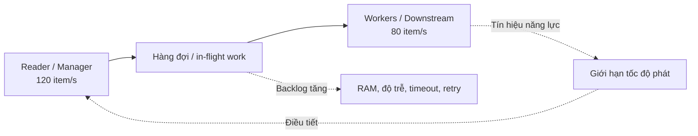
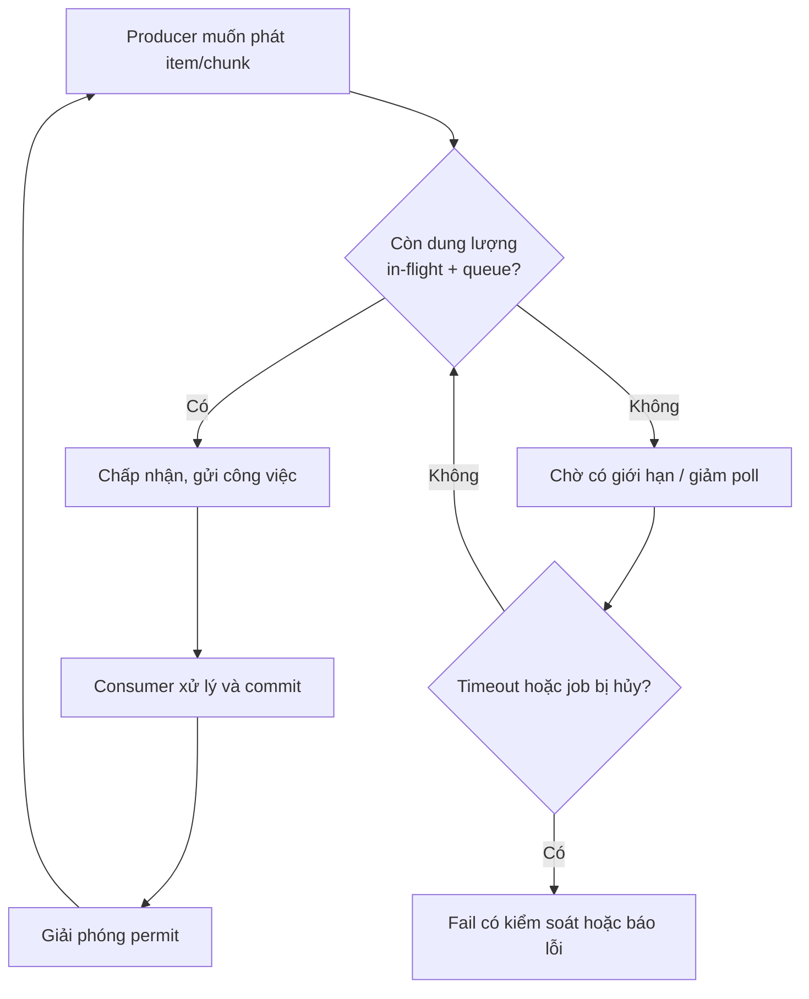

# Vì sao cần giới hạn tốc độ phát trong Spring Batch?

Trong chương **Backpressure** của module **SPRING_BATCH_SCALING_OPERATIONS**, mục tiêu là mở rộng Spring Batch cho workload dữ liệu lớn bằng multi-threaded step, parallel steps, partitioning và các mô hình phân tán, nhưng vẫn bảo đảm tính đúng đắn, khả năng retry/restart và vận hành ổn định. Khi tăng số worker, partition hoặc tốc độ đọc, một câu hỏi quan trọng xuất hiện: **nếu phía tạo công việc nhanh hơn phía tiêu thụ, công việc dư thừa sẽ đi đâu?**

**Giới hạn tốc độ phát** là chủ động kiểm soát tốc độ sinh và chuyển giao dữ liệu, chunk, task hoặc message dựa trên năng lực xử lý thực tế. Đây là một trong những cách thực hiện backpressure: ngăn lượng công việc đang chờ tăng vô hạn, tránh làm quá tải tài nguyên và giữ hệ thống có thể phục hồi khi downstream chậm hoặc lỗi.

## 1. Producer nhanh hơn consumer: vấn đề gốc

Xét một batch job đọc dữ liệu từ database và gửi yêu cầu tới dịch vụ bên ngoài. Reader có thể lấy 120 item/giây, trong khi tổng năng lực xử lý an toàn của worker và dịch vụ đích chỉ là 80 item/giây. Nếu producer tiếp tục phát 120 item/giây, **40 item/giây phải nằm ở đâu đó**: trong bộ nhớ ứng dụng, hàng đợi executor, broker, kết nối đang chờ, hoặc backlog tại downstream.



Ở khoảng thời gian ngắn, buffer giúp hấp thụ một đợt tăng đột biến. Nhưng nếu chênh lệch tốc độ kéo dài, buffer chỉ trì hoãn sự cố.

Gọi:

- `λ` (*lambda*) là tốc độ phát trung bình, đơn vị item/giây.
- `μ` (*mu*) là tốc độ tiêu thụ hiệu dụng trung bình, cùng đơn vị.
- `Q(t)` là số item đang chờ tại thời điểm `t`.

Khi `λ > μ` ổn định và chưa có giới hạn hay loại bỏ công việc, gần đúng:

```text
Tốc độ tăng backlog ≈ λ - μ
Backlog mới sau t giây ≈ max(0, Q(0) + (λ - μ) × t)
```

Ví dụ: `λ = 120 item/s`, `μ = 80 item/s`. Sau 10 phút (`600 s`), backlog tăng khoảng `(120 - 80) × 600 = 24.000 item`. Nếu mỗi item giữ trung bình 12 KiB payload, riêng payload của backlog đã xấp xỉ **281 MiB**, chưa tính object overhead, reference, serialization, queue metadata hay dữ liệu ghi log. Nếu buffer chỉ chứa 2.000 item thì nó đầy sau khoảng **50 giây** kể từ lúc rỗng.

Đây là mô hình để hiểu rủi ro, không phải dự báo chính xác. Tốc độ thực tế biến động theo chunk, transaction, garbage collection, network, retry và thời gian phục vụ; kích thước bộ nhớ thực tế thường lớn hơn payload thuần.

## 2. Vì sao không thể chỉ tăng số thread hoặc queue?

Tăng concurrency có thể tăng throughput **nếu** còn CPU, kết nối DB, I/O hoặc năng lực dịch vụ đích chưa được khai thác hết. Nhưng nó không tự tạo thêm năng lực tại nút thắt.

Giả sử database cho 16 kết nối và một job đã sử dụng gần hết. Tăng worker từ 8 lên 32 có thể khiến 24 worker còn lại chờ connection, tăng timeout và tranh chấp lock. Nếu API đích cho phép 100 request/giây, phát 500 request/giây thường làm tăng lỗi `429 Too Many Requests`, kéo theo retry, thay vì hoàn thành job nhanh hơn.

| Khi không giới hạn tốc độ phát | Hệ quả có thể xảy ra |
| --- | --- |
| Queue executor hoặc buffer không giới hạn | RAM tăng, GC nặng, có thể `OutOfMemoryError` |
| Broker nhận message nhanh hơn khả năng tiêu thụ | Queue lag, tăng dung lượng lưu trữ và thời gian chờ của item |
| Worker cùng tranh pool kết nối hữu hạn | Chờ connection, timeout, transaction kéo dài |
| Gửi API vượt quota hoặc giới hạn đồng thời | `429`, `503`, circuit breaker mở, retry khuếch đại tải |
| Nhiều request/chunk đang xử lý cùng lúc | Tăng số item phải làm lại khi lỗi, khó dự đoán checkpoint và restart |
| Batch job chiếm toàn bộ tài nguyên dùng chung | Ảnh hưởng workload giao dịch hoặc các job khác, mất công bằng tài nguyên |
| Manager phát hàng nghìn partition một lúc | Overhead điều phối, metadata/DB và broker tăng, trong khi worker vẫn hữu hạn |

Một hàng đợi lớn có thể làm biểu đồ throughput trông ổn định trong vài phút đầu, nhưng ẩn độ trễ thật của công việc đang chờ. Với batch job có hạn hoàn thành, cần theo dõi cả **thời gian xử lý toàn job** và **tuổi của item cũ nhất trong queue**, chứ không chỉ tốc độ phát.

## 3. Phân biệt backpressure, rate limiting, concurrency limiting và buffering

Những khái niệm này hỗ trợ nhau nhưng giải quyết các khía cạnh khác nhau.

| Kỹ thuật | Điều bị kiểm soát | Ví dụ trong Spring Batch | Giới hạn |
| --- | --- | --- | --- |
| **Backpressure** | Producer giảm/tạm dừng khi downstream không nhận thêm được | Dừng lấy chunk mới khi số chunk đang chạy đạt ngưỡng | Chỉ hiệu quả nếu tín hiệu có thể lan ngược tới nơi sinh công việc |
| **Rate limiting** | Số request/item phát trong một khoảng thời gian | Tối đa 80 API request/giây | Chưa giới hạn số request đồng thời nếu latency tăng mạnh |
| **Concurrency limiting** | Số tác vụ/request cùng in-flight | Tối đa 8 worker gọi API cùng lúc | Không tương đương 8 request/giây; tốc độ còn tùy latency |
| **Bounded buffering** | Số công việc chờ trong RAM/queue | Executor queue chứa tối đa 16 task | Khi đầy vẫn cần chính sách block, reject hoặc chuyển tải |
| **Load shedding** | Từ chối/bỏ bớt công việc vượt khả năng | Từ chối trigger job mới nếu hệ thống quá tải | Chỉ được bỏ việc khi yêu cầu nghiệp vụ cho phép; dữ liệu batch thường không thể tùy tiện làm mất |
| **Retry with backoff** | Tốc độ gửi lại khi gặp lỗi tạm thời | Retry API sau `429`, chờ theo `Retry-After` | Không thay thế admission control khi tải bình thường đã vượt khả năng |

**Backpressure** là mối quan hệ điều khiển giữa phía nhận và phía phát. **Rate limiting** là một cơ chế định lượng có thể giúp thực hiện điều khiển đó, kể cả khi không có feedback trực tiếp từ consumer. Trong Spring Batch kiểu chunk blocking, backpressure thường được tạo bằng **giới hạn số tác vụ đang chạy, buffer hữu hạn, poll có kiểm soát và điều tiết API**; không nên mặc định có cơ chế `request(n)` như Reactive Streams chỉ vì đã dùng Spring Framework.

## 4. Backpressure phải lan đến đúng nơi sinh công việc

Hãy xem chuỗi:

```text
Database reader -> chunk -> local executor -> message broker -> worker -> API/DB
```

Nếu chỉ chặn ở worker, local executor có thể vẫn tạo task hoặc broker vẫn tiếp nhận message. Nếu giới hạn queue RAM nhưng lúc đầy lại đẩy mọi việc sang một broker queue không giới hạn, backlog chỉ **chuyển địa điểm**. Muốn kiểm soát toàn hệ thống, cần biết giới hạn tại từng ranh giới:

1. **Nguồn:** reader hoặc scheduler có thể tạm ngưng phát, giảm kích thước lô, hay chỉ lên lịch thêm khi có capacity không?
2. **Ranh giới truyền tải:** channel, executor và broker có queue bound, timeout, flow control, quota hay chính sách rejection nào?
3. **Consumer:** worker có số thread tối đa, khả năng commit, pool connection, và quota downstream bao nhiêu?
4. **Điều khiển:** tín hiệu đầy/chậm được dùng để block producer, giảm poll, giãn thời gian gửi hay báo job fail có thể restart?

Trong hệ thống phân tán, không phải lúc nào downstream cũng báo trực tiếp sức chứa cho manager. Khi đó có thể dùng mức cấp phép (*permits*), số request in-flight, queue depth, tốc độ hoàn tất, latency hoặc lỗi `429` làm tín hiệu. Một con số cố định thường là điểm khởi đầu; điều chỉnh động nên có giới hạn trên/dưới và tránh dao động liên tục theo nhiễu.



Trong batch phải phân biệt **chờ có giới hạn** với **mất item**. Khi buffer đầy, nếu item đã được reader đánh dấu là xử lý nhưng không được chấp nhận vào pipeline, checkpoint/transaction có thể trở nên không nhất quán. Quyết định chờ, từ chối hoặc retry phải được đặt tại ranh giới phù hợp với transaction và cơ chế restart của step.

## 5. Trường hợp 1: multi-threaded step

Một multi-threaded step dùng `TaskExecutor` để cho phép xử lý nhiều chunk đồng thời. Tăng số thread chỉ hữu ích khi reader, processor và writer an toàn luồng và downstream đủ sức phục vụ. Với Spring Batch 5.x, `StepBuilder.throttleLimit(int)` đã được đánh dấu **deprecated từ 5.0**, không nên dùng làm cơ sở cho thiết kế mới. Tài liệu 5.x hướng dẫn dùng `RepeatOperations` tùy chỉnh kết hợp một `TaskExecutor` có queue hữu hạn khi cần thay thế cơ chế throttle; vì API giữa các phiên bản thay đổi, cần đối chiếu bản Spring Batch đang dùng.

Ví dụ cấu hình **một thread pool hữu hạn** trong Spring Framework:

```java
@Bean
public ThreadPoolTaskExecutor batchTaskExecutor() {
    ThreadPoolTaskExecutor executor = new ThreadPoolTaskExecutor();
    executor.setCorePoolSize(4);
    executor.setMaxPoolSize(4);
    executor.setQueueCapacity(16);
    executor.setThreadNamePrefix("batch-chunk-");
    executor.initialize();
    return executor;
}
```

Ở thời điểm nhất định, pool này chạy tối đa 4 task và hàng đợi có sức chứa 16 task. **Đây là giới hạn tài nguyên của executor, chưa phải thiết kế backpressure hoàn chỉnh.** Khi queue đầy, hành vi chịu ảnh hưởng rejection handler và cách phía gọi xử lý lỗi. Không được mặc định queue đầy sẽ tự động làm reader chậm lại một cách an toàn.

Ví dụ cách gắn executor vào chunk step (cú pháp minh họa theo Spring Batch 5.x):

```java
@Bean
public Step importStep(
        JobRepository jobRepository,
        PlatformTransactionManager transactionManager,
        ItemReader<InputRow> reader,
        ItemProcessor<InputRow, OutputRow> processor,
        ItemWriter<OutputRow> writer,
        @Qualifier("batchTaskExecutor") TaskExecutor taskExecutor) {

    return new StepBuilder("importStep", jobRepository)
            .<InputRow, OutputRow>chunk(100, transactionManager)
            .reader(reader)
            .processor(processor)
            .writer(writer)
            .taskExecutor(taskExecutor)
            .build();
}
```

Các bean `reader`, `processor`, `writer`, repository và transaction manager cần triển khai riêng; import Java được lược bỏ để tập trung vào cấu hình. Cần kiểm tra **throttle/scheduling semantics của đúng phiên bản Spring Batch**, khả năng đọc/ghi đồng thời và cách exception được truyền từ executor lên step. Cấu hình pool đơn thuần không bảo đảm các thành phần batch thread-safe hay restart-safe.

### Khi executor đầy thì làm gì?

| Chính sách | Tác động | Cân nhắc nghiệp vụ |
| --- | --- | --- |
| Chặn trước khi submit (*bounded admission*) | Producer chờ tới khi có permit/slot | Thường phù hợp nếu có timeout, interrupt/cancel và checkpoint đúng |
| Reject có kiểm soát | Step nhận lỗi, có thể fail và restart theo quy trình | Không được nuốt exception khiến job báo thành công nhưng mất item |
| `CallerRunsPolicy` | Thread submit thực thi task, tạo khả năng tự làm chậm producer | Phải kiểm tra tương tác với thread/transaction context của Spring Batch; không đặt mặc định mà chưa thử nghiệm |
| Queue lớn/không giới hạn | Ít reject trước mắt, nhưng backlog tăng | Dễ giấu nút thắt, tăng RAM và độ trễ |

Điểm quan trọng là **giới hạn số chunk in-flight**, thường còn phải nhỏ hơn sức chứa các tài nguyên chung như connection pool. Khi kích thước chunk là 100, 20 chunk in-flight có thể tương đương khoảng 2.000 item chưa được quyết toán; đây là mức cần cân nhắc nếu lỗi buộc xử lý lại.

## 6. Trường hợp 2: gọi API ngoài từ processor/writer

Giả sử mỗi `ItemProcessor` gọi dịch vụ xác thực. Dịch vụ cho phép tối đa 50 request/giây và 10 request đồng thời. Hai giới hạn **không giống nhau**:

- Rate limiter theo token bucket hoặc sliding window giữ mức phát phù hợp quota, ví dụ 50 request/giây.
- Semaphore/bulkhead giới hạn tối đa 10 request đang chờ phản hồi cùng lúc.
- Timeout, retry backoff và circuit breaker xử lý tình huống dịch vụ chậm hoặc không khỏe.

Ví dụ **chỉ giới hạn concurrency**, không phải request/giây:

```java
public final class LimitedValidationGateway {
    private final Semaphore permits = new Semaphore(10, true);
    private final ValidationClient client;

    public LimitedValidationGateway(ValidationClient client) {
        this.client = client;
    }

    public ValidationResult validate(InputRow item)
            throws InterruptedException {

        if (!permits.tryAcquire(5, TimeUnit.SECONDS)) {
            throw new IllegalStateException("Validation service is overloaded");
        }

        try {
            return client.validate(item);
        } finally {
            permits.release();
        }
    }
}
```

`ValidationClient` và các record/item là kiểu đại diện cho ứng dụng; đây là ví dụ một thành phần chuyên trách. Dùng `tryAcquire` với timeout để không chờ vô hạn; khi không còn slot, exception cần được xử lý bằng chính sách lỗi/retry của job. Nếu dùng `InterruptedException` trong luồng xử lý thực tế, hãy tôn trọng yêu cầu dừng job và khôi phục interrupt flag khi bắt exception ở tầng gọi (`Thread.currentThread().interrupt()`).

**Chú ý:** `Semaphore` trên một JVM chỉ giới hạn trong JVM đó. Nếu chạy 5 worker JVM và mỗi JVM có 10 permit, toàn hệ thống có thể tạo **50** request đồng thời. Với quota toàn cụm, cần quota phân bổ rõ cho mỗi worker hoặc một cơ chế rate/concurrency limiting phân tán đáng tin cậy. Ngoài ra, permit dùng để hạn chế *đang xử lý* không tự áp giới hạn requests-per-second.

Tránh đặt lệnh `Thread.sleep` không có kiểm soát sau mỗi item để giả làm backpressure: nó giữ tài nguyên, khó phối hợp retry và không phản ứng theo tốc độ thực tế. Nếu dùng delay để tuân quota, cần timeout, khả năng hủy và nên đặt tại điểm phát yêu cầu trước tác dụng phụ. Không giữ transaction DB mở xuyên suốt thời gian chờ nếu có thể thiết kế lại ranh giới giao dịch.

## 7. Trường hợp 3: remote chunking, partitioning và broker

Trong **remote chunking**, manager đọc rồi gửi chunk dưới dạng message; worker tiêu thụ và xử lý. Nếu tốc độ manager đọc/gửi lớn hơn tổng năng lực worker, backlog tăng ở broker. Bật thêm partition hoặc tăng producer không cải thiện tốc độ xử lý thực chất khi worker/DB/API đã đạt trần.

Trong **remote partitioning**, manager gửi request để worker chạy từng partition. Mỗi request không chứa mọi item của partition, nhưng một số lượng partition quá lớn vẫn tạo áp lực lên broker, `JobRepository`, connection pool, lịch chạy, tiến trình checkpoint và việc thu hồi trạng thái.

| Nút điều khiển | Tác dụng | Điều phải kiểm tra |
| --- | --- | --- |
| `gridSize` / số partition | Thay số mảnh công việc manager dự kiến phát | Không đồng nghĩa số worker xử lý thật; partition quá nhỏ gây overhead |
| Worker concurrency | Giới hạn số consumer xử lý đồng thời | Đồng bộ với DB/API capacity và kích thước transaction |
| Broker prefetch / consumer credits | Giới hạn message được giao trước cho consumer | Khác nhau giữa JMS, RabbitMQ, Kafka; kiểm tra cách ack/commit |
| Broker queue quota / flow control | Ngăn tích lũy message vô hạn | Producer sẽ block, timeout hay bị reject? Có thể retry không mất việc? |
| Message batching/chunk size | Đổi số item mỗi message và chi phí round-trip | Chunk lớn tăng thời gian xử lý/rollback và lượng dữ liệu in-flight |
| Poll interval/`maxMessagesPerPoll` (nếu dùng poller) | Giảm nhịp lấy message hoặc lấy nguồn mới | Cần phân biệt polling với message-driven listener và kiểm tra cấu hình cụ thể |

Ví dụ: 4 workers, mỗi worker xử lý bền vững 25 chunk/giây. Manager đẩy 180 chunk/giây thì broker tăng backlog khoảng 80 chunk/giây. Tăng prefetch của worker không thay đổi tổng công suất 100 chunk/giây. Cách xử lý hợp lý có thể là hạ nhịp manager xuống khoảng 90–100 chunk/giây, hoặc tăng worker nếu DB/downstream còn dư tải và broker được cấu hình đúng.

**Broker không thay thế flow control.** Dù message được lưu bền vững, dung lượng đĩa và độ trễ vẫn hữu hạn. Ngoài ra, broker redelivery có thể khiến một chunk được xử lý lại, nên writer và side effect phải idempotent hoặc được quản lý bằng giao dịch/checkpoint thích hợp. Thông điệp "đã được broker nhận" không đồng nghĩa "item đã commit thành công ở đích".

## 8. Retry storm: khi lỗi lại làm tải tăng

Nếu hệ thống phát 100 request/giây vào API chỉ chịu 80 request/giây, 20 request/giây bị từ chối. Nếu mỗi lỗi được retry lập tức 3 lần, số request thực tế còn cao hơn 100, tiếp tục gây lỗi. Đây là **retry amplification**: cố khôi phục công việc nhưng tự tăng tải lên nơi đang nghẽn.

Một chiến lược là:

1. Giới hạn tốc độ và concurrency **ngay trước** điểm gọi downstream.
2. Phân loại lỗi: lỗi nghiệp vụ không nên retry vô hạn; `429`, timeout/`503` có thể retry khi thích hợp.
3. Tuân theo `Retry-After` nếu hệ thống đích cung cấp, nếu không dùng exponential backoff có jitter, giới hạn số lần và tổng thời gian retry.
4. Giữ số retry **đồng thời** trong ngân sách tài nguyên; không cho retry vượt admission control.
5. Khi lỗi kéo dài, giảm phát mới, tạm dừng hoặc fail step có thể restart; không tạo vòng retry nóng liên tục.

Ví dụ lịch chờ minh họa (không phải thông số mặc định của Spring Batch): `1s`, `2s`, `4s`, `8s` kèm jitter và số lần thử tối đa. Chọn chính sách thực tế dựa trên quota, SLA và khả năng chịu lỗi của API. Retry có thể phát lại side effect sau rollback hoặc lỗi mạng: backpressure **không tự giải quyết exactly-once**. Đầu ra vẫn cần idempotency key, unique constraint, outbox hoặc transaction phù hợp.

Trong Spring Batch, fault tolerance (`retry`, `skip`, restart) nằm ở vòng đời step/chunk. Nếu item đã được đọc trước khi downstream nhận, phải kiểm thử tình huống queue đầy, timeout, rollback và restart để chứng minh không có item mất hoặc trùng. Không tự nhận rằng "queue có retry" là đủ bảo toàn dữ liệu.

## 9. Ước lượng giới hạn ban đầu bằng số đo

Số liệu quan trọng nhất không phải CPU trên biểu đồ, mà là **công suất bền vững của đoạn chậm nhất**. Có thể làm theo trình tự:

1. Chạy baseline với mức concurrency thấp, không có backlog tích lũy; đo số item/chunk **commit thành công** mỗi giây.
2. Tìm điểm nghẽn: DB connection wait, lock, API quota, latency, CPU, GC, I/O, broker publish/consume, repository checkpoint.
3. Thử các mức 2, 4, 8 worker trên cùng dữ liệu và điều kiện tương đương. Khi throughput không tăng nhưng error/latency tăng, đã tới hoặc vượt vùng hiệu quả.
4. Chọn tốc độ phát có khoảng dự phòng so với mức tiêu thụ an toàn, nhất là khi công suất downstream biến động.
5. Đặt **giới hạn backlog**, **timeout chờ permit**, cảnh báo queue age và chính sách phục hồi khi hệ thống không theo kịp.

Một nguyên lý hữu ích là **Little's Law** trong trạng thái ổn định:

```text
L = λ_effective × W

L: số công việc trung bình trong hệ thống (in-flight + đang chờ)
λ_effective: throughput hoàn tất trung bình (công việc/giây)
W: thời gian ở trong hệ thống trung bình (giây)
```

Ví dụ muốn duy trì throughput 80 item/giây với thời gian từ chấp nhận đến hoàn tất trung bình 0,5 giây, thì số item trong hệ thống theo trung bình khoảng `L = 80 × 0,5 = 40`. Đây là ước lượng để lập ngân sách in-flight, **không phải công thức chọn cứng queue capacity**; burst, phân phối latency và thời gian chờ tail vẫn cần kiểm thử. Nếu hệ thống không ổn định (`λ > μ` kéo dài), không được dùng Little's Law như thể backlog có thể ổn định.

### Phân biệt chỉ số phát, nhận và hoàn thành

| Chỉ số | Cho biết điều gì | Cách đọc khi backpressure hoạt động |
| --- | --- | --- |
| `produced/s` | Số item/chunk/message được producer phát | Có thể giảm chủ động khi downstream đầy |
| `accepted/s` | Số item/channel/broker đã nhận | Không khẳng định xử lý/commit xong |
| `completed/s` hoặc committed/s | Công việc hoàn tất thành công | Thước đo công suất hiệu dụng |
| `queue_depth` | Số công việc đang chờ | Xu hướng tăng liên tục là tín hiệu mất cân bằng |
| `oldest_message_age` / queue wait p95 | Công việc phải đợi bao lâu trước xử lý | Cảnh báo độ trễ bị ẩn bởi buffer lớn |
| `in_flight`, pool active, pool queue | Tài nguyên xử lý đang sử dụng | Giúp đánh giá permit, concurrency và queue bound |
| DB pool wait/lock, API p95/p99 | Áp lực tại nút thắt | Có thể xấu đi dù CPU ứng dụng còn thấp |
| Retry, 429, 503, timeout, rollback | Áp lực và lỗi được khuếch đại | Tăng mạnh thường cần giảm tải phát hoặc kiểm tra downstream |
| Job duration, checkpoint/restart | SLA và khả năng phục hồi toàn job | Đánh giá trade-off throughput, ổn định và tính đúng đắn |

Một hệ thống backpressure đúng có thể cho `produced/s` giảm trong lúc downstream chậm, trong khi `completed/s` ít biến động hơn và queue ổn định. Đó là **hành vi có chủ đích**, không phải một lỗi hiệu năng của producer.

## 10. Khi nào không nên cố giữ tốc độ phát tối đa?

Giả sử một batch job nhập 1 triệu bản ghi phải chạy cùng hệ thống giao dịch trực tuyến. Job có thể phát 250 item/giây nếu chiếm 30 kết nối DB, nhưng dịch vụ online sẽ tăng latency. Giới hạn job ở 150 item/giây và tối đa 8 kết nối có thể làm job chạy lâu hơn, đồng thời giữ SLA chung và giảm xác suất timeout/retry. Kiến trúc mở rộng hợp lý phải tính **tổng tài nguyên thực**, không chỉ thời gian của riêng batch.

Ngoài ra, việc phát nhanh có thể xóa mất khả năng kiểm soát khi cần dừng: hàng trăm nghìn message đã được enqueue vẫn tiếp tục chờ ở broker ngay cả khi manager bị dừng. Với backpressure và backlog bound, quy mô công việc "đã phát nhưng chưa hoàn tất" có thể dự đoán được, giúp vận hành, triển khai phiên bản mới và restart an toàn hơn.

### Tình huống tự kiểm tra

Một job có 6 worker. Mỗi worker làm được 15 chunk/giây khi API ổn định. Manager phát 150 chunk/giây, broker cho phép lưu không giới hạn. Sau 5 phút, công suất worker không đổi.

**Câu hỏi:** broker đã nhận hết message thì hệ thống có đang khỏe không? Thay `gridSize` lên 32 có giúp ích? Nên điều chỉnh ở đâu?

**Phân tích:** công suất tổng là `6 × 15 = 90 chunk/giây`, chênh lệch `150 - 90 = 60 chunk/giây`. Nếu không có sự thay đổi khác, backlog tăng khoảng `60 × 300 = 18.000 chunk`. Broker nhận message chỉ cho biết dữ liệu được đệm; thời gian chờ và chi phí lưu trữ đang tăng. Tăng số partition không làm API/worker nhanh hơn. Cần đo đúng nút thắt, giới hạn phát gần công suất an toàn, giới hạn số in-flight/buffer, rồi chỉ bổ sung worker nếu API, DB và broker còn tài nguyên.

## 11. Checklist triển khai và kiểm chứng

- [ ] Đã xác định cụ thể **producer** là reader, manager, scheduler hay adapter nào và **consumer** là ai.
- [ ] Đã đo throughput **commit thành công**, không nhầm với số message gửi hoặc item đọc.
- [ ] Đã biết capacity của DB pool, quota API, broker, worker và repository khi tải cao.
- [ ] Có giới hạn rõ cho concurrency, backlog và tốc độ phát nếu cần; queue không tăng vô hạn.
- [ ] Khi buffer đầy, có hành vi block/timeout/reject được kiểm thử cùng transaction và restart.
- [ ] Không dựa vào `.throttleLimit(...)` deprecated cho thiết kế Spring Batch mới.
- [ ] Retry có backoff, giới hạn attempts, tôn trọng quota và tránh retry storm.
- [ ] Đã kiểm chứng idempotency, không mất hoặc trùng item sau rollback, worker crash và restart.
- [ ] Có metric và cảnh báo queue age, queue depth, in-flight, pool wait, 429/503, p95/p99 và job duration.
- [ ] Đã thử nhiều mức tải và concurrency; có phương án giảm tốc/fail an toàn nếu downstream giảm năng lực.

**Ghi nhớ:** giới hạn tốc độ phát bảo vệ cả tính ổn định và tính đúng đắn của batch job. Mở rộng hệ thống không phải tạo công việc càng nhanh càng tốt, mà là giữ tốc độ nhận công việc tương ứng với **tốc độ hoàn thành bền vững**, có bộ đệm hữu hạn, ranh giới tài nguyên rõ ràng và khả năng retry/restart được kiểm chứng.

## Tài liệu tham khảo

- [Spring Batch — Scaling and Parallel Processing](https://docs.spring.io/spring-batch/reference/scalability.html): multi-threaded step, remote chunking, partitioning và giới hạn tài nguyên khi scale.
- [Spring Batch 5.2 — `AbstractTaskletStepBuilder` API](https://docs.spring.io/spring-batch/docs/5.2.x/api/org/springframework/batch/core/step/builder/AbstractTaskletStepBuilder.html): `throttleLimit` deprecated và hướng dẫn dùng `RepeatOperations` tùy chỉnh với bounded `TaskExecutor`.
- [Spring Integration — Message Endpoints](https://docs.spring.io/spring-integration/reference/endpoint.html): poller, nhịp lấy message và cấu hình luồng message.
- [Spring Framework — `ThreadPoolTaskExecutor`](https://docs.spring.io/spring-framework/reference/integration/scheduling.html): cấu hình thread pool, số worker và hàng đợi.
