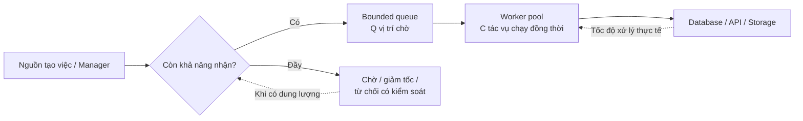
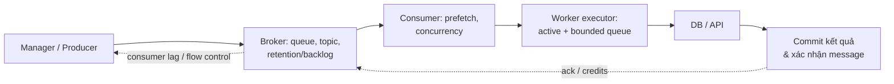

# Bounded queue cho worker trong Spring Batch

Khi mở rộng Spring Batch bằng multi-threaded step, parallel steps, local partitioning hoặc worker phân tán, một vấn đề thường xuất hiện: **bên tạo việc nhanh hơn bên xử lý việc**. Nếu mọi tác vụ mới đều được giữ lại trong bộ nhớ, queue có thể tăng không giới hạn, kéo theo heap pressure, GC, độ trễ, timeout và thậm chí mất ổn định toàn bộ job. **Bounded queue** (hàng đợi có dung lượng giới hạn) là cơ chế giữ số tác vụ chờ trong một mức có thể kiểm soát và buộc phía tạo việc phản ứng khi hệ thống đã đầy.

Bài học thuộc chương **Backpressure** của module **SPRING_BATCH_SCALING_OPERATIONS**, tập trung vào mở rộng workload dữ liệu lớn theo năng lực CPU, I/O, database và hệ thống đích. Bạn sẽ học cách định cỡ queue, cấu hình worker pool, lựa chọn hành vi khi quá tải và bảo đảm retry/restart an toàn. Đây là bài về **điều tiết lượng công việc đang chờ worker**, không chỉ là chọn một con số cho `queueCapacity`.

## 1. Vì sao worker cần bounded queue?

Xét một job chia dữ liệu thành nhiều partition. Manager tạo tác vụ và đưa vào executor; worker lấy tác vụ để đọc, xử lý, ghi từng phần dữ liệu.

- Manager có thể tạo 1.000 partition trong thời gian rất ngắn.
- Pool chỉ có 8 worker đang chạy.
- Mỗi partition phải giữ reader, transaction, kết nối và trạng thái cho đến khi kết thúc.
- Nếu phần lớn tác vụ được xếp vào queue không giới hạn, số việc chờ tăng nhanh hơn khả năng xử lý, dù không có thêm worker.

Ví dụ queue giữ 100.000 object tác vụ, mỗi tác vụ tham chiếu đến context và cấu trúc dữ liệu khác, có thể chiếm bộ nhớ đáng kể. Quan trọng hơn, nhiều tác vụ **được chấp nhận** nhưng chưa thể chạy: thời gian nằm trong queue có thể vượt ngưỡng chờ của hệ thống gọi hoặc giới hạn vận hành job.

Bounded queue giúp:

1. Giới hạn số tác vụ đang chờ bên trong một tiến trình.
2. Đưa ra tín hiệu rõ ràng khi hệ thống đạt ngưỡng nhận việc.
3. Buộc bên tạo việc giảm tốc, đợi, hoặc xử lý từ chối một cách có kiểm soát.
4. Phân biệt **năng lực thực thi** với **khả năng tích lũy backlog**.
5. Giữ latency và memory footprint dễ dự đoán hơn khi có burst.

**Giới hạn queue không tự tăng throughput.** Nếu database chỉ xử lý được 50 chunk/giây thì chuyển từ queue 1.000 sang queue 50 không khiến database ghi được 100 chunk/giây. Cơ chế này bảo vệ hệ thống và làm quá tải trở nên quan sát được.

## 2. Cấu trúc: worker pool, queue và tín hiệu backpressure



Ba đại lượng cần tách biệt:

| Đại lượng | Ý nghĩa | Ví dụ |
| --- | --- | --- |
| `C` — số worker đồng thời | Số tác vụ đang thực thi (giới hạn tối đa) | 8 |
| `Q` — dung lượng queue chờ | Số tác vụ được nhận nhưng **chưa bắt đầu** | 24 |
| `I` — số tác vụ đang thực thi hoặc đang chờ | Gần đúng `I ≤ C + Q` trong một executor cố định | Tối đa 32 |

Trong cấu hình một executor đơn giản, mức tối đa `C + Q` chỉ là **giới hạn phần đang nằm trong executor**. Không thể coi đó là giới hạn toàn hệ thống nếu vẫn có backlog ở message broker, nơi nhận HTTP, source connector, các service upstream hoặc queue của executor khác.

**Backpressure hoàn chỉnh** là tín hiệu lan ngược về phía nguồn. Khi queue đầy, phía tạo việc phải dừng/giảm phát, đợi có chỗ, áp dụng chính sách từ chối có thể xử lý lại, hoặc dùng kho việc bền vững. Chỉ đặt queue nhỏ nhưng tiếp tục tạo task không kiểm soát thường chuyển vấn đề thành `RejectedExecutionException`.

### Phân biệt các kiểu “đầy”

- **Queue đầy:** không còn chỗ giữ công việc chờ, nhưng có thể có worker sắp rảnh.
- **Worker bận:** tất cả C worker đang chạy; chưa hẳn queue đã đầy.
- **Database pool cạn:** các worker có thể đang chờ connection chứ không thực sự xử lý dữ liệu.
- **Broker có backlog:** executor JVM có thể chỉ chứa ít task, nhưng hệ thống còn hàng triệu message chưa xử lý trong broker.
- **Memory cao:** dữ liệu item/chunk đang được đệm hoặc giữ trong reader, writer, cache cũng có thể là nguồn tiêu thụ RAM lớn, độc lập với số Runnable trong queue.

## 3. Tính dung lượng queue dựa trên năng lực thật

Định nghĩa các đại lượng trong cùng một đơn vị công việc (task, chunk hoặc partition; **không trộn đơn vị**):

- `λ` (lambda): tốc độ tác vụ đến, task/giây.
- `μ` (mu): tốc độ hoàn tất của toàn bộ worker pool, task/giây.
- `C`: số worker có thể chạy đồng thời.
- `S`: thời gian xử lý trung bình một task, giây/task, đo khi hệ thống chưa bị nghẽn mạnh.
- `Q`: số vị trí chờ của queue.

Xấp xỉ đơn giản khi các task có thời gian xử lý tương đương:

\[
\mu \approx \frac{C}{S}
\]

Nếu `λ < μ` trong thời gian dài, hệ thống có khả năng xử lý kịp. Nếu `λ > μ` kéo dài, backlog sẽ tăng bất kể queue lớn bao nhiêu. Khi chưa có biện pháp chặn tốc độ đến, tăng `Q` chỉ trì hoãn thời điểm đầy.

Giả sử 6 worker, trung bình mỗi task cần 0,2 giây:

\[
\mu \approx \frac{6}{0.2} = 30 \text{ task/giây}
\]

Nếu nguồn phát ổn định 36 task/giây, backlog tăng khoảng 6 task/giây. Với queue 60 vị trí, từ trạng thái rỗng và với tốc độ không đổi, queue có thể đầy sau khoảng:

\[
T_{\text{đầy}} \approx \frac{60}{36 - 30}=10\text{ giây}
\]

Đây là **ước lượng trung bình** để thấy cơ chế quá tải; trong thực tế thời gian xử lý biến động, tác vụ có kích thước khác nhau, GC, network hoặc lock khiến queue đầy sớm/muộn hơn. Đặc biệt, khi hệ thống đã ở trạng thái tắc nghẽn, `S` đo trong điều kiện bình thường có thể không còn đúng.

### Little's Law và độ trễ

Trong hệ thống **ổn định**, trung bình:

\[
L = \lambda W
\]

Với `L` là số tác vụ đang trong hệ thống, `W` là thời gian trung bình từ khi được chấp nhận đến khi hoàn tất, và `λ` là throughput hoàn tất/đến trong trạng thái ổn định. Công thức giúp định cỡ ngân sách **in-flight** và đánh giá mục tiêu latency, nhưng không dùng để khẳng định hệ thống đang quá tải vẫn ổn định.

Ví dụ muốn nhận tối đa 40 task/giây và đặt ngân sách end-to-end trung bình 0,5 giây/task, số task trung bình trong hệ thống khoảng 20. Đây là con số **để tham chiếu**, không phải mặc định dùng queue capacity = 20: số task đang chạy đã chiếm một phần, và p95/p99 của thời gian đợi có thể cao hơn trung bình đáng kể.

### Chọn `Q` theo burst và yêu cầu SLO

Một điểm xuất phát có kiểm soát:

1. Đo throughput tối đa bền vững `μ` dưới giới hạn CPU, database, API và pool.
2. Ước lượng burst `λ_burst` và thời gian burst dự kiến `T`.
3. Dung lượng backlog cần hấp thụ trong một burst ngắn xấp xỉ `max(0, (λ_burst − μ) × T)` nếu hệ thống bắt đầu với queue rỗng.
4. So mức backlog đó với ngân sách memory và **thời gian chờ tối đa**. Queue lớn có thể giữ được việc nhưng khiến task chờ quá lâu.
5. Đặt chính sách backpressure/rejection khi vượt khả năng, kiểm thử bằng tải thật và điều chỉnh.

Có thể chọn `Q` chỉ bằng vài lần số worker làm baseline để đo, sau đó điều chỉnh theo burst và ràng buộc nghiệp vụ. **Không có tỉ lệ “queue = 10 × thread” đúng cho mọi Spring Batch job.**

## 4. Cấu hình bounded queue với ThreadPoolTaskExecutor

Spring Framework cung cấp `ThreadPoolTaskExecutor` dùng `ThreadPoolExecutor` của Java. Ví dụ dưới đây dành cho Spring Batch chạy local partitioning hoặc tác vụ chạy trên pool riêng.

```java
import java.util.concurrent.ThreadPoolExecutor;

import org.springframework.context.annotation.Bean;
import org.springframework.context.annotation.Configuration;
import org.springframework.scheduling.concurrent.ThreadPoolTaskExecutor;

@Configuration
public class BatchExecutorConfiguration {

    @Bean
    public ThreadPoolTaskExecutor batchWorkerExecutor() {
        ThreadPoolTaskExecutor executor = new ThreadPoolTaskExecutor();

        executor.setCorePoolSize(4);
        executor.setMaxPoolSize(4);
        executor.setQueueCapacity(8);
        executor.setThreadNamePrefix("batch-worker-");

        // Khi 4 worker bận và 8 task đang chờ:
        // từ chối submission tiếp theo để caller xử lý rõ ràng.
        executor.setRejectedExecutionHandler(
                new ThreadPoolExecutor.AbortPolicy());

        executor.setWaitForTasksToCompleteOnShutdown(true);
        executor.setAwaitTerminationSeconds(30);
        executor.initialize();
        return executor;
    }
}
```

Cấu hình này cho phép tối đa **4 tác vụ đang chạy + 8 tác vụ chờ** trong executor; tác vụ tiếp theo khi không còn năng lực nhận sẽ bị từ chối. Spring có thể chuyển ngoại lệ từ chối thành `TaskRejectedException` tại lớp `TaskExecutor`, vì vậy bên gọi cần xử lý theo contract thực tế của API.

**Vì sao dùng `corePoolSize == maxPoolSize` trong ví dụ?** Với `ThreadPoolExecutor` và queue có dung lượng dương, khi core thread đã bận, executor thường **đưa task mới vào queue trước**, chỉ mở rộng thêm thread vượt core khi queue đã đầy. Nếu cấu hình `corePoolSize=4`, `maxPoolSize=16`, `queueCapacity=10_000`, hệ thống có thể xếp hàng dài trong khi phần lớn thread tối đa chưa được tạo. Pool cố định giúp người vận hành hiểu giới hạn rõ hơn.

Cũng cần biết:

- `queueCapacity > 0` thường dùng hàng đợi có dung lượng giới hạn; `queueCapacity = 0` dùng cơ chế handoff trực tiếp, không lưu task chờ, thích hợp với một số workload nhưng dễ bị từ chối nếu burst lớn.
- `queueCapacity` giới hạn **task chờ**, không giới hạn tổng số item một task/partition đọc và giữ trong RAM.
- Thread pool cần lifecycle/shutdown hợp lệ để job không tạo thread vô hạn. Trong Spring container, bean này được quản lý lifecycle.
- Số thread phải xét thêm connection pool, transaction, CPU, I/O và giới hạn hệ đích.

### Khi queue đầy thì chọn chính sách nào?

| Chính sách | Hành vi | Phù hợp khi | Rủi ro |
| --- | --- | --- | --- |
| `AbortPolicy` | Ném lỗi từ chối tác vụ | Hệ thống cần phát hiện quá tải và để tầng điều phối quyết định retry/fail | Nếu caller không xử lý, job thất bại; **không được nuốt lỗi** |
| `CallerRunsPolicy` | Tác vụ bị từ chối được chạy ngay trên thread gọi nếu executor chưa shutdown | Có thể chấp nhận caller chậm lại và việc chạy trên caller đúng ngữ nghĩa | Manager/request thread bị giữ; không bảo đảm được nhận nếu executor đã shutdown |
| Chờ dung lượng bằng semaphore/admission control | Giới hạn số in-flight, caller đợi slot | Có producer tách biệt worker, có ngân sách timeout/cancel | Nếu gọi từ chính worker pool hoặc có phụ thuộc vòng có thể gây deadlock |
| Từ chối có tín hiệu cho upstream | Trả 429/503, pause consumer, retry với backoff | Có giao thức cho phép nguồn giảm tốc hoặc phát lại an toàn | Cần idempotency, retry budget, không đẩy backlog vô hạn sang tầng khác |
| `DiscardPolicy` hoặc `DiscardOldestPolicy` | Bỏ task im lặng hoặc bỏ task cũ | Hầu như **không phù hợp** với batch đòi hỏi đầy đủ dữ liệu | Mất item/partition mà hệ thống có thể không biết |

Trong Spring Batch, một task thường đại diện cho cả **chunk hoặc partition có trạng thái nghiệp vụ**. Mất hoặc nuốt tác vụ là rủi ro dữ liệu, nên ưu tiên **fail rõ ràng, chặn việc nhận thêm có kiểm soát hoặc retry theo cơ chế đáng tin cậy**.

`CallerRunsPolicy` có thể tạo backpressure tự nhiên vì manager phải trực tiếp xử lý khi pool đầy, nhưng **không nên bật máy móc**: hãy thử thực tế với transaction, StepScope, lifecycle, thời gian chờ và đường xử lý lỗi; tác vụ có thể chạy trên thread khác với giả định ban đầu.

## 5. Admission control: giới hạn cả task chờ lẫn task đang chạy

Một queue dung lượng 8 giới hạn chỗ chờ của executor, nhưng không thể điều tiết producer nếu producer giữ thêm danh sách 100.000 tác vụ ngoài queue. Khi cần chống burst tại nơi phát sinh task, có thể dùng **semaphore** như một bộ đếm quyền nhận việc, bao phủ cả queued và running.

Ví dụ một dispatcher dành cho producer chạy trên thread khác với worker pool:

```java
import java.util.Objects;
import java.util.concurrent.Executor;
import java.util.concurrent.Semaphore;

public final class BoundedDispatcher {
    private final Executor executor;
    private final Semaphore slots;

    public BoundedDispatcher(Executor executor, int maxInFlight) {
        if (maxInFlight <= 0) {
            throw new IllegalArgumentException("maxInFlight must be > 0");
        }
        this.executor = Objects.requireNonNull(executor);
        this.slots = new Semaphore(maxInFlight, true);
    }

    // Producer đợi có chỗ thay vì tạo backlog vô hạn.
    public void submit(Runnable work) throws InterruptedException {
        Objects.requireNonNull(work);
        slots.acquire();

        boolean accepted = false;
        try {
            executor.execute(() -> {
                try {
                    work.run();
                } finally {
                    slots.release();
                }
            });
            accepted = true;
        } finally {
            // Executor từ chối: trả lại slot trước khi báo lỗi.
            if (!accepted) {
                slots.release();
            }
        }
    }
}
```

Sử dụng với `poolSize=4`, `queueCapacity=8` và `maxInFlight=12` có thể chặn producer ở ngưỡng **4 running + 8 queued**. `Semaphore.acquire()` sẽ **block** thread producer; khi một worker hoàn thành, `release()` cho phép nhận task mới. Đây là ví dụ về cơ chế backpressure **đồng bộ tại nơi submit**.

Các giới hạn quan trọng:

- **Không gọi `submit()` từ một worker của chính pool** khi worker cần submit task phụ để hoàn thành; nếu tất cả worker chờ slot, có thể deadlock.
- Cần hỗ trợ timeout/cancel và cách phản ứng khi bị interrupt theo yêu cầu vận hành; ví dụ này chỉ dùng `acquire()` để minh họa ngưỡng.
- Bản thân một queue vật lý vẫn phải bounded. Nếu nhiều producer có đường đưa việc khác vào cùng executor, giới hạn semaphore không bao phủ các đường đó.
- Semaphore không phải JobRepository, không ghi trạng thái bền vững và **không thay thế** restart/retry của Spring Batch.

Đối với yêu cầu “đừng chờ vô hạn”, thay `acquire()` bằng `tryAcquire(timeout, unit)` và trả trạng thái quá tải rõ ràng. Khi task đã được chấp nhận nhưng thất bại lúc chạy, quản lý completion/error riêng; semaphore chỉ bảo vệ ngân sách thực thi.

## 6. Áp dụng cho local partitioning của Spring Batch

Trong local partitioning, manager Step tạo tập `ExecutionContext` theo `Partitioner` rồi giao các worker Step cho `TaskExecutor`. Ví dụ Java theo kiểu cấu hình Spring Batch 5.x:

```java
import org.springframework.batch.core.Step;
import org.springframework.batch.core.partition.support.Partitioner;
import org.springframework.batch.core.repository.JobRepository;
import org.springframework.batch.core.step.builder.StepBuilder;
import org.springframework.context.annotation.Bean;
import org.springframework.scheduling.concurrent.ThreadPoolTaskExecutor;

@Bean
public Step partitionManagerStep(
        JobRepository jobRepository,
        Step partitionWorkerStep,
        Partitioner workPartitioner,
        ThreadPoolTaskExecutor batchWorkerExecutor) {

    return new StepBuilder("partitionManagerStep", jobRepository)
            .partitioner(partitionWorkerStep.getName(), workPartitioner)
            .step(partitionWorkerStep)
            .gridSize(4)
            .taskExecutor(batchWorkerExecutor)
            .build();
}
```

Đoạn cấu hình giả định các bean `partitionWorkerStep` và `workPartitioner` đã được định nghĩa. Reader, processor, writer của worker Step phải được thiết kế đúng phạm vi partition; reader có trạng thái thường nên là bean `@StepScope` để mỗi StepExecution có instance/checkpoint riêng.

**Lưu ý quan trọng về `gridSize`:** đây là gợi ý số partition cho `Partitioner` và cơ chế điều phối, **không phải bảo đảm số task outstanding hoặc thread luôn tối đa bằng 4**. Một custom `Partitioner` có thể trả về nhiều partition hơn `gridSize`. TaskExecutorPartitionHandler có thể submit nhiều partition vào executor; nếu số task vượt số đang chạy cộng với sức chứa queue thì chính sách từ chối sẽ kích hoạt. Do đó:

1. Biết rõ Partitioner tạo **bao nhiêu partition** tại mỗi lần chạy.
2. Phân biệt **số partition logic** với **số worker chạy đồng thời** và **sức chứa queue**.
3. Với lượng partition lớn, thiết kế cơ chế chia đợt/điều tiết submission có kiểm chứng, hoặc cách phân phối công việc phù hợp, thay vì giả định pool tự quản lý mọi partition vô hạn.
4. Kiểm thử một lần pool bão hòa xem lỗi submit có làm manager Step thất bại đúng cách và có thể restart an toàn không.

Nếu `Partitioner` tôn trọng `gridSize(4)` bằng cách tạo 4 partition, executor 4 worker/8 chỗ chờ đủ cho việc submit ban đầu. Nhưng 400 partition và cùng cấu hình sẽ **không tự động** được xử lý hết trong 4 luồng nếu không có cơ chế điều phối hoặc admission control phù hợp.

### Với multi-threaded step

Multi-threaded step có thể submit công việc chunk đồng thời. Một executor bounded giúp ngăn số Runnable xếp hàng tăng quá mức, nhưng không thay cho việc bảo đảm **reader/writer thread-safe**, kiểm soát state/checkpoint, transaction theo chunk và tính đúng đắn khi retry. Năng lực lưu đệm bên trong reader, driver, HTTP client hoặc writer cũng phải được đo.

Trong các phiên bản Spring Batch hiện đại, API giới hạn đồng thời của step có thể thay đổi và một số cấu hình throttle trước đây đã bị deprecated. Do đó hãy dựa trên **phiên bản thực dùng**, TaskExecutor/step configuration và phép đo thực tế; không giả định `throttleLimit` là cơ chế admission control đủ cho mọi kiến trúc.

### Với parallel steps

Mỗi Step có thể sở hữu executor riêng hoặc chia sẻ executor. Nếu cùng dùng pool 8 thread, tổng mức đồng thời của các Step bị ràng buộc bởi pool đó; nếu dùng ba pool 8 thread độc lập, tổng có thể lên đến 24 thread và cùng cạnh tranh DB/API. **Ngân sách tài nguyên phải tính trên toàn job**, không chỉ từng Step.

## 7. Remote partitioning và remote chunking: queue tồn tại ở nhiều tầng

Khi worker chạy trên nhiều JVM/host, giới hạn một executor không còn đủ. Cần xem toàn tuyến:



Mỗi tầng phải có ràng buộc độc lập:

| Tầng | Giới hạn thường cần xem | Câu hỏi vận hành |
| --- | --- | --- |
| Manager/producer | Tốc độ phát task, batch submission, số request chưa có kết quả | Có ngừng phát khi chưa đủ worker không? |
| Broker | Backlog, quota, lưu trữ, retention, flow control | Backlog tăng bao lâu trước khi hết disk/quota? |
| Consumer | Concurrency, prefetch/max poll, số message chưa ack | Mỗi consumer có giữ quá nhiều message trong RAM không? |
| Worker JVM | Pool size, bounded queue, heap, GC | Executor có bị đầy; task chờ bao lâu? |
| Nguồn/đích dữ liệu | Connection pool, query/lock, rate limit, timeout | Tăng worker có gây tải vượt sức chứa không? |

**Remote partitioning:** manager giao thông tin partition cho worker, worker chạy Step tương ứng. Hãy giới hạn số partition in-flight ở tầng điều phối/nhắn tin và tính đến các worker rớt kết nối, message giao lại, timeout, retry/restart theo trạng thái JobRepository.

**Remote chunking:** manager đọc/chia chunk và gửi tới worker. Nếu manager tiếp tục đẩy chunk nhanh hơn worker xử lý, broker backlog tăng dù worker pool có bounded queue. Khi đó cần giới hạn số chunk chưa nhận kết quả, điều chỉnh consumer prefetch, cơ chế acknowledgement và tốc độ reader/producer. Điều này phụ thuộc framework messaging được dùng; **không mặc định** rằng broker hoặc Spring Batch tự thực hiện backpressure xuyên suốt từ DB đích về ItemReader.

Trong mô hình có giao nhận message ít nhất một lần (*at-least-once*), cùng task có thể được gửi lại sau lỗi. Bounded queue không tạo ra bảo đảm exactly-once. Writer cần idempotency/khóa nghiệp vụ và cách đối soát kết quả.

## 8. Khi nào “chờ”, khi nào “từ chối”?

Chính sách phụ thuộc loại workload.

**Batch nội bộ có thể chờ:** một producer duy nhất, dữ liệu đầu vào đã được lưu bền vững, không có timeout khắt khe. Có thể giới hạn số in-flight và block producer một khoảng có thể giám sát, miễn không gây deadlock.

**API kích hoạt batch theo yêu cầu:** nếu người dùng liên tục gửi job mới, queue quá lớn tạo hàng dài “đã nhận” nhưng chưa chạy. Có thể áp dụng quota số job đang chạy/chờ, trả lỗi quá tải kèm hướng retry, hoặc nhận yêu cầu vào kho bền vững có status rõ ràng rồi điều phối theo năng lực. Cần định nghĩa hợp đồng nhận việc trước khi trả thành công.

**Consumer từ broker:** giới hạn prefetch/unacked, pause/resume hoặc giảm consumer concurrency khi downstream chậm. Nếu nhận rồi ack trước khi commit công việc thì lỗi có thể gây mất xử lý; nếu không ack, cần timeout/retry/dead-letter theo ngữ nghĩa nghiệp vụ.

**Partition scheduler:** nếu task bị từ chối, lỗi phải trở thành trạng thái có thể truy ra qua JobRepository/manager. Không tự giả định rằng một Runnable bị ném khỏi executor sẽ được Spring Batch chạy lại thành công.

Trong mọi trường hợp, **không nuốt lỗi từ chối, không drop task im lặng, không trả “thành công” khi thực tế chưa nhận một đơn vị công việc bền vững**.

## 9. Thread safety, retry/restart và giới hạn transaction

Bounded queue giới hạn lượng việc trong bộ nhớ nhưng không quản lý tính đúng đắn dữ liệu. Khi đưa vào một Spring Batch job, cần kiểm tra:

- **Thread safety:** mỗi worker có reader/writer/process state phù hợp. Reader có state thường cần được tạo riêng theo StepExecution; không chia sẻ cursor và ExecutionContext tùy tiện.
- **Transaction:** chunk commit phải bảo toàn atomicity trong phạm vi transaction được cấu hình. Thời gian gọi writer chưa chắc bao gồm database commit hoặc I/O từ hệ ngoài transaction.
- **Retry:** một chunk bị lỗi có thể được xử lý lại. Số lần submit/task execution và số item đã commit là hai chỉ số khác nhau.
- **Restart:** job phải biết partition/chunk nào đã commit qua JobRepository/checkpoint; Runnable còn nằm trong RAM queue khi JVM dừng **không phải** chứng cứ đã hoàn thành.
- **Idempotency:** ghi đích phải chịu được retry, message redelivery và lỗi sau khi gửi side effect nhưng trước khi ghi checkpoint.
- **Shutdown:** đặt thời gian chờ shutdown phù hợp với thời gian chunk/partition; khi hết thời gian, hệ thống cần kết thúc theo lifecycle và restart theo trạng thái đã ghi bền vững.

Ví dụ, một partition đã được manager submit nhưng chưa chạy có thể vẫn ở trạng thái khác partition hoàn thành; khi JVM lỗi, cần để cơ chế phục hồi của Spring Batch và cấu hình job thực tế xử lý dựa trên state. Đừng coi một task đã được đặt vào queue là đã được xử lý.

## 10. Quan sát đúng nơi nghẽn

Chỉ số tối thiểu của worker pool:

| Metric | Ý nghĩa |
| --- | --- |
| `active_threads` | Số worker đang chạy; có bão hòa theo thời gian không |
| `pool_size / max_pool_size` | Quy mô pool thực tế và trần cấu hình |
| `queue_size / queue_capacity` | Tác vụ đang chờ và phần trăm queue đầy |
| `queue_wait_ms` (p50, p95, p99) | Từ lúc chấp nhận đến lúc task bắt đầu; trực tiếp phản ánh backlog |
| `task_duration_ms` (p50, p95, p99) | Thời gian xử lý sau khi worker bắt đầu |
| `rejected_submissions` | Số task bị từ chối do hết khả năng nhận |
| `completed_tasks_per_second` | Throughput thực tế của worker |
| `retry / rollback / error_count` | Sự cố có thể làm tăng thời gian mỗi task |
| `cpu / gc / db_pool_wait / db_locks / api_latency` | Nguyên nhân nền khiến worker chậm |

Một số gauge có thể đọc từ `ThreadPoolTaskExecutor`:

```java
int active = executor.getActiveCount();
int currentPoolSize = executor.getPoolSize();
int queued = executor.getThreadPoolExecutor().getQueue().size();
int availableQueueSlots =
        executor.getThreadPoolExecutor().getQueue().remainingCapacity();
```

Ví dụ trên cần biến `executor` là instance thực tế của bean `ThreadPoolTaskExecutor` đang chạy. Có thể dùng Micrometer để xuất gauge và timer từ executor hoặc Spring Boot Actuator nếu đã cấu hình phù hợp; tên metric cụ thể tùy phiên bản, binder và cách đặt tên trong hệ thống.

**Đừng chỉ nhìn queue size:** queue rỗng với CPU 100% và output chậm có thể do producer đã bị throttled thành công; queue đầy với CPU thấp có thể do worker đang chờ DB hoặc API. Phải ghép nhiều metric trong cùng một khoảng thời gian.

Đặt cảnh báo theo **độ dài thời gian** queue đầy, p95 queue wait, rejection rate, lag nguồn và giới hạn tài nguyên. Queue chạm 100% trong một vài mili-giây khi burst không đồng nghĩa job hỏng; queue thường xuyên đầy và rejection kéo dài là dấu hiệu cần xử lý.

Khi metric có tag, dùng những nhãn có cardinality thấp như `job_type`, `step`, `worker_pool`, `status`. Không đưa ID của từng item, partition hoặc JobExecution vào mọi time series; chi tiết cao nên để trong log/trace.

## 11. Tuning theo phép đo, không theo cảm tính

Quy trình benchmark đề xuất:

1. **Chốt workload:** số item/partition, kích cỡ payload, độ phức tạp processor, lượng dữ liệu đang có ở DB và giới hạn upstream/downstream.
2. **Baseline:** dùng pool nhỏ có queue bounded; đo wall-clock, throughput, p95 queue wait, heap/GC, số task bị từ chối và lỗi.
3. **Thử riêng concurrency:** tăng worker từ 2 lên 4 rồi 8 trên dữ liệu tương đương, giữ nguyên hoặc kiểm soát queue size; tìm điểm throughput ngừng tăng.
4. **Thử riêng queue size:** ví dụ `Q=4`, `Q=16`, `Q=64`; xem burst được hấp thụ, p95 wait, memory và rejection thay đổi thế nào.
5. **Điều tiết nguồn:** nếu `λ > μ` kéo dài, giảm tốc sinh task hoặc nâng năng lực xử lý thực; không tăng queue để che nghẽn.
6. **Kiểm tra lỗi:** ép DB chậm, connection pool cạn, task ném exception, worker shutdown giữa chunk; xác minh không mất/trùng dữ liệu sau restart.
7. **Đánh giá end-to-end:** so thời gian hoàn tất workload, số bản ghi đầu ra đúng, throughput, mức tài nguyên và khả năng phục hồi. Chọn cấu hình ổn định trong điều kiện production.

### Bài toán minh họa

Một worker pool có 4 thread, mỗi task chiếm trung bình 0,25 giây, nên năng lực xử lý xấp xỉ **16 task/giây**. Nguồn phát burst **24 task/giây trong 10 giây**.

- Chênh lệch trong burst: `24 − 16 = 8 task/giây`.
- Backlog dự kiến sau 10 giây nếu không điều tiết: `8 × 10 = 80 task`.
- Với `Q=32` và hệ thống bắt đầu ở mức queue rỗng, queue dự kiến đầy sau khoảng **4 giây**.
- Tăng queue lên 80 có thể giữ được burst này trong giả định đơn giản, nhưng tăng thời gian chờ và memory; không giải quyết nếu burst kéo dài hơn hoặc lặp liên tục.

Nếu SLA không cho phép task đợi quá lâu, cần giảm tốc nguồn hoặc tăng **năng lực downstream thực tế** trước khi tăng queue. Nếu writer đang chờ database lock, tăng từ 4 lên 16 thread có thể gây tác dụng ngược; tối ưu khóa/truy vấn và transaction trước.

## 12. Những lỗi thường gặp

| Sai lầm | Hậu quả | Cách khắc phục |
| --- | --- | --- |
| Queue không giới hạn vì “đã giới hạn thread” | Backlog tăng đến khi tốn RAM/GC hoặc latency không chấp nhận được | Dùng bounded queue và cơ chế điều tiết submission |
| `corePoolSize` nhỏ, `maxPoolSize` lớn, queue cực lớn | Executor giữ task trong queue trước khi mở rộng pool | Hiểu chính sách ThreadPoolExecutor; benchmark pool cố định hoặc cấu hình phù hợp |
| Coi `gridSize` là trần task đồng thời của Spring Batch | Custom Partitioner có thể tạo nhiều task hơn và bị reject | Kiểm soát số partition được submit và năng lực executor thực |
| Bật `CallerRunsPolicy` mà không đo | Thread manager bị giữ lâu, thứ tự/transaction behavior khác giả định | Kiểm thử đường thực thi, timeouts và chính sách restart |
| `DiscardPolicy` để “không bị lỗi” | Im lặng bỏ công việc, mất dữ liệu | Không dùng cho task bắt buộc xử lý; truyền lỗi rõ ràng |
| Queue JVM bounded nhưng broker prefetch không giới hạn hợp lý | Nhiều message còn nằm trong consumer memory | Điều chỉnh prefetch, ack, concurrency và end-to-end flow control |
| Queue đầy, chỉ tăng `Q` khi DB đã bão hòa | Kéo dài thời gian chờ, không tăng throughput | Đo DB lock/connection wait; giới hạn concurrency hoặc tối ưu ghi |
| Submit xong coi như đã commit | Task có thể vẫn chờ hoặc thất bại sau khi nhận | Theo dõi trạng thái bền vững của Step/Job và idempotency |
| Không đo queue wait và rejection | Khó phân biệt chậm vì chờ và chậm vì xử lý | Bổ sung meter cho cả waiting, running, outcome |
| Blocking admission từ chính worker pool | Có thể deadlock khi worker chờ slot của task phụ | Đặt admission tại producer khác pool hoặc dùng scheduler rõ ràng |

## 13. Checklist triển khai

Trước khi áp dụng bounded queue vào workload lớn, xác nhận:

- [ ] Có định nghĩa rõ **một task** là chunk, partition hay tác vụ khác; đơn vị dùng trong mọi phép đo nhất quán.
- [ ] Số worker (`C`) và queue capacity (`Q`) có giới hạn; ước lượng heap cho cả task và item/chunk bên trong.
- [ ] Mọi đường tạo tác vụ đi qua admission control hoặc biết giới hạn nhận việc của tầng sau.
- [ ] Có hành vi khi quá tải: chờ có giới hạn, trả tín hiệu cho upstream hoặc thất bại có thể phục hồi.
- [ ] Không dùng discard im lặng với dữ liệu bắt buộc xử lý.
- [ ] Đo queue wait, running time, throughput, rejection, CPU, DB wait và trạng thái job.
- [ ] Reader/writer, checkpoint và transaction đúng với chế độ chạy nhiều worker.
- [ ] Retry/restart đã được thử khi pool đầy hoặc JVM dừng giữa chunk/partition.
- [ ] Kết quả nghiệp vụ được đối soát về số lượng, tính duy nhất và đúng dữ liệu.
- [ ] Cấu hình được benchmark ở tải thực, không vượt giới hạn DB/API/broker.

## 14. Câu hỏi và bài tập tự kiểm tra

1. Vì sao 8 worker đi cùng queue không giới hạn vẫn có thể khiến batch job bị out-of-memory?
2. Một pool có `corePoolSize=4`, `maxPoolSize=12`, `queueCapacity=10_000`. Vì sao executor có thể vẫn chỉ chạy quanh 4 thread dù queue rất dài?
3. Pool xử lý 30 task/giây; nguồn gửi 45 task/giây trong 8 giây. Backlog tăng gần bao nhiêu task? Với queue 60, khi nào cần phát tín hiệu backpressure?
4. So sánh `AbortPolicy` và `CallerRunsPolicy` đối với manager thread trong local partitioning. Trường hợp nào cần kiểm thử đặc biệt?
5. Một consumer có queue worker bounded nhưng prefetch 10.000 message từ broker. Vì sao hệ thống vẫn có nguy cơ giữ backlog lớn trong RAM?
6. Worker đẩy dữ liệu đến API trả timeout sau khi đã ghi thành công. Cơ chế nào bảo vệ khi chunk được retry và message được giao lại?
7. Khi queue rỗng nhưng batch vẫn chậm, bạn sẽ lấy những metric nào để phân biệt CPU nghẽn, database lock và producer bị throttle?

**Ghi nhớ:** bounded queue là **ranh giới nhận việc có dung lượng hữu hạn**. Nó tạo điều kiện cho backpressure khi kết hợp với một chính sách chờ, giảm tốc hoặc từ chối có kiểm soát. Chọn kích thước theo throughput, burst, latency và tài nguyên thật; bảo toàn retry/restart, thread safety và tính đúng đắn khi mở rộng Spring Batch.
