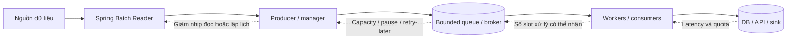
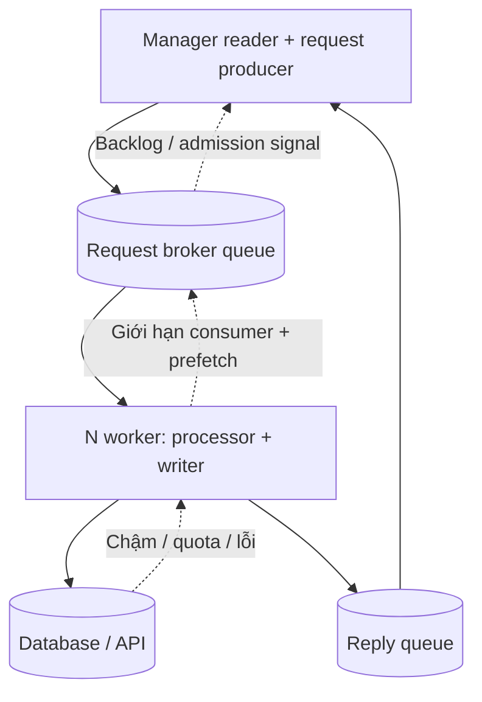
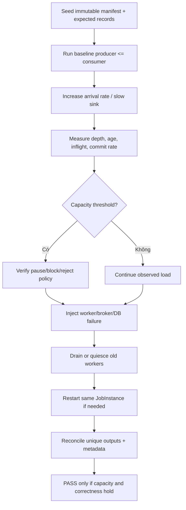

# Producer nhanh hơn consumer

## 1. Bài toán: dữ liệu đến nhanh hơn khả năng xử lý

Một pipeline Spring Batch nhập giao dịch từ file hoặc cơ sở dữ liệu, biến đổi và ghi sang data warehouse. Trong môi trường phân tán, **manager** có thể đọc và gửi chunk qua broker rất nhanh, trong khi các **worker** phải gọi API, kiểm tra nghiệp vụ và ghi database chậm hơn. Sau một thời gian, hàng chờ tăng, bộ nhớ hoặc disk của broker bị chiếm, thời gian hoàn thành job vượt SLA và các lần retry còn làm hệ thống quá tải hơn.

Đó là tình huống **producer nhanh hơn consumer**: tốc độ sản sinh công việc vượt tốc độ mà các thành phần phía sau có thể xử lý và xác nhận thành công.

Trong chương **Backpressure** thuộc module **SPRING_BATCH_SCALING_OPERATIONS**, nhiệm vụ không chỉ là “tăng số worker”, mà còn phải **điều tiết tốc độ nhận việc**, giới hạn lượng công việc đang chờ, giữ tính đúng dữ liệu, thread safety, retry/restart và bảo đảm job có thể vận hành với tài nguyên thực tế.

> **Backpressure** là khả năng **truyền tín hiệu hoặc áp giới hạn ngược từ phía xử lý chậm tới phía tạo việc nhanh** để không tiếp tục sản sinh công việc vượt khả năng chịu tải. Chỉ có queue lớn hoặc mở thêm thread chưa phải một giải pháp backpressure hoàn chỉnh.

### Mục tiêu học tập

Sau bài này, bạn có thể:

1. Phân biệt **arrival rate**, **service rate**, **backlog**, **in-flight work** và **latency**.
2. Ước lượng thời gian đầy queue, thời gian tiêu backlog và điều kiện hệ thống có thể ổn định.
3. Chọn giữa **giới hạn concurrency, bounded queue, rate limiting, pause/resume, retry có backoff** và mở rộng consumer khi có đủ năng lực.
4. Áp dụng các nguyên tắc này cho **multi-threaded step, parallel steps, partitioning và remote chunking** của Spring Batch.
5. Hiểu giới hạn của `ThreadPoolTaskExecutor`, Spring Integration `QueueChannel`, RabbitMQ `prefetch` và Kafka consumer.
6. Kiểm chứng hệ thống dưới overload, shutdown/restart và failure injection mà không làm mất, nhân đôi hoặc làm sai thứ tự dữ liệu nghiệp vụ.

## 2. Hiểu đúng tốc độ producer và consumer

Giả sử trong 1 phút:

- Producer phát **1.200 chunk requests**.
- Consumer chỉ hoàn thành, commit và xác nhận được **800 chunks**.
- Mỗi chunk chứa trung bình 100 item.

Khi đó:

```text
Arrival rate, λ = 1.200 chunks/phút
Service rate, μ =   800 chunks/phút

Chênh lệch Δ = λ - μ = 400 chunks/phút

Tốc độ phát item ước tính: 120.000 items/phút
Tốc độ xử lý item ước tính: 80.000 items/phút
```

Nếu tốc độ duy trì và không có cơ chế chặn producer, **backlog tăng trung bình 400 chunk/phút**. Sau 45 phút, hàng chờ tăng thêm khoảng:

```text
400 chunks/phút × 45 phút = 18.000 chunks
```

Nếu payload trung bình khoảng **200 KB/chunk**, lượng payload phát sinh đang chờ vào khoảng **3,6 GB** theo cách tính thập phân, **chưa kể** message headers, index, replica, WAL, metadata, network buffers và overhead của broker.

**Chú ý:** đây là mô hình trung bình đơn giản, không phải số đo một RabbitMQ/Kafka cluster cụ thể. Với workload có chunk size thay đổi, 800 chunk hoàn tất/phút chưa chắc tương ứng chính xác 80.000 item/phút. Phải đo cả **chunk/s** và **item/s**.

### 2.1. Khi nào queue sẽ đầy?

Nếu queue chỉ cho phép **500 chunk đang chờ** và ban đầu rỗng:

```text
Time to fill ≈ 500 / (1.200 - 800)
             = 1,25 phút
```

Chưa tới hai phút, producer sẽ gặp tình huống queue không thể tiếp nhận thêm. Hành vi tiếp theo phải được **thiết kế có chủ đích**: chờ, trì hoãn/pause, từ chối có kiểm soát, đưa vào storage bền vững, hoặc fail rõ ràng. **Không được âm thầm bỏ chunk** chỉ để giữ backlog bằng không.

### 2.2. Khi nào backlog được tiêu hết?

Giả sử đã có 18.000 chunks chờ:

| Tình huống sau khi phát hiện quá tải | Tốc độ backlog thay đổi | Thời gian ước tính |
| --- | ---: | ---: |
| Producer vẫn 1.200, consumer 800 chunks/phút | **+400/phút** | Backlog không tự hết |
| Dừng producer, consumer vẫn 800/phút | **−800/phút** | Khoảng **22,5 phút** |
| Giảm producer xuống 600, consumer vẫn 800/phút | **−200/phút** | Khoảng **90 phút** |
| Tăng consumer lên 1.400, producer vẫn 1.200/phút | **−200/phút** | Khoảng **90 phút**, nếu downstream chịu được |

Các phép tính bỏ qua biến động tốc độ, ưu tiên message, thời gian warm-up và lỗi. **Tăng worker lên 1.400 chunks/phút chỉ là một phương án thực** nếu database, API và broker còn đủ capacity.

### 2.3. Hệ thống ổn định cần điều kiện gì?

Về mặt trung bình dài hạn, một queue có đầu vào `λ` và năng lực xử lý hiệu dụng `μ` chỉ có khả năng ổn định khi:

```text
λ < μ
```

Điều kiện này **chưa đủ để bảo đảm latency tốt**. Khi `λ` gần `μ`, biến động ngẫu nhiên của thời gian xử lý có thể làm hàng chờ và P95/P99 latency tăng mạnh. Cần **headroom**, không cấu hình theo đúng tốc độ tối đa đo được một lần.

Theo **Little's Law**, trong hệ thống ổn định:

```text
L = λ × W

L : số công việc trung bình đang ở trong hệ thống
λ : throughput hiệu dụng trung bình qua hệ thống
W : thời gian trung bình của một công việc trong hệ thống
```

Ví dụ một pipeline ổn định hoàn tất 300 chunks/giây, mỗi chunk ở trong pipeline trung bình 2 giây thì khoảng **600 chunks** đang ở trong hệ thống. Không dùng Little's Law như cách chứng minh một queue **đang tăng vô hạn** là ổn định; phải phân biệt **đang chờ** và **đang xử lý**.

## 3. Backlog, in-flight, throughput và latency khác nhau

| Chỉ số | Câu hỏi được trả lời | Lỗi diễn giải thường gặp |
| --- | --- | --- |
| **Arrival rate** | Bao nhiêu chunks/items mới được nhận mỗi giây? | Đếm request publish là số item thực đã commit |
| **Completion/service rate** | Bao nhiêu chunks/items hoàn tất thành công mỗi giây? | Đếm delivery/ACK transport là commit nghiệp vụ |
| **Queue depth** | Bao nhiêu message đang nằm chờ trong broker/channel? | Queue rỗng nghĩa toàn bộ đã xử lý thành công |
| **In-flight/unacked** | Bao nhiêu message đã giao nhưng chưa hoàn tất ACK? | Unacked bằng 0 nghĩa manager đã ghi nhận reply |
| **Queue age** | Message lâu nhất đang chờ đã bao lâu? | Queue depth nhỏ luôn có độ trễ nhỏ |
| **End-to-end latency** | Từ lúc nhận dữ liệu tới khi commit/publish xong? | Chỉ đo thời gian trong `ItemProcessor` |
| **Retry/redelivery rate** | Có bao nhiêu công việc lặp lại? | Throughput tăng chỉ vì xử lý lại cùng message |
| **Unique business output** | Bao nhiêu bản ghi nghiệp vụ duy nhất đúng? | `writeCount` hoặc số broker ACK bảo đảm exactly-once |

**Điểm đặc biệt:** một consumer có thể **prefetch** nhiều message và giữ chúng trong bộ nhớ, khiến queue depth giảm dù chưa có thêm kết quả. Vì vậy **queue depth + unacked + completion rate + oldest age** phải được xem cùng nhau.

### 3.1. Dấu hiệu producer nhanh hơn consumer

- Queue depth, message age hoặc consumer lag tăng liên tục.
- Thread pool active gần tối đa, queue của executor đầy hoặc task bị reject.
- Thời gian trong queue tăng, trong khi CPU có thể rảnh vì consumer bị chặn ở DB/API.
- DB connections pending, lock waits, IOPS hoặc network đạt giới hạn.
- Timeout và retries tăng, sinh thêm công việc **không tạo giá trị nghiệp vụ mới**.
- Memory/GC tăng do buffer payload hoặc executor task.
- Job `STARTED` quá lâu, thiếu chunk replies hoặc có partition straggler.
- Broker disk watermark/quota cảnh báo; một DLQ/ retry queue phình ra.

**Không vội kết luận “thiếu CPU”** nếu throughput không tăng. Nếu consumer đang chờ external API 429 hoặc database lock, thêm thread có thể làm hiệu năng xấu hơn.

## 4. Backpressure truyền ngược như thế nào?

Một chuỗi xử lý lý tưởng:



**Backpressure thực sự cần kết nối phản hồi về phía upstream.** Nếu worker đã giới hạn bốn thread nhưng manager vẫn publish không hạn chế vào broker, hệ thống chỉ **chuyển điểm tích backlog** từ JVM sang broker; chưa ngăn tốc độ dữ liệu tới vượt năng lực tiêu thụ.

### 4.1. Bốn cơ chế thường kết hợp

1. **Bounded concurrency:** giới hạn số worker/step/chunk đang xử lý đồng thời.
2. **Bounded buffering:** giới hạn số task/message chờ; khi đầy phải có hành vi xác định.
3. **Rate/admission control:** giảm nhịp producer hoặc chỉ nhận lô công việc khi còn ngân sách.
4. **Capacity/recovery management:** scale consumer khi có headroom, retry bounded và điều phối restart an toàn.

Trong workload thực tế, chỉ một cơ chế thường **không đủ**. Ví dụ worker concurrency=8 làm CPU ổn định, nhưng broker queue không giới hạn vẫn tăng khi nguồn phát 20.000 sự kiện/s còn sink chỉ commit 10.000 sự kiện/s.

### 4.2. Buffering không đồng nghĩa backpressure

Một queue có thể hấp thụ **burst ngắn** rất hữu ích. Nhưng với `λ > μ` kéo dài, mọi queue hữu hạn cuối cùng đều đầy.

- **Buffer lớn hơn** giúp chịu burst lâu hơn nhưng tăng thời gian chờ và chi phí lưu.
- **Backpressure** làm upstream thay đổi hành vi trước khi toàn hệ thống cạn tài nguyên.
- **Scale consumer** tăng `μ` nếu có capacity thực.
- **Drop** chỉ hợp lệ nếu nghiệp vụ chấp nhận mất dữ liệu và có hợp đồng rõ; với batch tài chính/ETL quan trọng thường không được phép.
- **DLQ** dùng cách ly lỗi/poison message; không phải nơi nhận bình thường cho mọi dữ liệu khi consumer chậm.

## 5. Chọn chính sách khi downstream chạm giới hạn

| Chính sách | Phù hợp khi | Cần cảnh giác |
| --- | --- | --- |
| **Block/chờ có timeout** | Upstream đồng bộ, có thể chờ mà không deadlock | Thread đang chờ có thể chiếm tài nguyên và timeout |
| **Pause source/consumer intake** | Kafka polling, lịch ingest, scheduler có khả năng tạm dừng | Không để lease/heartbeat/offset mất hiệu lực |
| **Rate limit producer** | Có thể điều khiển nguồn phát và biết quota của downstream | Phải đo completion rate, tránh điều tiết theo chỉ một metric |
| **Bounded executor queue** | Tasks trong cùng JVM | Queue đầy gây rejection; không được drop task im lặng |
| **Broker buffering có quota** | Cần chịu burst tạm thời và durability | Retention/disk, replica, message age và restart |
| **Scale workers** | Worker CPU-bound và DB/API còn headroom | Nhiều worker có thể làm DB/API tệ hơn |
| **Giảm chunk size** | Transaction dài hoặc memory theo chunk quá lớn | Tăng commit/messaging overhead; throughput có thể giảm |
| **Tăng chunk size vừa đủ** | Overhead commit quá lớn và sink hỗ trợ batch | Tăng transaction memory/rollback cost/side effects |
| **Retry + backoff** | Lỗi transient có thể phục hồi | Retry storm nếu nhiều tầng retry đồng thời |
| **Fail/stop có kiểm soát** | Nguồn không pause được, downstream overload kéo dài | Phải giữ checkpoint và kế hoạch restart/đối soát |

**Fail rõ còn an toàn hơn nhận việc rồi mất dữ liệu.** Ví dụ nguồn chỉ push fire-and-forget mà không lưu bản gốc, trả về lỗi khi queue đầy có thể vẫn làm mất message nếu producer không xử lý lỗi. Phải định nghĩa **giao thức tiếp nhận, confirm, retry và ownership** xuyên suốt.

## 6. Backpressure trong từng mô hình Spring Batch

### 6.1. Chunk-oriented step tuần tự

Một chunk-oriented step thông thường đọc, xử lý và ghi chunk theo cơ chế transaction rồi mới chuyển sang chunk tiếp theo. Nó có nhịp sản xuất/tiêu thụ gắn với nhau ở một mức nhất định, nên không có queue bất đồng bộ vô hạn **trừ khi ứng dụng tạo thêm**.

Tuy nhiên, một processor gửi hàng nghìn HTTP requests không chờ kết quả hoặc writer enqueue vào executor không giới hạn **vẫn có thể biến step tuần tự thành producer nhanh**. Spring Batch `writeCount` không tự đảm bảo những request nền đã hoàn tất.

### 6.2. Multi-threaded step

Multi-threaded step có nhiều chunk được xử lý đồng thời. Rủi ro:

- ItemReader/ItemWriter có state bị truy cập đồng thời nếu không thread-safe.
- Reader tạo item/chunk nhanh hơn writer/DB commit.
- Queue executor tích tụ tasks trong heap.
- Transaction/checkpoint/ordering có thể phức tạp theo Spring Batch version.

**Lưu ý version:** `throttleLimit(...)` trong Spring Batch 5.x đã bị **deprecated từ 5.0**; tài liệu khuyến nghị custom `RepeatOperations` dựa trên `TaskExecutor` có queue giới hạn qua `stepOperations(...)` nếu cần thay cơ chế throttling của default repeat template. Không dùng `throttleLimit` như giải pháp mới bền vững hoặc giả định API này tồn tại nguyên vẹn ở Spring Batch 6.x.

Nếu bài toán có khả năng phân chia dữ liệu không chồng lấn, **partitioned step** với reader step-scoped theo từng partition thường cho checkpoint/ownership rõ hơn việc chia một stateful reader trong multi-threaded step. Dù vậy, partitioning vẫn có thể tạo backlog ở manager/handler.

### 6.3. Parallel steps

Khi nhiều flow/step chạy song song, mỗi step có thể tạo tải lên cùng database, API hoặc broker. Hai flow có pool riêng `4 + 4` có thể tạo **8 concurrent tasks** lên cùng nguồn; không thể nhìn riêng pool của một flow để kết luận quota toàn job chỉ là 4.

Backpressure ở đây bao gồm giới hạn tổng resources, đo critical path và tránh nested executor/flow làm oversubscription. Một flow chậm chưa chắc cần thêm threads nếu nó đang đợi DB connection.

### 6.4. Partitioning

Một `Partitioner` có thể sinh **1.000 ExecutionContexts**. `gridSize(4)` là **hint**, không tự ép mọi implementation chỉ tạo bốn partitions; `TaskExecutorPartitionHandler` có thể dispatch nhiều StepExecutions đến executor. Nếu pool/queue nhỏ, task submission có thể bị từ chối; nếu queue lớn, backlog có thể tích trong JVM.

Giải pháp:

- Cân bằng và **gộp input nhỏ thành các nhóm** hợp lý trước khi dispatch.
- Chọn số partitions theo workload, metadata cost và recovery granularity.
- Bounded executor/dispatch; xử lý `TaskRejectedException` một cách nhất quán.
- Không tạo nhiều JobInstances song song chỉ để vượt trần pool.
- Giữ **partition identity + manifest bất biến** khi restart; không tính lại grouping vì backlog thay đổi.

### 6.5. Remote chunking

Trong **remote chunking**, manager đọc item, tạo chunk requests và gửi qua middleware; workers xử lý/ghi rồi gửi replies. Nếu manager đọc/phát nhanh hơn worker commit, broker backlog và **số chunk in-flight** có thể tăng.



**Đừng hiểu nhầm**: consumer prefetch thấp giúp giới hạn số delivery chưa ACK trên worker, **không tự ngăn manager publish**. Manager vẫn có thể làm queue trên broker phình ra nếu không có cơ chế quản lý tốc độ gửi/chunk in-flight, batch scheduler hoặc điều tiết upstream.

**Quan trọng về tính đúng:** broker publisher confirms xác nhận mức tiếp nhận của broker theo cơ chế cấu hình, **không xác nhận worker đã commit DB**. Manager chỉ có thể kết luận kết quả theo protocol chunk reply/StepExecution mà hệ thống tích hợp thật sự dùng.

## 7. ThreadPoolTaskExecutor: giới hạn worker và queue

Trong Spring Batch 5.x, có thể dùng `ThreadPoolTaskExecutor` để giới hạn số partition worker tasks **trong một JVM**:

```java
@Configuration
class BoundedPartitionConfiguration {

    @Bean("boundedPartitionExecutor")
    ThreadPoolTaskExecutor boundedPartitionExecutor() {
        ThreadPoolTaskExecutor executor = new ThreadPoolTaskExecutor();
        executor.setThreadNamePrefix("batch-partition-");
        executor.setCorePoolSize(4);
        executor.setMaxPoolSize(4);
        executor.setQueueCapacity(12);
        return executor;
    }

    @Bean("partitionManagerStep")
    Step partitionManagerStep(
            JobRepository jobRepository,
            @Qualifier("workerStep") Step workerStep,
            @Qualifier("workPartitioner") Partitioner partitioner,
            @Qualifier("boundedPartitionExecutor") TaskExecutor executor) {

        return new StepBuilder("partitionManagerStep", jobRepository)
                .partitioner(workerStep.getName(), partitioner)
                .step(workerStep)
                .gridSize(4)
                .taskExecutor(executor)
                .build();
    }
}
```

Đây là ví dụ **local partitioning**, không phải tự động cấu hình remote chunking. Bean `workerStep` và `workPartitioner` cần được ứng dụng cung cấp. Với một executor như trên:

- **Core/max pool = 4:** tối đa bốn worker threads xử lý task của pool.
- **Queue capacity = 12:** có thể chờ thêm tasks trong queue nội bộ.
- **Tổng công việc đã submit** có thể gồm tasks đang chạy và tasks chờ; không được hiểu “16 là throughput” hoặc là giới hạn toàn cluster.
- **`gridSize(4)` không nhất thiết bằng số partition** do partitioner tạo.
- Nếu 100 partition tasks được submit quá nhanh, executor có thể **reject** khi đã hết capacity.

### 7.1. Hiểu chính xác core/max/queue

Với `ThreadPoolTaskExecutor` sử dụng queue capacity dương, thread pool thường:

1. Tạo threads tới `corePoolSize` khi cần.
2. Khi đã đạt core, ưu tiên đưa task mới vào queue.
3. Chỉ tăng từ core tới max khi queue không nhận thêm task.
4. Khi cả thread capacity và queue đều đầy, dùng rejection policy.

Vì vậy nếu cấu hình `core=2, max=16, queue=1.000`, pool có thể chỉ hoạt động gần **hai threads trong thời gian dài** khi queue còn chỗ. Đặt max cao không có nghĩa executor tự tăng lên 16 ngay khi backlog xuất hiện. Khi muốn predictable concurrency, bắt đầu bằng **core=max** rồi benchmark.

Có thể dùng `queueCapacity(0)` cho kiểu handoff trực tiếp, nhưng hành vi, rejection và số threads phụ thuộc cấu hình; không copy cứng cho mọi workload.

### 7.2. Rejection phải được thiết kế

Một `TaskRejectedException` không đồng nghĩa message đã được lưu vào nơi có thể retry. Không được dùng rejection handler discard task im lặng trong batch quan trọng.

| Chính sách | Hành vi vận hành | Cảnh giác |
| --- | --- | --- |
| Abort/reject | Báo lỗi người submit khi pool đầy | Cần fail/retry có kiểm soát |
| Caller runs | Thread gửi task có thể tự thực thi | Có thể làm mất giả định “chỉ bốn worker xử lý” và gây deadlock nếu dùng sai |
| Wait/block có timeout | Producer chờ slot | Phải bảo vệ transaction, pool starvation và stop behavior |
| Bounded admission coordinator | Chỉ dispatch khi có capacity | Thiết kế phức tạp hơn nhưng giới hạn rõ |
| Discard | Bỏ task | **Không phù hợp** nếu không có nguồn có thể replay và bằng chứng đầy đủ |

**Ví dụ đặc biệt nguy hiểm:** manager giữ DB transaction/lock rồi chờ một task worker, trong khi worker chờ cùng resource bị manager giữ. Thêm blocking queue có thể tạo deadlock; cần nhìn ranh giới transaction và dependency, không đặt `Semaphore.acquire()` tùy tiện trong mọi callback.

### 7.3. Worker step không được chia sẻ state sai

```java
@Bean("workReader")
@StepScope
JdbcPagingItemReader<WorkRow> workReader(
        DataSource dataSource,
        @Value("#{stepExecutionContext['rangeStart']}") Long from,
        @Value("#{stepExecutionContext['rangeEnd']}") Long to) {

    return new JdbcPagingItemReaderBuilder<WorkRow>()
            .name("workReader")
            .dataSource(dataSource)
            .selectClause("SELECT work_id, payload")
            .fromClause("FROM frozen_work")
            .whereClause(
                    "WHERE work_id >= :from AND work_id < :to")
            .parameterValues(Map.of("from", from, "to", to))
            .sortKeys(Map.of("work_id", Order.ASCENDING))
            .rowMapper((rs, i) -> new WorkRow(
                    rs.getLong("work_id"),
                    rs.getString("payload")))
            .pageSize(200)
            .saveState(true)
            .build();
}
```

`WorkRow` là domain record do ứng dụng định nghĩa. Đây là **mẫu reader** cho Spring Batch 5.x, chưa có toàn bộ `Step`, `Job`, writer hay schema. Đầu vào `frozen_work` phải được **đóng băng theo JobInstance**, hoặc bổ sung `snapshotId` và version/range tương ứng. Nếu nguồn thay đổi, paging checkpoint có thể sai dù reader step-scoped.

**`@StepScope` tạo reader theo StepExecution**, không tự biến mọi singleton processor/writer thành thread-safe và không tạo một reader riêng cho từng thread nếu bên trong chính worker step lại dùng multi-threaded chunks.

## 8. Spring Integration QueueChannel: buffer có giới hạn

Spring Integration `QueueChannel` là kênh có hàng chờ cho message. Có thể tạo một queue nội bộ có capacity hữu hạn:

```java
@Bean("boundedHandoffChannel")
PollableChannel boundedHandoffChannel() {
    return new QueueChannel(64);
}
```

**Cảnh báo quan trọng:**

- `QueueChannel` mặc định là **in-memory**, không phải broker durable. JVM crash có thể mất message chưa được xử lý.
- Capacity 64 giới hạn **số message chờ trong kênh này**, không giới hạn số message trong một broker queue khác hoặc tổng các channel.
- Khi đầy, `send(message, timeout)` có thể chờ rồi thất bại; ứng dụng phải kiểm tra giá trị trả về/exception theo chính sách.
- Một queue nội bộ có giới hạn **chỉ tạo backpressure** nếu người gửi thực sự chờ hoặc xử lý tín hiệu đầy queue; nếu code bỏ qua `false` và tiếp tục đọc nguồn, vẫn có thể mất dữ liệu.
- Không cài thêm queue này vào remote chunking pipeline chỉ để “hết lỗi” nếu nó thay đổi semantics ACK, transaction, reply hoặc ordering; phải kiểm thử toàn bộ giao thức.

### 8.1. Minh họa xử lý khi kênh đầy

```java
// Đây là ví dụ message handoff đồng bộ ở tầng ứng dụng,
// không phải implementation của Spring Batch remote chunking.
boolean accepted = boundedChannel.send(message, 2_000L);

if (!accepted) {
    // Báo lỗi cho cơ chế retry/backoff có giới hạn,
    // hoặc trả tín hiệu upstream pause nếu contract cho phép.
    throw new IllegalStateException("Bounded handoff channel is full");
}
```

Chỉ throw exception **chưa đủ** nếu phía trên đã ack/xóa record nguồn trước đó; phải bảo đảm nguồn vẫn replay được, hoặc đã persist message vào một store bền vững trước khi xác nhận tiếp nhận. Nếu consumer cần lâu mới xử lý, producer có thể timeout theo ngân sách tổng và fail job đúng cách.

### 8.2. DirectChannel và ExecutorChannel

| Channel | Hành vi khái quát | Hàm ý backpressure |
| --- | --- | --- |
| `DirectChannel` | Gọi handler đồng bộ theo thread gửi trong trường hợp điển hình | Handler chậm làm upstream chậm theo, nhưng có thể chiếm thread |
| `ExecutorChannel` | Giao handler cho TaskExecutor | Cần bounded executor; rejection phải đi ngược đúng |
| `QueueChannel` | Buffer rồi consumer/poller nhận | Cần capacity hữu hạn, send timeout và persistence nếu yêu cầu |
| Broker queue | Buffer liên tiến trình/node | Cần quota, retention, consumer capacity, producer admission và failure handling |

Không dựa vào tên channel để kết luận một cấu hình **tự bảo đảm at-least-once/exactly-once**. Phải xem acknowledgment, transaction, polling endpoint và adapter mà Spring Integration thực sự sử dụng.

## 9. RabbitMQ: prefetch giới hạn phía consumer, không giới hạn producer

RabbitMQ có cơ chế **consumer prefetch** (QoS) để giới hạn số delivery chưa ACK. Với `prefetch=2` và bốn consumers, số lượng unacked delivery do các consumers đó giữ thường có trần xấp xỉ **8** theo semantics per-consumer của RabbitMQ, nếu không có giới hạn khác và không đổi cấu hình giữa chừng.

Điều này giúp tránh worker nạp hàng nghìn message vào RAM trước khi kịp xử lý. **Nhưng queue trên broker vẫn có thể nhận thêm message từ producer**; prefetch **không phải rate limit phía manager**.

### 9.1. Ví dụ Spring AMQP container có prefetch nhỏ

```java
@Bean("boundedChunkListenerFactory")
SimpleRabbitListenerContainerFactory boundedChunkListenerFactory(
        ConnectionFactory connectionFactory) {

    SimpleRabbitListenerContainerFactory factory =
            new SimpleRabbitListenerContainerFactory();
    factory.setConnectionFactory(connectionFactory);
    factory.setConcurrentConsumers(4);
    factory.setMaxConcurrentConsumers(4);
    factory.setPrefetchCount(2);
    return factory;
}
```

Đây là **listener container factory thông thường của Spring AMQP**, **không tự động được áp dụng vào worker inbound adapter của Spring Batch Integration**. Nếu ứng dụng remote chunking dùng Spring Integration `Amqp.inboundAdapter(...)` hoặc listener container khác, phải cấu hình **đúng container thật**.

Cần phối hợp:

- **Manual/AUTO ack theo listener contract**; đừng ACK quá sớm khi worker chưa commit hoặc chưa đáp ứng nghĩa vụ reply theo giao thức.
- Bounded worker concurrency và DB connection pool.
- Broker queue length/bytes/retention và disk alarms.
- Retry/backoff, poison message isolation và DLQ có topology hợp lệ.
- Publisher confirms/returns khi manager gửi request.
- Correlation và reply timeout để manager không chờ vô hạn.

**`prefetch=0` trong AMQP thường nghĩa là không giới hạn**, không phải “đừng giao message”. RabbitMQ còn có semantics QoS per-consumer và các giới hạn khác tùy queue type/version. Vì vậy phải đo delivery count và unacked thực trên broker.

### 9.2. Publisher confirms không phải worker completion

```text
Manager publish chunk 123
    -> Broker confirm publish
    -> Chunk nằm trong request queue
    -> Worker nhận và xử lý
    -> Worker COMMIT DB
    -> Worker gửi reply
    -> Manager nhận reply và tổng hợp

Confirm ở bước thứ hai KHÔNG khẳng định đã tới bước COMMIT.
```

Nếu producer đã đánh dấu “hoàn thành” ngay sau publisher confirm, backlog ở tầng worker bị che giấu. Phải đo **completion rate tại consumer/sink** và các chunk còn thiếu reply.

### 9.3. DLQ không tự chữa overload

Một queue đầy hoặc message quá TTL có thể bị reject/dead-letter tùy policy broker. Với dữ liệu batch cần đầy đủ, **TTL hết hạn rồi tự loại message có thể gây mất công việc** nếu không có runbook replay hoặc nguồn bền vững.

DLQ phù hợp cách ly message sai schema/poison hoặc lỗi đã hết retry budget, **không phải nơi dùng thay cho capacity planning**. Replay DLQ hàng loạt trong lúc consumer vẫn nghẽn có thể tạo **retry storm** và ghi trùng side effects.

## 10. Kafka: consumer lag, pause/resume và giới hạn polling

Với Kafka, backlog thường biểu hiện dưới dạng **consumer lag** (độ chênh giữa log offsets và committed/processed offsets), không phải một hàng chờ RabbitMQ có ACK/NACK từng delivery.

Các điểm cần phân biệt:

- `max.poll.records` kiểm soát **số records tối đa được trả về trong một lần `poll()`**, **không** trực tiếp là giới hạn tổng inflight HTTP calls hay size toàn pipeline.
- `pause()/resume()` có thể làm consumer tạm ngừng fetch một số partitions; implementation cần tiếp tục poll đúng heartbeat/rebalance contract, không block vô hạn.
- `max.poll.interval.ms` cùng các cấu hình group ảnh hưởng việc consumer bị coi là không tiến triển; một listener xử lý quá lâu có thể gây rebalance/redelivery.
- Kafka có thể giữ log dữ liệu trong retention, nhưng **retention không vô hạn**; consumer lag tăng mãi có thể khiến dữ liệu cũ không còn sẵn.
- Commit offset **trước khi sink commit** có thể mất dữ liệu; commit offset **sau khi sink commit** có thể phát lại sau crash, nên cần idempotency.

Với Spring Kafka/Spring Integration, dùng **đúng listener container và acknowledgment mode của hệ thống**, không giả định một `@KafkaListener` sample sẽ tự cấu hình cho remote chunking. Khi downstream chậm, giới hạn số tasks trong ứng dụng, dùng pause/resume hoặc retry topics có kiểm soát, theo dõi lag age và source retention.

## 11. Giới hạn in-flight chunk và connection budget

Với remote chunking, một thiết kế có thể quy định **cửa sổ chunk in-flight**: manager chỉ gửi thêm request khi có đủ capacity được xác nhận, và mỗi reply/timeout được đối soát để giải phóng hoặc chuyển trạng thái công việc.

```text
1. Có một ngân sách inflight (ví dụ 16 chunk requests).
2. Trước khi phát request mới, phải có slot.
3. Request gắn sequence/correlation thuộc JobExecution hợp lệ.
4. Khi nhận reply hợp lệ, cập nhật trạng thái/tiến độ theo protocol.
5. Slot được tái sử dụng sau khi giao thức xác nhận kết quả.
6. Nếu timeout/worker crash, giữ trạng thái UNKNOWN đến khi
   reconciliation hoặc retry an toàn; không tự coi là SUCCESS.
```

**Đây là mô hình thiết kế**, không phải một `Semaphore` có thể cắm vào mọi `RemoteChunkingManagerStepBuilder`. Khi manager JVM crash, trạng thái slots in-memory biến mất; vì vậy production cần thiết kế metadata bền vững hoặc khôi phục từ những request/reply/JobRepository đã được ghi, không dùng một bộ đếm JVM làm bằng chứng duy nhất.

### 11.1. Ước lượng worker throughput

Giả sử có tám workers độc lập, mỗi worker mất trung bình **400 ms** để xử lý và commit một chunk:

```text
Năng lực lý tưởng ≈ 8 workers / 0,4 giây/chunk
                 = 20 chunks/giây
```

Đây là **giới hạn ước tính trong điều kiện không contention**, không phải guarantee. Nếu tất cả dùng chung DB pool bốn connections hoặc một API chỉ cho mười requests/s, năng lực hiệu dụng có thể thấp hơn nhiều.

Một cách budgeting:

```text
safeInputRate <= min(
    measuredWorkerCompletionRate,
    measuredDatabaseWriteCapacity / itemsPerChunk,
    externalApiQuota / callsPerChunk,
    configuredTransportBudget
)
```

Các đơn vị phải được quy đổi nhất quán; `itemsPerChunk` có thể thay đổi, một item có thể phát nhiều API calls và worker latency thường phân phối không đều. Đặt giới hạn dựa trên **throughput commit đo được trong peak**, không dùng số thread làm đại diện duy nhất.

### 11.2. Đừng mở rộng worker vượt năng lực sink

| Tài nguyên | Ngân sách cần quan sát | Khi vượt |
| --- | --- | --- |
| Database connections | active/pending/max, giữ chỗ cho JobRepository | Pool wait, timeout, lock contention |
| Database write throughput | commits/s, bytes/s, index costs | CPU/IOPS, WAL, deadlock |
| HTTP downstream | concurrency/QPS/quota, P95 latency | 429, timeout và retry storm |
| Broker | publish ingress, disk, queue age, consumer ACK | Backlog hoặc disk watermark |
| JVM | threads, heap/GC, queued Runnables | Latency, OOM, rejection |
| Worker pods | CPU/memory/network, replicas | OOMKilled/throttling |
| JobRepository | StepExecution updates/checkpoint rate | Metadata contention, slow restart |

Nếu worker xử lý CPU-bound, tăng số node có thể hiệu quả. Nếu database đã 100% write capacity, thêm worker thường chỉ **di chuyển backlog sang connection pool và retry queue**.

## 12. Retry khi quá tải: tác dụng ngược nếu không giới hạn

Một lỗi tạm thời có thể gây hiệu ứng khuếch đại:

```text
Nguồn 1.000 requests/s
    -> worker lỗi DB timeout
    -> listener retry 3 lần
    -> broker redelivery 4 lần
    -> ứng dụng gọi lại API 2 lần mỗi attempt

Tổng downstream attempts có thể vượt rất xa 1.000/s,
tùy cách các tầng retry thực sự lồng nhau.
```

Không dùng công thức nhân đơn giản để khẳng định chính xác số lần thử cho mọi implementation; phải lập bảng budget theo tầng và đo **attempts/s** thực tế. Trong overload, retry ngay lập tức có thể **giảm completion rate** và khiến backlog tăng nhanh hơn.

### 12.1. Nguyên tắc retry hợp lý

1. Phân loại **transient** (`HTTP 503`, network timeout, failover) và **permanent** (schema sai, input không hợp lệ).
2. Dùng **bounded attempts** với exponential backoff và jitter nơi phù hợp.
3. Giới hạn **tổng** retry budget giữa Spring Batch fault tolerance, listener adapter và broker redelivery.
4. Với `HTTP 429`, xem `Retry-After` và quota downstream.
5. Khi nhiều workers cùng lỗi, dùng circuit breaker/admission control để upstream **không tiếp tục xả việc vô hạn**.
6. Sau khi hết budget, **fail/stop có thể quan sát** và quarantine nếu cần; không che lỗi bằng ACK thành công.
7. Mọi retry sau commit nhưng mất reply phải qua business idempotency/reconciliation.

### 12.2. Poison message khác overload

- **Poison message:** cứ xử lý là lỗi vĩnh viễn, ví dụ không deserialize được.
- **Overload:** message hợp lệ nhưng hệ thống tạm không đủ capacity.

Đưa mọi overload vào DLQ mà không có recovery policy sẽ biến DLQ thành một kho backlog không chính thức. Ngược lại, retry vô hạn poison message gây vòng nhận–lỗi–requeue chiếm worker. Phải có hai chính sách riêng.

## 13. Backpressure phải đi cùng checkpoint và restart

Trong Spring Batch, `ExecutionContext` và `JobRepository` hỗ trợ restart, nhưng không tự bảo đảm mọi request/side effect **exactly-once end-to-end**.

Giả sử worker ghi xong DB rồi mất kết nối trước khi gửi reply. Manager không biết đã commit và gửi lại chunk; nếu writer là `INSERT` không có business unique key, kết quả sẽ trùng. **Backpressure có thể giảm số công việc đang bay**, nhưng không giải quyết hết khoảng bất định sau commit.

### 13.1. Khóa nghiệp vụ và idempotency

Ví dụ PostgreSQL:

```sql
CREATE TABLE normalized_invoice (
    business_batch_id TEXT NOT NULL,
    invoice_id TEXT NOT NULL,
    source_version BIGINT NOT NULL,
    amount NUMERIC(18, 2) NOT NULL,
    PRIMARY KEY (business_batch_id, invoice_id)
);

INSERT INTO normalized_invoice (
    business_batch_id, invoice_id, source_version, amount
)
VALUES (
    :batchId, :invoiceId, :sourceVersion, :amount
)
ON CONFLICT (business_batch_id, invoice_id)
DO UPDATE SET
    source_version = EXCLUDED.source_version,
    amount = EXCLUDED.amount
WHERE normalized_invoice.source_version < EXCLUDED.source_version;
```

Replay cùng phiên bản không ghi đè bản đã có. Nhưng `source_version` phải có thứ tự nghiệp vụ đáng tin; nếu payload cùng version khác dữ liệu, cần đối soát/fail rõ. Writer chỉ có DB UPSERT vẫn **không bảo vệ** email, payment API hay publish sự kiện, nên external effects phải có idempotency key/outbox riêng.

### 13.2. Bounded queue khi restart

Một số bẫy:

| Tình huống | Vì sao nguy hiểm? | Chính sách |
| --- | --- | --- |
| Manager restart trong khi request vẫn đang ở broker | Có thể publish lại cùng chunk | Correlation, dedup, reconcile |
| Worker ACK trước DB commit rồi crash | Message có thể mất dù job metadata chưa đúng | Định nghĩa transaction/ack boundary |
| Worker DB commit nhưng reply mất | Manager có thể retry | Idempotent sink, không giả SUCCESS |
| QueueChannel in-memory chứa messages khi JVM chết | Messages có thể mất | Durable transport/source hoặc persistence |
| JobInstance restart nhưng `manifestId` đổi | Partition/checkpoint không khớp | Giữ identifying params và snapshot bất biến |
| Executor reject task và ứng dụng bỏ qua | Partition/chunk không được thực thi | Propagate failure, retry/stop theo contract |
| Broker TTL xóa backlog | Tập đầu vào thiếu | Retention/re-drive policy, alert |
| Nhiều JobInstances xử lý cùng source | Duplicate load và competition | Admission control/unique ownership |

**Không tự thay `status` trong `BATCH_*`, tạo reply thành công giả hoặc replay toàn DLQ** để làm queue rỗng. Kiểm tra trạng thái thật ở JobRepository và sink trước khi restart.

### 13.3. Dữ liệu mới phát sinh trong lúc backlog lớn

Nếu producer vẫn đọc một database live và tạo thêm partitions dựa trên `MAX(id)` mới, một JobInstance kéo dài có thể không bao giờ kết thúc. Nên:

- Chốt **manifest/snapshot** cho JobInstance hiện tại.
- Dữ liệu mới thuộc **batch kế tiếp** hoặc CDC event log với offset riêng.
- Giữ bounds, file versions, partition IDs và order ổn định khi restart.
- Theo dõi **freshness lag** ngoài runtime của một job: backlog của các batches kế tiếp có thể tăng dù job đang chạy đúng.

## 14. Khi nào nên throttle producer, khi nào scale consumer?

Để quyết định, phân tích bottleneck của **toàn đường dữ liệu**:

| Quan sát | Khả năng | Hướng ưu tiên |
| --- | --- | --- |
| Worker CPU gần 100%, DB/API còn rảnh | CPU-bound transform | Thêm CPU/worker, tối ưu processor |
| Worker CPU thấp, DB pool pending cao | Database-bound | Giảm concurrency, tối ưu SQL/pool/DB |
| External API trả 429 | Vượt rate limit | Throttle upstream, obey quota/backoff |
| Broker queue tăng, worker active thấp | Consumer lỗi cấu hình/không đủ replica | Kiểm tra listener, connection, ACL, scale phù hợp |
| Worker queue tăng nhưng broker queue thấp | Prefetch/executor buffering quá lớn | Hạ prefetch/queue, đo inflight |
| JobRepository chậm, nhiều partitions nhỏ | Metadata/dispatch overhead | Group partitions, tối ưu job granularity |
| Một partition 100 GB kéo dài sau khi các partitions khác xong | Data skew/straggler | Chia theo range/record boundary hợp lệ |
| Throughput tốt nhưng queue age cao do backlog cũ | Bursts/long recovery tail | Tăng headroom, tính drain time, ưu tiên backlog hợp lý |
| Retry rate lớn khi DB failover | Retry storm | Circuit breaker/bounded retry, wait for recovery |

**Không điều khiển chỉ theo CPU.** Một API-bound worker có thể dùng ít CPU nhưng bão hòa connection slots hoặc external quota. Trong phân tán, pool local bốn thread **không giới hạn bốn requests toàn cluster** nếu có nhiều pods.

### 14.1. Adaptive throttling có thể hữu ích, nhưng không miễn phí

Một controller có thể điều chỉnh nhịp producer theo **queue age, completion rate, error rate, latency và quota**:

```text
Nếu oldestAge tăng và completionRate < arrivalRate:
    giảm admission rate hoặc pause batch mới
Nếu completionRate hồi phục, retries thấp, sink có headroom:
    tăng admission rate từng bước nhỏ
Nếu 429/503, DB pending hoặc broker disk alarm:
    đóng bớt admission, backoff/circuit breaker
```

**Đây là pseudocode chính sách**, không phải Spring Batch cung cấp sẵn một bộ PID/AIMD controller cho mọi middleware. Controller phải có giới hạn min/max, hysteresis/cooldown để tránh dao động “tăng–giảm” liên tục. Khi nhiều producers cùng tự điều chỉnh, cần quota phối hợp chứ không để từng ứng dụng tối ưu cục bộ làm vượt trần toàn hệ thống.

## 15. Quan sát và cảnh báo backpressure

### 15.1. Metric tối thiểu

| Metric đề xuất | Ý nghĩa | Dấu hiệu |
| --- | --- | --- |
| `producer_chunks_per_second` | Nhịp manager/gateway phát chunk | Vượt completion rate kéo dài |
| `consumer_committed_chunks_per_second` | Chunk được xử lý/commit thành công | Giảm bất thường |
| `queue_depth` | Backlog đang chờ | Tăng không dừng |
| `oldest_message_age_seconds` | Độ trễ message lâu nhất | Vượt SLA |
| `consumer_unacked_messages` | Delivery chưa ACK | Tăng hoặc giữ rất cao |
| `inflight_chunk_requests` | Request manager còn thiếu kết quả theo protocol | Chạm trần window |
| `executor_active_threads` | Work đang chạy trong JVM pool | Luôn đầy nhưng throughput thấp |
| `executor_queue_depth` | Tasks chờ ở JVM | Nguy cơ reject/OOM |
| `executor_rejected_tasks_total` | Đã bị từ chối | Cần điều tra mất việc/overload |
| `db_pool_pending_connections` | Chờ DB connection | DB bottleneck |
| `downstream_429_503_total` | Bị upstream/downstream giới hạn hoặc lỗi | Retry storm |
| `retries_and_redeliveries_total` | Công việc lặp ở các tầng | Throughput ảo |
| `job_execution_duration_seconds` | Runtime job | Nguy cơ trễ lịch |
| `reconciliation_mismatch_total` | Sai kết quả nghiệp vụ | **Lỗi correctness**, cần ưu tiên |

Tên metric là **gợi ý**, không phải Spring Batch/Micrometer/RabbitMQ mặc định đều cung cấp đúng các tên đó. Cần gắn `jobName`/stage/group phù hợp, nhưng tránh tag theo từng ID có cardinality quá lớn. ID chi tiết nên nằm trong logs/traces có quyền truy cập.

### 15.2. Alert nên xét cả xu hướng và tuổi

Không chỉ cảnh báo `queue_depth > 1_000` mà còn:

- Queue depth tăng 10–15 phút **và** completion rate thấp hơn arrival rate.
- Oldest message age vượt thời gian tối đa trước deadline job.
- DB pending connections, lock wait và API 429 tăng đồng thời.
- Retry rate vượt ngưỡng trong khi unique output không tiến.
- Manager in-flight chunk count cao và số replies không tăng.
- Broker gần disk quota hoặc retention có thể loại message trước khi tiêu backlog.
- Job execution còn `STARTED` quá SLA nhưng worker không còn hoạt động.
- Mọi mismatch giữa snapshot input và unique sink rows.

**Queue depth có thể thấp giả tạo** khi prefetch lớn kéo message sang worker memory. Vì vậy alert cần đồng thời nhìn unacked, queue age và end-to-end commit progress.

## 16. Kiểm thử hệ thống khi producer cố tình nhanh hơn consumer

Một thiết kế backpressure phải được chứng minh bằng **overload test** chứ không chỉ chạy trên dữ liệu cân bằng.

### 16.1. Test P0: sustained overload

**Arrange:** source snapshot bất biến; producer phát 1.200 chunk/phút, consumer được giới hạn năng lực khoảng 800 chunk/phút; queue có ngưỡng đã xác định.

**Act:** chạy đủ lâu để backlog chạm ngưỡng, sau đó dừng/giảm producer.

**Assert:**

1. Queue có giới hạn thật hoặc broker quota/retention có monitor.
2. Upstream nhận tín hiệu block/retry/pause/rejection có xử lý.
3. Không có message/task bị bỏ âm thầm.
4. Memory, threads, disk và DB connections không vượt budget.
5. Sau khi giảm producer, backlog giảm theo completion rate đo được.
6. Sau drain/restart, **unique business outputs** đúng số lượng kỳ vọng.
7. Không có `TaskRejectedException` bị bắt rồi coi là `SUCCESS`.

### 16.2. Test P0: crash giữa commit và reply

**Arrange:** một request/chunk có business ID dễ đối soát; hook fault hoặc network proxy tại reply path.

**Act:** cho worker **commit DB thành công**, rồi drop reply hoặc kill worker trước khi manager nhận. Kích hoạt redelivery/restart theo policy.

**Assert:** sink chỉ có **một hiệu ứng nghiệp vụ**, manager không bị kẹt vô hạn, correlation đúng, job trạng thái hợp lệ hoặc fail rõ; không sửa metadata thủ công. Ném exception **ngay trong writer transaction** thường tạo rollback, **không tương đương test đã commit nhưng mất reply**.

### 16.3. Test P0: queue đầy và producer không được chờ vô hạn

- Đặt queue capacity nhỏ và consumer cố ý sleep bằng test hook.
- Gửi quá số slot, đo `send(timeout)`/task rejection.
- Kiểm tra timeout/retry policy được áp đúng và không mất dữ liệu nguồn.
- Khi worker hồi phục, tất cả work units hợp lệ được xử lý hoặc job báo fail rõ.
- Test graceful stop và hard kill khi còn backlog trong in-memory channel/broker.

### 16.4. Test P1: retry amplification và broker outage

- API trả 429/503 trong một cửa sổ dài: retries bounded và backoff thực sự giảm attempts/s.
- Broker restart: publisher confirms, durable queue, reply routing và correlation không làm mất công việc.
- Worker kill sau ACK nhưng trước side effect: phát hiện contract ack sai nếu có.
- Poison message: quarantine/DLQ, không tạo requeue loop.
- Rolling deploy: không để hai generation workers chạy cùng logical partition nếu chưa fenced.
- DB connection pool giảm từ 16 xuống 4: hệ thống tự giảm admission/không timeout vô hạn.
- Tạo 1.000 partitions với executor bốn workers và queue 12: rejection được quan sát, không swallow.
- Tăng worker từ 4 lên 32 khi DB đã bão hòa: chứng minh throughput không nhất thiết tăng.

### 16.5. Kế hoạch test có thể lặp lại



Không đánh dấu PASS chỉ vì `BatchStatus.COMPLETED` nếu queue còn thông điệp chưa được xử lý, business totals sai hoặc side effect nhân đôi. Bộ test cần giữ **JobRepository và source snapshot** xuyên suốt failure/restart, thay vì xóa DB rồi chạy lại từ đầu.

## 17. Case study: remote chunking nhập 8 triệu đơn hàng

Một doanh nghiệp nhập **8 triệu đơn hàng** mỗi đêm. Manager đọc database nguồn, phát chunk **200 items** qua RabbitMQ. Có bốn workers, mỗi worker gọi API chuẩn hóa rồi ghi warehouse.

**Baseline**: manager có thể tạo 1.200 chunk requests/phút, bốn workers chỉ commit 800 chunks/phút. Sau 45 phút backlog tăng khoảng 18.000 requests, tương ứng nhiều gigabyte payload. DBA thấy số connection pending tăng, còn nhà cung cấp API bắt đầu trả 429. Đội vận hành đề xuất “thêm 20 worker”.

### 17.1. Cách tiếp cận có kiểm soát

1. **Đo đúng choke point:** manager published chunks/s, worker committed chunks/s, API P95/429, DB pool và broker queue age. Thấy API quota mới là bottleneck.
2. **Giảm tốc độ tiếp nhận:** manager/admission controller không tiếp tục phát request vô hạn; scheduling đợt tiếp theo chờ budget.
3. **Bound worker concurrency:** ban đầu giữ bốn workers, RabbitMQ `prefetch` nhỏ; không chuyển hàng chục nghìn requests sang RAM của mỗi worker.
4. **Bound queue/backlog:** broker có quota/disk alerts và retention, không dựa vào queue không giới hạn; publisher error được xử lý, không discard.
5. **Retry có giới hạn:** tôn trọng 429 và backoff; tránh cả Spring Batch processor, listener và broker retry cùng khuếch đại.
6. **Nâng hiệu quả sink:** nếu API hỗ trợ batch requests hoặc warehouse tối ưu bulk write, cải thiện service rate trước khi tăng replicas.
7. **Giữ correctness:** chunk/request correlation, writer UPSERT theo business key, manifest snapshot bất biến và kiểm thử crash sau commit.
8. **Đo lại:** tăng workers 4 → 6 chỉ khi API quota/DB còn headroom; nếu throughput không tăng, quay lại giới hạn nhỏ hơn.
9. **Dọn backlog theo rate an toàn:** không replay DLQ hoặc restart nhiều JobInstances cùng lúc; quan sát message age.
10. **Đối soát cuối job:** unique order IDs = expected sau skip/filter, tổng tiền khớp, không có notification/payment lặp.

### 17.2. Chỉ số thành công

| Trước điều tiết | Sau thiết kế đúng |
| --- | --- |
| Queue tăng không dừng | Backlog được giới hạn và có drain path |
| Publisher chỉ nhìn publish rate | Theo dõi committed completion rate |
| Retry ngay khi 429 | Backoff, rate budget và phục hồi khi API sẵn sàng |
| Đặt prefetch rất lớn để “nhanh” | Prefetch theo worker capacity |
| Tăng worker bất kể DB/API | Scale dựa trên bottleneck đo thực |
| Job completed là đủ | Đối soát business IDs, totals và effects |
| Restart bằng `run.id` mới | Restart cùng JobInstance và snapshot cũ |
| Queue/DLQ không có cảnh báo | Alert depth, age, unacked, missing replies |

Không có con số worker/queue size “chuẩn” dùng cho mọi công ty. Những giá trị 4/12/64 hoặc prefetch 2 trong bài đều là **mốc minh họa để đo và điều chỉnh**, không phải mặc định tối ưu của Spring Batch.

## 18. Những hiểu lầm thường gặp

| Nhận định | Vì sao sai |
| --- | --- |
| “Có queue là đã có backpressure.” | Queue chỉ buffer; cần capacity và tín hiệu hạn chế producer. |
| “Queue unbounded an toàn vì xử lý sau cũng được.” | `λ > μ` kéo dài sẽ làm backlog tăng và chạm giới hạn tài nguyên. |
| “Tăng queue capacity sẽ tăng throughput.” | Queue lớn thường tăng thời gian chờ, không tăng năng lực sink. |
| “Producer publish thành công nghĩa consumer đã ghi xong.” | Broker confirms không phải business DB commit/reply. |
| “Prefetch 2 giới hạn manager chỉ gửi hai chunk.” | Prefetch giới hạn delivery chưa ACK phía consumer. |
| “Prefetch 0 nghĩa không đọc message.” | Trong AMQP thường là không giới hạn prefetch. |
| “ThreadPoolTaskExecutor max=32 luôn chạy 32 threads.” | Core/max/queue quyết định khi nào mở thread thêm. |
| “`gridSize(4)` ép partitioner chỉ trả bốn context.” | GridSize là hint; custom partitioner có thể trả số khác. |
| “`throttleLimit` luôn là API hiện đại của Spring Batch.” | Đã deprecated từ 5.0, nên xem version/`RepeatOperations`. |
| “Bắt `TaskRejectedException` rồi log warn là đủ.” | Có thể mất work unit nếu không được ghi nhận và retry đúng. |
| “Dùng CallerRunsPolicy là luôn giữ concurrency tối đa bốn.” | Thread submit có thể chạy thêm task hoặc bị block. |
| “DLQ là queue overload bình thường.” | DLQ dành cho failure isolation, cần runbook và tính đúng. |
| “Retry càng nhiều càng nhanh hồi phục.” | Retry storm có thể phá năng lực consumer còn lại. |
| “`@StepScope` làm mọi reader/writer thread-safe.” | Scope theo StepExecution, không bảo vệ shared mutable state. |
| “Queue rỗng nghĩa không còn dữ liệu đang xử lý.” | Có thể còn nhiều message unacked/in-flight ở workers. |
| “Job `COMPLETED` chứng minh dữ liệu không trùng.” | Phải đối soát unique business records và external effects. |
| “Restart từ JobInstance mới để xử lý backlog an toàn hơn.” | Có thể replay toàn bộ dữ liệu và lặp side effects. |
| “Tăng workers chắc chắn giảm queue.” | Nếu bottleneck là DB/API, workers mới tăng contention. |
| “Backpressure và idempotency là một.” | Một cái hạn chế tốc độ; cái kia bảo vệ tính đúng khi replay. |

## 19. Câu hỏi tự kiểm tra

**Câu 1.** Producer phát 1.200 chunk/phút, consumer hoàn tất 800 chunk/phút, backlog lúc đầu bằng 0. Sau 30 phút tăng bao nhiêu chunk, nếu tốc độ giữ nguyên?

*Gợi ý:* `(1.200 − 800) × 30 = 12.000 chunks`.

**Câu 2.** Broker queue chứa 6.000 message, consumer hoàn tất 300 message/phút, producer tiếp tục phát 400 message/phút. Sau bao lâu queue hết?

*Gợi ý:* Không tự hết; backlog vẫn tăng `100 message/phút`. Phải giảm producer hoặc tăng **completion rate thực** vượt 400.

**Câu 3.** Vì sao RabbitMQ `prefetch=1` không bảo đảm manager remote chunking ngừng gửi việc?

*Gợi ý:* Prefetch chỉ giới hạn số delivery chưa ACK mỗi consumer; manager vẫn có thể publish tiếp vào broker queue.

**Câu 4.** Pool `core=2, max=16, queue=1000` đang có queue 200 tasks. Vì sao chỉ có thể mới thấy hai threads chạy?

*Gợi ý:* ThreadPoolExecutor thường ưu tiên queue sau khi đạt core; chỉ mở thêm threads khi queue không nhận task mới.

**Câu 5.** Worker commit DB rồi mất reply; manager retry chunk. Backpressure đã được bật nên có bảo đảm không ghi trùng không?

*Gợi ý:* Không. Backpressure hạn chế inflight/load; cần idempotency và correlation/reconciliation.

**Câu 6.** Một `QueueChannel(64)` đầy, `send(..., timeout)` trả `false`. Điều gì cần xảy ra?

*Gợi ý:* Producer phải nhận tín hiệu thất bại, không ACK/xóa input, hoặc có durable replay/stop policy; không bỏ message âm thầm.

**Câu 7.** Khi nguồn tạo 10.000 events/s nhưng sink chỉ commit được 7.000 events/s, tăng `gridSize` từ 4 lên 64 có giải quyết chắc chắn không?

*Gợi ý:* Không. Nếu sink đã chạm quota, tăng partitions chỉ tăng cạnh tranh; cần đo bottleneck, rate limiting và capacity.

## 20. Checklist đưa vào production

- [ ] Có số đo arrival rate và committed completion rate theo cùng đơn vị.
- [ ] Có tiêu chuẩn headroom, backlog age, RTO/freshness SLA và điều kiện overload.
- [ ] Phân biệt queue depth, unacked/inflight, end-to-end latency và unique business output.
- [ ] Mọi queue/channel/task pool đều có capacity/budget và hành vi khi đầy rõ ràng.
- [ ] Producer thực sự nhận được tín hiệu pause/block/reject hoặc điều tiết admission.
- [ ] Không ACK/xóa đầu vào trước khi có durable handoff/commit theo protocol.
- [ ] `ThreadPoolTaskExecutor` có core/max/queue phù hợp, rejection không discard im lặng.
- [ ] Không dựa vào `throttleLimit` deprecated như chiến lược duy nhất.
- [ ] Partitioners tạo số partition hợp lý; `gridSize` không bị hiểu nhầm là hard limit.
- [ ] Tổng concurrency của nhiều jobs/pods/flows được đo và giới hạn theo DB/API quotas.
- [ ] `@StepScope` reader và shared processor/writer đã được kiểm tra thread safety.
- [ ] Với remote chunking, manager in-flight window, request/reply correlation và timeout được thiết kế đúng.
- [ ] RabbitMQ prefetch và listener container đúng endpoint đang xử lý thật, không chỉ demo bean.
- [ ] Kafka consumer lag, pause/resume, offset commit và retention được kiểm chứng nếu sử dụng.
- [ ] Retry bounded/backoff, không có nhiều tầng retry gây storm.
- [ ] DLQ/DLT dùng để cách ly lỗi; không thay cho cơ chế backpressure/durable input.
- [ ] JobRepository, snapshot/manifest và business idempotency hỗ trợ restart.
- [ ] Có test queue full, DB/API throttling, broker outage và crash sau commit trước reply.
- [ ] Có metric/alert queue age, inflight, retries, rejections và resource saturation.
- [ ] Benchmark workload ở nhiều mức producer/consumer rates và worker counts.
- [ ] Có runbook pause source, drain backlog, quiesce workers cũ, restart và reconcile.
- [ ] Không tuyên bố PASS chỉ vì queue rỗng hoặc JobExecution completed mà chưa đối soát đầu ra.

## Tài liệu tham khảo

- [Spring Batch — Scaling and Parallel Processing](https://docs.spring.io/spring-batch/reference/scalability.html): multi-threaded steps, parallel flows, partitioning và remote chunking.
- [Spring Batch 5.2 — Scaling and Parallel Processing](https://docs.spring.io/spring-batch/reference/5.2/scalability.html): giới hạn thread/TaskExecutor và lưu ý `throttleLimit` deprecated.
- [Spring Batch API — AbstractTaskletStepBuilder](https://docs.spring.io/spring-batch/docs/5.2.x/api/org/springframework/batch/core/step/builder/AbstractTaskletStepBuilder.html): `taskExecutor`, `throttleLimit` và `stepOperations`.
- [Spring Batch Integration — Externalizing Batch Process Execution](https://docs.spring.io/spring-batch/reference/spring-batch-integration/externalizing-execution.html): manager/worker, request/reply và chunk transport.
- [Spring Integration — Configuring Message Channels](https://docs.spring.io/spring-integration/reference/channel/configuration.html): `QueueChannel` capacity, mặc định in-memory và lựa chọn persistent store.
- [Spring Framework — ThreadPoolTaskExecutor](https://docs.spring.io/spring-framework/reference/integration/scheduling.html): core/max pool, queue capacity và task rejection.
- [RabbitMQ — Consumer Acknowledgements and Publisher Confirms](https://www.rabbitmq.com/docs/confirms): ACK, publisher confirms và consumer prefetch.
- [RabbitMQ — Consumer Prefetch](https://www.rabbitmq.com/docs/consumer-prefetch): semantics prefetch trên từng consumer.
- [RabbitMQ — Dead Letter Exchanges](https://www.rabbitmq.com/docs/dlx): dead-letter routing và lỗi message.
- [Apache Kafka — Consumer Configuration](https://kafka.apache.org/documentation/#consumerconfigs): `max.poll.records`, offset và consumer liveness.
- [Spring Batch — Configuring a Step for Restart](https://docs.spring.io/spring-batch/reference/step/chunk-oriented-processing/restart.html): checkpoint, `ItemStream`, restart.
- [Spring Batch — Database ItemReaders and ItemWriters](https://docs.spring.io/spring-batch/reference/readers-and-writers/database.html): paging reader và writer.

**Điểm cần nhớ:** khi **producer nhanh hơn consumer**, queue chỉ trì hoãn thời điểm chạm giới hạn, không tự tạo thêm throughput. Backpressure hiệu quả phải **giới hạn công việc đang bay, buffer hữu hạn, truyền tín hiệu quá tải về upstream, tối ưu năng lực bottleneck thật, retry có backoff và giữ nguyên semantics của Spring Batch**. Hãy đo completion rate, backlog age, khả năng tiêu backlog và unique output sau restart; đó mới là bằng chứng pipeline có thể mở rộng bền vững.
